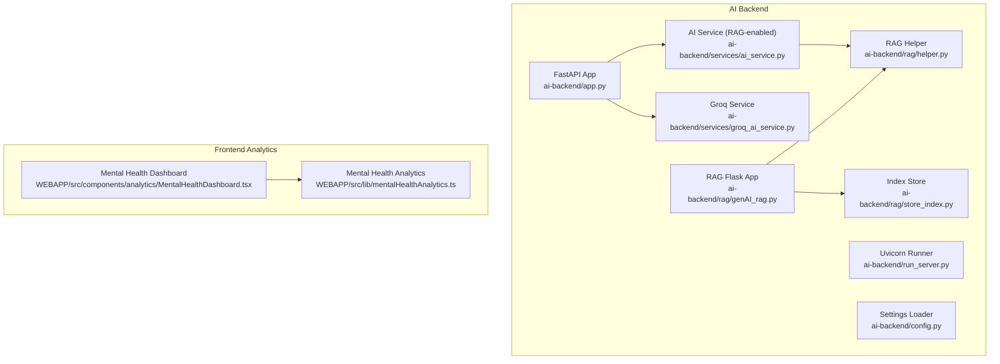
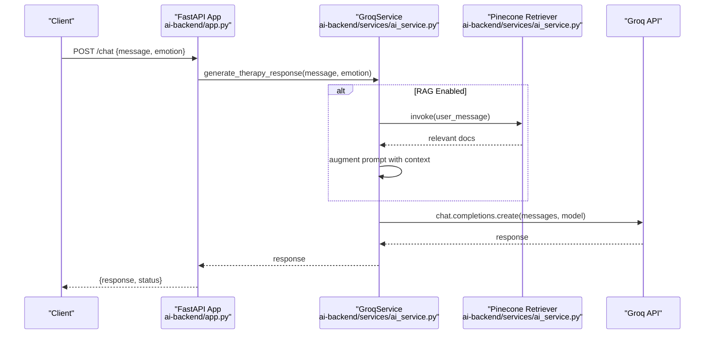
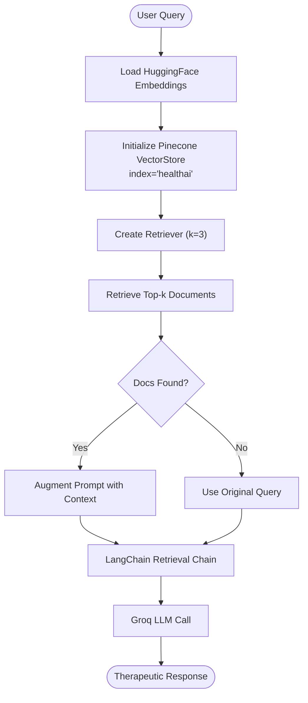
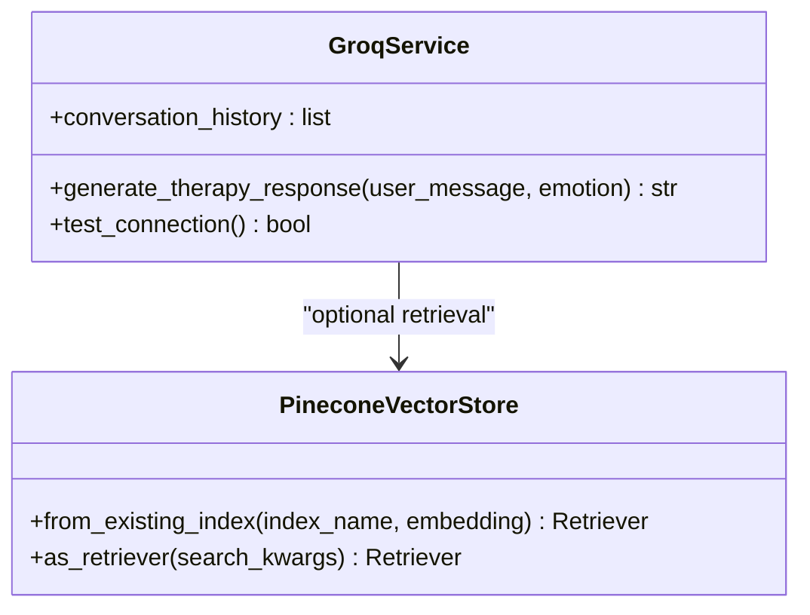
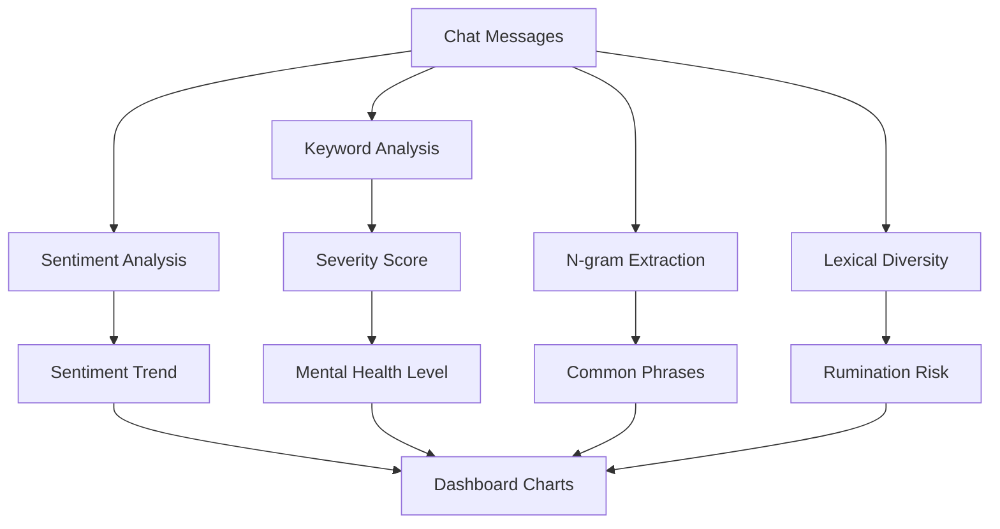
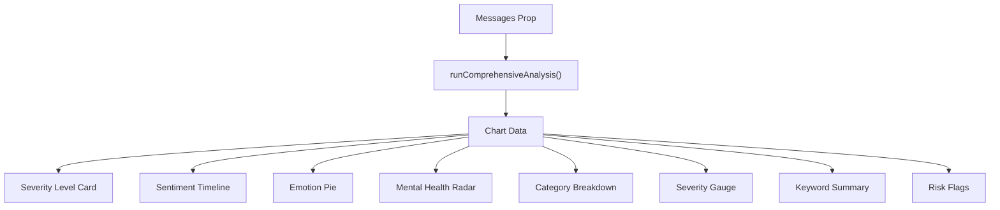
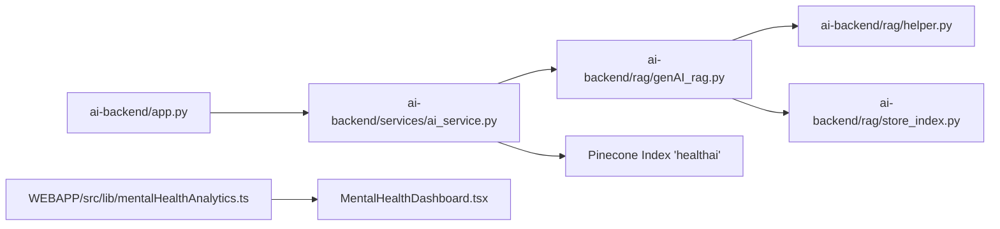

# AI & Machine Learning Features

<cite>
**Referenced Files in This Document**
- [README.md](file://README.md)
- [ai-backend/app.py](file://ai-backend/app.py)
- [ai-backend/run_server.py](file://ai-backend/run_server.py)
- [ai-backend/config.py](file://ai-backend/config.py)
- [ai-backend/services/groq_ai_service.py](file://ai-backend/services/groq_ai_service.py)
- [ai-backend/services/ai_service.py](file://ai-backend/services/ai_service.py)
- [ai-backend/rag/genAI_rag.py](file://ai-backend/rag/genAI_rag.py)
- [ai-backend/rag/helper.py](file://ai-backend/rag/helper.py)
- [ai-backend/rag/store_index.py](file://ai-backend/rag/store_index.py)
- [WEBAPP/src/lib/mentalHealthAnalytics.ts](file://WEBAPP/src/lib/mentalHealthAnalytics.ts)
- [WEBAPP/src/components/analytics/MentalHealthDashboard.tsx](file://WEBAPP/src/components/analytics/MentalHealthDashboard.tsx)
</cite>

## Table of Contents
1. [Introduction](#introduction)
2. [Project Structure](#project-structure)
3. [Core Components](#core-components)
4. [Architecture Overview](#architecture-overview)
5. [Detailed Component Analysis](#detailed-component-analysis)
6. [Dependency Analysis](#dependency-analysis)
7. [Performance Considerations](#performance-considerations)
8. [Troubleshooting Guide](#troubleshooting-guide)
9. [Conclusion](#conclusion)
10. [Appendices](#appendices)

## Introduction
This document explains the AI and machine learning capabilities implemented in the project, focusing on:
- Retrieval-Augmented Generation (RAG) using LangChain and vector databases to enhance therapeutic responses
- Emotion detection, sentiment analysis, and mental health assessment tools
- Integration with Groq AI models for response generation
- Text preprocessing pipelines and response generation logic
- Analytics dashboard components for patient progress tracking and therapeutic insights
- Model training processes, evaluation metrics, and performance monitoring
- Ethical considerations and bias mitigation strategies for AI in healthcare

## Project Structure
The system comprises:
- An AI backend built with FastAPI that exposes endpoints for chat, text-to-speech, and avatar generation
- A Groq integration for therapeutic response generation with optional RAG augmentation
- A LangChain and Pinecone-based RAG pipeline for contextual knowledge retrieval
- A frontend analytics engine that performs keyword-based mental health analysis, sentiment scoring, and visualization

**Diagram sources**
- [ai-backend/app.py](file://ai-backend/app.py#L1-L154)
- [ai-backend/run_server.py](file://ai-backend/run_server.py#L1-L21)
- [ai-backend/config.py](file://ai-backend/config.py#L1-L49)
- [ai-backend/services/groq_ai_service.py](file://ai-backend/services/groq_ai_service.py#L1-L123)
- [ai-backend/services/ai_service.py](file://ai-backend/services/ai_service.py#L1-L293)
- [ai-backend/rag/genAI_rag.py](file://ai-backend/rag/genAI_rag.py#L1-L76)
- [ai-backend/rag/helper.py](file://ai-backend/rag/helper.py#L1-L29)
- [ai-backend/rag/store_index.py](file://ai-backend/rag/store_index.py#L1-L40)
- [WEBAPP/src/lib/mentalHealthAnalytics.ts](file://WEBAPP/src/lib/mentalHealthAnalytics.ts#L1-L884)
- [WEBAPP/src/components/analytics/MentalHealthDashboard.tsx](file://WEBAPP/src/components/analytics/MentalHealthDashboard.tsx#L1-L541)

**Section sources**
- [README.md](file://README.md#L1-L3)
- [ai-backend/app.py](file://ai-backend/app.py#L1-L154)
- [ai-backend/run_server.py](file://ai-backend/run_server.py#L1-L21)
- [ai-backend/config.py](file://ai-backend/config.py#L1-L49)
- [ai-backend/services/groq_ai_service.py](file://ai-backend/services/groq_ai_service.py#L1-L123)
- [ai-backend/services/ai_service.py](file://ai-backend/services/ai_service.py#L1-L293)
- [ai-backend/rag/genAI_rag.py](file://ai-backend/rag/genAI_rag.py#L1-L76)
- [ai-backend/rag/helper.py](file://ai-backend/rag/helper.py#L1-L29)
- [ai-backend/rag/store_index.py](file://ai-backend/rag/store_index.py#L1-L40)
- [WEBAPP/src/lib/mentalHealthAnalytics.ts](file://WEBAPP/src/lib/mentalHealthAnalytics.ts#L1-L884)
- [WEBAPP/src/components/analytics/MentalHealthDashboard.tsx](file://WEBAPP/src/components/analytics/MentalHealthDashboard.tsx#L1-L541)

## Core Components
- AI Backend API
  - Provides endpoints for chat, text-to-speech, and avatar generation
  - Uses lazy initialization for services to avoid import-time issues
  - Exposes health checks and static audio/video serving
- Groq Integration
  - Implements a GroqService that maintains conversation history and optionally augments prompts with retrieved context from a vector store
  - Includes a standalone Groq service module for legacy compatibility
- RAG Pipeline
  - LangChain-based retrieval chain with a Groq LLM
  - Vector store backed by Pinecone using sentence-transformers embeddings
  - Index creation and ingestion utilities
- Frontend Analytics Engine
  - Keyword-based categorization, sentiment analysis, lexical diversity, and n-gram extraction
  - Assessment scoring aligned with PHQ-9/GAD-7 constructs
  - Dashboard component rendering charts and severity gauges

**Section sources**
- [ai-backend/app.py](file://ai-backend/app.py#L1-L154)
- [ai-backend/services/ai_service.py](file://ai-backend/services/ai_service.py#L72-L192)
- [ai-backend/services/groq_ai_service.py](file://ai-backend/services/groq_ai_service.py#L70-L112)
- [ai-backend/rag/genAI_rag.py](file://ai-backend/rag/genAI_rag.py#L40-L71)
- [ai-backend/rag/helper.py](file://ai-backend/rag/helper.py#L18-L29)
- [ai-backend/rag/store_index.py](file://ai-backend/rag/store_index.py#L20-L40)
- [WEBAPP/src/lib/mentalHealthAnalytics.ts](file://WEBAPP/src/lib/mentalHealthAnalytics.ts#L12-L92)
- [WEBAPP/src/lib/mentalHealthAnalytics.ts](file://WEBAPP/src/lib/mentalHealthAnalytics.ts#L535-L594)
- [WEBAPP/src/lib/mentalHealthAnalytics.ts](file://WEBAPP/src/lib/mentalHealthAnalytics.ts#L308-L350)
- [WEBAPP/src/components/analytics/MentalHealthDashboard.tsx](file://WEBAPP/src/components/analytics/MentalHealthDashboard.tsx#L47-L541)

## Architecture Overview
The system integrates three primary flows:
- Chat with RAG augmentation: user message enters the FastAPI chat endpoint, which delegates to GroqService. If RAG is enabled, the service retrieves relevant context from Pinecone and augments the prompt before calling the Groq model.
- Text-to-Speech and Avatar: separate endpoints generate synthesized speech and talking avatar videos.
- Analytics: frontend components analyze chat transcripts and present severity levels, sentiment trends, emotion distributions, and keyword categories.

**Diagram sources**
- [ai-backend/app.py](file://ai-backend/app.py#L81-L95)
- [ai-backend/services/ai_service.py](file://ai-backend/services/ai_service.py#L131-L192)
- [ai-backend/services/ai_service.py](file://ai-backend/services/ai_service.py#L146-L170)

## Detailed Component Analysis

### RAG System with LangChain and Pinecone
The RAG system retrieves relevant mental health knowledge to augment the user’s query before generating a response. It uses:
- Sentence-transformers embeddings (dimension 384)
- Pinecone index “healthai” with cosine similarity
- LangChain retrieval chain with a Groq LLM

**Diagram sources**
- [ai-backend/rag/helper.py](file://ai-backend/rag/helper.py#L26-L29)
- [ai-backend/rag/store_index.py](file://ai-backend/rag/store_index.py#L20-L40)
- [ai-backend/rag/genAI_rag.py](file://ai-backend/rag/genAI_rag.py#L30-L56)
- [ai-backend/services/ai_service.py](file://ai-backend/services/ai_service.py#L100-L107)

**Section sources**
- [ai-backend/rag/helper.py](file://ai-backend/rag/helper.py#L1-L29)
- [ai-backend/rag/store_index.py](file://ai-backend/rag/store_index.py#L1-L40)
- [ai-backend/rag/genAI_rag.py](file://ai-backend/rag/genAI_rag.py#L1-L76)
- [ai-backend/services/ai_service.py](file://ai-backend/services/ai_service.py#L82-L119)

### Groq Integration and Response Generation
The GroqService manages:
- System prompt tailored for a supportive, non-clinical mental health assistant
- Conversation history to maintain context across turns
- Optional RAG augmentation via Pinecone retriever
- Async-friendly execution with event loop bridging for synchronous Groq calls

**Diagram sources**
- [ai-backend/services/ai_service.py](file://ai-backend/services/ai_service.py#L72-L192)
- [ai-backend/services/ai_service.py](file://ai-backend/services/ai_service.py#L100-L107)

**Section sources**
- [ai-backend/services/ai_service.py](file://ai-backend/services/ai_service.py#L72-L192)
- [ai-backend/services/groq_ai_service.py](file://ai-backend/services/groq_ai_service.py#L70-L112)

### Emotion Detection, Sentiment Analysis, and Mental Health Assessment
The frontend analytics engine provides:
- Keyword categorization (stress, anxiety, depression, anger, self-harm risk, loneliness, positive)
- Severity scoring and level assignment
- Sentiment analysis with negation and intensifier handling
- Lexical diversity and n-gram analysis
- Assessment scoring aligned with PHQ-9/GAD-7 constructs

**Diagram sources**
- [WEBAPP/src/lib/mentalHealthAnalytics.ts](file://WEBAPP/src/lib/mentalHealthAnalytics.ts#L199-L289)
- [WEBAPP/src/lib/mentalHealthAnalytics.ts](file://WEBAPP/src/lib/mentalHealthAnalytics.ts#L535-L594)
- [WEBAPP/src/lib/mentalHealthAnalytics.ts](file://WEBAPP/src/lib/mentalHealthAnalytics.ts#L695-L723)
- [WEBAPP/src/lib/mentalHealthAnalytics.ts](file://WEBAPP/src/lib/mentalHealthAnalytics.ts#L640-L681)
- [WEBAPP/src/lib/mentalHealthAnalytics.ts](file://WEBAPP/src/lib/mentalHealthAnalytics.ts#L308-L350)

**Section sources**
- [WEBAPP/src/lib/mentalHealthAnalytics.ts](file://WEBAPP/src/lib/mentalHealthAnalytics.ts#L12-L92)
- [WEBAPP/src/lib/mentalHealthAnalytics.ts](file://WEBAPP/src/lib/mentalHealthAnalytics.ts#L199-L289)
- [WEBAPP/src/lib/mentalHealthAnalytics.ts](file://WEBAPP/src/lib/mentalHealthAnalytics.ts#L535-L594)
- [WEBAPP/src/lib/mentalHealthAnalytics.ts](file://WEBAPP/src/lib/mentalHealthAnalytics.ts#L695-L723)
- [WEBAPP/src/lib/mentalHealthAnalytics.ts](file://WEBAPP/src/lib/mentalHealthAnalytics.ts#L640-L681)
- [WEBAPP/src/lib/mentalHealthAnalytics.ts](file://WEBAPP/src/lib/mentalHealthAnalytics.ts#L308-L350)
- [WEBAPP/src/components/analytics/MentalHealthDashboard.tsx](file://WEBAPP/src/components/analytics/MentalHealthDashboard.tsx#L47-L541)

### Analytics Dashboard Components
The MentalHealthDashboard renders:
- Severity level cards, overall sentiment, dominant emotion, and lexical diversity
- Sentiment timeline with area and moving average
- Emotion distribution pie chart
- Mental health radar and category breakdown bar chart
- Severity gauge and keyword summary grid
- Risk flags highlighting critical mentions

**Diagram sources**
- [WEBAPP/src/components/analytics/MentalHealthDashboard.tsx](file://WEBAPP/src/components/analytics/MentalHealthDashboard.tsx#L47-L541)
- [WEBAPP/src/lib/mentalHealthAnalytics.ts](file://WEBAPP/src/lib/mentalHealthAnalytics.ts#L199-L289)

**Section sources**
- [WEBAPP/src/components/analytics/MentalHealthDashboard.tsx](file://WEBAPP/src/components/analytics/MentalHealthDashboard.tsx#L47-L541)

## Dependency Analysis
- Backend API depends on:
  - GroqService for response generation
  - Optional RAG components (Pinecone, LangChain) for contextual augmentation
- RAG pipeline depends on:
  - HuggingFace embeddings
  - Pinecone index “healthai”
  - LangChain retrieval chain and Groq LLM
- Frontend analytics depends on:
  - Keyword dictionaries and lexicons
  - Sentiment and lexical diversity utilities
  - Dashboard rendering with Recharts

**Diagram sources**
- [ai-backend/app.py](file://ai-backend/app.py#L81-L95)
- [ai-backend/services/ai_service.py](file://ai-backend/services/ai_service.py#L82-L119)
- [ai-backend/rag/genAI_rag.py](file://ai-backend/rag/genAI_rag.py#L30-L56)
- [ai-backend/rag/helper.py](file://ai-backend/rag/helper.py#L26-L29)
- [ai-backend/rag/store_index.py](file://ai-backend/rag/store_index.py#L20-L40)
- [WEBAPP/src/lib/mentalHealthAnalytics.ts](file://WEBAPP/src/lib/mentalHealthAnalytics.ts#L199-L289)
- [WEBAPP/src/components/analytics/MentalHealthDashboard.tsx](file://WEBAPP/src/components/analytics/MentalHealthDashboard.tsx#L47-L541)

**Section sources**
- [ai-backend/app.py](file://ai-backend/app.py#L1-L154)
- [ai-backend/services/ai_service.py](file://ai-backend/services/ai_service.py#L1-L293)
- [ai-backend/rag/genAI_rag.py](file://ai-backend/rag/genAI_rag.py#L1-L76)
- [ai-backend/rag/helper.py](file://ai-backend/rag/helper.py#L1-L29)
- [ai-backend/rag/store_index.py](file://ai-backend/rag/store_index.py#L1-L40)
- [WEBAPP/src/lib/mentalHealthAnalytics.ts](file://WEBAPP/src/lib/mentalHealthAnalytics.ts#L1-L884)
- [WEBAPP/src/components/analytics/MentalHealthDashboard.tsx](file://WEBAPP/src/components/analytics/MentalHealthDashboard.tsx#L1-L541)

## Performance Considerations
- RAG retrieval adds latency proportional to vector search and LLM call; consider:
  - Increasing k for richer context cautiously
  - Caching frequent queries and conversation histories
  - Offloading embedding and retrieval to dedicated threads/processes
- GroqService uses synchronous LLM calls via event loop bridging; ensure:
  - Proper concurrency limits and timeouts
  - Streaming responses where feasible
- Frontend analytics:
  - Debounce analysis on rapid message bursts
  - Precompute rolling averages and reduce chart updates frequency
- Vector DB:
  - Monitor Pinecone index performance and adjust replicas
  - Batch upserts during ingestion to minimize latency

[No sources needed since this section provides general guidance]

## Troubleshooting Guide
- Environment variables
  - Ensure GROQ_API_KEY is set for GroqService
  - If using RAG, set PINECONE_API_KEY and confirm index “healthai” exists
- RAG initialization failures
  - Verify embeddings and index creation steps
  - Confirm LangChain and Pinecone dependencies are installed
- API connectivity
  - Use the /health endpoint to validate backend status
  - Check CORS settings if cross-origin requests fail
- Conversation history
  - If RAG fails, the service continues with conversation history only
- Frontend analysis
  - Empty charts indicate insufficient messages or no keywords detected
  - Risk flags appear when self-harm or comorbid indicators are present

**Section sources**
- [ai-backend/services/ai_service.py](file://ai-backend/services/ai_service.py#L112-L118)
- [ai-backend/services/groq_ai_service.py](file://ai-backend/services/groq_ai_service.py#L10-L11)
- [ai-backend/rag/store_index.py](file://ai-backend/rag/store_index.py#L20-L40)
- [ai-backend/app.py](file://ai-backend/app.py#L77-L79)

## Conclusion
The system combines a robust Groq-backed therapeutic assistant with a LangChain-Pinecone RAG pipeline and a comprehensive frontend analytics suite. Together, they enable contextual, data-driven insights into user mental health, supporting both immediate therapeutic responses and long-term progress tracking.

[No sources needed since this section summarizes without analyzing specific files]

## Appendices

### API Endpoints
- GET /
  - Description: Root endpoint
  - Response: Status message
- GET /health
  - Description: Health check for the backend
  - Response: Health status
- POST /chat
  - Description: Generate therapeutic response using Groq
  - Body: message (string), emotion (string)
  - Response: response (string), status (string)
- POST /tts
  - Description: Convert text to speech
  - Body: text (string), voice (string)
  - Response: audio_url (string), status (string)
- POST /avatar
  - Description: Generate talking avatar video
  - Body: text (string), avatar_id (string)
  - Response: video_url (string), status (string)

**Section sources**
- [ai-backend/app.py](file://ai-backend/app.py#L73-L123)

### Configuration Options
- Application
  - app_name: string
  - debug: boolean
  - port: integer
  - host: string
- OpenAI
  - openai_api_key: string
  - openai_model: string
  - max_tokens: integer
- ElevenLabs
  - elevenlabs_api_key: string
  - elevenlabs_voice_id: string
- D-ID
  - did_api_key: string
  - did_presenter_id: string
- Database
  - mongodb_url: string
  - database_name: string
- Redis
  - redis_url: string
- Security
  - secret_key: string
  - algorithm: string
  - access_token_expire_minutes: integer
- CORS
  - allowed_origins: list

**Section sources**
- [ai-backend/config.py](file://ai-backend/config.py#L5-L48)

### Startup and Deployment Notes
- Multiprocessing and Windows compatibility are handled in the app and runner scripts
- Uvicorn runs the FastAPI app with configured host/port

**Section sources**
- [ai-backend/app.py](file://ai-backend/app.py#L11-L15)
- [ai-backend/run_server.py](file://ai-backend/run_server.py#L10-L21)