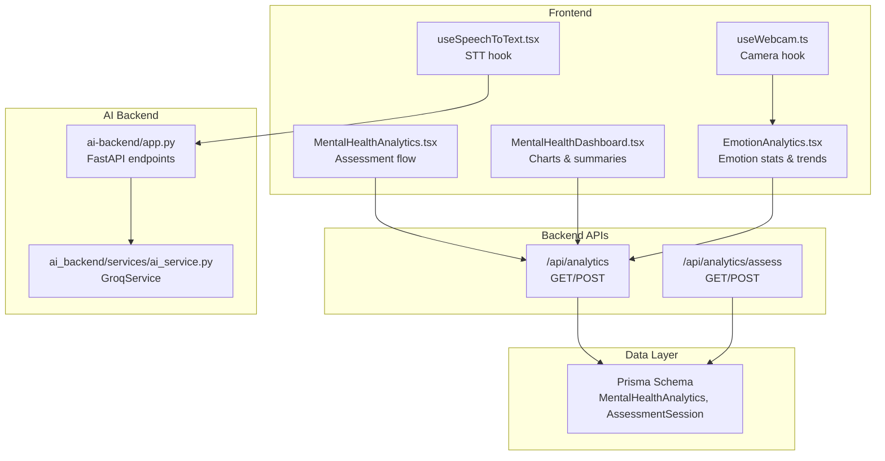
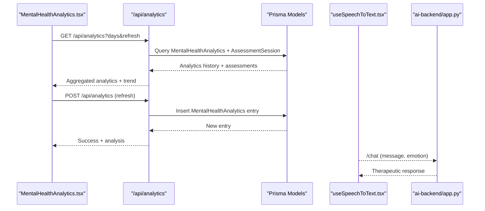
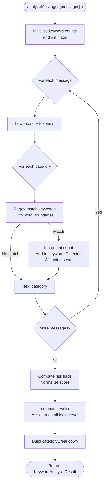
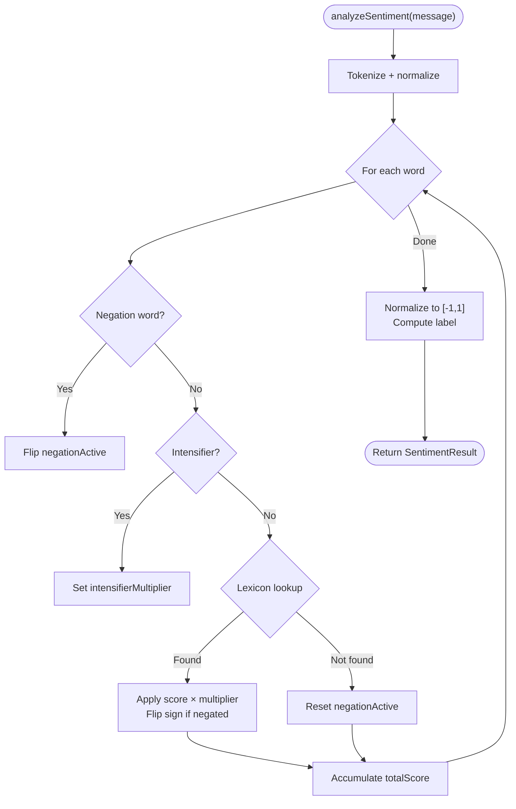
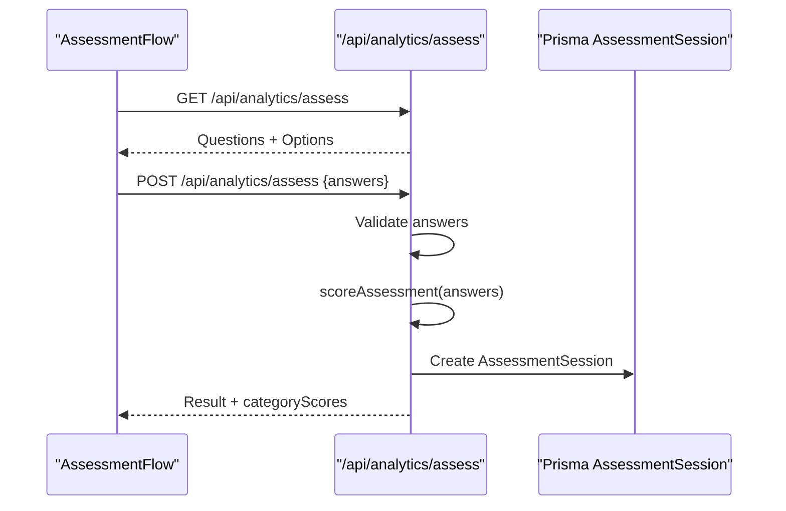
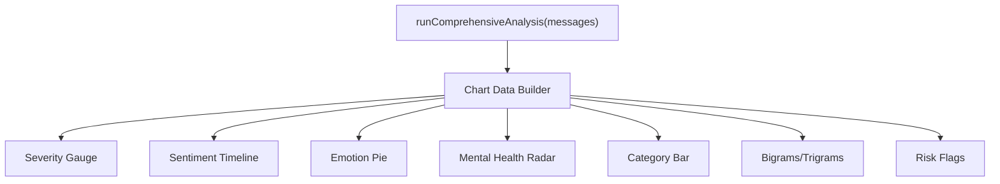
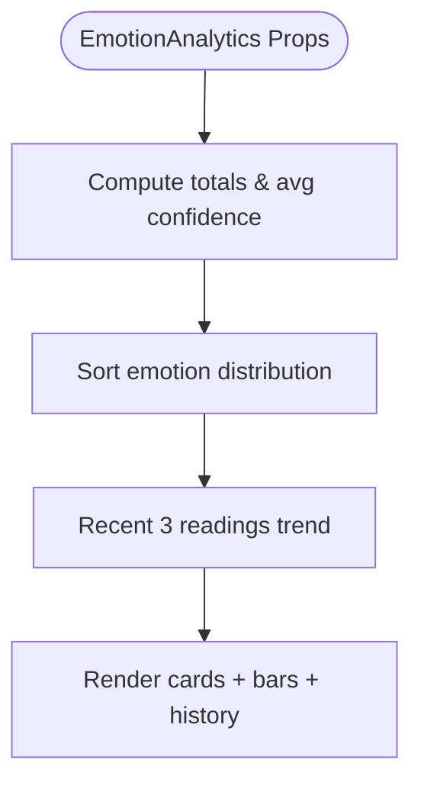
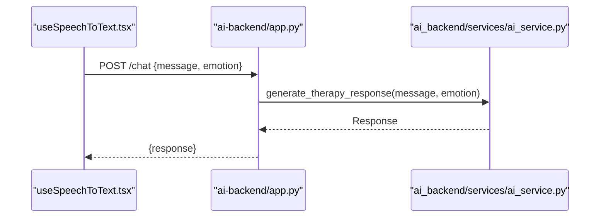
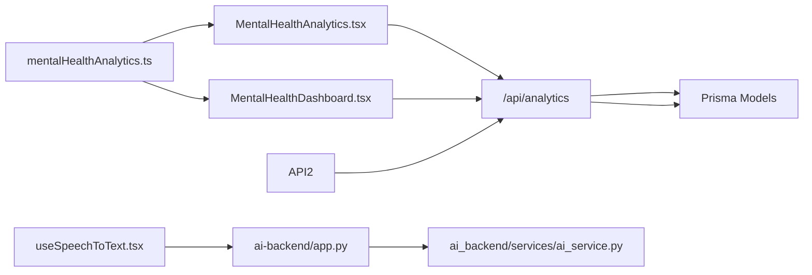

# Emotion Detection & Analytics

<cite>
**Referenced Files in This Document**
- [mentalHealthAnalytics.ts](file://WEBAPP/src/lib/mentalHealthAnalytics.ts)
- [MentalHealthDashboard.tsx](file://WEBAPP/src/components/analytics/MentalHealthDashboard.tsx)
- [MentalHealthAnalytics.tsx](file://WEBAPP/src/components/MentalHealthAnalytics.tsx)
- [EmotionAnalytics.tsx](file://WEBAPP/src/components/EmotionAnalytics.tsx)
- [route.ts](file://WEBAPP/src/app/api/analytics/route.ts)
- [route.ts](file://WEBAPP/src/app/api/analytics/assess/route.ts)
- [schema.prisma](file://WEBAPP/prisma/schema.prisma)
- [ai_service.py](file://ai-backend/services/ai_service.py)
- [app.py](file://ai-backend/app.py)
- [useWebcam.ts](file://WEBAPP/src/hooks/useWebcam.ts)
- [useSpeechToText.tsx](file://WEBAPP/src/hooks/useSpeechToText.tsx)
</cite>

## Table of Contents
1. [Introduction](#introduction)
2. [Project Structure](#project-structure)
3. [Core Components](#core-components)
4. [Architecture Overview](#architecture-overview)
5. [Detailed Component Analysis](#detailed-component-analysis)
6. [Dependency Analysis](#dependency-analysis)
7. [Performance Considerations](#performance-considerations)
8. [Troubleshooting Guide](#troubleshooting-guide)
9. [Conclusion](#conclusion)
10. [Appendices](#appendices)

## Introduction
This document explains the emotion detection and mental health analytics capabilities of the MindBridge platform. It covers the sentiment analysis algorithms used for processing therapeutic conversations and user inputs, the emotion classification models and confidence scoring mechanisms, and the trend analysis features. It also details the visualization components that show emotion patterns over time, therapeutic session insights, and progress tracking dashboards. Implementation examples demonstrate real-time emotion detection, historical data analysis, and personalized therapeutic recommendations. Finally, it addresses data privacy considerations and ethical implications of emotion analysis in healthcare contexts.

## Project Structure
The emotion and analytics system spans three primary areas:
- Frontend analytics engine and UI: sentiment and keyword analysis, visualization dashboards, and assessment flows
- Backend APIs: analytics aggregation, assessment scoring, and storage via Prisma ORM
- AI backend: therapeutic conversation generation and optional emotion-aware augmentation

**Diagram sources**
- [MentalHealthAnalytics.tsx](file://WEBAPP/src/components/MentalHealthAnalytics.tsx#L135-L679)
- [MentalHealthDashboard.tsx](file://WEBAPP/src/components/analytics/MentalHealthDashboard.tsx#L47-L541)
- [EmotionAnalytics.tsx](file://WEBAPP/src/components/EmotionAnalytics.tsx#L18-L212)
- [route.ts](file://WEBAPP/src/app/api/analytics/route.ts#L13-L253)
- [route.ts](file://WEBAPP/src/app/api/analytics/assess/route.ts#L9-L121)
- [schema.prisma](file://WEBAPP/prisma/schema.prisma#L229-L266)
- [app.py](file://ai-backend/app.py#L81-L123)
- [ai_service.py](file://ai-backend/services/ai_service.py#L131-L192)
- [useWebcam.ts](file://WEBAPP/src/hooks/useWebcam.ts#L9-L89)
- [useSpeechToText.tsx](file://WEBAPP/src/hooks/useSpeechToText.tsx#L56-L129)

**Section sources**
- [MentalHealthAnalytics.tsx](file://WEBAPP/src/components/MentalHealthAnalytics.tsx#L135-L679)
- [MentalHealthDashboard.tsx](file://WEBAPP/src/components/analytics/MentalHealthDashboard.tsx#L47-L541)
- [EmotionAnalytics.tsx](file://WEBAPP/src/components/EmotionAnalytics.tsx#L18-L212)
- [route.ts](file://WEBAPP/src/app/api/analytics/route.ts#L13-L253)
- [route.ts](file://WEBAPP/src/app/api/analytics/assess/route.ts#L9-L121)
- [schema.prisma](file://WEBAPP/prisma/schema.prisma#L229-L266)
- [app.py](file://ai-backend/app.py#L81-L123)
- [ai_service.py](file://ai-backend/services/ai_service.py#L131-L192)
- [useWebcam.ts](file://WEBAPP/src/hooks/useWebcam.ts#L9-L89)
- [useSpeechToText.tsx](file://WEBAPP/src/hooks/useSpeechToText.tsx#L56-L129)

## Core Components
- Mental health analytics engine: keyword-based categorization, sentiment scoring, lexical diversity, n-gram extraction, temporal decay weighting, and Plutchik’s emotion wheel classification
- Assessment pipeline: PHQ-9/GAD-7 inspired questions, scoring, and level assignment
- Visualization dashboards: severity gauges, radar charts, pie charts, timelines, and keyword breakdowns
- Real-time emotion analytics: emotion distribution, confidence metrics, and recent trends
- Backend APIs: analytics retrieval and refresh, assessment creation, and storage
- AI backend: therapeutic responses with optional RAG augmentation

**Section sources**
- [mentalHealthAnalytics.ts](file://WEBAPP/src/lib/mentalHealthAnalytics.ts#L12-L92)
- [mentalHealthAnalytics.ts](file://WEBAPP/src/lib/mentalHealthAnalytics.ts#L199-L289)
- [mentalHealthAnalytics.ts](file://WEBAPP/src/lib/mentalHealthAnalytics.ts#L535-L631)
- [mentalHealthAnalytics.ts](file://WEBAPP/src/lib/mentalHealthAnalytics.ts#L798-L800)
- [MentalHealthDashboard.tsx](file://WEBAPP/src/components/analytics/MentalHealthDashboard.tsx#L47-L541)
- [MentalHealthAnalytics.tsx](file://WEBAPP/src/components/MentalHealthAnalytics.tsx#L135-L679)
- [EmotionAnalytics.tsx](file://WEBAPP/src/components/EmotionAnalytics.tsx#L18-L212)
- [route.ts](file://WEBAPP/src/app/api/analytics/route.ts#L13-L253)
- [route.ts](file://WEBAPP/src/app/api/analytics/assess/route.ts#L9-L121)
- [ai_service.py](file://ai-backend/services/ai_service.py#L131-L192)

## Architecture Overview
The system integrates frontend analytics with backend APIs and persistent storage. Users trigger analyses, receive results, and optionally take assessments. AI backend supports therapeutic conversations and optional emotion-aware augmentation.

**Diagram sources**
- [MentalHealthAnalytics.tsx](file://WEBAPP/src/components/MentalHealthAnalytics.tsx#L142-L160)
- [route.ts](file://WEBAPP/src/app/api/analytics/route.ts#L13-L161)
- [schema.prisma](file://WEBAPP/prisma/schema.prisma#L229-L266)
- [app.py](file://ai-backend/app.py#L81-L94)
- [useSpeechToText.tsx](file://WEBAPP/src/hooks/useSpeechToText.tsx#L56-L129)

## Detailed Component Analysis

### Sentiment and Keyword Analysis Engine
The frontend analytics library provides:
- Keyword categorization with weights and risk flags
- Normalized severity scoring and level assignment
- Sentiment analysis with negation and intensifier handling
- Lexical diversity and n-gram extraction
- Temporal decay weighting for recent messages
- Plutchik’s emotion wheel classification

**Diagram sources**
- [mentalHealthAnalytics.ts](file://WEBAPP/src/lib/mentalHealthAnalytics.ts#L199-L289)
- [mentalHealthAnalytics.ts](file://WEBAPP/src/lib/mentalHealthAnalytics.ts#L294-L303)

**Section sources**
- [mentalHealthAnalytics.ts](file://WEBAPP/src/lib/mentalHealthAnalytics.ts#L12-L92)
- [mentalHealthAnalytics.ts](file://WEBAPP/src/lib/mentalHealthAnalytics.ts#L199-L289)
- [mentalHealthAnalytics.ts](file://WEBAPP/src/lib/mentalHealthAnalytics.ts#L294-L303)

### Sentiment Analysis (VADER-like)
The sentiment analyzer:
- Uses a lexicon with scores ranging from -5 to +5
- Handles negation and intensifiers
- Produces raw score, comparative score, and labeled sentiment
- Supports trend analysis with moving averages and volatility

**Diagram sources**
- [mentalHealthAnalytics.ts](file://WEBAPP/src/lib/mentalHealthAnalytics.ts#L535-L594)

**Section sources**
- [mentalHealthAnalytics.ts](file://WEBAPP/src/lib/mentalHealthAnalytics.ts#L435-L498)
- [mentalHealthAnalytics.ts](file://WEBAPP/src/lib/mentalHealthAnalytics.ts#L535-L594)
- [mentalHealthAnalytics.ts](file://WEBAPP/src/lib/mentalHealthAnalytics.ts#L599-L631)

### Assessment Pipeline (PHQ-9/GAD-7 Inspired)
The assessment flow:
- Loads questions and answer options
- Validates submitted answers
- Scores total and category-wise
- Computes mental health level and stores results

**Diagram sources**
- [MentalHealthAnalytics.tsx](file://WEBAPP/src/components/MentalHealthAnalytics.tsx#L690-L800)
- [route.ts](file://WEBAPP/src/app/api/analytics/assess/route.ts#L9-L121)

**Section sources**
- [MentalHealthAnalytics.tsx](file://WEBAPP/src/components/MentalHealthAnalytics.tsx#L690-L800)
- [route.ts](file://WEBAPP/src/app/api/analytics/assess/route.ts#L9-L121)
- [mentalHealthAnalytics.ts](file://WEBAPP/src/lib/mentalHealthAnalytics.ts#L308-L350)

### Visualization Dashboards
The dashboard components render:
- Severity gauge and trend cards
- Sentiment timeline with moving average
- Emotion distribution pie chart
- Keyword category radar and bar charts
- N-gram phrase frequency
- Risk flags and summary statistics

**Diagram sources**
- [MentalHealthDashboard.tsx](file://WEBAPP/src/components/analytics/MentalHealthDashboard.tsx#L47-L541)
- [MentalHealthAnalytics.tsx](file://WEBAPP/src/components/MentalHealthAnalytics.tsx#L135-L679)

**Section sources**
- [MentalHealthDashboard.tsx](file://WEBAPP/src/components/analytics/MentalHealthDashboard.tsx#L47-L541)
- [MentalHealthAnalytics.tsx](file://WEBAPP/src/components/MentalHealthAnalytics.tsx#L135-L679)

### Real-Time Emotion Analytics
The emotion analytics component tracks:
- Current emotion with confidence and timestamp
- Distribution across emotions and average confidence
- Recent trend stability
- History display with timestamps

**Diagram sources**
- [EmotionAnalytics.tsx](file://WEBAPP/src/components/EmotionAnalytics.tsx#L18-L212)

**Section sources**
- [EmotionAnalytics.tsx](file://WEBAPP/src/components/EmotionAnalytics.tsx#L18-L212)

### AI Backend Integration
The AI backend:
- Provides therapeutic responses via Groq
- Optionally augments responses with RAG context
- Exposes endpoints for chat, TTS, and avatar generation

**Diagram sources**
- [app.py](file://ai-backend/app.py#L81-L94)
- [ai_service.py](file://ai-backend/services/ai_service.py#L131-L192)
- [useSpeechToText.tsx](file://WEBAPP/src/hooks/useSpeechToText.tsx#L56-L129)

**Section sources**
- [app.py](file://ai-backend/app.py#L81-L94)
- [ai_service.py](file://ai-backend/services/ai_service.py#L131-L192)
- [useSpeechToText.tsx](file://WEBAPP/src/hooks/useSpeechToText.tsx#L56-L129)

## Dependency Analysis
- Frontend analytics depends on:
  - Keyword dictionaries and sentiment lexicon
  - Recharts for visualization
  - NextAuth session for user context
- Backend APIs depend on:
  - Prisma models for persistence
  - Session-based authentication
- AI backend depends on:
  - Groq client
  - Optional RAG retriever (Pinecone)

**Diagram sources**
- [mentalHealthAnalytics.ts](file://WEBAPP/src/lib/mentalHealthAnalytics.ts#L12-L92)
- [MentalHealthDashboard.tsx](file://WEBAPP/src/components/analytics/MentalHealthDashboard.tsx#L47-L541)
- [MentalHealthAnalytics.tsx](file://WEBAPP/src/components/MentalHealthAnalytics.tsx#L135-L679)
- [route.ts](file://WEBAPP/src/app/api/analytics/route.ts#L13-L253)
- [schema.prisma](file://WEBAPP/prisma/schema.prisma#L229-L266)
- [app.py](file://ai-backend/app.py#L81-L94)
- [ai_service.py](file://ai-backend/services/ai_service.py#L131-L192)
- [useSpeechToText.tsx](file://WEBAPP/src/hooks/useSpeechToText.tsx#L56-L129)

**Section sources**
- [mentalHealthAnalytics.ts](file://WEBAPP/src/lib/mentalHealthAnalytics.ts#L12-L92)
- [MentalHealthDashboard.tsx](file://WEBAPP/src/components/analytics/MentalHealthDashboard.tsx#L47-L541)
- [MentalHealthAnalytics.tsx](file://WEBAPP/src/components/MentalHealthAnalytics.tsx#L135-L679)
- [route.ts](file://WEBAPP/src/app/api/analytics/route.ts#L13-L253)
- [schema.prisma](file://WEBAPP/prisma/schema.prisma#L229-L266)
- [app.py](file://ai-backend/app.py#L81-L94)
- [ai_service.py](file://ai-backend/services/ai_service.py#L131-L192)
- [useSpeechToText.tsx](file://WEBAPP/src/hooks/useSpeechToText.tsx#L56-L129)

## Performance Considerations
- Keyword matching uses word-boundary regex; ensure keyword lists are curated to minimize false positives
- Sentiment analysis scales linearly with token count; consider batching or throttling for long transcripts
- N-gram extraction and lexical diversity are O(n words); cap message lengths for responsiveness
- Temporal decay duplicates messages proportionally; tune half-life minutes to balance recency vs. computational cost
- Dashboard rendering uses Recharts; defer heavy computations to background threads or memoization
- Backend queries filter by date windows; ensure appropriate indexing on timestamps

[No sources needed since this section provides general guidance]

## Troubleshooting Guide
Common issues and resolutions:
- Unauthorized access to analytics: verify NextAuth session and user existence
- Empty analytics: ensure recent user messages exist and refresh triggers analysis
- Assessment validation errors: confirm answer count and score ranges
- RAG initialization failures: check Pinecone API key and embeddings setup
- Webcam errors: handle MediaDevices permission prompts and device availability

**Section sources**
- [route.ts](file://WEBAPP/src/app/api/analytics/route.ts#L14-L25)
- [route.ts](file://WEBAPP/src/app/api/analytics/route.ts#L195-L252)
- [route.ts](file://WEBAPP/src/app/api/analytics/assess/route.ts#L42-L61)
- [ai_service.py](file://ai-backend/services/ai_service.py#L82-L118)
- [useWebcam.ts](file://WEBAPP/src/hooks/useWebcam.ts#L17-L41)

## Conclusion
MindBridge’s emotion detection and analytics system combines keyword-based mental health indicators, VADER-style sentiment analysis, and visualization dashboards to provide actionable insights from therapeutic conversations. The backend APIs and Prisma models persist analytics and assessments, enabling trend analysis and progress tracking. The AI backend enhances therapeutic responses with optional RAG augmentation. Together, these components support real-time monitoring, historical analysis, and personalized recommendations while maintaining a strong focus on user privacy and ethical use.

[No sources needed since this section summarizes without analyzing specific files]

## Appendices

### Implementation Examples

- Real-time emotion detection
  - Capture webcam frames and derive emotion distributions
  - Track average confidence and recent trends
  - Example path: [EmotionAnalytics.tsx](file://WEBAPP/src/components/EmotionAnalytics.tsx#L18-L212), [useWebcam.ts](file://WEBAPP/src/hooks/useWebcam.ts#L9-L89)

- Historical data analysis
  - Fetch analytics with optional refresh and days window
  - Build severity timeline and keyword radar
  - Example path: [route.ts](file://WEBAPP/src/app/api/analytics/route.ts#L13-L161), [MentalHealthDashboard.tsx](file://WEBAPP/src/components/analytics/MentalHealthDashboard.tsx#L47-L541)

- Personalized therapeutic recommendations
  - Use AI backend chat endpoint with emotion context
  - Example path: [app.py](file://ai-backend/app.py#L81-L94), [ai_service.py](file://ai-backend/services/ai_service.py#L131-L192)

- Assessment-driven insights
  - Load questions, validate answers, and compute levels
  - Example path: [route.ts](file://WEBAPP/src/app/api/analytics/assess/route.ts#L9-L121), [MentalHealthAnalytics.tsx](file://WEBAPP/src/components/MentalHealthAnalytics.tsx#L690-L800)

### Data Privacy and Ethics
- Access control: all analytics endpoints require a valid NextAuth session
- Data retention: analytics and assessments stored with user-scoped identifiers
- Consent: assessments are opt-in; analytics can be refreshed by the user
- Bias mitigation: keyword lists and lexicons should be regularly reviewed for inclusivity
- Transparency: risk flags and severity levels are surfaced clearly in UI
- Crisis response: dashboard highlights risk flags and suggests immediate professional help

**Section sources**
- [route.ts](file://WEBAPP/src/app/api/analytics/route.ts#L14-L25)
- [schema.prisma](file://WEBAPP/prisma/schema.prisma#L229-L266)
- [MentalHealthDashboard.tsx](file://WEBAPP/src/components/analytics/MentalHealthDashboard.tsx#L147-L167)