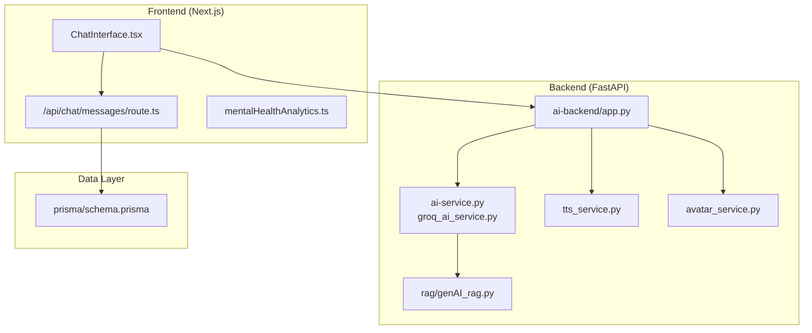
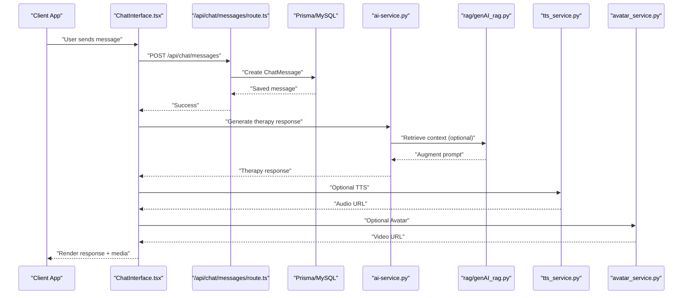
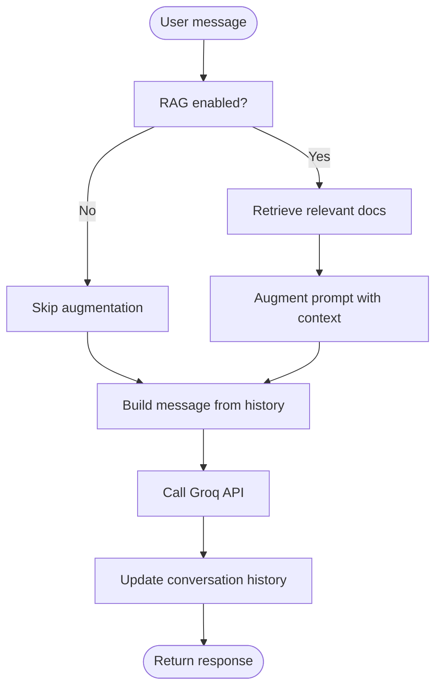
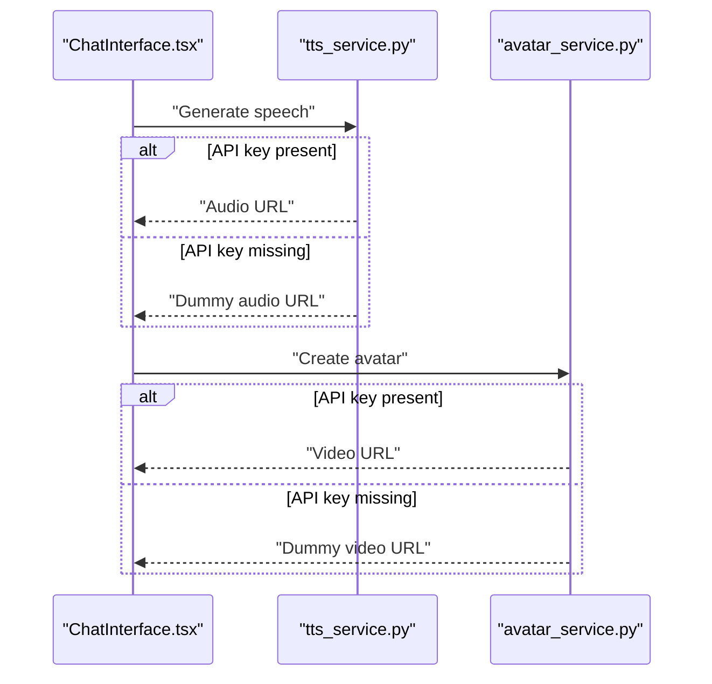
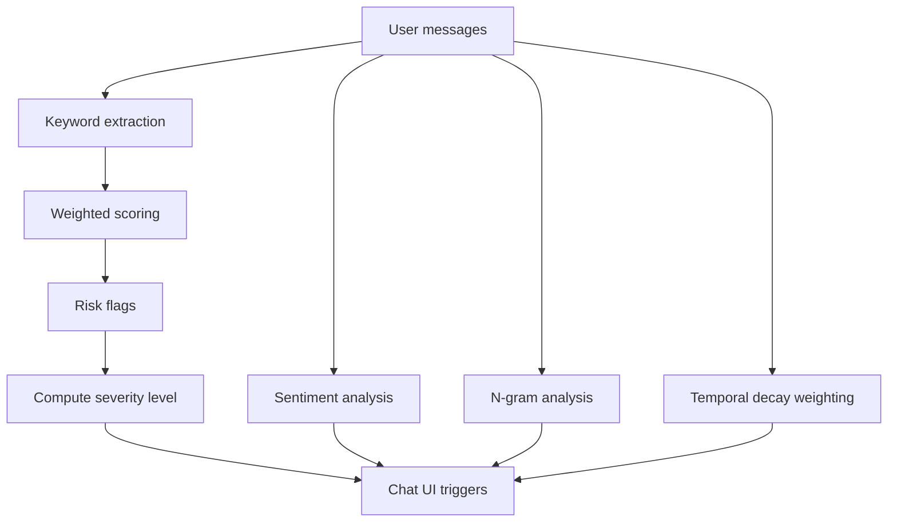
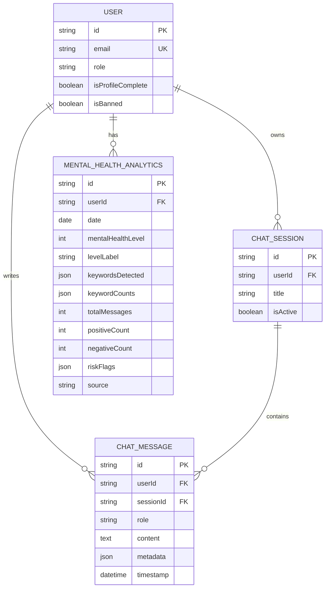
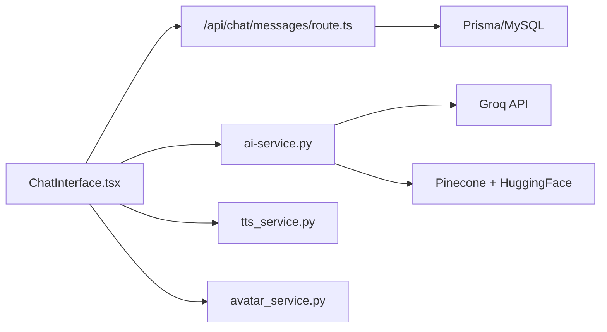

# Ethical AI & Bias Mitigation

<cite>
**Referenced Files in This Document**
- [README.md](file://README.md)
- [ai-backend/app.py](file://ai-backend/app.py)
- [ai-backend/services/ai_service.py](file://ai-backend/services/ai_service.py)
- [ai-backend/services/groq_ai_service.py](file://ai-backend/services/groq_ai_service.py)
- [ai-backend/services/tts_service.py](file://ai-backend/services/tts_service.py)
- [ai-backend/services/avatar_service.py](file://ai-backend/services/avatar_service.py)
- [ai-backend/rag/genAI_rag.py](file://ai-backend/rag/genAI_rag.py)
- [WEBAPP/src/lib/mentalHealthAnalytics.ts](file://WEBAPP/src/lib/mentalHealthAnalytics.ts)
- [WEBAPP/prisma/schema.prisma](file://WEBAPP/prisma/schema.prisma)
- [WEBAPP/src/components/ChatInterface.tsx](file://WEBAPP/src/components/ChatInterface.tsx)
- [WEBAPP/src/app/api/chat/messages/route.ts](file://WEBAPP/src/app/api/chat/messages/route.ts)
</cite>

## Table of Contents
1. [Introduction](#introduction)
2. [Project Structure](#project-structure)
3. [Core Components](#core-components)
4. [Architecture Overview](#architecture-overview)
5. [Detailed Component Analysis](#detailed-component-analysis)
6. [Dependency Analysis](#dependency-analysis)
7. [Performance Considerations](#performance-considerations)
8. [Privacy, Security, and Governance](#privacy-security-and-governance)
9. [Bias Mitigation and Fairness Strategies](#bias-mitigation-and-fairness-strategies)
10. [Inclusive Design and Accessibility](#inclusive-design-and-accessibility)
11. [Responsible Deployment and Transparency](#responsible-deployment-and-transparency)
12. [Troubleshooting Guide](#troubleshooting-guide)
13. [Conclusion](#conclusion)

## Introduction
This document provides comprehensive guidance for ethical AI and bias mitigation in AI-powered mental health care. It synthesizes the MindBridge codebase to explain fairness algorithms, bias detection mechanisms, inclusive design principles, privacy-preserving techniques, secure inference practices, governance frameworks, and responsible deployment strategies. The goal is to help teams build trustworthy, equitable, and transparent AI systems that support therapeutic outcomes while respecting user autonomy and safety.

## Project Structure
MindBridge comprises:
- An AI backend (FastAPI) orchestrating therapy responses, TTS, and avatar generation
- A frontend (Next.js) enabling chat, assessments, and analytics
- A database (Prisma/MySQL) storing user data, messages, analytics, and profiles
- Retrieval-Augmented Generation (RAG) for contextual knowledge augmentation
- Browser-side analytics for keyword-based mental health indicators and sentiment

**Diagram sources**
- [ai-backend/app.py](file://ai-backend/app.py#L1-L154)
- [ai-backend/services/ai_service.py](file://ai-backend/services/ai_service.py#L1-L293)
- [ai-backend/services/groq_ai_service.py](file://ai-backend/services/groq_ai_service.py#L1-L123)
- [ai-backend/rag/genAI_rag.py](file://ai-backend/rag/genAI_rag.py#L1-L76)
- [ai-backend/services/tts_service.py](file://ai-backend/services/tts_service.py#L1-L280)
- [ai-backend/services/avatar_service.py](file://ai-backend/services/avatar_service.py#L1-L237)
- [WEBAPP/src/lib/mentalHealthAnalytics.ts](file://WEBAPP/src/lib/mentalHealthAnalytics.ts#L1-L884)
- [WEBAPP/prisma/schema.prisma](file://WEBAPP/prisma/schema.prisma#L1-L330)
- [WEBAPP/src/components/ChatInterface.tsx](file://WEBAPP/src/components/ChatInterface.tsx#L1-L567)
- [WEBAPP/src/app/api/chat/messages/route.ts](file://WEBAPP/src/app/api/chat/messages/route.ts#L1-L91)

**Section sources**
- [README.md](file://README.md#L1-L3)
- [ai-backend/app.py](file://ai-backend/app.py#L1-L154)
- [WEBAPP/prisma/schema.prisma](file://WEBAPP/prisma/schema.prisma#L1-L330)

## Core Components
- AI therapy service: Generates empathetic, non-clinical responses with optional RAG augmentation
- Text-to-speech and avatar services: Provide multimodal therapeutic experiences with graceful fallbacks
- Frontend chat and assessment: Supports structured assessments, analytics-driven prompts, and safe messaging
- Analytics engine: Computes keyword-based severity, sentiment trends, and risk flags
- Data persistence: Securely stores user messages, analytics, and profiles with role-based access

Key ethical capabilities:
- Crisis-awareness triggers (e.g., self-harm keywords escalate severity)
- Assessment prompts triggered by vague or low-context messages
- Temporal decay weighting to emphasize recent concerns
- Graceful degradation when external APIs are unavailable

**Section sources**
- [ai-backend/services/ai_service.py](file://ai-backend/services/ai_service.py#L1-L293)
- [ai-backend/services/groq_ai_service.py](file://ai-backend/services/groq_ai_service.py#L1-L123)
- [ai-backend/services/tts_service.py](file://ai-backend/services/tts_service.py#L1-L280)
- [ai-backend/services/avatar_service.py](file://ai-backend/services/avatar_service.py#L1-L237)
- [WEBAPP/src/lib/mentalHealthAnalytics.ts](file://WEBAPP/src/lib/mentalHealthAnalytics.ts#L1-L884)
- [WEBAPP/src/components/ChatInterface.tsx](file://WEBAPP/src/components/ChatInterface.tsx#L1-L567)
- [WEBAPP/src/app/api/chat/messages/route.ts](file://WEBAPP/src/app/api/chat/messages/route.ts#L1-L91)

## Architecture Overview
The system integrates frontend UX with backend AI services and a secure data layer. AI responses leverage a curated system prompt and optional RAG to ground responses in mental health knowledge. Analytics run client-side to minimize data exposure, while sensitive data is stored behind authentication and authorization.

**Diagram sources**
- [WEBAPP/src/components/ChatInterface.tsx](file://WEBAPP/src/components/ChatInterface.tsx#L1-L567)
- [WEBAPP/src/app/api/chat/messages/route.ts](file://WEBAPP/src/app/api/chat/messages/route.ts#L1-L91)
- [WEBAPP/prisma/schema.prisma](file://WEBAPP/prisma/schema.prisma#L108-L138)
- [ai-backend/services/ai_service.py](file://ai-backend/services/ai_service.py#L120-L192)
- [ai-backend/rag/genAI_rag.py](file://ai-backend/rag/genAI_rag.py#L40-L56)
- [ai-backend/services/tts_service.py](file://ai-backend/services/tts_service.py#L53-L144)
- [ai-backend/services/avatar_service.py](file://ai-backend/services/avatar_service.py#L19-L67)

## Detailed Component Analysis

### AI Therapy Service and RAG
- System prompt enforces non-clinical, supportive, and validating communication aligned with mental health best practices
- Conversation history maintains context across turns
- RAG augmentation enriches responses with relevant knowledge when available; gracefully degrades when unavailable
- Emotion parameter is preserved for compatibility; current implementation focuses on textual context

**Diagram sources**
- [ai-backend/services/ai_service.py](file://ai-backend/services/ai_service.py#L131-L192)
- [ai-backend/rag/genAI_rag.py](file://ai-backend/rag/genAI_rag.py#L38-L56)

**Section sources**
- [ai-backend/services/ai_service.py](file://ai-backend/services/ai_service.py#L18-L71)
- [ai-backend/services/ai_service.py](file://ai-backend/services/ai_service.py#L72-L119)
- [ai-backend/rag/genAI_rag.py](file://ai-backend/rag/genAI_rag.py#L1-L76)

### Text-to-Speech and Avatar Services
- TTS service validates API credentials and falls back to locally generated audio when unavailable
- Avatar service returns a placeholder or copies a frontend asset when API keys are absent
- Both services include cleanup and logging to manage resources and diagnostics

**Diagram sources**
- [ai-backend/services/tts_service.py](file://ai-backend/services/tts_service.py#L53-L144)
- [ai-backend/services/avatar_service.py](file://ai-backend/services/avatar_service.py#L19-L67)

**Section sources**
- [ai-backend/services/tts_service.py](file://ai-backend/services/tts_service.py#L1-L280)
- [ai-backend/services/avatar_service.py](file://ai-backend/services/avatar_service.py#L1-L237)

### Analytics Engine and Assessment Integration
- Keyword-based categorization (stress, anxiety, depression, anger, self-harm risk, loneliness, positivity)
- Severity scoring normalized by message length and weighted by category importance
- Risk flags escalate severity (e.g., self-harm mentions)
- Assessment questions mirror PHQ-9/GAD-7 constructs; results mapped to severity levels
- Sentiment analysis with negation and intensifier handling; lexical diversity to detect rumination
- Temporal decay weighting emphasizes recent messages

**Diagram sources**
- [WEBAPP/src/lib/mentalHealthAnalytics.ts](file://WEBAPP/src/lib/mentalHealthAnalytics.ts#L199-L289)
- [WEBAPP/src/lib/mentalHealthAnalytics.ts](file://WEBAPP/src/lib/mentalHealthAnalytics.ts#L308-L350)
- [WEBAPP/src/lib/mentalHealthAnalytics.ts](file://WEBAPP/src/lib/mentalHealthAnalytics.ts#L535-L594)
- [WEBAPP/src/lib/mentalHealthAnalytics.ts](file://WEBAPP/src/lib/mentalHealthAnalytics.ts#L695-L723)
- [WEBAPP/src/lib/mentalHealthAnalytics.ts](file://WEBAPP/src/lib/mentalHealthAnalytics.ts#L733-L757)

**Section sources**
- [WEBAPP/src/lib/mentalHealthAnalytics.ts](file://WEBAPP/src/lib/mentalHealthAnalytics.ts#L12-L92)
- [WEBAPP/src/lib/mentalHealthAnalytics.ts](file://WEBAPP/src/lib/mentalHealthAnalytics.ts#L199-L303)
- [WEBAPP/src/lib/mentalHealthAnalytics.ts](file://WEBAPP/src/lib/mentalHealthAnalytics.ts#L308-L350)
- [WEBAPP/src/lib/mentalHealthAnalytics.ts](file://WEBAPP/src/lib/mentalHealthAnalytics.ts#L535-L631)
- [WEBAPP/src/lib/mentalHealthAnalytics.ts](file://WEBAPP/src/lib/mentalHealthAnalytics.ts#L695-L757)

### Data Persistence and Access Control
- Prisma schema defines user roles (patient, therapist, admin), chat sessions, messages, analytics, and assessments
- Authentication via NextAuth; API endpoints validate session and user identity
- Message storage supports metadata for audio/video URLs

**Diagram sources**
- [WEBAPP/prisma/schema.prisma](file://WEBAPP/prisma/schema.prisma#L39-L69)
- [WEBAPP/prisma/schema.prisma](file://WEBAPP/prisma/schema.prisma#L108-L138)
- [WEBAPP/prisma/schema.prisma](file://WEBAPP/prisma/schema.prisma#L229-L249)

**Section sources**
- [WEBAPP/prisma/schema.prisma](file://WEBAPP/prisma/schema.prisma#L1-L330)
- [WEBAPP/src/app/api/chat/messages/route.ts](file://WEBAPP/src/app/api/chat/messages/route.ts#L1-L91)

## Dependency Analysis
- AI backend depends on Groq for LLM inference and optional Pinecone/Hugging Face embeddings for RAG
- Frontend depends on NextAuth for session management and Prisma for data access
- Analytics runs client-side to reduce server-side data processing and exposure
- Services implement graceful fallbacks to maintain functionality during partial outages

**Diagram sources**
- [ai-backend/app.py](file://ai-backend/app.py#L81-L123)
- [ai-backend/services/ai_service.py](file://ai-backend/services/ai_service.py#L72-L119)
- [ai-backend/rag/genAI_rag.py](file://ai-backend/rag/genAI_rag.py#L27-L56)
- [ai-backend/services/tts_service.py](file://ai-backend/services/tts_service.py#L1-L280)
- [ai-backend/services/avatar_service.py](file://ai-backend/services/avatar_service.py#L1-L237)
- [WEBAPP/src/components/ChatInterface.tsx](file://WEBAPP/src/components/ChatInterface.tsx#L1-L567)
- [WEBAPP/src/app/api/chat/messages/route.ts](file://WEBAPP/src/app/api/chat/messages/route.ts#L1-L91)

**Section sources**
- [ai-backend/app.py](file://ai-backend/app.py#L1-L154)
- [ai-backend/services/ai_service.py](file://ai-backend/services/ai_service.py#L1-L293)
- [ai-backend/rag/genAI_rag.py](file://ai-backend/rag/genAI_rag.py#L1-L76)

## Performance Considerations
- Asynchronous execution for external API calls (TTS, avatar, Groq) prevents blocking
- Lazy initialization of services avoids startup overhead
- Cleanup routines for temporary media files prevent disk growth
- Client-side analytics reduce server load and improve latency

[No sources needed since this section provides general guidance]

## Privacy, Security, and Governance

### Privacy-Preserving Techniques
- Client-side analytics minimize server-side processing of sensitive text
- Temporary media files are cleaned up after a retention period
- Metadata stored with messages is scoped to audio/video URLs

**Section sources**
- [WEBAPP/src/lib/mentalHealthAnalytics.ts](file://WEBAPP/src/lib/mentalHealthAnalytics.ts#L1-L884)
- [ai-backend/services/tts_service.py](file://ai-backend/services/tts_service.py#L193-L207)
- [WEBAPP/src/app/api/chat/messages/route.ts](file://WEBAPP/src/app/api/chat/messages/route.ts#L33-L39)

### Data Anonymization and Minimization
- Store only necessary fields (e.g., content, metadata) with timestamps
- Avoid capturing personally identifiable information unless required for service (e.g., profile details)
- Use hashed identifiers for anonymous posts and replies

**Section sources**
- [WEBAPP/prisma/schema.prisma](file://WEBAPP/prisma/schema.prisma#L80-L106)
- [WEBAPP/prisma/schema.prisma](file://WEBAPP/prisma/schema.prisma#L229-L249)

### Secure AI Inference Practices
- Environment variables for API keys; initialize clients only when keys are present
- Graceful fallbacks when external services are unavailable
- Logging excludes sensitive data; errors return generic messages

**Section sources**
- [ai-backend/services/ai_service.py](file://ai-backend/services/ai_service.py#L10-L16)
- [ai-backend/services/tts_service.py](file://ai-backend/services/tts_service.py#L10-L21)
- [ai-backend/services/avatar_service.py](file://ai-backend/services/avatar_service.py#L12-L18)

### Governance Frameworks and Compliance
- Role-based access control (patient, therapist, admin) ensures appropriate permissions
- Authentication via NextAuth protects endpoints
- Audit trails via message timestamps and analytics records

**Section sources**
- [WEBAPP/prisma/schema.prisma](file://WEBAPP/prisma/schema.prisma#L39-L69)
- [WEBAPP/src/app/api/chat/messages/route.ts](file://WEBAPP/src/app/api/chat/messages/route.ts#L8-L20)

## Bias Mitigation and Fairness Strategies

### Fairness Algorithms
- Weighted keyword categories adjust severity contributions; positivity weights reduce severity
- Temporal decay prioritizes recent messages, reducing historical bias amplification
- Sentiment analysis handles negation and intensifiers to avoid skewed interpretations

**Section sources**
- [WEBAPP/src/lib/mentalHealthAnalytics.ts](file://WEBAPP/src/lib/mentalHealthAnalytics.ts#L12-L92)
- [WEBAPP/src/lib/mentalHealthAnalytics.ts](file://WEBAPP/src/lib/mentalHealthAnalytics.ts#L294-L303)
- [WEBAPP/src/lib/mentalHealthAnalytics.ts](file://WEBAPP/src/lib/mentalHealthAnalytics.ts#L535-L594)

### Bias Detection Mechanisms
- Risk flagging for self-harm keywords escalates severity to ensure appropriate intervention
- Assessment prompts trigger when users provide vague or low-context messages, reducing misinterpretation
- Lexical diversity analysis detects repetitive or ruminative language patterns

**Section sources**
- [WEBAPP/src/lib/mentalHealthAnalytics.ts](file://WEBAPP/src/lib/mentalHealthAnalytics.ts#L250-L257)
- [WEBAPP/src/lib/mentalHealthAnalytics.ts](file://WEBAPP/src/lib/mentalHealthAnalytics.ts#L398-L425)
- [WEBAPP/src/lib/mentalHealthAnalytics.ts](file://WEBAPP/src/lib/mentalHealthAnalytics.ts#L695-L723)

### Inclusive Design Principles
- Warm, validating tone in system prompts aligns with supportive communication
- Emotion parameter preserved for future expansion while current implementation focuses on textual context
- Multimodal outputs (TTS/Avatar) accommodate diverse user preferences

**Section sources**
- [ai-backend/services/ai_service.py](file://ai-backend/services/ai_service.py#L18-L36)
- [ai-backend/services/groq_ai_service.py](file://ai-backend/services/groq_ai_service.py#L16-L34)
- [ai-backend/services/tts_service.py](file://ai-backend/services/tts_service.py#L53-L144)
- [ai-backend/services/avatar_service.py](file://ai-backend/services/avatar_service.py#L19-L67)

## Inclusive Design and Accessibility
- Emotionally supportive language and grounding techniques in system prompts
- Assessment interface with clear, simple options and immediate feedback
- Visual severity indicators and progress bars aid comprehension
- Placeholder assets and fallbacks ensure continuity for users without premium subscriptions

**Section sources**
- [WEBAPP/src/lib/mentalHealthAnalytics.ts](file://WEBAPP/src/lib/mentalHealthAnalytics.ts#L100-L106)
- [WEBAPP/src/components/ChatInterface.tsx](file://WEBAPP/src/components/ChatInterface.tsx#L408-L434)
- [ai-backend/services/avatar_service.py](file://ai-backend/services/avatar_service.py#L69-L121)

## Responsible Deployment and Transparency

### Guidelines for Responsible AI Deployment
- Use validated system prompts and regular audits
- Monitor for escalation signals (self-harm, comorbid indicators)
- Provide clear opt-out mechanisms for analytics and media generation
- Offer human alternatives when AI cannot provide adequate support

**Section sources**
- [ai-backend/services/ai_service.py](file://ai-backend/services/ai_service.py#L18-L36)
- [WEBAPP/src/lib/mentalHealthAnalytics.ts](file://WEBAPP/src/lib/mentalHealthAnalytics.ts#L250-L257)

### Transparency Reporting
- Track severity levels, risk flags, and assessment completion rates
- Log service health checks and fallback events
- Report on demographic representation in training data (if applicable) and model performance across groups

**Section sources**
- [WEBAPP/src/lib/mentalHealthAnalytics.ts](file://WEBAPP/src/lib/mentalHealthAnalytics.ts#L277-L289)
- [ai-backend/services/ai_service.py](file://ai-backend/services/ai_service.py#L120-L129)
- [ai-backend/services/tts_service.py](file://ai-backend/services/tts_service.py#L22-L51)

### Stakeholder Engagement
- Include patients and therapists in design reviews
- Provide feedback mechanisms and regular updates on system improvements
- Collaborate with ethics boards and clinical advisors

[No sources needed since this section provides general guidance]

## Troubleshooting Guide
Common issues and mitigations:
- Groq API failures: The service logs errors and returns fallback responses; verify API key and rate limits
- TTS quota exceeded or unauthorized: Falls back to dummy audio; check subscription limits
- Avatar API unconfigured: Returns a local placeholder video
- RAG initialization errors: Continues without augmentation; confirm Pinecone key and index name
- Database session errors: Validate NextAuth session and user existence

**Section sources**
- [ai-backend/services/ai_service.py](file://ai-backend/services/ai_service.py#L112-L118)
- [ai-backend/services/tts_service.py](file://ai-backend/services/tts_service.py#L107-L144)
- [ai-backend/services/avatar_service.py](file://ai-backend/services/avatar_service.py#L24-L27)
- [WEBAPP/src/app/api/chat/messages/route.ts](file://WEBAPP/src/app/api/chat/messages/route.ts#L8-L20)

## Conclusion
MindBridge demonstrates a practical foundation for ethical, inclusive, and secure AI in mental health care. By combining supportive system prompts, robust fallbacks, client-side analytics, and strong data governance, the system can responsibly support users while maintaining transparency and safety. Continued investment in bias monitoring, inclusive design, and stakeholder engagement will further strengthen trust and equity.