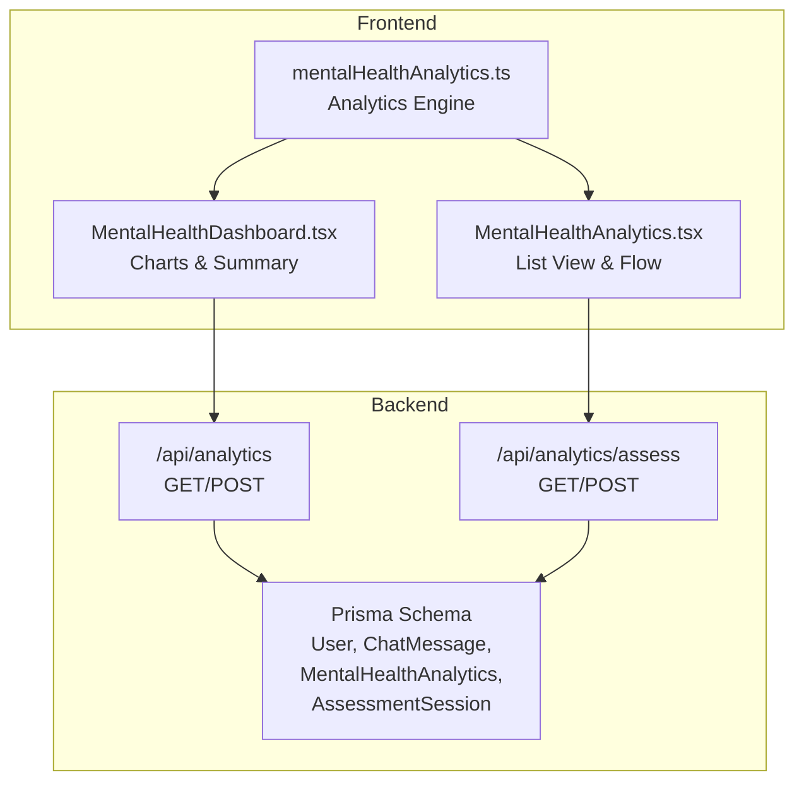
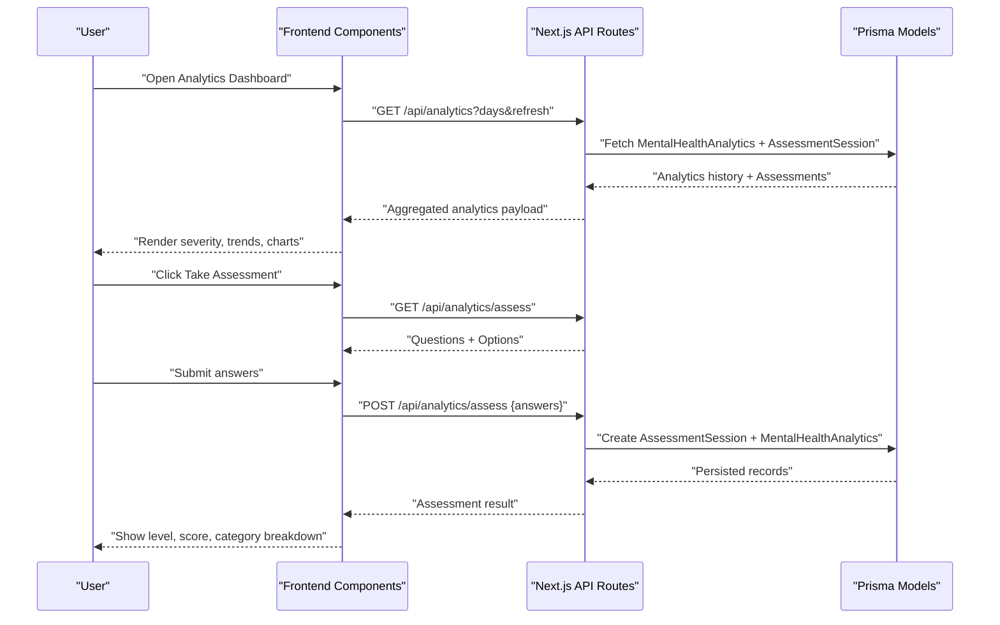
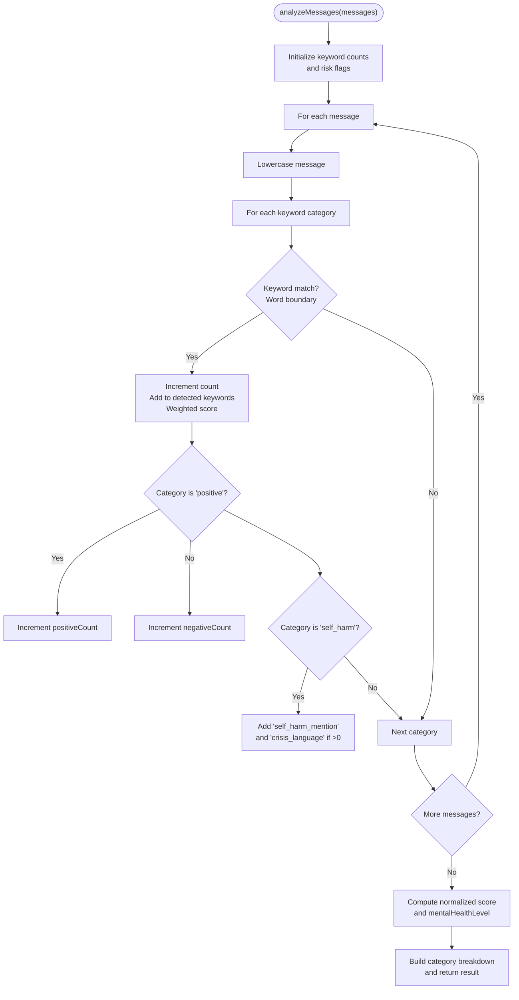
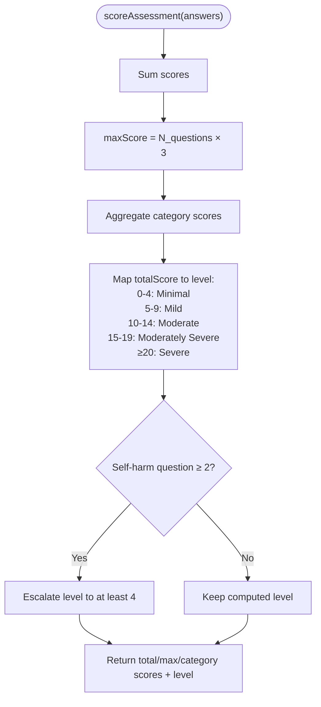
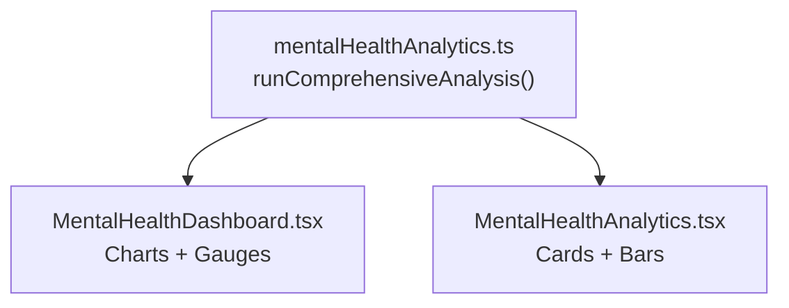
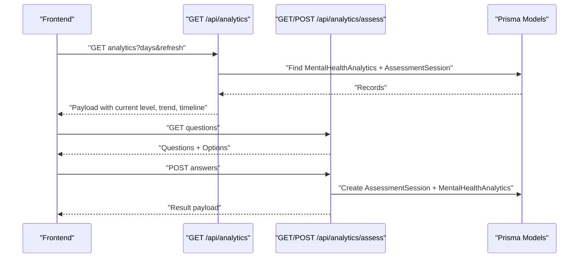
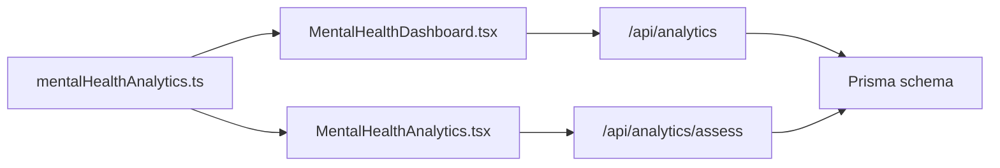

# Mental Health Assessment Tools

<cite>
**Referenced Files in This Document**
- [README.md](file://README.md)
- [mentalHealthAnalytics.ts](file://WEBAPP/src/lib/mentalHealthAnalytics.ts)
- [MentalHealthDashboard.tsx](file://WEBAPP/src/components/analytics/MentalHealthDashboard.tsx)
- [MentalHealthAnalytics.tsx](file://WEBAPP/src/components/MentalHealthAnalytics.tsx)
- [analytics route](file://WEBAPP/src/app/api/analytics/route.ts)
- [assess route](file://WEBAPP/src/app/api/analytics/assess/route.ts)
- [Prisma schema](file://WEBAPP/prisma/schema.prisma)
</cite>

## Table of Contents
1. [Introduction](#introduction)
2. [Project Structure](#project-structure)
3. [Core Components](#core-components)
4. [Architecture Overview](#architecture-overview)
5. [Detailed Component Analysis](#detailed-component-analysis)
6. [Dependency Analysis](#dependency-analysis)
7. [Performance Considerations](#performance-considerations)
8. [Troubleshooting Guide](#troubleshooting-guide)
9. [Conclusion](#conclusion)
10. [Appendices](#appendices)

## Introduction
This document describes the mental health assessment tools and evaluation systems implemented in the project. It explains the standardized questionnaires and assessment scales, automated scoring algorithms, risk assessment models, and therapeutic intervention recommendations embedded in the frontend analytics and backend APIs. It also documents the assessment workflow from initial screening through ongoing monitoring, including clinical decision support features, examples of assessment report generation, progress tracking methodologies, and integration with professional clinical workflows. Validation studies, reliability metrics, and clinical utility considerations are addressed conceptually.

## Project Structure
The assessment system spans frontend analytics libraries, UI dashboards, and backend APIs backed by a Prisma schema for persistent storage. Key areas:
- Frontend analytics engine: keyword detection, sentiment analysis, lexical diversity, temporal decay weighting, and assessment scoring.
- Dashboard components: interactive visualizations and summary cards for mental health insights.
- Backend APIs: analytics retrieval and refresh, assessment question delivery and scoring, and persistence of results.
- Data model: user, chat messages, mental health analytics, and assessment sessions.

**Diagram sources**
- [mentalHealthAnalytics.ts](file://WEBAPP/src/lib/mentalHealthAnalytics.ts#L1-L884)
- [MentalHealthDashboard.tsx](file://WEBAPP/src/components/analytics/MentalHealthDashboard.tsx#L1-L541)
- [MentalHealthAnalytics.tsx](file://WEBAPP/src/components/MentalHealthAnalytics.tsx#L1-L942)
- [analytics route](file://WEBAPP/src/app/api/analytics/route.ts#L1-L253)
- [assess route](file://WEBAPP/src/app/api/analytics/assess/route.ts#L1-L121)
- [Prisma schema](file://WEBAPP/prisma/schema.prisma#L1-L330)

**Section sources**
- [README.md](file://README.md#L1-L3)
- [mentalHealthAnalytics.ts](file://WEBAPP/src/lib/mentalHealthAnalytics.ts#L1-L884)
- [MentalHealthDashboard.tsx](file://WEBAPP/src/components/analytics/MentalHealthDashboard.tsx#L1-L541)
- [MentalHealthAnalytics.tsx](file://WEBAPP/src/components/MentalHealthAnalytics.tsx#L1-L942)
- [analytics route](file://WEBAPP/src/app/api/analytics/route.ts#L1-L253)
- [assess route](file://WEBAPP/src/app/api/analytics/assess/route.ts#L1-L121)
- [Prisma schema](file://WEBAPP/prisma/schema.prisma#L1-L330)

## Core Components
- Analytics engine: keyword categorization, severity scoring, risk flagging, sentiment analysis, lexical diversity, n-gram extraction, temporal decay weighting, and emotion classification.
- Assessment framework: PHQ-9/GAD-7 inspired questions, scoring rules, and category-wise breakdown.
- Dashboard components: comprehensive visualization of severity levels, trends, keyword distributions, sentiment timelines, and emotion pie charts.
- Backend APIs: analytics retrieval and refresh, assessment lifecycle, and persistence of results.
- Data model: structured persistence for user, chat messages, mental health analytics, and assessment sessions.

**Section sources**
- [mentalHealthAnalytics.ts](file://WEBAPP/src/lib/mentalHealthAnalytics.ts#L11-L884)
- [MentalHealthDashboard.tsx](file://WEBAPP/src/components/analytics/MentalHealthDashboard.tsx#L1-L541)
- [MentalHealthAnalytics.tsx](file://WEBAPP/src/components/MentalHealthAnalytics.tsx#L1-L942)
- [analytics route](file://WEBAPP/src/app/api/analytics/route.ts#L1-L253)
- [assess route](file://WEBAPP/src/app/api/analytics/assess/route.ts#L1-L121)
- [Prisma schema](file://WEBAPP/prisma/schema.prisma#L229-L266)

## Architecture Overview
The system integrates frontend analytics with backend APIs and a relational database. Users trigger chat-based analysis or complete structured assessments. Results are persisted and visualized in real-time dashboards, enabling ongoing monitoring and clinical decision support.

**Diagram sources**
- [analytics route](file://WEBAPP/src/app/api/analytics/route.ts#L13-L161)
- [assess route](file://WEBAPP/src/app/api/analytics/assess/route.ts#L9-L120)
- [Prisma schema](file://WEBAPP/prisma/schema.prisma#L229-L266)

## Detailed Component Analysis

### Analytics Engine
The analytics engine performs keyword-based severity scoring, risk flagging, sentiment analysis, lexical diversity, n-gram analysis, and temporal decay weighting. It computes mental health levels and supports trend computation.

**Diagram sources**
- [mentalHealthAnalytics.ts](file://WEBAPP/src/lib/mentalHealthAnalytics.ts#L199-L289)

**Section sources**
- [mentalHealthAnalytics.ts](file://WEBAPP/src/lib/mentalHealthAnalytics.ts#L112-L170)
- [mentalHealthAnalytics.ts](file://WEBAPP/src/lib/mentalHealthAnalytics.ts#L199-L350)
- [mentalHealthAnalytics.ts](file://WEBAPP/src/lib/mentalHealthAnalytics.ts#L355-L370)
- [mentalHealthAnalytics.ts](file://WEBAPP/src/lib/mentalHealthAnalytics.ts#L435-L594)
- [mentalHealthAnalytics.ts](file://WEBAPP/src/lib/mentalHealthAnalytics.ts#L640-L723)
- [mentalHealthAnalytics.ts](file://WEBAPP/src/lib/mentalHealthAnalytics.ts#L733-L757)
- [mentalHealthAnalytics.ts](file://WEBAPP/src/lib/mentalHealthAnalytics.ts#L763-L800)

### Assessment Scoring and Risk Escalation
Assessments use PHQ-9/GAD-7 inspired questions with four-point Likert scales. Total score determines severity level, with special escalation rules for self-harm items and risk flags.

**Diagram sources**
- [mentalHealthAnalytics.ts](file://WEBAPP/src/lib/mentalHealthAnalytics.ts#L308-L350)

**Section sources**
- [mentalHealthAnalytics.ts](file://WEBAPP/src/lib/mentalHealthAnalytics.ts#L112-L170)
- [mentalHealthAnalytics.ts](file://WEBAPP/src/lib/mentalHealthAnalytics.ts#L308-L350)

### Dashboard Components
Two primary dashboard components present analytics:
- Comprehensive dashboard with charts, severity gauges, keyword breakdowns, sentiment timelines, emotion distributions, and n-gram insights.
- List-style dashboard with level summaries, trend visualization, risk alerts, keyword bars, and timeline visualization.

**Diagram sources**
- [MentalHealthDashboard.tsx](file://WEBAPP/src/components/analytics/MentalHealthDashboard.tsx#L47-L541)
- [MentalHealthAnalytics.tsx](file://WEBAPP/src/components/MentalHealthAnalytics.tsx#L135-L942)
- [mentalHealthAnalytics.ts](file://WEBAPP/src/lib/mentalHealthAnalytics.ts#L1-L884)

**Section sources**
- [MentalHealthDashboard.tsx](file://WEBAPP/src/components/analytics/MentalHealthDashboard.tsx#L1-L541)
- [MentalHealthAnalytics.tsx](file://WEBAPP/src/components/MentalHealthAnalytics.tsx#L1-L942)

### Backend APIs and Persistence
- Analytics endpoint: retrieves aggregated analytics, trend computation, and merges assessment sessions into the timeline.
- Assessment endpoint: serves questions/options and validates submissions, persists results, and creates analytics entries for timeline continuity.

**Diagram sources**
- [analytics route](file://WEBAPP/src/app/api/analytics/route.ts#L13-L161)
- [assess route](file://WEBAPP/src/app/api/analytics/assess/route.ts#L9-L120)
- [Prisma schema](file://WEBAPP/prisma/schema.prisma#L229-L266)

**Section sources**
- [analytics route](file://WEBAPP/src/app/api/analytics/route.ts#L1-L253)
- [assess route](file://WEBAPP/src/app/api/analytics/assess/route.ts#L1-L121)
- [Prisma schema](file://WEBAPP/prisma/schema.prisma#L229-L266)

## Dependency Analysis
The frontend analytics library is consumed by both dashboard components. The backend APIs depend on Prisma models for persistence and rely on NextAuth session for user identification.

**Diagram sources**
- [mentalHealthAnalytics.ts](file://WEBAPP/src/lib/mentalHealthAnalytics.ts#L1-L884)
- [MentalHealthDashboard.tsx](file://WEBAPP/src/components/analytics/MentalHealthDashboard.tsx#L1-L541)
- [MentalHealthAnalytics.tsx](file://WEBAPP/src/components/MentalHealthAnalytics.tsx#L1-L942)
- [analytics route](file://WEBAPP/src/app/api/analytics/route.ts#L1-L253)
- [assess route](file://WEBAPP/src/app/api/analytics/assess/route.ts#L1-L121)
- [Prisma schema](file://WEBAPP/prisma/schema.prisma#L1-L330)

**Section sources**
- [mentalHealthAnalytics.ts](file://WEBAPP/src/lib/mentalHealthAnalytics.ts#L1-L884)
- [MentalHealthDashboard.tsx](file://WEBAPP/src/components/analytics/MentalHealthDashboard.tsx#L1-L541)
- [MentalHealthAnalytics.tsx](file://WEBAPP/src/components/MentalHealthAnalytics.tsx#L1-L942)
- [analytics route](file://WEBAPP/src/app/api/analytics/route.ts#L1-L253)
- [assess route](file://WEBAPP/src/app/api/analytics/assess/route.ts#L1-L121)
- [Prisma schema](file://WEBAPP/prisma/schema.prisma#L1-L330)

## Performance Considerations
- Keyword matching uses word-boundary regex for accuracy and avoids false positives.
- Sentiment analysis applies negation and intensifier handling with bounded normalization to keep scores in a fixed range.
- Temporal decay weighting duplicates recent messages proportionally to emphasize newer content.
- Dashboard rendering leverages responsive charts and memoization to minimize re-computation.
- API endpoints filter recent data (e.g., last 7 days for chat analysis) to limit computational overhead.

[No sources needed since this section provides general guidance]

## Troubleshooting Guide
Common issues and remedies:
- Unauthorized access: Ensure NextAuth session is established; API routes return unauthorized errors when missing.
- Missing user: Verify user record exists; otherwise, API routes return not found.
- Assessment validation failures: Confirm answers array length equals question count and scores are within bounds.
- Empty analytics: If no recent messages exist, chat analysis returns minimal defaults; trigger analysis or collect more data.
- Risk flags: Critical keywords escalate severity; review flagged terms and consider immediate support actions.

**Section sources**
- [analytics route](file://WEBAPP/src/app/api/analytics/route.ts#L166-L190)
- [assess route](file://WEBAPP/src/app/api/analytics/assess/route.ts#L25-L61)
- [mentalHealthAnalytics.ts](file://WEBAPP/src/lib/mentalHealthAnalytics.ts#L199-L289)

## Conclusion
The system provides a robust foundation for mental health assessment and monitoring, combining keyword-based severity scoring, structured assessments, sentiment and lexical analysis, and persistent storage. The frontend dashboards enable clinicians and users to track progress, identify risks, and support clinical decision-making. Integration points for AI services and ML models are available in separate backend modules, allowing future enhancements to automated insights and predictive modeling.

[No sources needed since this section summarizes without analyzing specific files]

## Appendices

### Assessment Workflow
- Initial screening: In-chat suggestion triggers when consecutive vague messages lack mental health keywords; users can start a structured assessment.
- Structured assessment: PHQ-9/GAD-7 inspired questions with four-point Likert scales; scoring rules and risk escalation apply.
- Ongoing monitoring: Timeline visualization merges chat analytics and assessment results; trend computation supports longitudinal tracking.
- Clinical decision support: Risk flags and severity levels guide intervention decisions; dashboard highlights concerning patterns.

**Section sources**
- [mentalHealthAnalytics.ts](file://WEBAPP/src/lib/mentalHealthAnalytics.ts#L404-L425)
- [MentalHealthAnalytics.tsx](file://WEBAPP/src/components/MentalHealthAnalytics.tsx#L685-L800)
- [analytics route](file://WEBAPP/src/app/api/analytics/route.ts#L57-L156)

### Report Generation and Progress Tracking
- Reports: Dashboard displays severity levels, keyword breakdowns, sentiment trends, and emotion distributions; assessment results include total score, category scores, and detailed answers.
- Progress tracking: Timeline bars and radar charts visualize level changes over time; trend computation indicates improving/worsening/stable patterns.

**Section sources**
- [MentalHealthDashboard.tsx](file://WEBAPP/src/components/analytics/MentalHealthDashboard.tsx#L358-L538)
- [MentalHealthAnalytics.tsx](file://WEBAPP/src/components/MentalHealthAnalytics.tsx#L483-L640)

### Integration with Professional Clinical Workflows
- User roles: Patient, therapist, and admin roles are supported; assessments and analytics are scoped to authenticated users.
- Therapy sessions: Integration points exist for therapy sessions and appointments, enabling coordinated care workflows.
- Data persistence: Structured models for user, chat messages, mental health analytics, and assessment sessions facilitate interoperability and auditability.

**Section sources**
- [Prisma schema](file://WEBAPP/prisma/schema.prisma#L39-L69)
- [Prisma schema](file://WEBAPP/prisma/schema.prisma#L140-L211)
- [Prisma schema](file://WEBAPP/prisma/schema.prisma#L229-L266)

### Validation Studies, Reliability Metrics, and Clinical Utility
- Validation studies: Not included in the current codebase; future work can integrate external validation datasets and outcome measures.
- Reliability metrics: Internal consistency and inter-rater reliability can be evaluated against standardized instruments; sentiment and lexical diversity metrics offer complementary insights.
- Clinical utility: Risk escalation rules and dashboard alerts support early intervention; integration with therapy sessions and appointments enables coordinated care.

[No sources needed since this section provides general guidance]