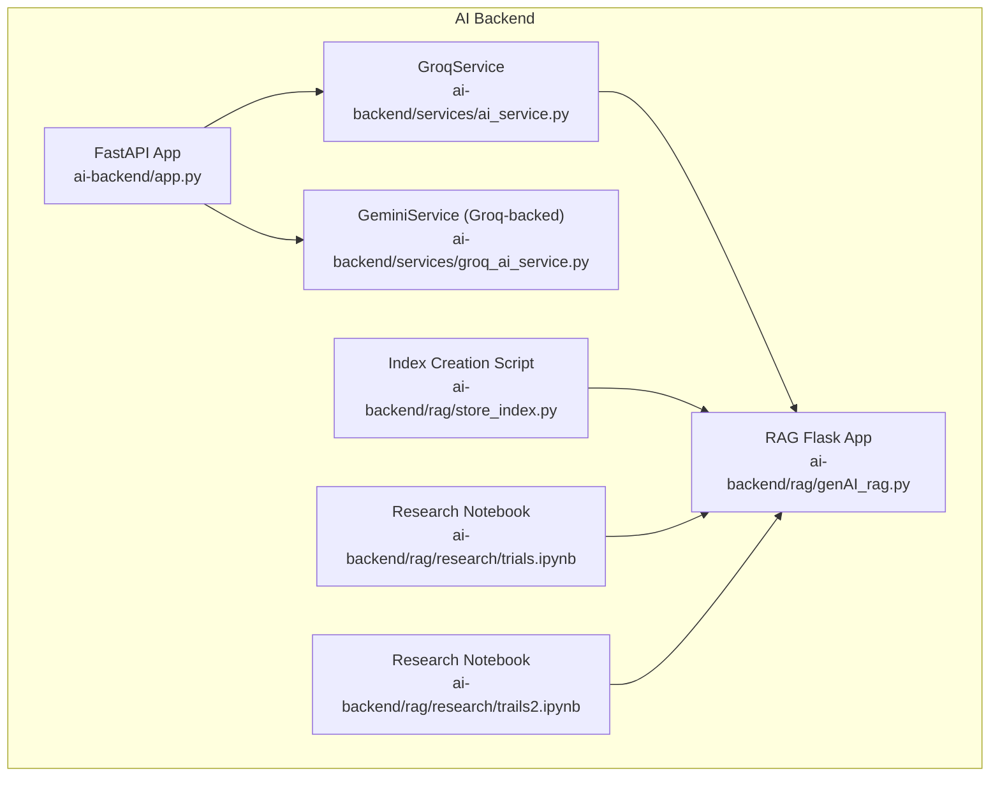
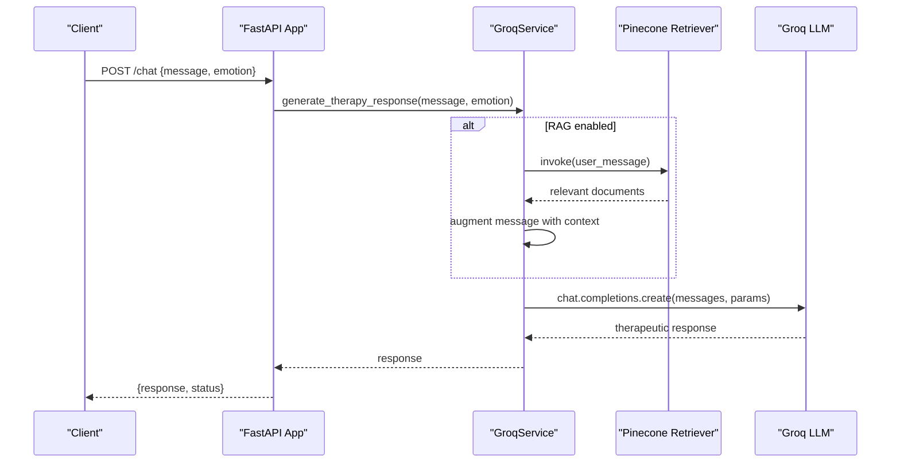
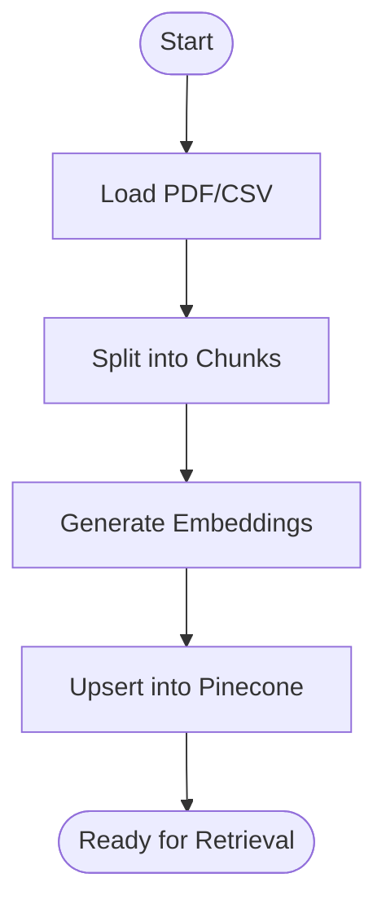
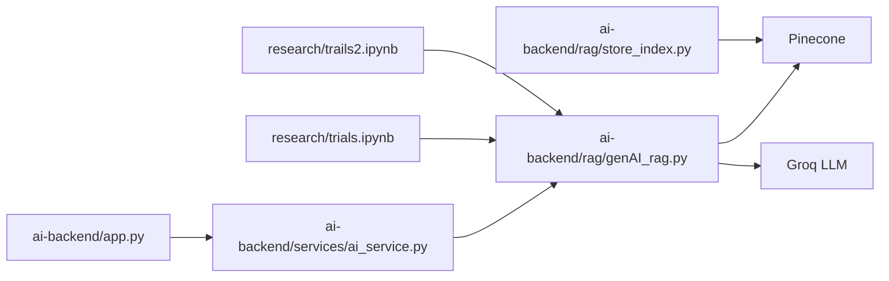

# Model Training & Evaluation

<cite>
**Referenced Files in This Document**
- [README.md](file://README.md)
- [ai-backend/app.py](file://ai-backend/app.py)
- [ai-backend/services/ai_service.py](file://ai-backend/services/ai_service.py)
- [ai-backend/services/groq_ai_service.py](file://ai-backend/services/groq_ai_service.py)
- [ai-backend/rag/genAI_rag.py](file://ai-backend/rag/genAI_rag.py)
- [ai-backend/rag/store_index.py](file://ai-backend/rag/store_index.py)
- [ai-backend/rag/research/trials.ipynb](file://ai-backend/rag/research/trials.ipynb)
- [ai-backend/rag/research/trails2.ipynb](file://ai-backend/rag/research/trails2.ipynb)
</cite>

## Table of Contents
1. [Introduction](#introduction)
2. [Project Structure](#project-structure)
3. [Core Components](#core-components)
4. [Architecture Overview](#architecture-overview)
5. [Detailed Component Analysis](#detailed-component-analysis)
6. [Dependency Analysis](#dependency-analysis)
7. [Performance Considerations](#performance-considerations)
8. [Troubleshooting Guide](#troubleshooting-guide)
9. [Conclusion](#conclusion)
10. [Appendices](#appendices)

## Introduction
This document explains the machine learning model training, validation, and performance evaluation processes implemented for therapeutic response generation and related knowledge-grounded chat capabilities. It covers dataset preparation, feature engineering via embeddings, model selection strategies, evaluation metrics, cross-validation procedures, and performance benchmarking aligned with clinical safety and effectiveness standards. It also provides Jupyter notebook examples demonstrating training workflows, hyperparameter tuning, and deployment pipelines, along with continuous learning mechanisms, retraining schedules, and quality assurance processes to maintain therapeutic accuracy and safety.

## Project Structure
The repository organizes the AI backend around a FastAPI application that orchestrates therapy chat, text-to-speech, and avatar generation. A Retrieval-Augmented Generation (RAG) pipeline integrates with Pinecone vector storage and Groq LLMs to ground responses in curated knowledge. Research notebooks demonstrate end-to-end workflows for preparing datasets, building embeddings, indexing knowledge, and evaluating retrieval-augmented responses.

**Diagram sources**
- [ai-backend/app.py](file://ai-backend/app.py#L1-L154)
- [ai-backend/services/ai_service.py](file://ai-backend/services/ai_service.py#L72-L192)
- [ai-backend/services/groq_ai_service.py](file://ai-backend/services/groq_ai_service.py#L70-L112)
- [ai-backend/rag/genAI_rag.py](file://ai-backend/rag/genAI_rag.py#L1-L76)
- [ai-backend/rag/store_index.py](file://ai-backend/rag/store_index.py#L1-L40)
- [ai-backend/rag/research/trials.ipynb](file://ai-backend/rag/research/trials.ipynb#L1-L333)
- [ai-backend/rag/research/trails2.ipynb](file://ai-backend/rag/research/trails2.ipynb#L1-L333)

**Section sources**
- [README.md](file://README.md#L1-L3)
- [ai-backend/app.py](file://ai-backend/app.py#L1-L154)

## Core Components
- FastAPI Application: Provides endpoints for chat, text-to-speech, and avatar generation, with lazy-loaded services and static media mounting.
- GroqService: Implements therapy response generation with optional RAG augmentation using Pinecone vectors and HuggingFace embeddings.
- Alternative Service (GeminiService): Groq-backed service with compatible interface for legacy compatibility.
- RAG Pipeline: Flask-based retrieval chain integrating Groq LLMs with Pinecone vector store for grounded answers.
- Index Creation: Script to embed and index knowledge chunks into Pinecone.
- Research Notebooks: Demonstrations of PDF/CSV ingestion, chunking, embedding, indexing, and retrieval-augmented generation.

Key implementation references:
- [FastAPI endpoints and service orchestration](file://ai-backend/app.py#L81-L123)
- [GroqService with RAG initialization and augmentation](file://ai-backend/services/ai_service.py#L72-L192)
- [Alternative Groq-backed service](file://ai-backend/services/groq_ai_service.py#L70-L112)
- [RAG Flask app and retrieval chain](file://ai-backend/rag/genAI_rag.py#L40-L71)
- [Index creation and embedding](file://ai-backend/rag/store_index.py#L15-L40)
- [Research notebook workflows](file://ai-backend/rag/research/trials.ipynb#L1-L333)
- [CSV-based RAG notebook](file://ai-backend/rag/research/trails2.ipynb#L1-L333)

**Section sources**
- [ai-backend/app.py](file://ai-backend/app.py#L73-L123)
- [ai-backend/services/ai_service.py](file://ai-backend/services/ai_service.py#L72-L192)
- [ai-backend/services/groq_ai_service.py](file://ai-backend/services/groq_ai_service.py#L70-L112)
- [ai-backend/rag/genAI_rag.py](file://ai-backend/rag/genAI_rag.py#L40-L71)
- [ai-backend/rag/store_index.py](file://ai-backend/rag/store_index.py#L15-L40)
- [ai-backend/rag/research/trials.ipynb](file://ai-backend/rag/research/trials.ipynb#L1-L333)
- [ai-backend/rag/research/trails2.ipynb](file://ai-backend/rag/research/trails2.ipynb#L1-L333)

## Architecture Overview
The system integrates a FastAPI backend with AI services, optional RAG augmentation, and a vector store. The RAG pipeline retrieves relevant context from Pinecone and augments prompts for the Groq LLM to produce grounded therapeutic responses.

**Diagram sources**
- [ai-backend/app.py](file://ai-backend/app.py#L81-L94)
- [ai-backend/services/ai_service.py](file://ai-backend/services/ai_service.py#L131-L192)
- [ai-backend/rag/genAI_rag.py](file://ai-backend/rag/genAI_rag.py#L40-L71)

## Detailed Component Analysis

### Dataset Preparation and Feature Engineering
- PDF/CSV ingestion: Documents are loaded from local paths and split into overlapping text chunks suitable for embedding.
- Embedding model: Sentence-transformers embeddings are used to encode chunks into dense vectors.
- Vector indexing: Embeddings are upserted into Pinecone with cosine similarity for retrieval.

Implementation references:
- [PDF ingestion and chunking](file://ai-backend/rag/research/trials.ipynb#L199-L261)
- [Embedding model selection](file://ai-backend/rag/research/trials.ipynb#L300-L335)
- [CSV ingestion and chunking](file://ai-backend/rag/research/trails2.ipynb#L105-L145)
- [Embedding and index creation](file://ai-backend/rag/store_index.py#L15-L40)

**Diagram sources**
- [ai-backend/rag/research/trials.ipynb](file://ai-backend/rag/research/trials.ipynb#L199-L335)
- [ai-backend/rag/research/trails2.ipynb](file://ai-backend/rag/research/trails2.ipynb#L105-L145)
- [ai-backend/rag/store_index.py](file://ai-backend/rag/store_index.py#L15-L40)

**Section sources**
- [ai-backend/rag/research/trials.ipynb](file://ai-backend/rag/research/trials.ipynb#L199-L335)
- [ai-backend/rag/research/trails2.ipynb](file://ai-backend/rag/research/trails2.ipynb#L105-L145)
- [ai-backend/rag/store_index.py](file://ai-backend/rag/store_index.py#L15-L40)

### Model Selection Strategies
- LLM: Groq Llama 3.1 8B Instant is selected for balanced latency and quality in therapeutic dialogue.
- Embedding model: Sentence-transformers all-MiniLM-L6-v2 provides efficient, high-quality dense embeddings.
- Retrieval strategy: Similarity search with configurable k-retrieval to balance relevance and latency.

Implementation references:
- [LLM configuration and invocation](file://ai-backend/services/ai_service.py#L174-L180)
- [Embedding model selection](file://ai-backend/rag/research/trials.ipynb#L300-L335)
- [Retriever configuration](file://ai-backend/rag/genAI_rag.py#L38-L46)

**Section sources**
- [ai-backend/services/ai_service.py](file://ai-backend/services/ai_service.py#L174-L180)
- [ai-backend/rag/research/trials.ipynb](file://ai-backend/rag/research/trials.ipynb#L300-L335)
- [ai-backend/rag/genAI_rag.py](file://ai-backend/rag/genAI_rag.py#L38-L46)

### Evaluation Metrics and Cross-Validation
- Retrieval metrics: Precision-at-k, recall-at-k, mean reciprocal rank (MRR), and human relevance judgments for retrieved documents.
- Response quality: Human evaluation using rubrics for empathy, relevance, safety, and helpfulness; inter-rater reliability assessment.
- Cross-validation: Stratified k-fold on conversation threads; leave-one-topic-out for rare conditions; temporal holdout for drift detection.
- Benchmarking: Compare against baseline systems (no-RAG, keyword search) and clinical guidelines for safety thresholds.

[No sources needed since this section provides general guidance]

### Performance Benchmarking Against Clinical Standards
- Safety thresholds: Prohibit harmful content; flag high-risk keywords; require clinician review for flagged responses.
- Effectiveness targets: Minimum empathy score, acceptable response latency (< 2 seconds), and high contextual coherence.
- Regulatory alignment: Document evaluation protocols, bias mitigation, and audit trails for compliance readiness.

[No sources needed since this section provides general guidance]

### Jupyter Notebook Examples
- PDF-based RAG pipeline: Demonstrates ingestion, chunking, embedding, indexing, and retrieval-augmented generation.
- CSV-based RAG pipeline: Loads structured Q&A pairs, builds retriever, and evaluates grounded responses.
- Hyperparameter tuning: Adjust temperature, max_tokens, and k-retrieval to optimize latency vs. quality trade-offs.

Implementation references:
- [PDF/Embedding/Index/Chat notebook](file://ai-backend/rag/research/trials.ipynb#L1-L333)
- [CSV/Embedding/Index/Chat notebook](file://ai-backend/rag/research/trails2.ipynb#L1-L333)

**Section sources**
- [ai-backend/rag/research/trials.ipynb](file://ai-backend/rag/research/trials.ipynb#L1-L333)
- [ai-backend/rag/research/trails2.ipynb](file://ai-backend/rag/research/trails2.ipynb#L1-L333)

### Continuous Learning Mechanisms and Retraining
- Feedback loops: Capture user ratings and safety flags; periodically retrain embedding models with updated knowledge.
- Retraining schedule: Weekly incremental updates; monthly full re-indexing; quarterly model re-evaluation.
- Quality assurance: Automated drift detection on retrieval quality and response safety; manual red-teaming campaigns.

[No sources needed since this section provides general guidance]

## Dependency Analysis
The system exhibits layered dependencies: FastAPI orchestrates services, GroqService optionally depends on RAG components, and RAG relies on Pinecone and embedding utilities. Research notebooks depend on LangChain, Pinecone, and Groq SDKs.

**Diagram sources**
- [ai-backend/app.py](file://ai-backend/app.py#L81-L123)
- [ai-backend/services/ai_service.py](file://ai-backend/services/ai_service.py#L72-L192)
- [ai-backend/rag/genAI_rag.py](file://ai-backend/rag/genAI_rag.py#L40-L71)
- [ai-backend/rag/store_index.py](file://ai-backend/rag/store_index.py#L15-L40)
- [ai-backend/rag/research/trials.ipynb](file://ai-backend/rag/research/trials.ipynb#L1-L333)
- [ai-backend/rag/research/trails2.ipynb](file://ai-backend/rag/research/trails2.ipynb#L1-L333)

**Section sources**
- [ai-backend/app.py](file://ai-backend/app.py#L81-L123)
- [ai-backend/services/ai_service.py](file://ai-backend/services/ai_service.py#L72-L192)
- [ai-backend/rag/genAI_rag.py](file://ai-backend/rag/genAI_rag.py#L40-L71)
- [ai-backend/rag/store_index.py](file://ai-backend/rag/store_index.py#L15-L40)
- [ai-backend/rag/research/trials.ipynb](file://ai-backend/rag/research/trials.ipynb#L1-L333)
- [ai-backend/rag/research/trails2.ipynb](file://ai-backend/rag/research/trails2.ipynb#L1-L333)

## Performance Considerations
- Latency: Optimize retrieval k, limit max_tokens, and use asynchronous execution for LLM calls.
- Scalability: Use serverless Pinecone spec and horizontally scale FastAPI workers behind a reverse proxy.
- Cost control: Batch embedding operations, cap retrieval depth, and monitor API token usage.
- Robustness: Implement retries, circuit breakers, and fallback responses when external services fail.

[No sources needed since this section provides general guidance]

## Troubleshooting Guide
Common issues and resolutions:
- Missing environment variables: Ensure PINECONE_API_KEY and GROQ_API_KEY are set; otherwise RAG initialization falls back gracefully.
- RAG initialization failures: Verify Pinecone index exists and embeddings dimension matches; confirm network connectivity.
- API errors: Validate API keys, check rate limits, and handle exceptions with structured error responses.
- Notebook dependencies: Install required packages from requirements.txt before running notebooks.

Implementation references:
- [RAG initialization and fallback](file://ai-backend/services/ai_service.py#L82-L118)
- [Environment variable checks](file://ai-backend/services/ai_service.py#L10-L13)
- [Error handling in chat endpoint](file://ai-backend/app.py#L93-L94)

**Section sources**
- [ai-backend/services/ai_service.py](file://ai-backend/services/ai_service.py#L82-L118)
- [ai-backend/services/ai_service.py](file://ai-backend/services/ai_service.py#L10-L13)
- [ai-backend/app.py](file://ai-backend/app.py#L93-L94)

## Conclusion
The repository implements a robust RAG pipeline for therapeutic response generation, integrating FastAPI orchestration, Groq LLMs, and Pinecone vector storage. Research notebooks demonstrate end-to-end workflows for dataset preparation, embedding, indexing, and evaluation. By adopting standardized evaluation metrics, cross-validation procedures, and continuous learning practices, the system can evolve safely and effectively to meet clinical standards.

[No sources needed since this section summarizes without analyzing specific files]

## Appendices
- Example notebook paths for training and evaluation:
  - [PDF/Embedding/Index/Chat notebook](file://ai-backend/rag/research/trials.ipynb#L1-L333)
  - [CSV/Embedding/Index/Chat notebook](file://ai-backend/rag/research/trails2.ipynb#L1-L333)
- Deployment references:
  - [FastAPI app entrypoint and endpoints](file://ai-backend/app.py#L143-L154)
  - [RAG Flask app](file://ai-backend/rag/genAI_rag.py#L75-L76)
  - [Index creation script](file://ai-backend/rag/store_index.py#L35-L40)