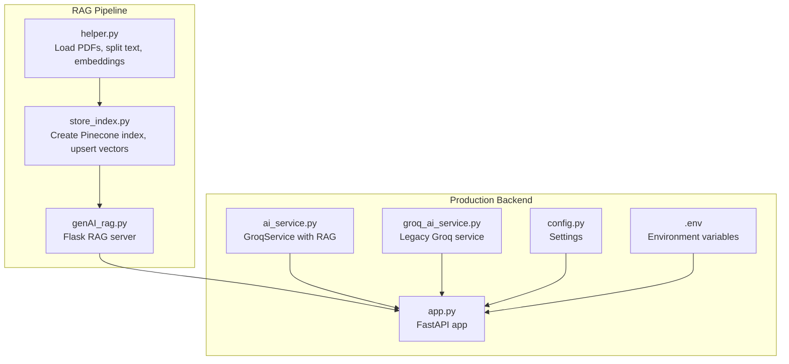
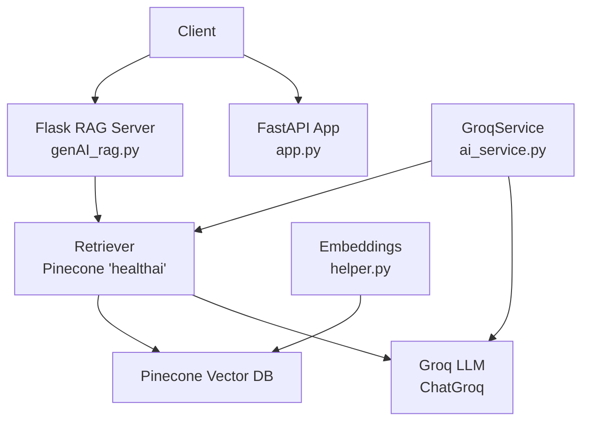
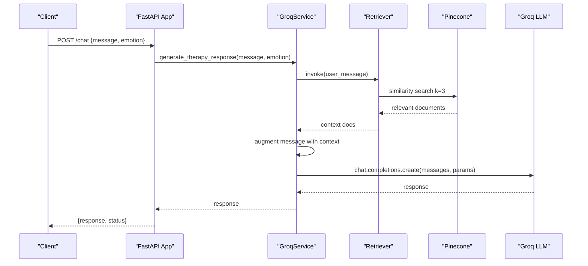
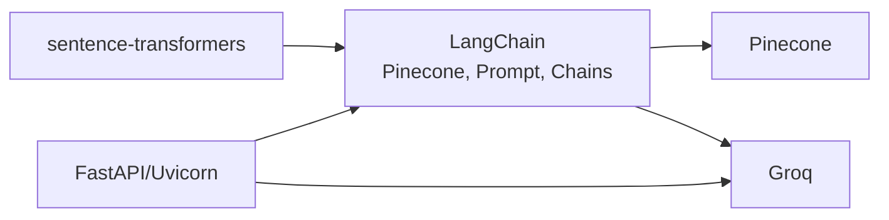
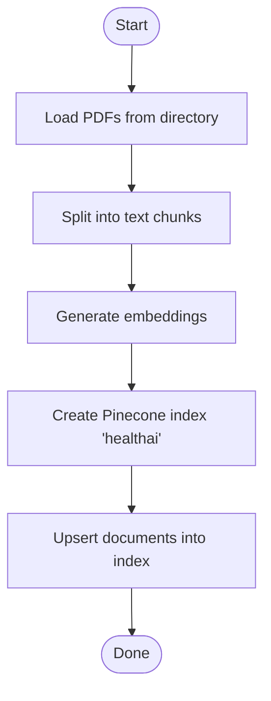
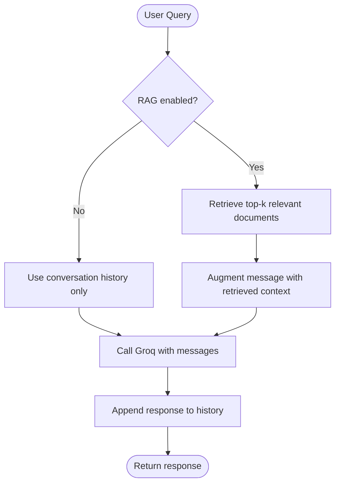

# RAG System Implementation

<cite>
**Referenced Files in This Document**
- [genAI_rag.py](file://ai-backend/rag/genAI_rag.py)
- [store_index.py](file://ai-backend/rag/store_index.py)
- [helper.py](file://ai-backend/rag/helper.py)
- [prompt.py](file://ai-backend/rag/prompt.py)
- [ai_service.py](file://ai-backend/services/ai_service.py)
- [groq_ai_service.py](file://ai-backend/services/groq_ai_service.py)
- [app.py](file://ai-backend/app.py)
- [config.py](file://ai-backend/config.py)
- [requirements.txt](file://ai-backend/requirements.txt)
- [run_server.py](file://ai-backend/run_server.py)
- [.env](file://ai-backend/.env)
- [test_groq_integration.py](file://ai-backend/test_groq_integration.py)
</cite>

## Table of Contents
1. [Introduction](#introduction)
2. [Project Structure](#project-structure)
3. [Core Components](#core-components)
4. [Architecture Overview](#architecture-overview)
5. [Detailed Component Analysis](#detailed-component-analysis)
6. [Dependency Analysis](#dependency-analysis)
7. [Performance Considerations](#performance-considerations)
8. [Troubleshooting Guide](#troubleshooting-guide)
9. [Conclusion](#conclusion)
10. [Appendices](#appendices)

## Introduction
This document explains the Retrieval-Augmented Generation (RAG) system integrated with Pinecone vector storage and LangChain, alongside Groq LLM for response synthesis. It covers embedding model setup using Hugging Face transformers, vector storage configuration, similarity search, prompt engineering, and chain composition patterns. It also documents the backend architecture, endpoints, and operational guidance for building a scalable therapeutic knowledge base.

## Project Structure
The RAG system spans two primary areas:
- ai-backend/rag: Indexing pipeline and a lightweight Flask-based RAG chat server
- ai-backend/services: Production-grade FastAPI backend with Groq integration, TTS, and avatar services

**Diagram sources**
- [genAI_rag.py](file://ai-backend/rag/genAI_rag.py#L1-L76)
- [store_index.py](file://ai-backend/rag/store_index.py#L1-L40)
- [helper.py](file://ai-backend/rag/helper.py#L1-L29)
- [ai_service.py](file://ai-backend/services/ai_service.py#L72-L192)
- [app.py](file://ai-backend/app.py#L1-L154)
- [config.py](file://ai-backend/config.py#L1-L49)
- [.env](file://ai-backend/.env)

**Section sources**
- [genAI_rag.py](file://ai-backend/rag/genAI_rag.py#L1-L76)
- [store_index.py](file://ai-backend/rag/store_index.py#L1-L40)
- [helper.py](file://ai-backend/rag/helper.py#L1-L29)
- [ai_service.py](file://ai-backend/services/ai_service.py#L1-L293)
- [app.py](file://ai-backend/app.py#L1-L154)
- [config.py](file://ai-backend/config.py#L1-L49)
- [.env](file://ai-backend/.env)

## Core Components
- Embedding model: Hugging Face sentence-transformers model configured to produce 384-dimensional vectors
- Vector store: Pinecone index named “healthai” with cosine similarity
- Retriever: Similarity search retrieving top-k relevant chunks
- Prompt template: System prompt instructing concise, context-aware answers
- LLM: Groq ChatGroq with configurable temperature and max tokens
- Chain: LangChain retrieval chain combining retriever and question-answer chain
- Production service: GroqService with optional RAG augmentation layered on top of conversation history

Key implementation references:
- Embeddings and chunking: [helper.py](file://ai-backend/rag/helper.py#L18-L29)
- Pinecone index creation and upsert: [store_index.py](file://ai-backend/rag/store_index.py#L20-L40)
- Retrieval and chain setup: [genAI_rag.py](file://ai-backend/rag/genAI_rag.py#L30-L56)
- Prompt template: [prompt.py](file://ai-backend/rag/prompt.py#L3-L11)
- GroqService with RAG: [ai_service.py](file://ai-backend/services/ai_service.py#L72-L192)

**Section sources**
- [helper.py](file://ai-backend/rag/helper.py#L18-L29)
- [store_index.py](file://ai-backend/rag/store_index.py#L20-L40)
- [genAI_rag.py](file://ai-backend/rag/genAI_rag.py#L30-L56)
- [prompt.py](file://ai-backend/rag/prompt.py#L3-L11)
- [ai_service.py](file://ai-backend/services/ai_service.py#L72-L192)

## Architecture Overview
The system supports two operational modes:
- Lightweight RAG chat server: Flask app that loads an existing Pinecone index and serves queries via a retrieval chain
- Production FastAPI backend: Provides chat, TTS, and avatar endpoints; GroqService optionally augments responses with retrieved context

**Diagram sources**
- [genAI_rag.py](file://ai-backend/rag/genAI_rag.py#L30-L56)
- [store_index.py](file://ai-backend/rag/store_index.py#L20-L40)
- [helper.py](file://ai-backend/rag/helper.py#L27-L29)
- [ai_service.py](file://ai-backend/services/ai_service.py#L72-L192)
- [app.py](file://ai-backend/app.py#L81-L94)

## Detailed Component Analysis

### Embedding Model Setup (Hugging Face Transformers)
- Loads a sentence-transformers model producing 384-dimensional embeddings
- Used consistently across indexing and querying
- Chunking strategy employs recursive splitting with overlap to preserve context

Implementation references:
- Model selection and dimensionality: [helper.py](file://ai-backend/rag/helper.py#L27-L29)
- Chunking parameters: [helper.py](file://ai-backend/rag/helper.py#L19-L22)

**Section sources**
- [helper.py](file://ai-backend/rag/helper.py#L19-L29)

### Vector Storage Configuration (Pinecone)
- Creates a Pinecone index named “healthai”
- Sets dimension to 384 and metric to cosine similarity
- Upserts pre-chunked documents using the embedding model

Implementation references:
- Index creation and spec: [store_index.py](file://ai-backend/rag/store_index.py#L25-L33)
- Upsert from documents: [store_index.py](file://ai-backend/rag/store_index.py#L35-L40)

**Section sources**
- [store_index.py](file://ai-backend/rag/store_index.py#L25-L40)

### Similarity Search Implementation
- Retrieves top-k relevant chunks from Pinecone using similarity search
- Integrated into a LangChain retrieval chain for question answering

Implementation references:
- Retriever configuration: [genAI_rag.py](file://ai-backend/rag/genAI_rag.py#L38-L38)
- Retrieval chain composition: [genAI_rag.py](file://ai-backend/rag/genAI_rag.py#L54-L55)

**Section sources**
- [genAI_rag.py](file://ai-backend/rag/genAI_rag.py#L38-L38)
- [genAI_rag.py](file://ai-backend/rag/genAI_rag.py#L54-L55)

### Prompt Engineering Strategies
- System prompt emphasizes concise, context-aware answers
- Template composes system role and human input with retrieved context placeholders

Implementation references:
- Prompt template: [prompt.py](file://ai-backend/rag/prompt.py#L3-L11)
- Prompt usage in chain: [genAI_rag.py](file://ai-backend/rag/genAI_rag.py#L47-L52)

**Section sources**
- [prompt.py](file://ai-backend/rag/prompt.py#L3-L11)
- [genAI_rag.py](file://ai-backend/rag/genAI_rag.py#L47-L52)

### Chain Composition Patterns (LangChain)
- Two-stage chain: documents chain (combines context and prompt) + retrieval chain (wraps retriever)
- Enables modular composition and extensibility

Implementation references:
- Documents chain: [genAI_rag.py](file://ai-backend/rag/genAI_rag.py#L54-L54)
- Retrieval chain: [genAI_rag.py](file://ai-backend/rag/genAI_rag.py#L55-L55)

**Section sources**
- [genAI_rag.py](file://ai-backend/rag/genAI_rag.py#L54-L55)

### Groq LLM Integration and Response Generation
- Legacy Flask-based chat endpoint invokes the retrieval chain and returns answers
- Production GroqService augments conversation history with retrieved context when available

Implementation references:
- Flask chat endpoint: [genAI_rag.py](file://ai-backend/rag/genAI_rag.py#L63-L70)
- GroqService with RAG: [ai_service.py](file://ai-backend/services/ai_service.py#L131-L192)
- Legacy standalone Groq service: [groq_ai_service.py](file://ai-backend/services/groq_ai_service.py#L42-L68)

**Section sources**
- [genAI_rag.py](file://ai-backend/rag/genAI_rag.py#L63-L70)
- [ai_service.py](file://ai-backend/services/ai_service.py#L131-L192)
- [groq_ai_service.py](file://ai-backend/services/groq_ai_service.py#L42-L68)

### Lightweight RAG Chat Server (Flask)
- Initializes embeddings, loads existing Pinecone index, sets up retriever and chain
- Serves a simple chat endpoint returning answers

Implementation references:
- Initialization and chain setup: [genAI_rag.py](file://ai-backend/rag/genAI_rag.py#L27-L56)
- Route handlers: [genAI_rag.py](file://ai-backend/rag/genAI_rag.py#L58-L70)

**Section sources**
- [genAI_rag.py](file://ai-backend/rag/genAI_rag.py#L27-L56)
- [genAI_rag.py](file://ai-backend/rag/genAI_rag.py#L58-L70)

### Production FastAPI Backend and Services
- FastAPI app mounts static audio/video and exposes endpoints for chat, TTS, and avatar
- GroqService encapsulates RAG-enabled response generation with robust error handling
- Configuration class centralizes environment-driven settings

Implementation references:
- FastAPI endpoints: [app.py](file://ai-backend/app.py#L81-L122)
- GroqService with RAG: [ai_service.py](file://ai-backend/services/ai_service.py#L72-L192)
- Settings configuration: [config.py](file://ai-backend/config.py#L5-L48)

**Section sources**
- [app.py](file://ai-backend/app.py#L81-L122)
- [ai_service.py](file://ai-backend/services/ai_service.py#L72-L192)
- [config.py](file://ai-backend/config.py#L5-L48)

### Sequence: Query Processing and Response Synthesis

**Diagram sources**
- [app.py](file://ai-backend/app.py#L81-L94)
- [ai_service.py](file://ai-backend/services/ai_service.py#L131-L192)

## Dependency Analysis
External libraries and integrations:
- LangChain ecosystem for retrieval and chains
- Pinecone for vector storage and similarity search
- Hugging Face sentence-transformers for embeddings
- Groq for LLM inference
- FastAPI and Uvicorn for production server

**Diagram sources**
- [requirements.txt](file://ai-backend/requirements.txt#L70-L81)
- [helper.py](file://ai-backend/rag/helper.py#L27-L29)
- [store_index.py](file://ai-backend/rag/store_index.py#L20-L40)
- [genAI_rag.py](file://ai-backend/rag/genAI_rag.py#L27-L56)
- [ai_service.py](file://ai-backend/services/ai_service.py#L72-L192)

**Section sources**
- [requirements.txt](file://ai-backend/requirements.txt#L70-L81)

## Performance Considerations
- Embedding dimension and similarity metric: Ensure the embedding model dimension matches Pinecone index dimension; cosine similarity is appropriate for normalized embeddings
- Retrieval parameters: Tune k (top-k) based on latency and accuracy trade-offs; larger k improves recall but increases LLM context length and cost
- Asynchronous execution: Use event loops and executor threads to avoid blocking during retriever invocation
- Caching and retry: Implement retries for transient failures and consider caching recent conversation history to reduce repeated retrievals
- Scalability: Use serverless or provisioned Pinecone indexes; shard data across multiple indexes for very large knowledge bases; batch upserts during indexing
- Cost control: Limit max_tokens and temperature for deterministic, shorter responses; monitor Groq token usage

[No sources needed since this section provides general guidance]

## Troubleshooting Guide
Common issues and resolutions:
- Missing environment variables:
  - Ensure PINECONE_API_KEY and GROQ_API_KEY are set in .env
  - Verify settings loading in services and RAG modules
- Pinecone index not found:
  - Confirm index name “healthai” exists or update to match your index
  - Re-run indexing pipeline to create the index and upsert documents
- RAG initialization failures:
  - GroqService logs initialization warnings and continues without RAG if dependencies are missing
  - Install RAG-specific requirements and set PINECONE_API_KEY
- API errors:
  - ElevenLabs/TTS fallback to dummy audio when API key is missing or quota exceeded
  - D-ID avatar fallback to dummy video when DID_API_KEY is missing
- Endpoint connectivity:
  - Use run_server.py to avoid multiprocessing issues on Windows
  - Verify PORT and HOST settings in .env and config

Operational references:
- Environment variables and keys: [.env](file://ai-backend/.env), [config.py](file://ai-backend/config.py#L5-L48)
- GroqService initialization and fallbacks: [ai_service.py](file://ai-backend/services/ai_service.py#L82-L118)
- TTS fallback behavior: [ai_service.py](file://ai-backend/services/tts_service.py#L146-L191)
- Avatar fallback behavior: [ai_service.py](file://ai-backend/services/avatar_service.py#L69-L120)
- Server startup script: [run_server.py](file://ai-backend/run_server.py#L10-L20)

**Section sources**
- [.env](file://ai-backend/.env)
- [config.py](file://ai-backend/config.py#L5-L48)
- [ai_service.py](file://ai-backend/services/ai_service.py#L82-L118)
- [ai_service.py](file://ai-backend/services/tts_service.py#L146-L191)
- [ai_service.py](file://ai-backend/services/avatar_service.py#L69-L120)
- [run_server.py](file://ai-backend/run_server.py#L10-L20)

## Conclusion
The RAG system integrates Hugging Face embeddings, Pinecone vector storage, and LangChain retrieval chains to deliver context-aware responses powered by Groq. The design separates a lightweight Flask-based prototype from a production FastAPI backend, enabling incremental deployment and scalability. By tuning retrieval parameters, managing embeddings and indexes, and leveraging fallbacks for external services, the system can evolve into a robust therapeutic knowledge platform.

[No sources needed since this section summarizes without analyzing specific files]

## Appendices

### Endpoints Overview
- FastAPI chat endpoint:
  - Method: POST
  - Path: /chat
  - Body: { "message": "string", "emotion": "string" }
  - Response: { "response": "string", "status": "success" }
- FastAPI TTS endpoint:
  - Method: POST
  - Path: /tts
  - Body: { "text": "string", "voice": "string" }
  - Response: { "audio_url": "string", "status": "success" }
- FastAPI avatar endpoint:
  - Method: POST
  - Path: /avatar
  - Body: { "text": "string", "avatar_id": "string" }
  - Response: { "video_url": "string", "status": "success" }

References:
- [app.py](file://ai-backend/app.py#L81-L122)

**Section sources**
- [app.py](file://ai-backend/app.py#L81-L122)

### Example Workflows

#### Document Indexing Workflow

**Diagram sources**
- [store_index.py](file://ai-backend/rag/store_index.py#L15-L40)
- [helper.py](file://ai-backend/rag/helper.py#L7-L22)

#### Query Processing Workflow

**Diagram sources**
- [ai_service.py](file://ai-backend/services/ai_service.py#L142-L192)

### Environment Variables Reference
- PINECONE_API_KEY: Pinecone API key
- GROQ_API_KEY: Groq API key
- ELEVENLABS_API_KEY: ElevenLabs API key (optional)
- DID_API_KEY: D-ID API key (optional)
- PORT/HOST: Server binding configuration

References:
- [.env](file://ai-backend/.env)
- [config.py](file://ai-backend/config.py#L5-L48)

**Section sources**
- [.env](file://ai-backend/.env)
- [config.py](file://ai-backend/config.py#L5-L48)