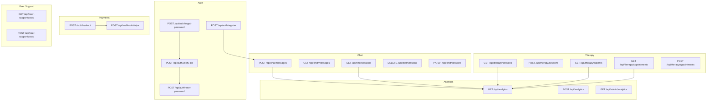
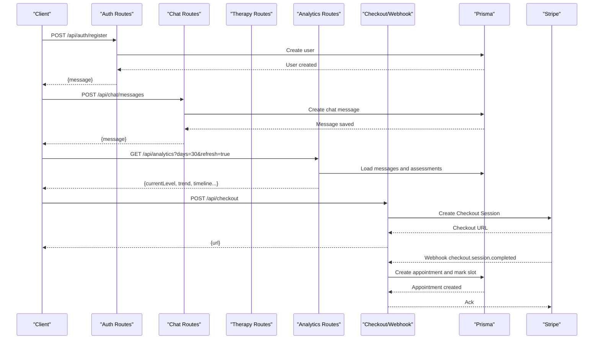
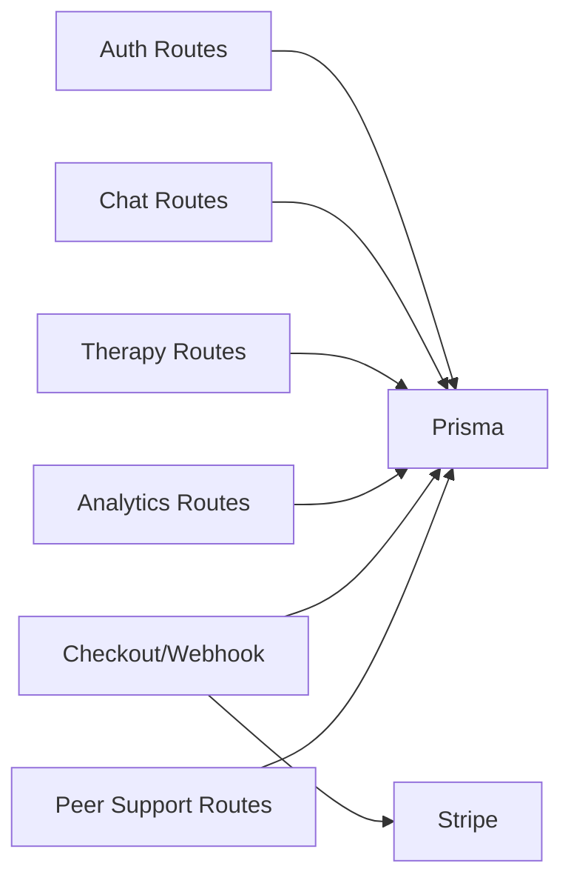

# API Reference

<cite>
**Referenced Files in This Document**
- [register/route.ts](file://WEBAPP/src/app/api/auth/register/route.ts)
- [forgot-password/route.ts](file://WEBAPP/src/app/api/auth/forgot-password/route.ts)
- [reset-password/route.ts](file://WEBAPP/src/app/api/auth/reset-password/route.ts)
- [verify-otp/route.ts](file://WEBAPP/src/app/api/auth/verify-otp/route.ts)
- [messages/route.ts](file://WEBAPP/src/app/api/chat/messages/route.ts)
- [sessions/route.ts](file://WEBAPP/src/app/api/chat/sessions/route.ts)
- [sessions/route.ts](file://WEBAPP/src/app/api/therapy/sessions/route.ts)
- [patients/route.ts](file://WEBAPP/src/app/api/therapy/patients/route.ts)
- [appointments/route.ts](file://WEBAPP/src/app/api/therapy/appointments/route.ts)
- [analytics/route.ts](file://WEBAPP/src/app/api/analytics/route.ts)
- [analytics/route.ts](file://WEBAPP/src/app/api/admin/analytics/route.ts)
- [checkout/route.ts](file://WEBAPP/src/app/api/checkout/route.ts)
- [webhook/stripe/route.ts](file://WEBAPP/src/app/api/webhook/stripe/route.ts)
- [posts/route.ts](file://WEBAPP/src/app/api/peer-support/posts/route.ts)
</cite>

## Table of Contents
1. [Introduction](#introduction)
2. [Project Structure](#project-structure)
3. [Core Components](#core-components)
4. [Architecture Overview](#architecture-overview)
5. [Detailed Component Analysis](#detailed-component-analysis)
6. [Dependency Analysis](#dependency-analysis)
7. [Performance Considerations](#performance-considerations)
8. [Troubleshooting Guide](#troubleshooting-guide)
9. [Conclusion](#conclusion)
10. [Appendices](#appendices)

## Introduction
This document provides comprehensive API documentation for MindBridge’s backend. It covers REST endpoints for authentication, chat, therapy sessions, analytics, admin operations, and payment processing. For each endpoint, you will find HTTP methods, URL patterns, request/response schemas, authentication requirements, and error codes. Where applicable, we explain validation rules, rate limiting, and security measures. WebSocket endpoints are not present in the repository; therefore, no real-time chat or video session endpoints are documented here.

## Project Structure
The API surface is organized under Next.js App Router conventions, with route handlers grouped by feature:
- Authentication: registration, OTP-based password reset, and OTP verification
- Chat: message persistence and session lifecycle
- Therapy: sessions, patients, and appointments
- Analytics: user mental health analytics and admin dashboards
- Payments: Stripe checkout and webhooks
- Peer support: anonymous community posts

**Diagram sources**
- [register/route.ts](file://WEBAPP/src/app/api/auth/register/route.ts#L1-L48)
- [forgot-password/route.ts](file://WEBAPP/src/app/api/auth/forgot-password/route.ts#L1-L102)
- [verify-otp/route.ts](file://WEBAPP/src/app/api/auth/verify-otp/route.ts#L1-L55)
- [reset-password/route.ts](file://WEBAPP/src/app/api/auth/reset-password/route.ts#L1-L42)
- [messages/route.ts](file://WEBAPP/src/app/api/chat/messages/route.ts#L1-L91)
- [sessions/route.ts](file://WEBAPP/src/app/api/chat/sessions/route.ts#L1-L187)
- [sessions/route.ts](file://WEBAPP/src/app/api/therapy/sessions/route.ts#L1-L80)
- [patients/route.ts](file://WEBAPP/src/app/api/therapy/patients/route.ts#L1-L61)
- [appointments/route.ts](file://WEBAPP/src/app/api/therapy/appointments/route.ts#L1-L181)
- [analytics/route.ts](file://WEBAPP/src/app/api/analytics/route.ts#L1-L253)
- [analytics/route.ts](file://WEBAPP/src/app/api/admin/analytics/route.ts#L1-L109)
- [checkout/route.ts](file://WEBAPP/src/app/api/checkout/route.ts#L1-L82)
- [webhook/stripe/route.ts](file://WEBAPP/src/app/api/webhook/stripe/route.ts#L1-L67)
- [posts/route.ts](file://WEBAPP/src/app/api/peer-support/posts/route.ts#L1-L161)

**Section sources**
- [register/route.ts](file://WEBAPP/src/app/api/auth/register/route.ts#L1-L48)
- [messages/route.ts](file://WEBAPP/src/app/api/chat/messages/route.ts#L1-L91)
- [sessions/route.ts](file://WEBAPP/src/app/api/chat/sessions/route.ts#L1-L187)
- [sessions/route.ts](file://WEBAPP/src/app/api/therapy/sessions/route.ts#L1-L80)
- [patients/route.ts](file://WEBAPP/src/app/api/therapy/patients/route.ts#L1-L61)
- [appointments/route.ts](file://WEBAPP/src/app/api/therapy/appointments/route.ts#L1-L181)
- [analytics/route.ts](file://WEBAPP/src/app/api/analytics/route.ts#L1-L253)
- [analytics/route.ts](file://WEBAPP/src/app/api/admin/analytics/route.ts#L1-L109)
- [checkout/route.ts](file://WEBAPP/src/app/api/checkout/route.ts#L1-L82)
- [webhook/stripe/route.ts](file://WEBAPP/src/app/api/webhook/stripe/route.ts#L1-L67)
- [posts/route.ts](file://WEBAPP/src/app/api/peer-support/posts/route.ts#L1-L161)

## Core Components
- Authentication: Registration, OTP generation and verification, and password reset
- Chat: Message creation and retrieval, session listing, creation, deletion, and updates
- Therapy: Sessions listing and creation, patients listing, appointments listing and creation
- Analytics: User analytics computation and admin overview
- Payments: Stripe checkout session creation and webhook handling
- Peer support: Anonymous posts with rate limiting and spam controls

**Section sources**
- [register/route.ts](file://WEBAPP/src/app/api/auth/register/route.ts#L1-L48)
- [messages/route.ts](file://WEBAPP/src/app/api/chat/messages/route.ts#L1-L91)
- [sessions/route.ts](file://WEBAPP/src/app/api/chat/sessions/route.ts#L1-L187)
- [sessions/route.ts](file://WEBAPP/src/app/api/therapy/sessions/route.ts#L1-L80)
- [patients/route.ts](file://WEBAPP/src/app/api/therapy/patients/route.ts#L1-L61)
- [appointments/route.ts](file://WEBAPP/src/app/api/therapy/appointments/route.ts#L1-L181)
- [analytics/route.ts](file://WEBAPP/src/app/api/analytics/route.ts#L1-L253)
- [analytics/route.ts](file://WEBAPP/src/app/api/admin/analytics/route.ts#L1-L109)
- [checkout/route.ts](file://WEBAPP/src/app/api/checkout/route.ts#L1-L82)
- [webhook/stripe/route.ts](file://WEBAPP/src/app/api/webhook/stripe/route.ts#L1-L67)
- [posts/route.ts](file://WEBAPP/src/app/api/peer-support/posts/route.ts#L1-L161)

## Architecture Overview
The API relies on Next.js server-side sessions for authentication and Prisma for data persistence. Payment processing integrates with Stripe for checkout and webhooks. Analytics leverage local analysis utilities and store results in the database.

**Diagram sources**
- [register/route.ts](file://WEBAPP/src/app/api/auth/register/route.ts#L1-L48)
- [messages/route.ts](file://WEBAPP/src/app/api/chat/messages/route.ts#L1-L91)
- [analytics/route.ts](file://WEBAPP/src/app/api/analytics/route.ts#L1-L253)
- [checkout/route.ts](file://WEBAPP/src/app/api/checkout/route.ts#L1-L82)
- [webhook/stripe/route.ts](file://WEBAPP/src/app/api/webhook/stripe/route.ts#L1-L67)

## Detailed Component Analysis

### Authentication Endpoints
- POST /api/auth/register
  - Description: Registers a new user with email, password, and role.
  - Authentication: None.
  - Request JSON:
    - email: string (required, valid email)
    - password: string (required, length 4–10)
    - role: enum ["patient","therapist"] (required)
  - Responses:
    - 201 Created: { message: "User registered" }
    - 400 Bad Request: { error: "Invalid input", details }
    - 409 Conflict: { error: "User already exists" }
    - 500 Internal Server Error: { error: "Server error" }

- POST /api/auth/forgot-password
  - Description: Sends a 6-digit OTP to the user’s email for password reset.
  - Authentication: None.
  - Request JSON:
    - email: string (required, valid email)
    - role: enum ["patient","therapist"] (required)
  - Responses:
    - 200 OK: { message: "OTP sent to your email", userId }
    - 400 Bad Request: { error: "Invalid input", details }
    - 404 Not Found: { error: "No account found with this email and role" }
    - 500 Internal Server Error: { error: "Server error" }

- POST /api/auth/verify-otp
  - Description: Verifies a valid, unexpired OTP.
  - Authentication: None.
  - Request JSON:
    - userId: string (required)
    - otp: string (required, exactly 6 digits)
  - Responses:
    - 200 OK: { message: "OTP verified successfully", verified: true }
    - 400 Bad Request: { error: "Invalid or expired OTP" }
    - 500 Internal Server Error: { error: "Server error" }

- POST /api/auth/reset-password
  - Description: Resets the user’s password after OTP verification.
  - Authentication: None.
  - Request JSON:
    - userId: string (required)
    - newPassword: string (required, length 4–20)
  - Responses:
    - 200 OK: { message: "Password reset successfully" }
    - 400 Bad Request: { error: "Invalid input", details }
    - 500 Internal Server Error: { error: "Server error" }

Validation rules:
- Zod schemas enforce field presence and types.
- Password minimum/maximum lengths enforced.
- OTP must be exactly 6 digits.
- Role must be one of the allowed enums.

Security measures:
- Passwords are hashed before storage.
- OTPs are time-bound (10 minutes) and marked used after verification.
- Admin endpoints use JWT-based bearer tokens.

**Section sources**
- [register/route.ts](file://WEBAPP/src/app/api/auth/register/route.ts#L1-L48)
- [forgot-password/route.ts](file://WEBAPP/src/app/api/auth/forgot-password/route.ts#L1-L102)
- [verify-otp/route.ts](file://WEBAPP/src/app/api/auth/verify-otp/route.ts#L1-L55)
- [reset-password/route.ts](file://WEBAPP/src/app/api/auth/reset-password/route.ts#L1-L42)

### Chat Endpoints
- POST /api/chat/messages
  - Description: Saves a user message to the database.
  - Authentication: Required (NextAuth session).
  - Request JSON:
    - content: string (required, non-empty)
    - emotion: string (optional)
    - emotionScore: number (optional)
    - metadata: object (optional)
  - Responses:
    - 201 Created: { message }
    - 400 Bad Request: { error: "Content is required" }
    - 401 Unauthorized: { error: "Unauthorized" }
    - 404 Not Found: { error: "User not found" }
    - 500 Internal Server Error: { error: "Failed to save message" }

- GET /api/chat/messages
  - Description: Lists user messages with pagination.
  - Authentication: Required (NextAuth session).
  - Query parameters:
    - limit: number (default 100)
    - offset: number (default 0)
  - Responses:
    - 200 OK: { messages[], total, limit, offset }
    - 401 Unauthorized: { error: "Unauthorized" }
    - 404 Not Found: { error: "User not found" }
    - 500 Internal Server Error: { error: "Failed to fetch messages" }

- GET /api/chat/sessions
  - Description: Lists active chat sessions for the user.
  - Authentication: Required (NextAuth session).
  - Responses:
    - 200 OK: { sessions[] }
    - 401 Unauthorized: { error: "Unauthorized" }
    - 404 Not Found: { error: "User not found" }
    - 500 Internal Server Error: { error: "Failed to fetch chat sessions" }

- POST /api/chat/sessions
  - Description: Creates a new chat session.
  - Authentication: Required (NextAuth session).
  - Request JSON:
    - title: string (optional, defaults to "New Chat")
  - Responses:
    - 201 Created: { session }
    - 401 Unauthorized: { error: "Unauthorized" }
    - 404 Not Found: { error: "User not found" }
    - 500 Internal Server Error: { error: "Failed to create chat session" }

- PATCH /api/chat/sessions
  - Description: Updates a chat session title.
  - Authentication: Required (NextAuth session).
  - Request JSON:
    - sessionId: string (required)
    - title: string (optional)
  - Responses:
    - 200 OK: { session }
    - 400 Bad Request: { error: "Session ID is required" }
    - 401 Unauthorized: { error: "Unauthorized" }
    - 404 Not Found: { error: "Session not found" }
    - 500 Internal Server Error: { error: "Failed to update chat session" }

- DELETE /api/chat/sessions
  - Description: Deletes a chat session (hard delete if empty; soft delete otherwise).
  - Authentication: Required (NextAuth session).
  - Query parameters:
    - sessionId: string (required)
  - Responses:
    - 200 OK: { message: "Session deleted successfully" }
    - 400 Bad Request: { error: "Session ID is required" }
    - 401 Unauthorized: { error: "Unauthorized" }
    - 404 Not Found: { error: "Session not found" }
    - 500 Internal Server Error: { error: "Failed to delete chat session" }

**Section sources**
- [messages/route.ts](file://WEBAPP/src/app/api/chat/messages/route.ts#L1-L91)
- [sessions/route.ts](file://WEBAPP/src/app/api/chat/sessions/route.ts#L1-L187)

### Therapy Endpoints
- GET /api/therapy/sessions
  - Description: Lists therapy sessions filtered by therapistId or patientId.
  - Authentication: Required (NextAuth session).
  - Query parameters:
    - therapistId: string (optional)
    - patientId: string (optional) (at least one required)
  - Responses:
    - 200 OK: sessions[]
    - 400 Bad Request: { error: "Missing therapistId or patientId" }
    - 401 Unauthorized: { error: "Unauthorized" }
    - 500 Internal Server Error: { error: "Failed to fetch sessions" }

- POST /api/therapy/sessions
  - Description: Creates a therapy session.
  - Authentication: Required (NextAuth session).
  - Request JSON:
    - therapistId: string (required)
    - patientId: string (required)
    - startTime: string (ISO date, required)
    - duration: number (optional, default 0)
    - status: enum ["scheduled","completed","cancelled"] (optional, default "scheduled")
    - notes: string (optional)
  - Responses:
    - 201 Created: therapySession
    - 400 Bad Request: { error: "Missing required fields" }
    - 401 Unauthorized: { error: "Unauthorized" }
    - 500 Internal Server Error: { error: "Failed to create session" }

- GET /api/therapy/patients
  - Description: Lists unique patients for a given therapist with derived stats.
  - Authentication: Required (NextAuth session).
  - Query parameters:
    - therapistId: string (required)
  - Responses:
    - 200 OK: patientsWithStats[]
    - 400 Bad Request: { error: "Missing therapistId" }
    - 401 Unauthorized: { error: "Unauthorized" }
    - 500 Internal Server Error: { error: "Failed to fetch patients" }

- GET /api/therapy/appointments
  - Description: Lists appointments filtered by therapistId or patientId.
  - Authentication: Required (NextAuth session).
  - Query parameters:
    - therapistId: string (optional)
    - patientId: string (optional)
  - Responses:
    - 200 OK: appointments[]
    - 401 Unauthorized: { error: "Unauthorized" }
    - 500 Internal Server Error: { error: "Failed to fetch appointments" }

- POST /api/therapy/appointments
  - Description: Books an appointment with atomic conflict checks and optional slot claiming.
  - Authentication: Required (NextAuth session).
  - Request JSON:
    - therapistId: string (required)
    - patientId: string (required)
    - scheduledTime: string (required, ISO date)
    - duration: number (optional, default 3600)
    - notes: string (optional)
    - slotId: string (optional)
    - type: enum ["followup","initial","emergency",...] (optional, default "followup")
  - Responses:
    - 201 Created: appointment
    - 400 Bad Request: { error: "Missing required fields" }
    - 404 Not Found: { error: "Selected time slot not found or inactive" }
    - 409 Conflict: { error: "This time slot is already booked..." } or { error: "This time conflicts with an existing appointment" }
    - 401 Unauthorized: { error: "Unauthorized" }
    - 500 Internal Server Error: { error: "Failed to create appointment" }

Booking flow highlights:
- Uses Prisma transactions to ensure atomicity.
- Prevents overlapping bookings.
- Optionally claims a therapist availability slot and marks it as booked.
- Attempts to sync with Google Calendar (non-blocking).

**Section sources**
- [sessions/route.ts](file://WEBAPP/src/app/api/therapy/sessions/route.ts#L1-L80)
- [patients/route.ts](file://WEBAPP/src/app/api/therapy/patients/route.ts#L1-L61)
- [appointments/route.ts](file://WEBAPP/src/app/api/therapy/appointments/route.ts#L1-L181)

### Analytics Endpoints
- GET /api/analytics
  - Description: Returns user mental health analytics for a period, optionally refreshing analysis.
  - Authentication: Required (NextAuth session).
  - Query parameters:
    - days: number (default 30)
    - refresh: "true" to re-analyze recent chat messages
  - Responses:
    - 200 OK: { currentLevel, currentLevelLabel, currentSource, levelInfo, trend, keywordCounts, riskFlags, timeline, assessmentCount, chatAnalysisCount, totalAnalyticsEntries, latestAnalysis, latestAssessment }
    - 401 Unauthorized: { error: "Unauthorized" }
    - 404 Not Found: { error: "User not found" }
    - 500 Internal Server Error: { error: "Failed to fetch analytics" }

- POST /api/analytics
  - Description: Triggers a fresh analysis of recent chat messages.
  - Authentication: Required (NextAuth session).
  - Responses:
    - 200 OK: { success: true, analysis }
    - 401 Unauthorized: { error: "Unauthorized" }
    - 404 Not Found: { error: "User not found" }
    - 500 Internal Server Error: { error: "Failed to run analysis" }

- GET /api/admin/analytics
  - Description: Admin dashboard overview (requires admin JWT).
  - Authentication: Bearer token (role=admin).
  - Headers:
    - Authorization: Bearer <JWT>
  - Responses:
    - 200 OK: { overview, appointmentStats, dailyRegistrations }
    - 401 Unauthorized: { error: "Unauthorized" }
    - 500 Internal Server Error: { error: "Server error" }

Admin JWT:
- Secret is derived from NEXTAUTH_SECRET.
- Token must contain role=admin.

**Section sources**
- [analytics/route.ts](file://WEBAPP/src/app/api/analytics/route.ts#L1-L253)
- [analytics/route.ts](file://WEBAPP/src/app/api/admin/analytics/route.ts#L1-L109)

### Payment Endpoints
- POST /api/checkout
  - Description: Creates a Stripe Checkout Session for a therapy appointment.
  - Authentication: Required (NextAuth session).
  - Request JSON:
    - therapistId: string (required)
    - therapistName: string (optional)
    - patientId: string (required)
    - scheduledTime: string (required, ISO date)
    - duration: number (required; must match configured durations)
    - type: enum ["followup","initial","emergency",...] (optional)
    - notes: string (optional)
    - slotId: string (required)
  - Responses:
    - 200 OK: { url: "<checkout_session_url>" }
    - 400 Bad Request: { error: "Missing required fields" }
    - 401 Unauthorized: { error: "Unauthorized" }
    - 500 Internal Server Error: { error: "Failed to create checkout session" }

- POST /api/webhook/stripe
  - Description: Handles Stripe checkout.session.completed to finalize booking.
  - Authentication: None (signature verified).
  - Headers:
    - stripe-signature: string (required)
  - Responses:
    - 200 OK: { received: true }
    - 400 Bad Request: { error: "Invalid signature" }
    - 500 Internal Server Error: { error: "Failed to process payment" }

Payment configuration:
- Stripe API version is set to a specific release.
- Price mapping supports 30m, 1h, 1.5h, and 2h durations.
- Metadata is passed through to the checkout session and later used by the webhook to create the appointment.

**Section sources**
- [checkout/route.ts](file://WEBAPP/src/app/api/checkout/route.ts#L1-L82)
- [webhook/stripe/route.ts](file://WEBAPP/src/app/api/webhook/stripe/route.ts#L1-L67)

### Peer Support Endpoints
- GET /api/peer-support/posts
  - Description: Lists anonymous posts with optional category and search filters, paginated.
  - Authentication: None.
  - Query parameters:
    - category: string (optional; "all" or specific category)
    - search: string (optional; free-text search across post content and replies)
    - page: number (default 1)
  - Responses:
    - 200 OK: { posts[], pagination: { current, total, hasMore } }
    - 500 Internal Server Error: { error: "Failed to fetch posts" }

- POST /api/peer-support/posts
  - Description: Creates a new anonymous post with rate limiting and spam controls.
  - Authentication: None.
  - Request JSON:
    - content: string (required, non-empty, <=1000 chars)
    - category: string (required; one of predefined categories)
  - Responses:
    - 201 Created: { post }
    - 400 Bad Request: { error }
    - 429 Too Many Requests: { error: "Rate limit exceeded. Please wait before posting again." }
    - 500 Internal Server Error: { error: "Failed to create post" }

Spam and rate limiting:
- IP is hashed and stored to detect repeated submissions.
- Maximum 5 posts per hour per IP hash.
- Anonymous IDs are generated for posts.

**Section sources**
- [posts/route.ts](file://WEBAPP/src/app/api/peer-support/posts/route.ts#L1-L161)

## Dependency Analysis
- Authentication depends on NextAuth sessions for protected routes and on bcrypt for password hashing.
- Chat and therapy endpoints depend on Prisma models for user, chat messages, sessions, therapy sessions, appointments, and availability.
- Analytics endpoints depend on an external analysis utility and Prisma for persisted analytics and assessments.
- Payment endpoints depend on Stripe SDK and environment variables for secret keys and webhook secrets.
- Peer support endpoints depend on Prisma for posts and replies, and on cryptographic hashing for IP obfuscation.

**Diagram sources**
- [messages/route.ts](file://WEBAPP/src/app/api/chat/messages/route.ts#L1-L91)
- [sessions/route.ts](file://WEBAPP/src/app/api/chat/sessions/route.ts#L1-L187)
- [sessions/route.ts](file://WEBAPP/src/app/api/therapy/sessions/route.ts#L1-L80)
- [patients/route.ts](file://WEBAPP/src/app/api/therapy/patients/route.ts#L1-L61)
- [appointments/route.ts](file://WEBAPP/src/app/api/therapy/appointments/route.ts#L1-L181)
- [analytics/route.ts](file://WEBAPP/src/app/api/analytics/route.ts#L1-L253)
- [checkout/route.ts](file://WEBAPP/src/app/api/checkout/route.ts#L1-L82)
- [webhook/stripe/route.ts](file://WEBAPP/src/app/api/webhook/stripe/route.ts#L1-L67)
- [posts/route.ts](file://WEBAPP/src/app/api/peer-support/posts/route.ts#L1-L161)

**Section sources**
- [messages/route.ts](file://WEBAPP/src/app/api/chat/messages/route.ts#L1-L91)
- [sessions/route.ts](file://WEBAPP/src/app/api/chat/sessions/route.ts#L1-L187)
- [sessions/route.ts](file://WEBAPP/src/app/api/therapy/sessions/route.ts#L1-L80)
- [patients/route.ts](file://WEBAPP/src/app/api/therapy/patients/route.ts#L1-L61)
- [appointments/route.ts](file://WEBAPP/src/app/api/therapy/appointments/route.ts#L1-L181)
- [analytics/route.ts](file://WEBAPP/src/app/api/analytics/route.ts#L1-L253)
- [checkout/route.ts](file://WEBAPP/src/app/api/checkout/route.ts#L1-L82)
- [webhook/stripe/route.ts](file://WEBAPP/src/app/api/webhook/stripe/route.ts#L1-L67)
- [posts/route.ts](file://WEBAPP/src/app/api/peer-support/posts/route.ts#L1-L161)

## Performance Considerations
- Pagination: Chat message listing supports limit/offset to avoid large payloads.
- Asynchronous operations: Google Calendar sync is attempted after appointment creation but is non-blocking.
- Atomic operations: Appointment creation uses Prisma transactions to prevent race conditions.
- Rate limiting: Peer support enforces per-IP posting limits to mitigate spam.
- Caching: No explicit caching is implemented in the routes; consider adding CDN or in-memory caches for read-heavy endpoints.

[No sources needed since this section provides general guidance]

## Troubleshooting Guide
Common errors and resolutions:
- Authentication failures:
  - 401 Unauthorized: Ensure a valid NextAuth session is present for protected routes.
  - Admin 401 Unauthorized: Verify the Authorization header contains a valid Bearer token with role=admin.
- Validation errors:
  - 400 Bad Request: Review request payload against endpoint-specific schemas.
- Business logic errors:
  - 409 Conflict during appointment creation: Adjust timing or slot selection; verify no overlapping bookings.
  - 429 Too Many Requests (peer support): Wait for the hourly cooldown to pass.
- Server errors:
  - 500 Internal Server Error: Check server logs for stack traces; retry after resolving underlying causes.

**Section sources**
- [messages/route.ts](file://WEBAPP/src/app/api/chat/messages/route.ts#L1-L91)
- [sessions/route.ts](file://WEBAPP/src/app/api/chat/sessions/route.ts#L1-L187)
- [appointments/route.ts](file://WEBAPP/src/app/api/therapy/appointments/route.ts#L1-L181)
- [posts/route.ts](file://WEBAPP/src/app/api/peer-support/posts/route.ts#L1-L161)

## Conclusion
MindBridge’s API provides a cohesive set of endpoints for user authentication, secure chat messaging, therapy session management, analytics, and payments. Authentication is handled via NextAuth sessions for most routes, while admin endpoints require JWT-based authorization. Payments integrate with Stripe for checkout and webhooks to finalize bookings. Robust validation, rate limiting, and transactional integrity help maintain reliability and security.

[No sources needed since this section summarizes without analyzing specific files]

## Appendices

### API Versioning Strategy
- No explicit version prefix is used in URLs.
- Stripe API version is pinned via an environment variable.

**Section sources**
- [checkout/route.ts](file://WEBAPP/src/app/api/checkout/route.ts#L5-L7)

### Rate Limiting
- Peer support: Max 5 posts per hour per IP hash.
- General routes: No global rate limiting is implemented in the examined files.

**Section sources**
- [posts/route.ts](file://WEBAPP/src/app/api/peer-support/posts/route.ts#L96-L107)

### Security Measures
- Passwords are hashed before storage.
- OTPs are time-bound and marked used after verification.
- Admin endpoints require a signed JWT with role=admin.
- Stripe webhook signature verification is performed before processing events.

**Section sources**
- [register/route.ts](file://WEBAPP/src/app/api/auth/register/route.ts#L32-L40)
- [verify-otp/route.ts](file://WEBAPP/src/app/api/auth/verify-otp/route.ts#L24-L44)
- [analytics/route.ts](file://WEBAPP/src/app/api/admin/analytics/route.ts#L7-L17)
- [webhook/stripe/route.ts](file://WEBAPP/src/app/api/webhook/stripe/route.ts#L17-L22)

### Example Requests and Responses
Note: The following examples describe request/response shapes. They are illustrative and not code.

- POST /api/auth/register
  - Request: { email: "user@example.com", password: "pass1234", role: "patient" }
  - Response: 201 { message: "User registered" }

- POST /api/chat/messages
  - Request: { content: "Hello there", emotion: "happy", emotionScore: 0.8, metadata: { source: "mobile" } }
  - Response: 201 { message: { id, content, timestamp } }

- GET /api/analytics?days=30&refresh=true
  - Response: 200 { currentLevel, currentLevelLabel, trend, keywordCounts, timeline, ... }

- POST /api/checkout
  - Request: { therapistId, patientId, scheduledTime, duration, type, notes, slotId }
  - Response: 200 { url: "<checkout_session_url>" }

- POST /api/webhook/stripe
  - Headers: stripe-signature: "<sig>"
  - Body: Stripe event payload
  - Response: 200 { received: true }

[No sources needed since this section provides general guidance]

### Client Implementation Patterns
- Authentication:
  - Store NextAuth session cookies server-side; for client integrations, use server-provided session tokens where applicable.
- Payments:
  - Redirect clients to the returned checkout URL; handle success/cancelled states on the frontend.
- Analytics:
  - Poll or cache analytics periodically; refresh on demand when refresh=true.
- Rate limiting:
  - Implement client-side backoff and user feedback for peer support posting.

[No sources needed since this section provides general guidance]