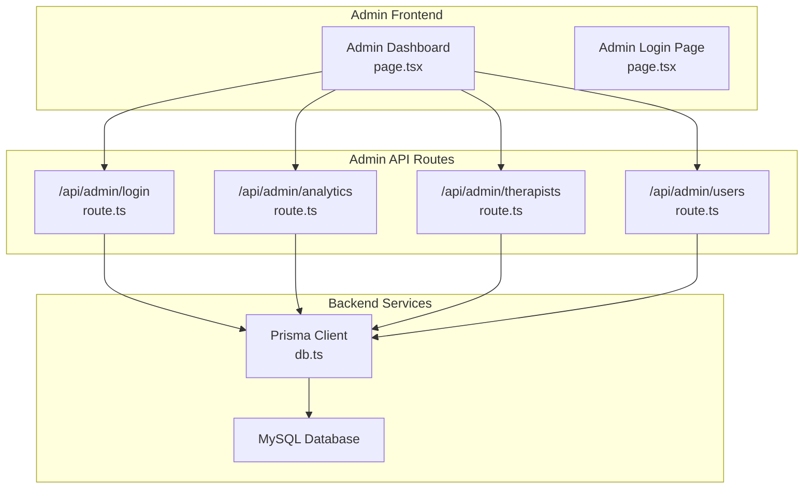
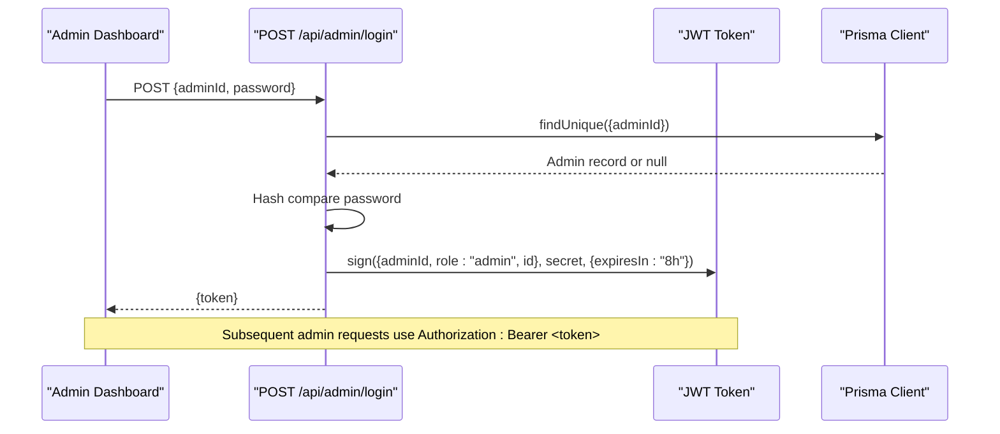
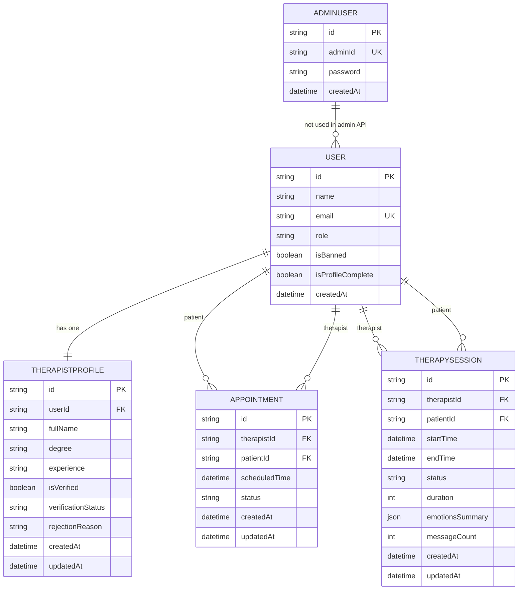
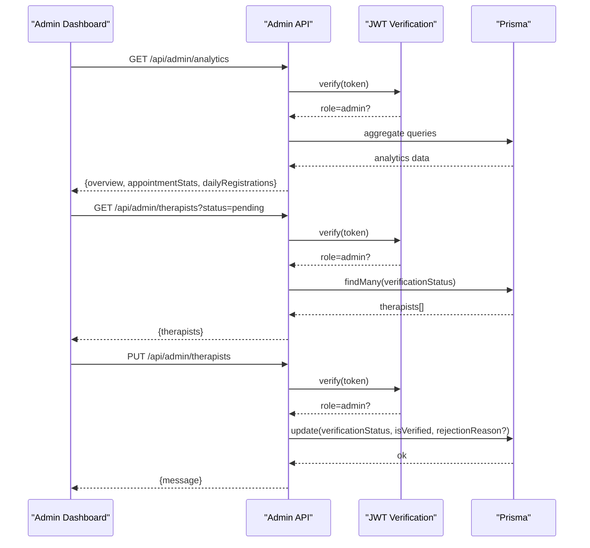
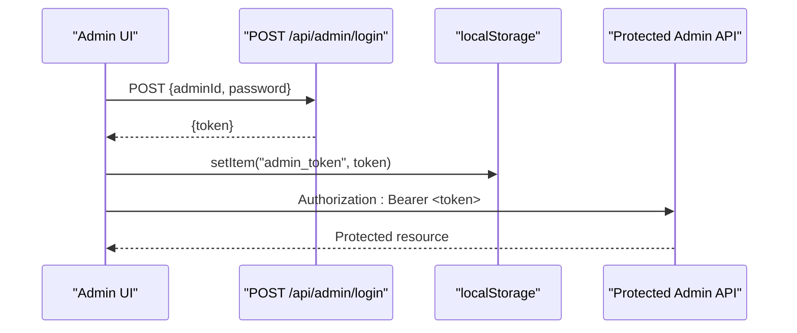
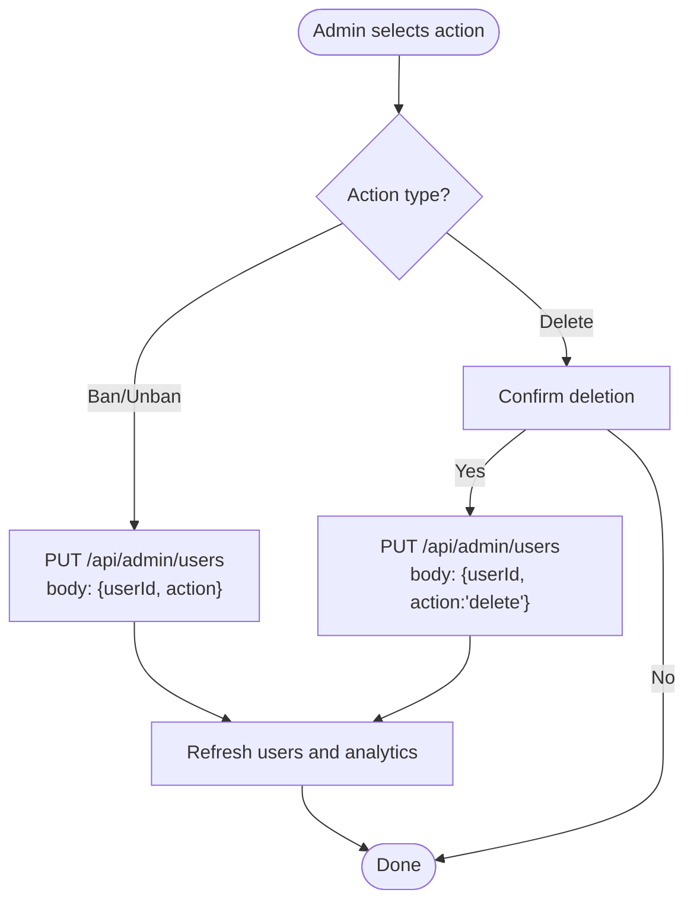
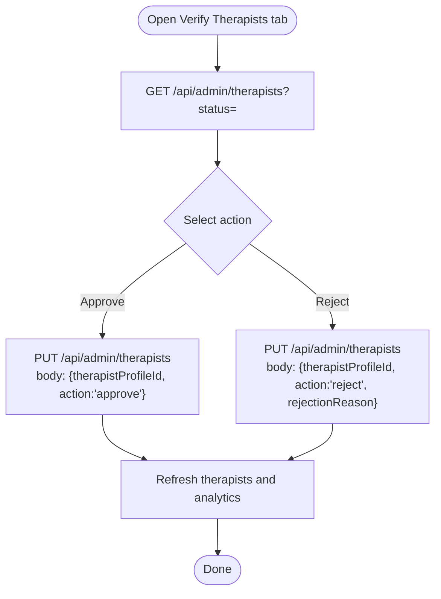
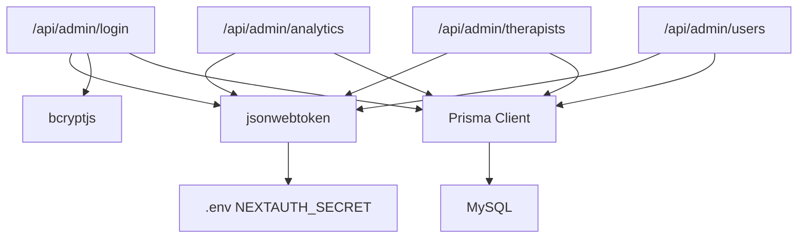

# Administration API

<cite>
**Referenced Files in This Document**
- [login/route.ts](file://WEBAPP/src/app/api/admin/login/route.ts)
- [analytics/route.ts](file://WEBAPP/src/app/api/admin/analytics/route.ts)
- [therapists/route.ts](file://WEBAPP/src/app/api/admin/therapists/route.ts)
- [users/route.ts](file://WEBAPP/src/app/api/admin/users/route.ts)
- [schema.prisma](file://WEBAPP/prisma/schema.prisma)
- [db.ts](file://WEBAPP/src/lib/db.ts)
- [admin-dashboard/page.tsx](file://WEBAPP/src/app/admin/dashboard/page.tsx)
- [admin-login/page.tsx](file://WEBAPP/src/app/admin/page.tsx)
- [.env](file://WEBAPP/.env)
</cite>

## Table of Contents
1. [Introduction](#introduction)
2. [Project Structure](#project-structure)
3. [Core Components](#core-components)
4. [Architecture Overview](#architecture-overview)
5. [Detailed Component Analysis](#detailed-component-analysis)
6. [Dependency Analysis](#dependency-analysis)
7. [Performance Considerations](#performance-considerations)
8. [Troubleshooting Guide](#troubleshooting-guide)
9. [Conclusion](#conclusion)
10. [Appendices](#appendices)

## Introduction
This document provides comprehensive API documentation for the MindBridge administration endpoints. It covers admin dashboard access, user management, therapist oversight, system analytics, and administrative controls. For each endpoint, you will find HTTP methods, URL patterns, request/response schemas, authentication requirements, and permission levels. The documentation also includes parameter descriptions for user roles, therapist approvals, system monitoring, and administrative actions, along with examples of admin workflows, user provisioning, and system maintenance procedures. Security considerations for privileged access and audit trail requirements are addressed throughout.

## Project Structure
The administration APIs are implemented as Next.js App Router API routes under WEBAPP/src/app/api/admin. The backend uses Prisma ORM to interact with a MySQL database. The admin dashboard UI is implemented as a client-side Next.js page that consumes these APIs.

**Diagram sources**
- [admin-dashboard/page.tsx](file://WEBAPP/src/app/admin/dashboard/page.tsx#L86-L131)
- [admin-login/page.tsx](file://WEBAPP/src/app/admin/page.tsx#L15-L37)
- [login/route.ts](file://WEBAPP/src/app/api/admin/login/route.ts#L9-L74)
- [analytics/route.ts](file://WEBAPP/src/app/api/admin/analytics/route.ts#L19-L108)
- [therapists/route.ts](file://WEBAPP/src/app/api/admin/therapists/route.ts#L20-L92)
- [users/route.ts](file://WEBAPP/src/app/api/admin/users/route.ts#L19-L107)
- [db.ts](file://WEBAPP/src/lib/db.ts#L1-L15)

**Section sources**
- [admin-dashboard/page.tsx](file://WEBAPP/src/app/admin/dashboard/page.tsx#L86-L131)
- [admin-login/page.tsx](file://WEBAPP/src/app/admin/page.tsx#L15-L37)
- [login/route.ts](file://WEBAPP/src/app/api/admin/login/route.ts#L9-L74)
- [analytics/route.ts](file://WEBAPP/src/app/api/admin/analytics/route.ts#L19-L108)
- [therapists/route.ts](file://WEBAPP/src/app/api/admin/therapists/route.ts#L20-L92)
- [users/route.ts](file://WEBAPP/src/app/api/admin/users/route.ts#L19-L107)
- [db.ts](file://WEBAPP/src/lib/db.ts#L1-L15)

## Core Components
- Admin Authentication and Authorization
  - Admin login endpoint validates credentials and issues a signed JWT with role claim.
  - All admin endpoints require a Bearer token with role=admin.
- System Analytics Endpoint
  - Returns aggregated metrics, appointment statistics, and daily registration trends.
- Therapist Oversight Endpoint
  - Lists therapist profiles filtered by verification status and approves/rejects them.
- User Management Endpoint
  - Lists users filtered by role and search query, and performs ban/unban/delete actions.

**Section sources**
- [login/route.ts](file://WEBAPP/src/app/api/admin/login/route.ts#L9-L74)
- [analytics/route.ts](file://WEBAPP/src/app/api/admin/analytics/route.ts#L19-L108)
- [therapists/route.ts](file://WEBAPP/src/app/api/admin/therapists/route.ts#L20-L92)
- [users/route.ts](file://WEBAPP/src/app/api/admin/users/route.ts#L19-L107)

## Architecture Overview
The admin API follows a layered architecture:
- Presentation Layer: Next.js API routes implement HTTP endpoints.
- Business Logic Layer: Route handlers validate requests, enforce permissions, and orchestrate data retrieval.
- Data Access Layer: Prisma client connects to MySQL database.
- Security Layer: JWT-based admin authentication with role enforcement.

**Diagram sources**
- [login/route.ts](file://WEBAPP/src/app/api/admin/login/route.ts#L9-L74)
- [db.ts](file://WEBAPP/src/lib/db.ts#L1-L15)

**Section sources**
- [login/route.ts](file://WEBAPP/src/app/api/admin/login/route.ts#L9-L74)
- [db.ts](file://WEBAPP/src/lib/db.ts#L1-L15)

## Detailed Component Analysis

### Admin Login
- Purpose: Authenticate admin credentials and issue a JWT token.
- Authentication: None required for login; however, issued tokens must be used for protected endpoints.
- Permissions: N/A (login endpoint itself does not require admin role).
- URL: POST /api/admin/login
- Request Body
  - adminId: string (required)
  - password: string (required)
- Response
  - On success: { message: string, token: string }
  - On invalid input: { error: string } (400)
  - On invalid credentials: { error: string } (401)
  - On server error: { error: string } (500)
- Security Notes
  - Uses bcrypt for password comparison.
  - Issues JWT with role=admin and expiration of 8 hours.
  - Secret is derived from NEXTAUTH_SECRET environment variable.

**Section sources**
- [login/route.ts](file://WEBAPP/src/app/api/admin/login/route.ts#L9-L74)
- [.env](file://WEBAPP/.env#L1-L31)

### Admin Dashboard Analytics
- Purpose: Retrieve system-wide analytics for the admin dashboard.
- Authentication: Required (Authorization: Bearer <admin-token>).
- Permissions: admin.
- URL: GET /api/admin/analytics
- Response Schema
  - overview: Object containing totals and counts
    - totalPatients: number
    - totalTherapists: number
    - totalUsers: number
    - totalSessions: number
    - totalAppointments: number
    - activePatients: number
    - activeTherapists: number
    - pendingVerifications: number
    - bannedUsers: number
    - newRegistrations: number
  - appointmentStats: Object mapping status to count
  - dailyRegistrations: Array of { createdAt: date, _count: { id: number } }
- Error Responses
  - Unauthorized: { error: string } (401)
  - Server Error: { error: string } (500)

**Section sources**
- [analytics/route.ts](file://WEBAPP/src/app/api/admin/analytics/route.ts#L19-L108)

### Therapist Oversight
- Purpose: Manage therapist verification lifecycle.
- Authentication: Required (Authorization: Bearer <admin-token>).
- Permissions: admin.
- URL: GET /api/admin/therapists
  - Query Parameter
    - status: string (optional; default "pending"). Allowed values: "pending", "approved", "rejected".
  - Response: { therapists: array of therapist profiles }
- URL: PUT /api/admin/therapists
  - Request Body
    - therapistProfileId: string (required)
    - action: string (required; "approve" or "reject")
    - rejectionReason: string (optional; required when action is "reject")
  - Response: { message: string }
  - Error Responses
    - Invalid input: { error: string } (400)
    - Unauthorized: { error: string } (401)
    - Server Error: { error: string } (500)

**Section sources**
- [therapists/route.ts](file://WEBAPP/src/app/api/admin/therapists/route.ts#L20-L92)

### User Management
- Purpose: View and manage users (patients and therapists).
- Authentication: Required (Authorization: Bearer <admin-token>).
- Permissions: admin.
- URL: GET /api/admin/users
  - Query Parameters
    - role: string (optional; "patient", "therapist", or omitted for both)
    - search: string (optional; partial match on email or name)
  - Response: { users: array of user records }
- URL: PUT /api/admin/users
  - Request Body
    - userId: string (required)
    - action: string (required; "ban", "unban", or "delete")
  - Response: { message: string }
  - Error Responses
    - Invalid input: { error: string } (400)
    - Unauthorized: { error: string } (401)
    - Server Error: { error: string } (500)

**Section sources**
- [users/route.ts](file://WEBAPP/src/app/api/admin/users/route.ts#L19-L107)

### Data Models and Relationships
The admin endpoints operate on the following Prisma models:
- AdminUser: Stores admin credentials (adminId, password).
- User: Base user entity with role ("patient", "therapist", "admin").
- TherapistProfile: Extended profile for therapists with verification fields.
- Appointment: Scheduling and status tracking.
- TherapySession: Session metadata and analytics.

**Diagram sources**
- [schema.prisma](file://WEBAPP/prisma/schema.prisma#L324-L330)
- [schema.prisma](file://WEBAPP/prisma/schema.prisma#L39-L69)
- [schema.prisma](file://WEBAPP/prisma/schema.prisma#L299-L321)
- [schema.prisma](file://WEBAPP/prisma/schema.prisma#L186-L211)
- [schema.prisma](file://WEBAPP/prisma/schema.prisma#L140-L161)

**Section sources**
- [schema.prisma](file://WEBAPP/prisma/schema.prisma#L324-L330)
- [schema.prisma](file://WEBAPP/prisma/schema.prisma#L39-L69)
- [schema.prisma](file://WEBAPP/prisma/schema.prisma#L299-L321)
- [schema.prisma](file://WEBAPP/prisma/schema.prisma#L186-L211)
- [schema.prisma](file://WEBAPP/prisma/schema.prisma#L140-L161)

## Architecture Overview
The admin dashboard orchestrates calls to the admin APIs, passing the admin JWT in the Authorization header. It supports tabbed views for overview, therapist verification, and user management.

**Diagram sources**
- [admin-dashboard/page.tsx](file://WEBAPP/src/app/admin/dashboard/page.tsx#L92-L131)
- [analytics/route.ts](file://WEBAPP/src/app/api/admin/analytics/route.ts#L19-L108)
- [therapists/route.ts](file://WEBAPP/src/app/api/admin/therapists/route.ts#L20-L92)

**Section sources**
- [admin-dashboard/page.tsx](file://WEBAPP/src/app/admin/dashboard/page.tsx#L86-L131)
- [analytics/route.ts](file://WEBAPP/src/app/api/admin/analytics/route.ts#L19-L108)
- [therapists/route.ts](file://WEBAPP/src/app/api/admin/therapists/route.ts#L20-L92)

## Detailed Component Analysis

### Admin Authentication Flow
- Admin login issues a JWT with role=admin and 8-hour expiry.
- All subsequent admin endpoints validate the token and confirm role=admin.
- The frontend stores the token in localStorage and attaches it to all admin requests.

**Diagram sources**
- [admin-login/page.tsx](file://WEBAPP/src/app/admin/page.tsx#L15-L37)
- [login/route.ts](file://WEBAPP/src/app/api/admin/login/route.ts#L9-L74)
- [admin-dashboard/page.tsx](file://WEBAPP/src/app/admin/dashboard/page.tsx#L76-L84)

**Section sources**
- [admin-login/page.tsx](file://WEBAPP/src/app/admin/page.tsx#L15-L37)
- [login/route.ts](file://WEBAPP/src/app/api/admin/login/route.ts#L9-L74)
- [admin-dashboard/page.tsx](file://WEBAPP/src/app/admin/dashboard/page.tsx#L76-L84)

### User Management Workflow
- Fetch users with optional filters (role, search).
- Perform bulk-like actions (ban, unban, delete) per user.
- Refresh analytics after user actions.

**Diagram sources**
- [admin-dashboard/page.tsx](file://WEBAPP/src/app/admin/dashboard/page.tsx#L149-L163)
- [users/route.ts](file://WEBAPP/src/app/api/admin/users/route.ts#L75-L107)

**Section sources**
- [admin-dashboard/page.tsx](file://WEBAPP/src/app/admin/dashboard/page.tsx#L149-L163)
- [users/route.ts](file://WEBAPP/src/app/api/admin/users/route.ts#L75-L107)

### Therapist Approval Workflow
- Filter therapists by verification status.
- Approve or reject with optional rejection reason.
- Update analytics to reflect changes.

**Diagram sources**
- [admin-dashboard/page.tsx](file://WEBAPP/src/app/admin/dashboard/page.tsx#L102-L147)
- [therapists/route.ts](file://WEBAPP/src/app/api/admin/therapists/route.ts#L52-L92)

**Section sources**
- [admin-dashboard/page.tsx](file://WEBAPP/src/app/admin/dashboard/page.tsx#L102-L147)
- [therapists/route.ts](file://WEBAPP/src/app/api/admin/therapists/route.ts#L52-L92)

## Dependency Analysis
- Admin endpoints depend on Prisma client for database operations.
- JWT verification depends on NEXTAUTH_SECRET environment variable.
- Frontend depends on local storage for token persistence and Authorization header injection.

**Diagram sources**
- [login/route.ts](file://WEBAPP/src/app/api/admin/login/route.ts#L3-L74)
- [analytics/route.ts](file://WEBAPP/src/app/api/admin/analytics/route.ts#L1-L17)
- [therapists/route.ts](file://WEBAPP/src/app/api/admin/therapists/route.ts#L1-L18)
- [users/route.ts](file://WEBAPP/src/app/api/admin/users/route.ts#L1-L17)
- [db.ts](file://WEBAPP/src/lib/db.ts#L1-L15)
- [.env](file://WEBAPP/.env#L1-L31)

**Section sources**
- [login/route.ts](file://WEBAPP/src/app/api/admin/login/route.ts#L3-L74)
- [analytics/route.ts](file://WEBAPP/src/app/api/admin/analytics/route.ts#L1-L17)
- [therapists/route.ts](file://WEBAPP/src/app/api/admin/therapists/route.ts#L1-L18)
- [users/route.ts](file://WEBAPP/src/app/api/admin/users/route.ts#L1-L17)
- [db.ts](file://WEBAPP/src/lib/db.ts#L1-L15)
- [.env](file://WEBAPP/.env#L1-L31)

## Performance Considerations
- Analytics endpoint uses concurrent queries to minimize latency.
- Filtering and search are applied server-side to reduce payload sizes.
- Token verification is lightweight and cached in memory.

[No sources needed since this section provides general guidance]

## Troubleshooting Guide
- 401 Unauthorized on admin endpoints
  - Cause: Missing or invalid Authorization header; token missing role=admin.
  - Resolution: Re-authenticate via /api/admin/login and ensure token is stored and sent.
- Invalid input errors (400)
  - Causes: Missing or malformed fields in request body.
  - Resolution: Validate request payload against documented schemas.
- Server errors (500)
  - Causes: Database connectivity or query failures.
  - Resolution: Check database logs and Prisma client configuration.

**Section sources**
- [analytics/route.ts](file://WEBAPP/src/app/api/admin/analytics/route.ts#L19-L108)
- [therapists/route.ts](file://WEBAPP/src/app/api/admin/therapists/route.ts#L52-L92)
- [users/route.ts](file://WEBAPP/src/app/api/admin/users/route.ts#L75-L107)

## Conclusion
The MindBridge administration API provides a focused set of endpoints for admin login, analytics, therapist oversight, and user management. All endpoints enforce admin authentication via JWT, ensuring secure access to privileged operations. The frontend integrates seamlessly with these endpoints to support efficient administrative workflows.

[No sources needed since this section summarizes without analyzing specific files]

## Appendices

### API Reference Summary
- Admin Login
  - Method: POST
  - URL: /api/admin/login
  - Auth: None
  - Permissions: N/A
  - Response: { message, token }
- Analytics
  - Method: GET
  - URL: /api/admin/analytics
  - Auth: Bearer admin token
  - Permissions: admin
  - Response: { overview, appointmentStats, dailyRegistrations }
- Therapists
  - Method: GET
  - URL: /api/admin/therapists?status=pending|approved|rejected
  - Auth: Bearer admin token
  - Permissions: admin
  - Response: { therapists }
  - Method: PUT
  - URL: /api/admin/therapists
  - Auth: Bearer admin token
  - Permissions: admin
  - Request: { therapistProfileId, action, rejectionReason? }
  - Response: { message }
- Users
  - Method: GET
  - URL: /api/admin/users?role=&search=
  - Auth: Bearer admin token
  - Permissions: admin
  - Response: { users }
  - Method: PUT
  - URL: /api/admin/users
  - Auth: Bearer admin token
  - Permissions: admin
  - Request: { userId, action }
  - Response: { message }

**Section sources**
- [login/route.ts](file://WEBAPP/src/app/api/admin/login/route.ts#L9-L74)
- [analytics/route.ts](file://WEBAPP/src/app/api/admin/analytics/route.ts#L19-L108)
- [therapists/route.ts](file://WEBAPP/src/app/api/admin/therapists/route.ts#L20-L92)
- [users/route.ts](file://WEBAPP/src/app/api/admin/users/route.ts#L19-L107)