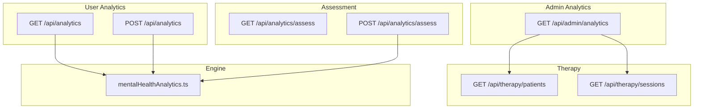
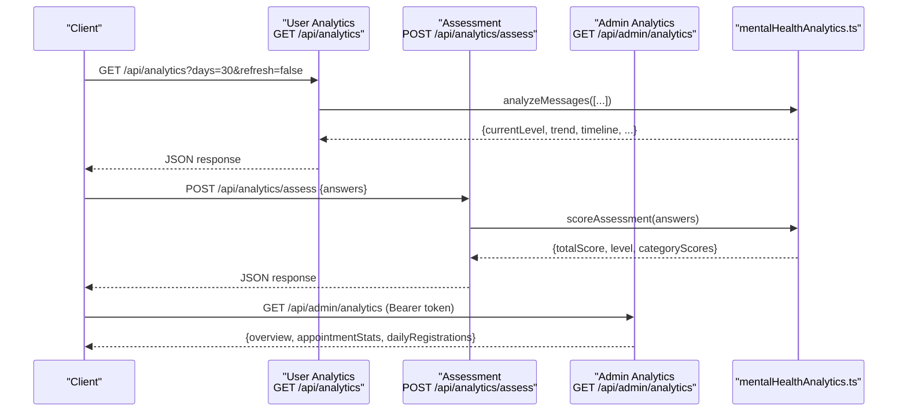
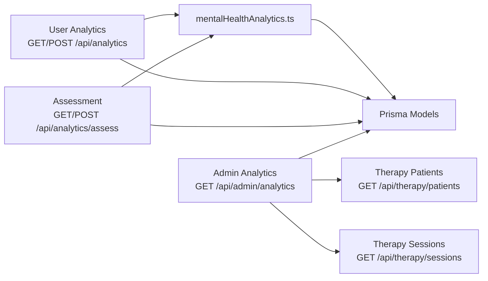

# Analytics API

<cite>
**Referenced Files in This Document**
- [route.ts](file://WEBAPP/src/app/api/analytics/route.ts)
- [route.ts](file://WEBAPP/src/app/api/analytics/assess/route.ts)
- [route.ts](file://WEBAPP/src/app/api/admin/analytics/route.ts)
- [mentalHealthAnalytics.ts](file://WEBAPP/src/lib/mentalHealthAnalytics.ts)
- [MentalHealthDashboard.tsx](file://WEBAPP/src/components/analytics/MentalHealthDashboard.tsx)
- [api.ts](file://WEBAPP/src/lib/api.ts)
- [route.ts](file://WEBAPP/src/app/api/therapy/patients/route.ts)
- [route.ts](file://WEBAPP/src/app/api/therapy/sessions/route.ts)
- [page.tsx](file://WEBAPP/src/app/admin/dashboard/page.tsx)
</cite>

## Table of Contents
1. [Introduction](#introduction)
2. [Project Structure](#project-structure)
3. [Core Components](#core-components)
4. [Architecture Overview](#architecture-overview)
5. [Detailed Component Analysis](#detailed-component-analysis)
6. [Dependency Analysis](#dependency-analysis)
7. [Performance Considerations](#performance-considerations)
8. [Troubleshooting Guide](#troubleshooting-guide)
9. [Conclusion](#conclusion)
10. [Appendices](#appendices)

## Introduction
This document provides comprehensive API documentation for MindBridge’s analytics endpoints. It covers:
- Patient progress tracking via chat-based mental health analytics
- Assessment scoring using structured questionnaires
- Mental health analytics engine and visualization formats
- Administrative reporting and dashboard integrations
- Filtering, aggregation, and export considerations
- Real-time analytics streaming and automated reporting
- Data privacy and HIPAA compliance considerations

## Project Structure
The analytics surface area spans:
- User-facing analytics endpoints under /api/analytics
- Assessment endpoints under /api/analytics/assess
- Administrative analytics under /api/admin/analytics
- Supporting analytics library and UI components
- Therapy session and patient listing endpoints used for administrative reporting

**Diagram sources**
- [route.ts](file://WEBAPP/src/app/api/analytics/route.ts#L1-L253)
- [route.ts](file://WEBAPP/src/app/api/analytics/assess/route.ts#L1-L121)
- [route.ts](file://WEBAPP/src/app/api/admin/analytics/route.ts#L1-L109)
- [route.ts](file://WEBAPP/src/app/api/therapy/patients/route.ts#L1-L61)
- [route.ts](file://WEBAPP/src/app/api/therapy/sessions/route.ts#L1-L80)
- [mentalHealthAnalytics.ts](file://WEBAPP/src/lib/mentalHealthAnalytics.ts#L1-L884)

**Section sources**
- [route.ts](file://WEBAPP/src/app/api/analytics/route.ts#L1-L253)
- [route.ts](file://WEBAPP/src/app/api/analytics/assess/route.ts#L1-L121)
- [route.ts](file://WEBAPP/src/app/api/admin/analytics/route.ts#L1-L109)
- [route.ts](file://WEBAPP/src/app/api/therapy/patients/route.ts#L1-L61)
- [route.ts](file://WEBAPP/src/app/api/therapy/sessions/route.ts#L1-L80)
- [mentalHealthAnalytics.ts](file://WEBAPP/src/lib/mentalHealthAnalytics.ts#L1-L884)

## Core Components
- User Analytics Endpoint
  - GET /api/analytics: Returns current mental health level, trend, keyword counts, risk flags, timeline, and counts of assessments and chat analyses. Supports query parameters days and refresh.
  - POST /api/analytics: Triggers a fresh analysis of recent chat messages for the authenticated user.
- Assessment Endpoint
  - GET /api/analytics/assess: Returns assessment questions and answer options.
  - POST /api/analytics/assess: Scores submitted answers and persists both assessment and analytics entries.
- Admin Analytics Endpoint
  - GET /api/admin/analytics: Returns administrative overview metrics, grouped appointment statistics, and daily registration counts. Requires admin JWT bearer token.
- Analytics Engine
  - Keyword-based categorization, risk flagging, trend computation, sentiment analysis, emotion classification, lexical diversity, and n-gram extraction.
- UI Dashboard
  - Renders charts and summaries derived from the analytics engine for patient-facing dashboards.

**Section sources**
- [route.ts](file://WEBAPP/src/app/api/analytics/route.ts#L1-L253)
- [route.ts](file://WEBAPP/src/app/api/analytics/assess/route.ts#L1-L121)
- [route.ts](file://WEBAPP/src/app/api/admin/analytics/route.ts#L1-L109)
- [mentalHealthAnalytics.ts](file://WEBAPP/src/lib/mentalHealthAnalytics.ts#L1-L884)
- [MentalHealthDashboard.tsx](file://WEBAPP/src/components/analytics/MentalHealthDashboard.tsx#L1-L541)

## Architecture Overview
The analytics pipeline integrates frontend dashboards, backend endpoints, and the analytics engine. Administrators consume administrative endpoints to generate reports and manage users and therapy sessions.

**Diagram sources**
- [route.ts](file://WEBAPP/src/app/api/analytics/route.ts#L1-L253)
- [route.ts](file://WEBAPP/src/app/api/analytics/assess/route.ts#L1-L121)
- [route.ts](file://WEBAPP/src/app/api/admin/analytics/route.ts#L1-L109)
- [mentalHealthAnalytics.ts](file://WEBAPP/src/lib/mentalHealthAnalytics.ts#L1-L884)

## Detailed Component Analysis

### User Analytics Endpoint
- Method: GET
- URL: /api/analytics
- Authentication: Session-based via next-auth
- Query Parameters:
  - days: number (default 30) — lookback window for history
  - refresh: string "true" to force re-analysis of recent chat messages
- Processing:
  - Builds a timeline combining chat analytics and assessment results
  - Computes trend from recent levels
  - Aggregates keyword counts and risk flags from the latest analysis
- Response Schema (selected fields):
  - currentLevel: number (1–5)
  - currentLevelLabel: string
  - currentSource: string ("chat" | "assessment" | "none")
  - trend: string ("improving" | "worsening" | "stable")
  - keywordCounts: object
  - riskFlags: string[]
  - timeline: array of { date, level, label, source, positiveCount, negativeCount }
  - assessmentCount: number
  - chatAnalysisCount: number
  - totalAnalyticsEntries: number
  - latestAnalysis: object (date, keywordsDetected, keywordCounts, totalMessages, positiveCount, negativeCount)
  - latestAssessment: object (date, totalScore, maxScore, level, label)

- Method: POST
- URL: /api/analytics
- Authentication: Session-based
- Processing:
  - Analyzes user chat messages from the last 7 days
  - Saves a new mental health analytics entry
- Response Schema:
  - success: boolean
  - analysis: object (id, mentalHealthLevel, levelLabel, totalMessages, positiveCount, negativeCount, keywordCounts, riskFlags, categoryBreakdown)

**Section sources**
- [route.ts](file://WEBAPP/src/app/api/analytics/route.ts#L1-L253)
- [mentalHealthAnalytics.ts](file://WEBAPP/src/lib/mentalHealthAnalytics.ts#L1-L884)

### Assessment Endpoint
- Method: GET
- URL: /api/analytics/assess
- Response Schema:
  - questions: array of { id, question, category }
  - answerOptions: array of { label, score }
  - totalQuestions: number
  - maxScore: number (questions × 3)

- Method: POST
- URL: /api/analytics/assess
- Authentication: Session-based
- Request Body:
  - answers: array of { questionId: number, score: number }
- Validation:
  - answers array required and length must match totalQuestions
  - Each answer score must be 0–3
- Processing:
  - Scores assessment and computes mental health level
  - Persists assessment session and a corresponding analytics entry
- Response Schema:
  - success: boolean
  - assessmentId: string
  - totalScore: number
  - maxScore: number
  - mentalHealthLevel: number (1–5)
  - levelLabel: string
  - categoryScores: object
  - detailedAnswers: array of { questionId, question, category, answer, score }

**Section sources**
- [route.ts](file://WEBAPP/src/app/api/analytics/assess/route.ts#L1-L121)
- [mentalHealthAnalytics.ts](file://WEBAPP/src/lib/mentalHealthAnalytics.ts#L1-L884)

### Administrative Analytics Endpoint
- Method: GET
- URL: /api/admin/analytics
- Authentication: Bearer token (admin JWT)
- Response Schema:
  - overview: { totalPatients, totalTherapists, totalUsers, totalSessions, totalAppointments, activePatients, activeTherapists, pendingVerifications, bannedUsers, newRegistrations }
  - appointmentStats: object mapping status to count
  - dailyRegistrations: array of { createdAt, _count: { id } }, ordered by date

- Related Therapy Endpoints (used for administrative reporting)
  - GET /api/therapy/patients?therapistId={id}
    - Returns list of patients for a given therapist with stats
  - GET /api/therapy/sessions?therapistId={id}&patientId={id}
    - Returns therapy sessions filtered by therapist or patient

**Section sources**
- [route.ts](file://WEBAPP/src/app/api/admin/analytics/route.ts#L1-L109)
- [route.ts](file://WEBAPP/src/app/api/therapy/patients/route.ts#L1-L61)
- [route.ts](file://WEBAPP/src/app/api/therapy/sessions/route.ts#L1-L80)

### Analytics Engine
- Keyword Categories and Weights:
  - stress, anxiety, depression, anger, self_harm, loneliness, positive
  - Weighted scoring influences severity level computation
- Mental Health Levels:
  - 1 Minimal, 2 Mild, 3 Moderate, 4 Moderately Severe, 5 Severe
- Assessment Scoring:
  - Sum of scores; categorical totals per question category
  - Escalation rules for self-harm indicators
- Trend Computation:
  - Compares recent vs older averages of levels
- Sentiment, Emotion, Lexical Diversity, N-grams:
  - VADER-like sentiment scoring and moving average
  - Plutchik’s wheel emotion classification
  - Lexical diversity (TTR) and rumination risk
  - Bigrams/trigrams extraction

**Section sources**
- [mentalHealthAnalytics.ts](file://WEBAPP/src/lib/mentalHealthAnalytics.ts#L1-L884)

### UI Dashboard Integration
- The MentalHealthDashboard component consumes the analytics engine to render:
  - Severity level gauge
  - Sentiment timeline (area + moving average)
  - Emotion distribution pie chart
  - Mental health radar and category breakdown bar chart
  - N-gram phrase charts
  - Risk flags and summary cards

**Section sources**
- [MentalHealthDashboard.tsx](file://WEBAPP/src/components/analytics/MentalHealthDashboard.tsx#L1-L541)
- [mentalHealthAnalytics.ts](file://WEBAPP/src/lib/mentalHealthAnalytics.ts#L1-L884)

## Dependency Analysis
- Endpoints depend on:
  - Prisma ORM for persistence
  - next-auth for session-based authentication
  - mentalHealthAnalytics.ts for computations
- Admin analytics depends on therapy endpoints for administrative reporting
- Frontend dashboards rely on the analytics engine for rendering

**Diagram sources**
- [route.ts](file://WEBAPP/src/app/api/analytics/route.ts#L1-L253)
- [route.ts](file://WEBAPP/src/app/api/analytics/assess/route.ts#L1-L121)
- [route.ts](file://WEBAPP/src/app/api/admin/analytics/route.ts#L1-L109)
- [route.ts](file://WEBAPP/src/app/api/therapy/patients/route.ts#L1-L61)
- [route.ts](file://WEBAPP/src/app/api/therapy/sessions/route.ts#L1-L80)
- [mentalHealthAnalytics.ts](file://WEBAPP/src/lib/mentalHealthAnalytics.ts#L1-L884)

**Section sources**
- [route.ts](file://WEBAPP/src/app/api/analytics/route.ts#L1-L253)
- [route.ts](file://WEBAPP/src/app/api/analytics/assess/route.ts#L1-L121)
- [route.ts](file://WEBAPP/src/app/api/admin/analytics/route.ts#L1-L109)
- [route.ts](file://WEBAPP/src/app/api/therapy/patients/route.ts#L1-L61)
- [route.ts](file://WEBAPP/src/app/api/therapy/sessions/route.ts#L1-L80)
- [mentalHealthAnalytics.ts](file://WEBAPP/src/lib/mentalHealthAnalytics.ts#L1-L884)

## Performance Considerations
- Query windows:
  - User analytics defaults to 30 days; adjust days to balance fidelity and performance.
  - Chat analysis operates on the last 7 days to keep computations timely.
- Trend computation:
  - Uses recent vs older averages; ensure sufficient data points for meaningful trend signals.
- Sentiment and emotion analysis:
  - Complexity scales linearly with message count; consider batching or caching for repeated queries.
- Database queries:
  - Admin analytics uses grouped aggregations and parallel promises to minimize latency.

[No sources needed since this section provides general guidance]

## Troubleshooting Guide
- Unauthorized Access:
  - User endpoints require a valid session; admin endpoint requires a valid Bearer token.
- Missing or invalid parameters:
  - Assessment POST expects a complete answers array with valid scores.
  - Therapy endpoints require either therapistId or patientId.
- Error responses:
  - Endpoints return JSON errors with appropriate HTTP status codes (400, 401, 404, 500).

**Section sources**
- [route.ts](file://WEBAPP/src/app/api/analytics/route.ts#L1-L253)
- [route.ts](file://WEBAPP/src/app/api/analytics/assess/route.ts#L1-L121)
- [route.ts](file://WEBAPP/src/app/api/admin/analytics/route.ts#L1-L109)
- [route.ts](file://WEBAPP/src/app/api/therapy/patients/route.ts#L1-L61)
- [route.ts](file://WEBAPP/src/app/api/therapy/sessions/route.ts#L1-L80)

## Conclusion
MindBridge’s analytics endpoints provide a robust foundation for patient progress tracking, structured assessment scoring, and administrative reporting. The mental health analytics engine offers rich insights through keyword analysis, sentiment, emotion classification, and trend computation. Administrators can leverage administrative endpoints to monitor platform activity and support operational decisions.

[No sources needed since this section summarizes without analyzing specific files]

## Appendices

### API Definitions

- User Analytics
  - GET /api/analytics
    - Query: days (number, default 30), refresh (string "true"|"false")
    - Response: aggregated analytics, timeline, counts, and metadata
  - POST /api/analytics
    - Response: success flag and analysis payload

- Assessment
  - GET /api/analytics/assess
    - Response: questions, answer options, totals
  - POST /api/analytics/assess
    - Body: answers array
    - Response: assessmentId, scores, level, categoryScores, detailedAnswers

- Admin Analytics
  - GET /api/admin/analytics
    - Headers: Authorization: Bearer <token>
    - Response: overview metrics, appointmentStats, dailyRegistrations

- Therapy Reporting
  - GET /api/therapy/patients?therapistId={id}
  - GET /api/therapy/sessions?therapistId={id}&patientId={id}

**Section sources**
- [route.ts](file://WEBAPP/src/app/api/analytics/route.ts#L1-L253)
- [route.ts](file://WEBAPP/src/app/api/analytics/assess/route.ts#L1-L121)
- [route.ts](file://WEBAPP/src/app/api/admin/analytics/route.ts#L1-L109)
- [route.ts](file://WEBAPP/src/app/api/therapy/patients/route.ts#L1-L61)
- [route.ts](file://WEBAPP/src/app/api/therapy/sessions/route.ts#L1-L80)

### Data Visualization Formats
- Charts supported by the UI dashboard:
  - Line/Area charts for sentiment over time
  - Radar chart for keyword category frequency
  - Bar charts for category breakdown
  - Pie chart for emotion distribution
  - Severity gauge bars
- Backend timeline and category breakdown are designed for chart consumption.

**Section sources**
- [MentalHealthDashboard.tsx](file://WEBAPP/src/components/analytics/MentalHealthDashboard.tsx#L1-L541)
- [mentalHealthAnalytics.ts](file://WEBAPP/src/lib/mentalHealthAnalytics.ts#L1-L884)

### Export Capabilities
- Current endpoints return JSON responses suitable for client-side rendering and chart consumption.
- To enable exports, clients can:
  - Persist returned JSON payloads locally
  - Transform timeline arrays and category breakdowns into CSV/Excel for external reporting
  - Use admin overview and grouped stats for executive dashboards

[No sources needed since this section provides general guidance]

### Real-Time Analytics Streaming
- The current endpoints are request-response based.
- To implement streaming:
  - Use Server-Sent Events (SSE) or WebSockets to push updates when new chat messages or assessments are recorded
  - Clients can subscribe to their own analytics stream and update charts in real time

[No sources needed since this section provides general guidance]

### Automated Reporting Setups
- Daily/weekly/monthly reports can be scheduled by:
  - Polling GET /api/admin/analytics at cadence intervals
  - Storing overview and dailyRegistrations for trend analysis
  - Integrating therapy endpoints for session-based KPIs

**Section sources**
- [route.ts](file://WEBAPP/src/app/api/admin/analytics/route.ts#L1-L109)
- [route.ts](file://WEBAPP/src/app/api/therapy/patients/route.ts#L1-L61)
- [route.ts](file://WEBAPP/src/app/api/therapy/sessions/route.ts#L1-L80)

### Data Privacy and HIPAA Compliance Considerations
- Authentication and Authorization:
  - User endpoints require session-based authentication; admin endpoint requires a signed JWT bearer token.
- Data Minimization:
  - Analyze only necessary chat messages (last 7 days) and limit lookback windows (days parameter).
- Secure Storage:
  - Ensure environment variables for secrets and database credentials are protected.
- Audit Logging:
  - Log administrative actions and analytics requests for accountability.
- Data Retention:
  - Implement policies for retaining analytics and assessment data per regulatory requirements.
- Token Management:
  - Rotate admin JWT secrets and enforce short-lived tokens.

**Section sources**
- [route.ts](file://WEBAPP/src/app/api/analytics/route.ts#L1-L253)
- [route.ts](file://WEBAPP/src/app/api/analytics/assess/route.ts#L1-L121)
- [route.ts](file://WEBAPP/src/app/api/admin/analytics/route.ts#L1-L109)
- [api.ts](file://WEBAPP/src/lib/api.ts#L1-L142)