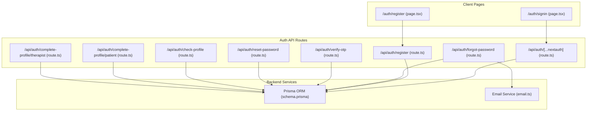
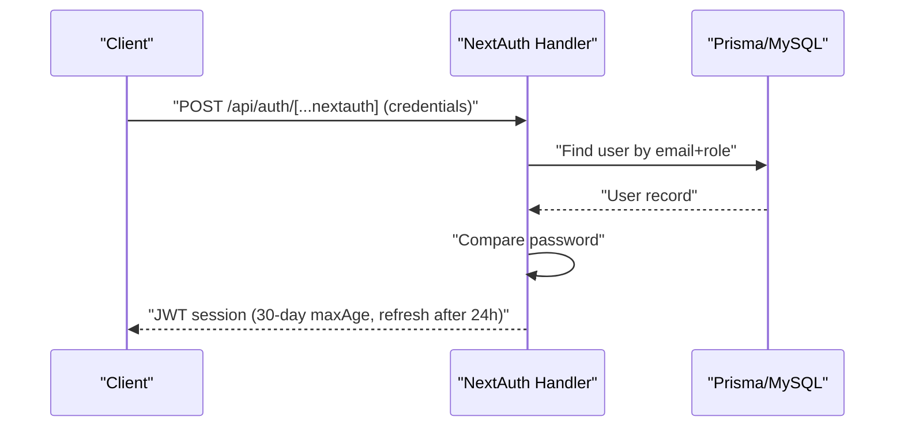
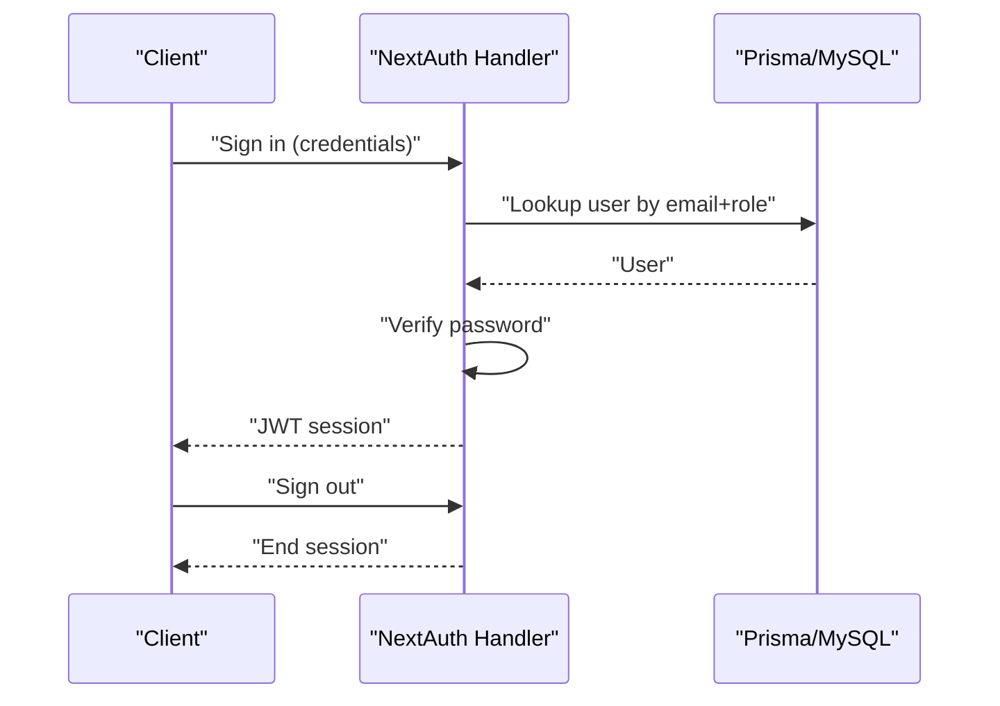
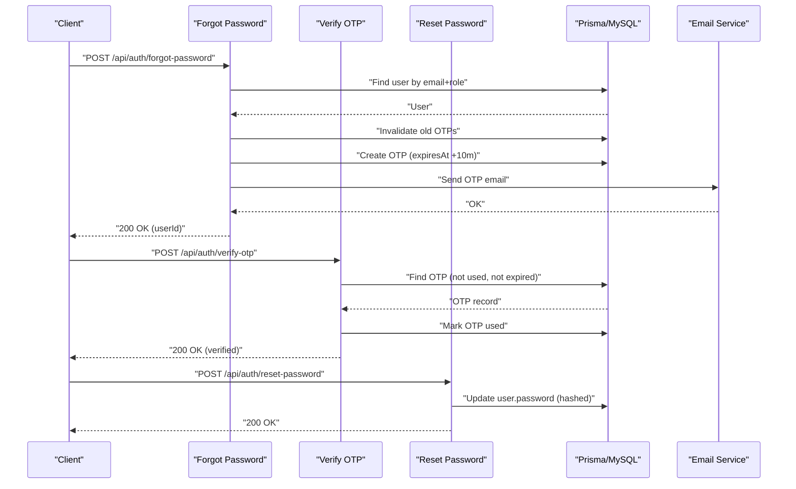
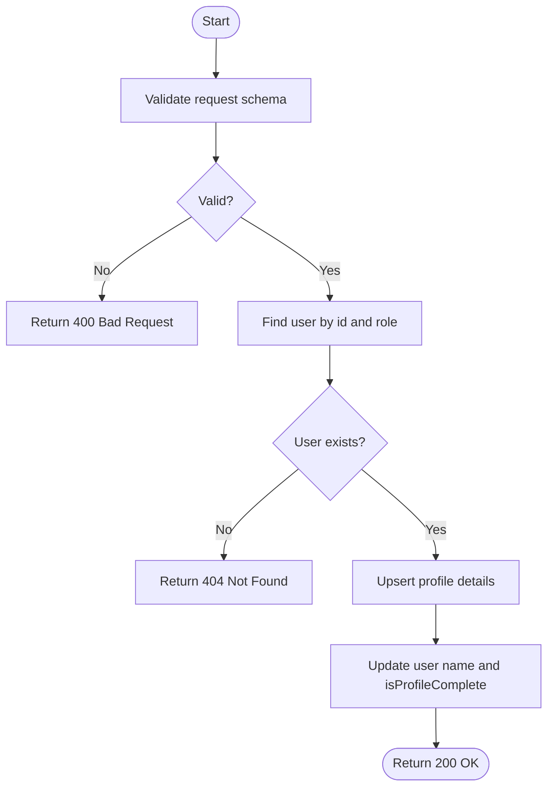
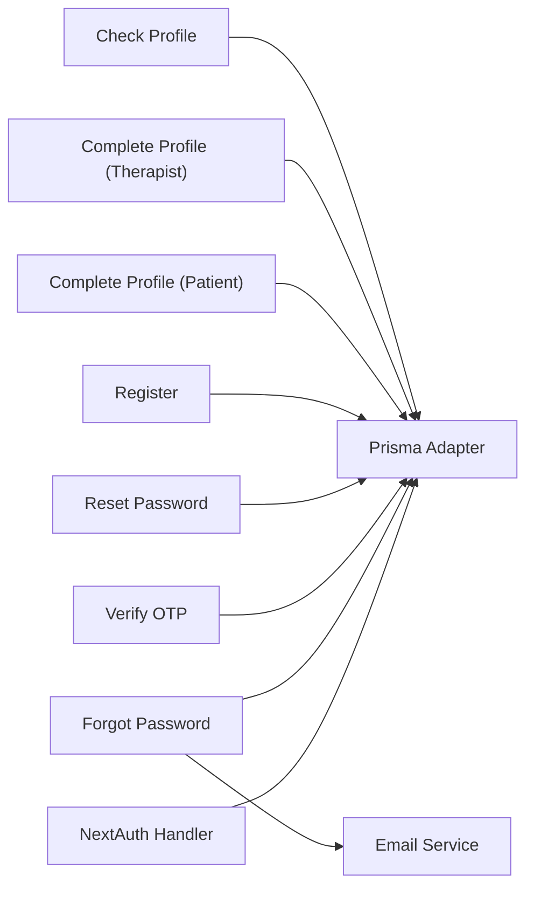

# Authentication API

<cite>
**Referenced Files in This Document**
- [route.ts](file://WEBAPP/src/app/api/auth/register/route.ts)
- [route.ts](file://WEBAPP/src/app/api/auth/verify-otp/route.ts)
- [route.ts](file://WEBAPP/src/app/api/auth/forgot-password/route.ts)
- [route.ts](file://WEBAPP/src/app/api/auth/reset-password/route.ts)
- [route.ts](file://WEBAPP/src/app/api/auth/check-profile/route.ts)
- [route.ts](file://WEBAPP/src/app/api/auth/complete-profile/patient/route.ts)
- [route.ts](file://WEBAPP/src/app/api/auth/complete-profile/therapist/route.ts)
- [route.ts](file://WEBAPP/src/app/api/auth/[...nextauth]/route.ts)
- [schema.prisma](file://WEBAPP/prisma/schema.prisma)
- [email.ts](file://WEBAPP/src/lib/email.ts)
- [sessionManager.ts](file://WEBAPP/src/lib/sessionManager.ts)
- [next-auth.d.ts](file://WEBAPP/src/types/next-auth.d.ts)
- [page.tsx](file://WEBAPP/src/app/auth/signin/page.tsx)
- [page.tsx](file://WEBAPP/src/app/auth/register/page.tsx)
</cite>

## Table of Contents
1. [Introduction](#introduction)
2. [Project Structure](#project-structure)
3. [Core Components](#core-components)
4. [Architecture Overview](#architecture-overview)
5. [Detailed Component Analysis](#detailed-component-analysis)
6. [Dependency Analysis](#dependency-analysis)
7. [Performance Considerations](#performance-considerations)
8. [Troubleshooting Guide](#troubleshooting-guide)
9. [Conclusion](#conclusion)
10. [Appendices](#appendices)

## Introduction
This document provides comprehensive API documentation for MindBridge’s authentication system. It covers user registration, login, password management via OTP, profile completion flows, and NextAuth integration. For each endpoint, you will find HTTP methods, URL patterns, request/response schemas, validation rules, error handling, session management, role-based access controls, and security measures. Client implementation examples are included to guide proper error handling and token/session lifecycle management.

## Project Structure
The authentication surface is implemented as Next.js App Router API routes under WEBAPP/src/app/api/auth, integrated with NextAuth for session/JWT management, and backed by Prisma ORM and a MySQL database. Client pages demonstrate typical client-side flows.

**Diagram sources**
- [route.ts](file://WEBAPP/src/app/api/auth/register/route.ts#L1-L48)
- [route.ts](file://WEBAPP/src/app/api/auth/verify-otp/route.ts#L1-L55)
- [route.ts](file://WEBAPP/src/app/api/auth/forgot-password/route.ts#L1-L102)
- [route.ts](file://WEBAPP/src/app/api/auth/reset-password/route.ts#L1-L42)
- [route.ts](file://WEBAPP/src/app/api/auth/check-profile/route.ts#L1-L53)
- [route.ts](file://WEBAPP/src/app/api/auth/complete-profile/patient/route.ts#L1-L74)
- [route.ts](file://WEBAPP/src/app/api/auth/complete-profile/therapist/route.ts#L1-L93)
- [route.ts](file://WEBAPP/src/app/api/auth/[...nextauth]/route.ts#L1-L240)
- [schema.prisma](file://WEBAPP/prisma/schema.prisma#L1-L330)
- [email.ts](file://WEBAPP/src/lib/email.ts#L1-L201)
- [page.tsx](file://WEBAPP/src/app/auth/signin/page.tsx#L1-L257)
- [page.tsx](file://WEBAPP/src/app/auth/register/page.tsx#L1-L266)

**Section sources**
- [route.ts](file://WEBAPP/src/app/api/auth/register/route.ts#L1-L48)
- [route.ts](file://WEBAPP/src/app/api/auth/[...nextauth]/route.ts#L1-L240)
- [schema.prisma](file://WEBAPP/prisma/schema.prisma#L1-L330)
- [email.ts](file://WEBAPP/src/lib/email.ts#L1-L201)
- [page.tsx](file://WEBAPP/src/app/auth/signin/page.tsx#L1-L257)
- [page.tsx](file://WEBAPP/src/app/auth/register/page.tsx#L1-L266)

## Core Components
- Registration endpoint validates input, checks uniqueness by email and role, hashes passwords, and creates a user record.
- NextAuth handles credentials and Google OAuth, manages JWT sessions, and enriches tokens/sessions with role and profile flags.
- Password reset uses OTP generation, persistence, email delivery, and secure updates.
- Profile completion enforces role-specific schemas and marks profiles complete.
- Session utilities help detect expiry and manage browser events.

**Section sources**
- [route.ts](file://WEBAPP/src/app/api/auth/register/route.ts#L1-L48)
- [route.ts](file://WEBAPP/src/app/api/auth/[...nextauth]/route.ts#L1-L240)
- [route.ts](file://WEBAPP/src/app/api/auth/forgot-password/route.ts#L1-L102)
- [route.ts](file://WEBAPP/src/app/api/auth/reset-password/route.ts#L1-L42)
- [route.ts](file://WEBAPP/src/app/api/auth/complete-profile/patient/route.ts#L1-L74)
- [route.ts](file://WEBAPP/src/app/api/auth/complete-profile/therapist/route.ts#L1-L93)
- [sessionManager.ts](file://WEBAPP/src/lib/sessionManager.ts#L1-L78)

## Architecture Overview
MindBridge uses NextAuth with a JWT strategy for session management. Credentials and Google providers are supported. OTP-based password reset is implemented alongside database-backed user and profile records.

**Diagram sources**
- [route.ts](file://WEBAPP/src/app/api/auth/[...nextauth]/route.ts#L62-L98)
- [schema.prisma](file://WEBAPP/prisma/schema.prisma#L39-L69)

## Detailed Component Analysis

### Registration
- Method: POST
- URL: /api/auth/register
- Purpose: Create a new user account with hashed password and role.
- Request schema:
  - email: string (valid email)
  - password: string (min 4, max 10)
  - role: enum ["patient", "therapist"]
- Response:
  - On success: 201 Created with message
  - On conflict: 409 Conflict if user+role exists
  - On validation failure: 400 Bad Request with details
  - On server error: 500 Internal Server Error
- Validation rules:
  - Email must be valid.
  - Password length constrained by backend schema.
  - Role must be one of the allowed values.
- Security:
  - Password hashed with bcrypt before storage.
  - Duplicate prevention by email+role composite filter.
- Error handling:
  - Returns structured error payload with details when validation fails.
  - Logs and returns generic server error on exceptions.

**Section sources**
- [route.ts](file://WEBAPP/src/app/api/auth/register/route.ts#L1-L48)
- [schema.prisma](file://WEBAPP/prisma/schema.prisma#L39-L48)

### Login (NextAuth)
- Method: POST
- URL: /api/auth/[...nextauth]
- Providers:
  - Credentials: email, password, role
  - Google: OAuth with offline access and consent prompt
- Session strategy:
  - JWT with maxAge 30 days, updateAge 24 hours.
  - Cookies configured for HTTP-only, SameSite lax, and secure when served over HTTPS.
- Token enrichment:
  - Adds role, id, and isProfileComplete to JWT and session.
- Access control:
  - Rejects banned users.
  - Ensures correct role selection during sign-in.
- Logout:
  - Triggers NextAuth sign-out events and logs activity.

**Diagram sources**
- [route.ts](file://WEBAPP/src/app/api/auth/[...nextauth]/route.ts#L62-L98)
- [route.ts](file://WEBAPP/src/app/api/auth/[...nextauth]/route.ts#L174-L213)
- [route.ts](file://WEBAPP/src/app/api/auth/[...nextauth]/route.ts#L215-L233)

**Section sources**
- [route.ts](file://WEBAPP/src/app/api/auth/[...nextauth]/route.ts#L1-L240)
- [next-auth.d.ts](file://WEBAPP/src/types/next-auth.d.ts#L1-L28)

### Password Reset (Forgot Password + Reset)
- Step 1: Forgot Password
  - Method: POST
  - URL: /api/auth/forgot-password
  - Request schema:
    - email: string (valid email)
    - role: enum ["patient", "therapist"]
  - Behavior:
    - Validates input.
    - Finds user by email+role.
    - Invalidates previous unused OTPs for the user.
    - Generates a 6-digit OTP with 10-minute expiry.
    - Persists OTP with expiry timestamp.
    - Sends email with OTP (or logs in dev).
  - Response:
    - 200 OK with message and userId on success.
    - 404 Not Found if user not found.
    - 400/500 on validation or server errors.
  - Security:
    - OTP expires after 10 minutes.
    - OTP marked as used upon verification.
- Step 2: Verify OTP
  - Method: POST
  - URL: /api/auth/verify-otp
  - Request schema:
    - userId: string
    - otp: string (exactly 6 digits)
  - Behavior:
    - Validates input.
    - Finds OTP by userId, otp, not used, and not expired.
    - Marks OTP as used.
  - Response:
    - 200 OK with verified flag on success.
    - 400 Bad Request if invalid/expired.
    - 500 Internal Server Error on failure.
- Step 3: Reset Password
  - Method: POST
  - URL: /api/auth/reset-password
  - Request schema:
    - userId: string
    - newPassword: string (min 4, max 20)
  - Behavior:
    - Validates input.
    - Hashes new password.
    - Updates user’s password.
  - Response:
    - 200 OK on success.
    - 400/500 on validation or server errors.

**Diagram sources**
- [route.ts](file://WEBAPP/src/app/api/auth/forgot-password/route.ts#L1-L102)
- [route.ts](file://WEBAPP/src/app/api/auth/verify-otp/route.ts#L1-L55)
- [route.ts](file://WEBAPP/src/app/api/auth/reset-password/route.ts#L1-L42)
- [email.ts](file://WEBAPP/src/lib/email.ts#L1-L201)
- [schema.prisma](file://WEBAPP/prisma/schema.prisma#L268-L280)

**Section sources**
- [route.ts](file://WEBAPP/src/app/api/auth/forgot-password/route.ts#L1-L102)
- [route.ts](file://WEBAPP/src/app/api/auth/verify-otp/route.ts#L1-L55)
- [route.ts](file://WEBAPP/src/app/api/auth/reset-password/route.ts#L1-L42)
- [email.ts](file://WEBAPP/src/lib/email.ts#L1-L201)

### Profile Completion
- Patient profile completion
  - Method: POST
  - URL: /api/auth/complete-profile/patient
  - Request schema:
    - userId: string
    - fullName: string (min length 2)
    - dateOfBirth: string (ISO date)
    - gender: string
    - age: number (min 1, max 150)
    - height: optional string
    - weight: optional string
  - Behavior:
    - Validates input.
    - Confirms user exists and role is patient.
    - Upserts patient details.
    - Updates user name and sets isProfileComplete.
  - Response:
    - 200 OK on success.
    - 404 Not Found if user not found.
    - 400/500 on validation or server errors.
- Therapist profile completion
  - Method: POST
  - URL: /api/auth/complete-profile/therapist
  - Request schema:
    - userId: string
    - fullName: string (min length 2)
    - dateOfBirth: string (ISO date)
    - gender: string
    - age: number (min 1, max 150)
    - degree: string (min length 2)
    - experience: string (min length 1)
    - hospitalAffiliation: string (min length 2)
    - photoUrl: string (min length 1)
  - Behavior:
    - Validates input.
    - Confirms user exists and role is therapist.
    - Upserts therapist profile with verification defaults.
    - Updates user name and sets isProfileComplete.
  - Response:
    - 200 OK on success.
    - 404 Not Found if user not found.
    - 400/500 on validation or server errors.

**Diagram sources**
- [route.ts](file://WEBAPP/src/app/api/auth/complete-profile/patient/route.ts#L1-L74)
- [route.ts](file://WEBAPP/src/app/api/auth/complete-profile/therapist/route.ts#L1-L93)

**Section sources**
- [route.ts](file://WEBAPP/src/app/api/auth/complete-profile/patient/route.ts#L1-L74)
- [route.ts](file://WEBAPP/src/app/api/auth/complete-profile/therapist/route.ts#L1-L93)
- [schema.prisma](file://WEBAPP/prisma/schema.prisma#L282-L321)

### Profile Status Check
- Method: POST
- URL: /api/auth/check-profile
- Request schema:
  - userId: string
- Response:
  - isProfileComplete: boolean
  - role: string
  - isBanned: boolean
  - therapistVerification: object|null (includes verificationStatus, isVerified, rejectionReason)
- Behavior:
  - Validates input.
  - Loads user with therapistProfile inclusion.
  - Returns profile completeness and verification state.
- Error handling:
  - 400/500 on validation or server errors.

**Section sources**
- [route.ts](file://WEBAPP/src/app/api/auth/check-profile/route.ts#L1-L53)
- [schema.prisma](file://WEBAPP/prisma/schema.prisma#L39-L69)

## Dependency Analysis
- NextAuth integrates with Prisma via PrismaAdapter and stores sessions/JWTs in the database.
- Email service is used for OTP delivery; missing credentials cause emails to be skipped with a warning.
- Client pages coordinate with NextAuth and local API endpoints to drive the authentication flow.

**Diagram sources**
- [route.ts](file://WEBAPP/src/app/api/auth/[...nextauth]/route.ts#L1-L240)
- [route.ts](file://WEBAPP/src/app/api/auth/forgot-password/route.ts#L1-L102)
- [route.ts](file://WEBAPP/src/app/api/auth/verify-otp/route.ts#L1-L55)
- [route.ts](file://WEBAPP/src/app/api/auth/reset-password/route.ts#L1-L42)
- [route.ts](file://WEBAPP/src/app/api/auth/register/route.ts#L1-L48)
- [route.ts](file://WEBAPP/src/app/api/auth/complete-profile/patient/route.ts#L1-L74)
- [route.ts](file://WEBAPP/src/app/api/auth/complete-profile/therapist/route.ts#L1-L93)
- [route.ts](file://WEBAPP/src/app/api/auth/check-profile/route.ts#L1-L53)
- [email.ts](file://WEBAPP/src/lib/email.ts#L1-L201)
- [schema.prisma](file://WEBAPP/prisma/schema.prisma#L1-L330)

**Section sources**
- [route.ts](file://WEBAPP/src/app/api/auth/[...nextauth]/route.ts#L1-L240)
- [email.ts](file://WEBAPP/src/lib/email.ts#L1-L201)
- [schema.prisma](file://WEBAPP/prisma/schema.prisma#L1-L330)

## Performance Considerations
- OTP expiry is enforced server-side to prevent replay attacks.
- Password hashing uses bcrypt with a moderate cost; adjust as needed for environment.
- NextAuth JWT maxAge and updateAge balance convenience and security.
- Email sending is asynchronous and falls back to logging in development.

[No sources needed since this section provides general guidance]

## Troubleshooting Guide
- Registration conflicts:
  - If a user+role combination already exists, the endpoint returns 409. Ensure unique combinations or prompt the user to sign in.
- Validation failures:
  - Requests with invalid schemas receive 400 with flattened details. Review field constraints (email format, min/max lengths, enums).
- OTP issues:
  - Expired or invalid OTPs return 400. Ensure client displays appropriate messages and allows resending OTP.
  - If email is not configured, OTP emails are skipped; verify environment variables and check logs.
- NextAuth session problems:
  - Use session utilities to detect expiry and reload on focus. Check browser storage events for cookie changes.
  - For secure cookies, ensure deployment is behind HTTPS when required.

**Section sources**
- [route.ts](file://WEBAPP/src/app/api/auth/register/route.ts#L1-L48)
- [route.ts](file://WEBAPP/src/app/api/auth/verify-otp/route.ts#L1-L55)
- [route.ts](file://WEBAPP/src/app/api/auth/forgot-password/route.ts#L1-L102)
- [email.ts](file://WEBAPP/src/lib/email.ts#L1-L201)
- [sessionManager.ts](file://WEBAPP/src/lib/sessionManager.ts#L1-L78)

## Conclusion
MindBridge’s authentication system combines robust input validation, secure password handling, OTP-based password reset, and flexible profile completion flows. NextAuth provides a secure, standards-compliant session/JWT mechanism with role-aware token enrichment. The APIs are designed for predictable error handling and clear client integration points.

[No sources needed since this section summarizes without analyzing specific files]

## Appendices

### Client Implementation Examples
- Client-side sign-in flow:
  - Use NextAuth’s signIn with credentials provider.
  - After successful sign-in, call the profile check endpoint to decide redirect (complete profile, pending verification, or dashboard).
- Client-side registration flow:
  - Submit registration form to /api/auth/register.
  - On success, auto sign-in and redirect to profile completion.
- Session lifecycle:
  - Use session utilities to detect expiry and reload on focus.
  - Listen for storage events to detect external cookie changes.

**Section sources**
- [page.tsx](file://WEBAPP/src/app/auth/signin/page.tsx#L1-L257)
- [page.tsx](file://WEBAPP/src/app/auth/register/page.tsx#L1-L266)
- [sessionManager.ts](file://WEBAPP/src/lib/sessionManager.ts#L1-L78)

### JWT Token Lifecycle and Logout
- JWT lifecycle:
  - Strategy: JWT.
  - maxAge: 30 days.
  - updateAge: 24 hours (refresh if active).
  - Cookies configured for HTTP-only, SameSite lax, and secure when served over HTTPS.
- Logout:
  - Trigger NextAuth sign-out; events are logged for monitoring.

**Section sources**
- [route.ts](file://WEBAPP/src/app/api/auth/[...nextauth]/route.ts#L10-L48)
- [route.ts](file://WEBAPP/src/app/api/auth/[...nextauth]/route.ts#L215-L233)