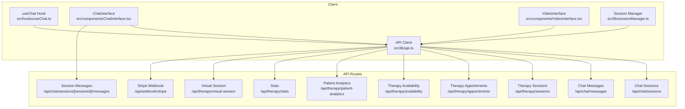
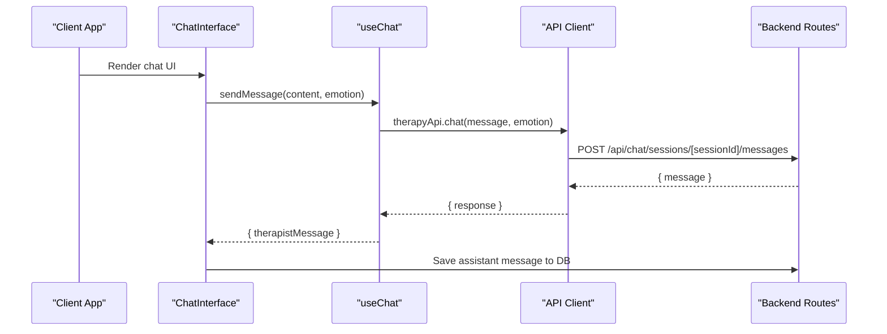
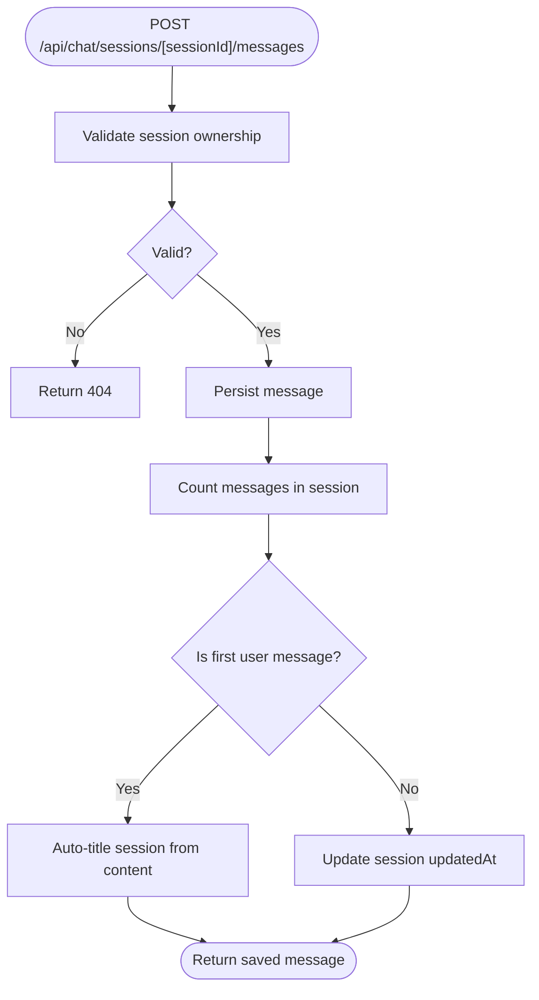
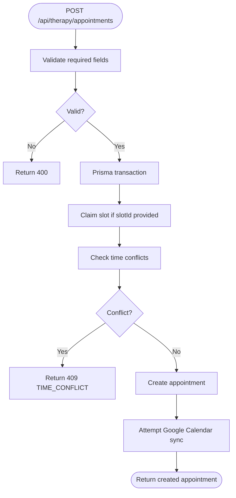
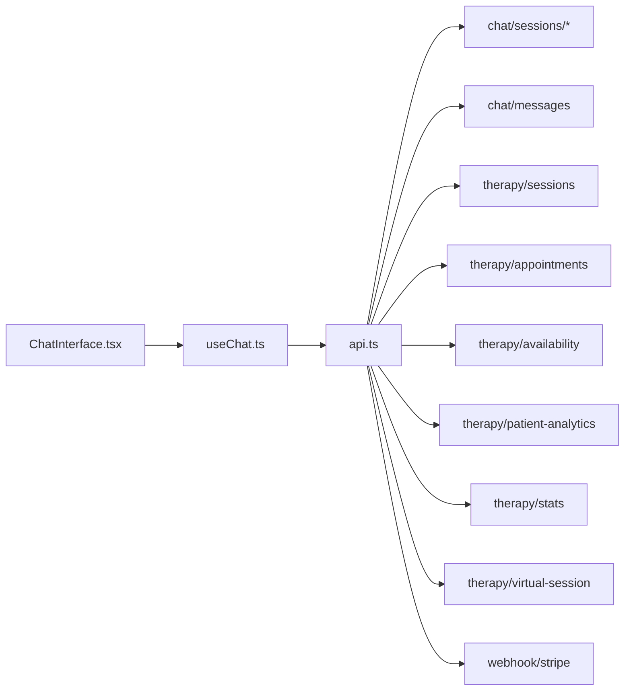

# Chat & Therapy API

<cite>
**Referenced Files in This Document**
- [route.ts](file://WEBAPP/src/app/api/chat/sessions/route.ts)
- [route.ts](file://WEBAPP/src/app/api/chat/messages/route.ts)
- [route.ts](file://WEBAPP/src/app/api/chat/sessions/[sessionId]/messages/route.ts)
- [route.ts](file://WEBAPP/src/app/api/therapy/sessions/route.ts)
- [route.ts](file://WEBAPP/src/app/api/therapy/appointments/route.ts)
- [route.ts](file://WEBAPP/src/app/api/therapy/availability/route.ts)
- [route.ts](file://WEBAPP/src/app/api/therapy/patient-analytics/route.ts)
- [route.ts](file://WEBAPP/src/app/api/therapy/stats/route.ts)
- [route.ts](file://WEBAPP/src/app/api/therapy/virtual-session/route.ts)
- [route.ts](file://WEBAPP/src/app/api/webhook/stripe/route.ts)
- [api.ts](file://WEBAPP/src/lib/api.ts)
- [useChat.ts](file://WEBAPP/src/hooks/useChat.ts)
- [ChatInterface.tsx](file://WEBAPP/src/components/ChatInterface.tsx)
- [VideoInterface.tsx](file://WEBAPP/src/components/VideoInterface.tsx)
- [sessionManager.ts](file://WEBAPP/src/lib/sessionManager.ts)
</cite>

## Table of Contents
1. [Introduction](#introduction)
2. [Project Structure](#project-structure)
3. [Core Components](#core-components)
4. [Architecture Overview](#architecture-overview)
5. [Detailed Component Analysis](#detailed-component-analysis)
6. [Dependency Analysis](#dependency-analysis)
7. [Performance Considerations](#performance-considerations)
8. [Troubleshooting Guide](#troubleshooting-guide)
9. [Conclusion](#conclusion)
10. [Appendices](#appendices)

## Introduction
This document provides comprehensive API documentation for MindBridge’s chat and therapy endpoints. It covers:
- Real-time-like messaging and session management
- Patient–therapist coordination
- Appointment scheduling and availability management
- Analytics and statistics
- Authentication and authorization
- Client-side integration patterns for chat interfaces and video consultations

It also documents the client SDK and UI components that consume these APIs, along with practical implementation guidance.

## Project Structure
The API surface is organized under Next.js App Router routes grouped by domain:
- Chat: sessions and messages
- Therapy: sessions, appointments, availability, analytics, stats, and virtual sessions
- Webhooks: Stripe payment completion webhook
- Client SDK and UI: API client, hooks, and components

**Diagram sources**
- [route.ts](file://WEBAPP/src/app/api/chat/sessions/route.ts#L1-L187)
- [route.ts](file://WEBAPP/src/app/api/chat/messages/route.ts#L1-L91)
- [route.ts](file://WEBAPP/src/app/api/chat/sessions/[sessionId]/messages/route.ts#L1-L137)
- [route.ts](file://WEBAPP/src/app/api/therapy/sessions/route.ts#L1-L80)
- [route.ts](file://WEBAPP/src/app/api/therapy/appointments/route.ts#L1-L181)
- [route.ts](file://WEBAPP/src/app/api/therapy/availability/route.ts#L1-L217)
- [route.ts](file://WEBAPP/src/app/api/therapy/patient-analytics/route.ts#L1-L74)
- [route.ts](file://WEBAPP/src/app/api/therapy/stats/route.ts#L1-L57)
- [route.ts](file://WEBAPP/src/app/api/therapy/virtual-session/route.ts#L1-L80)
- [route.ts](file://WEBAPP/src/app/api/webhook/stripe/route.ts#L1-L67)
- [api.ts](file://WEBAPP/src/lib/api.ts#L1-L142)
- [useChat.ts](file://WEBAPP/src/hooks/useChat.ts#L1-L150)
- [ChatInterface.tsx](file://WEBAPP/src/components/ChatInterface.tsx#L1-L567)
- [VideoInterface.tsx](file://WEBAPP/src/components/VideoInterface.tsx#L1-L207)
- [sessionManager.ts](file://WEBAPP/src/lib/sessionManager.ts#L1-L78)

**Section sources**
- [route.ts](file://WEBAPP/src/app/api/chat/sessions/route.ts#L1-L187)
- [route.ts](file://WEBAPP/src/app/api/chat/messages/route.ts#L1-L91)
- [route.ts](file://WEBAPP/src/app/api/chat/sessions/[sessionId]/messages/route.ts#L1-L137)
- [route.ts](file://WEBAPP/src/app/api/therapy/sessions/route.ts#L1-L80)
- [route.ts](file://WEBAPP/src/app/api/therapy/appointments/route.ts#L1-L181)
- [route.ts](file://WEBAPP/src/app/api/therapy/availability/route.ts#L1-L217)
- [route.ts](file://WEBAPP/src/app/api/therapy/patient-analytics/route.ts#L1-L74)
- [route.ts](file://WEBAPP/src/app/api/therapy/stats/route.ts#L1-L57)
- [route.ts](file://WEBAPP/src/app/api/therapy/virtual-session/route.ts#L1-L80)
- [route.ts](file://WEBAPP/src/app/api/webhook/stripe/route.ts#L1-L67)
- [api.ts](file://WEBAPP/src/lib/api.ts#L1-L142)
- [useChat.ts](file://WEBAPP/src/hooks/useChat.ts#L1-L150)
- [ChatInterface.tsx](file://WEBAPP/src/components/ChatInterface.tsx#L1-L567)
- [VideoInterface.tsx](file://WEBAPP/src/components/VideoInterface.tsx#L1-L207)
- [sessionManager.ts](file://WEBAPP/src/lib/sessionManager.ts#L1-L78)

## Core Components
- Authentication: All endpoints rely on NextAuth session validation via getServerSession. Requests must include the active NextAuth cookie.
- Data persistence: Prisma ORM connects to the database for CRUD operations.
- Client SDK: Centralized API client for AI/ML backends and convenience utilities.
- UI hooks and components: useChat manages chat state and integrates with AI/ML services; ChatInterface renders the chat UI and persists messages per session.

Key responsibilities:
- Chat: create/list/delete/update sessions; list/save messages; per-session message retrieval
- Therapy: list/create therapy sessions; list/create appointments; manage availability; analytics and stats; virtual session coordination
- Webhooks: process Stripe checkout completion to finalize appointments

**Section sources**
- [route.ts](file://WEBAPP/src/app/api/chat/sessions/route.ts#L1-L187)
- [route.ts](file://WEBAPP/src/app/api/chat/messages/route.ts#L1-L91)
- [route.ts](file://WEBAPP/src/app/api/chat/sessions/[sessionId]/messages/route.ts#L1-L137)
- [route.ts](file://WEBAPP/src/app/api/therapy/sessions/route.ts#L1-L80)
- [route.ts](file://WEBAPP/src/app/api/therapy/appointments/route.ts#L1-L181)
- [route.ts](file://WEBAPP/src/app/api/therapy/availability/route.ts#L1-L217)
- [route.ts](file://WEBAPP/src/app/api/therapy/patient-analytics/route.ts#L1-L74)
- [route.ts](file://WEBAPP/src/app/api/therapy/stats/route.ts#L1-L57)
- [route.ts](file://WEBAPP/src/app/api/therapy/virtual-session/route.ts#L1-L80)
- [route.ts](file://WEBAPP/src/app/api/webhook/stripe/route.ts#L1-L67)
- [api.ts](file://WEBAPP/src/lib/api.ts#L1-L142)
- [useChat.ts](file://WEBAPP/src/hooks/useChat.ts#L1-L150)
- [ChatInterface.tsx](file://WEBAPP/src/components/ChatInterface.tsx#L1-L567)
- [VideoInterface.tsx](file://WEBAPP/src/components/VideoInterface.tsx#L1-L207)
- [sessionManager.ts](file://WEBAPP/src/lib/sessionManager.ts#L1-L78)

## Architecture Overview
The system comprises:
- Backend routes (Next.js App Router) enforcing session-based auth and returning JSON responses
- Prisma models for chat sessions, messages, therapy sessions, appointments, availability, and analytics
- Client SDK for AI/ML services and convenience utilities
- UI components that integrate with the backend and AI/ML services

**Diagram sources**
- [ChatInterface.tsx](file://WEBAPP/src/components/ChatInterface.tsx#L106-L147)
- [useChat.ts](file://WEBAPP/src/hooks/useChat.ts#L40-L116)
- [api.ts](file://WEBAPP/src/lib/api.ts#L76-L113)
- [route.ts](file://WEBAPP/src/app/api/chat/sessions/[sessionId]/messages/route.ts#L52-L136)

## Detailed Component Analysis

### Authentication and Authorization
- All endpoints validate the NextAuth session via getServerSession and require an authenticated user.
- Role checks are enforced for therapist-only endpoints (e.g., availability management and analytics).
- Session expiration and incognito mode detection are handled client-side for UX continuity.

**Section sources**
- [route.ts](file://WEBAPP/src/app/api/chat/sessions/route.ts#L6-L40)
- [route.ts](file://WEBAPP/src/app/api/chat/messages/route.ts#L5-L46)
- [route.ts](file://WEBAPP/src/app/api/chat/sessions/[sessionId]/messages/route.ts#L5-L50)
- [route.ts](file://WEBAPP/src/app/api/therapy/availability/route.ts#L96-L111)
- [route.ts](file://WEBAPP/src/app/api/therapy/patient-analytics/route.ts#L11-L25)
- [sessionManager.ts](file://WEBAPP/src/lib/sessionManager.ts#L29-L76)

### Chat Endpoints

#### List and Manage Sessions
- GET /api/chat/sessions
  - Purpose: Retrieve a user’s active chat sessions
  - Auth: Required
  - Query: None
  - Response: Array of sessions with message counts
- POST /api/chat/sessions
  - Purpose: Create a new chat session
  - Auth: Required
  - Body: Optional title (defaults to “New Chat”)
  - Response: Created session
- PATCH /api/chat/sessions
  - Purpose: Update a session title
  - Auth: Required
  - Body: sessionId, optional title
  - Response: Updated session
- DELETE /api/chat/sessions?sessionId=...
  - Purpose: Delete a session (soft-delete if has messages; hard-delete if empty)
  - Auth: Required
  - Query: sessionId
  - Response: Deletion confirmation

**Section sources**
- [route.ts](file://WEBAPP/src/app/api/chat/sessions/route.ts#L5-L187)

#### Messages
- POST /api/chat/messages
  - Purpose: Save a user message
  - Auth: Required
  - Body: content (required), emotion, emotionScore, metadata
  - Response: Saved message
- GET /api/chat/messages?limit=&offset=
  - Purpose: Paginate user messages
  - Auth: Required
  - Query: limit (default 100), offset (default 0)
  - Response: messages[], total, limit, offset

**Section sources**
- [route.ts](file://WEBAPP/src/app/api/chat/messages/route.ts#L5-L91)

#### Per-Session Messages
- GET /api/chat/sessions/[sessionId]/messages
  - Purpose: Retrieve all messages for a given session (authorized to session owner)
  - Auth: Required
  - Path: sessionId
  - Response: messages[]
- POST /api/chat/sessions/[sessionId]/messages
  - Purpose: Add a message to a session (auto-updates session timestamps and titles on first user message)
  - Auth: Required
  - Path: sessionId
  - Body: content (required), role (default user), metadata
  - Response: Saved message

**Diagram sources**
- [route.ts](file://WEBAPP/src/app/api/chat/sessions/[sessionId]/messages/route.ts#L52-L136)

**Section sources**
- [route.ts](file://WEBAPP/src/app/api/chat/sessions/[sessionId]/messages/route.ts#L5-L137)

### Therapy Endpoints

#### Sessions
- GET /api/therapy/sessions?therapistId=&patientId=
  - Purpose: List therapy sessions filtered by therapist or patient
  - Auth: Required
  - Query: therapistId or patientId (at least one required)
  - Response: Array of sessions with patient/therapist included
- POST /api/therapy/sessions
  - Purpose: Create a therapy session
  - Auth: Required
  - Body: therapistId, patientId, startTime (ISO), duration, status, notes
  - Response: Created session with patient info

**Section sources**
- [route.ts](file://WEBAPP/src/app/api/therapy/sessions/route.ts#L5-L80)

#### Virtual Session
- GET /api/therapy/virtual-session?therapistId=&patientId=
- POST /api/therapy/virtual-session
  - Same contract as therapy sessions; used for virtual session coordination

**Section sources**
- [route.ts](file://WEBAPP/src/app/api/therapy/virtual-session/route.ts#L5-L80)

#### Appointments
- GET /api/therapy/appointments?therapistId=&patientId=
  - Purpose: List appointments filtered by therapist or patient
  - Auth: Required
  - Query: therapistId or patientId
  - Response: Array of appointments with patient/therapist/slot
- POST /api/therapy/appointments
  - Purpose: Book an appointment (supports slot-based booking and conflict checks)
  - Auth: Required
  - Body: therapistId, patientId, scheduledTime (required), duration, notes, slotId, type
  - Behavior:
    - Uses Prisma transaction to atomically claim slot (if provided) and prevent time conflicts
    - On success, attempts to create a Google Calendar event (non-blocking)
  - Response: Created appointment with patient/therapist/slot
  - Errors:
    - 404: Selected time slot not found or inactive
    - 409: Slot already booked or time conflicts with existing appointment
    - 500: General failure

**Diagram sources**
- [route.ts](file://WEBAPP/src/app/api/therapy/appointments/route.ts#L38-L181)

**Section sources**
- [route.ts](file://WEBAPP/src/app/api/therapy/appointments/route.ts#L6-L181)

#### Availability Management
- GET /api/therapy/availability?therapistId=&dayOfWeek=&date=&availableOnly=
  - Purpose: Fetch therapist availability; supports filtering by day of week, specific date, and availability
  - Auth: Required
  - Query: therapistId (required), dayOfWeek, date (YYYY-MM-DD), availableOnly=true
  - Response: Slots (with computed isBooked for recurring slots on specific dates)
- POST /api/therapy/availability
  - Purpose: Create availability (single or bulk)
  - Auth: Required (must be therapist)
  - Body: Single object or array of { dayOfWeek, startTime, endTime, isRecurring?, specificDate? }
  - Behavior: Overlap check prevents conflicts
  - Response: Created slot(s)
- DELETE /api/therapy/availability?slotId=
  - Purpose: Deactivate a slot (soft delete)
  - Auth: Required (must be therapist)
  - Query: slotId
  - Response: Confirmation message

**Section sources**
- [route.ts](file://WEBAPP/src/app/api/therapy/availability/route.ts#L5-L217)

#### Patient Analytics
- GET /api/therapy/patient-analytics?patientId=&limit=
  - Purpose: Allow a therapist to fetch a specific patient’s chat messages for NLP analytics
  - Auth: Required (therapist only)
  - Query: patientId (required), limit (default 500)
  - Response: { patient, messages[], total }

**Section sources**
- [route.ts](file://WEBAPP/src/app/api/therapy/patient-analytics/route.ts#L11-L74)

#### Stats
- GET /api/therapy/stats?therapistId=
  - Purpose: Retrieve therapist stats (total sessions, appointments, duration, active patients)
  - Auth: Required
  - Query: therapistId (required)
  - Response: { totalPatients, totalSessions, totalDuration, weeklyAppointments, activePatients[], avgSessionDuration }

**Section sources**
- [route.ts](file://WEBAPP/src/app/api/therapy/stats/route.ts#L5-L57)

### Webhooks
- POST /api/webhook/stripe
  - Purpose: Process Stripe checkout.session.completed to finalize appointment creation and mark slot as booked
  - Auth: Signature verification via Stripe webhook secret
  - Behavior: Reads metadata from checkout session and creates appointment; marks slot as booked if applicable
  - Response: { received: true }

**Section sources**
- [route.ts](file://WEBAPP/src/app/api/webhook/stripe/route.ts#L11-L67)

### Client SDK and UI Integration

#### API Client
- Provides:
  - aiApi/mlApi clients for AI/ML backends
  - emotionApi: detect emotion, analyze video
  - therapyApi: chat, generate speech, generate avatar
  - Utilities: canvasToBase64, formatEmotionData, generateUserId, formatTimestamp

**Section sources**
- [api.ts](file://WEBAPP/src/lib/api.ts#L1-L142)

#### useChat Hook
- Manages:
  - Messages with roles and assessment support
  - AI chat via therapyApi.chat
  - Optional TTS and avatar generation
  - Local-only messages for assessments
- Returns:
  - messages, isLoading, error
  - sendMessage, addLocalMessage, clearMessages, loadMessages, getLastUserEmotion

**Section sources**
- [useChat.ts](file://WEBAPP/src/hooks/useChat.ts#L1-L150)

#### ChatInterface Component
- Integrates:
  - useChat hook
  - Loads session messages via GET /api/chat/sessions/[sessionId]/messages
  - Saves messages via POST /api/chat/sessions/[sessionId]/messages
  - Supports assessment prompts/questions/results
- Emits:
  - onMessagesLoad, onFirstMessage callbacks

**Section sources**
- [ChatInterface.tsx](file://WEBAPP/src/components/ChatInterface.tsx#L1-L567)

#### VideoInterface Component
- Integrates:
  - Webcam and emotion detection hooks
  - Emotion overlay and statistics
- Emits:
  - onEmotionDetected callback

**Section sources**
- [VideoInterface.tsx](file://WEBAPP/src/components/VideoInterface.tsx#L1-L207)

#### Session Manager
- Features:
  - Expiration checks and human-readable countdown
  - Incognito mode detection
  - Event handlers for storage/focus to maintain session validity

**Section sources**
- [sessionManager.ts](file://WEBAPP/src/lib/sessionManager.ts#L1-L78)

## Dependency Analysis
- Backend routes depend on:
  - NextAuth session validation
  - Prisma for data access
  - Google Calendar service for appointment sync (availability)
- Client SDK depends on:
  - Environment variables for AI/ML backend URLs
  - Browser APIs for webcam and media
- UI components depend on:
  - useChat hook and API client
  - Session manager for session lifecycle

**Diagram sources**
- [ChatInterface.tsx](file://WEBAPP/src/components/ChatInterface.tsx#L66-L79)
- [useChat.ts](file://WEBAPP/src/hooks/useChat.ts#L33-L149)
- [api.ts](file://WEBAPP/src/lib/api.ts#L7-L113)
- [route.ts](file://WEBAPP/src/app/api/chat/sessions/route.ts#L1-L187)
- [route.ts](file://WEBAPP/src/app/api/chat/messages/route.ts#L1-L91)
- [route.ts](file://WEBAPP/src/app/api/therapy/sessions/route.ts#L1-L80)
- [route.ts](file://WEBAPP/src/app/api/therapy/appointments/route.ts#L1-L181)
- [route.ts](file://WEBAPP/src/app/api/therapy/availability/route.ts#L1-L217)
- [route.ts](file://WEBAPP/src/app/api/therapy/patient-analytics/route.ts#L1-L74)
- [route.ts](file://WEBAPP/src/app/api/therapy/stats/route.ts#L1-L57)
- [route.ts](file://WEBAPP/src/app/api/therapy/virtual-session/route.ts#L1-L80)
- [route.ts](file://WEBAPP/src/app/api/webhook/stripe/route.ts#L1-L67)

**Section sources**
- [ChatInterface.tsx](file://WEBAPP/src/components/ChatInterface.tsx#L1-L567)
- [useChat.ts](file://WEBAPP/src/hooks/useChat.ts#L1-L150)
- [api.ts](file://WEBAPP/src/lib/api.ts#L1-L142)
- [route.ts](file://WEBAPP/src/app/api/chat/sessions/route.ts#L1-L187)
- [route.ts](file://WEBAPP/src/app/api/chat/messages/route.ts#L1-L91)
- [route.ts](file://WEBAPP/src/app/api/therapy/sessions/route.ts#L1-L80)
- [route.ts](file://WEBAPP/src/app/api/therapy/appointments/route.ts#L1-L181)
- [route.ts](file://WEBAPP/src/app/api/therapy/availability/route.ts#L1-L217)
- [route.ts](file://WEBAPP/src/app/api/therapy/patient-analytics/route.ts#L1-L74)
- [route.ts](file://WEBAPP/src/app/api/therapy/stats/route.ts#L1-L57)
- [route.ts](file://WEBAPP/src/app/api/therapy/virtual-session/route.ts#L1-L80)
- [route.ts](file://WEBAPP/src/app/api/webhook/stripe/route.ts#L1-L67)

## Performance Considerations
- Pagination: Use limit/offset for message listing to avoid large payloads.
- Atomic operations: Appointments use Prisma transactions to ensure consistency.
- Soft deletes: Sessions with messages are soft-deleted to preserve analytics and history.
- Client caching: Consider memoizing session messages and debouncing frequent requests.
- Background tasks: Calendar sync is non-blocking to avoid slowing down booking.

[No sources needed since this section provides general guidance]

## Troubleshooting Guide
Common issues and resolutions:
- Unauthorized access: Ensure NextAuth session is present and valid.
- Session not found: Verify sessionId ownership and active status.
- Slot conflicts: Availability creation prevents overlapping slots; appointment booking detects time conflicts.
- Payment completion: Stripe webhook finalizes appointments; verify webhook secret and signature.

**Section sources**
- [route.ts](file://WEBAPP/src/app/api/chat/sessions/route.ts#L77-L135)
- [route.ts](file://WEBAPP/src/app/api/therapy/availability/route.ts#L142-L161)
- [route.ts](file://WEBAPP/src/app/api/therapy/appointments/route.ts#L164-L179)
- [route.ts](file://WEBAPP/src/app/api/webhook/stripe/route.ts#L17-L22)

## Conclusion
MindBridge’s API provides a cohesive set of endpoints for chat, therapy coordination, scheduling, availability, analytics, and webhooks. The client SDK and UI components integrate seamlessly with these endpoints, enabling robust chat experiences and therapy workflows. Adhering to the documented authentication, request/response schemas, and operational patterns ensures reliable integrations.

[No sources needed since this section summarizes without analyzing specific files]

## Appendices

### API Reference Summary

- Chat
  - GET /api/chat/sessions
  - POST /api/chat/sessions
  - PATCH /api/chat/sessions
  - DELETE /api/chat/sessions?sessionId=...
  - POST /api/chat/messages
  - GET /api/chat/messages?limit=&offset=
  - GET /api/chat/sessions/[sessionId]/messages
  - POST /api/chat/sessions/[sessionId]/messages

- Therapy
  - GET /api/therapy/sessions?therapistId=&patientId=
  - POST /api/therapy/sessions
  - GET /api/therapy/virtual-session?therapistId=&patientId=
  - POST /api/therapy/virtual-session
  - GET /api/therapy/appointments?therapistId=&patientId=
  - POST /api/therapy/appointments
  - GET /api/therapy/availability?therapistId=&dayOfWeek=&date=&availableOnly=
  - POST /api/therapy/availability
  - DELETE /api/therapy/availability?slotId=
  - GET /api/therapy/patient-analytics?patientId=&limit=
  - GET /api/therapy/stats?therapistId=

- Webhooks
  - POST /api/webhook/stripe

- Client SDK
  - therapyApi.chat, generateSpeech, generateAvatar
  - emotionApi.detectEmotion, analyzeVideo
  - Utilities: canvasToBase64, formatEmotionData, formatTimestamp

**Section sources**
- [route.ts](file://WEBAPP/src/app/api/chat/sessions/route.ts#L5-L187)
- [route.ts](file://WEBAPP/src/app/api/chat/messages/route.ts#L5-L91)
- [route.ts](file://WEBAPP/src/app/api/chat/sessions/[sessionId]/messages/route.ts#L5-L137)
- [route.ts](file://WEBAPP/src/app/api/therapy/sessions/route.ts#L5-L80)
- [route.ts](file://WEBAPP/src/app/api/therapy/virtual-session/route.ts#L5-L80)
- [route.ts](file://WEBAPP/src/app/api/therapy/appointments/route.ts#L6-L181)
- [route.ts](file://WEBAPP/src/app/api/therapy/availability/route.ts#L5-L217)
- [route.ts](file://WEBAPP/src/app/api/therapy/patient-analytics/route.ts#L11-L74)
- [route.ts](file://WEBAPP/src/app/api/therapy/stats/route.ts#L5-L57)
- [route.ts](file://WEBAPP/src/app/api/webhook/stripe/route.ts#L11-L67)
- [api.ts](file://WEBAPP/src/lib/api.ts#L76-L142)