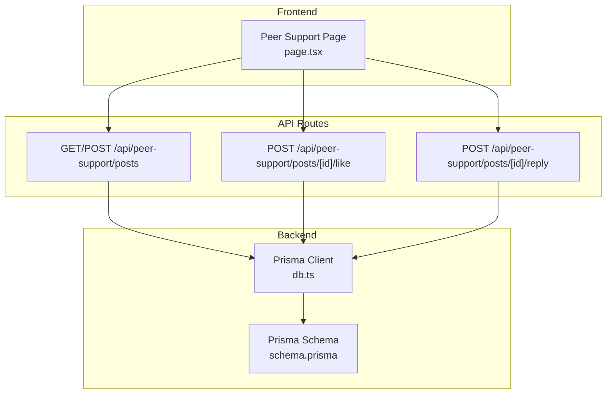
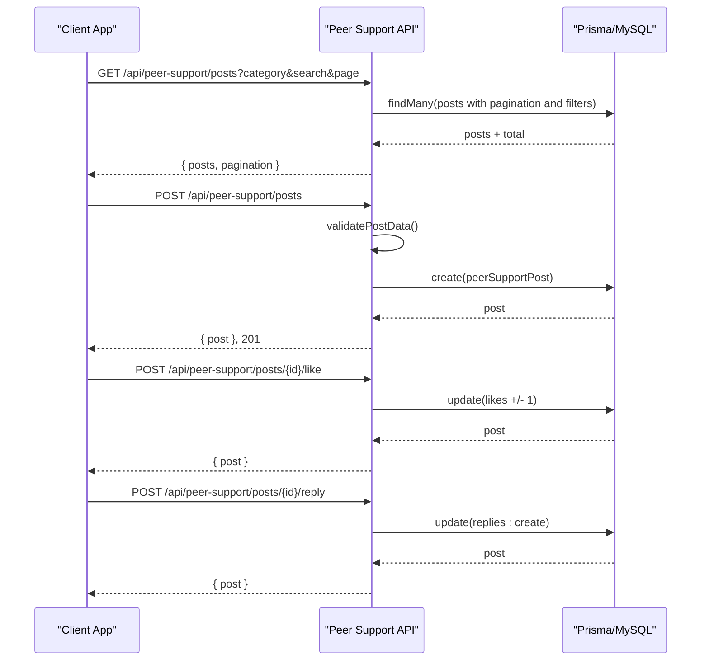
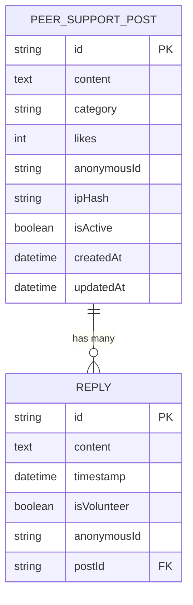
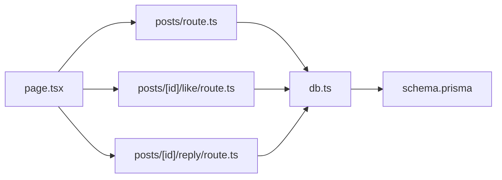

# Community & Peer Support API

<cite>
**Referenced Files in This Document**
- [posts/route.ts](file://WEBAPP/src/app/api/peer-support/posts/route.ts)
- [posts/[id]/like/route.ts](file://WEBAPP/src/app/api/peer-support/posts/[id]/like/route.ts)
- [posts/[id]/reply/route.ts](file://WEBAPP/src/app/api/peer-support/posts/[id]/reply/route.ts)
- [page.tsx](file://WEBAPP/src/app/peer-support/page.tsx)
- [schema.prisma](file://WEBAPP/prisma/schema.prisma)
- [db.ts](file://WEBAPP/src/lib/db.ts)
</cite>

## Table of Contents
1. [Introduction](#introduction)
2. [Project Structure](#project-structure)
3. [Core Components](#core-components)
4. [Architecture Overview](#architecture-overview)
5. [Detailed Component Analysis](#detailed-component-analysis)
6. [Dependency Analysis](#dependency-analysis)
7. [Performance Considerations](#performance-considerations)
8. [Troubleshooting Guide](#troubleshooting-guide)
9. [Conclusion](#conclusion)

## Introduction
This document provides comprehensive API documentation for the MindBridge Community & Peer Support system. It covers post creation, community interaction, anonymous posting, like functionality, and reply management. For each endpoint, you will find HTTP methods, URL patterns, request/response schemas, validation rules, rate limits, content filtering, spam prevention, and privacy considerations for anonymous users. It also outlines moderation workflows and community safety measures.

## Project Structure
The peer support API is implemented as Next.js App Router API routes under `/api/peer-support`. The frontend page integrates with these APIs to render posts, handle user interactions, and enforce community guidelines.

**Diagram sources**
- [page.tsx](file://WEBAPP/src/app/peer-support/page.tsx#L53-L193)
- [posts/route.ts](file://WEBAPP/src/app/api/peer-support/posts/route.ts#L22-L129)
- [posts/[id]/like/route.ts](file://WEBAPP/src/app/api/peer-support/posts/[id]/like/route.ts#L4-L58)
- [posts/[id]/reply/route.ts](file://WEBAPP/src/app/api/peer-support/posts/[id]/reply/route.ts#L20-L72)
- [db.ts](file://WEBAPP/src/lib/db.ts#L1-L15)
- [schema.prisma](file://WEBAPP/prisma/schema.prisma#L79-L106)

**Section sources**
- [page.tsx](file://WEBAPP/src/app/peer-support/page.tsx#L53-L193)
- [posts/route.ts](file://WEBAPP/src/app/api/peer-support/posts/route.ts#L22-L129)
- [posts/[id]/like/route.ts](file://WEBAPP/src/app/api/peer-support/posts/[id]/like/route.ts#L4-L58)
- [posts/[id]/reply/route.ts](file://WEBAPP/src/app/api/peer-support/posts/[id]/reply/route.ts#L20-L72)
- [db.ts](file://WEBAPP/src/lib/db.ts#L1-L15)
- [schema.prisma](file://WEBAPP/prisma/schema.prisma#L79-L106)

## Core Components
- PeerSupportPost: Represents a post with content, category, likes, anonymous identity, IP hash, activity status, timestamps, and associated replies.
- Reply: Represents a reply to a post with content, timestamp, volunteer flag, anonymous identity, and foreign key to the post.

Key data model attributes:
- PeerSupportPost
  - id: string (UUID)
  - content: string (text)
  - category: string
  - likes: integer (non-negative)
  - anonymousId: string
  - ipHash: string
  - isActive: boolean
  - createdAt: datetime
  - updatedAt: datetime
  - replies: Reply[]
- Reply
  - id: string (UUID)
  - content: string (text)
  - timestamp: datetime
  - isVolunteer: boolean
  - anonymousId: string
  - postId: string
  - post: PeerSupportPost

Validation and constraints:
- Categories are restricted to predefined values.
- Content lengths are validated for posts and replies.
- Rate limiting prevents excessive posting from the same IP.
- Anonymous identifiers are generated for posts and replies.

**Section sources**
- [schema.prisma](file://WEBAPP/prisma/schema.prisma#L79-L106)
- [posts/route.ts](file://WEBAPP/src/app/api/peer-support/posts/route.ts#L132-L159)
- [posts/[id]/reply/route.ts](file://WEBAPP/src/app/api/peer-support/posts/[id]/reply/route.ts#L83-L99)

## Architecture Overview
The peer support API follows a straightforward request-response pattern:
- Frontend fetches posts with filters and pagination.
- Users can create posts anonymously with validation and rate limiting.
- Users can like/unlike posts atomically.
- Users can reply to posts anonymously with validation.

**Diagram sources**
- [page.tsx](file://WEBAPP/src/app/peer-support/page.tsx#L53-L193)
- [posts/route.ts](file://WEBAPP/src/app/api/peer-support/posts/route.ts#L22-L129)
- [posts/[id]/like/route.ts](file://WEBAPP/src/app/api/peer-support/posts/[id]/like/route.ts#L4-L58)
- [posts/[id]/reply/route.ts](file://WEBAPP/src/app/api/peer-support/posts/[id]/reply/route.ts#L20-L72)

## Detailed Component Analysis

### Endpoint: GET /api/peer-support/posts
- Method: GET
- URL: /api/peer-support/posts
- Query Parameters:
  - category: string (optional; filters posts by category; "all" returns all)
  - search: string (optional; full-text search across post content and reply content)
  - page: number (optional; defaults to 1)
- Response Schema:
  - posts: array of PeerSupportPost with replies included
  - pagination: { current: number, total: number, hasMore: boolean }
- Filtering and Sorting:
  - Filters by category and optional search term across post content and reply content.
  - Sorts by creation time descending.
  - Pagination uses a fixed page size of 20.
- Error Responses:
  - 500: Internal server error

Example request:
- GET /api/peer-support/posts?category=academic-stress&search=exam&page=1

Example response:
- Status: 200 OK
- Body: { posts: [...], pagination: { current: 1, total: N, hasMore: true } }

**Section sources**
- [posts/route.ts](file://WEBAPP/src/app/api/peer-support/posts/route.ts#L22-L75)

### Endpoint: POST /api/peer-support/posts
- Method: POST
- URL: /api/peer-support/posts
- Request Body:
  - content: string (required; trimmed; 1–1000 characters)
  - category: string (required; must be one of predefined categories)
- Response Schema:
  - post: PeerSupportPost (with replies included)
- Validation:
  - Content must be present, non-empty after trimming, and within length limits.
  - Category must be one of: general, academic-stress, social-emotional, time-management, career-anxiety, relationships, health-wellness.
- Rate Limiting:
  - Enforced per IP hash; maximum 5 posts per hour.
- Spam Prevention:
  - IP address is hashed using a secret and stored to detect repeat offenders.
- Anonymous Posting:
  - anonymousId is generated for the post.
  - isActive is set to true upon creation.
- Error Responses:
  - 400: Validation failure
  - 429: Rate limit exceeded
  - 500: Internal server error

Example request:
- POST /api/peer-support/posts
- Body: { content: "I'm feeling overwhelmed...", category: "academic-stress" }

Example response:
- Status: 201 Created
- Body: { post: { id, content, category, likes, anonymousId, createdAt, updatedAt, replies: [] } }

**Section sources**
- [posts/route.ts](file://WEBAPP/src/app/api/peer-support/posts/route.ts#L80-L129)
- [posts/route.ts](file://WEBAPP/src/app/api/peer-support/posts/route.ts#L132-L159)

### Endpoint: POST /api/peer-support/posts/[id]/like
- Method: POST
- URL: /api/peer-support/posts/[id]/like
- Path Parameter:
  - id: string (peer support post identifier)
- Request Body:
  - increment: boolean (true to increase like, false to decrease)
- Response Schema:
  - post: PeerSupportPost (with replies included)
- Behavior:
  - Validates increment type.
  - Ensures post exists and is active.
  - Updates likes atomically; ensures likes never drop below zero.
- Error Responses:
  - 400: Invalid increment type or invalid payload
  - 404: Post not found
  - 500: Internal server error

Example request:
- POST /api/peer-support/posts/{id}/like
- Body: { increment: true }

Example response:
- Status: 200 OK
- Body: { post: { ...updated post with likes incremented } }

**Section sources**
- [posts/[id]/like/route.ts](file://WEBAPP/src/app/api/peer-support/posts/[id]/like/route.ts#L4-L58)

### Endpoint: POST /api/peer-support/posts/[id]/reply
- Method: POST
- URL: /api/peer-support/posts/[id]/reply
- Path Parameter:
  - id: string (peer support post identifier)
- Request Body:
  - content: string (required; trimmed; minimum 5, maximum 1000 characters)
  - isVolunteer: boolean (optional; defaults to false)
- Response Schema:
  - post: PeerSupportPost (with replies ordered by timestamp ascending)
- Validation:
  - Content must be present, non-empty after trimming, and within length limits.
- Anonymous Reply:
  - anonymousId is generated for the reply.
- Error Responses:
  - 400: Validation failure
  - 404: Post not found
  - 500: Internal server error

Example request:
- POST /api/peer-support/posts/{id}/reply
- Body: { content: "I totally feel you.", isVolunteer: false }

Example response:
- Status: 200 OK
- Body: { post: { ...updated post with new reply } }

**Section sources**
- [posts/[id]/reply/route.ts](file://WEBAPP/src/app/api/peer-support/posts/[id]/reply/route.ts#L20-L72)
- [posts/[id]/reply/route.ts](file://WEBAPP/src/app/api/peer-support/posts/[id]/reply/route.ts#L83-L99)

### Data Models and Relationships

**Diagram sources**
- [schema.prisma](file://WEBAPP/prisma/schema.prisma#L79-L106)

## Dependency Analysis
- API routes depend on Prisma for data access.
- Prisma client is initialized once and reused globally.
- Database schema defines the relationship between posts and replies.

**Diagram sources**
- [page.tsx](file://WEBAPP/src/app/peer-support/page.tsx#L53-L193)
- [posts/route.ts](file://WEBAPP/src/app/api/peer-support/posts/route.ts#L22-L129)
- [posts/[id]/like/route.ts](file://WEBAPP/src/app/api/peer-support/posts/[id]/like/route.ts#L4-L58)
- [posts/[id]/reply/route.ts](file://WEBAPP/src/app/api/peer-support/posts/[id]/reply/route.ts#L20-L72)
- [db.ts](file://WEBAPP/src/lib/db.ts#L1-L15)
- [schema.prisma](file://WEBAPP/prisma/schema.prisma#L79-L106)

**Section sources**
- [db.ts](file://WEBAPP/src/lib/db.ts#L1-L15)
- [schema.prisma](file://WEBAPP/prisma/schema.prisma#L79-L106)

## Performance Considerations
- Pagination: Fixed page size of 20 with skip/take for efficient retrieval.
- Indexing: Category and createdAt are indexed on PeerSupportPost to optimize filtering and sorting.
- Asynchronous operations: Parallel counting and fetching improve responsiveness.
- Rate limiting: Prevents abuse and reduces load on the database.

Recommendations:
- Consider caching frequently accessed post lists with short TTL.
- Monitor slow queries and add composite indexes if search volume grows.
- Apply CDN or edge caching for read-heavy GET requests.

**Section sources**
- [posts/route.ts](file://WEBAPP/src/app/api/peer-support/posts/route.ts#L22-L75)
- [schema.prisma](file://WEBAPP/prisma/schema.prisma#L92-L94)

## Troubleshooting Guide
Common issues and resolutions:
- Validation errors (400):
  - Ensure content is present and within length limits.
  - Ensure category is one of the allowed values.
  - Ensure increment is a boolean for like endpoint.
- Rate limit exceeded (429):
  - Wait until the next hour; the system enforces 5 posts per IP per hour.
- Post not found (404):
  - Verify the post ID exists and is active.
  - Confirm the post has not been removed or marked inactive.
- Internal server errors (500):
  - Check backend logs for database errors.
  - Verify Prisma client initialization and database connectivity.

Privacy and safety:
- Anonymous identities:
  - Posts and replies receive auto-generated anonymous IDs.
  - IP addresses are hashed and stored only for anti-abuse measures.
- Moderation:
  - Community guidelines are displayed in the UI.
  - Reporting mechanisms are available via the UI (flag button).
  - Admin controls exist for platform oversight (outside the scope of peer support endpoints).

**Section sources**
- [posts/route.ts](file://WEBAPP/src/app/api/peer-support/posts/route.ts#L96-L107)
- [posts/[id]/like/route.ts](file://WEBAPP/src/app/api/peer-support/posts/[id]/like/route.ts#L13-L24)
- [page.tsx](file://WEBAPP/src/app/peer-support/page.tsx#L500-L517)

## Conclusion
The Community & Peer Support API provides a secure, anonymous, and scalable foundation for student-driven discussions. It enforces strict validation, rate limiting, and hashing for spam prevention, while offering intuitive interactions for posting, replying, and liking. The frontend integrates seamlessly with these endpoints to deliver a responsive and inclusive experience. Administrators can monitor and moderate platform-wide activities, ensuring a safe environment aligned with community guidelines.