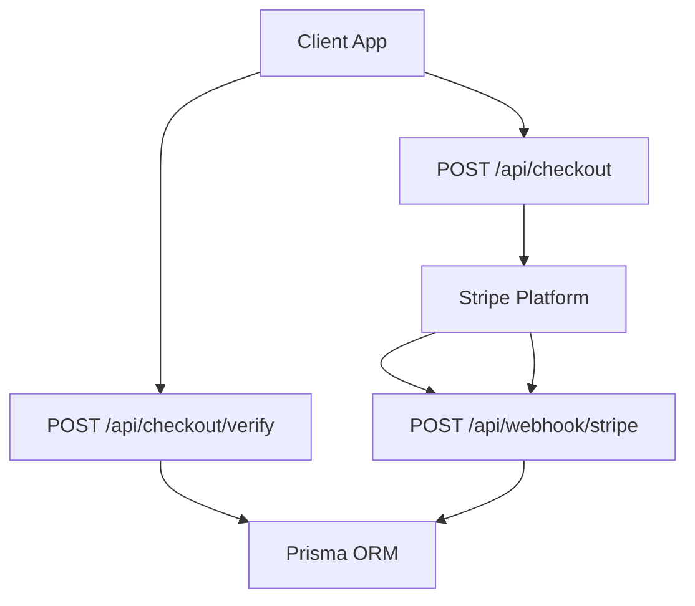
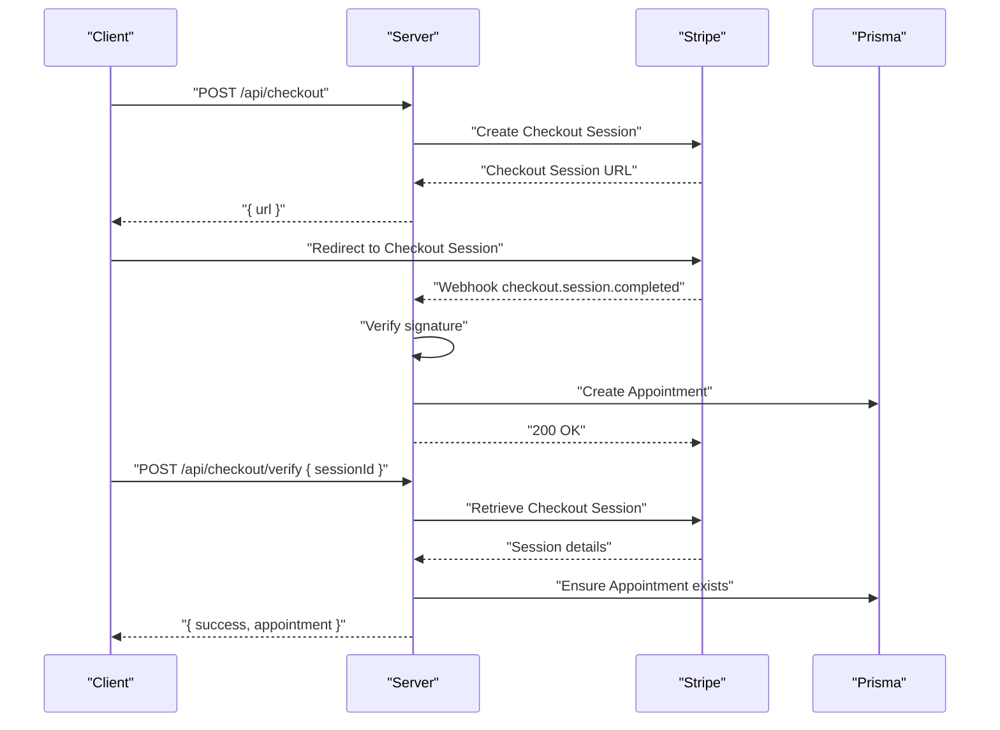
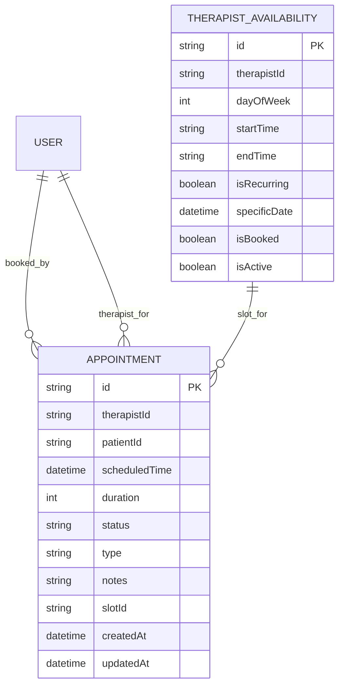
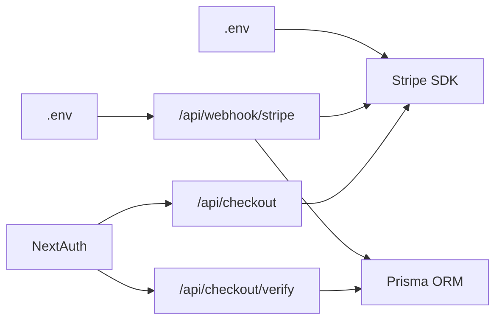

# Payment & Subscription API

<cite>
**Referenced Files in This Document**
- [route.ts](file://WEBAPP/src/app/api/checkout/route.ts)
- [route.ts](file://WEBAPP/src/app/api/checkout/verify/route.ts)
- [route.ts](file://WEBAPP/src/app/api/webhook/stripe/route.ts)
- [schema.prisma](file://WEBAPP/prisma/schema.prisma)
- [.env](file://WEBAPP/.env)
- [package.json](file://WEBAPP/package.json)
</cite>

## Table of Contents
1. [Introduction](#introduction)
2. [Project Structure](#project-structure)
3. [Core Components](#core-components)
4. [Architecture Overview](#architecture-overview)
5. [Detailed Component Analysis](#detailed-component-analysis)
6. [Dependency Analysis](#dependency-analysis)
7. [Performance Considerations](#performance-considerations)
8. [Troubleshooting Guide](#troubleshooting-guide)
9. [Conclusion](#conclusion)
10. [Appendices](#appendices)

## Introduction
This document provides comprehensive API documentation for MindBridge’s payment and subscription endpoints. It focuses on:
- Checkout creation and payment verification for therapy sessions
- Stripe webhook handling for asynchronous payment confirmation
- Subscription management and billing operations
- Security requirements, PCI compliance, and fraud prevention
- Request/response schemas, parameter descriptions, and operational examples

Current implementation supports per-session payments via Stripe Checkout. Subscription plans and recurring billing are not present in the current schema and codebase; therefore, this document emphasizes the implemented payment flow and outlines recommended extensions for subscriptions.

## Project Structure
The payment and subscription surface area is implemented under the Next.js App Router at:
- Checkout creation: POST /api/checkout
- Payment verification: POST /api/checkout/verify
- Stripe webhook: POST /api/webhook/stripe

**Diagram sources**
- [route.ts](file://WEBAPP/src/app/api/checkout/route.ts#L17-L81)
- [route.ts](file://WEBAPP/src/app/api/checkout/verify/route.ts#L10-L93)
- [route.ts](file://WEBAPP/src/app/api/webhook/stripe/route.ts#L11-L66)

**Section sources**
- [route.ts](file://WEBAPP/src/app/api/checkout/route.ts#L1-L82)
- [route.ts](file://WEBAPP/src/app/api/checkout/verify/route.ts#L1-L94)
- [route.ts](file://WEBAPP/src/app/api/webhook/stripe/route.ts#L1-L67)

## Core Components
- Checkout creation endpoint: Creates a Stripe Checkout Session and returns a redirect URL for the client.
- Payment verification endpoint: Confirms payment completion and creates an appointment if not already created by the webhook.
- Stripe webhook endpoint: Processes checkout.session.completed events to create appointments and mark availability slots as booked.

Key integrations:
- Stripe SDK configured with secret key and webhook secret
- Prisma ORM for database persistence
- NextAuth session for user context

**Section sources**
- [route.ts](file://WEBAPP/src/app/api/checkout/route.ts#L5-L7)
- [route.ts](file://WEBAPP/src/app/api/checkout/verify/route.ts#L6-L8)
- [route.ts](file://WEBAPP/src/app/api/webhook/stripe/route.ts#L5-L9)
- [schema.prisma](file://WEBAPP/prisma/schema.prisma#L186-L211)
- [.env](file://WEBAPP/.env#L29-L31)

## Architecture Overview
End-to-end payment flow:
1. Client requests a checkout session with session metadata.
2. Server creates a Stripe Checkout Session and returns a URL.
3. Client completes payment in Stripe.
4. Stripe sends a signed webhook to the server.
5. Server verifies the signature, processes the event, and persists the appointment.
6. Client may optionally verify payment and confirm the appointment.

**Diagram sources**
- [route.ts](file://WEBAPP/src/app/api/checkout/route.ts#L17-L81)
- [route.ts](file://WEBAPP/src/app/api/webhook/stripe/route.ts#L11-L66)
- [route.ts](file://WEBAPP/src/app/api/checkout/verify/route.ts#L10-L93)

## Detailed Component Analysis

### Endpoint: POST /api/checkout
Purpose:
- Create a Stripe Checkout Session for a therapy session payment.

Security:
- Requires NextAuth session; unauthorized requests receive 401.

Request body:
- therapistId: string, required
- therapistName: string, optional
- patientId: string, required
- scheduledTime: datetime string, required
- duration: number, required (supported durations: 1800, 3600, 5400, 7200 seconds)
- type: string, required (values: initial, followup, emergency, or others)
- notes: string, optional
- slotId: string, optional

Behavior:
- Validates presence of required fields.
- Maps duration to price amount and label.
- Constructs a Stripe Checkout Session with:
  - Payment method: card
  - Mode: payment
  - Metadata: includes all request fields
  - Success and cancel URLs pointing to the app
- Returns the Stripe checkout URL.

Response:
- Success: { url: string }
- Errors: { error: string }, status 400 or 500

Notes:
- Pricing is fixed per duration; no subscription plans are supported here.

**Section sources**
- [route.ts](file://WEBAPP/src/app/api/checkout/route.ts#L17-L81)

### Endpoint: POST /api/checkout/verify
Purpose:
- Verify that a Stripe Checkout Session has been paid and create an appointment if missing.

Security:
- Requires NextAuth session; unauthorized requests receive 401.

Request body:
- sessionId: string, required

Behavior:
- Retrieves the Checkout Session from Stripe.
- Ensures payment_status is paid.
- Checks for existing appointment using metadata fields.
- If missing, creates an Appointment record with:
  - therapistId, patientId, scheduledTime, duration, type, notes, slotId
  - status: confirmed
- Optionally marks the availability slot as booked if slotId is present.

Response:
- Success: { success: true, appointment, message }
- Errors: { error: string }, status 400 or 500

**Section sources**
- [route.ts](file://WEBAPP/src/app/api/checkout/verify/route.ts#L10-L93)

### Endpoint: POST /api/webhook/stripe
Purpose:
- Handle Stripe webhook events for asynchronous payment confirmation.

Security:
- Verifies webhook signature using endpoint secret from environment.

Supported event:
- checkout.session.completed: On successful payment, creates an Appointment and marks slot as booked if applicable.

Behavior:
- Reads raw body and stripe-signature header.
- Constructs event using Stripe signature and endpoint secret.
- On event.type == "checkout.session.completed":
  - Extracts metadata from session.
  - Creates Appointment with the same fields as the verify endpoint.
  - Marks slot as booked if slotId is present.
- Returns { received: true } on success.

Response:
- Success: { received: true }
- Signature errors: { error: "Invalid signature" }, status 400
- Other errors: { error: "Failed to process payment" }, status 500

**Section sources**
- [route.ts](file://WEBAPP/src/app/api/webhook/stripe/route.ts#L11-L66)

### Data Models Involved
- Appointment: stores session booking details and links to User and TherapistAvailability.
- User: authenticated user context for session checks.
- TherapistAvailability: optional slot linkage for bookings.

**Diagram sources**
- [schema.prisma](file://WEBAPP/prisma/schema.prisma#L186-L211)
- [schema.prisma](file://WEBAPP/prisma/schema.prisma#L163-L184)

**Section sources**
- [schema.prisma](file://WEBAPP/prisma/schema.prisma#L186-L211)
- [schema.prisma](file://WEBAPP/prisma/schema.prisma#L163-L184)

## Dependency Analysis
External dependencies and configuration:
- Stripe SDK: configured with STRIPE_SECRET_KEY and apiVersion.
- Stripe webhook secret: STRIPE_WEBHOOK_SECRET.
- NextAuth session: used for user context checks.
- Prisma ORM: used for database operations.

**Diagram sources**
- [route.ts](file://WEBAPP/src/app/api/checkout/route.ts#L5-L7)
- [route.ts](file://WEBAPP/src/app/api/checkout/verify/route.ts#L4-L4)
- [route.ts](file://WEBAPP/src/app/api/webhook/stripe/route.ts#L5-L9)
- [.env](file://WEBAPP/.env#L29-L31)
- [package.json](file://WEBAPP/package.json#L69-L69)

**Section sources**
- [route.ts](file://WEBAPP/src/app/api/checkout/route.ts#L5-L7)
- [route.ts](file://WEBAPP/src/app/api/checkout/verify/route.ts#L4-L4)
- [route.ts](file://WEBAPP/src/app/api/webhook/stripe/route.ts#L5-L9)
- [.env](file://WEBAPP/.env#L29-L31)
- [package.json](file://WEBAPP/package.json#L69-L69)

## Performance Considerations
- Stripe Checkout Sessions are created server-side; keep payload minimal to reduce latency.
- Webhook processing should be idempotent; the verify endpoint checks for existing appointments.
- Use database indexes on frequently queried fields (e.g., scheduledTime, status) to optimize appointment queries.
- Avoid long-running operations in webhooks; delegate to background jobs if needed.

## Troubleshooting Guide
Common issues and resolutions:
- Unauthorized access:
  - Symptom: 401 Unauthorized on checkout or verify.
  - Cause: Missing or invalid NextAuth session.
  - Resolution: Ensure client is logged in and session is active.
- Missing required fields:
  - Symptom: 400 Bad Request on checkout.
  - Cause: Missing therapistId, patientId, scheduledTime, or slotId.
  - Resolution: Provide all required fields in the request body.
- Payment not completed:
  - Symptom: 400 Bad Request on verify.
  - Cause: payment_status is not paid.
  - Resolution: Redirect user back to checkout to complete payment.
- Invalid webhook signature:
  - Symptom: 400 Bad Request on webhook.
  - Cause: stripe-signature mismatch or wrong endpoint secret.
  - Resolution: Verify STRIPE_WEBHOOK_SECRET and signing secret match Stripe dashboard.
- Duplicate appointment creation:
  - Symptom: Conflicts when creating appointment.
  - Cause: Race condition or missing idempotency.
  - Resolution: Use verify endpoint to check existence; webhook already guards against duplicates.

Operational checks:
- Confirm STRIPE_SECRET_KEY and STRIPE_WEBHOOK_SECRET are set in environment.
- Verify NEXTAUTH_URL matches the origin used for success/cancel URLs.
- Ensure database connectivity and Prisma migrations are applied.

**Section sources**
- [route.ts](file://WEBAPP/src/app/api/checkout/route.ts#L19-L22)
- [route.ts](file://WEBAPP/src/app/api/checkout/route.ts#L36-L38)
- [route.ts](file://WEBAPP/src/app/api/checkout/verify/route.ts#L12-L15)
- [route.ts](file://WEBAPP/src/app/api/checkout/verify/route.ts#L24-L29)
- [route.ts](file://WEBAPP/src/app/api/webhook/stripe/route.ts#L17-L22)
- [.env](file://WEBAPP/.env#L29-L31)

## Conclusion
MindBridge currently implements a robust per-session payment flow using Stripe Checkout, with asynchronous confirmation via webhooks and idempotent verification. The system enforces user authentication, validates required fields, and persists appointments reliably. Subscription and recurring billing are not present in the current codebase and would require extending the schema and adding endpoints for plan management, customer updates, and invoice handling.

## Appendices

### API Definitions

- POST /api/checkout
  - Description: Create a Stripe Checkout Session for a therapy session.
  - Authentication: Required (NextAuth session).
  - Request body:
    - therapistId: string, required
    - therapistName: string, optional
    - patientId: string, required
    - scheduledTime: datetime string, required
    - duration: number, required (1800, 3600, 5400, 7200)
    - type: string, required
    - notes: string, optional
    - slotId: string, optional
  - Response: { url: string }
  - Errors: 400 (validation), 401 (unauthorized), 500 (server error)

- POST /api/checkout/verify
  - Description: Verify payment and create appointment if missing.
  - Authentication: Required (NextAuth session).
  - Request body:
    - sessionId: string, required
  - Response: { success: true, appointment, message }
  - Errors: 400 (invalid session/payment), 401 (unauthorized), 500 (server error)

- POST /api/webhook/stripe
  - Description: Handle Stripe webhook events.
  - Authentication: Not required; signature verified.
  - Headers:
    - stripe-signature: string, required
  - Request body: Raw webhook payload.
  - Supported events:
    - checkout.session.completed: Creates appointment and marks slot as booked.
  - Response: { received: true }
  - Errors: 400 (invalid signature), 500 (processing failure)

### Security and Compliance
- PCI DSS:
  - Payments are processed by Stripe; client never receives raw card data.
  - No sensitive card data stored server-side.
- Fraud prevention:
  - Use Stripe Radar and configured webhooks for risk signals.
  - Enforce NextAuth session checks on payment endpoints.
- Secrets management:
  - Store STRIPE_SECRET_KEY and STRIPE_WEBHOOK_SECRET in environment variables.
  - Do not log secrets or raw webhook bodies.

### Subscription and Billing Extensions (Recommended)
- Models to add:
  - Customer, Plan, Subscription, Invoice, PaymentMethod
- Endpoints to add:
  - POST /api/subscription/create
  - POST /api/subscription/manage
  - POST /api/subscription/cancel
  - GET /api/subscription/status
- Webhooks to support:
  - invoice.payment_succeeded, invoice.payment_failed, customer.subscription.updated, customer.subscription.deleted
- Idempotency:
  - Use Stripe customer ids and webhook event ids for idempotent processing.

[No sources needed since this section provides general guidance]