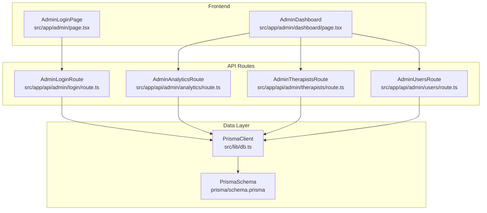
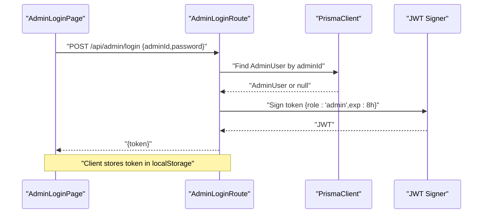
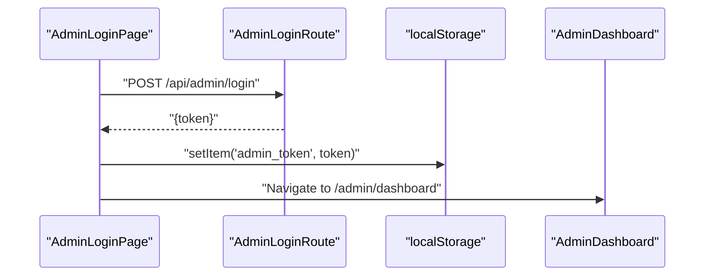
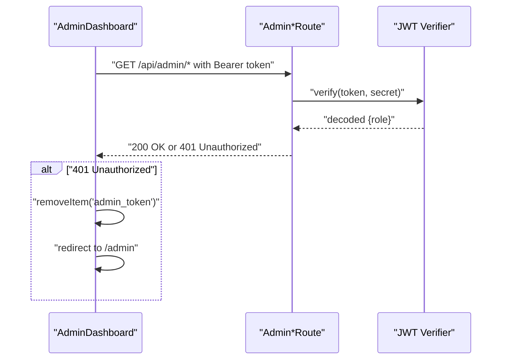
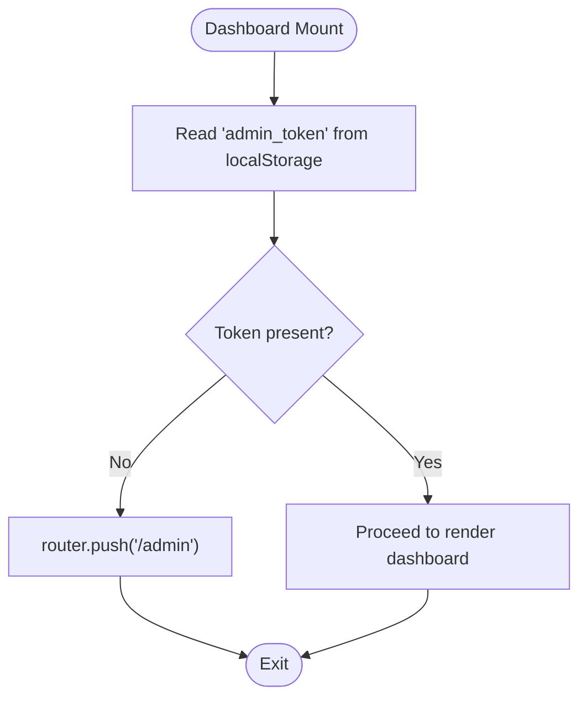
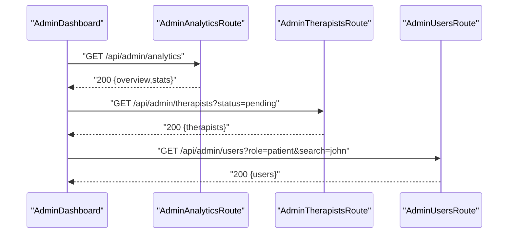
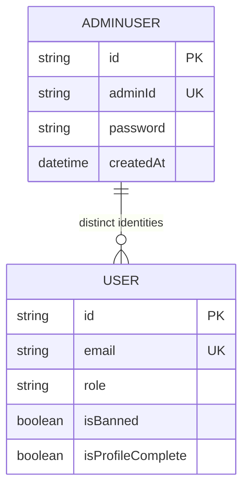
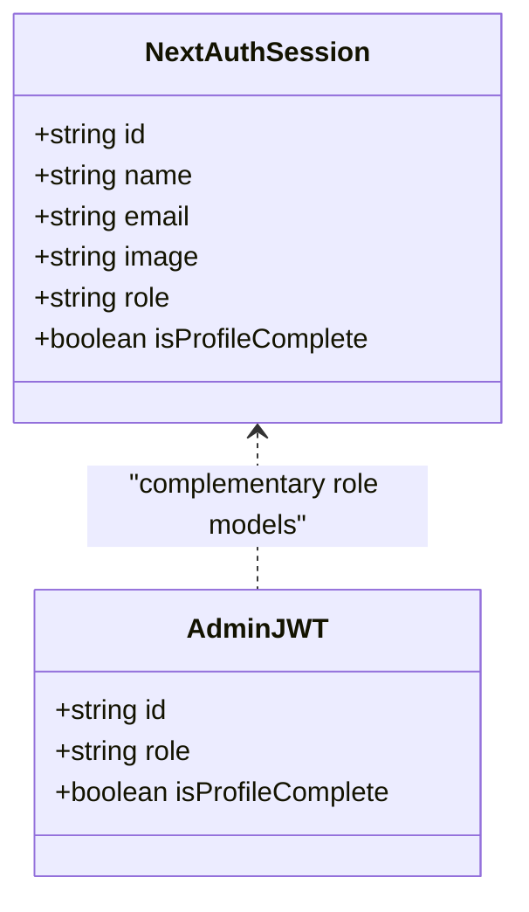
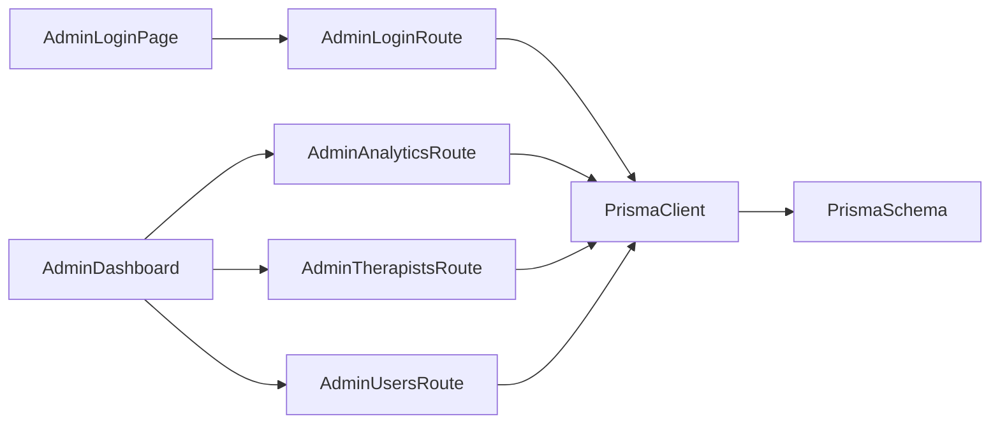

# Admin Authentication & Security

<cite>
**Referenced Files in This Document**
- [AdminLoginPage](file://WEBAPP/src/app/admin/page.tsx)
- [AdminDashboard](file://WEBAPP/src/app/admin/dashboard/page.tsx)
- [AdminLoginRoute](file://WEBAPP/src/app/api/admin/login/route.ts)
- [AdminAnalyticsRoute](file://WEBAPP/src/app/api/admin/analytics/route.ts)
- [AdminTherapistsRoute](file://WEBAPP/src/app/api/admin/therapists/route.ts)
- [AdminUsersRoute](file://WEBAPP/src/app/api/admin/users/route.ts)
- [PrismaSchema](file://WEBAPP/prisma/schema.prisma)
- [PrismaClient](file://WEBAPP/src/lib/db.ts)
- [NextAuthTypes](file://WEBAPP/src/types/next-auth.d.ts)
</cite>

## Table of Contents
1. [Introduction](#introduction)
2. [Project Structure](#project-structure)
3. [Core Components](#core-components)
4. [Architecture Overview](#architecture-overview)
5. [Detailed Component Analysis](#detailed-component-analysis)
6. [Dependency Analysis](#dependency-analysis)
7. [Performance Considerations](#performance-considerations)
8. [Troubleshooting Guide](#troubleshooting-guide)
9. [Conclusion](#conclusion)
10. [Appendices](#appendices)

## Introduction
This document explains the admin authentication and security model for the administration panel. It covers the token-based login flow, token storage in localStorage, automatic logout on invalidation, and backend validation. It also documents the admin-only API endpoints, unauthorized access handling, and outlines integration points with NextAuth for centralized authentication and role-based access control. Finally, it provides security best practices, token lifecycle management, administrative privilege escalation procedures, and audit logging recommendations.

## Project Structure
The admin authentication spans three layers:
- Frontend pages: admin login and dashboard pages that manage tokens and enforce access.
- API routes: admin endpoints secured by JWT verification and backed by Prisma.
- Data layer: Prisma schema defining AdminUser and related entities.

**Diagram sources**
- [AdminLoginPage](file://WEBAPP/src/app/admin/page.tsx#L1-L84)
- [AdminDashboard](file://WEBAPP/src/app/admin/dashboard/page.tsx#L1-L510)
- [AdminLoginRoute](file://WEBAPP/src/app/api/admin/login/route.ts#L1-L75)
- [AdminAnalyticsRoute](file://WEBAPP/src/app/api/admin/analytics/route.ts#L1-L109)
- [AdminTherapistsRoute](file://WEBAPP/src/app/api/admin/therapists/route.ts#L1-L93)
- [AdminUsersRoute](file://WEBAPP/src/app/api/admin/users/route.ts#L1-L108)
- [PrismaSchema](file://WEBAPP/prisma/schema.prisma#L323-L330)
- [PrismaClient](file://WEBAPP/src/lib/db.ts#L1-L15)

**Section sources**
- [AdminLoginPage](file://WEBAPP/src/app/admin/page.tsx#L1-L84)
- [AdminDashboard](file://WEBAPP/src/app/admin/dashboard/page.tsx#L1-L510)
- [AdminLoginRoute](file://WEBAPP/src/app/api/admin/login/route.ts#L1-L75)
- [AdminAnalyticsRoute](file://WEBAPP/src/app/api/admin/analytics/route.ts#L1-L109)
- [AdminTherapistsRoute](file://WEBAPP/src/app/api/admin/therapists/route.ts#L1-L93)
- [AdminUsersRoute](file://WEBAPP/src/app/api/admin/users/route.ts#L1-L108)
- [PrismaSchema](file://WEBAPP/prisma/schema.prisma#L323-L330)
- [PrismaClient](file://WEBAPP/src/lib/db.ts#L1-L15)

## Core Components
- Admin login page: Collects adminId and password, posts to the admin login endpoint, stores the returned JWT in localStorage, and navigates to the dashboard.
- Admin dashboard: Retrieves the stored token, attaches it to outgoing requests, handles 401 responses by clearing the token and redirecting to the login page, and exposes admin actions.
- Admin login API: Validates input, authenticates against AdminUser, and issues a signed JWT with an 8-hour expiry.
- Admin analytics/therapists/users APIs: Verify the incoming Bearer token and enforce role-based access control.
- Prisma AdminUser model: Stores admin credentials and supports seeded default admin for initial setup.

Security highlights:
- Token storage: localStorage on the client.
- Token validation: Backend verifies JWT signature and role.
- Unauthorized handling: On 401, the frontend clears the token and redirects to the login page.
- Expiration: JWT configured with 8-hour TTL.

**Section sources**
- [AdminLoginPage](file://WEBAPP/src/app/admin/page.tsx#L15-L37)
- [AdminDashboard](file://WEBAPP/src/app/admin/dashboard/page.tsx#L76-L99)
- [AdminLoginRoute](file://WEBAPP/src/app/api/admin/login/route.ts#L59-L64)
- [AdminAnalyticsRoute](file://WEBAPP/src/app/api/admin/analytics/route.ts#L7-L17)
- [AdminTherapistsRoute](file://WEBAPP/src/app/api/admin/therapists/route.ts#L7-L18)
- [AdminUsersRoute](file://WEBAPP/src/app/api/admin/users/route.ts#L7-L17)
- [PrismaSchema](file://WEBAPP/prisma/schema.prisma#L323-L330)

## Architecture Overview
The admin authentication follows a classic token-based pattern:
- The client submits admin credentials to the login endpoint.
- The server validates them and returns a signed JWT.
- The client stores the token and sends it with subsequent admin requests.
- The server verifies the token and enforces role-based access.

**Diagram sources**
- [AdminLoginPage](file://WEBAPP/src/app/admin/page.tsx#L20-L28)
- [AdminLoginRoute](file://WEBAPP/src/app/api/admin/login/route.ts#L28-L64)
- [PrismaClient](file://WEBAPP/src/lib/db.ts#L1-L15)

## Detailed Component Analysis

### Admin Login Flow
- Frontend:
  - Submits credentials to the admin login endpoint.
  - On success, stores the token in localStorage and navigates to the dashboard.
  - On failure, displays an error message.
- Backend:
  - Validates input shape.
  - Loads AdminUser by adminId; seeds a default admin account if requested.
  - Compares password hashes.
  - Issues a signed JWT with role=admin and 8-hour expiry.

**Diagram sources**
- [AdminLoginPage](file://WEBAPP/src/app/admin/page.tsx#L20-L37)
- [AdminLoginRoute](file://WEBAPP/src/app/api/admin/login/route.ts#L59-L64)

**Section sources**
- [AdminLoginPage](file://WEBAPP/src/app/admin/page.tsx#L15-L37)
- [AdminLoginRoute](file://WEBAPP/src/app/api/admin/login/route.ts#L9-L74)

### Token Validation and Unauthorized Access Handling
- Frontend:
  - On dashboard load, reads the token from localStorage.
  - Attaches Authorization: Bearer header to all admin API requests.
  - On receiving 401, clears the token and redirects to the login page.
- Backend:
  - Extracts Authorization header and verifies the JWT signature using the shared secret.
  - Confirms role equals "admin".
  - Returns 401 for invalid or missing tokens.

**Diagram sources**
- [AdminDashboard](file://WEBAPP/src/app/admin/dashboard/page.tsx#L76-L99)
- [AdminAnalyticsRoute](file://WEBAPP/src/app/api/admin/analytics/route.ts#L7-L17)
- [AdminTherapistsRoute](file://WEBAPP/src/app/api/admin/therapists/route.ts#L7-L18)
- [AdminUsersRoute](file://WEBAPP/src/app/api/admin/users/route.ts#L7-L17)

**Section sources**
- [AdminDashboard](file://WEBAPP/src/app/admin/dashboard/page.tsx#L76-L99)
- [AdminAnalyticsRoute](file://WEBAPP/src/app/api/admin/analytics/route.ts#L7-L17)
- [AdminTherapistsRoute](file://WEBAPP/src/app/api/admin/therapists/route.ts#L7-L18)
- [AdminUsersRoute](file://WEBAPP/src/app/api/admin/users/route.ts#L7-L17)

### Admin Dashboard Navigation Protection
- The dashboard checks for the presence of the token on mount.
- If absent, it redirects to the admin login page.
- The logout action removes the token and navigates to the login page.

**Diagram sources**
- [AdminDashboard](file://WEBAPP/src/app/admin/dashboard/page.tsx#L76-L84)

**Section sources**
- [AdminDashboard](file://WEBAPP/src/app/admin/dashboard/page.tsx#L76-L84)
- [AdminDashboard](file://WEBAPP/src/app/admin/dashboard/page.tsx#L165-L168)

### Admin API Endpoints
- Analytics:
  - GET /api/admin/analytics returns aggregated metrics after verifying admin token.
- Therapists:
  - GET /api/admin/therapists lists therapist profiles filtered by verification status.
  - PUT /api/admin/therapists approves or rejects a profile with optional rejection reason.
- Users:
  - GET /api/admin/users lists users with role and search filters.
  - PUT /api/admin/users bans/unbans or deletes a user.

**Diagram sources**
- [AdminAnalyticsRoute](file://WEBAPP/src/app/api/admin/analytics/route.ts#L19-L103)
- [AdminTherapistsRoute](file://WEBAPP/src/app/api/admin/therapists/route.ts#L20-L49)
- [AdminUsersRoute](file://WEBAPP/src/app/api/admin/users/route.ts#L19-L72)

**Section sources**
- [AdminAnalyticsRoute](file://WEBAPP/src/app/api/admin/analytics/route.ts#L19-L103)
- [AdminTherapistsRoute](file://WEBAPP/src/app/api/admin/therapists/route.ts#L20-L92)
- [AdminUsersRoute](file://WEBAPP/src/app/api/admin/users/route.ts#L19-L107)

### Data Model: AdminUser
- The AdminUser model defines a dedicated admin identity separate from the general User model used by NextAuth.
- It includes a unique adminId and a hashed password.
- The schema supports seeding a default admin account during login when the special adminId is used.

**Diagram sources**
- [PrismaSchema](file://WEBAPP/prisma/schema.prisma#L323-L330)
- [PrismaSchema](file://WEBAPP/prisma/schema.prisma#L39-L69)

**Section sources**
- [PrismaSchema](file://WEBAPP/prisma/schema.prisma#L323-L330)

### NextAuth Integration and Role-Based Access Control
- NextAuth manages general user sessions (patients and therapists) with typed session and JWT extensions.
- The admin authentication uses a separate JWT-based flow for administrative endpoints.
- To centralize admin roles, consider aligning admin JWT claims with NextAuth session typing so that admin actions can leverage the same session infrastructure.

**Diagram sources**
- [NextAuthTypes](file://WEBAPP/src/types/next-auth.d.ts#L3-L27)

**Section sources**
- [NextAuthTypes](file://WEBAPP/src/types/next-auth.d.ts#L3-L27)

## Dependency Analysis
- Frontend depends on:
  - AdminLoginPage for initiating authentication.
  - AdminDashboard for protected navigation and actions.
- Backend depends on:
  - AdminLoginRoute for issuing tokens.
  - Admin*Routes for enforcing token verification and role checks.
- Data layer depends on:
  - PrismaClient for database operations.
  - Prisma schema for AdminUser and related entities.

**Diagram sources**
- [AdminLoginPage](file://WEBAPP/src/app/admin/page.tsx#L1-L84)
- [AdminDashboard](file://WEBAPP/src/app/admin/dashboard/page.tsx#L1-L510)
- [AdminLoginRoute](file://WEBAPP/src/app/api/admin/login/route.ts#L1-L75)
- [AdminAnalyticsRoute](file://WEBAPP/src/app/api/admin/analytics/route.ts#L1-L109)
- [AdminTherapistsRoute](file://WEBAPP/src/app/api/admin/therapists/route.ts#L1-L93)
- [AdminUsersRoute](file://WEBAPP/src/app/api/admin/users/route.ts#L1-L108)
- [PrismaClient](file://WEBAPP/src/lib/db.ts#L1-L15)
- [PrismaSchema](file://WEBAPP/prisma/schema.prisma#L323-L330)

**Section sources**
- [AdminLoginPage](file://WEBAPP/src/app/admin/page.tsx#L1-L84)
- [AdminDashboard](file://WEBAPP/src/app/admin/dashboard/page.tsx#L1-L510)
- [AdminLoginRoute](file://WEBAPP/src/app/api/admin/login/route.ts#L1-L75)
- [AdminAnalyticsRoute](file://WEBAPP/src/app/api/admin/analytics/route.ts#L1-L109)
- [AdminTherapistsRoute](file://WEBAPP/src/app/api/admin/therapists/route.ts#L1-L93)
- [AdminUsersRoute](file://WEBAPP/src/app/api/admin/users/route.ts#L1-L108)
- [PrismaClient](file://WEBAPP/src/lib/db.ts#L1-L15)
- [PrismaSchema](file://WEBAPP/prisma/schema.prisma#L323-L330)

## Performance Considerations
- Token verification overhead is minimal; keep the JWT secret short-lived and rotate it periodically.
- Batch requests: The dashboard uses Promise.all to fetch analytics, therapists, and users concurrently to reduce perceived latency.
- Avoid excessive polling; rely on user-initiated actions and server-side events where applicable.
- Consider adding client-side caching for non-sensitive data to reduce redundant network calls.

[No sources needed since this section provides general guidance]

## Troubleshooting Guide
Common issues and resolutions:
- Invalid credentials:
  - The login endpoint returns 401 with an error message when adminId/password do not match.
- Missing or invalid token:
  - Admin endpoints return 401 if Authorization header is missing, malformed, or fails verification.
  - The dashboard automatically clears the token and redirects to the login page upon receiving 401.
- Default admin seeding:
  - Logging in with the special adminId triggers creation of a seeded admin account with a hashed default password.
- Database connectivity:
  - Ensure DATABASE_URL is configured and PrismaClient connects successfully.

**Section sources**
- [AdminLoginRoute](file://WEBAPP/src/app/api/admin/login/route.ts#L43-L57)
- [AdminAnalyticsRoute](file://WEBAPP/src/app/api/admin/analytics/route.ts#L21-L23)
- [AdminDashboard](file://WEBAPP/src/app/admin/dashboard/page.tsx#L96-L97)

## Conclusion
The admin authentication system uses a straightforward JWT-based approach with localStorage token storage and robust backend verification. It provides automatic logout on unauthorized responses, protects admin endpoints with role checks, and integrates with Prisma for admin identity management. For centralized session management and unified role handling, aligning admin JWT claims with NextAuth’s session typing would streamline access control across the platform.

[No sources needed since this section summarizes without analyzing specific files]

## Appendices

### Security Best Practices
- Token storage:
  - Prefer HttpOnly cookies for sensitive tokens to mitigate XSS risks; if localStorage is retained, sanitize inputs and apply Content Security Policy hardening.
- Token lifecycle:
  - Enforce short-lived tokens (already configured with 8-hour expiry) and refresh mechanisms if needed.
  - Implement token revocation strategies (e.g., blacklisting) for compromised tokens.
- Transport security:
  - Enforce HTTPS in production to protect tokens in transit.
- Input validation:
  - Validate and sanitize all inputs on the server; the login route already uses schema validation.
- Least privilege:
  - Restrict admin actions to explicit endpoints and avoid exposing admin routes to general users.
- Audit logging:
  - Log admin login attempts, token issuance, and privileged actions with timestamps, IP addresses, and user agent details for compliance and forensic readiness.

[No sources needed since this section provides general guidance]

### Administrative Privilege Escalation Procedures
- Current state:
  - Admin credentials are stored in the AdminUser model and authenticated via the admin login endpoint.
- Recommended procedure:
  - Define a strict approval workflow for granting adminId/password to administrators.
  - Rotate secrets regularly and invalidate stale tokens.
  - Consider adding MFA for admin logins and limiting login locations/IPs via policy.

[No sources needed since this section provides general guidance]