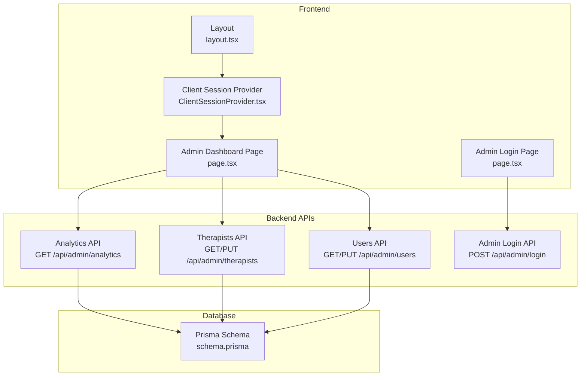
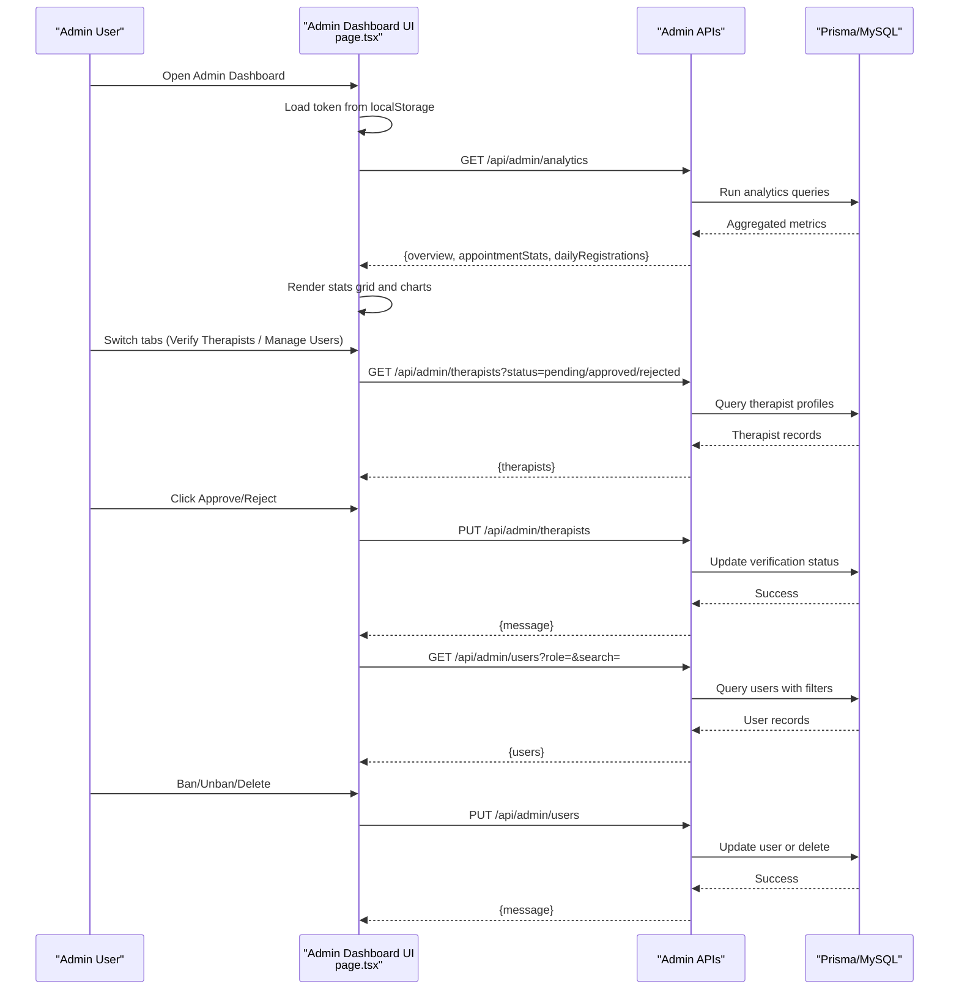
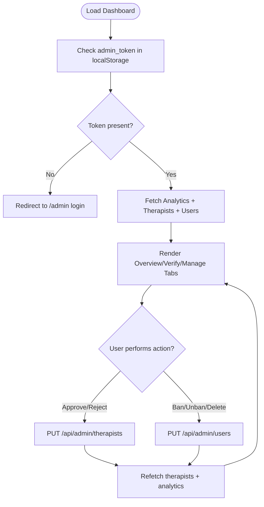
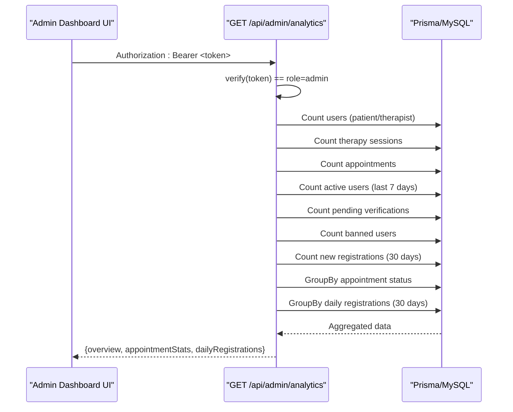
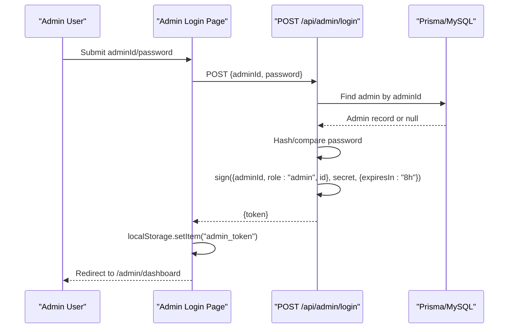
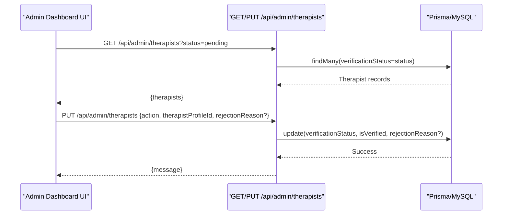
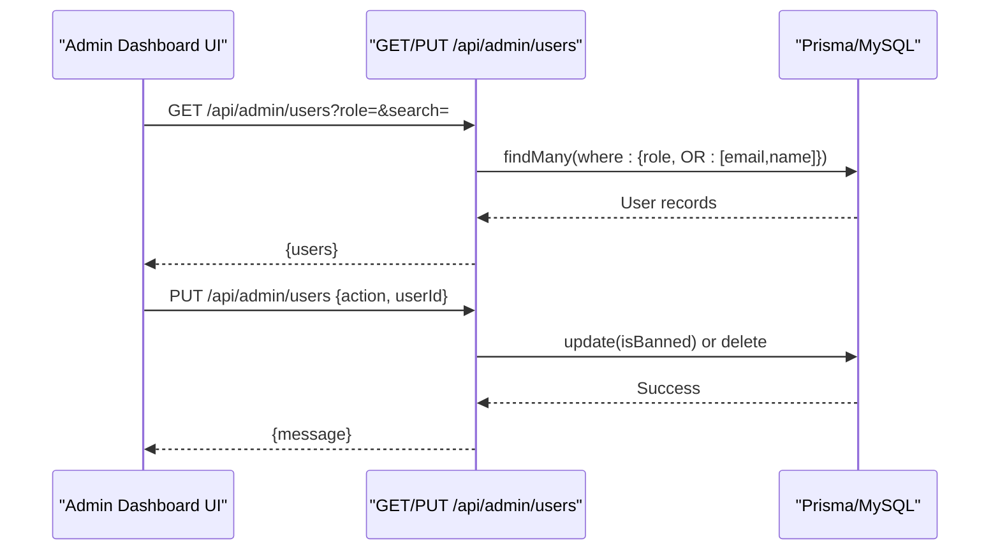
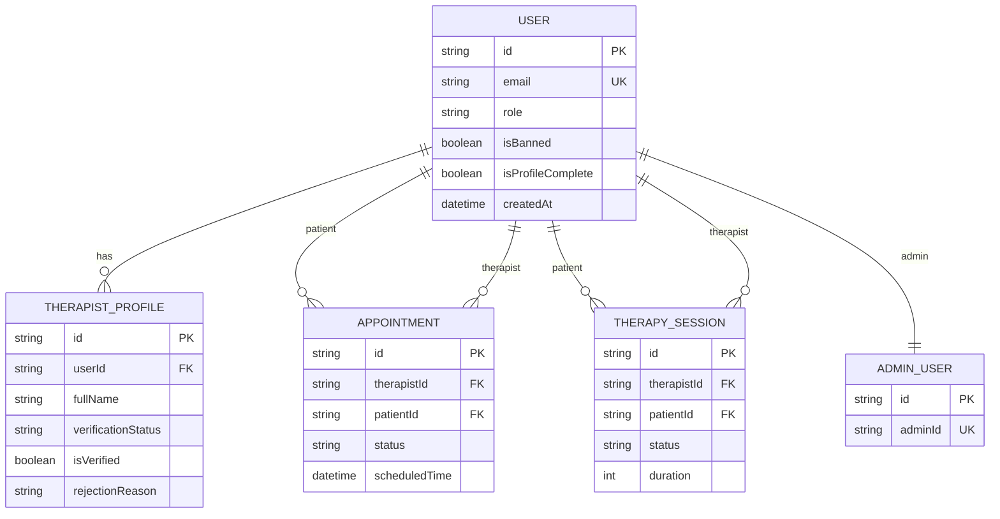
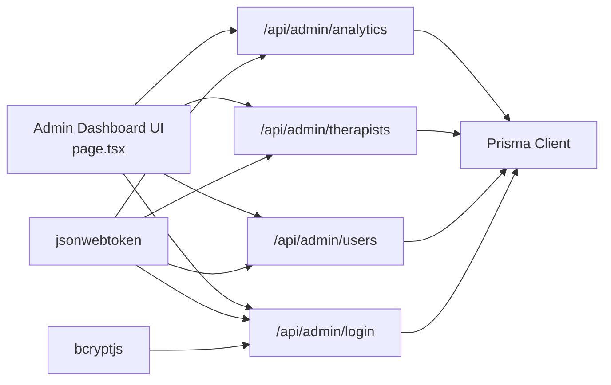

# Admin Dashboard Overview

<cite>
**Referenced Files in This Document**
- [page.tsx](file://WEBAPP/src/app/admin/dashboard/page.tsx)
- [route.ts](file://WEBAPP/src/app/api/admin/analytics/route.ts)
- [route.ts](file://WEBAPP/src/app/api/admin/login/route.ts)
- [route.ts](file://WEBAPP/src/app/api/admin/therapists/route.ts)
- [route.ts](file://WEBAPP/src/app/api/admin/users/route.ts)
- [page.tsx](file://WEBAPP/src/app/admin/page.tsx)
- [schema.prisma](file://WEBAPP/prisma/schema.prisma)
- [layout.tsx](file://WEBAPP/src/app/layout.tsx)
- [ClientSessionProvider.tsx](file://WEBAPP/src/components/ClientSessionProvider.tsx)
- [route.ts](file://WEBAPP/src/app/api/auth/[...nextauth]/route.ts)
- [sessionManager.ts](file://WEBAPP/src/lib/sessionManager.ts)
</cite>

## Table of Contents
1. [Introduction](#introduction)
2. [Project Structure](#project-structure)
3. [Core Components](#core-components)
4. [Architecture Overview](#architecture-overview)
5. [Detailed Component Analysis](#detailed-component-analysis)
6. [Dependency Analysis](#dependency-analysis)
7. [Performance Considerations](#performance-considerations)
8. [Troubleshooting Guide](#troubleshooting-guide)
9. [Conclusion](#conclusion)

## Introduction
This document explains the admin dashboard overview functionality, focusing on the analytics dashboard that displays system-wide metrics and administrative controls. It covers the tabbed interface (Overview, Verify Therapists, Manage Users), real-time analytics data fetching, token-based authentication, and responsive design. It also documents the statistics grid, appointment status breakdown charts, loading states, navigation examples, filter usage, data refresh mechanisms, and admin authentication flow with session management.

## Project Structure
The admin dashboard is implemented as a Next.js app page with dedicated API routes for analytics, login, therapist verification, and user management. The frontend uses a tabbed interface and fetches data from backend endpoints secured with JWT tokens. The database schema defines the entities used by analytics and admin operations.

**Diagram sources**
- [page.tsx](file://WEBAPP/src/app/admin/dashboard/page.tsx#L61-L509)
- [page.tsx](file://WEBAPP/src/app/admin/page.tsx#L5-L83)
- [route.ts](file://WEBAPP/src/app/api/admin/analytics/route.ts#L19-L108)
- [route.ts](file://WEBAPP/src/app/api/admin/login/route.ts#L9-L74)
- [route.ts](file://WEBAPP/src/app/api/admin/therapists/route.ts#L20-L92)
- [route.ts](file://WEBAPP/src/app/api/admin/users/route.ts#L19-L107)
- [schema.prisma](file://WEBAPP/prisma/schema.prisma#L39-L329)
- [layout.tsx](file://WEBAPP/src/app/layout.tsx#L36-L54)
- [ClientSessionProvider.tsx](file://WEBAPP/src/components/ClientSessionProvider.tsx#L10-L11)

**Section sources**
- [page.tsx](file://WEBAPP/src/app/admin/dashboard/page.tsx#L61-L509)
- [page.tsx](file://WEBAPP/src/app/admin/page.tsx#L5-L83)
- [route.ts](file://WEBAPP/src/app/api/admin/analytics/route.ts#L19-L108)
- [route.ts](file://WEBAPP/src/app/api/admin/login/route.ts#L9-L74)
- [route.ts](file://WEBAPP/src/app/api/admin/therapists/route.ts#L20-L92)
- [route.ts](file://WEBAPP/src/app/api/admin/users/route.ts#L19-L107)
- [schema.prisma](file://WEBAPP/prisma/schema.prisma#L39-L329)
- [layout.tsx](file://WEBAPP/src/app/layout.tsx#L36-L54)
- [ClientSessionProvider.tsx](file://WEBAPP/src/components/ClientSessionProvider.tsx#L10-L11)

## Core Components
- Admin Dashboard Page: Implements the tabbed interface, analytics display, therapist verification, and user management. Handles token-based authentication, data fetching, filtering, and actions.
- Analytics API: Computes system-wide metrics and appointment status distribution using Prisma queries.
- Admin Login API: Authenticates administrators and issues JWT tokens.
- Therapists API: Lists and updates therapist verification statuses.
- Users API: Lists and manages users (ban/unban/delete).
- Database Schema: Defines entities for users, therapists, appointments, sessions, and admin users.

**Section sources**
- [page.tsx](file://WEBAPP/src/app/admin/dashboard/page.tsx#L61-L509)
- [route.ts](file://WEBAPP/src/app/api/admin/analytics/route.ts#L19-L108)
- [route.ts](file://WEBAPP/src/app/api/admin/login/route.ts#L9-L74)
- [route.ts](file://WEBAPP/src/app/api/admin/therapists/route.ts#L20-L92)
- [route.ts](file://WEBAPP/src/app/api/admin/users/route.ts#L19-L107)
- [schema.prisma](file://WEBAPP/prisma/schema.prisma#L39-L329)

## Architecture Overview
The admin dashboard follows a client-server architecture:
- Frontend: Next.js app page with React state and effects for tab navigation, filters, and data loading.
- Backend: REST-like API routes protected by JWT verification middleware.
- Database: Prisma ORM queries against MySQL schema.

**Diagram sources**
- [page.tsx](file://WEBAPP/src/app/admin/dashboard/page.tsx#L76-L131)
- [route.ts](file://WEBAPP/src/app/api/admin/analytics/route.ts#L19-L108)
- [route.ts](file://WEBAPP/src/app/api/admin/therapists/route.ts#L20-L92)
- [route.ts](file://WEBAPP/src/app/api/admin/users/route.ts#L19-L107)

## Detailed Component Analysis

### Admin Dashboard Page
Responsibilities:
- Tabbed interface: Overview, Verify Therapists, Manage Users.
- Authentication: Checks admin token from localStorage; redirects to login if missing.
- Data fetching: Concurrently loads analytics, therapists, and users.
- Filtering: Therapist verification status and user role/search filters.
- Actions: Approve/reject therapists, ban/unban/delete users.
- UI: Loading spinner, stats grid, appointment status cards, rejection modal, and responsive tables.

Key behaviors:
- Token-based requests: Uses Authorization header with Bearer token.
- Real-time updates: After actions, re-fetches relevant lists and analytics.
- Error handling: On 401, clears token and navigates to login.

**Diagram sources**
- [page.tsx](file://WEBAPP/src/app/admin/dashboard/page.tsx#L76-L168)

**Section sources**
- [page.tsx](file://WEBAPP/src/app/admin/dashboard/page.tsx#L61-L509)

### Analytics API
Responsibilities:
- Verify admin JWT from Authorization header.
- Compute system-wide metrics:
  - Totals: patients, therapists, sessions, appointments.
  - Actives: logged in within last 7 days via chat/sessions.
  - Pending verifications, banned users, recent registrations (30 days).
  - Appointment status breakdown.
  - Daily registrations for charts.

Implementation highlights:
- Parallel queries for totals and actives.
- GroupBy for appointment status counts.
- Error handling with 401/500 responses.

**Diagram sources**
- [route.ts](file://WEBAPP/src/app/api/admin/analytics/route.ts#L19-L108)
- [schema.prisma](file://WEBAPP/prisma/schema.prisma#L39-L329)

**Section sources**
- [route.ts](file://WEBAPP/src/app/api/admin/analytics/route.ts#L19-L108)
- [schema.prisma](file://WEBAPP/prisma/schema.prisma#L39-L329)

### Admin Login API
Responsibilities:
- Validate input schema.
- Seed default admin if credentials match predefined values.
- Compare passwords using bcrypt.
- Issue JWT with role=admin and 8-hour expiry.

**Diagram sources**
- [page.tsx](file://WEBAPP/src/app/admin/page.tsx#L15-L37)
- [route.ts](file://WEBAPP/src/app/api/admin/login/route.ts#L9-L74)
- [schema.prisma](file://WEBAPP/prisma/schema.prisma#L323-L329)

**Section sources**
- [page.tsx](file://WEBAPP/src/app/admin/page.tsx#L5-L83)
- [route.ts](file://WEBAPP/src/app/api/admin/login/route.ts#L9-L74)
- [schema.prisma](file://WEBAPP/prisma/schema.prisma#L323-L329)

### Therapists API
Responsibilities:
- GET: List therapists filtered by verification status (pending/approved/rejected).
- PUT: Approve or reject a therapist; optionally include rejection reason.

**Diagram sources**
- [route.ts](file://WEBAPP/src/app/api/admin/therapists/route.ts#L20-L92)
- [schema.prisma](file://WEBAPP/prisma/schema.prisma#L299-L321)

**Section sources**
- [route.ts](file://WEBAPP/src/app/api/admin/therapists/route.ts#L20-L92)
- [schema.prisma](file://WEBAPP/prisma/schema.prisma#L299-L321)

### Users API
Responsibilities:
- GET: List users with role and search filters; excludes admin role.
- PUT: Ban/unban or delete a user.

**Diagram sources**
- [route.ts](file://WEBAPP/src/app/api/admin/users/route.ts#L19-L107)
- [schema.prisma](file://WEBAPP/prisma/schema.prisma#L39-L69)

**Section sources**
- [route.ts](file://WEBAPP/src/app/api/admin/users/route.ts#L19-L107)
- [schema.prisma](file://WEBAPP/prisma/schema.prisma#L39-L69)

### Database Schema
Key entities and relationships used by the dashboard:
- User: role, isBanned, isProfileComplete, chatSessions, therapySessions, appointments, therapistProfile, patientDetails.
- TherapistProfile: verificationStatus, isVerified, rejectionReason.
- Appointment: status, scheduledTime, slotId.
- TherapySession: patientId, therapistId, status, duration.
- AdminUser: adminId, password.

**Diagram sources**
- [schema.prisma](file://WEBAPP/prisma/schema.prisma#L39-L329)

**Section sources**
- [schema.prisma](file://WEBAPP/prisma/schema.prisma#L39-L329)

## Dependency Analysis
- Frontend depends on:
  - Local storage for admin token.
  - Next.js routing for navigation.
  - Fetch API for backend communication.
- Backend depends on:
  - Prisma for database queries.
  - jsonwebtoken for JWT verification and signing.
  - bcryptjs for password comparison.
- Shared:
  - Environment variable NEXTAUTH_SECRET for JWT secret.

**Diagram sources**
- [page.tsx](file://WEBAPP/src/app/admin/dashboard/page.tsx#L86-L125)
- [route.ts](file://WEBAPP/src/app/api/admin/analytics/route.ts#L5-L17)
- [route.ts](file://WEBAPP/src/app/api/admin/therapists/route.ts#L5-L18)
- [route.ts](file://WEBAPP/src/app/api/admin/users/route.ts#L5-L17)
- [route.ts](file://WEBAPP/src/app/api/admin/login/route.ts#L5-L7)

**Section sources**
- [page.tsx](file://WEBAPP/src/app/admin/dashboard/page.tsx#L86-L125)
- [route.ts](file://WEBAPP/src/app/api/admin/analytics/route.ts#L5-L17)
- [route.ts](file://WEBAPP/src/app/api/admin/therapists/route.ts#L5-L18)
- [route.ts](file://WEBAPP/src/app/api/admin/users/route.ts#L5-L17)
- [route.ts](file://WEBAPP/src/app/api/admin/login/route.ts#L5-L7)

## Performance Considerations
- Concurrent data fetching: The dashboard fetches analytics, therapists, and users in parallel to reduce load time.
- Efficient queries: GroupBy and count operations minimize payload size.
- Minimal re-renders: Using React state and callbacks avoids unnecessary renders.
- Token caching: Admin token is cached in localStorage to avoid repeated logins.
- Responsive design: Grid layouts adapt to different screen sizes for optimal UX.

[No sources needed since this section provides general guidance]

## Troubleshooting Guide
Common issues and resolutions:
- Unauthorized access:
  - Symptom: 401 response when accessing analytics/therapists/users.
  - Cause: Missing or invalid admin token.
  - Resolution: Log in again to obtain a new token; ensure NEXTAUTH_SECRET is configured.
- Token expiration:
  - Symptom: Requests fail after 8 hours.
  - Cause: Admin JWT expires after 8 hours.
  - Resolution: Re-login to refresh token.
- No data displayed:
  - Symptom: Blank stats grid or empty tables.
  - Cause: No records or filters too restrictive.
  - Resolution: Adjust filters (role, status, search) or wait for data to populate.
- Action failures:
  - Symptom: Approve/Reject or Ban/Delete does nothing.
  - Cause: Network errors or backend exceptions.
  - Resolution: Check browser console/network tab; retry after fixing backend errors.

**Section sources**
- [page.tsx](file://WEBAPP/src/app/admin/dashboard/page.tsx#L92-L168)
- [route.ts](file://WEBAPP/src/app/api/admin/analytics/route.ts#L21-L23)
- [route.ts](file://WEBAPP/src/app/api/admin/therapists/route.ts#L22-L24)
- [route.ts](file://WEBAPP/src/app/api/admin/users/route.ts#L21-L23)

## Conclusion
The admin dashboard provides a comprehensive overview of system health and enables efficient administration of therapists and users. Its tabbed interface, real-time data fetching, robust authentication, and responsive design deliver a smooth administrative experience. The modular backend APIs and Prisma schema support scalable growth and maintenance.