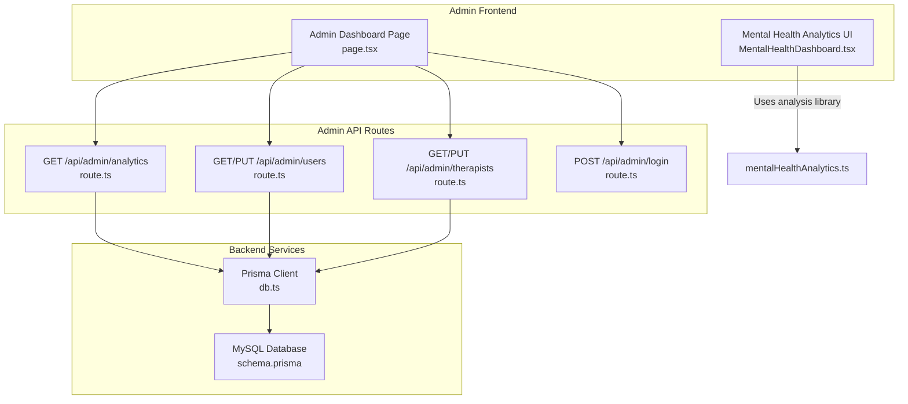
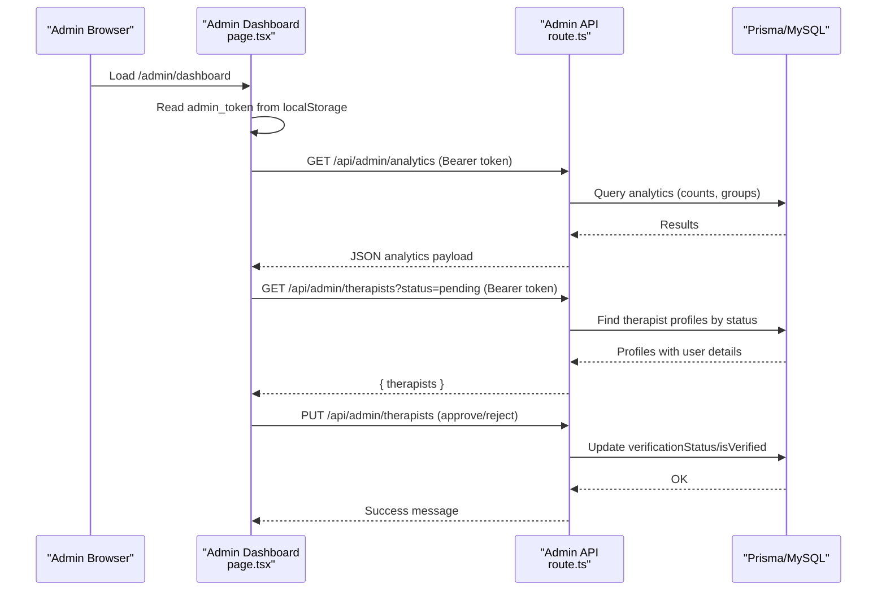
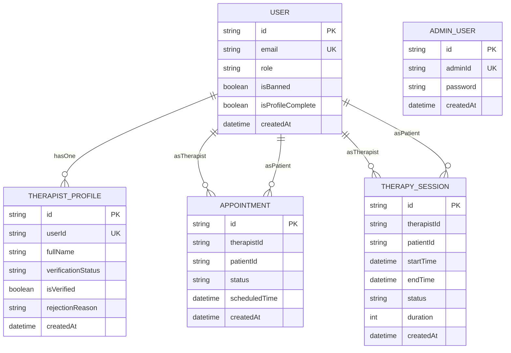
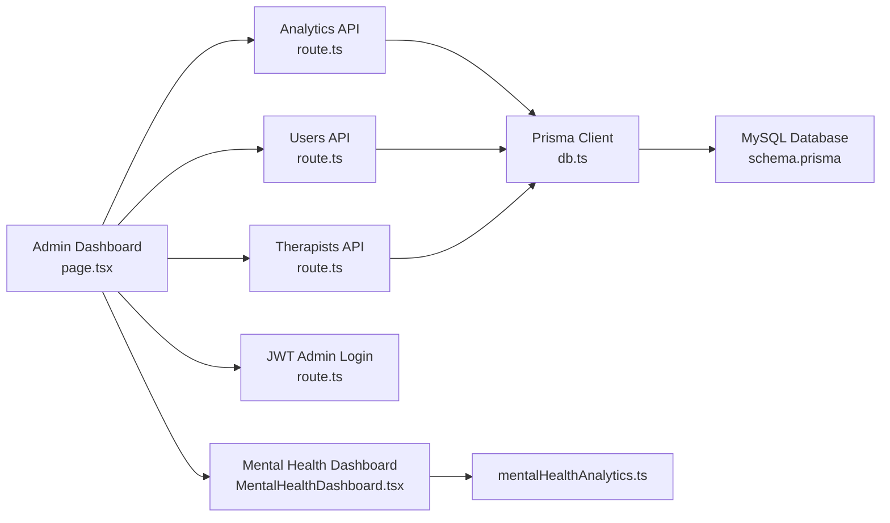

# Administration Panel

<cite>
**Referenced Files in This Document**
- [page.tsx](file://WEBAPP/src/app/admin/dashboard/page.tsx)
- [route.ts](file://WEBAPP/src/app/api/admin/analytics/route.ts)
- [route.ts](file://WEBAPP/src/app/api/admin/users/route.ts)
- [route.ts](file://WEBAPP/src/app/api/admin/therapists/route.ts)
- [route.ts](file://WEBAPP/src/app/api/admin/login/route.ts)
- [MentalHealthDashboard.tsx](file://WEBAPP/src/components/analytics/MentalHealthDashboard.tsx)
- [mentalHealthAnalytics.ts](file://WEBAPP/src/lib/mentalHealthAnalytics.ts)
- [db.ts](file://WEBAPP/src/lib/db.ts)
- [schema.prisma](file://WEBAPP/prisma/schema.prisma)
- [MY_SQL_INFO.md](file://WEBAPP/MY_SQL_INFO.md)
</cite>

## Table of Contents
1. [Introduction](#introduction)
2. [Project Structure](#project-structure)
3. [Core Components](#core-components)
4. [Architecture Overview](#architecture-overview)
5. [Detailed Component Analysis](#detailed-component-analysis)
6. [Dependency Analysis](#dependency-analysis)
7. [Performance Considerations](#performance-considerations)
8. [Troubleshooting Guide](#troubleshooting-guide)
9. [Conclusion](#conclusion)
10. [Appendices](#appendices)

## Introduction
This document explains the administrative functions and system management capabilities implemented in the project. It covers:
- Admin dashboard for system analytics, user management, and content moderation
- User administration: account verification, role assignment, and access control
- Therapist onboarding: license verification and professional credential management
- System analytics: usage metrics, performance monitoring, and compliance reporting
- Content moderation tools, policy enforcement, and incident response
- Audit logging, data export capabilities, and system maintenance workflows
- Administrative security measures and role-based access controls

## Project Structure
The administration panel is built as a Next.js app with a dedicated admin area. The frontend dashboard communicates with backend API routes secured by JWT. Data persistence uses Prisma ORM against a MySQL database.

**Diagram sources**
- [page.tsx](file://WEBAPP/src/app/admin/dashboard/page.tsx#L61-L509)
- [route.ts](file://WEBAPP/src/app/api/admin/analytics/route.ts#L19-L108)
- [route.ts](file://WEBAPP/src/app/api/admin/users/route.ts#L19-L107)
- [route.ts](file://WEBAPP/src/app/api/admin/therapists/route.ts#L20-L92)
- [route.ts](file://WEBAPP/src/app/api/admin/login/route.ts#L9-L74)
- [db.ts](file://WEBAPP/src/lib/db.ts#L1-L15)
- [schema.prisma](file://WEBAPP/prisma/schema.prisma#L39-L321)
- [MentalHealthDashboard.tsx](file://WEBAPP/src/components/analytics/MentalHealthDashboard.tsx#L47-L541)
- [mentalHealthAnalytics.ts](file://WEBAPP/src/lib/mentalHealthAnalytics.ts#L199-L289)

**Section sources**
- [page.tsx](file://WEBAPP/src/app/admin/dashboard/page.tsx#L61-L509)
- [route.ts](file://WEBAPP/src/app/api/admin/analytics/route.ts#L19-L108)
- [route.ts](file://WEBAPP/src/app/api/admin/users/route.ts#L19-L107)
- [route.ts](file://WEBAPP/src/app/api/admin/therapists/route.ts#L20-L92)
- [route.ts](file://WEBAPP/src/app/api/admin/login/route.ts#L9-L74)
- [db.ts](file://WEBAPP/src/lib/db.ts#L1-L15)
- [schema.prisma](file://WEBAPP/prisma/schema.prisma#L39-L321)
- [MentalHealthDashboard.tsx](file://WEBAPP/src/components/analytics/MentalHealthDashboard.tsx#L47-L541)
- [mentalHealthAnalytics.ts](file://WEBAPP/src/lib/mentalHealthAnalytics.ts#L199-L289)

## Core Components
- Admin Dashboard (client): renders analytics cards, therapist verification queue, and user management table; handles admin auth via local storage and JWT bearer tokens; triggers admin actions.
- Admin API routes: secure endpoints for analytics, user management, therapist verification, and admin login.
- Prisma models: define User, AdminUser, TherapistProfile, Appointment, TherapySession, and related entities.
- Analytics UI: mental health analytics dashboard for severity, sentiment, emotion distribution, and keyword trends.

**Section sources**
- [page.tsx](file://WEBAPP/src/app/admin/dashboard/page.tsx#L61-L509)
- [route.ts](file://WEBAPP/src/app/api/admin/analytics/route.ts#L19-L108)
- [route.ts](file://WEBAPP/src/app/api/admin/users/route.ts#L19-L107)
- [route.ts](file://WEBAPP/src/app/api/admin/therapists/route.ts#L20-L92)
- [schema.prisma](file://WEBAPP/prisma/schema.prisma#L39-L321)
- [MentalHealthDashboard.tsx](file://WEBAPP/src/components/analytics/MentalHealthDashboard.tsx#L47-L541)

## Architecture Overview
The admin panel follows a layered architecture:
- Presentation layer: Next.js app pages and components
- API layer: Next.js API routes under /api/admin
- Persistence layer: Prisma ORM with MySQL
- Security: JWT-based admin authentication with role claims

**Diagram sources**
- [page.tsx](file://WEBAPP/src/app/admin/dashboard/page.tsx#L76-L147)
- [route.ts](file://WEBAPP/src/app/api/admin/analytics/route.ts#L19-L108)
- [route.ts](file://WEBAPP/src/app/api/admin/therapists/route.ts#L20-L92)

## Detailed Component Analysis

### Admin Dashboard (Client)
Responsibilities:
- Tabbed interface: Overview, Verify Therapists, Manage Users
- Authentication: checks admin_token; redirects unauthenticated users
- Analytics: fetches system overview and appointment status breakdown
- Therapist verification: filters by status, displays profile details, approves/rejects with optional reason
- User management: filters by role, searches by name/email, bans/unbans/deletes users
- Action feedback: loading states, action buttons, modal for rejection reasons

Key behaviors:
- Uses Authorization header with Bearer token for all admin requests
- On unauthorized responses, clears stored token and navigates to admin login
- Parallel data fetching for analytics, therapists, and users on mount

**Section sources**
- [page.tsx](file://WEBAPP/src/app/admin/dashboard/page.tsx#L61-L509)

### Admin Login API
Responsibilities:
- Validates adminId and password against seeded AdminUser record
- Seeds default admin (adminId: 123456, password: 123456) if not present
- Issues JWT with role claim for admin sessions

Security:
- Uses bcrypt for password comparison
- JWT secret sourced from NEXTAUTH_SECRET environment variable
- Token includes role and id for downstream verification

**Section sources**
- [route.ts](file://WEBAPP/src/app/api/admin/login/route.ts#L9-L74)

### Analytics API
Responsibilities:
- Verifies admin JWT
- Computes totals: patients, therapists, sessions, appointments
- Active users: counts based on recent chat/session activity
- Pending verifications and banned users
- Appointment status breakdown
- Daily registrations for charting

Data sources:
- Prisma queries across User, TherapySession, Appointment, and TherapistProfile

**Section sources**
- [route.ts](file://WEBAPP/src/app/api/admin/analytics/route.ts#L19-L108)

### Users Management API
Responsibilities:
- GET: lists users with filtering by role and search term; excludes admin role
- PUT: bans/unbans or deletes users

Data model:
- User entity includes role, isBanned, isProfileComplete, timestamps, and relations

**Section sources**
- [route.ts](file://WEBAPP/src/app/api/admin/users/route.ts#L19-L107)
- [schema.prisma](file://WEBAPP/prisma/schema.prisma#L39-L69)

### Therapist Verification API
Responsibilities:
- GET: lists therapist profiles filtered by verificationStatus
- PUT: updates verificationStatus, isVerified, and optional rejectionReason

Data model:
- TherapistProfile includes personal/professional details and verification fields

**Section sources**
- [route.ts](file://WEBAPP/src/app/api/admin/therapists/route.ts#L20-L92)
- [schema.prisma](file://WEBAPP/prisma/schema.prisma#L299-L321)

### Mental Health Analytics UI
Responsibilities:
- Renders severity level, sentiment, dominant emotion, lexical diversity
- Displays charts: sentiment timeline, emotion pie, radar, category bar chart
- Provides keyword category breakdown and risk flag indicators
- Integrates with mentalHealthAnalytics library for computations

**Section sources**
- [MentalHealthDashboard.tsx](file://WEBAPP/src/components/analytics/MentalHealthDashboard.tsx#L47-L541)
- [mentalHealthAnalytics.ts](file://WEBAPP/src/lib/mentalHealthAnalytics.ts#L199-L289)

### Data Models Overview
Key models used by admin functions:
- User: role, isBanned, isProfileComplete, timestamps, relations
- AdminUser: adminId, password
- TherapistProfile: verificationStatus, isVerified, rejectionReason, professional details
- Appointment and TherapySession: used for analytics and status reporting

**Diagram sources**
- [schema.prisma](file://WEBAPP/prisma/schema.prisma#L39-L321)

## Dependency Analysis
- Admin Dashboard depends on:
  - Admin API routes for analytics, users, therapists
  - Local storage for admin_token
- Admin API routes depend on:
  - Prisma client for database operations
  - JWT verification for admin authentication
- Analytics UI depends on:
  - mentalHealthAnalytics library for computations

**Diagram sources**
- [page.tsx](file://WEBAPP/src/app/admin/dashboard/page.tsx#L61-L509)
- [route.ts](file://WEBAPP/src/app/api/admin/analytics/route.ts#L19-L108)
- [route.ts](file://WEBAPP/src/app/api/admin/users/route.ts#L19-L107)
- [route.ts](file://WEBAPP/src/app/api/admin/therapists/route.ts#L20-L92)
- [route.ts](file://WEBAPP/src/app/api/admin/login/route.ts#L9-L74)
- [db.ts](file://WEBAPP/src/lib/db.ts#L1-L15)
- [schema.prisma](file://WEBAPP/prisma/schema.prisma#L39-L321)
- [MentalHealthDashboard.tsx](file://WEBAPP/src/components/analytics/MentalHealthDashboard.tsx#L47-L541)
- [mentalHealthAnalytics.ts](file://WEBAPP/src/lib/mentalHealthAnalytics.ts#L199-L289)

**Section sources**
- [page.tsx](file://WEBAPP/src/app/admin/dashboard/page.tsx#L61-L509)
- [route.ts](file://WEBAPP/src/app/api/admin/analytics/route.ts#L19-L108)
- [route.ts](file://WEBAPP/src/app/api/admin/users/route.ts#L19-L107)
- [route.ts](file://WEBAPP/src/app/api/admin/therapists/route.ts#L20-L92)
- [route.ts](file://WEBAPP/src/app/api/admin/login/route.ts#L9-L74)
- [db.ts](file://WEBAPP/src/lib/db.ts#L1-L15)
- [schema.prisma](file://WEBAPP/prisma/schema.prisma#L39-L321)
- [MentalHealthDashboard.tsx](file://WEBAPP/src/components/analytics/MentalHealthDashboard.tsx#L47-L541)
- [mentalHealthAnalytics.ts](file://WEBAPP/src/lib/mentalHealthAnalytics.ts#L199-L289)

## Performance Considerations
- Parallel data fetching: the dashboard fetches analytics, therapists, and users concurrently to reduce load time.
- Efficient Prisma queries: grouped counts and status breakdowns minimize round-trips.
- Pagination and filtering: user listings support role and search filters to limit result sets.
- Recommendations:
  - Add server-side pagination for large datasets
  - Cache analytics aggregates periodically
  - Use database indexes on frequently queried fields (verificationStatus, isBanned, role)

[No sources needed since this section provides general guidance]

## Troubleshooting Guide
Common issues and resolutions:
- Unauthorized access:
  - Symptom: Redirect to admin login after initial load
  - Cause: Missing or invalid admin_token
  - Resolution: Log in again to obtain a new token
- API 401 responses:
  - Symptom: Requests fail with unauthorized
  - Cause: Expired or incorrect JWT
  - Resolution: Re-authenticate and retry
- Database connectivity:
  - Symptom: Server errors when fetching data
  - Cause: Prisma client cannot connect to MySQL
  - Resolution: Verify DATABASE_URL and MySQL service status
- Schema generation:
  - Symptom: TypeScript errors with Prisma types
  - Cause: Missing generated client
  - Resolution: Run Prisma generate and restart development server

**Section sources**
- [page.tsx](file://WEBAPP/src/app/admin/dashboard/page.tsx#L76-L100)
- [route.ts](file://WEBAPP/src/app/api/admin/analytics/route.ts#L104-L107)
- [route.ts](file://WEBAPP/src/app/api/admin/users/route.ts#L69-L72)
- [route.ts](file://WEBAPP/src/app/api/admin/therapists/route.ts#L46-L49)
- [MY_SQL_INFO.md](file://WEBAPP/MY_SQL_INFO.md#L97-L114)

## Conclusion
The administration panel provides a comprehensive foundation for managing users, verifying therapists, and monitoring system health. It leverages JWT-based admin authentication, Prisma-backed analytics, and modular UI components for actionable insights. Extending the system with audit logs, data exports, and enhanced moderation tools will further strengthen operational oversight.

[No sources needed since this section summarizes without analyzing specific files]

## Appendices

### Administrative Security Measures
- Role-based access control: JWT tokens carry role claims validated by API routes
- Admin seeding: default admin credentials are created automatically for initial setup
- Token lifecycle: tokens are stored locally and cleared on logout or unauthorized responses

**Section sources**
- [route.ts](file://WEBAPP/src/app/api/admin/login/route.ts#L32-L41)
- [page.tsx](file://WEBAPP/src/app/admin/dashboard/page.tsx#L76-L84)

### System Maintenance Workflows
- Database initialization: Prisma client generation and schema push
- Local development: Prisma Studio for database inspection
- Environment configuration: MySQL connection and NextAuth secrets

**Section sources**
- [MY_SQL_INFO.md](file://WEBAPP/MY_SQL_INFO.md#L35-L48)
- [MY_SQL_INFO.md](file://WEBAPP/MY_SQL_INFO.md#L88-L95)