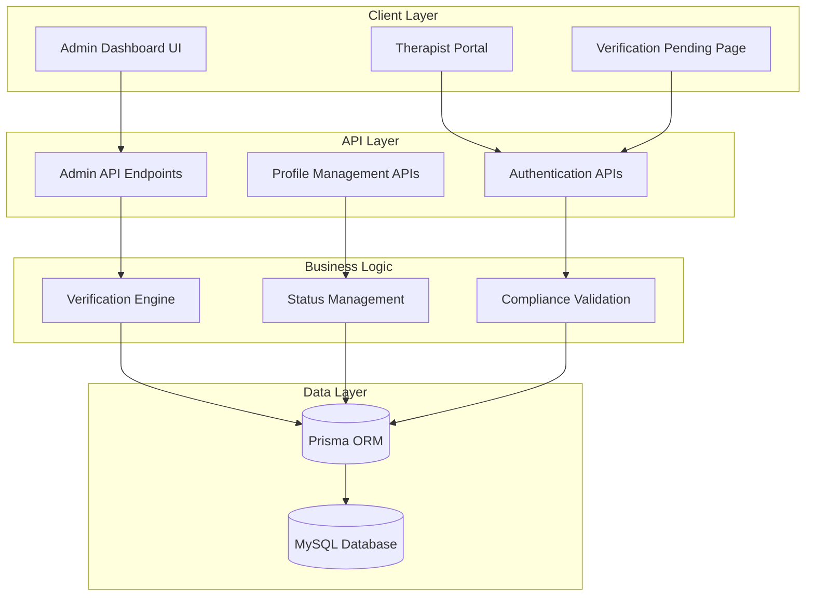
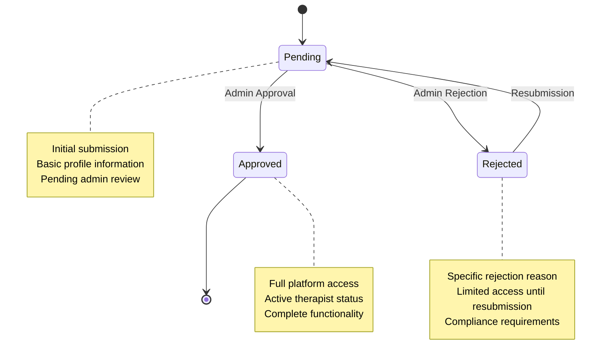
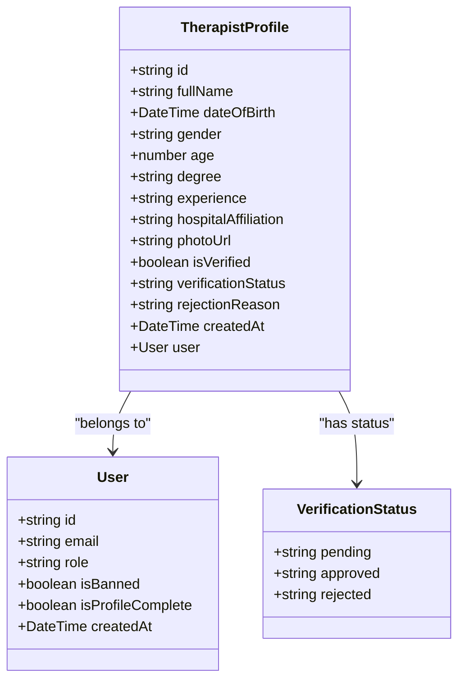
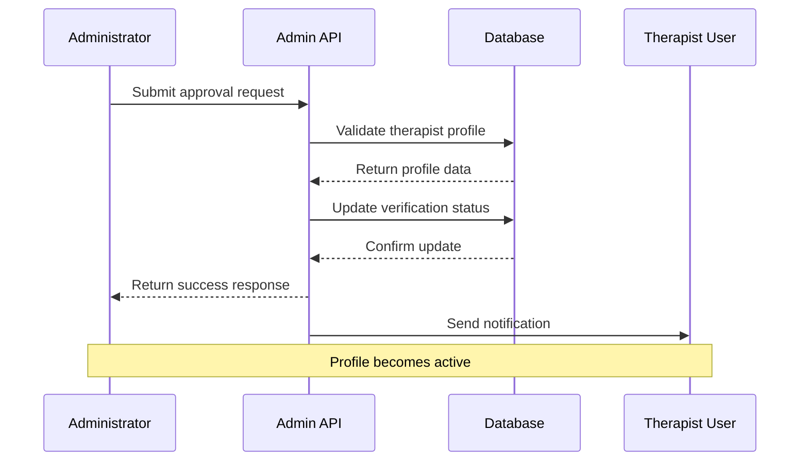
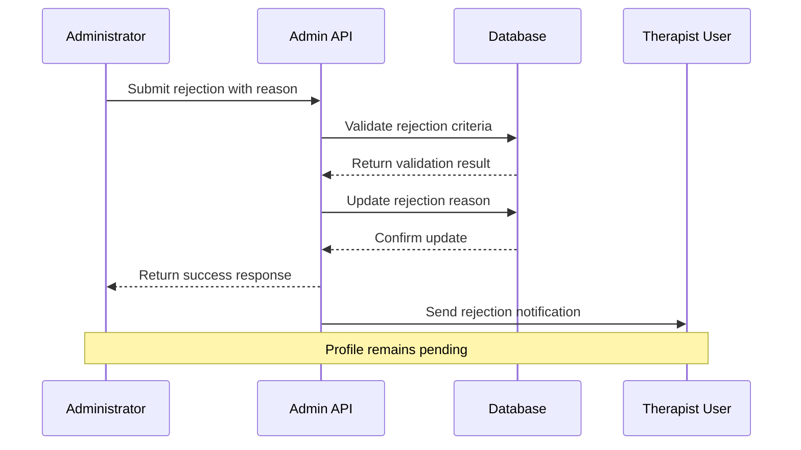
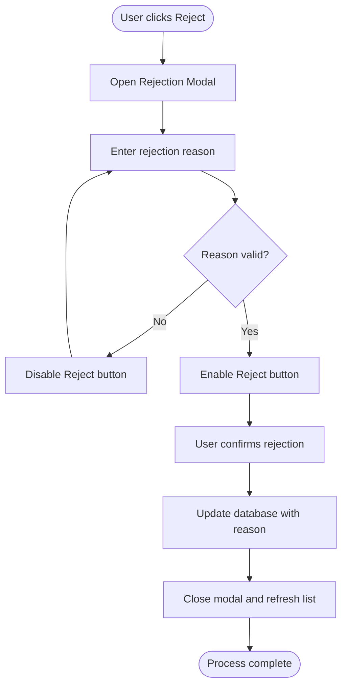
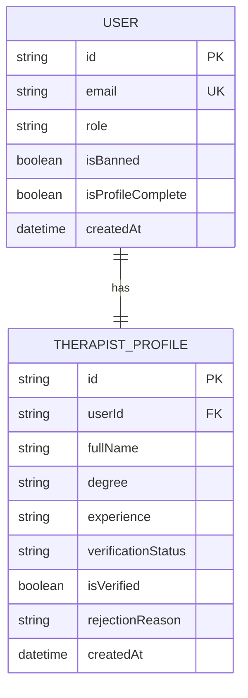

# Therapist Verification System

<cite>
**Referenced Files in This Document**
- [Admin Dashboard](file://src/app/admin/dashboard/page.tsx)
- [Admin Therapist API](file://src/app/api/admin/therapists/route.ts)
- [Verification Pending Page](file://src/app/auth/verification-pending/page.tsx)
- [Check Profile API](file://src/app/api/auth/check-profile/route.ts)
- [Complete Profile API](file://src/app/api/auth/complete-profile/therapist/route.ts)
- [Prisma Schema](file://prisma/schema.prisma)
</cite>

## Table of Contents
1. [Introduction](#introduction)
2. [System Architecture](#system-architecture)
3. [Three-Stage Verification Workflow](#three-stage-verification-workflow)
4. [Therapist Profile Management](#therapist-profile-management)
5. [Approval and Rejection Processes](#approval-and-rejection-processes)
6. [Filtering and Bulk Actions](#filtering-and-bulk-actions)
7. [Modal-Based Rejection Workflow](#modal-based-rejection-workflow)
8. [Integration with User Accounts](#integration-with-user-accounts)
9. [Verification Badges and Status Updates](#verification-badges-and-status-updates)
10. [Approval Criteria and Compliance](#approval-criteria-and-compliance)
11. [Technical Implementation Details](#technical-implementation-details)
12. [Troubleshooting Guide](#troubleshooting-guide)
13. [Conclusion](#conclusion)

## Introduction

The MindBridge therapist verification management system is a comprehensive administrative solution designed to validate and manage mental health professionals' credentials within the platform. This system implements a robust three-stage verification workflow ensuring regulatory compliance while maintaining user experience and operational efficiency.

The system integrates seamlessly with the broader MindBridge ecosystem, providing administrators with powerful tools to oversee therapist onboarding, maintain quality standards, and ensure patient safety through proper credential validation.

## System Architecture

The therapist verification system follows a client-server architecture with clear separation of concerns between administrative interfaces, API endpoints, and database management.

**Diagram sources**
- [Admin Dashboard](file://src/app/admin/dashboard/page.tsx#L61-L177)
- [Admin Therapist API](file://src/app/api/admin/therapists/route.ts#L20-L92)
- [Prisma Schema](file://prisma/schema.prisma#L299-L321)

## Three-Stage Verification Workflow

The verification system operates through a structured three-stage process designed to ensure comprehensive credential validation and compliance with healthcare regulations.

### Stage 1: Pending Verification
The initial stage captures therapist submissions and prepares them for administrative review. During this phase, profiles are stored with pending status and basic identifying information.

### Stage 2: Approved Verification
Successful verification results in approved status with full access permissions granted to therapists. This stage enables complete platform functionality including patient consultations and session management.

### Stage 3: Rejected Verification
Failed verification attempts are documented with specific rejection reasons, enabling therapists to understand requirements and resubmit corrected information.

**Diagram sources**
- [Admin Dashboard](file://src/app/admin/dashboard/page.tsx#L293-L299)
- [Admin Therapist API](file://src/app/api/admin/therapists/route.ts#L66-L77)

**Section sources**
- [Admin Dashboard](file://src/app/admin/dashboard/page.tsx#L255-L347)
- [Admin Therapist API](file://src/app/api/admin/therapists/route.ts#L20-L92)

## Therapist Profile Management

The system manages comprehensive therapist profiles containing personal information, professional credentials, and verification status indicators.

### Profile Information Structure

| Category | Fields | Description |
|----------|--------|-------------|
| Personal Information | fullName, dateOfBirth, gender, age | Basic demographic and identification data |
| Professional Credentials | degree, experience, hospitalAffiliation | Educational qualifications and professional background |
| Verification Status | isVerified, verificationStatus, rejectionReason | Current verification state and compliance indicators |
| Media Assets | photoUrl | Professional photograph for identity verification |

### Profile Display Components

The administrative interface presents therapist information through structured displays with status indicators and action controls.

**Diagram sources**
- [Prisma Schema](file://prisma/schema.prisma#L300-L316)
- [Admin Dashboard](file://src/app/admin/dashboard/page.tsx#L23-L58)

**Section sources**
- [Prisma Schema](file://prisma/schema.prisma#L299-L321)
- [Admin Dashboard](file://src/app/admin/dashboard/page.tsx#L277-L322)

## Approval and Rejection Processes

The approval and rejection mechanisms operate through secure API endpoints with comprehensive validation and audit capabilities.

### Approval Process Flow

**Diagram sources**
- [Admin Therapist API](file://src/app/api/admin/therapists/route.ts#L52-L92)

### Rejection Process Flow

**Diagram sources**
- [Admin Therapist API](file://src/app/api/admin/therapists/route.ts#L58-L82)

**Section sources**
- [Admin Therapist API](file://src/app/api/admin/therapists/route.ts#L52-L92)

## Filtering and Bulk Actions

The administrative interface provides sophisticated filtering mechanisms and bulk action capabilities for efficient therapist management.

### Status-Based Filtering

Administrators can filter therapists by verification status using intuitive tab-based navigation:

- **Pending**: Therapists awaiting initial review
- **Approved**: Verified professionals with full access
- **Rejected**: Profiles requiring resubmission

### Bulk Action Capabilities

The system supports efficient batch operations through the administrative interface, enabling rapid processing of multiple verification requests.

**Section sources**
- [Admin Dashboard](file://src/app/admin/dashboard/page.tsx#L258-L268)
- [Admin Dashboard](file://src/app/admin/dashboard/page.tsx#L133-L147)

## Modal-Based Rejection Workflow

The rejection process utilizes a modal-based interface ensuring comprehensive documentation of rejection reasons while maintaining user experience.

### Rejection Modal Components

| Element | Function | Security Features |
|---------|----------|-------------------|
| Reason Textarea | Collect detailed rejection information | Character validation, minimum length enforcement |
| Confirmation Button | Execute rejection action | Disabled until valid reason provided |
| Cancel Button | Abort rejection process | Immediate modal dismissal |
| Dynamic Preview | Show rejection recipient | Real-time name display |

### Modal Interaction Flow

**Diagram sources**
- [Admin Dashboard](file://src/app/admin/dashboard/page.tsx#L480-L506)

**Section sources**
- [Admin Dashboard](file://src/app/admin/dashboard/page.tsx#L480-L506)

## Integration with User Accounts

The verification system maintains seamless integration with the broader user account management infrastructure, ensuring consistent authentication and authorization across all platform features.

### User Account Integration Points

| Integration Point | Purpose | Security Impact |
|------------------|---------|-----------------|
| Authentication Layer | Secure therapist login | JWT token validation |
| Role Assignment | Determine access permissions | Role-based authorization |
| Profile Synchronization | Maintain consistent data | Real-time data updates |
| Status Tracking | Monitor verification progress | Audit trail maintenance |

### Account Lifecycle Management

**Diagram sources**
- [Prisma Schema](file://prisma/schema.prisma#L39-L69)
- [Prisma Schema](file://prisma/schema.prisma#L299-L321)

**Section sources**
- [Prisma Schema](file://prisma/schema.prisma#L39-L69)
- [Prisma Schema](file://prisma/schema.prisma#L299-L321)

## Verification Badges and Status Updates

The system employs visual indicators and real-time status updates to communicate verification state across all user interfaces.

### Status Badge System

| Status | Color | Icon | Meaning |
|--------|-------|------|---------|
| Pending | Yellow | ⏳ | Under review |
| Approved | Green | ✅ | Fully verified |
| Rejected | Red | ❌ | Requires correction |

### Real-Time Status Communication

The verification system implements WebSocket-like real-time updates through periodic polling, ensuring stakeholders receive immediate notifications of status changes.

**Section sources**
- [Admin Dashboard](file://src/app/admin/dashboard/page.tsx#L293-L299)
- [Verification Pending Page](file://src/app/auth/verification-pending/page.tsx#L33-L44)

## Approval Criteria and Compliance

The verification system enforces strict compliance requirements through automated validation and manual review processes.

### Professional Credential Validation

| Credential Type | Validation Method | Required Evidence |
|----------------|-------------------|-------------------|
| Medical Degree | Educational institution verification | Diploma copy, institutional verification |
| License Number | State licensing board verification | License document, board confirmation |
| Hospital Affiliation | Healthcare facility verification | Employment letter, facility confirmation |
| Professional References | Background verification | Reference letters, contact verification |

### Compliance Requirements

The system ensures adherence to healthcare regulations through:

- **HIPAA Compliance**: Protected health information handling
- **State Licensing**: Professional license validation
- **Background Checks**: Criminal history verification
- **Continuing Education**: Professional development validation

**Section sources**
- [Complete Profile API](file://src/app/api/auth/complete-profile/therapist/route.ts#L8-L18)
- [Prisma Schema](file://prisma/schema.prisma#L308-L310)

## Technical Implementation Details

The therapist verification system leverages modern web technologies and best practices for reliability and scalability.

### Database Schema Design

The Prisma schema defines comprehensive relationships between users, profiles, and verification data, ensuring data integrity and referential consistency.

### API Security Measures

- **JWT Authentication**: Secure administrative access
- **Input Validation**: Zod schema validation for all endpoints
- **Authorization Middleware**: Role-based access control
- **Audit Logging**: Comprehensive action tracking

### Frontend Implementation Patterns

The administrative interface utilizes React hooks for state management, implementing efficient data fetching and caching strategies to minimize latency and improve user experience.

**Section sources**
- [Prisma Schema](file://prisma/schema.prisma#L299-L321)
- [Admin Therapist API](file://src/app/api/admin/therapists/route.ts#L7-L18)

## Troubleshooting Guide

Common issues and their resolution strategies for the therapist verification system.

### Verification Status Not Updating

**Symptoms**: Approved/rejected status not reflected in therapist interface
**Causes**: 
- Database synchronization delays
- Client-side caching issues
- Authentication token expiration

**Resolution Steps**:
1. Clear browser cache and reload admin interface
2. Verify JWT token validity in local storage
3. Check database synchronization status
4. Restart API service if necessary

### Rejection Reason Not Saved

**Symptoms**: Rejection modal closes but reason not recorded
**Causes**:
- Frontend validation failures
- Network connectivity issues
- Database write permissions

**Resolution Steps**:
1. Verify network connection stability
2. Check browser console for JavaScript errors
3. Confirm database write permissions
4. Test with different browser or incognito mode

### Profile Submission Failures

**Symptoms**: Therapist profile submission returns validation errors
**Causes**:
- Missing required fields
- Invalid data formats
- Duplicate entries

**Resolution Steps**:
1. Review validation error messages
2. Verify required field completion
3. Check data format compliance
4. Remove duplicate entries

**Section sources**
- [Check Profile API](file://src/app/api/auth/check-profile/route.ts#L12-L15)
- [Complete Profile API](file://src/app/api/auth/complete-profile/therapist/route.ts#L21-L26)

## Conclusion

The MindBridge therapist verification management system provides a comprehensive solution for healthcare professional credential validation. Through its three-stage workflow, robust administrative interface, and integrated compliance mechanisms, the system ensures patient safety while maintaining operational efficiency.

Key strengths of the system include:

- **Comprehensive Validation**: Multi-layered credential verification
- **User Experience**: Intuitive administrative interface with real-time updates
- **Security**: Robust authentication and authorization mechanisms
- **Scalability**: Database-first design supporting growth
- **Compliance**: Built-in adherence to healthcare regulations

The system successfully balances regulatory requirements with practical usability, providing administrators with powerful tools while ensuring therapists have clear pathways for successful verification and ongoing compliance.