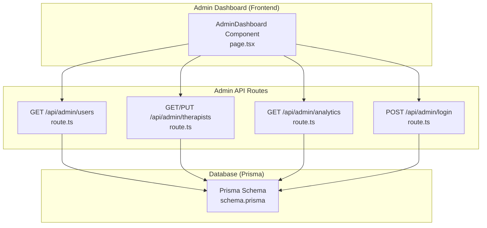
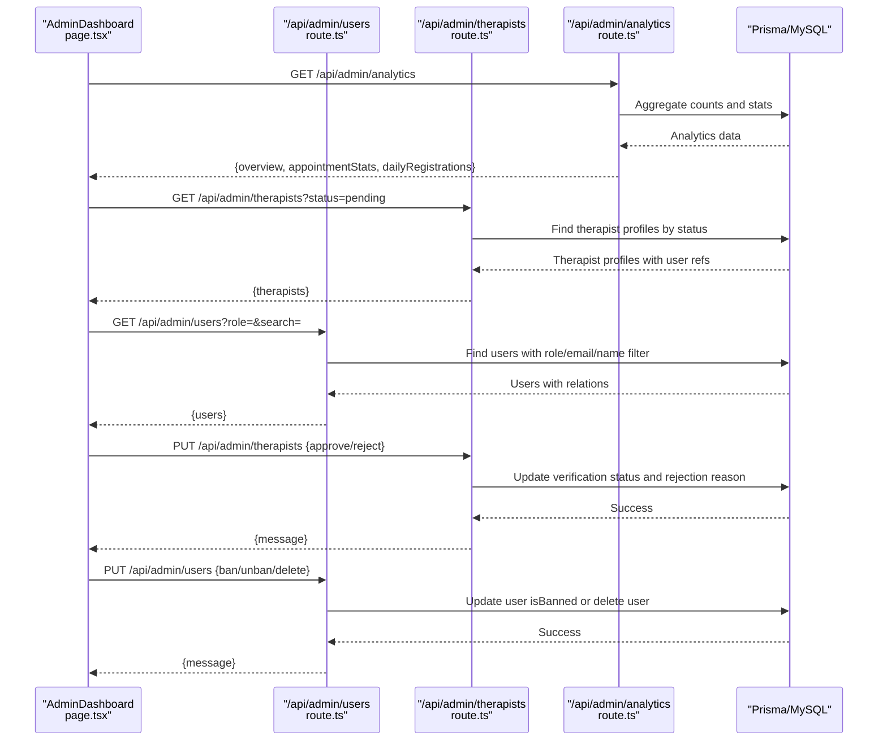
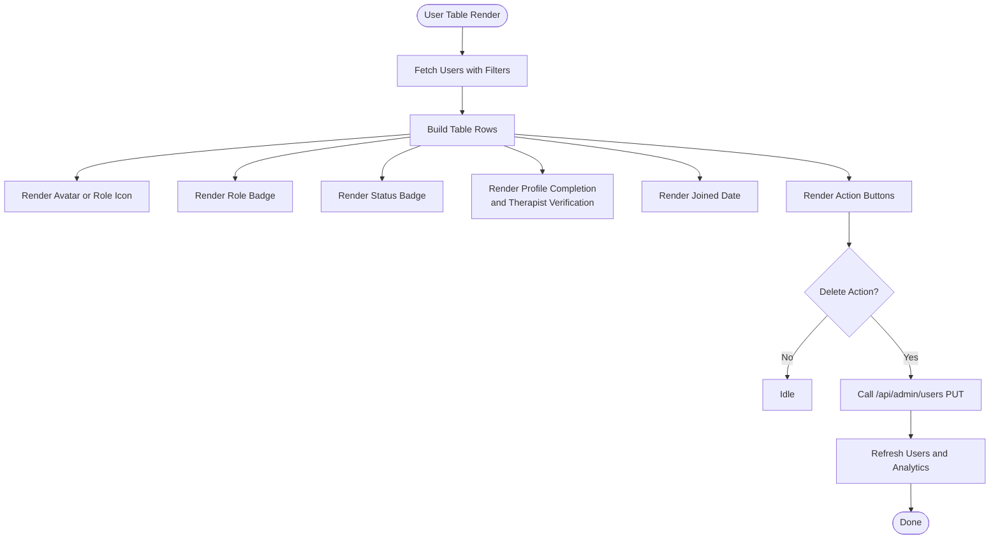
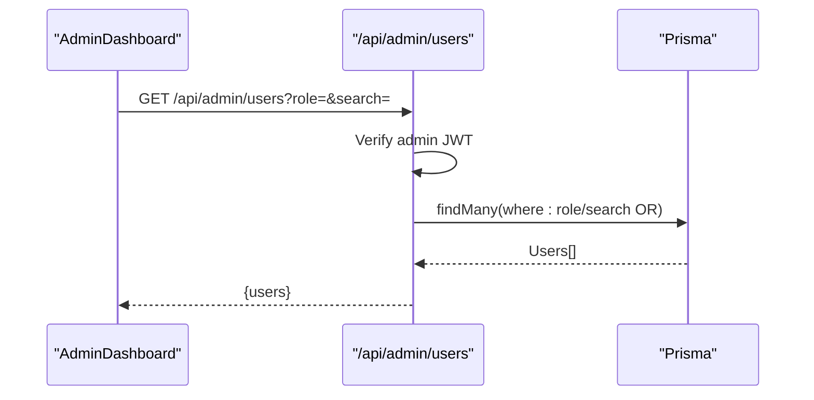
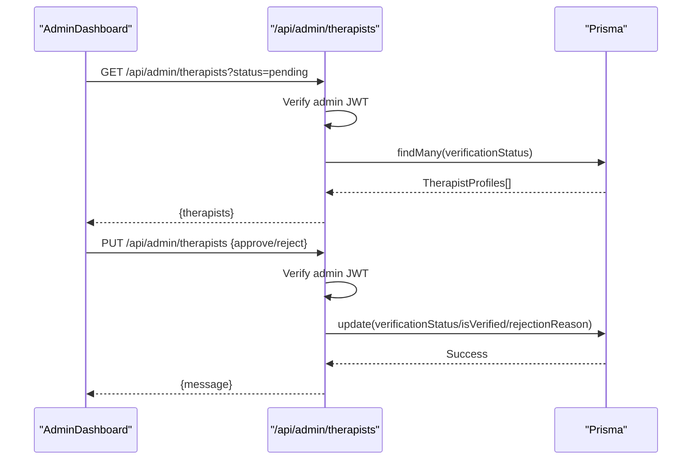
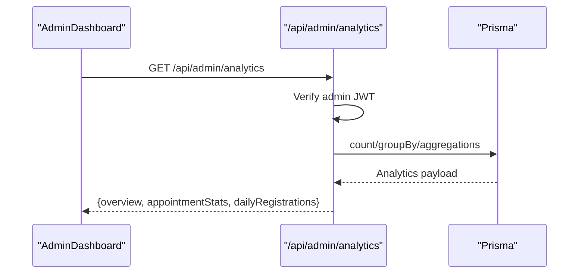
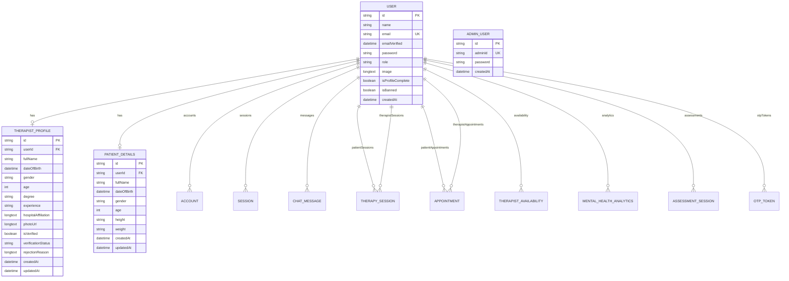
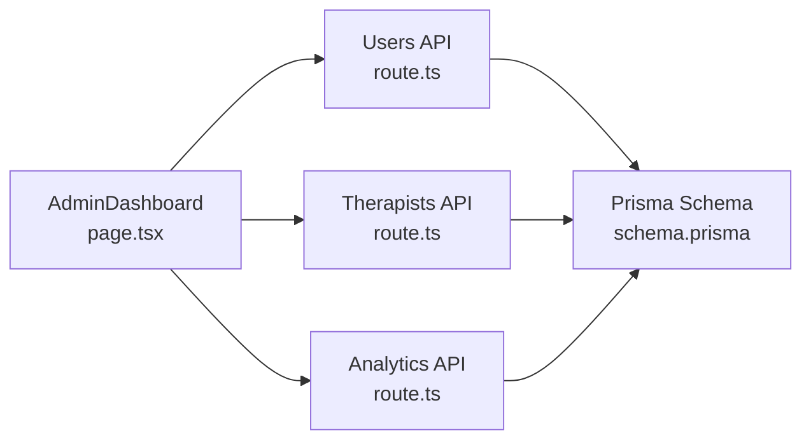

# User Management System

<cite>
**Referenced Files in This Document**
- [page.tsx](file://WEBAPP/src/app/admin/dashboard/page.tsx)
- [route.ts](file://WEBAPP/src/app/api/admin/users/route.ts)
- [route.ts](file://WEBAPP/src/app/api/admin/therapists/route.ts)
- [route.ts](file://WEBAPP/src/app/api/admin/analytics/route.ts)
- [route.ts](file://WEBAPP/src/app/api/admin/login/route.ts)
- [schema.prisma](file://WEBAPP/prisma/schema.prisma)
</cite>

## Table of Contents
1. [Introduction](#introduction)
2. [Project Structure](#project-structure)
3. [Core Components](#core-components)
4. [Architecture Overview](#architecture-overview)
5. [Detailed Component Analysis](#detailed-component-analysis)
6. [Dependency Analysis](#dependency-analysis)
7. [Performance Considerations](#performance-considerations)
8. [Troubleshooting Guide](#troubleshooting-guide)
9. [Conclusion](#conclusion)

## Introduction
This document describes the comprehensive user management system for the MindBridge platform. It covers multi-role user filtering (patients, therapists, admins), advanced search by name or email, the user table interface with profile completion indicators and account status badges, role assignments, user actions (ban/unban and permanent deletion with confirmation), user profile display with avatar handling and registration dates, integration with therapist verification status and profile completeness tracking, bulk operations, search optimization, user activity monitoring, and data privacy considerations with audit trail requirements.

## Project Structure
The user management system spans frontend React components and backend Next.js API routes, backed by Prisma ORM and a MySQL database. The admin dashboard orchestrates data fetching and user actions, while API routes enforce admin-only access and implement filtering, search, and moderation operations.

**Diagram sources**
- [page.tsx](file://WEBAPP/src/app/admin/dashboard/page.tsx#L1-L510)
- [route.ts](file://WEBAPP/src/app/api/admin/users/route.ts#L1-L41)
- [route.ts](file://WEBAPP/src/app/api/admin/therapists/route.ts#L1-L92)
- [route.ts](file://WEBAPP/src/app/api/admin/analytics/route.ts#L1-L109)
- [route.ts](file://WEBAPP/src/app/api/admin/login/route.ts#L1-L74)
- [schema.prisma](file://WEBAPP/prisma/schema.prisma#L1-L330)

**Section sources**
- [page.tsx](file://WEBAPP/src/app/admin/dashboard/page.tsx#L1-L510)
- [route.ts](file://WEBAPP/src/app/api/admin/users/route.ts#L1-L41)
- [route.ts](file://WEBAPP/src/app/api/admin/therapists/route.ts#L1-L92)
- [route.ts](file://WEBAPP/src/app/api/admin/analytics/route.ts#L1-L109)
- [route.ts](file://WEBAPP/src/app/api/admin/login/route.ts#L1-L74)
- [schema.prisma](file://WEBAPP/prisma/schema.prisma#L1-L330)

## Core Components
- AdminDashboard (page.tsx): Orchestrates analytics, therapist verification, and user management tabs. Implements filters, search, and user actions with confirmation dialogs.
- Admin API routes: Provide secure endpoints for analytics, therapist verification, user listing/search/filtering, and admin login.
- Prisma schema: Defines the User model with roles, profile completion, ban status, and relations to related entities.

Key capabilities:
- Multi-role filtering: patients, therapists, or all users.
- Advanced search: by name or email using OR conditions.
- User table: displays avatar, role badges, status badges, profile completeness, joined date, and actions.
- User actions: ban/unban and delete with confirmation.
- Therapist verification: approve/reject with optional rejection reason.
- Activity monitoring: analytics dashboard with counts and charts.
- Privacy and audit: admin-only JWT verification and exclusion of admin users from user listings.

**Section sources**
- [page.tsx](file://WEBAPP/src/app/admin/dashboard/page.tsx#L61-L163)
- [route.ts](file://WEBAPP/src/app/api/admin/users/route.ts#L19-L41)
- [route.ts](file://WEBAPP/src/app/api/admin/therapists/route.ts#L20-L92)
- [route.ts](file://WEBAPP/src/app/api/admin/analytics/route.ts#L19-L109)
- [schema.prisma](file://WEBAPP/prisma/schema.prisma#L39-L69)

## Architecture Overview
The system follows a client-server pattern:
- Frontend (Next.js App Router): AdminDashboard fetches data and triggers actions via API routes.
- Backend (Next.js API Routes): Enforce admin-only access, apply filters and search, and perform updates.
- Persistence (Prisma + MySQL): Models define user roles, verification, and related entities.

**Diagram sources**
- [page.tsx](file://WEBAPP/src/app/admin/dashboard/page.tsx#L92-L163)
- [route.ts](file://WEBAPP/src/app/api/admin/users/route.ts#L19-L41)
- [route.ts](file://WEBAPP/src/app/api/admin/therapists/route.ts#L20-L92)
- [route.ts](file://WEBAPP/src/app/api/admin/analytics/route.ts#L19-L109)

## Detailed Component Analysis

### AdminDashboard (User Management UI)
Responsibilities:
- Tabs: Overview, Verify Therapists, Manage Users.
- Filters: Role filter (all/patients/therapists) and text search by name or email.
- User table: Avatar, role badge, status badge, profile completeness indicator, joined date, and action buttons.
- Actions: Ban/Unban/Delete with confirmation; approve/reject therapist with rejection reason modal.
- Analytics: Overview cards and appointment status breakdown.

User table interface highlights:
- Avatar handling: Uses user image if present; otherwise renders role-specific icons.
- Role assignments: Patient vs therapist badges with distinct styles.
- Account status: Active/Banned badges.
- Profile completion: Indicator for isProfileComplete; therapist verification status appended when applicable.
- Joined date: Formatted from createdAt.
- Actions: Conditional ban/unban buttons and delete button with confirmation.

Therapist verification integration:
- Displays verification status badges (pending/approved/rejected).
- Approve/reject actions with rejection reason capture.
- Excludes admin users from user lists.

Bulk operations:
- Implemented via role and search filters applied to the user listing endpoint.

Search optimization:
- Client-side query construction with URLSearchParams for role and search parameters.
- Server-side OR condition on email and name for efficient filtering.

User activity monitoring:
- Analytics endpoint aggregates counts, active users, pending verifications, banned users, recent registrations, and appointment status distribution.

**Diagram sources**
- [page.tsx](file://WEBAPP/src/app/admin/dashboard/page.tsx#L350-L477)
- [page.tsx](file://WEBAPP/src/app/admin/dashboard/page.tsx#L149-L163)

**Section sources**
- [page.tsx](file://WEBAPP/src/app/admin/dashboard/page.tsx#L61-L163)
- [page.tsx](file://WEBAPP/src/app/admin/dashboard/page.tsx#L350-L477)

### Admin Users API Route
Responsibilities:
- Authentication: Verifies admin JWT from Authorization header.
- Filtering: Supports role parameter ("patient", "therapist", or none for both).
- Search: Supports search parameter with OR condition on email and name.
- Output: Returns users excluding admin role, with relations for profile completeness and therapist verification.

Implementation notes:
- Role filter: if provided, restricts results to that role; otherwise includes both patients and therapists.
- Search filter: applies OR condition to email and name fields.
- Security: Enforces admin-only access via JWT verification.

**Diagram sources**
- [route.ts](file://WEBAPP/src/app/api/admin/users/route.ts#L19-L41)

**Section sources**
- [route.ts](file://WEBAPP/src/app/api/admin/users/route.ts#L1-L41)

### Admin Therapists API Route
Responsibilities:
- Authentication: Verifies admin JWT.
- Listing: Retrieves therapist profiles filtered by verification status (pending, approved, rejected).
- Actions: Approve or reject therapist with optional rejection reason.

Implementation notes:
- Status filter: defaults to "pending".
- Approval: sets verificationStatus to "approved" and isVerified to true.
- Rejection: sets verificationStatus to "rejected", isVerified to false, and stores rejection reason if provided.

**Diagram sources**
- [route.ts](file://WEBAPP/src/app/api/admin/therapists/route.ts#L20-L92)

**Section sources**
- [route.ts](file://WEBAPP/src/app/api/admin/therapists/route.ts#L1-L92)

### Admin Analytics API Route
Responsibilities:
- Authentication: Verifies admin JWT.
- Aggregations: Computes totals, active users, pending verifications, banned users, recent registrations, appointment status distribution, and daily registration counts.

Implementation notes:
- Active users: Determined by recent session activity within the last 7 days.
- Counts: Parallelized queries for performance.
- Charts: Provides daily registration counts for visualization.

**Diagram sources**
- [route.ts](file://WEBAPP/src/app/api/admin/analytics/route.ts#L19-L109)

**Section sources**
- [route.ts](file://WEBAPP/src/app/api/admin/analytics/route.ts#L1-L109)

### Admin Login API Route
Responsibilities:
- Validates input schema for adminId and password.
- Seeds default admin if not present and adminId matches the predefined value.
- Compares password hash and issues admin JWT with role claim.

Security considerations:
- Admin-only endpoints rely on JWT verification.
- Default admin seeding ensures operational continuity.

**Section sources**
- [route.ts](file://WEBAPP/src/app/api/admin/login/route.ts#L1-L74)

### Prisma Schema (User Model and Relations)
Key fields and relations:
- User model includes role, isProfileComplete, isBanned, createdAt, and relations to accounts, sessions, chat entities, therapy sessions, appointments, availability, patient/therapist profiles, analytics, assessments, and OTP tokens.
- TherapistProfile includes verification fields (isVerified, verificationStatus, rejectionReason) and photoUrl.
- AdminUser model defines administrative credentials.

**Diagram sources**
- [schema.prisma](file://WEBAPP/prisma/schema.prisma#L39-L69)
- [schema.prisma](file://WEBAPP/prisma/schema.prisma#L299-L321)
- [schema.prisma](file://WEBAPP/prisma/schema.prisma#L282-L297)
- [schema.prisma](file://WEBAPP/prisma/schema.prisma#L323-L329)

**Section sources**
- [schema.prisma](file://WEBAPP/prisma/schema.prisma#L39-L69)
- [schema.prisma](file://WEBAPP/prisma/schema.prisma#L299-L321)
- [schema.prisma](file://WEBAPP/prisma/schema.prisma#L282-L297)
- [schema.prisma](file://WEBAPP/prisma/schema.prisma#L323-L329)

## Dependency Analysis
- AdminDashboard depends on:
  - Analytics API for overview metrics.
  - Therapist API for verification workflows.
  - Users API for listing and moderation actions.
- API routes depend on Prisma for data access and JWT verification for authorization.
- Prisma schema defines domain models and relationships used across the system.

**Diagram sources**
- [page.tsx](file://WEBAPP/src/app/admin/dashboard/page.tsx#L92-L163)
- [route.ts](file://WEBAPP/src/app/api/admin/users/route.ts#L19-L41)
- [route.ts](file://WEBAPP/src/app/api/admin/therapists/route.ts#L20-L92)
- [route.ts](file://WEBAPP/src/app/api/admin/analytics/route.ts#L19-L109)
- [schema.prisma](file://WEBAPP/prisma/schema.prisma#L39-L69)

**Section sources**
- [page.tsx](file://WEBAPP/src/app/admin/dashboard/page.tsx#L92-L163)
- [route.ts](file://WEBAPP/src/app/api/admin/users/route.ts#L19-L41)
- [route.ts](file://WEBAPP/src/app/api/admin/therapists/route.ts#L20-L92)
- [route.ts](file://WEBAPP/src/app/api/admin/analytics/route.ts#L19-L109)
- [schema.prisma](file://WEBAPP/prisma/schema.prisma#L39-L69)

## Performance Considerations
- Parallel data fetching: The dashboard loads analytics, therapists, and users concurrently to reduce perceived latency.
- Efficient filtering: Server-side role and search filters minimize payload sizes.
- Indexes: Prisma schema includes indexes on frequently queried fields (e.g., user role, therapist verification status, timestamps).
- Pagination: Consider adding pagination for large datasets to avoid excessive memory usage.
- Caching: For read-heavy analytics, consider caching aggregated results with appropriate invalidation.

[No sources needed since this section provides general guidance]

## Troubleshooting Guide
Common issues and resolutions:
- Unauthorized access: Ensure admin JWT is present and valid; verifyAdmin helper checks Authorization header and token signature.
- Empty user list: Confirm filters (role/search) and that admin role is excluded from user listings.
- Therapist approval/rejection failures: Validate input payload and rejection reason for rejections.
- Analytics errors: Check database connectivity and Prisma client initialization.

Audit trail and privacy:
- Admin-only endpoints: All admin routes verify JWT with role claim.
- Data exclusions: Admin users are excluded from user listings to prevent self-modification.
- Deletion confirmation: Client-side confirmation dialog prevents accidental permanent deletions.

**Section sources**
- [route.ts](file://WEBAPP/src/app/api/admin/users/route.ts#L7-L17)
- [route.ts](file://WEBAPP/src/app/api/admin/therapists/route.ts#L8-L18)
- [route.ts](file://WEBAPP/src/app/api/admin/analytics/route.ts#L7-L17)
- [page.tsx](file://WEBAPP/src/app/admin/dashboard/page.tsx#L150-L152)

## Conclusion
The user management system provides a robust, admin-controlled interface for managing users and therapists, with strong filtering, search, and moderation capabilities. The frontend integrates seamlessly with backend APIs secured by JWT, while Prisma models support comprehensive user and therapist data. The system emphasizes privacy and auditability through admin-only access, explicit data exclusions, and confirmation-driven destructive actions.