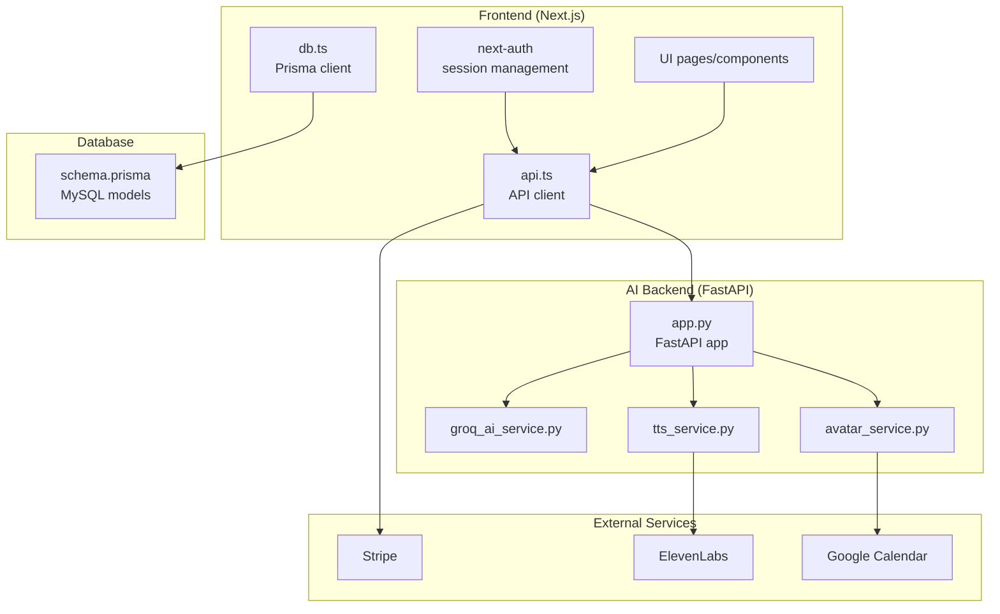
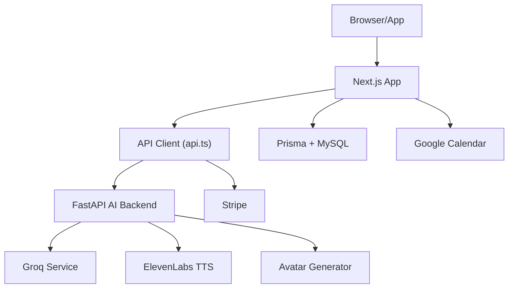
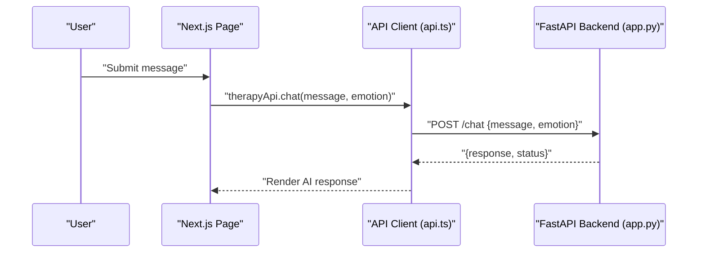
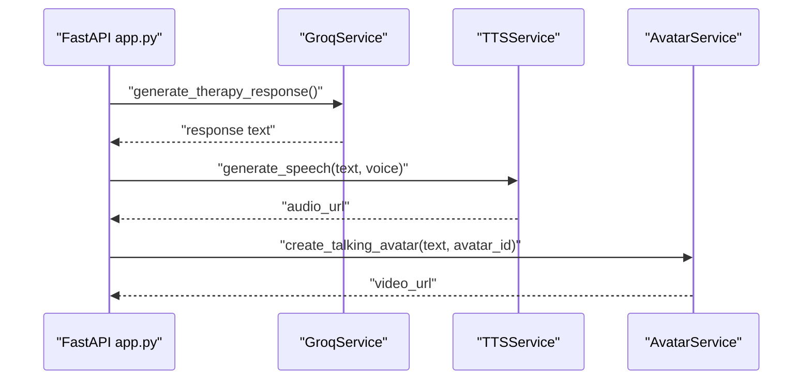
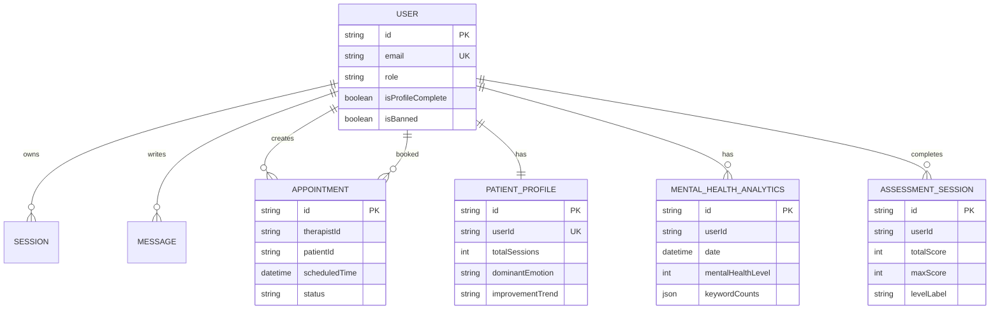
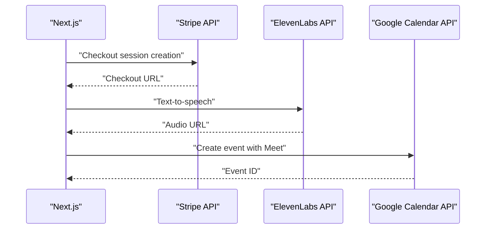
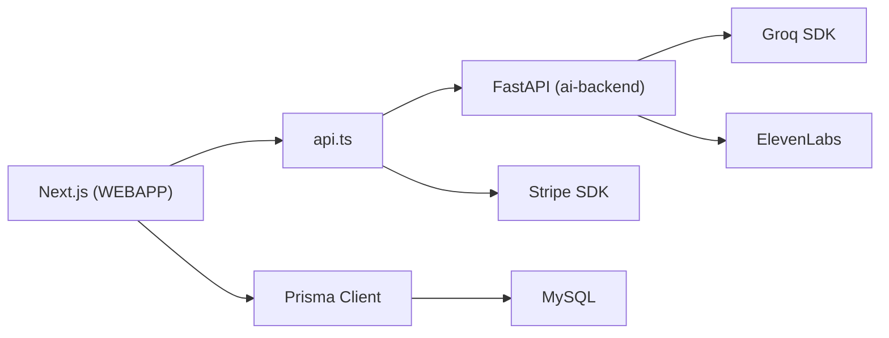

# Architecture Overview

<cite>
**Referenced Files in This Document**
- [package.json](file://WEBAPP/package.json)
- [schema.prisma](file://WEBAPP/prisma/schema.prisma)
- [app.py](file://ai-backend/app.py)
- [groq_ai_service.py](file://ai-backend/services/groq_ai_service.py)
- [tts_service.py](file://ai-backend/services/tts_service.py)
- [avatar_service.py](file://ai-backend/services/avatar_service.py)
- [api.ts](file://WEBAPP/src/lib/api.ts)
- [db.ts](file://WEBAPP/src/lib/db.ts)
- [googleCalendar.ts](file://WEBAPP/src/lib/googleCalendar.ts)
- [layout.tsx](file://WEBAPP/src/app/layout.tsx)
- [page.tsx](file://WEBAPP/src/app/page.tsx)
- [sessionManager.ts](file://WEBAPP/src/lib/sessionManager.ts)
- [README.md](file://README.md)
</cite>

## Table of Contents
1. [Introduction](#introduction)
2. [Project Structure](#project-structure)
3. [Core Components](#core-components)
4. [Architecture Overview](#architecture-overview)
5. [Detailed Component Analysis](#detailed-component-analysis)
6. [Dependency Analysis](#dependency-analysis)
7. [Performance Considerations](#performance-considerations)
8. [Security and Compliance](#security-and-compliance)
9. [Real-Time Communication](#real-time-communication)
10. [Scalability and Deployment Topology](#scalability-and-deployment-topology)
11. [Troubleshooting Guide](#troubleshooting-guide)
12. [Conclusion](#conclusion)

## Introduction
This document describes the MindBridge AI system architecture. The system is organized as a frontend-first application with a Next.js frontend, a FastAPI AI backend, and a Prisma-managed MySQL database. It implements a microservices-style separation across AI services (Groq integration, Text-to-Speech, Avatar generation), authentication services, and data management. The architecture integrates external services including Stripe for payments, ElevenLabs for TTS, and Google Calendar for appointment scheduling. Cross-cutting concerns include security, HIPAA considerations, and operational reliability.

## Project Structure
The repository is organized into three primary areas:
- WEBAPP: Next.js frontend with TypeScript, Prisma ORM, and UI components
- ai-backend: FastAPI microservice for AI capabilities (Groq, TTS, Avatar)
- ml-backend: Separate machine learning backend for emotion/video analytics (referenced in frontend APIs)

**Diagram sources**
- [app.py](file://ai-backend/app.py#L1-L154)
- [api.ts](file://WEBAPP/src/lib/api.ts#L1-L142)
- [db.ts](file://WEBAPP/src/lib/db.ts#L1-L15)
- [schema.prisma](file://WEBAPP/prisma/schema.prisma#L1-L330)
- [groq_ai_service.py](file://ai-backend/services/groq_ai_service.py#L1-L123)
- [tts_service.py](file://ai-backend/services/tts_service.py#L1-L280)
- [avatar_service.py](file://ai-backend/services/avatar_service.py#L1-L237)

**Section sources**
- [README.md](file://README.md#L1-L3)
- [package.json](file://WEBAPP/package.json#L1-L88)
- [schema.prisma](file://WEBAPP/prisma/schema.prisma#L1-L330)

## Core Components
- Frontend (Next.js):
  - API client abstraction for AI and ML backends
  - Prisma client for database access
  - Authentication via NextAuth.js
  - UI pages and components for patients, therapists, and admin
- AI Backend (FastAPI):
  - REST endpoints for chat, TTS, and avatar generation
  - Lazy-initialized service layer for Groq, TTS, and Avatar
- Database:
  - Prisma schema modeling users, sessions, therapy data, analytics, and admin roles
- External Integrations:
  - Stripe for checkout/webhooks
  - ElevenLabs for TTS
  - Google Calendar for appointment scheduling

**Section sources**
- [api.ts](file://WEBAPP/src/lib/api.ts#L1-L142)
- [db.ts](file://WEBAPP/src/lib/db.ts#L1-L15)
- [app.py](file://ai-backend/app.py#L1-L154)
- [schema.prisma](file://WEBAPP/prisma/schema.prisma#L1-L330)

## Architecture Overview
MindBridge follows a layered architecture with clear separation of concerns:
- Presentation Layer: Next.js app with pages, components, and session management
- API Gateway Layer: Next.js API routes and client-side API wrappers
- Business Logic Layer: FastAPI microservice orchestrating AI/ML integrations
- Data Access Layer: Prisma client connecting to MySQL
- External Systems: Stripe, ElevenLabs, Google Calendar

**Diagram sources**
- [layout.tsx](file://WEBAPP/src/app/layout.tsx#L1-L55)
- [page.tsx](file://WEBAPP/src/app/page.tsx#L1-L381)
- [api.ts](file://WEBAPP/src/lib/api.ts#L1-L142)
- [app.py](file://ai-backend/app.py#L1-L154)
- [groq_ai_service.py](file://ai-backend/services/groq_ai_service.py#L1-L123)
- [tts_service.py](file://ai-backend/services/tts_service.py#L1-L280)
- [avatar_service.py](file://ai-backend/services/avatar_service.py#L1-L237)
- [db.ts](file://WEBAPP/src/lib/db.ts#L1-L15)

## Detailed Component Analysis

### Next.js Frontend
- API Abstraction:
  - Centralized API client for AI and ML backends with typed request/response helpers
  - Therapy API exposes chat, TTS, and avatar generation endpoints
- Authentication:
  - NextAuth.js session management with storage events and focus validation
- UI and Routing:
  - Role-based dashboards and navigation
  - Theme provider and responsive layout

**Diagram sources**
- [page.tsx](file://WEBAPP/src/app/page.tsx#L1-L381)
- [api.ts](file://WEBAPP/src/lib/api.ts#L75-L113)
- [app.py](file://ai-backend/app.py#L81-L95)

**Section sources**
- [api.ts](file://WEBAPP/src/lib/api.ts#L1-L142)
- [sessionManager.ts](file://WEBAPP/src/lib/sessionManager.ts#L1-L78)
- [layout.tsx](file://WEBAPP/src/app/layout.tsx#L1-L55)
- [page.tsx](file://WEBAPP/src/app/page.tsx#L1-L381)

### FastAPI AI Backend
- Endpoints:
  - GET /health, POST /chat (Groq), POST /tts (ElevenLabs), POST /avatar
- Service Layer:
  - Lazy initialization of GroqService, TTSService, AvatarService
  - Static file serving for audio/video under /audio and /video
- External Integrations:
  - Groq for therapeutic responses
  - ElevenLabs for TTS with fallback to dummy audio
  - Avatar generation with D-ID API or dummy video

**Diagram sources**
- [app.py](file://ai-backend/app.py#L48-L71)
- [groq_ai_service.py](file://ai-backend/services/groq_ai_service.py#L81-L111)
- [tts_service.py](file://ai-backend/services/tts_service.py#L53-L144)
- [avatar_service.py](file://ai-backend/services/avatar_service.py#L19-L67)

**Section sources**
- [app.py](file://ai-backend/app.py#L1-L154)
- [groq_ai_service.py](file://ai-backend/services/groq_ai_service.py#L1-L123)
- [tts_service.py](file://ai-backend/services/tts_service.py#L1-L280)
- [avatar_service.py](file://ai-backend/services/avatar_service.py#L1-L237)

### Database and Data Models
- Prisma schema defines comprehensive models for:
  - Users with roles (patient, therapist, admin)
  - Sessions, messages, therapy sessions, availability, appointments
  - Analytics, assessments, profiles, OTP tokens
- Indexes and relations optimized for analytics and scheduling queries

**Diagram sources**
- [schema.prisma](file://WEBAPP/prisma/schema.prisma#L1-L330)

**Section sources**
- [schema.prisma](file://WEBAPP/prisma/schema.prisma#L1-L330)
- [db.ts](file://WEBAPP/src/lib/db.ts#L1-L15)

### External Integrations
- Stripe:
  - Checkout and webhook endpoints exposed under /checkout and /webhook/stripe
- ElevenLabs:
  - TTS service with account checks, voice selection, and fallback audio generation
- Google Calendar:
  - OAuth-based token refresh and CRUD operations for events

**Diagram sources**
- [api.ts](file://WEBAPP/src/lib/api.ts#L1-L142)
- [tts_service.py](file://ai-backend/services/tts_service.py#L22-L51)
- [googleCalendar.ts](file://WEBAPP/src/lib/googleCalendar.ts#L68-L100)

**Section sources**
- [api.ts](file://WEBAPP/src/lib/api.ts#L1-L142)
- [tts_service.py](file://ai-backend/services/tts_service.py#L1-L280)
- [googleCalendar.ts](file://WEBAPP/src/lib/googleCalendar.ts#L1-L226)

## Dependency Analysis
- Frontend depends on:
  - Next.js runtime and UI libraries
  - Prisma client for database operations
  - Stripe SDK for payments
- Backend depends on:
  - FastAPI for routing and async execution
  - Groq SDK for AI responses
  - httpx for external API calls
- Database:
  - MySQL via Prisma client with strict typing

**Diagram sources**
- [package.json](file://WEBAPP/package.json#L15-L86)
- [app.py](file://ai-backend/app.py#L1-L154)
- [api.ts](file://WEBAPP/src/lib/api.ts#L1-L142)
- [db.ts](file://WEBAPP/src/lib/db.ts#L1-L15)

**Section sources**
- [package.json](file://WEBAPP/package.json#L1-L88)
- [app.py](file://ai-backend/app.py#L1-L154)

## Performance Considerations
- Asynchronous I/O:
  - FastAPI and httpx enable concurrent external API calls
- Caching and fallbacks:
  - TTS and Avatar services fall back to local assets when external APIs are unavailable
- Streaming/static serving:
  - Audio/video served via FastAPI static files to reduce latency
- Database indexing:
  - Strategic indexes on timestamps, statuses, and foreign keys improve query performance

[No sources needed since this section provides general guidance]

## Security and Compliance
- Authentication and Authorization:
  - NextAuth.js manages sessions and role-based access
  - SessionManager validates session state and handles incognito scenarios
- Data Protection:
  - MySQL stores sensitive data with Prisma; ensure transport encryption and least-privilege access
- HIPAA Considerations:
  - Implement data-at-rest encryption, audit logs, and explicit consent mechanisms
  - Avoid embedding protected health information in URLs or logs
  - Use secure cookies and HTTPS-only transfers
- API Security:
  - Enforce CORS policies and consider bearer token authentication for internal endpoints
  - Sanitize external inputs and validate payloads

**Section sources**
- [sessionManager.ts](file://WEBAPP/src/lib/sessionManager.ts#L1-L78)
- [db.ts](file://WEBAPP/src/lib/db.ts#L1-L15)
- [schema.prisma](file://WEBAPP/prisma/schema.prisma#L1-L330)

## Real-Time Communication
- Current state:
  - Chat interactions are request-response; no WebSocket connections detected
- Recommendations:
  - Introduce WebSocket or Server-Sent Events for live updates
  - Use Redis pub/sub for horizontal scaling if needed

[No sources needed since this section provides general guidance]

## Scalability and Deployment Topology
- Horizontal Scaling:
  - Separate services (Next.js, FastAPI, ML backend) can scale independently
  - Use container orchestration (Kubernetes) with HPA based on CPU/RAM and queue depth
- Database:
  - Scale MySQL with read replicas and connection pooling
- CDN and Assets:
  - Serve audio/video via CDN for global distribution
- Observability:
  - Add metrics, structured logs, and distributed tracing across services

[No sources needed since this section provides general guidance]

## Troubleshooting Guide
- AI Backend Health:
  - Verify /health endpoint and service initialization
- TTS Failures:
  - Confirm ElevenLabs API key and quota limits; fallback audio is generated otherwise
- Avatar Generation:
  - Ensure D-ID API key or use dummy video for development
- Authentication Issues:
  - Check NextAuth session endpoints and storage events
- Database Connectivity:
  - Validate Prisma client configuration and MySQL credentials

**Section sources**
- [app.py](file://ai-backend/app.py#L77-L79)
- [tts_service.py](file://ai-backend/services/tts_service.py#L53-L144)
- [avatar_service.py](file://ai-backend/services/avatar_service.py#L19-L67)
- [sessionManager.ts](file://WEBAPP/src/lib/sessionManager.ts#L43-L75)
- [db.ts](file://WEBAPP/src/lib/db.ts#L1-L15)

## Conclusion
MindBridge employs a clean separation of concerns with a Next.js frontend, a FastAPI AI backend, and a Prisma-managed MySQL database. The system integrates external services for payments, speech synthesis, and calendar scheduling. While the current implementation focuses on request-response interactions, future enhancements can introduce real-time capabilities and strengthen HIPAA-aligned safeguards. The modular design supports independent scaling and robust observability.