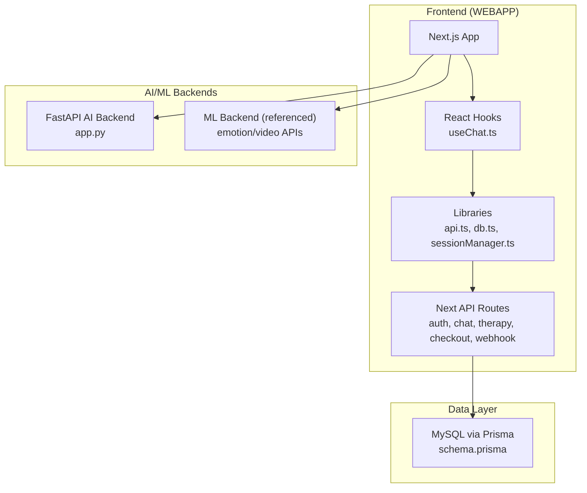
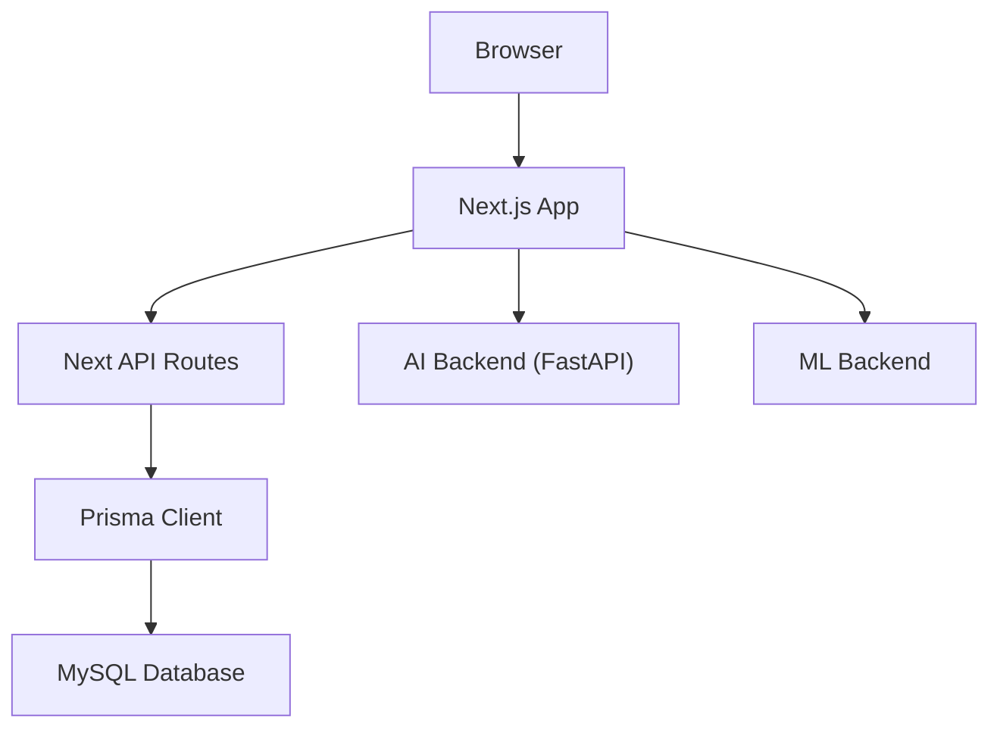
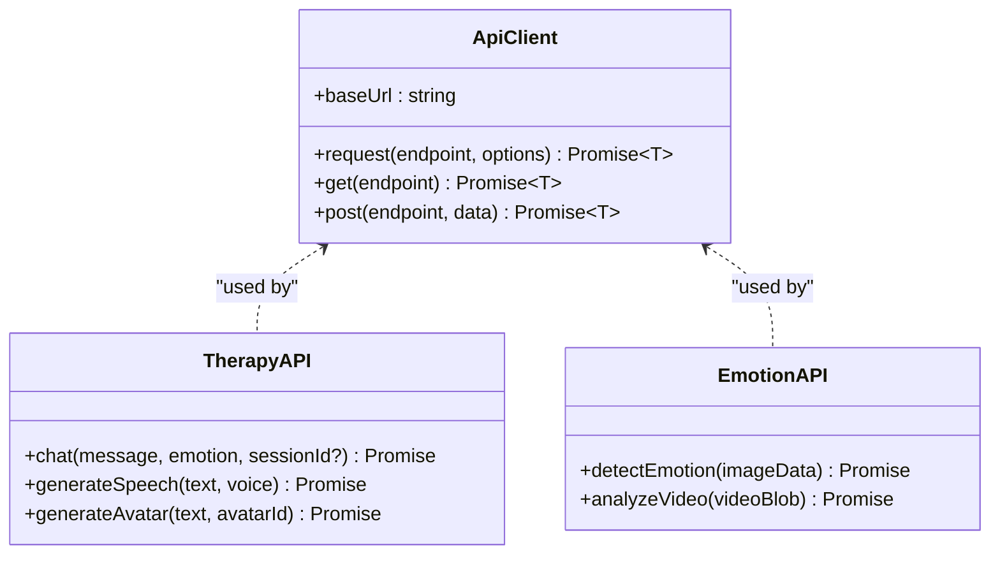
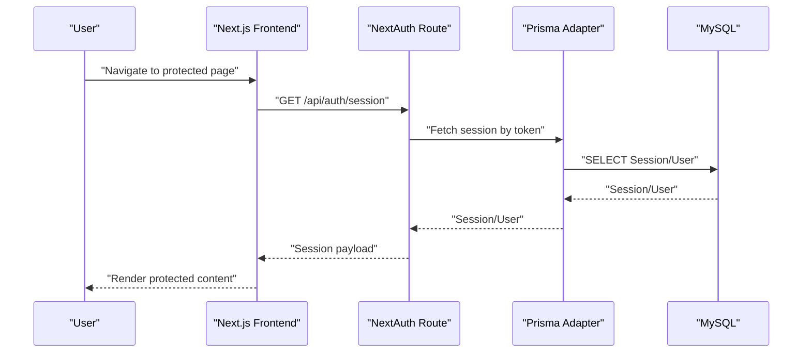
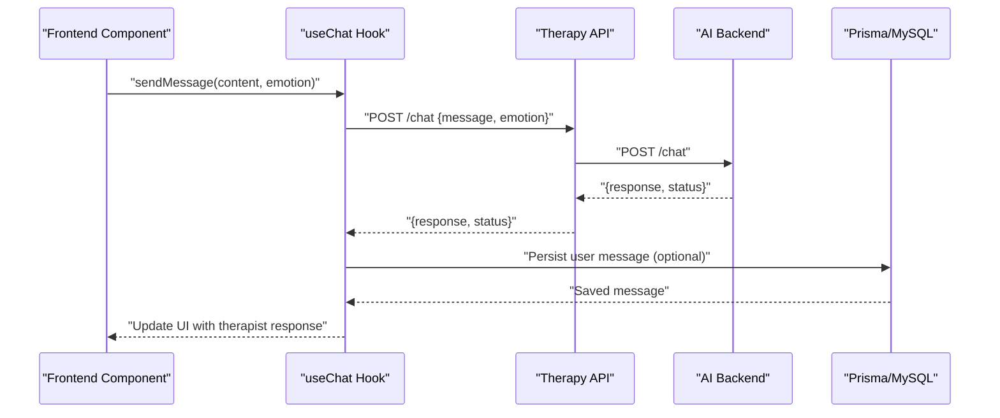
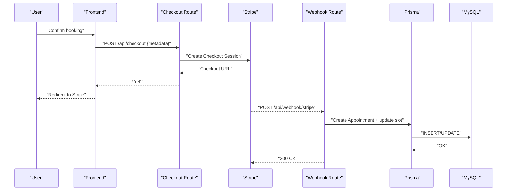
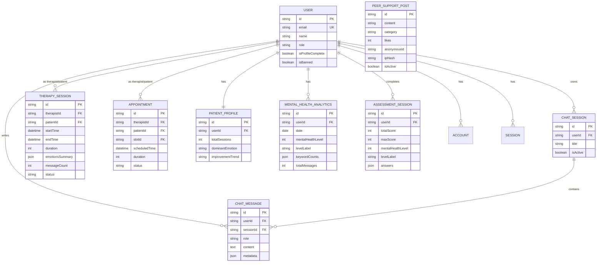
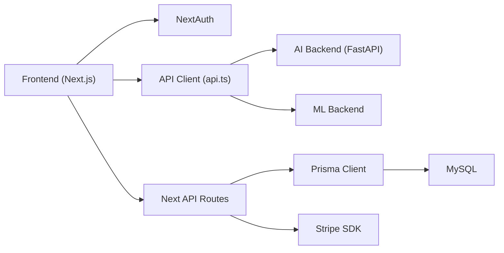

# Component Interactions

<cite>
**Referenced Files in This Document**
- [package.json](file://WEBAPP/package.json)
- [app.py](file://ai-backend/app.py)
- [api.ts](file://WEBAPP/src/lib/api.ts)
- [db.ts](file://WEBAPP/src/lib/db.ts)
- [sessionManager.ts](file://WEBAPP/src/lib/sessionManager.ts)
- [useChat.ts](file://WEBAPP/src/hooks/useChat.ts)
- [schema.prisma](file://WEBAPP/prisma/schema.prisma)
- [route.ts](file://WEBAPP/src/app/api/auth/[...nextauth]/route.ts)
- [route.ts](file://WEBAPP/src/app/api/chat/sessions/route.ts)
- [route.ts](file://WEBAPP/src/app/api/chat/messages/route.ts)
- [route.ts](file://WEBAPP/src/app/api/webhook/stripe/route.ts)
- [route.ts](file://WEBAPP/src/app/api/checkout/route.ts)
- [route.ts](file://WEBAPP/src/app/api/therapy/sessions/route.ts)
- [route.ts](file://WEBAPP/src/app/api/therapy/patients/route.ts)
- [route.ts](file://WEBAPP/src/app/api/peer-support/posts/route.ts)
</cite>

## Table of Contents
1. [Introduction](#introduction)
2. [Project Structure](#project-structure)
3. [Core Components](#core-components)
4. [Architecture Overview](#architecture-overview)
5. [Detailed Component Analysis](#detailed-component-analysis)
6. [Dependency Analysis](#dependency-analysis)
7. [Performance Considerations](#performance-considerations)
8. [Troubleshooting Guide](#troubleshooting-guide)
9. [Conclusion](#conclusion)

## Introduction
This document explains how the MindBridge frontend (Next.js) interacts with backend services, including AI/ML services, authentication, and data persistence. It covers API client patterns, real-time-like chat flows, database interaction via Prisma, authentication flows with NextAuth, and payment processing with Stripe webhooks. It also documents request-response flows, error handling, and retry strategies, and provides sequence diagrams for typical user workflows such as therapy sessions, authentication, and payments.

## Project Structure
MindBridge is organized into three primary areas:
- WEBAPP: Next.js frontend and API routes, UI hooks, and libraries for API and DB access.
- ai-backend: FastAPI service exposing AI/ML endpoints for therapy chat, text-to-speech, and avatar generation.
- ml-backend: Separate ML service for emotion detection and video analysis (referenced by the frontend API layer).

**Diagram sources**
- [app.py](file://ai-backend/app.py#L1-L154)
- [api.ts](file://WEBAPP/src/lib/api.ts#L1-L142)
- [db.ts](file://WEBAPP/src/lib/db.ts#L1-L15)
- [schema.prisma](file://WEBAPP/prisma/schema.prisma#L1-L330)
- [route.ts](file://WEBAPP/src/app/api/auth/[...nextauth]/route.ts#L1-L240)
- [route.ts](file://WEBAPP/src/app/api/chat/sessions/route.ts#L1-L187)
- [route.ts](file://WEBAPP/src/app/api/chat/messages/route.ts#L1-L91)
- [route.ts](file://WEBAPP/src/app/api/checkout/route.ts#L1-L82)
- [route.ts](file://WEBAPP/src/app/api/webhook/stripe/route.ts#L1-L67)

**Section sources**
- [package.json](file://WEBAPP/package.json#L1-L88)
- [app.py](file://ai-backend/app.py#L1-L154)
- [api.ts](file://WEBAPP/src/lib/api.ts#L1-L142)
- [db.ts](file://WEBAPP/src/lib/db.ts#L1-L15)
- [schema.prisma](file://WEBAPP/prisma/schema.prisma#L1-L330)

## Core Components
- API client layer: Centralized HTTP client for AI/ML backends and utilities for emotion/video analysis.
- Authentication: NextAuth with Prisma adapter, JWT session strategy, and providers (Google and Credentials).
- Database: Prisma client configured for MySQL with comprehensive domain models.
- Chat hook: React hook orchestrating therapy chat, optional TTS, and avatar placeholders.
- Next API routes: Server-side handlers for chat sessions/messages, therapy sessions, peer support, checkout, and Stripe webhooks.

Key implementation references:
- API client and endpoints: [api.ts](file://WEBAPP/src/lib/api.ts#L1-L142)
- Authentication setup: [route.ts](file://WEBAPP/src/app/api/auth/[...nextauth]/route.ts#L1-L240)
- Chat hook: [useChat.ts](file://WEBAPP/src/hooks/useChat.ts#L1-L150)
- Prisma client: [db.ts](file://WEBAPP/src/lib/db.ts#L1-L15)
- Prisma schema: [schema.prisma](file://WEBAPP/prisma/schema.prisma#L1-L330)
- Chat sessions API: [route.ts](file://WEBAPP/src/app/api/chat/sessions/route.ts#L1-L187)
- Chat messages API: [route.ts](file://WEBAPP/src/app/api/chat/messages/route.ts#L1-L91)
- Therapy sessions API: [route.ts](file://WEBAPP/src/app/api/therapy/sessions/route.ts#L1-L80)
- Checkout API: [route.ts](file://WEBAPP/src/app/api/checkout/route.ts#L1-L82)
- Stripe webhook: [route.ts](file://WEBAPP/src/app/api/webhook/stripe/route.ts#L1-L67)

**Section sources**
- [api.ts](file://WEBAPP/src/lib/api.ts#L1-L142)
- [route.ts](file://WEBAPP/src/app/api/auth/[...nextauth]/route.ts#L1-L240)
- [useChat.ts](file://WEBAPP/src/hooks/useChat.ts#L1-L150)
- [db.ts](file://WEBAPP/src/lib/db.ts#L1-L15)
- [schema.prisma](file://WEBAPP/prisma/schema.prisma#L1-L330)
- [route.ts](file://WEBAPP/src/app/api/chat/sessions/route.ts#L1-L187)
- [route.ts](file://WEBAPP/src/app/api/chat/messages/route.ts#L1-L91)
- [route.ts](file://WEBAPP/src/app/api/therapy/sessions/route.ts#L1-L80)
- [route.ts](file://WEBAPP/src/app/api/checkout/route.ts#L1-L82)
- [route.ts](file://WEBAPP/src/app/api/webhook/stripe/route.ts#L1-L67)

## Architecture Overview
MindBridge follows a layered architecture:
- Frontend (Next.js) renders pages and components, manages user state, and calls Next API routes and external services.
- Next API routes act as the backend boundary, validating sessions, interacting with Prisma, and invoking AI/ML services.
- AI/ML services expose REST endpoints for therapy chat, TTS, avatar generation, and ML-based emotion/video analysis.
- Database is MySQL with Prisma ORM providing strongly-typed models and queries.

**Diagram sources**
- [app.py](file://ai-backend/app.py#L1-L154)
- [api.ts](file://WEBAPP/src/lib/api.ts#L1-L142)
- [db.ts](file://WEBAPP/src/lib/db.ts#L1-L15)
- [schema.prisma](file://WEBAPP/prisma/schema.prisma#L1-L330)

## Detailed Component Analysis

### API Client Layer
- Purpose: Encapsulate HTTP requests to AI/ML backends and provide typed wrappers for chat, TTS, avatar, and emotion/video analysis.
- Responsibilities:
  - Build URLs from environment variables.
  - Perform fetch requests with JSON serialization/deserialization.
  - Surface errors via thrown exceptions.
  - Expose convenience methods for therapy, emotion detection, and video analysis.

**Diagram sources**
- [api.ts](file://WEBAPP/src/lib/api.ts#L8-L47)
- [api.ts](file://WEBAPP/src/lib/api.ts#L76-L113)
- [api.ts](file://WEBAPP/src/lib/api.ts#L54-L73)

**Section sources**
- [api.ts](file://WEBAPP/src/lib/api.ts#L1-L142)

### Authentication Flow (NextAuth + Prisma)
- Providers: Google OAuth and Credentials provider.
- Session strategy: JWT with rolling updates and fixed max age.
- Persistence: Prisma adapter stores sessions and accounts.
- Callbacks: Populate JWT/session with user role and profile completeness; enforce bans and handle sign-in/sign-out events.
- Frontend session checks: Periodic validation and incognito detection.

**Diagram sources**
- [route.ts](file://WEBAPP/src/app/api/auth/[...nextauth]/route.ts#L1-L240)
- [db.ts](file://WEBAPP/src/lib/db.ts#L1-L15)
- [schema.prisma](file://WEBAPP/prisma/schema.prisma#L11-L69)

**Section sources**
- [route.ts](file://WEBAPP/src/app/api/auth/[...nextauth]/route.ts#L1-L240)
- [sessionManager.ts](file://WEBAPP/src/lib/sessionManager.ts#L1-L78)

### Chat and Therapy Interaction
- Frontend hook:
  - Sends user message to AI backend via therapy API.
  - Optionally generates TTS and sets avatar placeholder.
  - Updates local message list and exposes error state.
- Backend routes:
  - Chat sessions: list/create/update/delete sessions scoped to the authenticated user.
  - Chat messages: persist user messages and fetch paginated history.

**Diagram sources**
- [useChat.ts](file://WEBAPP/src/hooks/useChat.ts#L40-L116)
- [api.ts](file://WEBAPP/src/lib/api.ts#L76-L113)
- [app.py](file://ai-backend/app.py#L81-L95)
- [route.ts](file://WEBAPP/src/app/api/chat/messages/route.ts#L5-L46)

**Section sources**
- [useChat.ts](file://WEBAPP/src/hooks/useChat.ts#L1-L150)
- [api.ts](file://WEBAPP/src/lib/api.ts#L76-L113)
- [app.py](file://ai-backend/app.py#L81-L95)
- [route.ts](file://WEBAPP/src/app/api/chat/messages/route.ts#L1-L91)
- [route.ts](file://WEBAPP/src/app/api/chat/sessions/route.ts#L1-L187)

### Payment Processing with Stripe Webhooks
- Checkout:
  - Frontend triggers creation of a Stripe Checkout Session with metadata.
  - Backend validates session and constructs session with price mapping by duration.
- Webhook:
  - On successful payment, Stripe webhook creates an appointment and marks slot as booked.

**Diagram sources**
- [route.ts](file://WEBAPP/src/app/api/checkout/route.ts#L17-L81)
- [route.ts](file://WEBAPP/src/app/api/webhook/stripe/route.ts#L11-L66)
- [schema.prisma](file://WEBAPP/prisma/schema.prisma#L186-L211)

**Section sources**
- [route.ts](file://WEBAPP/src/app/api/checkout/route.ts#L1-L82)
- [route.ts](file://WEBAPP/src/app/api/webhook/stripe/route.ts#L1-L67)

### Data Models Overview
The Prisma schema defines core entities for users, sessions, chat, therapy, appointments, analytics, assessments, and peer support.

**Diagram sources**
- [schema.prisma](file://WEBAPP/prisma/schema.prisma#L11-L330)

**Section sources**
- [schema.prisma](file://WEBAPP/prisma/schema.prisma#L1-L330)

## Dependency Analysis
- Frontend depends on:
  - NextAuth for session management.
  - Prisma client for database operations.
  - AI/ML API client for external service calls.
- Backend routes depend on:
  - Prisma for data access.
  - Stripe SDK for checkout and webhooks.
  - Environment variables for service endpoints and secrets.

**Diagram sources**
- [api.ts](file://WEBAPP/src/lib/api.ts#L1-L142)
- [app.py](file://ai-backend/app.py#L1-L154)
- [db.ts](file://WEBAPP/src/lib/db.ts#L1-L15)
- [schema.prisma](file://WEBAPP/prisma/schema.prisma#L1-L330)
- [route.ts](file://WEBAPP/src/app/api/checkout/route.ts#L1-L82)

**Section sources**
- [api.ts](file://WEBAPP/src/lib/api.ts#L1-L142)
- [app.py](file://ai-backend/app.py#L1-L154)
- [db.ts](file://WEBAPP/src/lib/db.ts#L1-L15)
- [schema.prisma](file://WEBAPP/prisma/schema.prisma#L1-L330)
- [route.ts](file://WEBAPP/src/app/api/checkout/route.ts#L1-L82)

## Performance Considerations
- API client:
  - Reuse a single ApiClient per service to minimize overhead.
  - Consider adding request/response interceptors for logging and retries.
- Database:
  - Use Prisma’s connection pooling and appropriate indexes (already defined in schema).
  - Paginate chat/message lists to avoid large payloads.
- AI/ML services:
  - Cache TTS/audio assets and avatar videos where feasible.
  - Implement exponential backoff for AI service calls.
- Authentication:
  - Keep session max age reasonable; leverage updateAge for activity-based refresh.
- Payments:
  - Stripe webhooks are idempotent; ensure idempotency keys for appointment creation.

[No sources needed since this section provides general guidance]

## Troubleshooting Guide
- Authentication failures:
  - Verify NextAuth cookies and secure flags match deployment scheme.
  - Check provider credentials and database user records.
- API errors:
  - Inspect thrown errors from ApiClient.request and surface user-friendly messages.
  - Confirm AI/ML backend endpoints are reachable and CORS is configured.
- Database errors:
  - Review Prisma logs and ensure migrations are applied.
  - Validate foreign key constraints and unique indexes.
- Payment issues:
  - Confirm webhook secret and signature verification.
  - Ensure metadata is correctly passed and parsed in webhook handler.

**Section sources**
- [api.ts](file://WEBAPP/src/lib/api.ts#L15-L35)
- [route.ts](file://WEBAPP/src/app/api/auth/[...nextauth]/route.ts#L1-L240)
- [route.ts](file://WEBAPP/src/app/api/webhook/stripe/route.ts#L17-L22)

## Conclusion
MindBridge integrates a Next.js frontend with Next API routes, Prisma-backed persistence, and external AI/ML services. Authentication is handled centrally via NextAuth with Prisma, while payment flows leverage Stripe with robust webhook processing. The useChat hook coordinates therapy interactions, optionally integrating TTS and avatar generation. The architecture supports scalability through modular services and clear separation of concerns, with room for enhancements such as centralized retry logic, caching, and improved error surfacing.