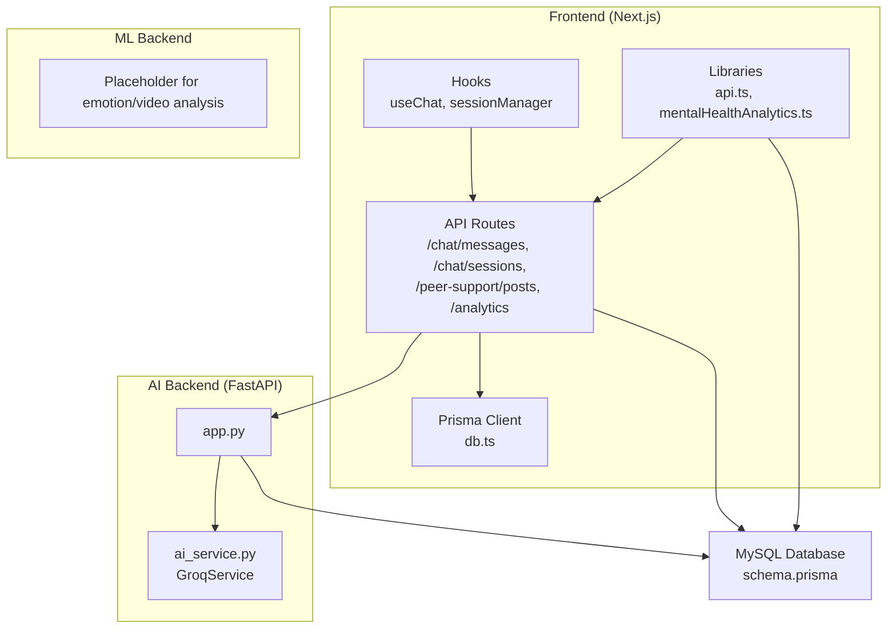
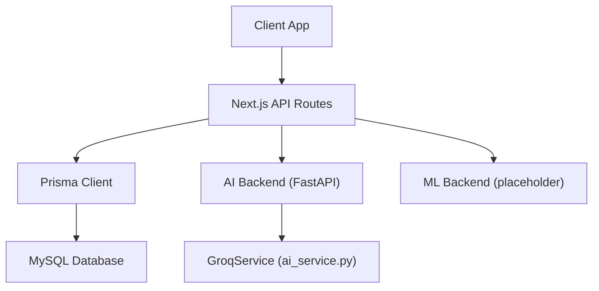
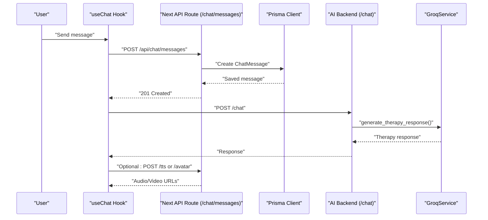
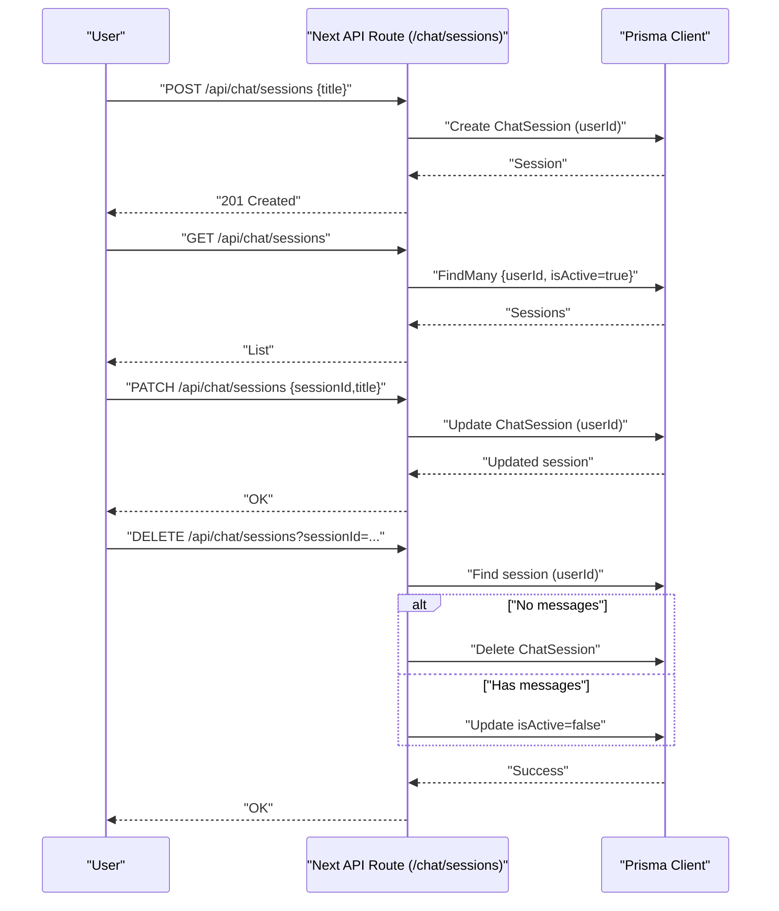
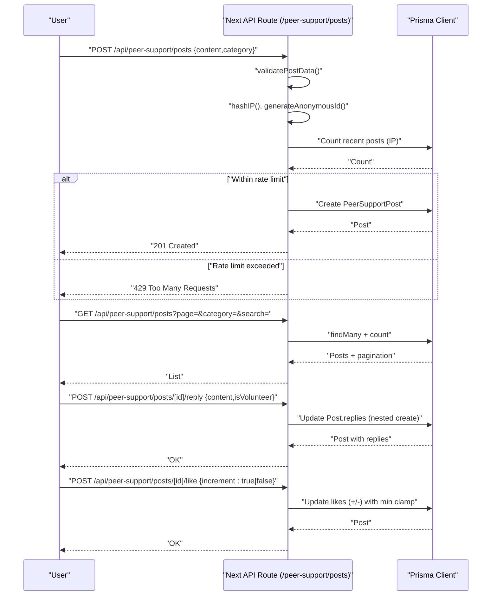
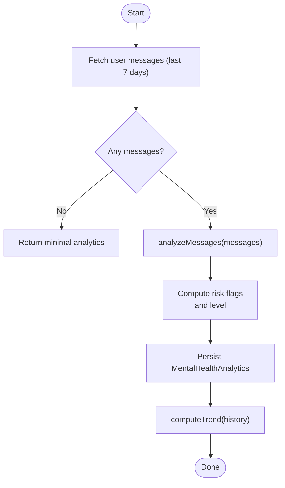
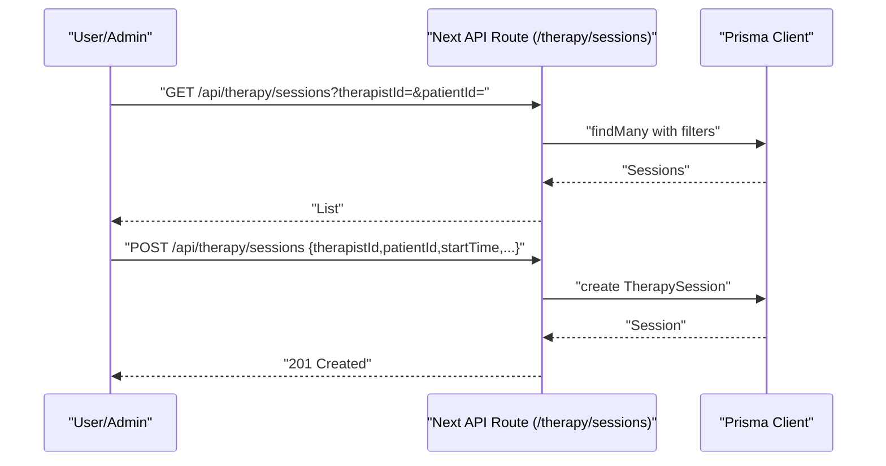
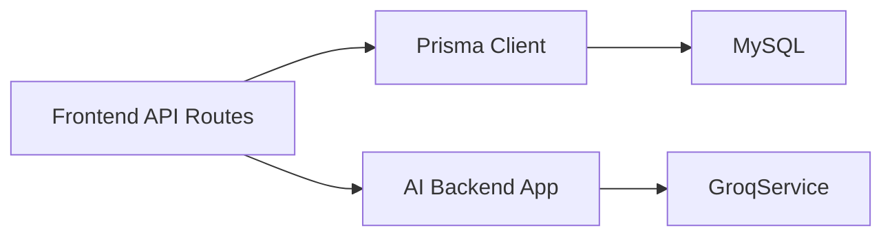
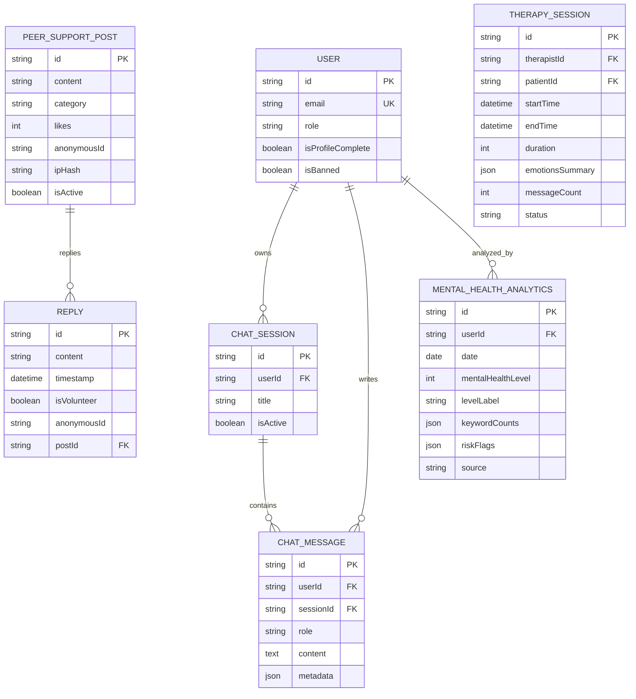

# Data Flow Patterns

<cite>
**Referenced Files in This Document**
- [db.ts](file://WEBAPP/src/lib/db.ts)
- [schema.prisma](file://WEBAPP/prisma/schema.prisma)
- [api.ts](file://WEBAPP/src/lib/api.ts)
- [useChat.ts](file://WEBAPP/src/hooks/useChat.ts)
- [route.ts](file://WEBAPP/src/app/api/chat/messages/route.ts)
- [route.ts](file://WEBAPP/src/app/api/chat/sessions/route.ts)
- [route.ts](file://WEBAPP/src/app/api/peer-support/posts/route.ts)
- [route.ts](file://WEBAPP/src/app/api/peer-support/posts/[id]/reply/route.ts)
- [route.ts](file://WEBAPP/src/app/api/peer-support/posts/[id]/like/route.ts)
- [route.ts](file://WEBAPP/src/app/api/analytics/route.ts)
- [route.ts](file://WEBAPP/src/app/api/therapy/sessions/route.ts)
- [mentalHealthAnalytics.ts](file://WEBAPP/src/lib/mentalHealthAnalytics.ts)
- [sessionManager.ts](file://WEBAPP/src/lib/sessionManager.ts)
- [app.py](file://ai-backend/app.py)
- [ai_service.py](file://ai-backend/services/ai_service.py)
</cite>

## Table of Contents
1. [Introduction](#introduction)
2. [Project Structure](#project-structure)
3. [Core Components](#core-components)
4. [Architecture Overview](#architecture-overview)
5. [Detailed Component Analysis](#detailed-component-analysis)
6. [Dependency Analysis](#dependency-analysis)
7. [Performance Considerations](#performance-considerations)
8. [Troubleshooting Guide](#troubleshooting-guide)
9. [Conclusion](#conclusion)
10. [Appendices](#appendices)

## Introduction
This document explains the end-to-end data flow in the MindBridge system, covering user input, AI processing, storage, retrieval, and analytics. It details the transformation pipeline for therapy sessions, emotion analytics, and peer support posts, and outlines real-time flows for chat, session management, and analytics updates. It also documents validation, sanitization, security measures, caching strategies, persistence patterns, backup procedures, privacy compliance, encryption, and audit logging requirements.

## Project Structure
MindBridge comprises:
- Frontend (Next.js app) with API routes, hooks, and analytics engine
- AI backend (FastAPI) for therapy responses, TTS, and avatar generation
- ML backend (placeholder) for emotion/video analysis
- Database (MySQL via Prisma) storing user, chat, therapy, analytics, and peer support data

**Diagram sources**
- [db.ts](file://WEBAPP/src/lib/db.ts#L1-L15)
- [schema.prisma](file://WEBAPP/prisma/schema.prisma#L1-L330)
- [api.ts](file://WEBAPP/src/lib/api.ts#L1-L142)
- [useChat.ts](file://WEBAPP/src/hooks/useChat.ts#L1-L150)
- [route.ts](file://WEBAPP/src/app/api/chat/messages/route.ts#L1-L91)
- [route.ts](file://WEBAPP/src/app/api/chat/sessions/route.ts#L1-L187)
- [route.ts](file://WEBAPP/src/app/api/peer-support/posts/route.ts#L1-L161)
- [route.ts](file://WEBAPP/src/app/api/analytics/route.ts#L1-L253)
- [app.py](file://ai-backend/app.py#L1-L154)
- [ai_service.py](file://ai-backend/services/ai_service.py#L1-L293)

**Section sources**
- [db.ts](file://WEBAPP/src/lib/db.ts#L1-L15)
- [schema.prisma](file://WEBAPP/prisma/schema.prisma#L1-L330)
- [api.ts](file://WEBAPP/src/lib/api.ts#L1-L142)
- [useChat.ts](file://WEBAPP/src/hooks/useChat.ts#L1-L150)
- [route.ts](file://WEBAPP/src/app/api/chat/messages/route.ts#L1-L91)
- [route.ts](file://WEBAPP/src/app/api/chat/sessions/route.ts#L1-L187)
- [route.ts](file://WEBAPP/src/app/api/peer-support/posts/route.ts#L1-L161)
- [route.ts](file://WEBAPP/src/app/api/analytics/route.ts#L1-L253)
- [app.py](file://ai-backend/app.py#L1-L154)
- [ai_service.py](file://ai-backend/services/ai_service.py#L1-L293)

## Core Components
- Data persistence: Prisma ORM connects to MySQL and defines models for users, chats, therapy sessions, analytics, and peer support.
- Frontend API routes: Secure endpoints for chat sessions/messages, peer support posts/replies/likes, analytics computation, and therapy session management.
- AI backend: FastAPI service exposing /chat, /tts, and /avatar endpoints powered by GroqService with optional RAG.
- Analytics engine: Browser-side and server-side analyzers for keyword detection, sentiment, trends, and risk flags.
- Session management: Client-side utilities for session expiration checks and incognito detection.

**Section sources**
- [schema.prisma](file://WEBAPP/prisma/schema.prisma#L1-L330)
- [route.ts](file://WEBAPP/src/app/api/chat/messages/route.ts#L1-L91)
- [route.ts](file://WEBAPP/src/app/api/chat/sessions/route.ts#L1-L187)
- [route.ts](file://WEBAPP/src/app/api/peer-support/posts/route.ts#L1-L161)
- [route.ts](file://WEBAPP/src/app/api/analytics/route.ts#L1-L253)
- [app.py](file://ai-backend/app.py#L1-L154)
- [ai_service.py](file://ai-backend/services/ai_service.py#L1-L293)
- [mentalHealthAnalytics.ts](file://WEBAPP/src/lib/mentalHealthAnalytics.ts#L1-L884)
- [sessionManager.ts](file://WEBAPP/src/lib/sessionManager.ts#L1-L78)

## Architecture Overview
The system follows a layered architecture:
- Presentation: Next.js pages and API routes
- Application: Route handlers orchestrate Prisma queries and external service calls
- AI/ML: FastAPI microservices for therapy, TTS, avatar, and emotion/video analysis
- Data: MySQL with Prisma schema and indexes

**Diagram sources**
- [api.ts](file://WEBAPP/src/lib/api.ts#L1-L142)
- [db.ts](file://WEBAPP/src/lib/db.ts#L1-L15)
- [schema.prisma](file://WEBAPP/prisma/schema.prisma#L1-L330)
- [app.py](file://ai-backend/app.py#L1-L154)
- [ai_service.py](file://ai-backend/services/ai_service.py#L1-L293)

## Detailed Component Analysis

### Chat Data Flow (End-to-End)
This flow covers user message submission, AI response generation, optional TTS/avatar, and persistence.

**Diagram sources**
- [useChat.ts](file://WEBAPP/src/hooks/useChat.ts#L1-L150)
- [route.ts](file://WEBAPP/src/app/api/chat/messages/route.ts#L1-L91)
- [api.ts](file://WEBAPP/src/lib/api.ts#L76-L113)
- [app.py](file://ai-backend/app.py#L81-L95)
- [ai_service.py](file://ai-backend/services/ai_service.py#L131-L192)

**Section sources**
- [useChat.ts](file://WEBAPP/src/hooks/useChat.ts#L1-L150)
- [route.ts](file://WEBAPP/src/app/api/chat/messages/route.ts#L1-L91)
- [api.ts](file://WEBAPP/src/lib/api.ts#L76-L113)
- [app.py](file://ai-backend/app.py#L81-L95)
- [ai_service.py](file://ai-backend/services/ai_service.py#L131-L192)

### Session Management Flow
User chat sessions are created, listed, updated, and deleted with ownership checks and soft-delete semantics.

**Diagram sources**
- [route.ts](file://WEBAPP/src/app/api/chat/sessions/route.ts#L1-L187)
- [schema.prisma](file://WEBAPP/prisma/schema.prisma#L108-L138)

**Section sources**
- [route.ts](file://WEBAPP/src/app/api/chat/sessions/route.ts#L1-L187)
- [schema.prisma](file://WEBAPP/prisma/schema.prisma#L108-L138)

### Peer Support Posts Flow
Posts are validated, rate-limited, anonymized, and stored with replies and likes.

**Diagram sources**
- [route.ts](file://WEBAPP/src/app/api/peer-support/posts/route.ts#L1-L161)
- [route.ts](file://WEBAPP/src/app/api/peer-support/posts/[id]/reply/route.ts#L1-L100)
- [route.ts](file://WEBAPP/src/app/api/peer-support/posts/[id]/like/route.ts#L1-L58)
- [schema.prisma](file://WEBAPP/prisma/schema.prisma#L79-L106)

**Section sources**
- [route.ts](file://WEBAPP/src/app/api/peer-support/posts/route.ts#L1-L161)
- [route.ts](file://WEBAPP/src/app/api/peer-support/posts/[id]/reply/route.ts#L1-L100)
- [route.ts](file://WEBAPP/src/app/api/peer-support/posts/[id]/like/route.ts#L1-L58)
- [schema.prisma](file://WEBAPP/prisma/schema.prisma#L79-L106)

### Emotion Analytics Pipeline
The pipeline extracts keywords, computes severity levels, detects risks, and stores daily analytics.

**Diagram sources**
- [route.ts](file://WEBAPP/src/app/api/analytics/route.ts#L195-L252)
- [mentalHealthAnalytics.ts](file://WEBAPP/src/lib/mentalHealthAnalytics.ts#L199-L289)

**Section sources**
- [route.ts](file://WEBAPP/src/app/api/analytics/route.ts#L1-L253)
- [mentalHealthAnalytics.ts](file://WEBAPP/src/lib/mentalHealthAnalytics.ts#L1-L884)

### Therapy Session Management
Endpoints support listing and creating therapy sessions with therapist/patient filters.

**Diagram sources**
- [route.ts](file://WEBAPP/src/app/api/therapy/sessions/route.ts#L1-L80)
- [schema.prisma](file://WEBAPP/prisma/schema.prisma#L140-L161)

**Section sources**
- [route.ts](file://WEBAPP/src/app/api/therapy/sessions/route.ts#L1-L80)
- [schema.prisma](file://WEBAPP/prisma/schema.prisma#L140-L161)

### Real-Time Data Flows
- Chat: Client sends messages via useChat hook to API routes, receives AI responses, and optionally TTS/avatar URLs. The UI updates immediately with new messages.
- Sessions: Listing and updating chat sessions occurs on demand; deletion applies soft-delete semantics when messages exist.
- Analytics: On-demand refresh triggers a recalculation over recent messages and persists the result.

**Section sources**
- [useChat.ts](file://WEBAPP/src/hooks/useChat.ts#L1-L150)
- [route.ts](file://WEBAPP/src/app/api/chat/messages/route.ts#L1-L91)
- [route.ts](file://WEBAPP/src/app/api/chat/sessions/route.ts#L1-L187)
- [route.ts](file://WEBAPP/src/app/api/analytics/route.ts#L166-L190)

### Data Validation, Sanitization, and Security
- Chat messages: Required content validation, trimming, and metadata storage; unauthorized access blocked by session checks.
- Peer support posts: Content and category validation, rate limiting (per IP), hashing for spam prevention, anonymous IDs, and nested reply creation.
- Authentication: NextAuth session-based protection across API routes; unauthorized requests return 401.
- AI backend: CORS enabled; bearer security placeholder; lazy service initialization.
- Privacy: Anonymous identifiers and IP hashing for posts; sensitive fields are stored with appropriate indexing; no PII leakage in public views.

**Section sources**
- [route.ts](file://WEBAPP/src/app/api/chat/messages/route.ts#L22-L45)
- [route.ts](file://WEBAPP/src/app/api/peer-support/posts/route.ts#L80-L129)
- [route.ts](file://WEBAPP/src/app/api/peer-support/posts/[id]/reply/route.ts#L20-L72)
- [route.ts](file://WEBAPP/src/app/api/peer-support/posts/[id]/like/route.ts#L4-L58)
- [app.py](file://ai-backend/app.py#L23-L30)

### Caching Strategies, Persistence, and Backups
- Caching: No explicit caching layer observed in the frontend or backend code; analytics recomputation is triggered on demand.
- Persistence: Prisma manages MySQL persistence with indexes on frequently queried fields (e.g., timestamps, statuses).
- Backups: No dedicated backup procedure documented in the code; rely on Prisma-managed migrations and database backups outside this repository.

**Section sources**
- [schema.prisma](file://WEBAPP/prisma/schema.prisma#L1-L330)
- [route.ts](file://WEBAPP/src/app/api/analytics/route.ts#L34-L37)

### Data Privacy Compliance, Encryption, and Audit Logging
- Encryption at rest: Database credentials and environment variables are loaded via .env; no explicit encryption-at-rest code observed in the repository.
- Encryption in transit: AI/ML backend endpoints are configured with CORS; secure transport depends on deployment configuration (not shown here).
- Audit logging: No explicit audit logs in the code; consider adding structured logs for sensitive operations (e.g., analytics writes, post creations).

**Section sources**
- [app.py](file://ai-backend/app.py#L23-L30)
- [route.ts](file://WEBAPP/src/app/api/analytics/route.ts#L195-L252)

## Dependency Analysis
The frontend depends on Prisma for data access and FastAPI services for AI/ML capabilities. The AI backend encapsulates GroqService and optional RAG.

**Diagram sources**
- [api.ts](file://WEBAPP/src/lib/api.ts#L1-L142)
- [db.ts](file://WEBAPP/src/lib/db.ts#L1-L15)
- [app.py](file://ai-backend/app.py#L1-L154)
- [ai_service.py](file://ai-backend/services/ai_service.py#L1-L293)

**Section sources**
- [api.ts](file://WEBAPP/src/lib/api.ts#L1-L142)
- [db.ts](file://WEBAPP/src/lib/db.ts#L1-L15)
- [app.py](file://ai-backend/app.py#L1-L154)
- [ai_service.py](file://ai-backend/services/ai_service.py#L1-L293)

## Performance Considerations
- Indexes: Prisma schema includes indexes on frequently filtered/sorted fields (timestamps, statuses, categories) to optimize reads.
- Asynchronous processing: AI backend uses asynchronous calls and executor threads for Groq and optional RAG retrieval.
- Pagination: Peer support posts and chat messages use pagination to limit payload sizes.
- Recommendations: Consider implementing Redis caching for analytics endpoints, batching analytics writes, and adding circuit breakers for AI service calls.

[No sources needed since this section provides general guidance]

## Troubleshooting Guide
- Unauthorized access: Ensure NextAuth session is present; API routes return 401 for missing sessions.
- Rate limits: Peer support posts enforce rate limiting per IP; excessive posts return 429.
- AI service failures: GroqService wraps exceptions and returns fallback responses; check environment variables and connectivity.
- Analytics gaps: If no recent messages are found, analytics returns minimal defaults; trigger refresh to re-analyze.

**Section sources**
- [route.ts](file://WEBAPP/src/app/api/chat/messages/route.ts#L8-L20)
- [route.ts](file://WEBAPP/src/app/api/peer-support/posts/route.ts#L96-L107)
- [ai_service.py](file://ai-backend/services/ai_service.py#L188-L191)
- [route.ts](file://WEBAPP/src/app/api/analytics/route.ts#L195-L216)

## Conclusion
MindBridge implements a clear separation of concerns across frontend, AI/ML backends, and persistent storage. The data flows are secure, validated, and designed for incremental analytics and peer support. Enhancements in caching, encryption, and audit logging would further strengthen the system’s robustness and compliance posture.

[No sources needed since this section summarizes without analyzing specific files]

## Appendices

### Data Models Overview

**Diagram sources**
- [schema.prisma](file://WEBAPP/prisma/schema.prisma#L1-L330)