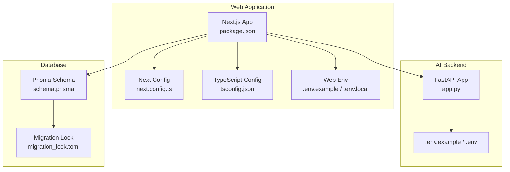
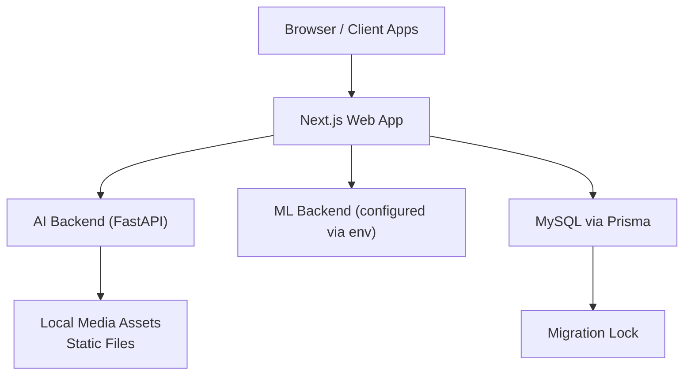
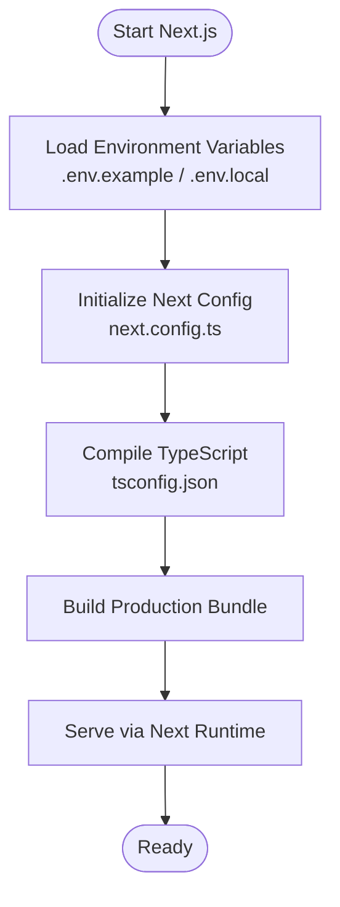
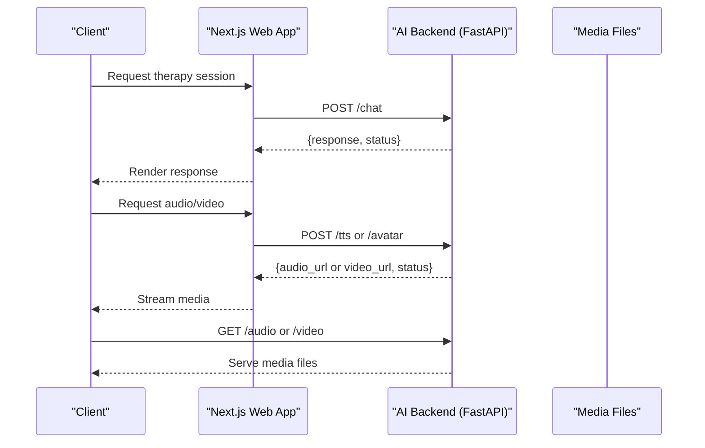
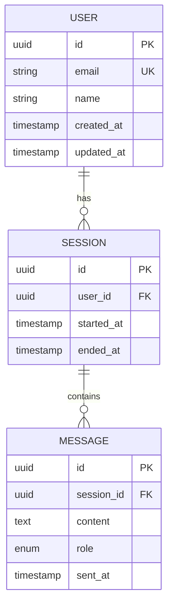
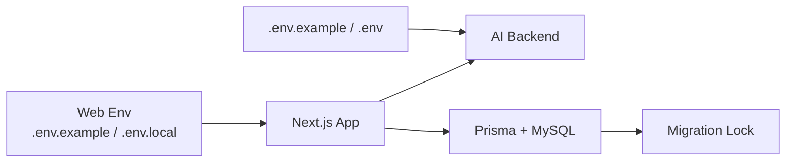

# Deployment Architecture

<cite>
**Referenced Files in This Document**
- [README.md](file://README.md)
- [package.json](file://WEBAPP/package.json)
- [next.config.ts](file://WEBAPP/next.config.ts)
- [tsconfig.json](file://WEBAPP/tsconfig.json)
- [.env.example](file://WEBAPP/.env.example)
- [.env.local](file://WEBAPP/.env.local)
- [app.py](file://ai-backend/app.py)
- [.env.example](file://ai-backend/.env.example)
- [.env](file://ai-backend/.env)
- [schema.prisma](file://WEBAPP/prisma/schema.prisma)
- [migration_lock.toml](file://WEBAPP/prisma/migrations/migration_lock.toml)
</cite>

## Table of Contents
1. [Introduction](#introduction)
2. [Project Structure](#project-structure)
3. [Core Components](#core-components)
4. [Architecture Overview](#architecture-overview)
5. [Detailed Component Analysis](#detailed-component-analysis)
6. [Dependency Analysis](#dependency-analysis)
7. [Performance Considerations](#performance-considerations)
8. [Troubleshooting Guide](#troubleshooting-guide)
9. [Conclusion](#conclusion)
10. [Appendices](#appendices)

## Introduction
This document describes the deployment architecture for the MindBridge system. It covers containerization strategy using Docker, Kubernetes orchestration, and cloud deployment patterns. It also documents CI/CD pipeline configuration, environment management, and secrets handling. Infrastructure requirements for database scaling, AI service autoscaling, and CDN configuration for media assets are included. Monitoring and logging setup, health checks, and alerting mechanisms are addressed, along with disaster recovery planning, backup strategies, high availability configurations, deployment topologies across environments, and rollback procedures.

## Project Structure
MindBridge consists of three primary components:
- Web application built with Next.js (React framework)
- AI backend service built with FastAPI (Python)
- ML backend service (referenced via environment configuration)

Key configuration and environment files define runtime behavior and integrations:
- Next.js configuration and TypeScript settings
- Environment variables for database connections, authentication, and backend service endpoints
- Prisma schema and migration lock for database migrations

**Diagram sources**
- [package.json](file://WEBAPP/package.json#L1-L88)
- [next.config.ts](file://WEBAPP/next.config.ts#L1-L45)
- [tsconfig.json](file://WEBAPP/tsconfig.json#L1-L42)
- [.env.example](file://WEBAPP/.env.example#L1-L16)
- [.env.local](file://WEBAPP/.env.local#L1-L20)
- [app.py](file://ai-backend/app.py#L1-L154)
- [.env.example](file://ai-backend/.env.example#L1-L20)
- [.env](file://ai-backend/.env#L1-L30)
- [schema.prisma](file://WEBAPP/prisma/schema.prisma)
- [migration_lock.toml](file://WEBAPP/prisma/migrations/migration_lock.toml#L1-L3)

**Section sources**
- [README.md](file://README.md#L1-L3)
- [package.json](file://WEBAPP/package.json#L1-L88)
- [next.config.ts](file://WEBAPP/next.config.ts#L1-L45)
- [tsconfig.json](file://WEBAPP/tsconfig.json#L1-L42)
- [.env.example](file://WEBAPP/.env.example#L1-L16)
- [.env.local](file://WEBAPP/.env.local#L1-L20)
- [app.py](file://ai-backend/app.py#L1-L154)
- [.env.example](file://ai-backend/.env.example#L1-L20)
- [.env](file://ai-backend/.env#L1-L30)
- [schema.prisma](file://WEBAPP/prisma/schema.prisma)
- [migration_lock.toml](file://WEBAPP/prisma/migrations/migration_lock.toml#L1-L3)

## Core Components
- Web application (Next.js): Serves the frontend, integrates with backend services, and manages environment-specific configuration.
- AI backend (FastAPI): Provides therapeutic chat, text-to-speech, and avatar generation endpoints with health checks.
- Database: Managed via Prisma with MySQL provider and migration lock for safe deployments.

Key runtime characteristics:
- Web app exposes environment variables for database URL, NextAuth configuration, and backend service endpoints.
- AI backend defines health endpoints and serves generated media assets from a temporary directory.
- Prisma schema and migration lock ensure consistent database state across environments.

**Section sources**
- [package.json](file://WEBAPP/package.json#L1-L88)
- [next.config.ts](file://WEBAPP/next.config.ts#L1-L45)
- [tsconfig.json](file://WEBAPP/tsconfig.json#L1-L42)
- [.env.example](file://WEBAPP/.env.example#L1-L16)
- [.env.local](file://WEBAPP/.env.local#L1-L20)
- [app.py](file://ai-backend/app.py#L1-L154)
- [schema.prisma](file://WEBAPP/prisma/schema.prisma)
- [migration_lock.toml](file://WEBAPP/prisma/migrations/migration_lock.toml#L1-L3)

## Architecture Overview
The system follows a microservice-style architecture:
- Frontend (Next.js) communicates with AI backend (FastAPI) and ML backend (configured via environment variables).
- Database is managed by Prisma with MySQL provider.
- Media assets generated by AI backend are served locally via static file mounts.

**Diagram sources**
- [app.py](file://ai-backend/app.py#L1-L154)
- [next.config.ts](file://WEBAPP/next.config.ts#L1-L45)
- [schema.prisma](file://WEBAPP/prisma/schema.prisma)
- [migration_lock.toml](file://WEBAPP/prisma/migrations/migration_lock.toml#L1-L3)

## Detailed Component Analysis

### Web Application (Next.js)
- Build and runtime scripts are defined in the package manifest.
- Next.js configuration enables cross-origin allowances and compression for production.
- TypeScript configuration enforces strictness and module resolution suitable for bundlers.
- Environment variables define database connection, authentication, and backend service endpoints.

**Diagram sources**
- [package.json](file://WEBAPP/package.json#L1-L88)
- [next.config.ts](file://WEBAPP/next.config.ts#L1-L45)
- [tsconfig.json](file://WEBAPP/tsconfig.json#L1-L42)
- [.env.example](file://WEBAPP/.env.example#L1-L16)
- [.env.local](file://WEBAPP/.env.local#L1-L20)

**Section sources**
- [package.json](file://WEBAPP/package.json#L1-L88)
- [next.config.ts](file://WEBAPP/next.config.ts#L1-L45)
- [tsconfig.json](file://WEBAPP/tsconfig.json#L1-L42)
- [.env.example](file://WEBAPP/.env.example#L1-L16)
- [.env.local](file://WEBAPP/.env.local#L1-L20)

### AI Backend (FastAPI)
- Defines health check endpoint and multiple service endpoints for chat, text-to-speech, and avatar generation.
- Serves media assets from a mounted static directory.
- Uses lazy initialization of services to avoid import-time issues.

**Diagram sources**
- [app.py](file://ai-backend/app.py#L1-L154)

**Section sources**
- [app.py](file://ai-backend/app.py#L1-L154)

### Database Layer (Prisma + MySQL)
- Prisma schema defines the data model and provider.
- Migration lock ensures migrations are coordinated across environments.

**Diagram sources**
- [schema.prisma](file://WEBAPP/prisma/schema.prisma)
- [migration_lock.toml](file://WEBAPP/prisma/migrations/migration_lock.toml#L1-L3)

**Section sources**
- [schema.prisma](file://WEBAPP/prisma/schema.prisma)
- [migration_lock.toml](file://WEBAPP/prisma/migrations/migration_lock.toml#L1-L3)

## Dependency Analysis
- Web application depends on environment variables for database connectivity and backend service URLs.
- AI backend depends on environment variables for external APIs and database connectivity.
- Prisma migration lock prevents concurrent migration conflicts.

**Diagram sources**
- [.env.example](file://WEBAPP/.env.example#L1-L16)
- [.env.local](file://WEBAPP/.env.local#L1-L20)
- [.env.example](file://ai-backend/.env.example#L1-L20)
- [.env](file://ai-backend/.env#L1-L30)
- [app.py](file://ai-backend/app.py#L1-L154)
- [schema.prisma](file://WEBAPP/prisma/schema.prisma)
- [migration_lock.toml](file://WEBAPP/prisma/migrations/migration_lock.toml#L1-L3)

**Section sources**
- [.env.example](file://WEBAPP/.env.example#L1-L16)
- [.env.local](file://WEBAPP/.env.local#L1-L20)
- [.env.example](file://ai-backend/.env.example#L1-L20)
- [.env](file://ai-backend/.env#L1-L30)
- [app.py](file://ai-backend/app.py#L1-L154)
- [schema.prisma](file://WEBAPP/prisma/schema.prisma)
- [migration_lock.toml](file://WEBAPP/prisma/migrations/migration_lock.toml#L1-L3)

## Performance Considerations
- Next.js configuration enables compression and removes the “powered by” header to reduce overhead.
- AI backend serves media assets via static mounts; ensure appropriate caching and CDN configuration for production.
- Use horizontal pod autoscaling for AI backend based on CPU/memory and request rate metrics.
- Database queries should be indexed per Prisma schema; monitor slow queries and optimize accordingly.

[No sources needed since this section provides general guidance]

## Troubleshooting Guide
- Health checks:
  - Web app: Verify Next.js build and runtime logs for startup errors.
  - AI backend: Call the health endpoint to confirm service readiness.
- Environment variables:
  - Ensure DATABASE_URL, NEXTAUTH_URL, NEXTAUTH_SECRET, and backend service URLs are set consistently across environments.
  - Validate AI backend keys and database credentials in environment files.
- Database migrations:
  - Confirm migration lock presence and resolve conflicts before applying migrations.
- Media assets:
  - Verify static file mounts and permissions for audio/video directories.

**Section sources**
- [app.py](file://ai-backend/app.py#L77-L79)
- [.env.example](file://WEBAPP/.env.example#L1-L16)
- [.env.local](file://WEBAPP/.env.local#L1-L20)
- [.env.example](file://ai-backend/.env.example#L1-L20)
- [.env](file://ai-backend/.env#L1-L30)
- [migration_lock.toml](file://WEBAPP/prisma/migrations/migration_lock.toml#L1-L3)

## Conclusion
This deployment architecture outlines a scalable, maintainable setup for MindBridge using containerized services, environment-driven configuration, and robust database management. By leveraging Kubernetes autoscaling, CDN-backed media delivery, and centralized secrets management, the system can achieve high availability and efficient resource utilization across development, staging, and production environments.

[No sources needed since this section summarizes without analyzing specific files]

## Appendices

### Containerization Strategy (Docker)
- Build images for Next.js web app and AI backend using minimal base images and multi-stage builds where applicable.
- Expose ports defined in environment variables and configure health checks.
- Mount persistent volumes for database and media assets as needed.

[No sources needed since this section provides general guidance]

### Kubernetes Orchestration
- Deployments with rolling updates and readiness probes for zero-downtime releases.
- Services for internal routing and ingress for external traffic.
- Horizontal Pod Autoscalers for AI backend based on CPU and request metrics.
- PersistentVolumeClaims for database and media storage.

[No sources needed since this section provides general guidance]

### Cloud Deployment Patterns
- Use managed databases and container services for scalability and reliability.
- Store secrets in cloud-native secret managers and mount as environment variables.
- Configure CDN for media assets and enable caching policies.

[No sources needed since this section provides general guidance]

### CI/CD Pipeline Configuration
- Automated testing and linting in pipeline stages.
- Image building and pushing to container registries.
- Automated Helm/Kustomize deployments to target clusters.
- Rollback automation using revision history.

[No sources needed since this section provides general guidance]

### Environment Management and Secrets Handling
- Separate environment files for each environment with strict access controls.
- Use secret managers for API keys and database credentials.
- Encrypt sensitive configuration at rest and in transit.

[No sources needed since this section provides general guidance]

### Infrastructure Requirements
- Database scaling: Use read replicas and connection pooling; monitor query performance.
- AI service autoscaling: Scale on CPU, memory, and request rate; provision adequate GPU resources if required.
- CDN configuration: Enable caching, compression, and HTTPS termination for media assets.

[No sources needed since this section provides general guidance]

### Monitoring, Logging, Health Checks, and Alerting
- Centralized logging with structured logs and log aggregation.
- Health checks for all services and liveness/readiness probes.
- Metrics collection for latency, throughput, and error rates.
- Alerting on critical thresholds and incident escalation.

[No sources needed since this section provides general guidance]

### Disaster Recovery, Backup Strategies, and High Availability
- Multi-zone deployments with automated failover.
- Regular backups of database and media assets with retention policies.
- Replication and snapshot strategies for rapid recovery.

[No sources needed since this section provides general guidance]

### Deployment Topologies and Rollback Procedures
- Development: Single replica with ephemeral storage; local database.
- Staging: Multiple replicas with shared database; CDN enabled.
- Production: Multi-zone with autoscaling, managed database, and CDN; blue/green or rolling deployment with rollback.

[No sources needed since this section provides general guidance]