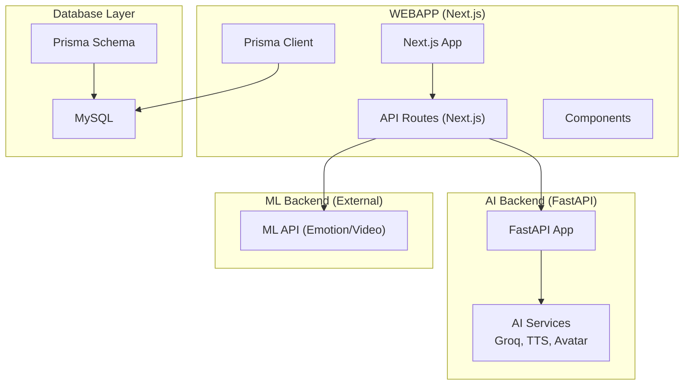
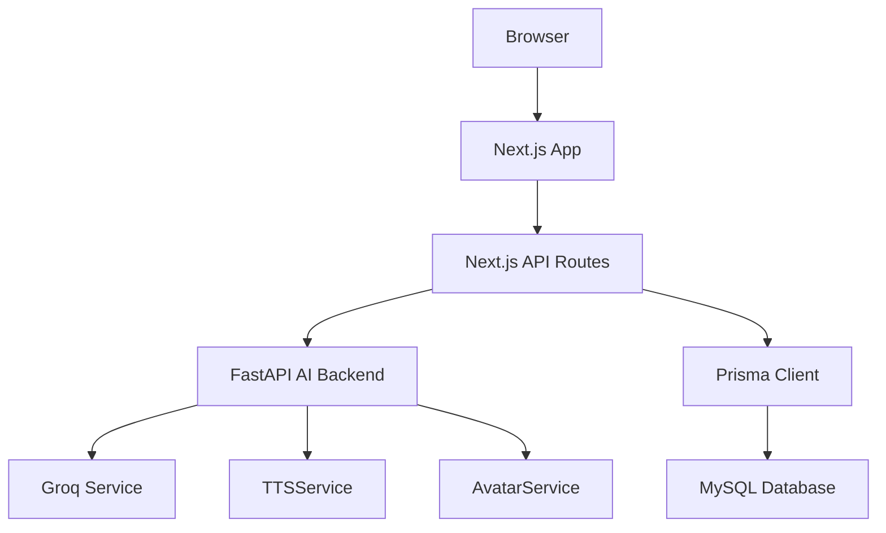
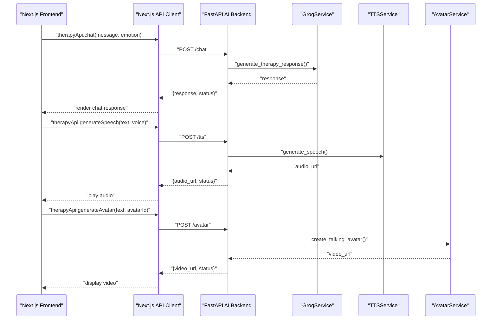
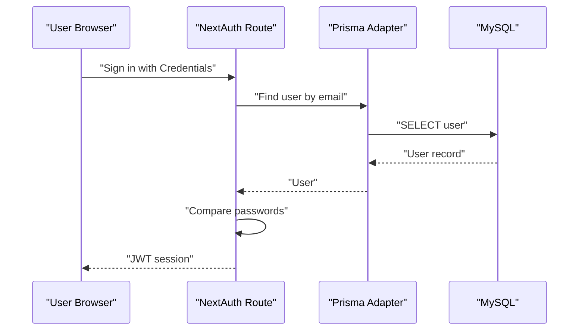
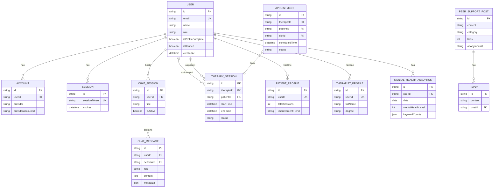
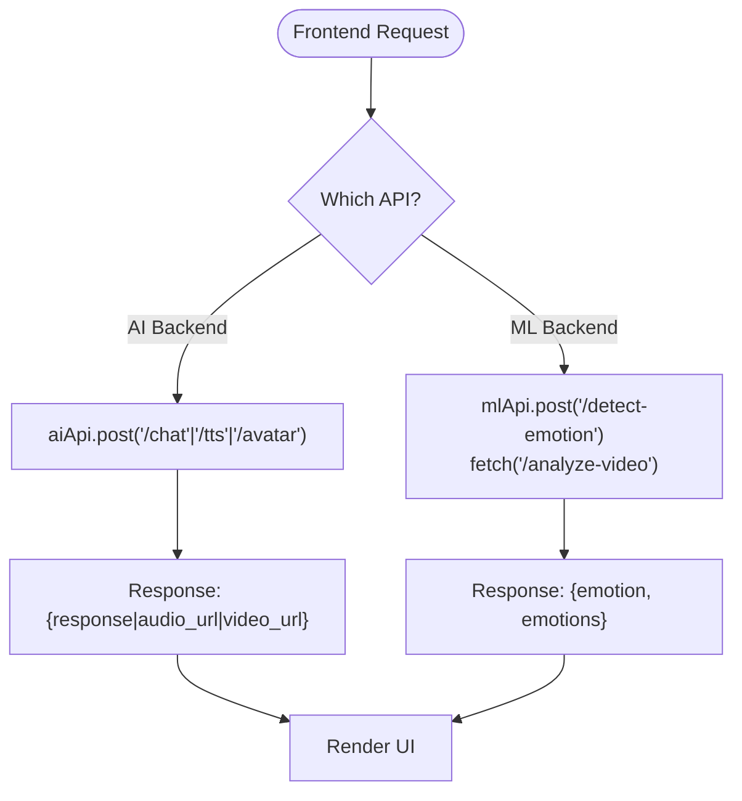
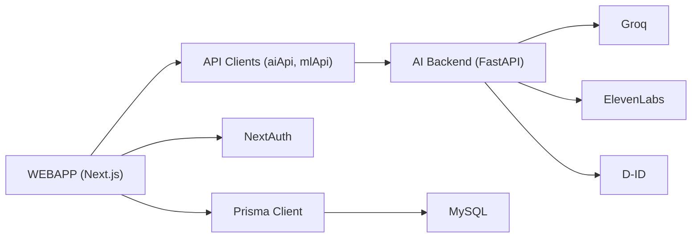

# System Design

<cite>
**Referenced Files in This Document**
- [README.md](file://README.md)
- [package.json](file://WEBAPP/package.json)
- [app.py](file://ai-backend/app.py)
- [groq_ai_service.py](file://ai-backend/services/groq_ai_service.py)
- [tts_service.py](file://ai-backend/services/tts_service.py)
- [avatar_service.py](file://ai-backend/services/avatar_service.py)
- [schema.prisma](file://WEBAPP/prisma/schema.prisma)
- [db.ts](file://WEBAPP/src/lib/db.ts)
- [api.ts](file://WEBAPP/src/lib/api.ts)
- [route.ts](file://WEBAPP/src/app/api/auth/[...nextauth]/route.ts)
- [email.ts](file://WEBAPP/src/lib/email.ts)
- [sessionManager.ts](file://WEBAPP/src/lib/sessionManager.ts)
- [.env](file://WEBAPP/.env)
- [.env](file://ai-backend/.env)
</cite>

## Table of Contents
1. [Introduction](#introduction)
2. [Project Structure](#project-structure)
3. [Core Components](#core-components)
4. [Architecture Overview](#architecture-overview)
5. [Detailed Component Analysis](#detailed-component-analysis)
6. [Dependency Analysis](#dependency-analysis)
7. [Performance Considerations](#performance-considerations)
8. [Troubleshooting Guide](#troubleshooting-guide)
9. [Conclusion](#conclusion)
10. [Appendices](#appendices)

## Introduction
This document describes the system design of MindBridge, a mental health platform integrating a Next.js frontend, FastAPI microservices backend, and a MySQL-backed data layer via Prisma. The system separates concerns across:
- AI services: Groq integration for therapy responses, Text-to-Speech (ElevenLabs), and Avatar generation (D-ID)
- Authentication services: NextAuth with Prisma adapter and local credentials plus Google OAuth
- Data management: Prisma ORM models and utilities for database access

The microservices pattern is implemented with distinct service boundaries for AI capabilities, while the frontend communicates with AI and ML backends through typed API clients. External integrations include Groq, ElevenLabs, D-ID, Google Calendar, Stripe, and SMTP email.

## Project Structure
The repository is organized into three primary areas:
- WEBAPP: Next.js application with pages, components, API routes, Prisma schema, and environment configuration
- ai-backend: FastAPI microservice exposing endpoints for AI-driven features (therapy, TTS, avatar)
- ml-backend: Separate ML service for emotion/video analytics (referenced in frontend API configuration)

**Diagram sources**
- [package.json](file://WEBAPP/package.json#L1-L88)
- [app.py](file://ai-backend/app.py#L1-L154)
- [schema.prisma](file://WEBAPP/prisma/schema.prisma#L1-L330)

**Section sources**
- [README.md](file://README.md#L1-L3)
- [package.json](file://WEBAPP/package.json#L1-L88)

## Core Components
- Frontend (Next.js):
  - Pages and components under src/app and src/components
  - API client utilities for AI and ML backends
  - Authentication via NextAuth with Prisma adapter
  - Prisma client initialization and database access
- AI Backend (FastAPI):
  - REST endpoints for chat, TTS, and avatar
  - Lazy-initialized service classes for Groq, ElevenLabs, and D-ID
- Data Management:
  - Prisma schema defines models for users, sessions, therapy, analytics, and more
  - Prisma client instantiated with environment-specific logging

Key implementation references:
- API configuration and clients: [api.ts](file://WEBAPP/src/lib/api.ts#L1-L142)
- Prisma client setup: [db.ts](file://WEBAPP/src/lib/db.ts#L1-L15)
- Prisma schema: [schema.prisma](file://WEBAPP/prisma/schema.prisma#L1-L330)
- AI backend app and endpoints: [app.py](file://ai-backend/app.py#L1-L154)
- AI services: [groq_ai_service.py](file://ai-backend/services/groq_ai_service.py#L1-L123), [tts_service.py](file://ai-backend/services/tts_service.py#L1-L280), [avatar_service.py](file://ai-backend/services/avatar_service.py#L1-L237)

**Section sources**
- [api.ts](file://WEBAPP/src/lib/api.ts#L1-L142)
- [db.ts](file://WEBAPP/src/lib/db.ts#L1-L15)
- [schema.prisma](file://WEBAPP/prisma/schema.prisma#L1-L330)
- [app.py](file://ai-backend/app.py#L1-L154)
- [groq_ai_service.py](file://ai-backend/services/groq_ai_service.py#L1-L123)
- [tts_service.py](file://ai-backend/services/tts_service.py#L1-L280)
- [avatar_service.py](file://ai-backend/services/avatar_service.py#L1-L237)

## Architecture Overview
MindBridge follows a layered architecture:
- Presentation Layer: Next.js app with pages and components
- API Layer: Next.js API routes and FastAPI endpoints
- Business Logic Layer: AI services (Groq, TTS, Avatar) and ML analytics
- Persistence Layer: Prisma ORM mapping to MySQL

**Diagram sources**
- [app.py](file://ai-backend/app.py#L1-L154)
- [groq_ai_service.py](file://ai-backend/services/groq_ai_service.py#L1-L123)
- [tts_service.py](file://ai-backend/services/tts_service.py#L1-L280)
- [avatar_service.py](file://ai-backend/services/avatar_service.py#L1-L237)
- [db.ts](file://WEBAPP/src/lib/db.ts#L1-L15)
- [schema.prisma](file://WEBAPP/prisma/schema.prisma#L1-L330)

## Detailed Component Analysis

### AI Backend (FastAPI) Endpoints and Services
The AI backend exposes three primary endpoints:
- POST /chat: Generates therapeutic responses using Groq
- POST /tts: Converts text to speech via ElevenLabs
- POST /avatar: Creates talking avatar videos via D-ID

**Diagram sources**
- [app.py](file://ai-backend/app.py#L81-L123)
- [groq_ai_service.py](file://ai-backend/services/groq_ai_service.py#L81-L111)
- [tts_service.py](file://ai-backend/services/tts_service.py#L53-L144)
- [avatar_service.py](file://ai-backend/services/avatar_service.py#L19-L67)
- [api.ts](file://WEBAPP/src/lib/api.ts#L76-L113)

Implementation highlights:
- Lazy service initialization avoids import-time overhead
- Static file mounting serves audio/video assets
- Health checks and CORS enabled for development

**Section sources**
- [app.py](file://ai-backend/app.py#L1-L154)
- [groq_ai_service.py](file://ai-backend/services/groq_ai_service.py#L1-L123)
- [tts_service.py](file://ai-backend/services/tts_service.py#L1-L280)
- [avatar_service.py](file://ai-backend/services/avatar_service.py#L1-L237)

### Authentication Services (NextAuth + Prisma)
Authentication integrates NextAuth with:
- Prisma adapter for session and user persistence
- Credentials provider for email/password
- Google OAuth provider
- Session lifecycle management and callbacks

**Diagram sources**
- [route.ts](file://WEBAPP/src/app/api/auth/[...nextauth]/route.ts#L1-L240)
- [db.ts](file://WEBAPP/src/lib/db.ts#L1-L15)
- [schema.prisma](file://WEBAPP/prisma/schema.prisma#L1-L330)

Operational details:
- Session strategy uses JWT with configurable max age and update age
- Cookie settings adapt to secure/non-secure environments
- Callbacks enrich JWT and session with role and profile completion status

**Section sources**
- [route.ts](file://WEBAPP/src/app/api/auth/[...nextauth]/route.ts#L1-L240)
- [db.ts](file://WEBAPP/src/lib/db.ts#L1-L15)
- [schema.prisma](file://WEBAPP/prisma/schema.prisma#L1-L330)

### Data Management (Prisma ORM)
Prisma models define the domain:
- Users, Accounts, Sessions, VerificationTokens
- Chat sessions/messages
- Therapy sessions, appointments, availability
- Patient and therapist profiles
- Analytics and assessments
- Peer support posts and replies

**Diagram sources**
- [schema.prisma](file://WEBAPP/prisma/schema.prisma#L1-L330)

**Section sources**
- [schema.prisma](file://WEBAPP/prisma/schema.prisma#L1-L330)
- [db.ts](file://WEBAPP/src/lib/db.ts#L1-L15)

### API Clients and External Integrations
The frontend defines API clients for AI and ML backends and utility functions for emotion detection and video analysis.

**Diagram sources**
- [api.ts](file://WEBAPP/src/lib/api.ts#L1-L142)

Integration points:
- AI Backend URL and ML Backend URL configured via environment variables
- Emotion detection and video analysis endpoints exposed by ML backend
- Environment variables for Stripe, Google Calendar, and SMTP configured in frontend

**Section sources**
- [api.ts](file://WEBAPP/src/lib/api.ts#L1-L142)
- [.env](file://WEBAPP/.env#L1-L31)

## Dependency Analysis
High-level dependencies:
- WEBAPP depends on Prisma client and NextAuth for authentication
- AI Backend depends on Groq, ElevenLabs, and D-ID SDKs
- Both layers depend on environment variables for secrets and URLs

**Diagram sources**
- [package.json](file://WEBAPP/package.json#L1-L88)
- [app.py](file://ai-backend/app.py#L1-L154)
- [groq_ai_service.py](file://ai-backend/services/groq_ai_service.py#L1-L123)
- [tts_service.py](file://ai-backend/services/tts_service.py#L1-L280)
- [avatar_service.py](file://ai-backend/services/avatar_service.py#L1-L237)
- [db.ts](file://WEBAPP/src/lib/db.ts#L1-L15)
- [schema.prisma](file://WEBAPP/prisma/schema.prisma#L1-L330)

**Section sources**
- [package.json](file://WEBAPP/package.json#L1-L88)
- [app.py](file://ai-backend/app.py#L1-L154)

## Performance Considerations
- AI service latency:
  - Groq chat completions and ElevenLabs TTS requests are asynchronous; ensure timeouts are tuned appropriately
  - Avatar generation involves polling for completion; consider retry/backoff strategies
- Caching and asset serving:
  - Static file mounting enables efficient audio/video delivery
  - Cleanup of temporary audio files prevents disk growth
- Database performance:
  - Indexes defined on frequently queried fields (e.g., user ID, timestamps)
  - Use Prisma pagination and filtering to reduce payload sizes
- Frontend responsiveness:
  - Debounce chat input and batch analytics updates
  - Lazy-load heavy components (e.g., video players)

[No sources needed since this section provides general guidance]

## Troubleshooting Guide
Common issues and remedies:
- Missing environment variables:
  - Verify AI backend keys (Groq, ElevenLabs, D-ID) and frontend URLs
  - Confirm database URL and NextAuth secrets
- Authentication failures:
  - Check Prisma adapter connectivity and user existence
  - Validate cookie settings for secure/non-secure contexts
- AI service errors:
  - Groq rate limits or invalid API key
  - ElevenLabs quota exceeded or unauthorized; fallback to dummy audio
  - D-ID API key missing; fallback to dummy video
- Email delivery:
  - Ensure SMTP host/port/user/pass are configured; verify sender address

**Section sources**
- [.env](file://ai-backend/.env#L1-L30)
- [.env](file://WEBAPP/.env#L1-L31)
- [tts_service.py](file://ai-backend/services/tts_service.py#L107-L144)
- [avatar_service.py](file://ai-backend/services/avatar_service.py#L24-L67)
- [email.ts](file://WEBAPP/src/lib/email.ts#L1-L201)

## Conclusion
MindBridge employs a clean separation of concerns across the frontend, AI backend, and data layer. The FastAPI microservice encapsulates AI capabilities behind simple endpoints, while NextAuth and Prisma manage identity and persistence. External integrations are modularized, enabling independent scaling and maintenance. The architecture supports scalability through horizontal deployment of services, load balancing, and robust error handling with fallbacks.

[No sources needed since this section summarizes without analyzing specific files]

## Appendices

### Service Boundaries and Interactions
- AI Backend:
  - /chat → GroqService
  - /tts → TTSService
  - /avatar → AvatarService
- Frontend:
  - Uses aiApi/mlApi for backend communication
  - NextAuth handles authentication and session management
  - Prisma models define data contracts

**Section sources**
- [app.py](file://ai-backend/app.py#L81-L123)
- [api.ts](file://WEBAPP/src/lib/api.ts#L1-L142)
- [route.ts](file://WEBAPP/src/app/api/auth/[...nextauth]/route.ts#L1-L240)
- [schema.prisma](file://WEBAPP/prisma/schema.prisma#L1-L330)