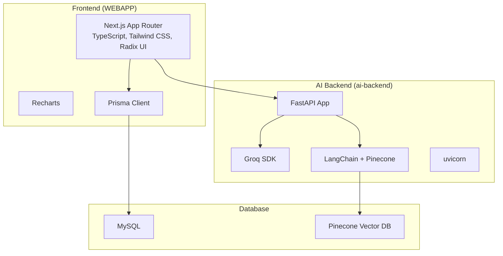
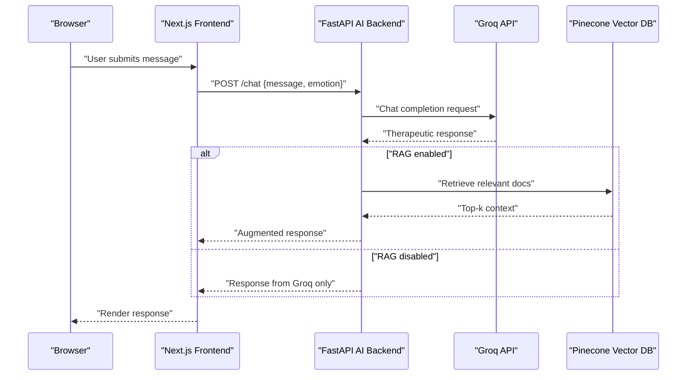
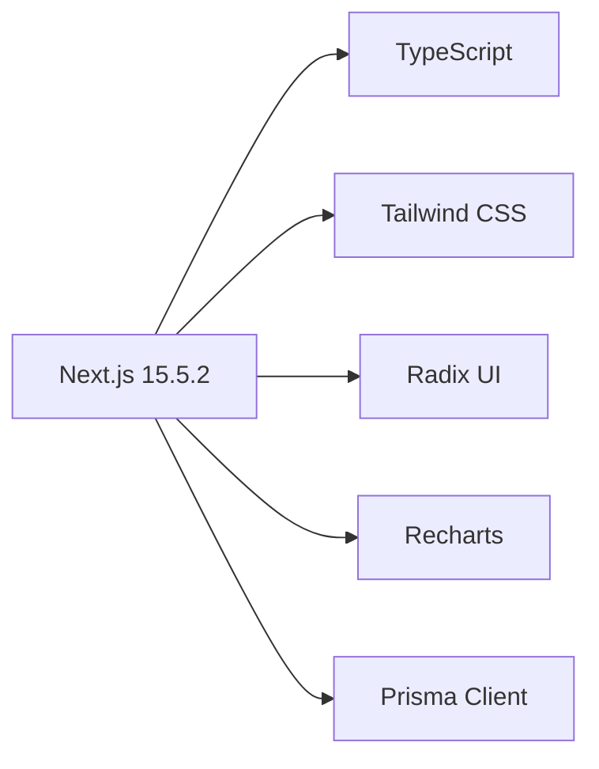
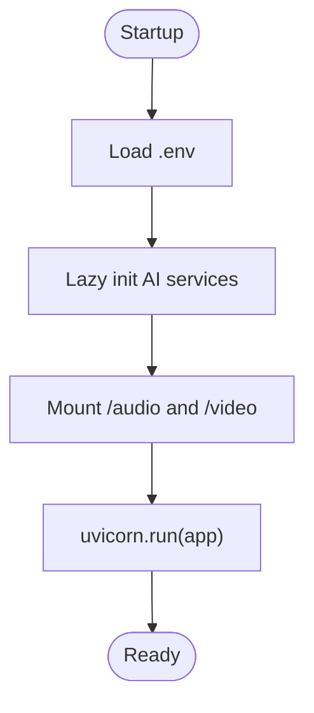
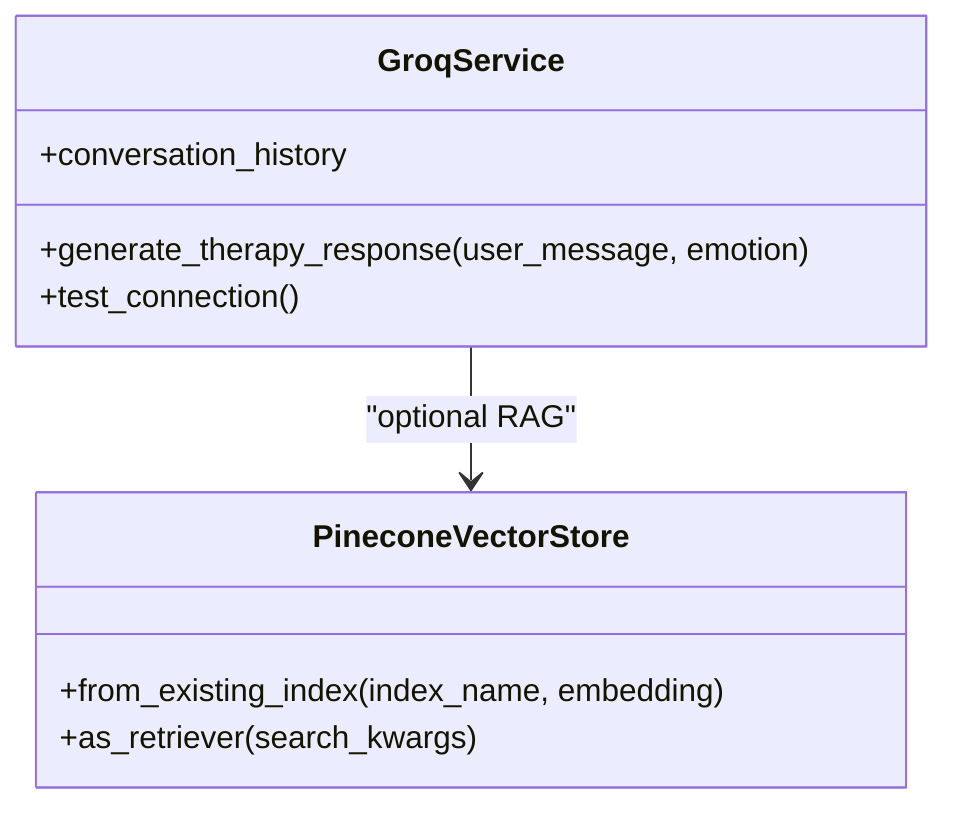
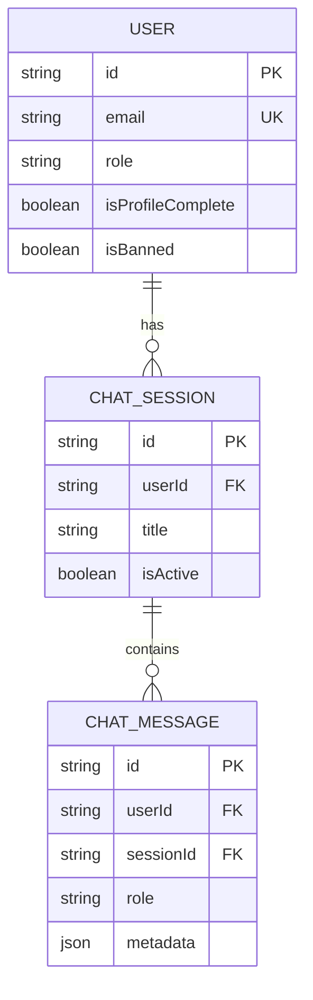
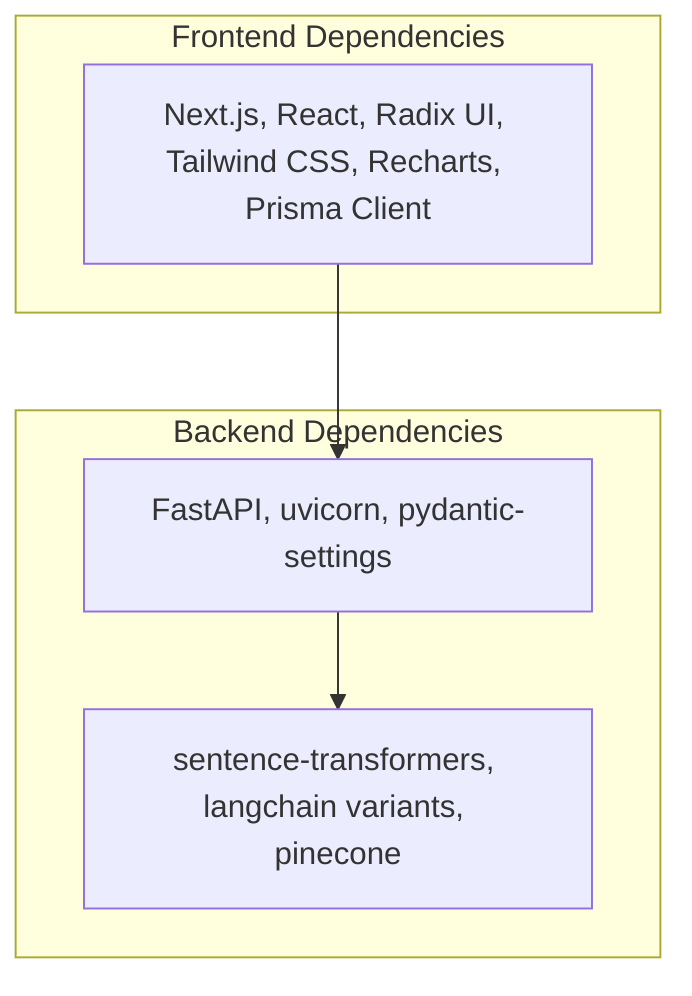

# Technology Stack

<cite>
**Referenced Files in This Document**
- [package.json](file://WEBAPP/package.json)
- [next.config.ts](file://WEBAPP/next.config.ts)
- [tsconfig.json](file://WEBAPP/tsconfig.json)
- [schema.prisma](file://WEBAPP/prisma/schema.prisma)
- [.env.example](file://WEBAPP/.env.example)
- [app.py](file://ai-backend/app.py)
- [config.py](file://ai-backend/config.py)
- [requirements.txt](file://ai-backend/requirements.txt)
- [groq_ai_service.py](file://ai-backend/services/groq_ai_service.py)
- [ai_service.py](file://ai-backend/services/ai_service.py)
- [genAI_rag.py](file://ai-backend/rag/genAI_rag.py)
- [store_index.py](file://ai-backend/rag/store_index.py)
- [.env.example](file://ai-backend/.env.example)
</cite>

## Table of Contents
1. [Introduction](#introduction)
2. [Project Structure](#project-structure)
3. [Core Components](#core-components)
4. [Architecture Overview](#architecture-overview)
5. [Detailed Component Analysis](#detailed-component-analysis)
6. [Dependency Analysis](#dependency-analysis)
7. [Performance Considerations](#performance-considerations)
8. [Troubleshooting Guide](#troubleshooting-guide)
9. [Conclusion](#conclusion)
10. [Appendices](#appendices)

## Introduction
This document provides a comprehensive technology stack overview for MindBridge. It covers the frontend (Next.js, React, TypeScript, Radix UI, Tailwind CSS, Recharts), backend (FastAPI, Python 3.x, uvicorn), AI/ML integrations (Groq SDK, ElevenLabs API, LangChain, Pinecone), and database (Prisma ORM with MySQL). It also outlines development tools, build tools, deployment technologies, version compatibility, upgrade paths, rationale for technology choices, and licensing considerations.

## Project Structure
MindBridge is organized into three primary areas:
- Frontend web application under WEBAPP, built with Next.js and TypeScript, styled with Tailwind CSS and Radix UI primitives, and instrumented with Recharts for analytics.
- AI backend under ai-backend, a FastAPI service integrating Groq, optional ElevenLabs TTS, and optional Pinecone RAG.
- Machine learning backend under ml-backend (not detailed here), separate from the AI backend.

**Diagram sources**
- [package.json](file://WEBAPP/package.json#L15-L86)
- [next.config.ts](file://WEBAPP/next.config.ts#L1-L45)
- [schema.prisma](file://WEBAPP/prisma/schema.prisma#L1-L330)
- [app.py](file://ai-backend/app.py#L1-L154)
- [ai_service.py](file://ai-backend/services/ai_service.py#L72-L192)
- [requirements.txt](file://ai-backend/requirements.txt#L70-L81)

**Section sources**
- [package.json](file://WEBAPP/package.json#L1-L88)
- [next.config.ts](file://WEBAPP/next.config.ts#L1-L45)
- [tsconfig.json](file://WEBAPP/tsconfig.json#L1-L42)
- [schema.prisma](file://WEBAPP/prisma/schema.prisma#L1-L330)

## Core Components
- Frontend stack
  - Next.js 15.5.2, React 19.1.0, TypeScript, Tailwind CSS, Radix UI, Recharts, and related UI primitives.
- Backend stack
  - FastAPI, Python 3.x, uvicorn, and AI/ML libraries (Groq SDK, LangChain, Pinecone).
- Database stack
  - Prisma ORM with MySQL and Pinecone vector database for RAG.

**Section sources**
- [package.json](file://WEBAPP/package.json#L15-L86)
- [app.py](file://ai-backend/app.py#L1-L154)
- [requirements.txt](file://ai-backend/requirements.txt#L70-L81)
- [schema.prisma](file://WEBAPP/prisma/schema.prisma#L1-L330)

## Architecture Overview
The frontend communicates with the AI backend via HTTP endpoints. The AI backend integrates Groq for chat responses and optionally LangChain with Pinecone for retrieval-augmented generation. Prisma connects the frontend to a MySQL database.

**Diagram sources**
- [app.py](file://ai-backend/app.py#L81-L95)
- [ai_service.py](file://ai-backend/services/ai_service.py#L131-L192)
- [genAI_rag.py](file://ai-backend/rag/genAI_rag.py#L40-L56)

## Detailed Component Analysis

### Frontend Stack (Next.js, React, TypeScript, Radix UI, Tailwind CSS, Recharts)
- Next.js 15.5.2 with App Router, TypeScript strict mode, and Tailwind CSS v4.1.13.
- React 19.1.0 and React DOM 19.1.0 for UI rendering.
- Radix UI primitives for accessible UI components (accordion, alert dialog, avatar, checkbox, collapsible, context menu, dialog, dropdown menu, hover card, label, menubar, navigation menu, popover, progress, radio group, scroll area, select, separator, slider, slot, switch, tabs, toast, toggle, toggle group, tooltip).
- Tailwind CSS for utility-first styling and PostCSS pipeline.
- Recharts for data visualization in analytics dashboards.
- Prisma client for database access and NextAuth adapter for authentication.

**Diagram sources**
- [package.json](file://WEBAPP/package.json#L15-L86)
- [next.config.ts](file://WEBAPP/next.config.ts#L1-L45)
- [tsconfig.json](file://WEBAPP/tsconfig.json#L1-L42)

**Section sources**
- [package.json](file://WEBAPP/package.json#L15-L86)
- [next.config.ts](file://WEBAPP/next.config.ts#L1-L45)
- [tsconfig.json](file://WEBAPP/tsconfig.json#L1-L42)

### Backend Stack (FastAPI, Python 3.x, uvicorn)
- FastAPI application with CORS middleware, HTTP bearer security, and static file serving for audio/video assets.
- uvicorn for ASGI server runtime.
- Environment configuration via pydantic-settings with .env loading.
- Lazy initialization pattern for AI services to avoid import-time issues.

**Diagram sources**
- [app.py](file://ai-backend/app.py#L1-L154)
- [config.py](file://ai-backend/config.py#L1-L49)

**Section sources**
- [app.py](file://ai-backend/app.py#L1-L154)
- [config.py](file://ai-backend/config.py#L1-L49)

### AI/ML Libraries (Groq SDK, ElevenLabs API, LangChain, Pinecone)
- Groq SDK integration for therapeutic chat responses with configurable system prompts and conversation history.
- LangChain and Pinecone for retrieval-augmented generation (RAG). The AI service attempts to initialize a retriever from an existing Pinecone index and augments user queries with retrieved context.
- ElevenLabs integration is present in the codebase but appears unused in the current FastAPI endpoints.

**Diagram sources**
- [ai_service.py](file://ai-backend/services/ai_service.py#L72-L192)
- [requirements.txt](file://ai-backend/requirements.txt#L75-L81)

**Section sources**
- [groq_ai_service.py](file://ai-backend/services/groq_ai_service.py#L1-L123)
- [ai_service.py](file://ai-backend/services/ai_service.py#L72-L192)
- [requirements.txt](file://ai-backend/requirements.txt#L70-L81)

### Database Stack (Prisma ORM, MySQL, Pinecone)
- Prisma schema defines models for users, sessions, chat, therapy, appointments, peer support, and analytics, with relations and indexes optimized for the application domain.
- MySQL configured as the datasource provider for Prisma client.
- Pinecone vector database used for RAG indexing and retrieval.

**Diagram sources**
- [schema.prisma](file://WEBAPP/prisma/schema.prisma#L11-L330)

**Section sources**
- [schema.prisma](file://WEBAPP/prisma/schema.prisma#L1-L330)
- [requirements.txt](file://ai-backend/requirements.txt#L75-L81)

### Development Tools, Build Tools, and Deployment Technologies
- Frontend build and linting via Next.js CLI and ESLint.
- Prisma client generation and seeding via Prisma CLI.
- Tailwind CSS and PostCSS toolchain for styling.
- Backend development with uvicorn and FastAPI.

**Section sources**
- [package.json](file://WEBAPP/package.json#L5-L14)
- [next.config.ts](file://WEBAPP/next.config.ts#L1-L45)
- [tsconfig.json](file://WEBAPP/tsconfig.json#L1-L42)

## Dependency Analysis
- Frontend dependencies include Next.js, React, Radix UI, Tailwind CSS, Recharts, Prisma client, and NextAuth adapter.
- Backend dependencies include FastAPI, uvicorn, pydantic-settings, sentence-transformers, langchain variants, pinecone, and related packages.
- Database connectivity is handled by Prisma client for MySQL and Pinecone client for vector storage.

**Diagram sources**
- [package.json](file://WEBAPP/package.json#L15-L86)
- [requirements.txt](file://ai-backend/requirements.txt#L70-L81)

**Section sources**
- [package.json](file://WEBAPP/package.json#L15-L86)
- [requirements.txt](file://ai-backend/requirements.txt#L70-L81)

## Performance Considerations
- Frontend
  - Next.js App Router with static exports and optimized image handling.
  - Tailwind CSS purging and tree-shaking via PostCSS.
  - Strict TypeScript configuration for early error detection.
- Backend
  - Lazy initialization of AI services to reduce cold-start overhead.
  - RAG retrieval guarded by error handling and fallback to conversation history.
  - uvicorn worker configuration suitable for single-process deployments.

[No sources needed since this section provides general guidance]

## Troubleshooting Guide
- Environment variables
  - Ensure DATABASE_URL is set for Prisma and NEXTAUTH configurations for authentication.
  - Verify AI backend environment variables for Groq, ElevenLabs, and Pinecone.
- CORS and static assets
  - Confirm CORS middleware allows expected origins and methods.
  - Validate audio/video static file mounts for asset serving.
- RAG initialization
  - If Pinecone API key is missing, RAG will be disabled with warnings; confirm PINECONE_API_KEY and index name.

**Section sources**
- [.env.example](file://WEBAPP/.env.example#L1-L16)
- [.env.example](file://ai-backend/.env.example#L1-L20)
- [app.py](file://ai-backend/app.py#L23-L41)
- [ai_service.py](file://ai-backend/services/ai_service.py#L82-L119)

## Conclusion
MindBridge leverages a modern, scalable stack combining Next.js and React for the frontend, FastAPI and Python for the backend, and Prisma with MySQL for persistence. The AI backend integrates Groq for conversational responses and supports optional RAG via LangChain and Pinecone. The stack emphasizes developer productivity, accessibility, and extensibility.

[No sources needed since this section summarizes without analyzing specific files]

## Appendices

### Version Compatibility and Upgrade Paths
- Next.js 15.5.2, React 19.1.0, TypeScript ^5, and Tailwind CSS ^4.1.13 indicate a recent ecosystem baseline. Upgrades should be validated against App Router changes, React 19 updates, and Tailwind v4 breaking changes.
- FastAPI and uvicorn versions are pinned in comments within the AI backend requirements; align with current stable releases and ensure pydantic-settings compatibility.
- Prisma client ^6.1.0 pairs with MySQL; verify schema migrations and generated client compatibility after upgrades.
- Groq SDK and LangChain versions should track upstream changes; test RAG retrieval and conversation history behavior after updates.

**Section sources**
- [package.json](file://WEBAPP/package.json#L59, 63, 65, 85)
- [requirements.txt](file://ai-backend/requirements.txt#L2-L6)
- [schema.prisma](file://WEBAPP/prisma/schema.prisma#L1-L10)

### Rationale for Technology Choices
- Next.js 15.5.2 with App Router provides efficient SSR/SSG, type-safe routing, and modern React features.
- React 19.1.0 offers improved concurrent rendering and hooks ergonomics.
- TypeScript ensures robustness and developer experience across frontend and backend.
- Radix UI primitives deliver accessible, unstyled components ideal for customization.
- Tailwind CSS enables rapid UI iteration with utility-first styling.
- Recharts simplifies analytics visualization with minimal configuration.
- FastAPI provides automatic OpenAPI docs, dependency injection, and async performance.
- Prisma ORM streamlines database operations and schema evolution.
- Pinecone and LangChain enable scalable RAG for contextual therapy responses.

[No sources needed since this section provides general guidance]

### Licensing Considerations and Open-Source Dependencies
- Frontend dependencies (Next.js, React, Radix UI, Tailwind CSS, Recharts, Prisma) are open source and widely used in commercial projects. Review per-dependency licenses for compliance.
- Backend dependencies (FastAPI, uvicorn, pydantic-settings, langchain variants, pinecone) are open source; verify license terms for distribution and modification.
- AI providers (Groq, ElevenLabs) require separate API keys and terms of service; ensure compliance with usage limits and data policies.

[No sources needed since this section provides general guidance]