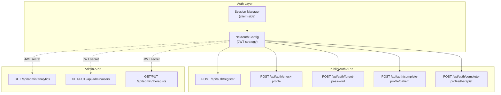
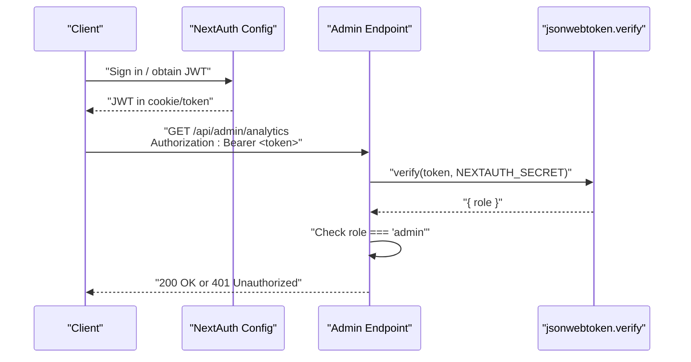
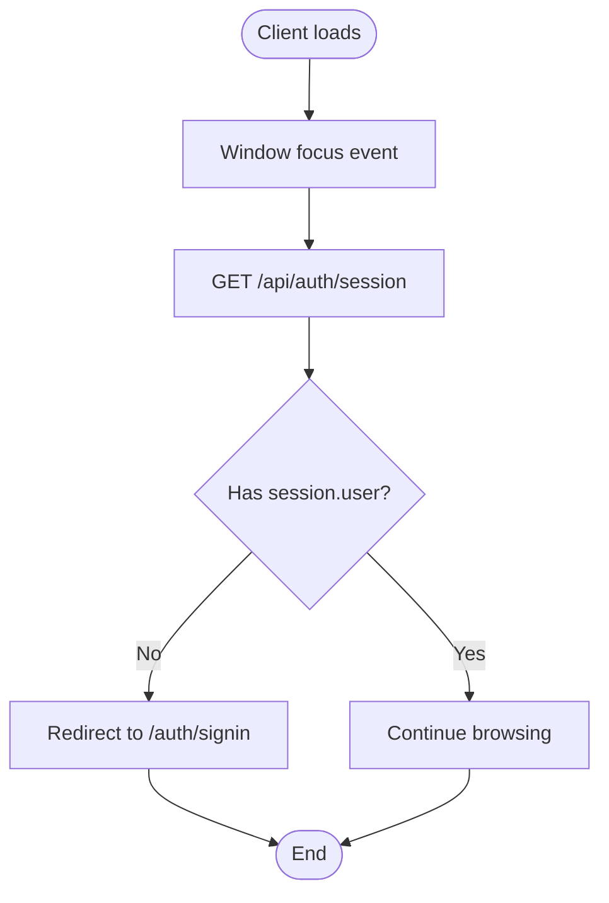
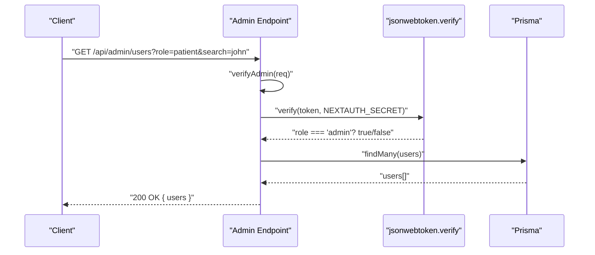
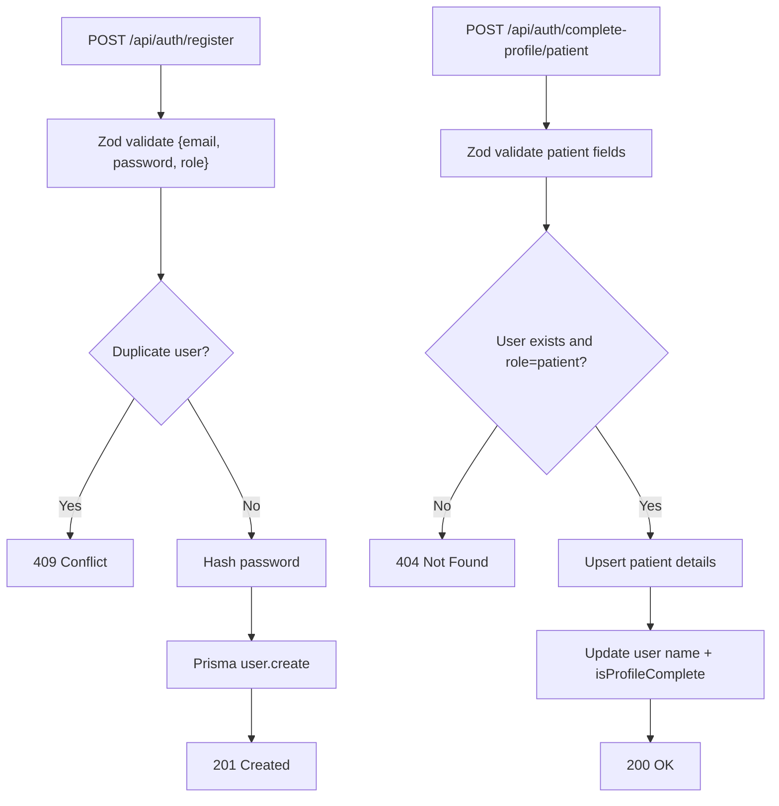
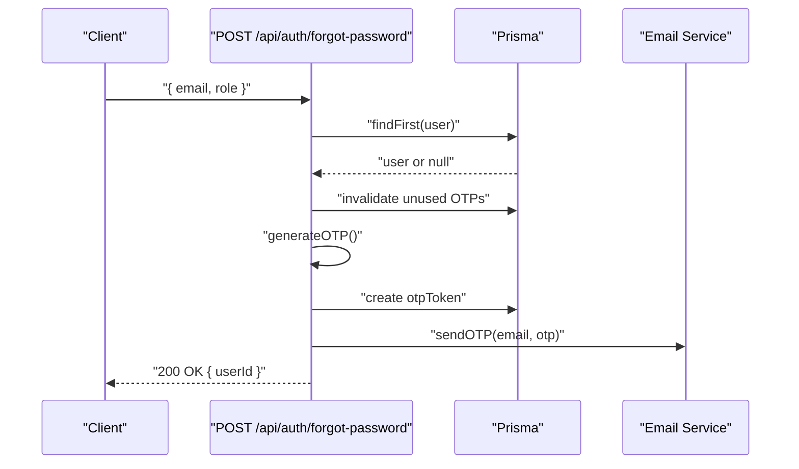
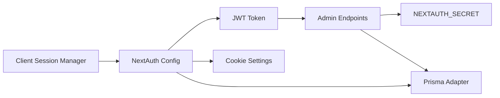

# API Protection & Middleware

<cite>
**Referenced Files in This Document**
- [route.ts](file://WEBAPP/src/app/api/auth/[...nextauth]/route.ts)
- [route.ts](file://WEBAPP/src/app/api/auth/check-profile/route.ts)
- [route.ts](file://WEBAPP/src/app/api/auth/register/route.ts)
- [route.ts](file://WEBAPP/src/app/api/auth/complete-profile/patient/route.ts)
- [route.ts](file://WEBAPP/src/app/api/auth/complete-profile/therapist/route.ts)
- [route.ts](file://WEBAPP/src/app/api/auth/forgot-password/route.ts)
- [route.ts](file://WEBAPP/src/app/api/admin/analytics/route.ts)
- [route.ts](file://WEBAPP/src/app/api/admin/users/route.ts)
- [route.ts](file://WEBAPP/src/app/api/admin/therapists/route.ts)
- [sessionManager.ts](file://WEBAPP/src/lib/sessionManager.ts)
</cite>

## Table of Contents
1. [Introduction](#introduction)
2. [Project Structure](#project-structure)
3. [Core Components](#core-components)
4. [Architecture Overview](#architecture-overview)
5. [Detailed Component Analysis](#detailed-component-analysis)
6. [Dependency Analysis](#dependency-analysis)
7. [Performance Considerations](#performance-considerations)
8. [Troubleshooting Guide](#troubleshooting-guide)
9. [Conclusion](#conclusion)
10. [Appendices](#appendices)

## Introduction
This document explains how API endpoints are protected and how middleware enforces authentication, authorization, and role-based access control across the backend. It covers:
- Authentication mechanisms (NextAuth.js JWT strategy, session lifecycle, and cookie configuration)
- Authorization enforcement patterns (admin-only endpoints and manual token verification)
- Request validation using schema-based validation
- Token verification and session checking
- Protected route patterns and unauthorized access handling
- Categorization of endpoints by security level and permission requirements
- Error responses for authentication failures and authorization denials
- Best practices for extending protection to new endpoints

## Project Structure
The API surface is organized under a conventional Next.js App Router pattern with per-route handlers. Authentication is centralized via NextAuth.js, while administrative endpoints implement explicit bearer token checks.

**Diagram sources**
- [route.ts](file://WEBAPP/src/app/api/auth/[...nextauth]/route.ts#L1-L240)
- [route.ts](file://WEBAPP/src/app/api/auth/register/route.ts#L1-L48)
- [route.ts](file://WEBAPP/src/app/api/auth/check-profile/route.ts#L1-L53)
- [route.ts](file://WEBAPP/src/app/api/auth/forgot-password/route.ts#L1-L102)
- [route.ts](file://WEBAPP/src/app/api/auth/complete-profile/patient/route.ts#L1-L74)
- [route.ts](file://WEBAPP/src/app/api/auth/complete-profile/therapist/route.ts#L1-L93)
- [route.ts](file://WEBAPP/src/app/api/admin/analytics/route.ts#L1-L109)
- [route.ts](file://WEBAPP/src/app/api/admin/users/route.ts#L1-L108)
- [route.ts](file://WEBAPP/src/app/api/admin/therapists/route.ts#L1-L93)
- [sessionManager.ts](file://WEBAPP/src/lib/sessionManager.ts#L1-L78)

**Section sources**
- [route.ts](file://WEBAPP/src/app/api/auth/[...nextauth]/route.ts#L1-L240)
- [route.ts](file://WEBAPP/src/app/api/admin/analytics/route.ts#L1-L109)
- [route.ts](file://WEBAPP/src/app/api/admin/users/route.ts#L1-L108)
- [route.ts](file://WEBAPP/src/app/api/admin/therapists/route.ts#L1-L93)
- [sessionManager.ts](file://WEBAPP/src/lib/sessionManager.ts#L1-L78)

## Core Components
- NextAuth.js configuration with JWT strategy and cookie settings
- Admin-only endpoints using manual JWT verification
- Profile completion endpoints enforcing role-specific validations
- Public registration and password reset endpoints with schema validation
- Client-side session manager for session checks and UI feedback

Key implementation patterns:
- Centralized authentication via NextAuth callbacks (JWT/session augmentation)
- Explicit authorization guards in admin endpoints (bearer token + role check)
- Zod-based request validation for all JSON endpoints
- Consistent error response shapes and HTTP status codes

**Section sources**
- [route.ts](file://WEBAPP/src/app/api/auth/[...nextauth]/route.ts#L1-L240)
- [route.ts](file://WEBAPP/src/app/api/admin/analytics/route.ts#L1-L109)
- [route.ts](file://WEBAPP/src/app/api/admin/users/route.ts#L1-L108)
- [route.ts](file://WEBAPP/src/app/api/admin/therapists/route.ts#L1-L93)
- [route.ts](file://WEBAPP/src/app/api/auth/register/route.ts#L1-L48)
- [route.ts](file://WEBAPP/src/app/api/auth/forgot-password/route.ts#L1-L102)
- [route.ts](file://WEBAPP/src/app/api/auth/complete-profile/patient/route.ts#L1-L74)
- [route.ts](file://WEBAPP/src/app/api/auth/complete-profile/therapist/route.ts#L1-L93)
- [sessionManager.ts](file://WEBAPP/src/lib/sessionManager.ts#L1-L78)

## Architecture Overview
The system separates concerns between:
- Authentication: NextAuth manages user sessions and tokens
- Authorization: Admin endpoints enforce roles via bearer tokens
- Validation: Zod schemas validate incoming requests
- Persistence: Prisma ORM handles database operations
- Frontend integration: Client-side session manager validates session state

**Diagram sources**
- [route.ts](file://WEBAPP/src/app/api/auth/[...nextauth]/route.ts#L1-L240)
- [route.ts](file://WEBAPP/src/app/api/admin/analytics/route.ts#L1-L109)

## Detailed Component Analysis

### Authentication and Session Management
- NextAuth configuration:
  - Uses JWT strategy with session token rotation and refresh windows
  - Cookie settings tuned for local development and secure environments
  - Callbacks augment JWT and session with user role, ID, and profile completion flag
  - Events log sign-in/out and session access for monitoring
- Client-side session manager:
  - Detects incognito mode and handles storage events
  - Validates session on focus and redirects to sign-in when expired

**Diagram sources**
- [sessionManager.ts](file://WEBAPP/src/lib/sessionManager.ts#L1-L78)

**Section sources**
- [route.ts](file://WEBAPP/src/app/api/auth/[...nextauth]/route.ts#L1-L240)
- [sessionManager.ts](file://WEBAPP/src/lib/sessionManager.ts#L1-L78)

### Admin-Protected Endpoints
- Analytics endpoint:
  - Verifies bearer token against a shared admin secret
  - Returns aggregated metrics after authorization check
- Users endpoint:
  - GET supports filtering by role and partial name/email
  - PUT supports ban/unban/delete actions guarded by admin token
- Therapists endpoint:
  - GET lists profiles by verification status
  - PUT approves/rejects profiles with optional rejection reason

**Diagram sources**
- [route.ts](file://WEBAPP/src/app/api/admin/users/route.ts#L1-L108)
- [route.ts](file://WEBAPP/src/app/api/admin/analytics/route.ts#L1-L109)
- [route.ts](file://WEBAPP/src/app/api/admin/therapists/route.ts#L1-L93)

**Section sources**
- [route.ts](file://WEBAPP/src/app/api/admin/analytics/route.ts#L1-L109)
- [route.ts](file://WEBAPP/src/app/api/admin/users/route.ts#L1-L108)
- [route.ts](file://WEBAPP/src/app/api/admin/therapists/route.ts#L1-L93)

### Registration and Profile Completion
- Registration:
  - Validates email, password length, and role
  - Prevents duplicates and hashes passwords
- Check profile:
  - Returns user’s profile completion state, role, ban status, and therapist verification metadata
- Patient profile completion:
  - Validates patient-specific fields and upserts patient details
  - Marks profile complete upon success
- Therapist profile completion:
  - Validates therapist-specific fields and creates profile with pending verification
  - Updates user name and profile completion flag

**Diagram sources**
- [route.ts](file://WEBAPP/src/app/api/auth/register/route.ts#L1-L48)
- [route.ts](file://WEBAPP/src/app/api/auth/complete-profile/patient/route.ts#L1-L74)
- [route.ts](file://WEBAPP/src/app/api/auth/check-profile/route.ts#L1-L53)

**Section sources**
- [route.ts](file://WEBAPP/src/app/api/auth/register/route.ts#L1-L48)
- [route.ts](file://WEBAPP/src/app/api/auth/check-profile/route.ts#L1-L53)
- [route.ts](file://WEBAPP/src/app/api/auth/complete-profile/patient/route.ts#L1-L74)
- [route.ts](file://WEBAPP/src/app/api/auth/complete-profile/therapist/route.ts#L1-L93)

### Password Reset Workflow
- Generates a short-lived OTP, stores it, and emails it to the user
- Enforces role-aware lookup and invalidates stale OTPs

**Diagram sources**
- [route.ts](file://WEBAPP/src/app/api/auth/forgot-password/route.ts#L1-L102)

**Section sources**
- [route.ts](file://WEBAPP/src/app/api/auth/forgot-password/route.ts#L1-L102)

## Dependency Analysis
- Authentication depends on:
  - NextAuth configuration for JWT/session management
  - Prisma for user and account lookups
  - bcrypt for password hashing/verification
- Admin endpoints depend on:
  - jsonwebtoken for bearer token verification
  - Shared admin secret (NEXTAUTH_SECRET fallback)
  - Prisma for reporting and user/profile updates
- Client-side session manager depends on:
  - Browser storage and focus events
  - NextAuth session endpoint for validation

**Diagram sources**
- [route.ts](file://WEBAPP/src/app/api/auth/[...nextauth]/route.ts#L1-L240)
- [route.ts](file://WEBAPP/src/app/api/admin/analytics/route.ts#L1-L109)
- [route.ts](file://WEBAPP/src/app/api/admin/users/route.ts#L1-L108)
- [route.ts](file://WEBAPP/src/app/api/admin/therapists/route.ts#L1-L93)
- [sessionManager.ts](file://WEBAPP/src/lib/sessionManager.ts#L1-L78)

**Section sources**
- [route.ts](file://WEBAPP/src/app/api/auth/[...nextauth]/route.ts#L1-L240)
- [route.ts](file://WEBAPP/src/app/api/admin/analytics/route.ts#L1-L109)
- [route.ts](file://WEBAPP/src/app/api/admin/users/route.ts#L1-L108)
- [route.ts](file://WEBAPP/src/app/api/admin/therapists/route.ts#L1-L93)
- [sessionManager.ts](file://WEBAPP/src/lib/sessionManager.ts#L1-L78)

## Performance Considerations
- Prefer batched queries for analytics to reduce round-trips
- Cache frequently accessed admin metrics where appropriate
- Keep Zod schemas minimal and reuse common field definitions
- Avoid heavy computations in middleware; defer to database-level aggregations
- Use pagination for admin listings when datasets grow

## Troubleshooting Guide
Common issues and resolutions:
- Unauthorized 401 on admin endpoints:
  - Ensure Authorization header includes a valid bearer token
  - Confirm token was issued by the same secret used by the server
- JWT expiration:
  - NextAuth performs server-side expiration checks in callbacks
  - Client should refresh or re-authenticate when encountering expired sessions
- Duplicate registration:
  - Registration prevents duplicates for the same email+role combination
- Schema validation errors:
  - Review request payload against Zod schemas for missing or invalid fields
- Session drift:
  - Client-side focus event triggers session validation; ensure endpoint availability

**Section sources**
- [route.ts](file://WEBAPP/src/app/api/auth/[...nextauth]/route.ts#L1-L240)
- [route.ts](file://WEBAPP/src/app/api/admin/analytics/route.ts#L1-L109)
- [route.ts](file://WEBAPP/src/app/api/auth/register/route.ts#L1-L48)
- [sessionManager.ts](file://WEBAPP/src/lib/sessionManager.ts#L1-L78)

## Conclusion
The backend employs a layered protection model:
- NextAuth secures general user flows with JWT and session management
- Admin endpoints enforce role-based access via bearer tokens
- Zod schemas ensure robust request validation
- Client-side session manager improves UX and security posture

Adhering to these patterns ensures consistent protection across new endpoints.

## Appendices

### Endpoint Security Matrix
- Public/Auth:
  - Registration: validated input, duplicate prevention, password hashing
  - Check profile: safe lookup with structured response
  - Forgot password: OTP generation and email delivery
  - Profile completion: role-specific validation and persistence
- Admin:
  - Analytics: bearer token + role check
  - Users: bearer token + role check, filtering, and actions
  - Therapists: bearer token + role check, verification workflows

### Error Responses
Typical error responses include:
- 400 Bad Request: invalid input or malformed request
- 401 Unauthorized: missing/invalid bearer token or insufficient privileges
- 404 Not Found: resource not found
- 409 Conflict: duplicate resource
- 500 Internal Server Error: unexpected server error

### Best Practices for Extending Protection
- Use bearer token verification for any endpoint requiring elevated privileges
- Centralize validation with Zod schemas and return structured error objects
- Reuse NextAuth callbacks for consistent JWT/session augmentation
- Add client-side session checks for improved UX and timely redirects
- Log security-relevant events (sign-in/out, session access, admin actions)
- Keep secrets and configurations environment-driven and secure