# Authentication & Authorization

<cite>
**Referenced Files in This Document**
- [route.ts](file://WEBAPP/src/app/api/auth/[...nextauth]/route.ts)
- [route.ts](file://WEBAPP/src/app/api/auth/register/route.ts)
- [route.ts](file://WEBAPP/src/app/api/auth/forgot-password/route.ts)
- [route.ts](file://WEBAPP/src/app/api/auth/reset-password/route.ts)
- [route.ts](file://WEBAPP/src/app/api/auth/verify-otp/route.ts)
- [route.ts](file://WEBAPP/src/app/api/auth/check-profile/route.ts)
- [route.ts](file://WEBAPP/src/app/api/auth/complete-profile/patient/route.ts)
- [route.ts](file://WEBAPP/src/app/api/auth/complete-profile/therapist/route.ts)
- [page.tsx](file://WEBAPP/src/app/auth/signin/page.tsx)
- [page.tsx](file://WEBAPP/src/app/auth/register/page.tsx)
- [page.tsx](file://WEBAPP/src/app/auth/forgot-password/page.tsx)
- [page.tsx](file://WEBAPP/src/app/auth/verification-pending/page.tsx)
- [sessionManager.ts](file://WEBAPP/src/lib/sessionManager.ts)
- [next-auth.d.ts](file://WEBAPP/src/types/next-auth.d.ts)
</cite>

## Table of Contents
1. [Introduction](#introduction)
2. [Project Structure](#project-structure)
3. [Core Components](#core-components)
4. [Architecture Overview](#architecture-overview)
5. [Detailed Component Analysis](#detailed-component-analysis)
6. [Dependency Analysis](#dependency-analysis)
7. [Performance Considerations](#performance-considerations)
8. [Troubleshooting Guide](#troubleshooting-guide)
9. [HIPAA and Security Considerations](#hipaa-and-security-considerations)
10. [Conclusion](#conclusion)

## Introduction
This document explains the authentication and authorization system for the MindBridge platform. It covers NextAuth implementation with multiple providers (email/password and OAuth), role-based access control (Patients, Therapists, Admin), session and token management, and security measures. It also documents user registration, login, password reset, and profile completion flows, along with API endpoint protection and access control patterns.

## Project Structure
The authentication system spans NextAuth configuration, API routes for registration and password reset, frontend pages for sign-in, registration, and password recovery, and session utilities for client-side session handling.

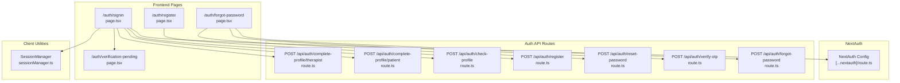

**Diagram sources**
- [route.ts](file://WEBAPP/src/app/api/auth/[...nextauth]/route.ts#L1-L240)
- [route.ts](file://WEBAPP/src/app/api/auth/register/route.ts#L1-L48)
- [route.ts](file://WEBAPP/src/app/api/auth/forgot-password/route.ts#L1-L102)
- [route.ts](file://WEBAPP/src/app/api/auth/verify-otp/route.ts#L1-L55)
- [route.ts](file://WEBAPP/src/app/api/auth/reset-password/route.ts#L1-L42)
- [route.ts](file://WEBAPP/src/app/api/auth/check-profile/route.ts#L1-L53)
- [route.ts](file://WEBAPP/src/app/api/auth/complete-profile/patient/route.ts#L1-L74)
- [route.ts](file://WEBAPP/src/app/api/auth/complete-profile/therapist/route.ts#L1-L93)
- [page.tsx](file://WEBAPP/src/app/auth/signin/page.tsx#L1-L257)
- [page.tsx](file://WEBAPP/src/app/auth/register/page.tsx#L1-L266)
- [page.tsx](file://WEBAPP/src/app/auth/forgot-password/page.tsx#L1-L275)
- [page.tsx](file://WEBAPP/src/app/auth/verification-pending/page.tsx#L1-L119)
- [sessionManager.ts](file://WEBAPP/src/lib/sessionManager.ts#L1-L78)

**Section sources**
- [route.ts](file://WEBAPP/src/app/api/auth/[...nextauth]/route.ts#L1-L240)
- [page.tsx](file://WEBAPP/src/app/auth/signin/page.tsx#L1-L257)

## Core Components
- NextAuth configuration with JWT strategy, cookie settings, providers (Google OAuth and Credentials), callbacks for JWT/session augmentation, and event logging.
- Registration API validating inputs and hashing passwords.
- Password reset workflow with OTP generation, verification, and password update.
- Profile completion APIs for Patients and Therapists, plus profile status checks.
- Frontend pages orchestrating flows for sign-in, registration, and password reset.
- Client-side session utilities for expiration checks and browser events.

**Section sources**
- [route.ts](file://WEBAPP/src/app/api/auth/[...nextauth]/route.ts#L8-L237)
- [route.ts](file://WEBAPP/src/app/api/auth/register/route.ts#L7-L47)
- [route.ts](file://WEBAPP/src/app/api/auth/forgot-password/route.ts#L11-L101)
- [route.ts](file://WEBAPP/src/app/api/auth/reset-password/route.ts#L6-L41)
- [route.ts](file://WEBAPP/src/app/api/auth/verify-otp/route.ts#L5-L54)
- [route.ts](file://WEBAPP/src/app/api/auth/check-profile/route.ts#L5-L52)
- [route.ts](file://WEBAPP/src/app/api/auth/complete-profile/patient/route.ts#L5-L73)
- [route.ts](file://WEBAPP/src/app/api/auth/complete-profile/therapist/route.ts#L5-L92)
- [page.tsx](file://WEBAPP/src/app/auth/signin/page.tsx#L9-L256)
- [page.tsx](file://WEBAPP/src/app/auth/register/page.tsx#L9-L265)
- [page.tsx](file://WEBAPP/src/app/auth/forgot-password/page.tsx#L11-L274)
- [page.tsx](file://WEBAPP/src/app/auth/verification-pending/page.tsx#L9-L118)
- [sessionManager.ts](file://WEBAPP/src/lib/sessionManager.ts#L3-L76)

## Architecture Overview
The system uses NextAuth with a JWT strategy and Prisma adapter. Providers include Google OAuth and email/password credentials. Role and profile completion status are stored in the JWT and session. Frontend pages integrate with NextAuth client hooks and call backend APIs for registration and password reset.

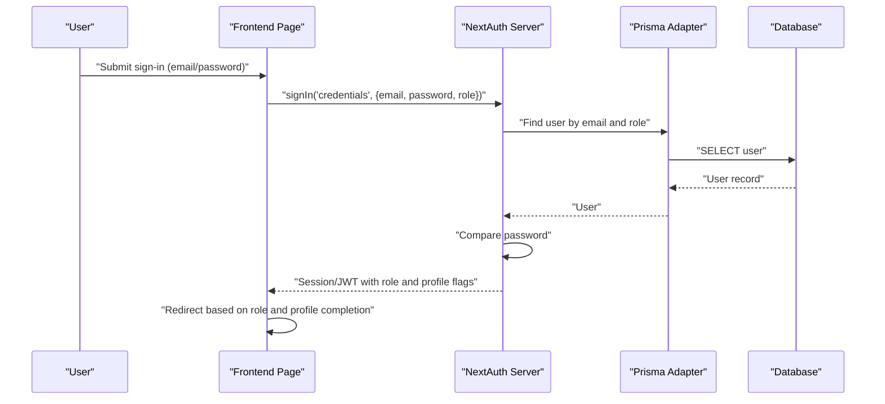

**Diagram sources**
- [route.ts](file://WEBAPP/src/app/api/auth/[...nextauth]/route.ts#L69-L96)
- [page.tsx](file://WEBAPP/src/app/auth/signin/page.tsx#L68-L89)

**Section sources**
- [route.ts](file://WEBAPP/src/app/api/auth/[...nextauth]/route.ts#L8-L237)
- [page.tsx](file://WEBAPP/src/app/auth/signin/page.tsx#L20-L66)

## Detailed Component Analysis

### NextAuth Configuration and Providers
- Strategy: JWT with automatic expiration and refresh window.
- Cookies: HttpOnly, SameSite lax, path "/", secure only on HTTPS, with explicit names and options.
- Providers:
  - Google OAuth: Consent prompt, offline access, code response type.
  - Credentials: Validates email/password and role, bans banned users, adds role/id/isProfileComplete to JWT/session.
- Callbacks:
  - signIn: For Google, links or creates user, defaults to patient role, marks profile incomplete.
  - jwt: Adds role/id/isProfileComplete; validates token expiration server-side.
  - session: Augments session with role/id/profile flags.
- Events: Logs sign-in, session access (dev), and sign-out for monitoring.

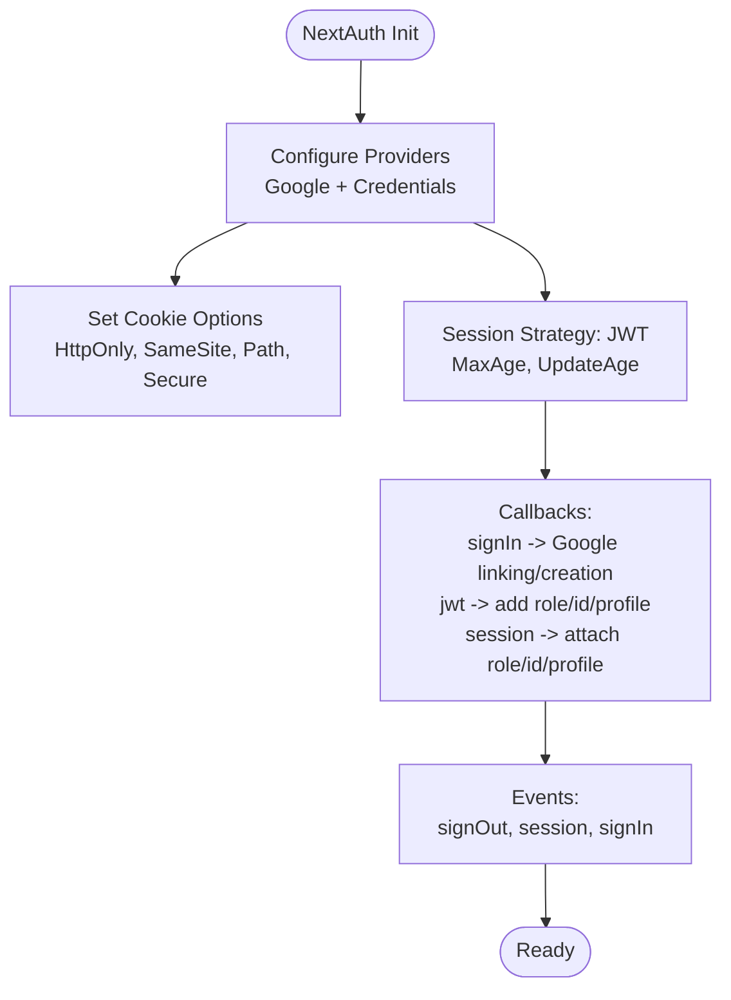

**Diagram sources**
- [route.ts](file://WEBAPP/src/app/api/auth/[...nextauth]/route.ts#L8-L237)

**Section sources**
- [route.ts](file://WEBAPP/src/app/api/auth/[...nextauth]/route.ts#L8-L237)

### User Registration
- Endpoint: POST /api/auth/register
- Validation: Zod schema enforces email, password length, and role enum.
- Behavior: Checks for existing user by email+role, hashes password, creates user, returns success.

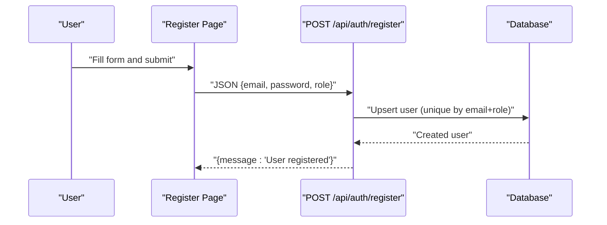

**Diagram sources**
- [route.ts](file://WEBAPP/src/app/api/auth/register/route.ts#L7-L47)
- [page.tsx](file://WEBAPP/src/app/auth/register/page.tsx#L24-L76)

**Section sources**
- [route.ts](file://WEBAPP/src/app/api/auth/register/route.ts#L7-L47)
- [page.tsx](file://WEBAPP/src/app/auth/register/page.tsx#L24-L76)

### Password Reset Workflow (OTP-based)
- Step 1: POST /api/auth/forgot-password generates a 6-digit OTP, marks previous OTPs as used, stores new OTP with expiry, sends email.
- Step 2: POST /api/auth/verify-otp validates OTP by userId, otp, not used, and not expired.
- Step 3: POST /api/auth/reset-password hashes new password and updates user.
- Frontend: Multi-step wizard guiding user through email → OTP → reset → auto sign-in.

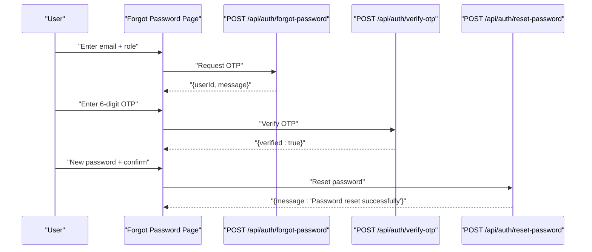

**Diagram sources**
- [route.ts](file://WEBAPP/src/app/api/auth/forgot-password/route.ts#L11-L101)
- [route.ts](file://WEBAPP/src/app/api/auth/verify-otp/route.ts#L5-L54)
- [route.ts](file://WEBAPP/src/app/api/auth/reset-password/route.ts#L6-L41)
- [page.tsx](file://WEBAPP/src/app/auth/forgot-password/page.tsx#L25-L120)

**Section sources**
- [route.ts](file://WEBAPP/src/app/api/auth/forgot-password/route.ts#L11-L101)
- [route.ts](file://WEBAPP/src/app/api/auth/verify-otp/route.ts#L5-L54)
- [route.ts](file://WEBAPP/src/app/api/auth/reset-password/route.ts#L6-L41)
- [page.tsx](file://WEBAPP/src/app/auth/forgot-password/page.tsx#L25-L120)

### Profile Completion and Verification
- Patient profile completion: Upserts patient details and sets user name and isProfileComplete.
- Therapist profile completion: Upserts therapist profile with verification fields; sets user name and image, marks profile incomplete until admin approval.
- Profile status check: Returns isProfileComplete, role, ban status, and therapist verification fields.

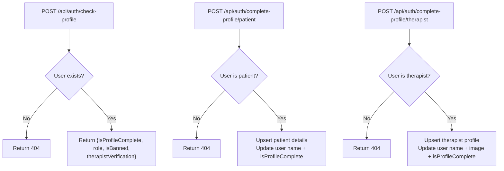

**Diagram sources**
- [route.ts](file://WEBAPP/src/app/api/auth/check-profile/route.ts#L5-L52)
- [route.ts](file://WEBAPP/src/app/api/auth/complete-profile/patient/route.ts#L5-L73)
- [route.ts](file://WEBAPP/src/app/api/auth/complete-profile/therapist/route.ts#L5-L92)

**Section sources**
- [route.ts](file://WEBAPP/src/app/api/auth/check-profile/route.ts#L5-L52)
- [route.ts](file://WEBAPP/src/app/api/auth/complete-profile/patient/route.ts#L5-L73)
- [route.ts](file://WEBAPP/src/app/api/auth/complete-profile/therapist/route.ts#L5-L92)

### Frontend Authentication Pages
- Sign-in page: Collects email, password, role; triggers NextAuth credentials sign-in; checks profile completion and redirects to appropriate dashboard or verification page.
- Registration page: Validates passwords, calls registration API, auto-signs in, and redirects to profile completion.
- Forgot password page: Multi-step wizard for OTP-based reset; auto-signs in after reset.
- Verification pending page: Polls profile status and handles approval/rejection.

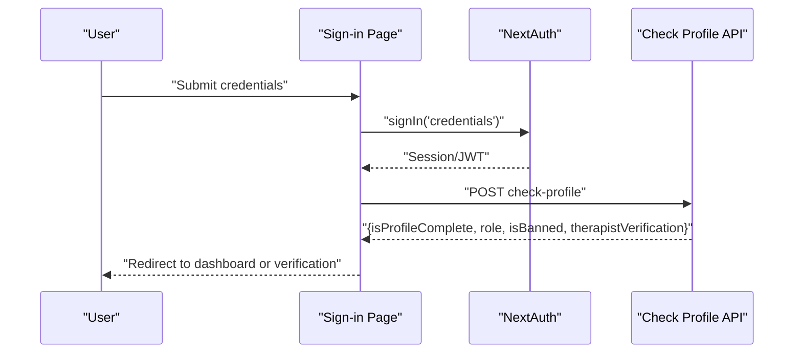

**Diagram sources**
- [page.tsx](file://WEBAPP/src/app/auth/signin/page.tsx#L20-L66)
- [route.ts](file://WEBAPP/src/app/api/auth/check-profile/route.ts#L5-L52)

**Section sources**
- [page.tsx](file://WEBAPP/src/app/auth/signin/page.tsx#L20-L66)
- [page.tsx](file://WEBAPP/src/app/auth/register/page.tsx#L24-L76)
- [page.tsx](file://WEBAPP/src/app/auth/forgot-password/page.tsx#L25-L120)
- [page.tsx](file://WEBAPP/src/app/auth/verification-pending/page.tsx#L15-L52)

### Session Management and Token Handling
- Session strategy: JWT with 30-day max age and 24-hour update window.
- Cookie configuration: HttpOnly, SameSite lax, path "/", secure only on HTTPS.
- Client utilities:
  - Detects impending expiration and displays remaining time.
  - Incognito mode detection via storage estimate.
  - Event listeners for storage changes, beforeunload, and focus to validate session.

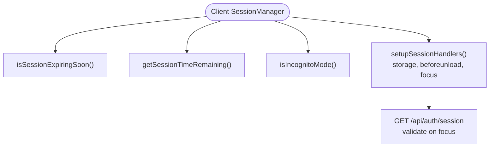

**Diagram sources**
- [route.ts](file://WEBAPP/src/app/api/auth/[...nextauth]/route.ts#L10-L48)
- [sessionManager.ts](file://WEBAPP/src/lib/sessionManager.ts#L3-L76)

**Section sources**
- [route.ts](file://WEBAPP/src/app/api/auth/[...nextauth]/route.ts#L10-L48)
- [sessionManager.ts](file://WEBAPP/src/lib/sessionManager.ts#L3-L76)

### Role-Based Access Control
- Roles: patient, therapist.
- Role propagation: Added to JWT and session via callbacks; frontend pages redirect based on role.
- Verification gating: Therapists are redirected to a verification-pending page until admin approval.

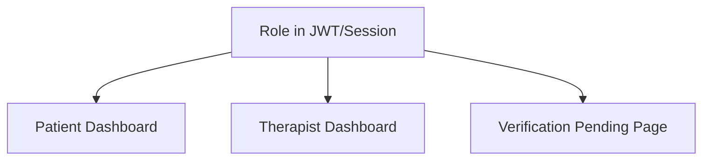

**Diagram sources**
- [route.ts](file://WEBAPP/src/app/api/auth/[...nextauth]/route.ts#L174-L213)
- [page.tsx](file://WEBAPP/src/app/auth/signin/page.tsx#L59-L65)
- [page.tsx](file://WEBAPP/src/app/auth/verification-pending/page.tsx#L33-L44)

**Section sources**
- [route.ts](file://WEBAPP/src/app/api/auth/[...nextauth]/route.ts#L174-L213)
- [page.tsx](file://WEBAPP/src/app/auth/signin/page.tsx#L59-L65)
- [page.tsx](file://WEBAPP/src/app/auth/verification-pending/page.tsx#L33-L44)

### Logout Mechanisms
- Frontend logout: Uses NextAuth client signOut with optional callbackUrl to root.
- Backend events: NextAuth logs sign-out events for monitoring.

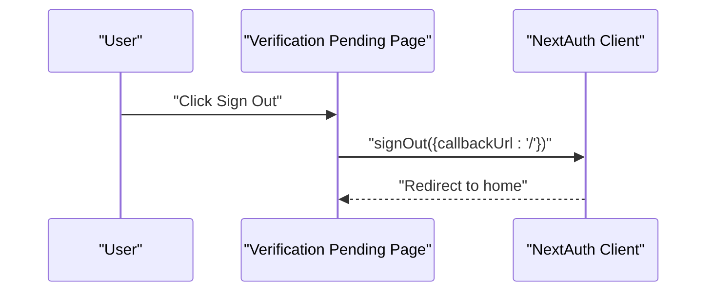

**Diagram sources**
- [page.tsx](file://WEBAPP/src/app/auth/verification-pending/page.tsx#L107-L112)
- [route.ts](file://WEBAPP/src/app/api/auth/[...nextauth]/route.ts#L215-L233)

**Section sources**
- [page.tsx](file://WEBAPP/src/app/auth/verification-pending/page.tsx#L107-L112)
- [route.ts](file://WEBAPP/src/app/api/auth/[...nextauth]/route.ts#L215-L233)

## Dependency Analysis
- NextAuth depends on Prisma adapter and bcrypt for password comparison.
- Frontend pages depend on NextAuth client hooks and local API routes.
- Client session utilities depend on browser APIs for storage and visibility.

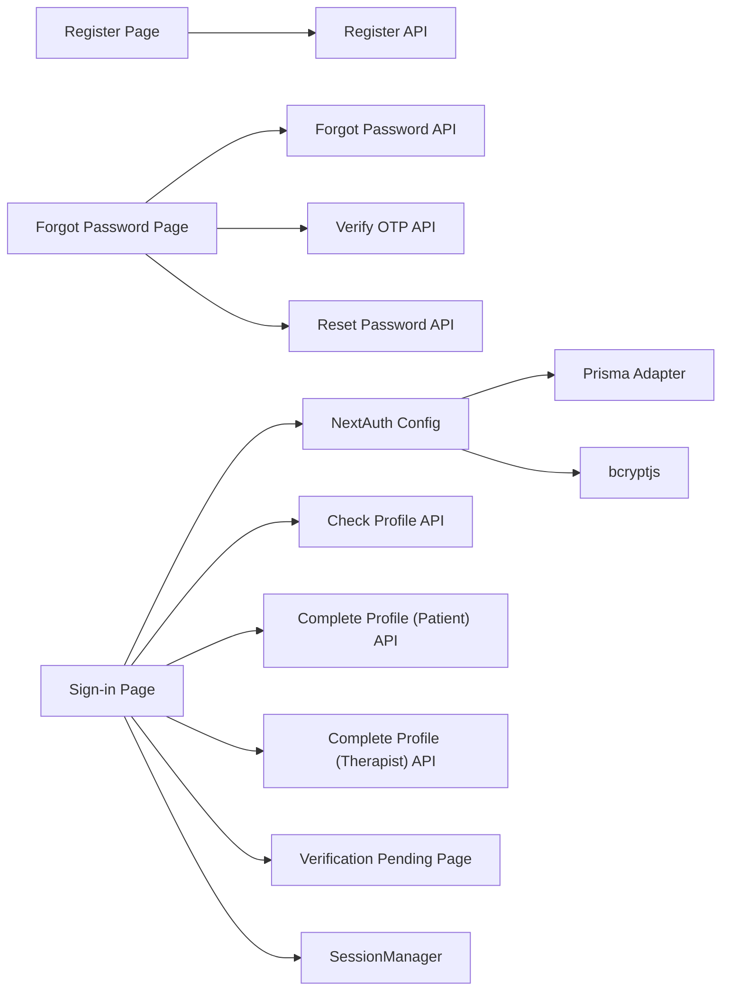

**Diagram sources**
- [route.ts](file://WEBAPP/src/app/api/auth/[...nextauth]/route.ts#L1-L6)
- [page.tsx](file://WEBAPP/src/app/auth/signin/page.tsx#L1-L14)
- [page.tsx](file://WEBAPP/src/app/auth/register/page.tsx#L1-L15)
- [page.tsx](file://WEBAPP/src/app/auth/forgot-password/page.tsx#L1-L18)
- [sessionManager.ts](file://WEBAPP/src/lib/sessionManager.ts#L1-L4)

**Section sources**
- [route.ts](file://WEBAPP/src/app/api/auth/[...nextauth]/route.ts#L1-L6)
- [page.tsx](file://WEBAPP/src/app/auth/signin/page.tsx#L1-L14)
- [page.tsx](file://WEBAPP/src/app/auth/register/page.tsx#L1-L15)
- [page.tsx](file://WEBAPP/src/app/auth/forgot-password/page.tsx#L1-L18)
- [sessionManager.ts](file://WEBAPP/src/lib/sessionManager.ts#L1-L4)

## Performance Considerations
- JWT strategy reduces database reads for protected routes; ensure token size remains minimal by avoiding large claims.
- Session cookie options balance security and cross-origin compatibility; adjust secure flag per deployment environment.
- OTP expiry is short-lived to reduce risk; ensure email delivery latency does not exceed 10 minutes.
- Client-side session polling on focus is lightweight; avoid excessive polling intervals.

[No sources needed since this section provides general guidance]

## Troubleshooting Guide
- NextAuth callbacks:
  - signIn: Ensure Google linking handles existing users and banned users correctly.
  - jwt/session: Verify role/id/profile flags are present; check token expiration server-side.
- Registration:
  - Validate Zod schema failures and conflict responses.
- Password reset:
  - Confirm OTP invalidation and uniqueness; verify email delivery and OTP expiry.
- Profile completion:
  - Check role-specific validations and upsert behavior.
- Session handling:
  - Use SessionManager helpers to detect incognito mode and handle storage events.

**Section sources**
- [route.ts](file://WEBAPP/src/app/api/auth/[...nextauth]/route.ts#L99-L233)
- [route.ts](file://WEBAPP/src/app/api/auth/register/route.ts#L15-L18)
- [route.ts](file://WEBAPP/src/app/api/auth/forgot-password/route.ts#L19-L25)
- [route.ts](file://WEBAPP/src/app/api/auth/verify-otp/route.ts#L13-L19)
- [sessionManager.ts](file://WEBAPP/src/lib/sessionManager.ts#L29-L76)

## HIPAA and Security Considerations
- Protected health information (PHI) handling:
  - Limit collection to what is necessary for therapy sessions and scheduling.
  - Ensure encryption at rest and in transit; enforce HTTPS in production.
  - Implement audit logging for access and modifications (NextAuth events can be extended).
- Authentication security:
  - Enforce strong password policies and rate limiting at the network level.
  - Use short-lived tokens with refresh windows; invalidate sessions on logout.
  - Sanitize and validate all inputs; use schema validation libraries.
- Privacy controls:
  - Provide users with access to their data and deletion requests.
  - Minimize data retention; implement automated cleanup policies.
- Compliance readiness:
  - Document data flows and security measures.
  - Regularly review provider configurations and cookie settings for secure defaults.

[No sources needed since this section provides general guidance]

## Conclusion
The MindBridge authentication system integrates NextAuth with JWT, supports multiple providers, and implements robust role-based access control. It provides secure registration, password reset via OTP, and profile completion flows tailored for Patients and Therapists. Client-side session utilities enhance user experience while maintaining security. For healthcare environments, additional safeguards and documentation should be implemented to meet regulatory requirements.