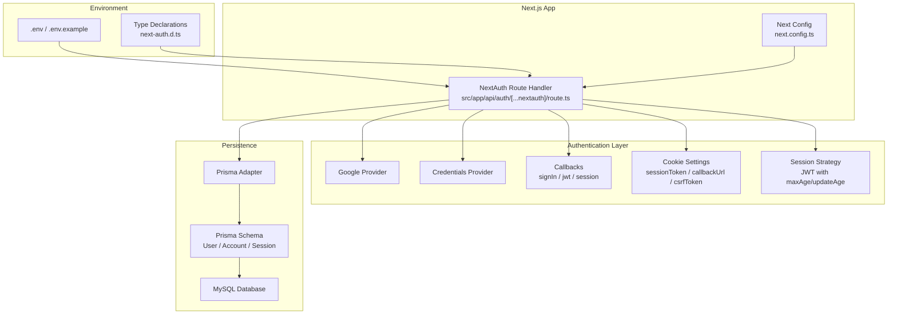
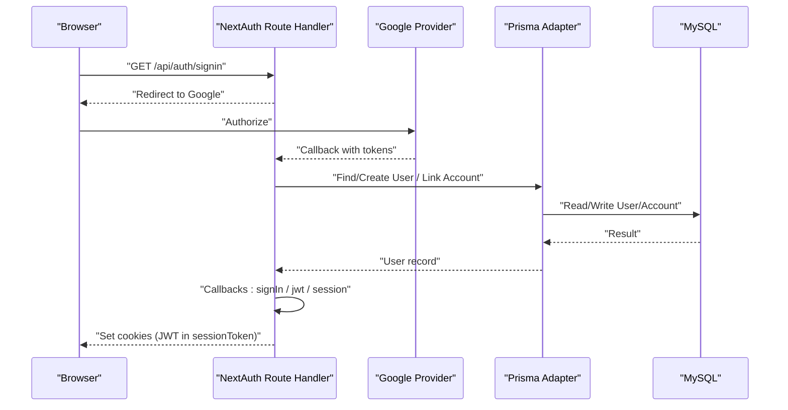
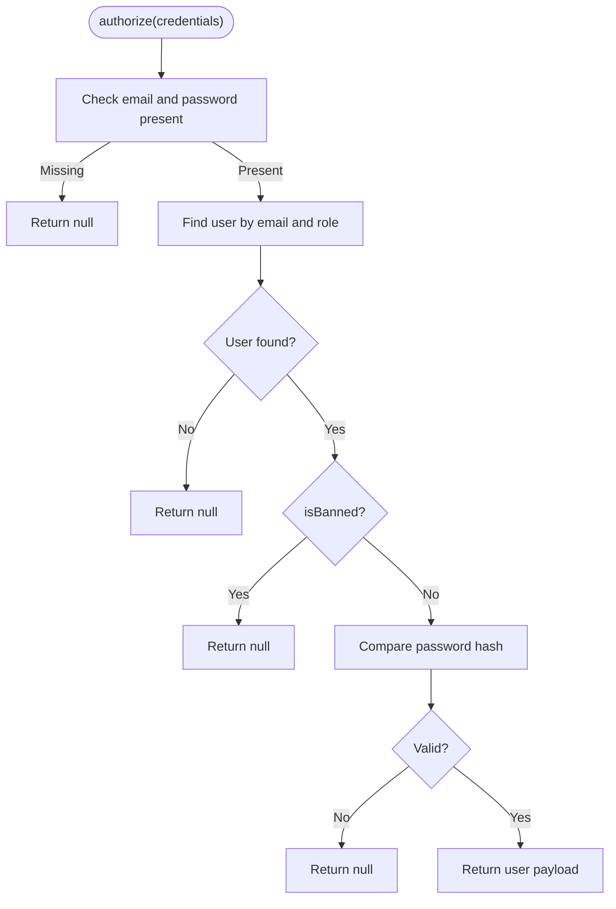
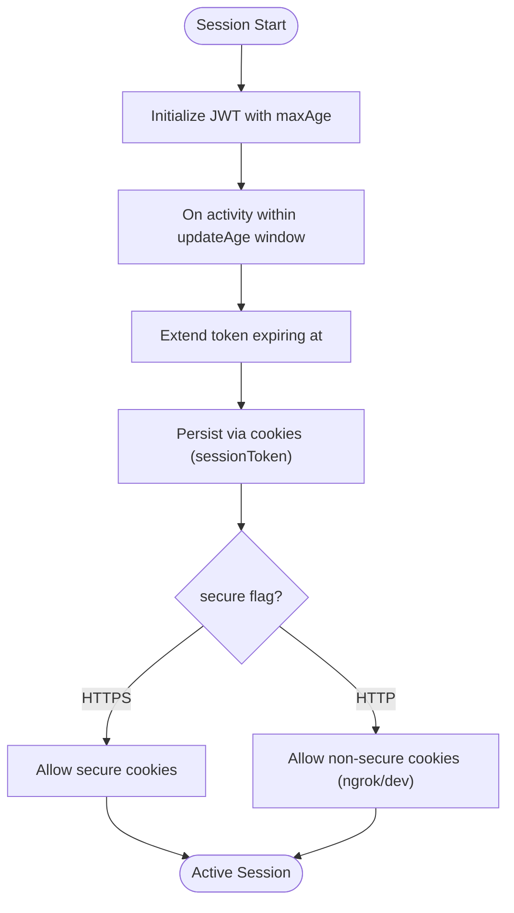
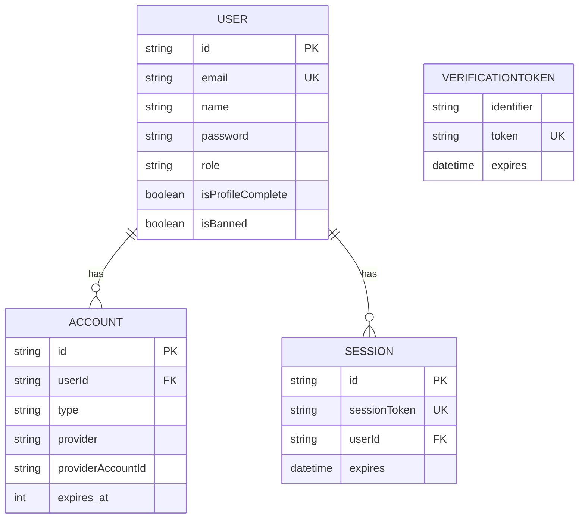
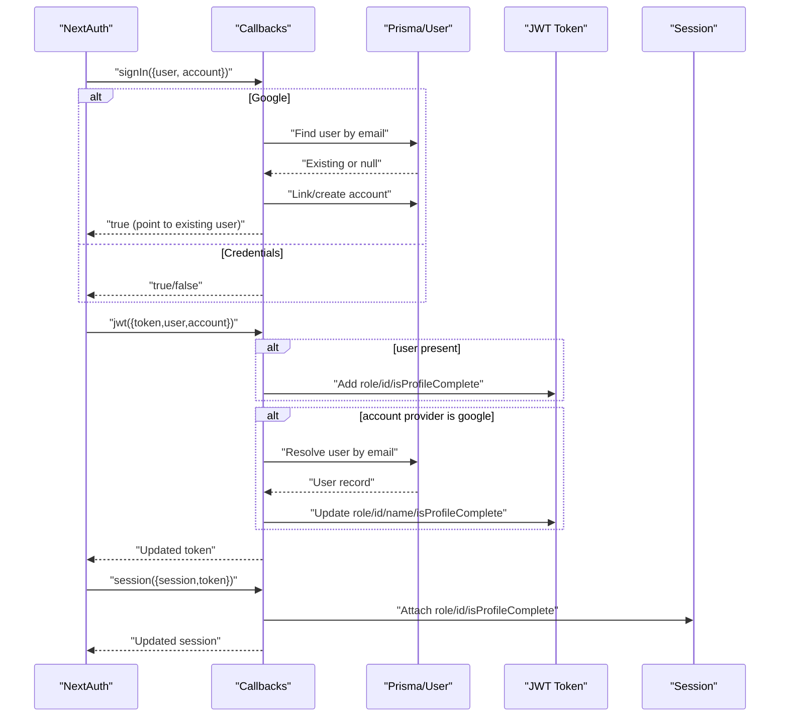
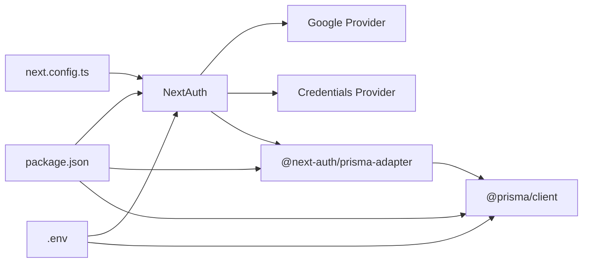

# NextAuth Configuration

<cite>
**Referenced Files in This Document**
- [route.ts](file://WEBAPP/src/app/api/auth/[...nextauth]/route.ts)
- [schema.prisma](file://WEBAPP/prisma/schema.prisma)
- [.env](file://WEBAPP/.env)
- [.env.example](file://WEBAPP/.env.example)
- [db.ts](file://WEBAPP/src/lib/db.ts)
- [next.config.ts](file://WEBAPP/next.config.ts)
- [GOOGLE_OAUTH_SETUP.md](file://WEBAPP/GOOGLE_OAUTH_SETUP.md)
- [MY_SQL_INFO.md](file://WEBAPP/MY_SQL_INFO.md)
- [package.json](file://WEBAPP/package.json)
- [next-auth.d.ts](file://WEBAPP/src/types/next-auth.d.ts)
</cite>

## Table of Contents
1. [Introduction](#introduction)
2. [Project Structure](#project-structure)
3. [Core Components](#core-components)
4. [Architecture Overview](#architecture-overview)
5. [Detailed Component Analysis](#detailed-component-analysis)
6. [Dependency Analysis](#dependency-analysis)
7. [Performance Considerations](#performance-considerations)
8. [Troubleshooting Guide](#troubleshooting-guide)
9. [Conclusion](#conclusion)
10. [Appendices](#appendices)

## Introduction
This document provides comprehensive guidance for configuring and operating NextAuth in the MindBridge web application. It covers provider configuration (Google OAuth and Credentials), JWT-based session strategy with secure cookie settings across environments, Prisma adapter integration for database persistence, callback transformations for signIn, jwt, and session, cookie configuration for ngrok compatibility, provider-specific settings such as consent prompts and offline access, and troubleshooting for common NextAuth issues.

## Project Structure
The NextAuth configuration is centralized in a Next.js app route handler under the API surface. Supporting components include:
- NextAuth route handler with providers, callbacks, and cookie/session settings
- Prisma schema modeling NextAuth tables and application user profiles
- Environment variables for secrets, providers, and database connectivity
- Prisma client initialization and Next.js configuration for ngrok compatibility

**Diagram sources**
- [route.ts](file://WEBAPP/src/app/api/auth/[...nextauth]/route.ts#L8-L237)
- [schema.prisma](file://WEBAPP/prisma/schema.prisma#L11-L77)
- [.env](file://WEBAPP/.env#L1-L31)
- [next.config.ts](file://WEBAPP/next.config.ts#L1-L45)
- [next-auth.d.ts](file://WEBAPP/src/types/next-auth.d.ts#L1-L28)

**Section sources**
- [route.ts](file://WEBAPP/src/app/api/auth/[...nextauth]/route.ts#L1-L240)
- [schema.prisma](file://WEBAPP/prisma/schema.prisma#L1-L330)
- [.env](file://WEBAPP/.env#L1-L31)
- [next.config.ts](file://WEBAPP/next.config.ts#L1-L45)
- [next-auth.d.ts](file://WEBAPP/src/types/next-auth.d.ts#L1-L28)

## Core Components
- Providers
  - Google OAuth provider configured with consent prompt and offline access for refresh tokens
  - Credentials provider validating user credentials against the database
- Session Strategy
  - JWT strategy with configurable maxAge and updateAge for automatic expiration and refresh
- Cookies
  - Custom cookie names and options; secure flag dynamically controlled by NEXTAUTH_URL scheme
- Adapter
  - Prisma adapter integrated with a MySQL datasource
- Callbacks
  - signIn: handles Google user linking/creation and bans
  - jwt: enriches token with user role, id, and profile completion status
  - session: propagates role/id/isProfileComplete to session.user
- Events
  - Logging for signOut, session access, and signIn events
- Pages
  - Custom sign-in page mapped to /auth/signin

**Section sources**
- [route.ts](file://WEBAPP/src/app/api/auth/[...nextauth]/route.ts#L8-L237)
- [schema.prisma](file://WEBAPP/prisma/schema.prisma#L11-L77)
- [.env](file://WEBAPP/.env#L1-L31)
- [next-auth.d.ts](file://WEBAPP/src/types/next-auth.d.ts#L1-L28)

## Architecture Overview
The authentication flow integrates NextAuth with Prisma-backed storage and environment-aware cookie security. The diagram below maps the actual implementation components.

**Diagram sources**
- [route.ts](file://WEBAPP/src/app/api/auth/[...nextauth]/route.ts#L49-L98)
- [route.ts](file://WEBAPP/src/app/api/auth/[...nextauth]/route.ts#L99-L214)
- [schema.prisma](file://WEBAPP/prisma/schema.prisma#L11-L77)

## Detailed Component Analysis

### Provider Configuration: Google OAuth
- Client credentials loaded from environment variables
- Authorization parameters include consent prompt and offline access to obtain refresh tokens
- Redirect URI aligns with NextAuth callback endpoint

Implementation highlights:
- Provider definition and authorization parameters
- Environment variables for client ID and secret
- Setup guide for consent screen, scopes, and redirect URIs

**Section sources**
- [route.ts](file://WEBAPP/src/app/api/auth/[...nextauth]/route.ts#L50-L61)
- [.env](file://WEBAPP/.env#L25-L28)
- [GOOGLE_OAUTH_SETUP.md](file://WEBAPP/GOOGLE_OAUTH_SETUP.md#L1-L74)

### Provider Configuration: Credentials Provider
- Accepts email, password, and role credentials
- Validates against database user records
- Prevents banned users from authenticating

**Diagram sources**
- [route.ts](file://WEBAPP/src/app/api/auth/[...nextauth]/route.ts#L62-L97)

**Section sources**
- [route.ts](file://WEBAPP/src/app/api/auth/[...nextauth]/route.ts#L62-L97)

### Session Strategy: JWT with Secure Cookies
- Strategy: JWT
- Max session lifetime: 30 days
- Refresh window: 24 hours
- Cookie settings:
  - Names customized for clarity
  - httpOnly and sameSite lax
  - Path restricted to root
  - secure flag toggled based on NEXTAUTH_URL scheme
  - Max age aligned with session length

**Diagram sources**
- [route.ts](file://WEBAPP/src/app/api/auth/[...nextauth]/route.ts#L10-L14)
- [route.ts](file://WEBAPP/src/app/api/auth/[...nextauth]/route.ts#L16-L46)
- [route.ts](file://WEBAPP/src/app/api/auth/[...nextauth]/route.ts#L47-L48)

**Section sources**
- [route.ts](file://WEBAPP/src/app/api/auth/[...nextauth]/route.ts#L10-L14)
- [route.ts](file://WEBAPP/src/app/api/auth/[...nextauth]/route.ts#L16-L48)

### Adapter Implementation: Prisma for Database Integration
- Prisma adapter connects NextAuth to MySQL
- Prisma client initialized with environment-aware logging
- NextAuth tables (User, Account, Session, VerificationToken) defined in schema
- Additional application models (PatientDetails, TherapistProfile, etc.) coexist

**Diagram sources**
- [schema.prisma](file://WEBAPP/prisma/schema.prisma#L11-L77)
- [db.ts](file://WEBAPP/src/lib/db.ts#L1-L15)

**Section sources**
- [route.ts](file://WEBAPP/src/app/api/auth/[...nextauth]/route.ts#L9)
- [schema.prisma](file://WEBAPP/prisma/schema.prisma#L11-L77)
- [db.ts](file://WEBAPP/src/lib/db.ts#L1-L15)

### Callback Functions: signIn, jwt, session Transformations
- signIn
  - For Google: link existing user accounts or create a new patient user with a temporary password and link the Google account
  - Enforce bans by returning false
- jwt
  - Attach role, id, and isProfileComplete to token on sign-in
  - On subsequent requests, resolve role/id/name/isProfileComplete from database using token email
  - Log expired tokens server-side
- session
  - Populate session.user with role, id, and isProfileComplete derived from token

**Diagram sources**
- [route.ts](file://WEBAPP/src/app/api/auth/[...nextauth]/route.ts#L99-L214)

**Section sources**
- [route.ts](file://WEBAPP/src/app/api/auth/[...nextauth]/route.ts#L99-L214)

### Cookie Configuration for ngrok Compatibility and Secure Cookies
- Custom cookie names for sessionToken, callbackUrl, and csrfToken
- httpOnly and sameSite lax recommended defaults
- secure flag dynamically enabled when NEXTAUTH_URL uses HTTPS
- useSecureCookies toggled accordingly for cookie signing/validation
- Next.js headers configuration allows external access for ngrok testing

**Section sources**
- [route.ts](file://WEBAPP/src/app/api/auth/[...nextauth]/route.ts#L15-L48)
- [route.ts](file://WEBAPP/src/app/api/auth/[...nextauth]/route.ts#L47-L48)
- [next.config.ts](file://WEBAPP/next.config.ts#L21-L41)

### Provider-Specific Settings: Consent Prompt and Offline Access
- Google provider configured with:
  - prompt: consent
  - access_type: offline
  - response_type: code
- This enables long-lived refresh tokens for extended access scenarios

**Section sources**
- [route.ts](file://WEBAPP/src/app/api/auth/[...nextauth]/route.ts#L54-L60)

### Type Declarations for Enhanced Type Safety
- Extends NextAuth session and JWT types to include role, id, and isProfileComplete fields
- Ensures type-safe access to user data in callbacks and downstream components

**Section sources**
- [next-auth.d.ts](file://WEBAPP/src/types/next-auth.d.ts#L1-L28)

## Dependency Analysis
Key dependencies and integrations:
- NextAuth runtime and providers
- Prisma adapter and client
- MySQL datasource
- Environment variables for secrets and URLs
- Next.js configuration for headers and ngrok compatibility

**Diagram sources**
- [package.json](file://WEBAPP/package.json#L15-L72)
- [route.ts](file://WEBAPP/src/app/api/auth/[...nextauth]/route.ts#L1-L6)
- [.env](file://WEBAPP/.env#L1-L31)
- [next.config.ts](file://WEBAPP/next.config.ts#L1-L45)

**Section sources**
- [package.json](file://WEBAPP/package.json#L15-L72)
- [route.ts](file://WEBAPP/src/app/api/auth/[...nextauth]/route.ts#L1-L6)
- [.env](file://WEBAPP/.env#L1-L31)
- [next.config.ts](file://WEBAPP/next.config.ts#L1-L45)

## Performance Considerations
- JWT strategy reduces database load for session validation; ensure token size remains reasonable by limiting claims
- Prisma client logging is reduced in production to minimize overhead
- Cookie secure flag disabled in non-HTTPS environments to avoid browser blocking; enable HTTPS in production for optimal security
- Consider rate-limiting for authentication endpoints and caching token resolution results if scaling

## Troubleshooting Guide
Common issues and resolutions:
- Google OAuth redirect mismatch
  - Ensure redirect URI matches the configured origin and callback path
  - Verify authorized JavaScript origins and redirect URIs in Google Cloud Console
- Access blocked during testing
  - Add test users in the OAuth consent screen
- Google sign-in button not visible
  - Confirm GOOGLE_CLIENT_ID and GOOGLE_CLIENT_SECRET are set and server restarted
- Database connectivity
  - Verify DATABASE_URL correctness and MySQL service availability
  - Re-run Prisma client generation and schema push if TypeScript errors occur
- ngrok HTTPS and cookies
  - NEXTAUTH_URL should use HTTPS for secure cookies; otherwise, cookies may be rejected by modern browsers
  - Confirm useSecureCookies alignment with NEXTAUTH_URL scheme
- Session not persisting
  - Check cookie domain/path settings and secure flag
  - Validate JWT token expiry and server-side token refresh logic

**Section sources**
- [GOOGLE_OAUTH_SETUP.md](file://WEBAPP/GOOGLE_OAUTH_SETUP.md#L70-L74)
- [MY_SQL_INFO.md](file://WEBAPP/MY_SQL_INFO.md#L97-L114)
- [route.ts](file://WEBAPP/src/app/api/auth/[...nextauth]/route.ts#L16-L48)
- [route.ts](file://WEBAPP/src/app/api/auth/[...nextauth]/route.ts#L47-L48)

## Conclusion
The NextAuth configuration in MindBridge leverages a robust JWT-based session strategy, Prisma-backed persistence, and provider-specific settings for Google OAuth. The setup includes environment-aware cookie security, comprehensive callback transformations, and practical guidance for ngrok compatibility and production hardening. Following the troubleshooting steps and maintaining proper environment variable hygiene ensures reliable authentication across development and production.

## Appendices

### Environment Variables Reference
- NEXTAUTH_URL: Base URL for NextAuth (use HTTPS in production)
- NEXTAUTH_SECRET: Cryptographic secret for signing tokens
- GOOGLE_CLIENT_ID / GOOGLE_CLIENT_SECRET: Google OAuth credentials
- DATABASE_URL: MySQL connection string for Prisma

**Section sources**
- [.env](file://WEBAPP/.env#L1-L31)
- [.env.example](file://WEBAPP/.env.example#L1-L16)

### Prisma Initialization Checklist
- Copy .env.example to .env and update values
- Create MySQL database and update DATABASE_URL
- Generate Prisma client and push schema
- Start the application

**Section sources**
- [MY_SQL_INFO.md](file://WEBAPP/MY_SQL_INFO.md#L10-L75)