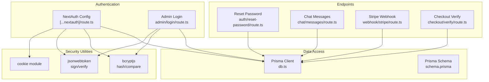
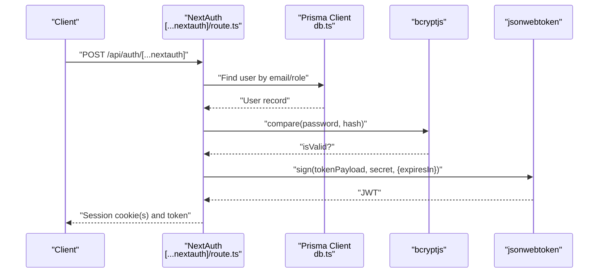
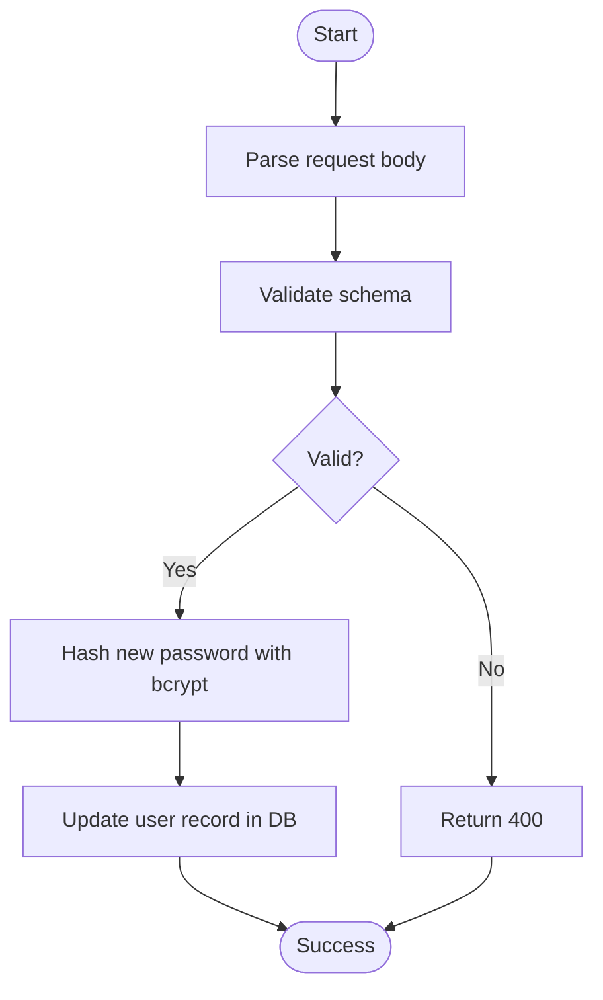
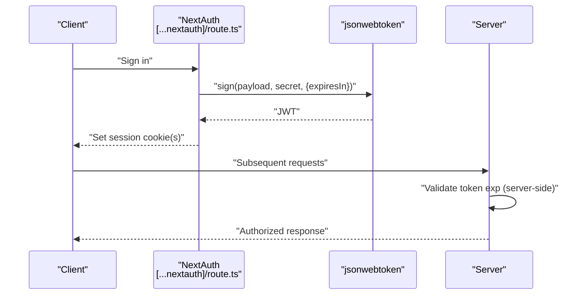
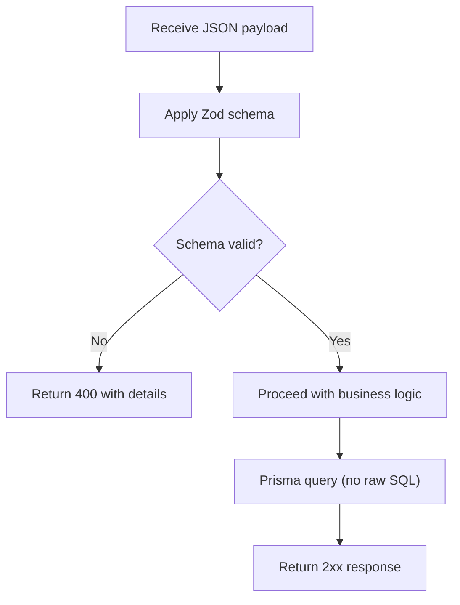
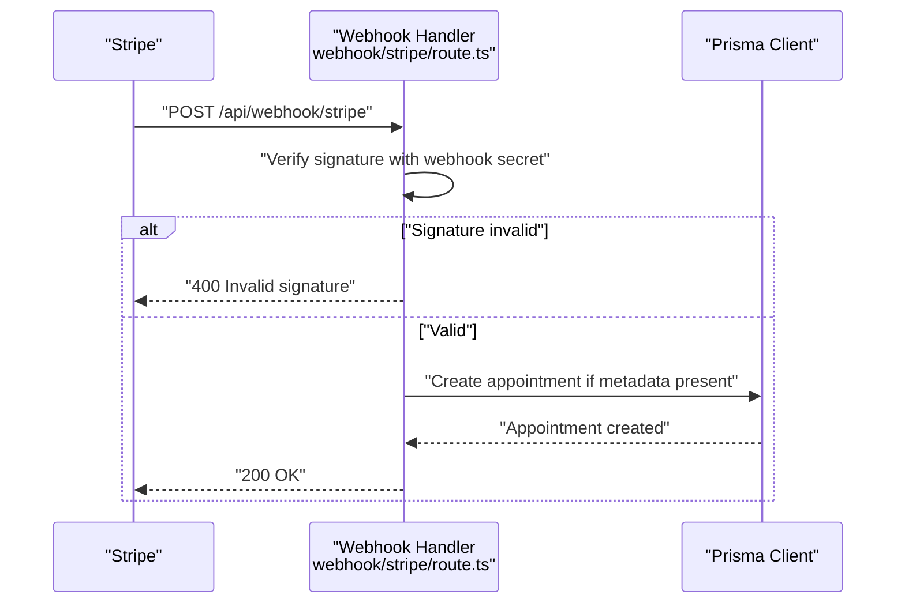
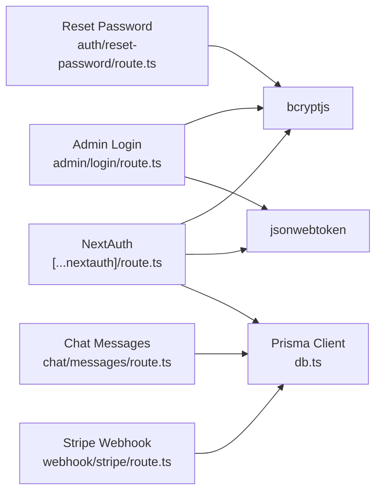

# Security Measures

<cite>
**Referenced Files in This Document**
- [route.ts](file://WEBAPP/src/app/api/admin/login/route.ts)
- [route.ts](file://WEBAPP/src/app/api/auth/reset-password/route.ts)
- [route.ts](file://WEBAPP/src/app/api/auth/[...nextauth]/route.ts)
- [.env](file://WEBAPP/.env)
- [.env.example](file://WEBAPP/.env.example)
- [route.ts](file://WEBAPP/src/app/api/webhook/stripe/route.ts)
- [route.ts](file://WEBAPP/src/app/api/chat/messages/route.ts)
- [route.ts](file://WEBAPP/src/app/api/checkout/verify/route.ts)
- [db.ts](file://WEBAPP/src/lib/db.ts)
- [schema.prisma](file://WEBAPP/prisma/schema.prisma)
- [route.ts](file://WEBAPP/src/app/api/analytics/assess/route.ts)
- [page.tsx](file://WEBAPP/src/app/auth/complete-profile/page.tsx)
- [route.ts](file://WEBAPP/src/app/api/auth/complete-profile/patient/route.ts)
- [page.tsx](file://WEBAPP/src/components/SessionStatus.tsx)
</cite>

## Table of Contents
1. [Introduction](#introduction)
2. [Project Structure](#project-structure)
3. [Core Components](#core-components)
4. [Architecture Overview](#architecture-overview)
5. [Detailed Component Analysis](#detailed-component-analysis)
6. [Dependency Analysis](#dependency-analysis)
7. [Performance Considerations](#performance-considerations)
8. [Troubleshooting Guide](#troubleshooting-guide)
9. [HIPAA Compliance Considerations](#hipaa-compliance-considerations)
10. [Security Monitoring, Logging, and Audit Trails](#security-monitoring-logging-and-audit-trails)
11. [Security Best Practices for Healthcare Applications](#security-best-practices-for-healthcare-applications)
12. [Conclusion](#conclusion)

## Introduction
This document details the security measures and compliance considerations implemented in the MindBridge application. It explains password hashing with bcrypt, JWT token security, cookie attributes, CSRF protection, input validation and sanitization, SQL injection prevention, HIPAA-related safeguards, and operational security monitoring. Guidance is provided for hardening the system further, especially for healthcare environments.

## Project Structure
Security-relevant code spans the Next.js API routes, authentication configuration, database layer, and environment configuration. Key areas include:
- Authentication and session management via NextAuth
- Password hashing and verification
- JWT token generation and validation
- Cookie security settings
- CSRF protection
- Input validation and sanitation
- SQL injection prevention through Prisma
- Payment webhooks and sensitive data handling
- Analytics and risk flagging for mental health data

**Diagram sources**
- [route.ts](file://WEBAPP/src/app/api/auth/[...nextauth]/route.ts#L1-L240)
- [route.ts](file://WEBAPP/src/app/api/admin/login/route.ts#L1-L75)
- [db.ts](file://WEBAPP/src/lib/db.ts#L1-L15)
- [schema.prisma](file://WEBAPP/prisma/schema.prisma#L238-L329)
- [route.ts](file://WEBAPP/src/app/api/auth/reset-password/route.ts#L1-L42)
- [route.ts](file://WEBAPP/src/app/api/chat/messages/route.ts#L1-L91)
- [route.ts](file://WEBAPP/src/app/api/webhook/stripe/route.ts#L1-L67)
- [route.ts](file://WEBAPP/src/app/api/checkout/verify/route.ts#L1-L94)

**Section sources**
- [route.ts](file://WEBAPP/src/app/api/auth/[...nextauth]/route.ts#L1-L240)
- [route.ts](file://WEBAPP/src/app/api/admin/login/route.ts#L1-L75)
- [db.ts](file://WEBAPP/src/lib/db.ts#L1-L15)
- [schema.prisma](file://WEBAPP/prisma/schema.prisma#L238-L329)

## Core Components
- Password hashing and verification: bcryptjs is used for hashing and verifying passwords in admin login and Google sign-in flows.
- JWT token lifecycle: NextAuth manages JWT strategy with automatic expiration and refresh; server-side checks are performed.
- Cookie security: HttpOnly, SameSite, and Secure attributes are configured per cookie; Secure depends on environment URL scheme.
- CSRF protection: NextAuth’s built-in CSRF token cookie is enabled and HttpOnly.
- Input validation and sanitization: Zod schemas and runtime checks validate and sanitize inputs.
- SQL injection prevention: Prisma ORM is used for all database queries, mitigating SQL injection risks.
- Payment webhook security: Stripe webhook signature verification is implemented.
- Risk-aware analytics: Mental health analytics surfaces risk flags for sensitive content.

**Section sources**
- [route.ts](file://WEBAPP/src/app/api/admin/login/route.ts#L1-L75)
- [route.ts](file://WEBAPP/src/app/api/auth/[...nextauth]/route.ts#L1-L240)
- [route.ts](file://WEBAPP/src/app/api/auth/reset-password/route.ts#L1-L42)
- [route.ts](file://WEBAPP/src/app/api/chat/messages/route.ts#L1-L91)
- [route.ts](file://WEBAPP/src/app/api/webhook/stripe/route.ts#L1-L67)
- [db.ts](file://WEBAPP/src/lib/db.ts#L1-L15)
- [schema.prisma](file://WEBAPP/prisma/schema.prisma#L238-L329)

## Architecture Overview
The authentication subsystem integrates NextAuth with Prisma, using bcrypt for password hashing and JWT for session tokens. Cookies are configured with security attributes. Sensitive endpoints enforce session checks and input validation. Payment flows use Stripe with signature verification. Analytics endpoints compute risk flags from user inputs.

**Diagram sources**
- [route.ts](file://WEBAPP/src/app/api/auth/[...nextauth]/route.ts#L1-L240)
- [db.ts](file://WEBAPP/src/lib/db.ts#L1-L15)

## Detailed Component Analysis

### Password Hashing with bcrypt
- Implementation pattern:
  - Hashing: New passwords are hashed using bcrypt with a work factor suitable for the deployment environment.
  - Verification: Incoming passwords are verified against stored hashes using bcrypt compare.
- Salt handling:
  - bcrypt generates and stores salts internally; explicit salt management is not required.
- Where it is used:
  - Admin login flow seeds and compares admin passwords.
  - Google sign-in flow creates a temporary random password hash for federated users.

**Diagram sources**
- [route.ts](file://WEBAPP/src/app/api/auth/reset-password/route.ts#L1-L42)
- [route.ts](file://WEBAPP/src/app/api/admin/login/route.ts#L1-L75)

**Section sources**
- [route.ts](file://WEBAPP/src/app/api/auth/reset-password/route.ts#L1-L42)
- [route.ts](file://WEBAPP/src/app/api/admin/login/route.ts#L1-L75)

### JWT Token Security
- Signing and expiration:
  - Tokens are signed with a secret derived from environment configuration.
  - Expiration is enforced client-side and server-side; server-side validation checks token exp claim.
- Session strategy:
  - NextAuth uses JWT strategy with configurable maxAge and updateAge for refresh behavior.
- Cookie attributes:
  - Session token, callback URL, and CSRF token cookies are configured with HttpOnly and SameSite.
  - Secure attribute is toggled based on whether the NEXTAUTH_URL uses HTTPS.

**Diagram sources**
- [route.ts](file://WEBAPP/src/app/api/auth/[...nextauth]/route.ts#L1-L240)

**Section sources**
- [route.ts](file://WEBAPP/src/app/api/auth/[...nextauth]/route.ts#L1-L240)
- [.env](file://WEBAPP/.env#L1-L31)
- [.env.example](file://WEBAPP/.env.example#L1-L16)

### Cookie Security Settings
- Attributes:
  - HttpOnly: Enabled for session, callback, and CSRF cookies.
  - SameSite: Lax for session, callback, and CSRF cookies.
  - Secure: Conditionally enabled based on NEXTAUTH_URL scheme.
- Purpose:
  - Mitigates XSS and CSRF risks by restricting cookie access and transport.

**Section sources**
- [route.ts](file://WEBAPP/src/app/api/auth/[...nextauth]/route.ts#L16-L46)
- [.env](file://WEBAPP/.env#L1-L31)
- [.env.example](file://WEBAPP/.env.example#L6-L8)

### CSRF Protection
- Mechanism:
  - NextAuth provides a CSRF token cookie with HttpOnly and SameSite=Lax.
  - CSRF protection is integrated into the authentication flow.
- Guidance:
  - Ensure SameSite is maintained and consider upgrading to Strict for higher-risk forms if necessary.

**Section sources**
- [route.ts](file://WEBAPP/src/app/api/auth/[...nextauth]/route.ts#L37-L45)

### Input Validation, Sanitization, and SQL Injection Prevention
- Validation:
  - Zod schemas validate request payloads for admin login and password reset.
  - Runtime checks validate chat message content and numeric fields.
- Sanitization:
  - Trimming of whitespace for content fields.
- SQL injection prevention:
  - All database queries are executed via Prisma, which prevents SQL injection by construction.

**Diagram sources**
- [route.ts](file://WEBAPP/src/app/api/auth/reset-password/route.ts#L1-L42)
- [route.ts](file://WEBAPP/src/app/api/chat/messages/route.ts#L1-L91)
- [db.ts](file://WEBAPP/src/lib/db.ts#L1-L15)

**Section sources**
- [route.ts](file://WEBAPP/src/app/api/auth/reset-password/route.ts#L1-L42)
- [route.ts](file://WEBAPP/src/app/api/chat/messages/route.ts#L1-L91)
- [db.ts](file://WEBAPP/src/lib/db.ts#L1-L15)
- [schema.prisma](file://WEBAPP/prisma/schema.prisma#L238-L329)

### Payment Webhook Security (Stripe)
- Signature verification:
  - Webhook requests are validated using Stripe’s signature header and webhook secret.
- Idempotency:
  - Endpoint checks for existing appointments to avoid duplicate creation.
- Error handling:
  - Malformed signatures return 400; internal errors return 500.

**Diagram sources**
- [route.ts](file://WEBAPP/src/app/api/webhook/stripe/route.ts#L1-L67)

**Section sources**
- [route.ts](file://WEBAPP/src/app/api/webhook/stripe/route.ts#L1-L67)

### Mental Health Analytics and Risk Flagging
- Risk flags:
  - Analytics models store risk indicators derived from chat and assessments.
  - UI components surface risk alerts to users and providers.
- Privacy:
  - Risk data is stored in the database; access controls and encryption at rest should be considered.

**Section sources**
- [schema.prisma](file://WEBAPP/prisma/schema.prisma#L238-L329)
- [page.tsx](file://WEBAPP/src/components/SessionStatus.tsx#L133-L161)

## Dependency Analysis
- Authentication depends on:
  - NextAuth for session management and JWT lifecycle
  - bcryptjs for password hashing/verification
  - jsonwebtoken for JWT signing
  - Prisma for user and session persistence
- Endpoints depend on:
  - getServerSession for authorization
  - Prisma for data access
  - Stripe SDK for payment verification

**Diagram sources**
- [route.ts](file://WEBAPP/src/app/api/auth/[...nextauth]/route.ts#L1-L240)
- [route.ts](file://WEBAPP/src/app/api/admin/login/route.ts#L1-L75)
- [route.ts](file://WEBAPP/src/app/api/auth/reset-password/route.ts#L1-L42)
- [route.ts](file://WEBAPP/src/app/api/chat/messages/route.ts#L1-L91)
- [route.ts](file://WEBAPP/src/app/api/webhook/stripe/route.ts#L1-L67)
- [db.ts](file://WEBAPP/src/lib/db.ts#L1-L15)

**Section sources**
- [route.ts](file://WEBAPP/src/app/api/auth/[...nextauth]/route.ts#L1-L240)
- [route.ts](file://WEBAPP/src/app/api/admin/login/route.ts#L1-L75)
- [route.ts](file://WEBAPP/src/app/api/auth/reset-password/route.ts#L1-L42)
- [route.ts](file://WEBAPP/src/app/api/chat/messages/route.ts#L1-L91)
- [route.ts](file://WEBAPP/src/app/api/webhook/stripe/route.ts#L1-L67)
- [db.ts](file://WEBAPP/src/lib/db.ts#L1-L15)

## Performance Considerations
- bcrypt cost factor: Adjust work factor according to hardware capacity; higher factors increase security but CPU usage.
- JWT maxAge/updateAge: Tune session lifetimes to balance usability and security.
- Prisma logging: Disable verbose logs in production to reduce overhead.
- Stripe webhook retries: Implement idempotent handlers to handle duplicate events efficiently.

[No sources needed since this section provides general guidance]

## Troubleshooting Guide
- Admin login failures:
  - Validate schema inputs and ensure bcrypt compare succeeds.
  - Confirm NEXTAUTH_SECRET is set and consistent.
- JWT expiration:
  - Server-side checks log expired tokens; clients should refresh or re-authenticate.
- Unauthorized access to protected endpoints:
  - Ensure getServerSession returns a valid user and email.
- Stripe webhook signature errors:
  - Verify endpoint secret and signature header match.
- Chat message validation:
  - Confirm content is present, non-empty, and trimmed.

**Section sources**
- [route.ts](file://WEBAPP/src/app/api/admin/login/route.ts#L1-L75)
- [route.ts](file://WEBAPP/src/app/api/auth/[...nextauth]/route.ts#L196-L204)
- [route.ts](file://WEBAPP/src/app/api/chat/messages/route.ts#L1-L91)
- [route.ts](file://WEBAPP/src/app/api/webhook/stripe/route.ts#L1-L67)

## HIPAA Compliance Considerations
- Protected Health Information (PHI) handling:
  - Identify PHI in chat messages, assessments, and user profiles.
  - Enforce access controls and audit logs for PHI access.
- Data minimization:
  - Limit collection and retention of PHI; anonymize where possible.
- Integrity and confidentiality:
  - Use HTTPS/TLS for all communications; secure secrets and keys.
  - Encrypt data at rest using platform-level encryption.
- Administrative safeguards:
  - Define roles and permissions; enforce least privilege.
  - Train personnel on PHI handling and breach procedures.
- Physical safeguards:
  - Secure hosting environments and backups.
- Audit logging:
  - Track access to PHI with timestamps and user identifiers.

[No sources needed since this section provides general guidance]

## Security Monitoring, Logging, and Audit Trails
- NextAuth events:
  - Sign-in, sign-out, and session access events are logged for monitoring.
- Stripe webhooks:
  - Successful and failed webhook processing is logged.
- Chat and assessment endpoints:
  - Errors are logged; consider augmenting with structured audit logs for PHI-related actions.
- Recommendations:
  - Centralize logs and apply retention policies.
  - Alert on repeated unauthorized access attempts and token expiration events.

**Section sources**
- [route.ts](file://WEBAPP/src/app/api/auth/[...nextauth]/route.ts#L215-L233)
- [route.ts](file://WEBAPP/src/app/api/webhook/stripe/route.ts#L1-L67)
- [route.ts](file://WEBAPP/src/app/api/chat/messages/route.ts#L1-L91)

## Security Best Practices for Healthcare Applications
- Strong authentication:
  - Multi-factor authentication (MFA) for privileged roles.
  - Enforce strong password policies and periodic rotation.
- Least privilege:
  - Restrict access to PHI by role and job function.
- Data classification:
  - Label and protect PHI appropriately; encrypt in transit and at rest.
- Penetration testing and vulnerability scanning:
  - Regularly test APIs and authentication flows.
- Incident response:
  - Define breach detection, escalation, and remediation procedures.
- Privacy by design:
  - Build privacy controls into features from the start.

[No sources needed since this section provides general guidance]

## Conclusion
MindBridge implements robust authentication with bcrypt, JWT, and secure cookie attributes, along with CSRF protection via NextAuth. Input validation and Prisma mitigate injection risks, while Stripe webhooks are secured with signature verification. For healthcare deployments, strengthen encryption, access controls, and audit logging, and adopt HIPAA-aligned policies and procedures.