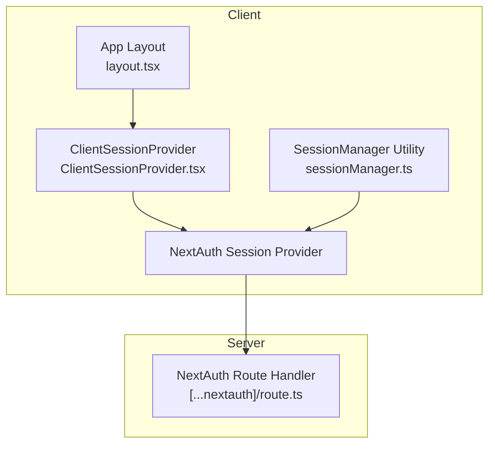
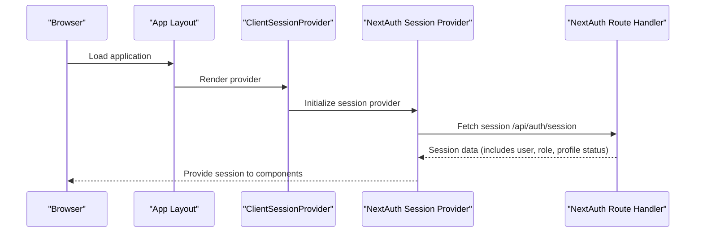
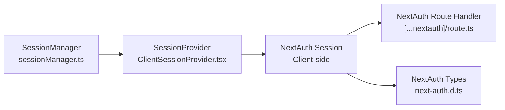

# Session Management

<cite>
**Referenced Files in This Document**
- [sessionManager.ts](file://WEBAPP/src/lib/sessionManager.ts)
- [ClientSessionProvider.tsx](file://WEBAPP/src/components/ClientSessionProvider.tsx)
- [next-auth.d.ts](file://WEBAPP/src/types/next-auth.d.ts)
- [route.ts](file://WEBAPP/src/app/api/auth/[...nextauth]/route.ts)
- [layout.tsx](file://WEBAPP/src/app/layout.tsx)
- [page.tsx](file://WEBAPP/src/app/page.tsx)
</cite>

## Table of Contents
1. [Introduction](#introduction)
2. [Project Structure](#project-structure)
3. [Core Components](#core-components)
4. [Architecture Overview](#architecture-overview)
5. [Detailed Component Analysis](#detailed-component-analysis)
6. [Dependency Analysis](#dependency-analysis)
7. [Performance Considerations](#performance-considerations)
8. [Troubleshooting Guide](#troubleshooting-guide)
9. [Conclusion](#conclusion)

## Introduction
This document explains the session management and lifecycle for the application, focusing on client-side session handling via NextAuth, JWT token structure, session duration and expiration, refresh mechanisms, persistence across browser restarts and tab switches, server-side validation, logout and cleanup, security measures, and debugging capabilities. It consolidates the current implementation present in the repository and provides actionable guidance for maintaining and extending session behavior.

## Project Structure
The session management spans client-side providers, type definitions for NextAuth/JWT, and server-side NextAuth routes. The client initializes a session provider at the top-level layout, wraps pages with it, and uses a dedicated session manager utility for runtime checks and event-driven behavior.

**Diagram sources**
- [layout.tsx](file://WEBAPP/src/app/layout.tsx)
- [ClientSessionProvider.tsx](file://WEBAPP/src/components/ClientSessionProvider.tsx)
- [sessionManager.ts](file://WEBAPP/src/lib/sessionManager.ts)
- [route.ts](file://WEBAPP/src/app/api/auth/[...nextauth]/route.ts)

**Section sources**
- [layout.tsx](file://WEBAPP/src/app/layout.tsx)
- [ClientSessionProvider.tsx](file://WEBAPP/src/components/ClientSessionProvider.tsx)
- [sessionManager.ts](file://WEBAPP/src/lib/sessionManager.ts)
- [route.ts](file://WEBAPP/src/app/api/auth/[...nextauth]/route.ts)

## Core Components
- ClientSessionProvider: Wraps the application with NextAuth’s session provider to enable client-side session access and synchronization.
- SessionManager: Provides runtime helpers for detecting imminent expiration, computing remaining time, detecting incognito/private mode, and setting up event handlers for storage, focus, and unload events.
- NextAuth Types: Extends NextAuth session and JWT types to include role, user ID, and profile completion status.
- NextAuth Route Handler: Implements server-side NextAuth configuration and session handling.

Key responsibilities:
- Client initialization and provider setup
- Session lifecycle checks and UX feedback
- Type-safe session data for frontend consumption
- Server-side session validation and token handling

**Section sources**
- [ClientSessionProvider.tsx](file://WEBAPP/src/components/ClientSessionProvider.tsx#L1-L12)
- [sessionManager.ts](file://WEBAPP/src/lib/sessionManager.ts#L1-L78)
- [next-auth.d.ts](file://WEBAPP/src/types/next-auth.d.ts#L1-L28)
- [route.ts](file://WEBAPP/src/app/api/auth/[...nextauth]/route.ts)

## Architecture Overview
The session architecture integrates NextAuth on both client and server. The client initializes the session provider at the app root, enabling pages and components to access session data. The session manager performs runtime checks and reacts to browser events. On the server, NextAuth manages authentication state, token issuance, and session validation.

**Diagram sources**
- [layout.tsx](file://WEBAPP/src/app/layout.tsx)
- [ClientSessionProvider.tsx](file://WEBAPP/src/components/ClientSessionProvider.tsx#L1-L12)
- [route.ts](file://WEBAPP/src/app/api/auth/[...nextauth]/route.ts)

## Detailed Component Analysis

### ClientSessionProvider
Purpose:
- Initializes NextAuth’s session provider at the client boundary so that session state is available to all pages and components.

Behavior:
- Wraps children with the NextAuth session provider.
- Enables client-side session access and automatic synchronization with the server.

Integration:
- Mounted at the application root to ensure global availability.

**Section sources**
- [ClientSessionProvider.tsx](file://WEBAPP/src/components/ClientSessionProvider.tsx#L1-L12)
- [layout.tsx](file://WEBAPP/src/app/layout.tsx)

### SessionManager
Responsibilities:
- Detect imminent expiration: Determines if a session is expiring within 24 hours based on the session’s expires timestamp.
- Compute remaining time: Returns a human-readable string indicating time left until expiration.
- Incognito detection: Uses storage estimate to infer private/incognito browsing mode.
- Event-driven session handling:
  - Storage events: Reloads the page if NextAuth cookies are cleared in another tab.
  - Before unload: Logs behavior when the browser closes in incognito mode.
  - Focus events: Validates session by fetching /api/auth/session; redirects to sign-in if the session is invalid.

Security and UX implications:
- Relies on client-side polling via a dedicated endpoint to detect session staleness.
- Uses browser events to maintain awareness of user presence and environment.

**Section sources**
- [sessionManager.ts](file://WEBAPP/src/lib/sessionManager.ts#L1-L78)

### NextAuth Types (Session and JWT)
Structure:
- Session extends NextAuth session to include:
  - user.id, user.name, user.email, user.image
  - user.role
  - user.isProfileComplete
- JWT extends NextAuth JWT to include:
  - role
  - id
  - isProfileComplete

Usage:
- Ensures type safety for session data consumed by client components and pages.

**Section sources**
- [next-auth.d.ts](file://WEBAPP/src/types/next-auth.d.ts#L1-L28)

### NextAuth Route Handler
Role:
- Implements server-side NextAuth configuration and session handling.
- Exposes session endpoints for client validation and refresh.

Note:
- The route handler file path indicates NextAuth’s dynamic route under the API surface. Consult the route file for provider configuration, callbacks, and session options.

**Section sources**
- [route.ts](file://WEBAPP/src/app/api/auth/[...nextauth]/route.ts)

### Page-Level Session Access
- Pages can consume session data via NextAuth’s client-side hooks after the provider is initialized at the layout level.
- The root layout ensures the provider is available globally.

**Section sources**
- [layout.tsx](file://WEBAPP/src/app/layout.tsx)
- [page.tsx](file://WEBAPP/src/app/page.tsx)

## Dependency Analysis
The client depends on NextAuth for session state, while the server depends on NextAuth for authentication and session management. The session manager utility bridges client-side runtime checks with server-provided session data.

**Diagram sources**
- [sessionManager.ts](file://WEBAPP/src/lib/sessionManager.ts#L1-L78)
- [ClientSessionProvider.tsx](file://WEBAPP/src/components/ClientSessionProvider.tsx#L1-L12)
- [route.ts](file://WEBAPP/src/app/api/auth/[...nextauth]/route.ts)
- [next-auth.d.ts](file://WEBAPP/src/types/next-auth.d.ts#L1-L28)

**Section sources**
- [sessionManager.ts](file://WEBAPP/src/lib/sessionManager.ts#L1-L78)
- [ClientSessionProvider.tsx](file://WEBAPP/src/components/ClientSessionProvider.tsx#L1-L12)
- [route.ts](file://WEBAPP/src/app/api/auth/[...nextauth]/route.ts)
- [next-auth.d.ts](file://WEBAPP/src/types/next-auth.d.ts#L1-L28)

## Performance Considerations
- Minimize unnecessary session validations: The focus-based validation fetches session data on tab focus. Consider debouncing or throttling to avoid excessive requests during rapid focus changes.
- Avoid redundant re-renders: Keep session-dependent logic inside components that only render when session data is available.
- Storage estimation: Incognito detection uses storage estimate; ensure this does not block critical UI initialization paths.

[No sources needed since this section provides general guidance]

## Troubleshooting Guide
Common scenarios and remedies:
- Session appears expired after returning to the tab:
  - The focus event triggers a validation request to /api/auth/session. If the response indicates no user, the client navigates to the sign-in page. Verify the server route is reachable and that the session cookie is intact.
- Session cookies cleared in another tab:
  - Storage event listener reloads the page when NextAuth keys change. Confirm that the event listener is attached and that the page reloads as expected.
- Incognito/private mode behavior:
  - Incognito detection logs behavior on unload. If sessions persist unexpectedly, confirm that the detection logic aligns with the environment.
- Type errors in session data:
  - Ensure user role and profile completion fields are properly typed in the NextAuth extension types.

**Section sources**
- [sessionManager.ts](file://WEBAPP/src/lib/sessionManager.ts#L43-L75)
- [next-auth.d.ts](file://WEBAPP/src/types/next-auth.d.ts#L1-L28)

## Conclusion
The session management implementation leverages NextAuth for robust client-server session handling, augmented by a client-side session manager for runtime checks and user experience enhancements. The extended session and JWT types ensure consistent typing across the application. To strengthen the system, consider server-side session refresh policies, CSRF protections, and secure cookie configurations as part of the NextAuth setup, and monitor session validation endpoints for reliability.