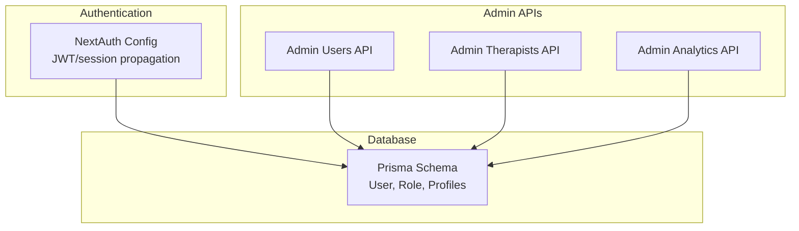
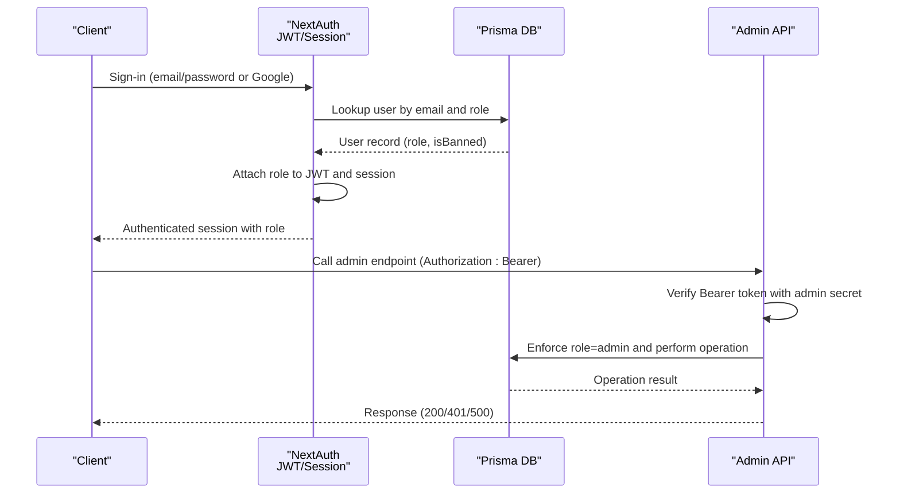
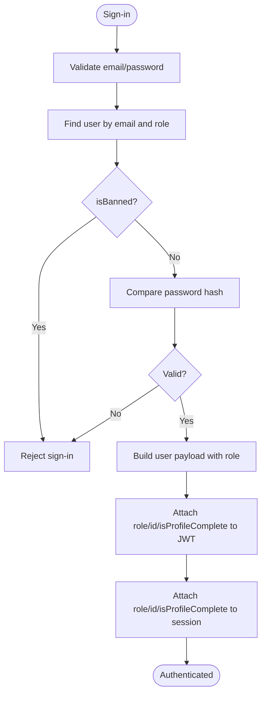
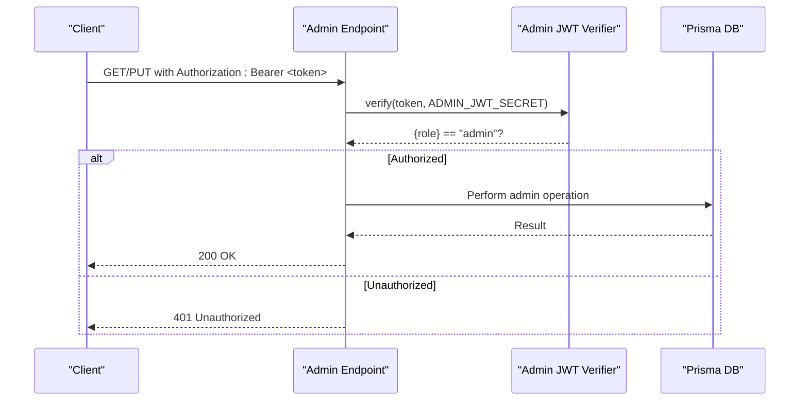
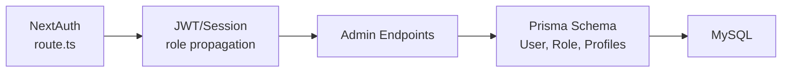

# User Roles & Permissions

<cite>
**Referenced Files in This Document**
- [route.ts](file://WEBAPP/src/app/api/auth/[...nextauth]/route.ts)
- [route.ts](file://WEBAPP/src/app/api/admin/users/route.ts)
- [route.ts](file://WEBAPP/src/app/api/admin/therapists/route.ts)
- [route.ts](file://WEBAPP/src/app/api/admin/analytics/route.ts)
- [schema.prisma](file://WEBAPP/prisma/schema.prisma)
- [db.ts](file://WEBAPP/src/lib/db.ts)
</cite>

## Table of Contents
1. [Introduction](#introduction)
2. [Project Structure](#project-structure)
3. [Core Components](#core-components)
4. [Architecture Overview](#architecture-overview)
5. [Detailed Component Analysis](#detailed-component-analysis)
6. [Dependency Analysis](#dependency-analysis)
7. [Performance Considerations](#performance-considerations)
8. [Troubleshooting Guide](#troubleshooting-guide)
9. [Conclusion](#conclusion)

## Introduction
This document explains the role-based access control (RBAC) system used by the application. It defines the three user roles (Patient, Therapist, Admin), how roles are assigned during registration and profile completion, and how authorization is enforced across APIs and the frontend. It also covers administrative capabilities for user and therapist management, along with security considerations to prevent role escalation and ensure robust access control validation.

## Project Structure
The RBAC system spans authentication, database modeling, and administrative endpoints:
- Authentication integrates with NextAuth.js and stores user roles in JWT/session tokens.
- The database schema defines the User entity with a role field and related profiles.
- Administrative endpoints enforce admin-only access using a dedicated admin secret and JWT verification.

**Diagram sources**
- [route.ts](file://WEBAPP/src/app/api/auth/[...nextauth]/route.ts#L1-L240)
- [schema.prisma](file://WEBAPP/prisma/schema.prisma#L39-L69)
- [route.ts](file://WEBAPP/src/app/api/admin/users/route.ts#L1-L108)
- [route.ts](file://WEBAPP/src/app/api/admin/therapists/route.ts#L1-L93)
- [route.ts](file://WEBAPP/src/app/api/admin/analytics/route.ts#L1-L109)

**Section sources**
- [route.ts](file://WEBAPP/src/app/api/auth/[...nextauth]/route.ts#L1-L240)
- [schema.prisma](file://WEBAPP/prisma/schema.prisma#L39-L69)

## Core Components
- User roles: The database enforces three roles: patient, therapist, and admin. The default role is patient.
- Role propagation: After sign-in, the user’s role is embedded into the JWT and session for downstream authorization checks.
- Admin enforcement: Dedicated admin endpoints require a Bearer token verified against a shared admin secret and confirm the role is admin.

Key implementation references:
- Role definition and defaults in the schema.
- Role inclusion in JWT and session callbacks.
- Admin-only endpoints and JWT verification helpers.

**Section sources**
- [schema.prisma](file://WEBAPP/prisma/schema.prisma#L45-L48)
- [route.ts](file://WEBAPP/src/app/api/auth/[...nextauth]/route.ts#L89-L96)
- [route.ts](file://WEBAPP/src/app/api/auth/[...nextauth]/route.ts#L174-L213)
- [route.ts](file://WEBAPP/src/app/api/admin/users/route.ts#L5-L17)
- [route.ts](file://WEBAPP/src/app/api/admin/therapists/route.ts#L5-L18)
- [route.ts](file://WEBAPP/src/app/api/admin/analytics/route.ts#L5-L17)

## Architecture Overview
The RBAC pipeline consists of:
- Authentication: NextAuth.js handles sign-in and populates role into the token/session.
- Authorization: Middleware-like checks in admin endpoints validate admin role.
- Data model: Prisma schema defines User and related entities with role constraints.

**Diagram sources**
- [route.ts](file://WEBAPP/src/app/api/auth/[...nextauth]/route.ts#L69-L96)
- [route.ts](file://WEBAPP/src/app/api/auth/[...nextauth]/route.ts#L174-L213)
- [route.ts](file://WEBAPP/src/app/api/admin/users/route.ts#L7-L17)
- [route.ts](file://WEBAPP/src/app/api/admin/therapists/route.ts#L8-L18)
- [route.ts](file://WEBAPP/src/app/api/admin/analytics/route.ts#L7-L17)

## Detailed Component Analysis

### Role Definitions and Defaults
- Role field on User is defined with a default value of patient.
- Admin role is supported and intended for privileged operations.
- isBanned is used to block access for suspended users.

**Section sources**
- [schema.prisma](file://WEBAPP/prisma/schema.prisma#L45-L48)

### Authentication and Role Propagation
- NextAuth.js providers include a Credentials provider that accepts role alongside email/password.
- During sign-in, the system queries the user by email and role, rejects banned users, and returns a user object containing role.
- JWT callback attaches role, id, and profile completeness to the token.
- Session callback propagates role and id into the session object.

**Diagram sources**
- [route.ts](file://WEBAPP/src/app/api/auth/[...nextauth]/route.ts#L69-L96)
- [route.ts](file://WEBAPP/src/app/api/auth/[...nextauth]/route.ts#L174-L213)

**Section sources**
- [route.ts](file://WEBAPP/src/app/api/auth/[...nextauth]/route.ts#L62-L98)
- [route.ts](file://WEBAPP/src/app/api/auth/[...nextauth]/route.ts#L174-L213)

### Role Assignment During Registration and Profile Completion
- Google sign-in creates a new user with role set to patient and marks profile as incomplete.
- The Credentials provider’s authorize function filters users by email and role during sign-in.
- Role escalation or modification is not performed by the authentication flow itself; administrative endpoints manage role changes.

Note: The provided files indicate default role assignment on Google sign-up and role filtering during credential sign-in, but do not show explicit role selection during profile completion in the analyzed routes.

**Section sources**
- [route.ts](file://WEBAPP/src/app/api/auth/[...nextauth]/route.ts#L139-L151)
- [route.ts](file://WEBAPP/src/app/api/auth/[...nextauth]/route.ts#L69-L79)

### Admin-Only Endpoints and Authorization Patterns
- Admin Users API: Lists users (excluding admins), bans/unbans, deletes users. Requires Bearer token verified against a shared admin secret.
- Admin Therapists API: Lists therapists by verification status and approves/rejects profiles.
- Admin Analytics API: Returns system-wide metrics; requires admin role.

**Diagram sources**
- [route.ts](file://WEBAPP/src/app/api/admin/users/route.ts#L5-L17)
- [route.ts](file://WEBAPP/src/app/api/admin/therapists/route.ts#L5-L18)
- [route.ts](file://WEBAPP/src/app/api/admin/analytics/route.ts#L5-L17)

**Section sources**
- [route.ts](file://WEBAPP/src/app/api/admin/users/route.ts#L1-L108)
- [route.ts](file://WEBAPP/src/app/api/admin/therapists/route.ts#L1-L93)
- [route.ts](file://WEBAPP/src/app/api/admin/analytics/route.ts#L1-L109)

### Administrative Functions: User Management and Role Modifications
- User listing: Filter by role or search by email/name; excludes admin records.
- User actions: Ban/unban or delete users.
- Therapist verification: Approve or reject profiles with optional rejection reason.
- Analytics: Aggregated counts and statistics for admins.

These endpoints enforce admin-only access using a dedicated JWT verification helper and a shared admin secret.

**Section sources**
- [route.ts](file://WEBAPP/src/app/api/admin/users/route.ts#L19-L73)
- [route.ts](file://WEBAPP/src/app/api/admin/users/route.ts#L75-L107)
- [route.ts](file://WEBAPP/src/app/api/admin/therapists/route.ts#L20-L50)
- [route.ts](file://WEBAPP/src/app/api/admin/therapists/route.ts#L52-L92)
- [route.ts](file://WEBAPP/src/app/api/admin/analytics/route.ts#L19-L103)

### Security Considerations for Role Escalation and Access Control Validation
- Centralized admin secret: Admin endpoints rely on a shared secret for JWT verification. Ensure secure storage and rotation of the secret.
- Role in token/session: Admin checks must validate the role extracted from the token/session, not rely solely on presence of a token.
- Banned user handling: Authentication rejects banned users; ensure this remains effective across sign-in methods.
- Least privilege: Admin endpoints should restrict operations to those strictly necessary for administration.
- Logging and monitoring: Authentication and admin endpoints include logging for sign-in/out and session access, aiding auditability.

**Section sources**
- [route.ts](file://WEBAPP/src/app/api/auth/[...nextauth]/route.ts#L83-L84)
- [route.ts](file://WEBAPP/src/app/api/auth/[...nextauth]/route.ts#L215-L232)
- [route.ts](file://WEBAPP/src/app/api/admin/users/route.ts#L5-L17)
- [route.ts](file://WEBAPP/src/app/api/admin/therapists/route.ts#L5-L18)
- [route.ts](file://WEBAPP/src/app/api/admin/analytics/route.ts#L5-L17)

## Dependency Analysis
The RBAC system depends on:
- NextAuth.js for authentication and token/session propagation.
- Prisma schema for role and user/profile relations.
- Admin endpoints for enforcing admin-only operations.

**Diagram sources**
- [route.ts](file://WEBAPP/src/app/api/auth/[...nextauth]/route.ts#L1-L240)
- [schema.prisma](file://WEBAPP/prisma/schema.prisma#L39-L69)
- [route.ts](file://WEBAPP/src/app/api/admin/users/route.ts#L1-L108)
- [route.ts](file://WEBAPP/src/app/api/admin/therapists/route.ts#L1-L93)
- [route.ts](file://WEBAPP/src/app/api/admin/analytics/route.ts#L1-L109)

**Section sources**
- [db.ts](file://WEBAPP/src/lib/db.ts#L1-L15)
- [schema.prisma](file://WEBAPP/prisma/schema.prisma#L39-L69)

## Performance Considerations
- Token validation overhead: Admin endpoints perform JWT verification per request; caching or short-lived tokens can reduce overhead.
- Database queries: Admin listings and analytics use multiple queries; batch or indexed queries can improve responsiveness.
- Logging: Development logs for session access aid debugging but should be minimized in production.

## Troubleshooting Guide
- Unauthorized errors on admin endpoints: Confirm Authorization header contains a valid Bearer token signed with the admin secret and that the token’s role is admin.
- Role not present in session: Verify JWT and session callbacks attach role and id; ensure client-side session retrieval reads the session properly.
- Banned user blocked: Authentication rejects banned users; unban the user in the database to restore access.

**Section sources**
- [route.ts](file://WEBAPP/src/app/api/admin/users/route.ts#L7-L17)
- [route.ts](file://WEBAPP/src/app/api/admin/therapists/route.ts#L8-L18)
- [route.ts](file://WEBAPP/src/app/api/admin/analytics/route.ts#L7-L17)
- [route.ts](file://WEBAPP/src/app/api/auth/[...nextauth]/route.ts#L174-L213)
- [route.ts](file://WEBAPP/src/app/api/auth/[...nextauth]/route.ts#L83-L84)

## Conclusion
The application implements a clear RBAC model with three roles and centralized admin controls. Authentication embeds role into tokens/sessions, while admin endpoints enforce role-based access using a shared admin secret. Administrators can manage users and therapists, and the system includes safeguards such as banning and logging. To maintain security, ensure strict secret management, validate roles at every boundary, and apply least-privilege principles across all admin operations.