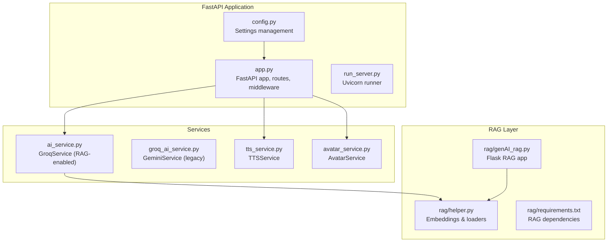
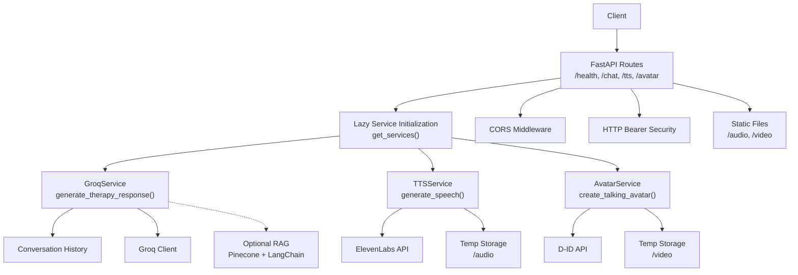
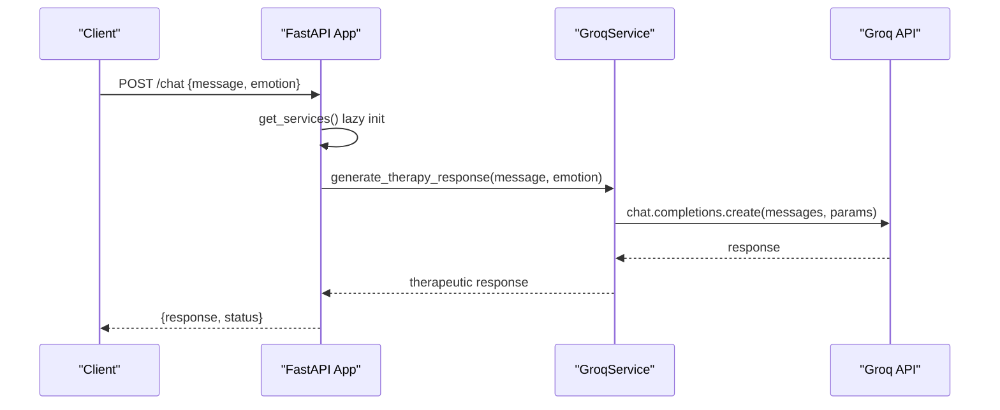
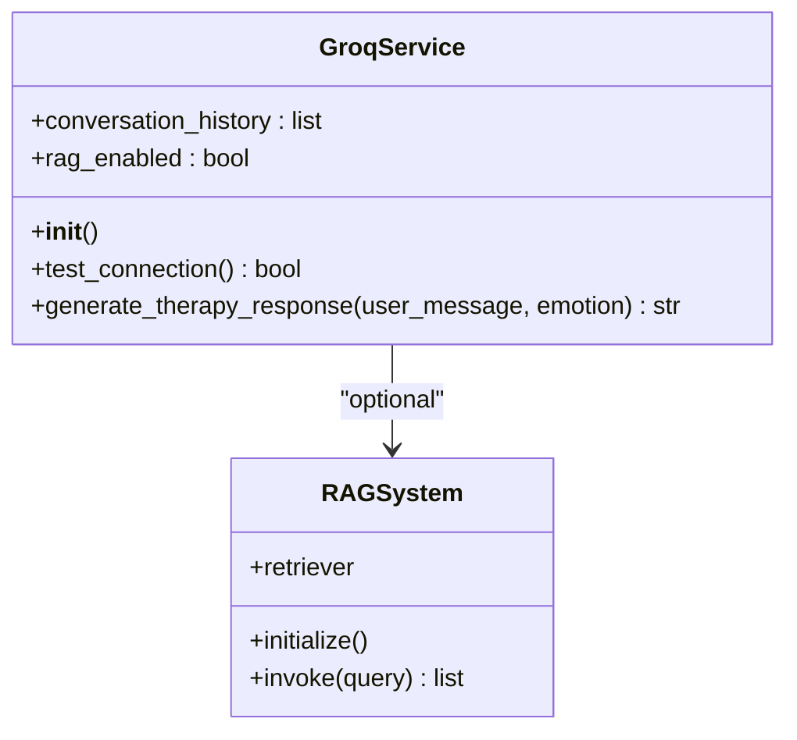
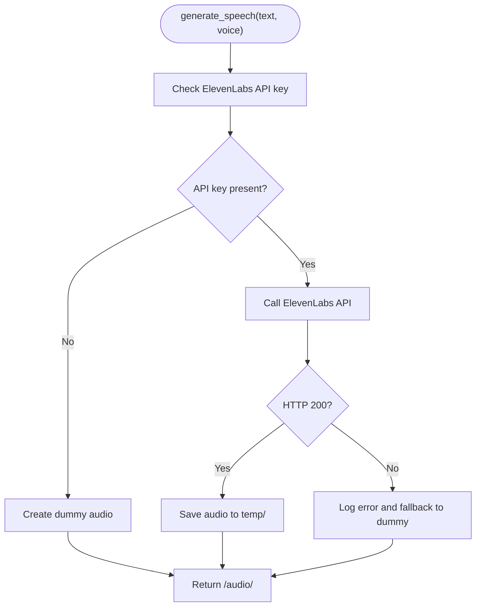
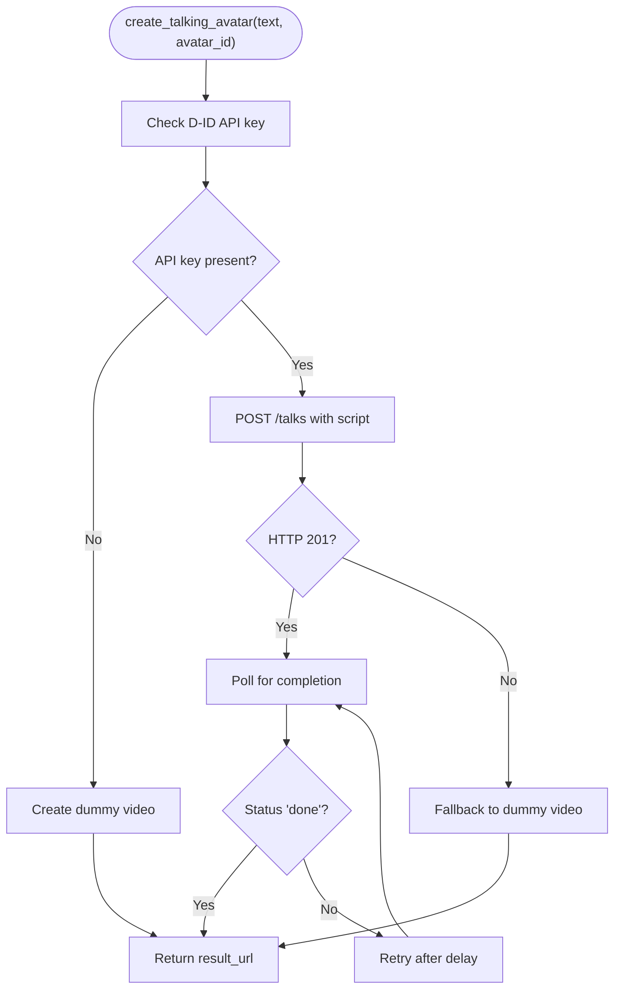
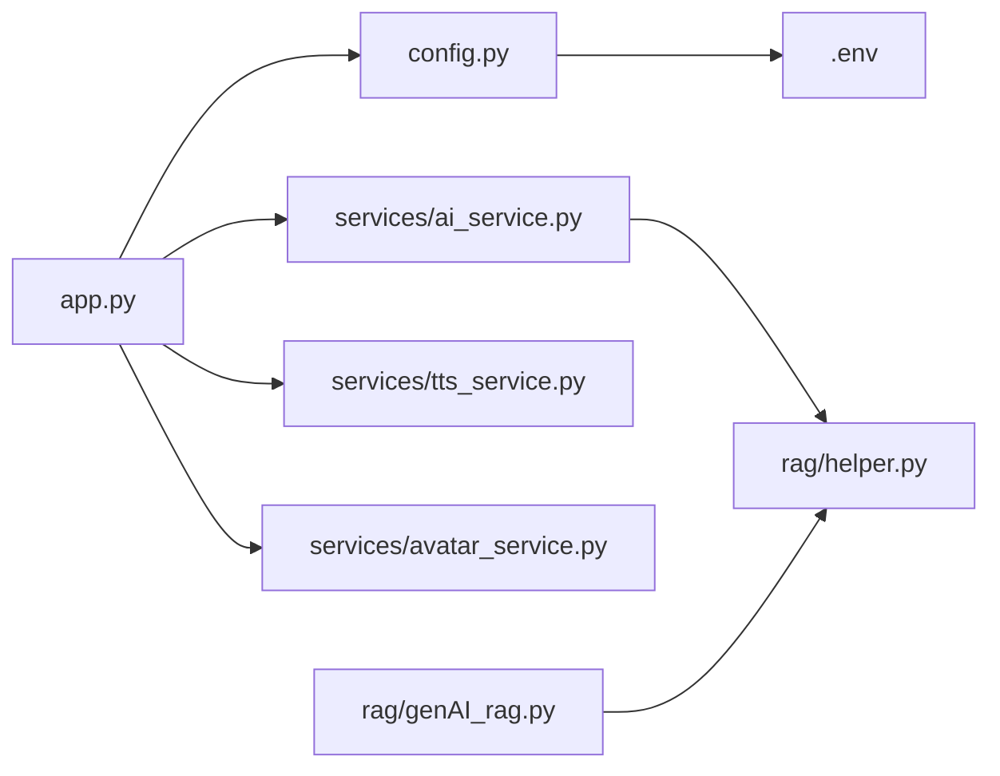

# AI Service Architecture

<cite>
**Referenced Files in This Document**
- [app.py](file://ai-backend/app.py)
- [run_server.py](file://ai-backend/run_server.py)
- [config.py](file://ai-backend/config.py)
- [ai_service.py](file://ai-backend/services/ai_service.py)
- [groq_ai_service.py](file://ai-backend/services/groq_ai_service.py)
- [tts_service.py](file://ai-backend/services/tts_service.py)
- [avatar_service.py](file://ai-backend/services/avatar_service.py)
- [.env.example](file://ai-backend/.env.example)
- [requirements.txt](file://ai-backend/requirements.txt)
- [test_endpoints.py](file://ai-backend/test_endpoints.py)
- [test_services.py](file://ai-backend/test_services.py)
- [test_groq_integration.py](file://ai-backend/test_groq_integration.py)
- [rag/requirements.txt](file://ai-backend/rag/requirements.txt)
- [rag/helper.py](file://ai-backend/rag/helper.py)
- [rag/genAI_rag.py](file://ai-backend/rag/genAI_rag.py)
</cite>

## Table of Contents
1. [Introduction](#introduction)
2. [Project Structure](#project-structure)
3. [Core Components](#core-components)
4. [Architecture Overview](#architecture-overview)
5. [Detailed Component Analysis](#detailed-component-analysis)
6. [Dependency Analysis](#dependency-analysis)
7. [Performance Considerations](#performance-considerations)
8. [Troubleshooting Guide](#troubleshooting-guide)
9. [Conclusion](#conclusion)
10. [Appendices](#appendices)

## Introduction
This document explains the AI service architecture built with FastAPI. It covers the application entry point, lazy service initialization patterns, CORS configuration, middleware setup, routing system (including the /chat endpoint), GroqService implementation for AI processing with emotion-aware parameters, error handling and exception management, service health checks, deployment configuration, worker processes, environment variable management, scalability considerations, and performance optimization techniques.

## Project Structure
The AI backend is organized around a FastAPI application that exposes endpoints for therapy chat, text-to-speech synthesis, and talking avatar generation. Services are modularized under the services directory and include:
- Groq-based AI responses with optional RAG integration
- ElevenLabs-based text-to-speech
- D-ID-based avatar video generation with fallbacks

**Diagram sources**
- [app.py](file://ai-backend/app.py#L1-L154)
- [run_server.py](file://ai-backend/run_server.py#L1-L21)
- [config.py](file://ai-backend/config.py#L1-L49)
- [ai_service.py](file://ai-backend/services/ai_service.py#L1-L293)
- [groq_ai_service.py](file://ai-backend/services/groq_ai_service.py#L1-L123)
- [tts_service.py](file://ai-backend/services/tts_service.py#L1-L280)
- [avatar_service.py](file://ai-backend/services/avatar_service.py#L1-L237)
- [rag/helper.py](file://ai-backend/rag/helper.py#L1-L29)
- [rag/genAI_rag.py](file://ai-backend/rag/genAI_rag.py#L1-L76)
- [rag/requirements.txt](file://ai-backend/rag/requirements.txt#L1-L12)

**Section sources**
- [app.py](file://ai-backend/app.py#L1-L154)
- [config.py](file://ai-backend/config.py#L1-L49)

## Core Components
- FastAPI Application: Defines routes, CORS, static file serving, and lazy service initialization.
- GroqService: Implements AI therapy responses with optional RAG augmentation and conversation history.
- TTSService: Generates speech via ElevenLabs with graceful fallbacks and cleanup.
- AvatarService: Creates talking avatar videos via D-ID with development-time dummy fallbacks.
- Configuration: Centralized settings via Pydantic settings with environment variables.
- RAG Integration: Optional retrieval-augmented generation using Pinecone and LangChain.

**Section sources**
- [app.py](file://ai-backend/app.py#L17-L154)
- [ai_service.py](file://ai-backend/services/ai_service.py#L72-L192)
- [tts_service.py](file://ai-backend/services/tts_service.py#L10-L280)
- [avatar_service.py](file://ai-backend/services/avatar_service.py#L11-L237)
- [config.py](file://ai-backend/config.py#L5-L49)

## Architecture Overview
The system follows a layered architecture:
- Presentation Layer: FastAPI routes handle HTTP requests and responses.
- Service Layer: GroqService, TTSService, and AvatarService encapsulate external integrations.
- Data/Retrieval Layer: Optional RAG stack for context-aware responses.
- Infrastructure: Uvicorn ASGI server, static file serving, environment-driven configuration.

**Diagram sources**
- [app.py](file://ai-backend/app.py#L23-L123)
- [ai_service.py](file://ai-backend/services/ai_service.py#L72-L192)
- [tts_service.py](file://ai-backend/services/tts_service.py#L53-L144)
- [avatar_service.py](file://ai-backend/services/avatar_service.py#L19-L67)

## Detailed Component Analysis

### FastAPI Application and Routing
- Entry Point: The application initializes FastAPI with metadata and mounts static directories for audio/video.
- CORS: Permissive configuration allowing all origins, methods, and headers.
- Security: HTTP bearer token configured for future use.
- Lazy Initialization: Services are initialized on-demand to avoid import-time issues.
- Routes:
  - GET /health: Health check endpoint.
  - POST /chat: Emotion-aware therapy response generation via GroqService.
  - POST /tts: Text-to-speech via TTSService.
  - POST /avatar: Talking avatar video via AvatarService.
- Server Startup: Uvicorn runs with single worker and explicit port from environment.

**Diagram sources**
- [app.py](file://ai-backend/app.py#L81-L95)
- [ai_service.py](file://ai-backend/services/ai_service.py#L131-L192)

**Section sources**
- [app.py](file://ai-backend/app.py#L17-L154)

### GroqService Implementation
- Purpose: Provides therapeutic responses using Groq with conversation history.
- RAG Integration: Optionally augments prompts with context retrieved from Pinecone vector store.
- Parameter Handling: Accepts emotion parameter for compatibility; current implementation does not alter behavior based on emotion.
- Error Handling: Graceful fallbacks and informative logging; returns standardized error messages on failure.
- Async Execution: Uses event loop to run synchronous Groq calls safely in async context.

**Diagram sources**
- [ai_service.py](file://ai-backend/services/ai_service.py#L72-L192)

**Section sources**
- [ai_service.py](file://ai-backend/services/ai_service.py#L72-L192)
- [groq_ai_service.py](file://ai-backend/services/groq_ai_service.py#L70-L112)

### TTSService Implementation
- Purpose: Converts text to speech using ElevenLabs API with robust fallbacks.
- Fallback Strategy: Creates dummy audio when API key is missing or quota limits are exceeded.
- Cleanup: Periodic removal of stale audio files to manage disk usage.
- Voice Selection: Supports default or custom voice IDs.
- Error Handling: Comprehensive logging and graceful degradation to placeholder audio.

**Diagram sources**
- [tts_service.py](file://ai-backend/services/tts_service.py#L53-L144)

**Section sources**
- [tts_service.py](file://ai-backend/services/tts_service.py#L10-L280)

### AvatarService Implementation
- Purpose: Generates talking avatar videos via D-ID API with development-time dummy fallback.
- Fallback Strategy: Copies a video asset from the webapp public directory or creates a minimal placeholder.
- Presenter Management: Supports default or custom presenter IDs.
- Error Handling: Logs failures and returns dummy URLs to ensure continuity.

**Diagram sources**
- [avatar_service.py](file://ai-backend/services/avatar_service.py#L19-L155)

**Section sources**
- [avatar_service.py](file://ai-backend/services/avatar_service.py#L11-L237)

### Configuration and Environment Variables
- Settings: Centralized via Pydantic settings class with defaults and environment overrides.
- Supported Variables:
  - API keys: GROQ_API_KEY, ELEVENLABS_API_KEY, D-ID/D-ID API key
  - Models and tokens: OPENAI_API_KEY, OPENAI_MODEL, MAX_TOKENS
  - Database and cache: MONGODB_URL, DATABASE_NAME, REDIS_URL
  - Security: SECRET_KEY, ALGORITHM, ACCESS_TOKEN_EXPIRE_MINUTES
  - CORS: allowed_origins list
  - Server: DEBUG, PORT, HOST
- Example template: .env.example provides a reference for required keys.

**Section sources**
- [config.py](file://ai-backend/config.py#L5-L49)
- [.env.example](file://ai-backend/.env.example#L1-L20)

### Deployment and Worker Processes
- Uvicorn Runner: Two approaches are provided:
  - Direct run in app.py with single worker and explicit port.
  - Alternative run_server.py for Windows multiprocessing compatibility.
- Worker Count: Single worker is used to avoid multiprocessing issues during development.
- Port: Defaults to 8001 with environment override.
- Static Files: Mounted under /audio and /video for serving generated media.

**Section sources**
- [app.py](file://ai-backend/app.py#L143-L154)
- [run_server.py](file://ai-backend/run_server.py#L10-L21)

### Service Health Checks and Error Handling
- Health Endpoint: GET /health returns service status.
- Exception Management: Routes catch exceptions and return HTTP 500 with details.
- Service-Level Resilience:
  - GroqService: Returns standardized fallback messages on errors.
  - TTSService: Always returns a valid audio URL via dummy fallbacks.
  - AvatarService: Always returns a valid video URL via dummy fallbacks.
- Logging: Extensive logging for diagnostics and operational visibility.

**Section sources**
- [app.py](file://ai-backend/app.py#L77-L94)
- [ai_service.py](file://ai-backend/services/ai_service.py#L188-L191)
- [tts_service.py](file://ai-backend/services/tts_service.py#L138-L144)
- [avatar_service.py](file://ai-backend/services/avatar_service.py#L64-L67)

## Dependency Analysis
The application exhibits clear separation of concerns:
- app.py depends on services for runtime behavior and delegates initialization.
- Services depend on external APIs and environment variables.
- RAG components are optional and conditionally loaded.

**Diagram sources**
- [app.py](file://ai-backend/app.py#L1-L154)
- [config.py](file://ai-backend/config.py#L1-L49)
- [ai_service.py](file://ai-backend/services/ai_service.py#L1-L293)
- [rag/helper.py](file://ai-backend/rag/helper.py#L1-L29)
- [rag/genAI_rag.py](file://ai-backend/rag/genAI_rag.py#L1-L76)

**Section sources**
- [app.py](file://ai-backend/app.py#L42-L71)
- [ai_service.py](file://ai-backend/services/ai_service.py#L82-L119)

## Performance Considerations
- Lazy Initialization: Reduces cold-start overhead by importing services only when needed.
- RAG Optional: Disables RAG if dependencies or credentials are missing to avoid blocking.
- Async Patterns: Services leverage async HTTP clients and event loops for I/O-bound operations.
- Static Serving: Media files are served directly by FastAPI, minimizing application overhead.
- Cleanup: Regular cleanup of temporary media prevents disk pressure.
- Recommendations:
  - Scale horizontally by running multiple instances behind a reverse proxy.
  - Use a process manager (e.g., systemd, Docker) for production deployments.
  - Enable caching for repeated audio/video assets.
  - Monitor API quotas and implement rate limiting for external providers.

[No sources needed since this section provides general guidance]

## Troubleshooting Guide
- Missing Environment Variables:
  - Ensure GROQ_API_KEY, ELEVENLABS_API_KEY, and D-ID API key are set.
  - Verify database and cache URLs if used.
- Health Check Failures:
  - Confirm the /health endpoint responds with a 200 status.
- TTS Issues:
  - Check ElevenLabs API key validity and quota limits.
  - Verify temp directory write permissions.
- Avatar Issues:
  - Confirm D-ID API key and presenter configuration.
  - Ensure video assets exist or allow dummy fallbacks.
- Endpoint Testing:
  - Use test_endpoints.py to validate health, TTS, and avatar endpoints.
  - Use test_services.py to validate service-level functionality.
  - Use test_groq_integration.py to verify GroqService import and readiness.

**Section sources**
- [test_endpoints.py](file://ai-backend/test_endpoints.py#L12-L87)
- [test_services.py](file://ai-backend/test_services.py#L16-L102)
- [test_groq_integration.py](file://ai-backend/test_groq_integration.py#L8-L30)

## Conclusion
The AI service architecture leverages FastAPI for a clean, extensible backend. Lazy initialization, robust error handling, and optional RAG integration provide flexibility and resilience. With proper environment configuration, static media serving, and conservative worker settings, the system supports development and can be scaled for production with minimal changes.

[No sources needed since this section summarizes without analyzing specific files]

## Appendices

### API Endpoints Summary
- GET /health: Service health status.
- POST /chat: Emotion-aware therapeutic response from GroqService.
- POST /tts: Text-to-speech via ElevenLabs with fallbacks.
- POST /avatar: Talking avatar video via D-ID with dummy fallbacks.

**Section sources**
- [app.py](file://ai-backend/app.py#L77-L123)

### Environment Variables Reference
- Required: GROQ_API_KEY, ELEVENLABS_API_KEY, D-ID API key
- Optional: OPENAI_API_KEY, PINECONE_API_KEY (for RAG)
- Database: MONGODB_URL, DATABASE_NAME
- Cache: REDIS_URL
- Security: SECRET_KEY, ALGORITHM, ACCESS_TOKEN_EXPIRE_MINUTES
- Server: DEBUG, PORT, HOST
- CORS: allowed_origins list

**Section sources**
- [.env.example](file://ai-backend/.env.example#L1-L20)
- [config.py](file://ai-backend/config.py#L5-L49)

### RAG Setup Notes
- Dependencies: sentence-transformers, langchain, pinecone, langchain-pinecone, langchain-community, langchain-openai, langchain-groq, langchain-experimental, langchain-text-splitters.
- Optional: The Flask-based RAG app demonstrates retrieval chains and can be used independently.

**Section sources**
- [rag/requirements.txt](file://ai-backend/rag/requirements.txt#L1-L12)
- [rag/helper.py](file://ai-backend/rag/helper.py#L1-L29)
- [rag/genAI_rag.py](file://ai-backend/rag/genAI_rag.py#L1-L76)