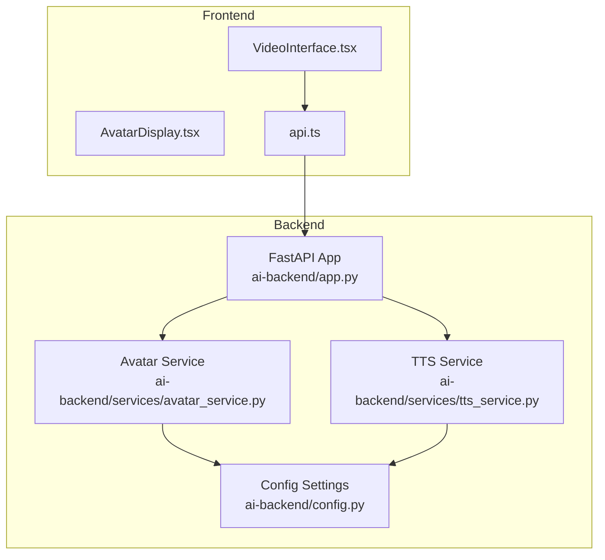
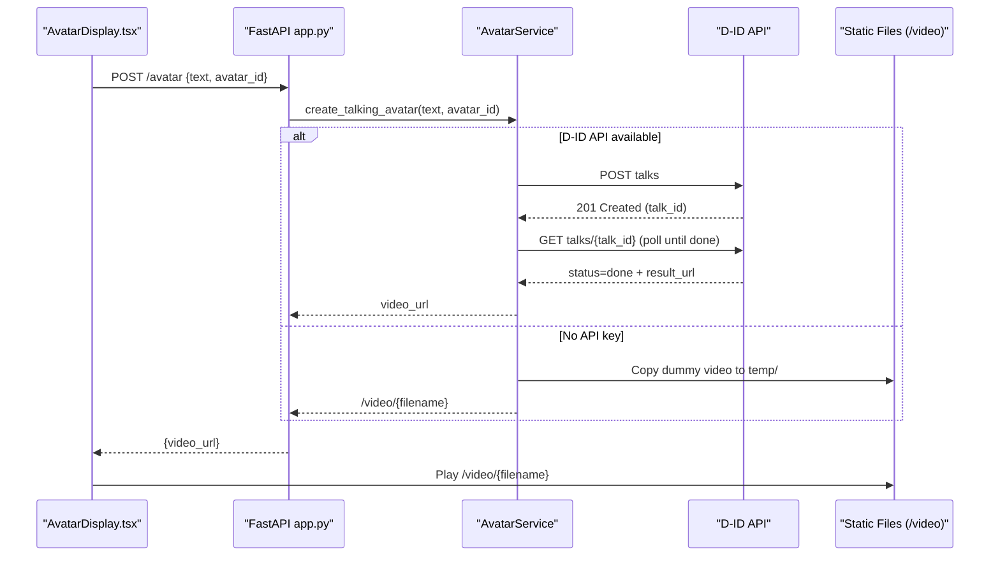
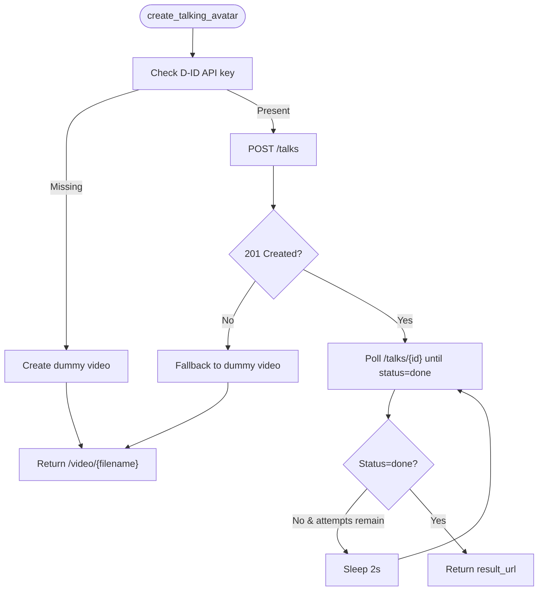
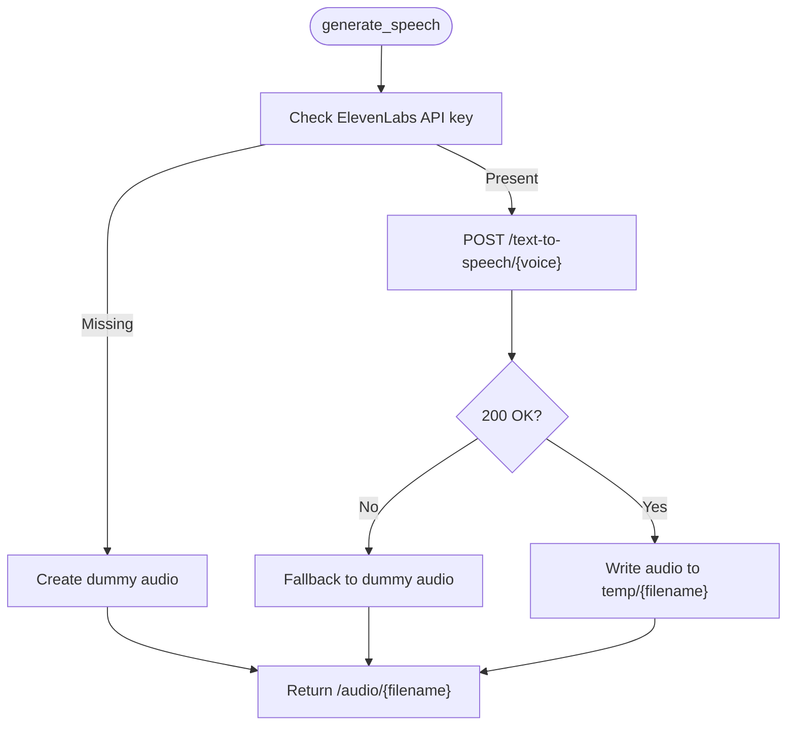
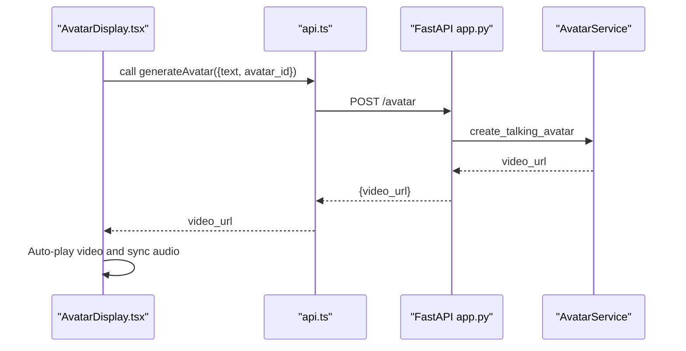
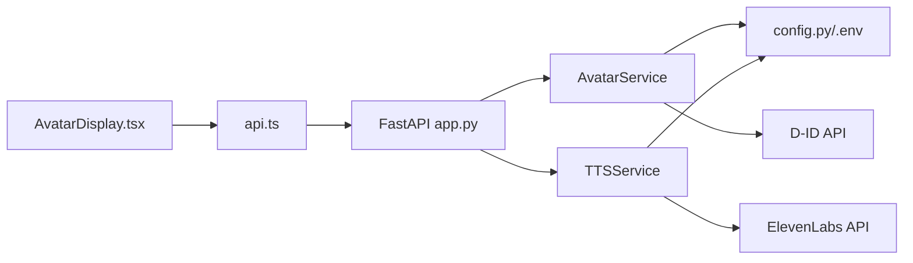

# Avatar Generation Service

<cite>
**Referenced Files in This Document**
- [app.py](file://ai-backend/app.py)
- [avatar_service.py](file://ai-backend/services/avatar_service.py)
- [tts_service.py](file://ai-backend/services/tts_service.py)
- [config.py](file://ai-backend/config.py)
- [VideoInterface.tsx](file://WEBAPP/src/components/VideoInterface.tsx)
- [AvatarDisplay.tsx](file://WEBAPP/src/components/AvatarDisplay.tsx)
- [api.ts](file://WEBAPP/src/lib/api.ts)
- [test_services.py](file://ai-backend/test_services.py)
</cite>

## Table of Contents
1. [Introduction](#introduction)
2. [Project Structure](#project-structure)
3. [Core Components](#core-components)
4. [Architecture Overview](#architecture-overview)
5. [Detailed Component Analysis](#detailed-component-analysis)
6. [Dependency Analysis](#dependency-analysis)
7. [Performance Considerations](#performance-considerations)
8. [Troubleshooting Guide](#troubleshooting-guide)
9. [Conclusion](#conclusion)

## Introduction
This document describes the avatar generation service that powers personalized video avatars for therapeutic conversations. It explains the video avatar creation workflow, integration with external avatar APIs (D-ID), the text-to-video processing pipeline, avatar selection mechanisms, and video file management. It also documents the temporary video storage system, static file serving configuration, video URL generation, asynchronous video generation process, file naming conventions, automated cleanup procedures, customization options, animation parameters, quality settings, performance considerations, bandwidth optimization, and concurrent video generation handling.

## Project Structure
The avatar generation service spans two primary areas:
- Backend API server (FastAPI) that exposes endpoints for chat, text-to-speech, and avatar generation, and serves static audio/video assets.
- Frontend components that render the avatar player and integrate with the backend via API calls.

**Diagram sources**
- [app.py](file://ai-backend/app.py#L1-L154)
- [avatar_service.py](file://ai-backend/services/avatar_service.py#L1-L237)
- [tts_service.py](file://ai-backend/services/tts_service.py#L1-L280)
- [config.py](file://ai-backend/config.py#L1-L49)
- [VideoInterface.tsx](file://WEBAPP/src/components/VideoInterface.tsx#L1-L207)
- [AvatarDisplay.tsx](file://WEBAPP/src/components/AvatarDisplay.tsx#L1-L210)
- [api.ts](file://WEBAPP/src/lib/api.ts#L93-L113)

**Section sources**
- [app.py](file://ai-backend/app.py#L1-L154)
- [avatar_service.py](file://ai-backend/services/avatar_service.py#L1-L237)
- [tts_service.py](file://ai-backend/services/tts_service.py#L1-L280)
- [config.py](file://ai-backend/config.py#L1-L49)
- [VideoInterface.tsx](file://WEBAPP/src/components/VideoInterface.tsx#L1-L207)
- [AvatarDisplay.tsx](file://WEBAPP/src/components/AvatarDisplay.tsx#L1-L210)
- [api.ts](file://WEBAPP/src/lib/api.ts#L93-L113)

## Core Components
- AvatarService: Orchestrates avatar video generation via D-ID API or returns a development dummy video. Handles asynchronous polling for completion, avatar selection, and fallbacks.
- TTSService: Generates speech from text using ElevenLabs API or creates a dummy audio file. Manages temporary audio storage and periodic cleanup.
- FastAPI App: Exposes endpoints for chat, TTS, and avatar generation, mounts static file serving for audio and video, and initializes services lazily.
- Frontend Components: VideoInterface captures webcam and emotion data; AvatarDisplay renders the avatar video and audio playback controls.

Key responsibilities:
- Text-to-video pipeline: Text input → AvatarService → D-ID API (or dummy) → video URL.
- Audio pipeline: Text input → TTSService → ElevenLabs API (or dummy) → audio URL.
- Static serving: FastAPI serves temp files under /audio and /video.
- File naming: Unique timestamps and hashes ensure cache busting and uniqueness.
- Cleanup: Automated removal of stale temp files.

**Section sources**
- [avatar_service.py](file://ai-backend/services/avatar_service.py#L11-L237)
- [tts_service.py](file://ai-backend/services/tts_service.py#L10-L280)
- [app.py](file://ai-backend/app.py#L38-L122)
- [VideoInterface.tsx](file://WEBAPP/src/components/VideoInterface.tsx#L1-L207)
- [AvatarDisplay.tsx](file://WEBAPP/src/components/AvatarDisplay.tsx#L1-L210)

## Architecture Overview
The avatar generation workflow integrates frontend UI, backend API, and external services.

**Diagram sources**
- [AvatarDisplay.tsx](file://WEBAPP/src/components/AvatarDisplay.tsx#L37-L64)
- [app.py](file://ai-backend/app.py#L110-L122)
- [avatar_service.py](file://ai-backend/services/avatar_service.py#L19-L67)
- [avatar_service.py](file://ai-backend/services/avatar_service.py#L122-L155)

## Detailed Component Analysis

### AvatarService
Responsibilities:
- Accepts text and optional avatar_id, selects presenter, and triggers D-ID talk creation.
- Polls for video readiness asynchronously and returns the result URL.
- Provides fallback to a dummy video when API keys are missing or unavailable.
- Supports listing available presenters and uploading custom avatars.

Processing logic highlights:
- Asynchronous HTTP requests using httpx.AsyncClient.
- Polling loop with bounded attempts and sleep intervals.
- Dummy video creation with fallback placeholder MP4.
- File naming convention using hash and timestamp for uniqueness.

**Diagram sources**
- [avatar_service.py](file://ai-backend/services/avatar_service.py#L19-L67)
- [avatar_service.py](file://ai-backend/services/avatar_service.py#L122-L155)

**Section sources**
- [avatar_service.py](file://ai-backend/services/avatar_service.py#L11-L237)

### TTSService
Responsibilities:
- Converts text to speech using ElevenLabs API or generates a dummy audio file.
- Manages temporary audio files with unique filenames and periodic cleanup.
- Provides voice listing and basic audio enhancement stub.

Processing logic highlights:
- Unique filename generation with text hash and timestamp to prevent caching.
- Cleanup routine removes old audio files older than 1 hour.
- Fallback audio creation using WAV generation and optional conversion to MP3.

**Diagram sources**
- [tts_service.py](file://ai-backend/services/tts_service.py#L53-L144)
- [tts_service.py](file://ai-backend/services/tts_service.py#L193-L207)

**Section sources**
- [tts_service.py](file://ai-backend/services/tts_service.py#L10-L280)

### FastAPI App and Static Serving
Endpoints:
- POST /avatar: Generates avatar video URL.
- POST /tts: Generates audio URL.
- GET /health: Health check.
- Root endpoint: Service status.

Static file serving:
- Mounted at /audio and /video pointing to temp directory.
- Enables direct browser access to generated media.

Initialization and concurrency:
- Lazy service initialization to avoid import issues.
- Windows-specific multiprocessing setup for stability.
- Single worker to simplify concurrent media generation handling.

**Section sources**
- [app.py](file://ai-backend/app.py#L17-L154)

### Frontend Integration
- VideoInterface.tsx: Captures webcam feed, performs emotion detection, and communicates detected emotions to parent components.
- AvatarDisplay.tsx: Renders the avatar video player, synchronizes with audio playback, and handles replay controls.
- api.ts: Calls POST /avatar to generate avatar videos and receives video URLs for playback.

**Diagram sources**
- [AvatarDisplay.tsx](file://WEBAPP/src/components/AvatarDisplay.tsx#L37-L64)
- [api.ts](file://WEBAPP/src/lib/api.ts#L93-L113)
- [app.py](file://ai-backend/app.py#L110-L122)
- [avatar_service.py](file://ai-backend/services/avatar_service.py#L19-L67)

**Section sources**
- [VideoInterface.tsx](file://WEBAPP/src/components/VideoInterface.tsx#L1-L207)
- [AvatarDisplay.tsx](file://WEBAPP/src/components/AvatarDisplay.tsx#L1-L210)
- [api.ts](file://WEBAPP/src/lib/api.ts#L93-L113)

## Dependency Analysis
External integrations:
- D-ID API: Used for creating talking avatar videos; requires DID_API_KEY and DID_PRESENTER_ID.
- ElevenLabs API: Used for text-to-speech; requires ELEVENLABS_API_KEY and ELEVENLABS_VOICE_ID.

Internal dependencies:
- FastAPI app depends on AvatarService and TTSService.
- AvatarService and TTSService depend on environment configuration.
- Frontend components depend on backend endpoints and static file serving.

**Diagram sources**
- [AvatarDisplay.tsx](file://WEBAPP/src/components/AvatarDisplay.tsx#L1-L210)
- [api.ts](file://WEBAPP/src/lib/api.ts#L93-L113)
- [app.py](file://ai-backend/app.py#L1-L154)
- [avatar_service.py](file://ai-backend/services/avatar_service.py#L1-L237)
- [tts_service.py](file://ai-backend/services/tts_service.py#L1-L280)
- [config.py](file://ai-backend/config.py#L1-L49)

**Section sources**
- [config.py](file://ai-backend/config.py#L21-L23)
- [avatar_service.py](file://ai-backend/services/avatar_service.py#L12-L15)
- [tts_service.py](file://ai-backend/services/tts_service.py#L12-L14)
- [app.py](file://ai-backend/app.py#L38-L40)

## Performance Considerations
- Asynchronous processing: Both AvatarService and TTSService use async HTTP clients to avoid blocking and improve throughput.
- Polling cadence: AvatarService polls D-ID with fixed intervals and caps attempts to balance responsiveness and cost.
- Temporary file lifecycle: TTSService cleans up old audio files to prevent disk pressure; similar cleanup could be applied to video files.
- Bandwidth optimization: Static serving from temp directory avoids re-encoding and reduces latency.
- Concurrency: FastAPI runs with a single worker to simplify resource contention; for production, consider scaling horizontally and adding rate limiting.
- Caching: Unique filenames with timestamps and hashes prevent browser caching conflicts; consider adding ETags or cache-control headers at the FastAPI level.

[No sources needed since this section provides general guidance]

## Troubleshooting Guide
Common issues and resolutions:
- Missing D-ID API key: AvatarService falls back to dummy video; verify DID_API_KEY and DID_PRESENTER_ID.
- D-ID API errors: Check status codes and error payloads; the service raises exceptions and falls back to dummy video.
- Missing dummy video: AvatarService tries alternative video files and creates a minimal placeholder MP4 if none are found.
- ElevenLabs API failures: TTSService logs detailed errors and falls back to dummy audio; check quotas and API key validity.
- Static file serving: Ensure temp directory exists and mounted under /video and /audio; verify file permissions.
- Frontend playback: AvatarDisplay handles video/audio synchronization and error states; inspect browser console for load/playback errors.

**Section sources**
- [avatar_service.py](file://ai-backend/services/avatar_service.py#L24-L26)
- [avatar_service.py](file://ai-backend/services/avatar_service.py#L64-L67)
- [avatar_service.py](file://ai-backend/services/avatar_service.py#L94-L111)
- [tts_service.py](file://ai-backend/services/tts_service.py#L107-L136)
- [app.py](file://ai-backend/app.py#L38-L40)
- [AvatarDisplay.tsx](file://WEBAPP/src/components/AvatarDisplay.tsx#L32-L35)

## Conclusion
The avatar generation service provides a robust pipeline for creating personalized therapeutic avatars with fallbacks for development and production environments. It integrates external APIs for video and audio synthesis, manages temporary media efficiently, and serves assets via static file endpoints. The frontend components offer a seamless user experience with synchronized video and audio playback. For production deployments, consider enabling horizontal scaling, implementing rate limiting, adding cache-control headers, and extending automated cleanup to video files.