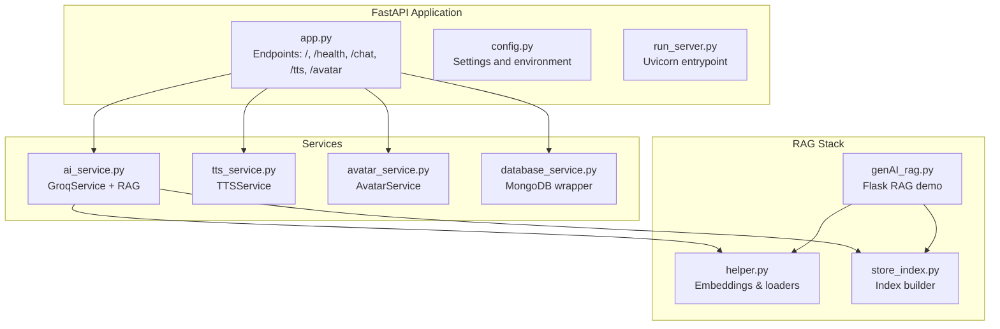
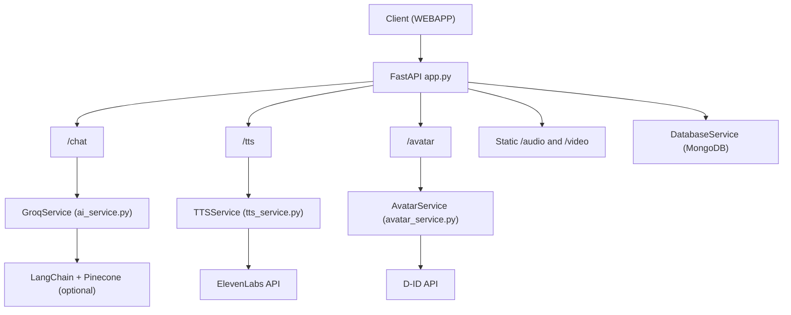
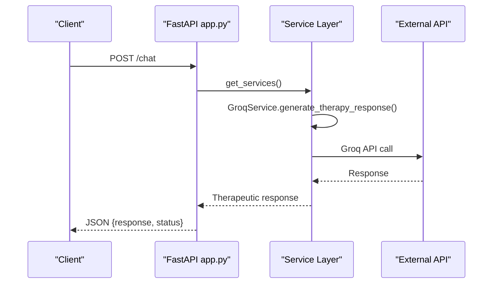
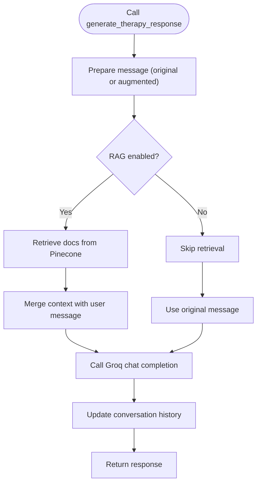
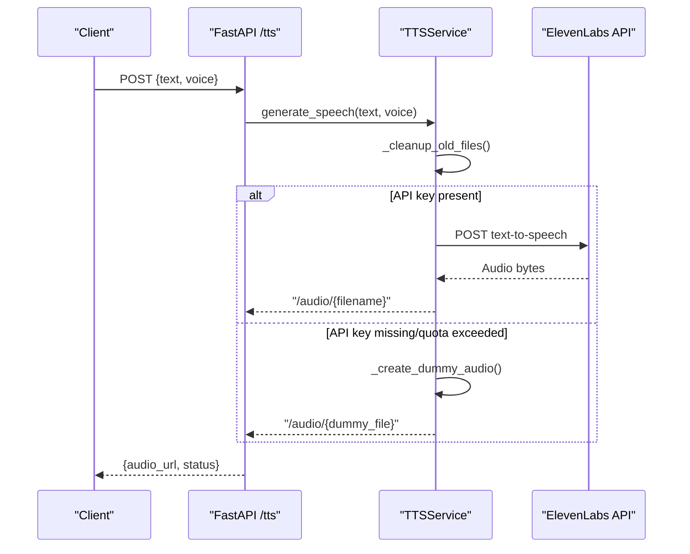
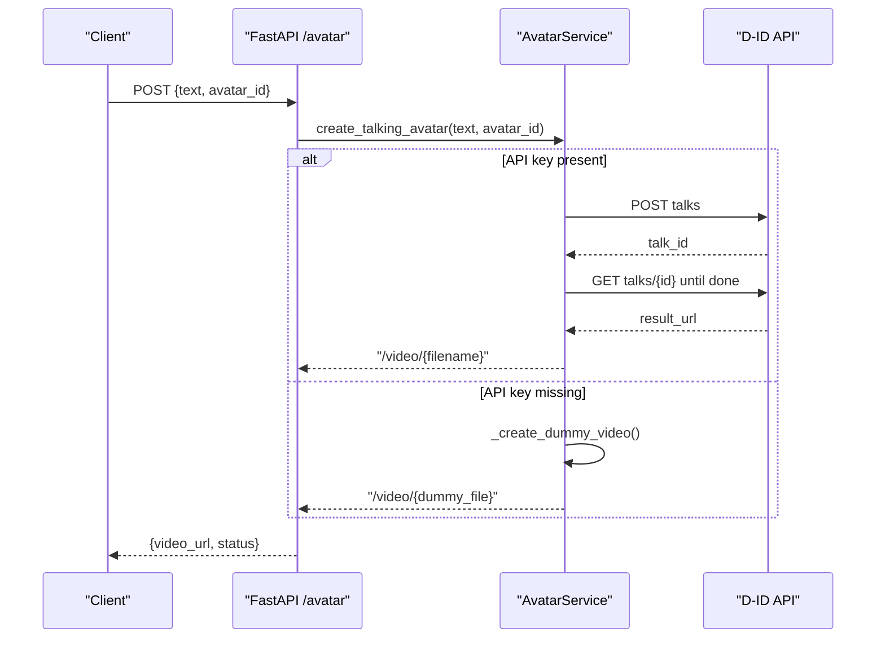
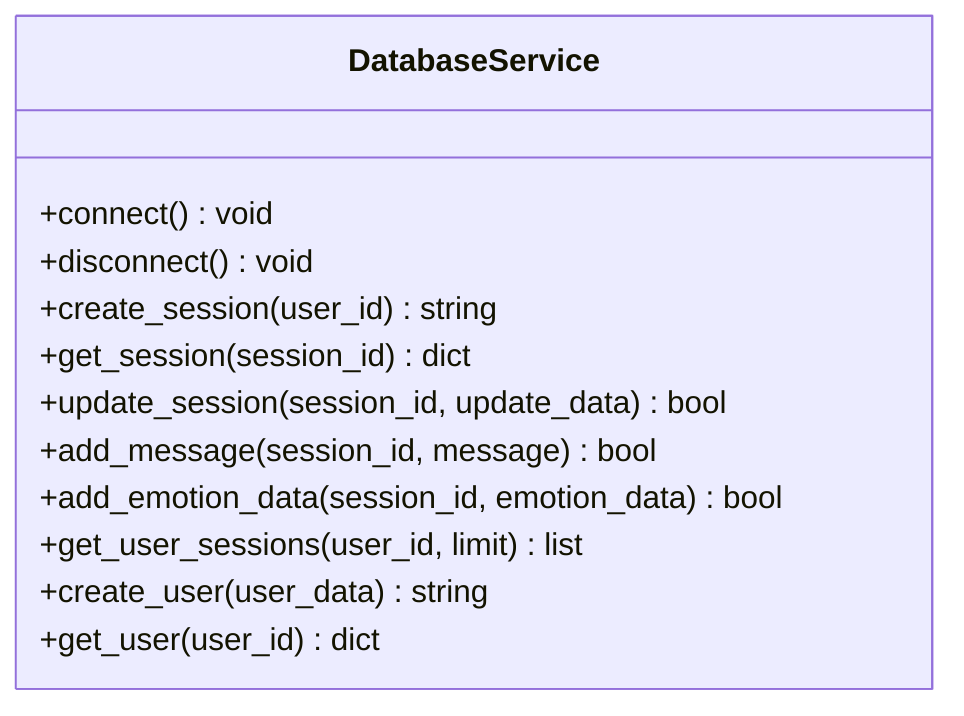
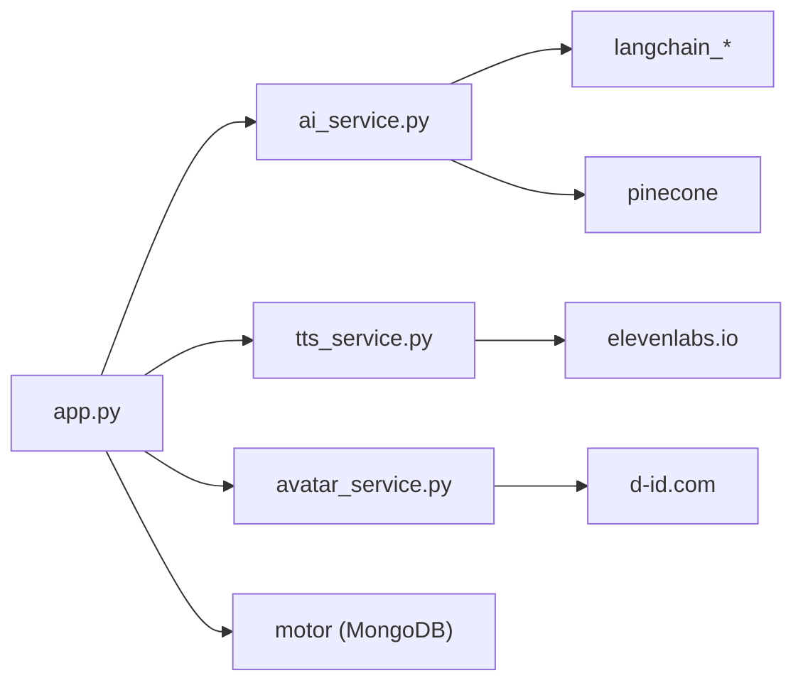

# Backend Services

<cite>
**Referenced Files in This Document**
- [app.py](file://ai-backend/app.py)
- [config.py](file://ai-backend/config.py)
- [ai_service.py](file://ai-backend/services/ai_service.py)
- [tts_service.py](file://ai-backend/services/tts_service.py)
- [avatar_service.py](file://ai-backend/services/avatar_service.py)
- [database_service.py](file://ai-backend/services/database_service.py)
- [run_server.py](file://ai-backend/run_server.py)
- [test_endpoints.py](file://ai-backend/test_endpoints.py)
- [requirements.txt](file://ai-backend/requirements.txt)
- [.env.example](file://ai-backend/.env.example)
- [genAI_rag.py](file://ai-backend/rag/genAI_rag.py)
- [helper.py](file://ai-backend/rag/helper.py)
- [store_index.py](file://ai-backend/rag/store_index.py)
</cite>

## Table of Contents
1. [Introduction](#introduction)
2. [Project Structure](#project-structure)
3. [Core Components](#core-components)
4. [Architecture Overview](#architecture-overview)
5. [Detailed Component Analysis](#detailed-component-analysis)
6. [Dependency Analysis](#dependency-analysis)
7. [Performance Considerations](#performance-considerations)
8. [Troubleshooting Guide](#troubleshooting-guide)
9. [Conclusion](#conclusion)
10. [Appendices](#appendices)

## Introduction
This document explains the AI backend services built with FastAPI. It covers the microservices architecture with dedicated endpoints for AI processing, text-to-speech (TTS), and avatar generation. It documents the Retrieval-Augmented Generation (RAG) system using LangChain and Pinecone, and the integration with external APIs (Groq for AI, ElevenLabs for TTS, and Stripe for payments). It also describes service communication patterns, error handling strategies, performance optimizations, model integration, data preprocessing, response formatting, deployment, scaling, and monitoring approaches.

## Project Structure
The backend is organized around a FastAPI application that exposes three primary endpoints:
- /chat: AI therapy responses powered by Groq with optional RAG augmentation
- /tts: Text-to-speech via ElevenLabs with fallback to local audio generation
- /avatar: Talking avatar video generation via D-ID with fallback to local video

Static media endpoints serve audio and video assets from a temp directory.

**Diagram sources**
- [app.py](file://ai-backend/app.py#L1-L154)
- [config.py](file://ai-backend/config.py#L1-L49)
- [run_server.py](file://ai-backend/run_server.py#L1-L21)
- [ai_service.py](file://ai-backend/services/ai_service.py#L1-L293)
- [tts_service.py](file://ai-backend/services/tts_service.py#L1-L280)
- [avatar_service.py](file://ai-backend/services/avatar_service.py#L1-L237)
- [database_service.py](file://ai-backend/services/database_service.py#L1-L192)
- [genAI_rag.py](file://ai-backend/rag/genAI_rag.py#L1-L76)
- [helper.py](file://ai-backend/rag/helper.py#L1-L29)
- [store_index.py](file://ai-backend/rag/store_index.py#L1-L40)

**Section sources**
- [app.py](file://ai-backend/app.py#L1-L154)
- [config.py](file://ai-backend/config.py#L1-L49)
- [run_server.py](file://ai-backend/run_server.py#L1-L21)

## Core Components
- FastAPI application with CORS, security bearer token, and static media mounting
- Lazy-initialized services for AI, TTS, and avatar generation
- Configuration via environment variables and pydantic settings
- Optional MongoDB persistence service for sessions and user data
- RAG stack using LangChain, HuggingFace embeddings, and Pinecone

Key responsibilities:
- /chat: Accepts user message and emotion, returns therapeutic response with optional RAG augmentation
- /tts: Converts text to speech using ElevenLabs with robust fallbacks
- /avatar: Generates talking avatar videos with fallback to local media
- Health checks and root endpoint for service status

**Section sources**
- [app.py](file://ai-backend/app.py#L1-L154)
- [ai_service.py](file://ai-backend/services/ai_service.py#L72-L192)
- [tts_service.py](file://ai-backend/services/tts_service.py#L10-L144)
- [avatar_service.py](file://ai-backend/services/avatar_service.py#L11-L121)
- [database_service.py](file://ai-backend/services/database_service.py#L11-L192)

## Architecture Overview
The backend follows a modular FastAPI design with service isolation and optional RAG integration. External integrations are encapsulated in dedicated service classes.

**Diagram sources**
- [app.py](file://ai-backend/app.py#L81-L122)
- [ai_service.py](file://ai-backend/services/ai_service.py#L72-L192)
- [tts_service.py](file://ai-backend/services/tts_service.py#L10-L144)
- [avatar_service.py](file://ai-backend/services/avatar_service.py#L11-L121)
- [database_service.py](file://ai-backend/services/database_service.py#L11-L192)

## Detailed Component Analysis

### FastAPI Application and Routing
- Root and health endpoints provide service status
- Static file serving for audio and video under /audio and /video
- Lazy service initialization to avoid import-time overhead
- Error propagation via HTTPException for upstream handlers

**Diagram sources**
- [app.py](file://ai-backend/app.py#L81-L94)
- [ai_service.py](file://ai-backend/services/ai_service.py#L131-L191)

**Section sources**
- [app.py](file://ai-backend/app.py#L73-L122)

### Groq AI Service and RAG Integration
- Initializes Groq client from environment
- Maintains conversation history for context
- Optional RAG: dynamically imports LangChain and Pinecone when available
- Retrieves top-k relevant documents and augments prompts
- Graceful degradation when RAG dependencies are missing

**Diagram sources**
- [ai_service.py](file://ai-backend/services/ai_service.py#L131-L191)
- [helper.py](file://ai-backend/rag/helper.py#L1-L29)
- [store_index.py](file://ai-backend/rag/store_index.py#L1-L40)

**Section sources**
- [ai_service.py](file://ai-backend/services/ai_service.py#L72-L192)
- [genAI_rag.py](file://ai-backend/rag/genAI_rag.py#L1-L76)
- [helper.py](file://ai-backend/rag/helper.py#L1-L29)
- [store_index.py](file://ai-backend/rag/store_index.py#L1-L40)

### Text-to-Speech Service (ElevenLabs)
- Validates API key and account limits
- Generates speech via ElevenLabs API with configurable voice
- Robust fallback to dummy audio when API is unavailable or rate-limited
- Periodic cleanup of temporary audio files
- Provides voice listing and enhancement stub

**Diagram sources**
- [app.py](file://ai-backend/app.py#L96-L108)
- [tts_service.py](file://ai-backend/services/tts_service.py#L53-L144)

**Section sources**
- [tts_service.py](file://ai-backend/services/tts_service.py#L10-L280)

### Avatar Service (D-ID)
- Creates talking avatar videos via D-ID API with presenter selection
- Returns dummy video when API key is missing
- Copies video from WEBAPP public folder or generates minimal placeholder
- Includes presenter listing and custom avatar upload stub

**Diagram sources**
- [app.py](file://ai-backend/app.py#L110-L122)
- [avatar_service.py](file://ai-backend/services/avatar_service.py#L19-L121)

**Section sources**
- [avatar_service.py](file://ai-backend/services/avatar_service.py#L11-L237)

### Database Service (MongoDB)
- Asynchronous Motor client for MongoDB
- Session lifecycle: create, fetch, update, append messages and emotions
- User lifecycle: create and fetch users
- Connection pooling and error logging

**Diagram sources**
- [database_service.py](file://ai-backend/services/database_service.py#L11-L192)

**Section sources**
- [database_service.py](file://ai-backend/services/database_service.py#L11-L192)

### Configuration and Environment
- Centralized settings via pydantic BaseSettings
- Keys for Groq, ElevenLabs, D-ID, MongoDB, Redis, JWT, and CORS
- Environment file template included

**Section sources**
- [config.py](file://ai-backend/config.py#L1-L49)
- [.env.example](file://ai-backend/.env.example#L1-L20)

## Dependency Analysis
External libraries and integrations:
- Groq SDK for AI responses
- LangChain ecosystem for RAG (optional)
- Pinecone for vector storage (optional)
- httpx for asynchronous HTTP calls
- ElevenLabs API for TTS
- D-ID API for avatar generation
- MongoDB via Motor for persistence

**Diagram sources**
- [app.py](file://ai-backend/app.py#L1-L154)
- [ai_service.py](file://ai-backend/services/ai_service.py#L1-L293)
- [tts_service.py](file://ai-backend/services/tts_service.py#L1-L280)
- [avatar_service.py](file://ai-backend/services/avatar_service.py#L1-L237)
- [requirements.txt](file://ai-backend/requirements.txt#L1-L81)

**Section sources**
- [requirements.txt](file://ai-backend/requirements.txt#L70-L81)

## Performance Considerations
- Asynchronous design: httpx and asyncio minimize blocking during external API calls
- Lazy service initialization reduces cold-start overhead
- RAG retrieval guarded by executor to avoid blocking event loop
- Temporary file cleanup prevents disk bloat
- Static file serving avoids in-process media encoding
- Worker count pinned to 1 in production entrypoint to avoid multiprocessing issues on Windows

Recommendations:
- Scale horizontally behind a reverse proxy
- Cache frequent RAG queries at the application level
- Use Redis for session and rate-limiting caches
- Monitor external API latency and apply circuit breaker patterns
- Consider CDN for static audio/video delivery

**Section sources**
- [app.py](file://ai-backend/app.py#L143-L153)
- [ai_service.py](file://ai-backend/services/ai_service.py#L174-L180)
- [tts_service.py](file://ai-backend/services/tts_service.py#L193-L207)
- [run_server.py](file://ai-backend/run_server.py#L14-L20)

## Troubleshooting Guide
Common issues and resolutions:
- Missing environment variables: Ensure all keys are set in .env
- RAG initialization failures: Install langchain and pinecone extras; verify PINECONE_API_KEY
- ElevenLabs quota errors: Upgrade plan or use fallback audio
- D-ID API errors: Verify credentials and presenter IDs
- Health endpoint failing: Confirm port and worker configuration

Validation steps:
- Run endpoint tests to verify audio/video accessibility
- Use health endpoint for readiness probes
- Enable debug logs for detailed error traces

**Section sources**
- [test_endpoints.py](file://ai-backend/test_endpoints.py#L12-L87)
- [app.py](file://ai-backend/app.py#L77-L79)
- [tts_service.py](file://ai-backend/services/tts_service.py#L107-L136)
- [avatar_service.py](file://ai-backend/services/avatar_service.py#L64-L67)

## Conclusion
The backend provides a modular, extensible FastAPI foundation for AI-driven therapy experiences. It integrates external AI, TTS, and avatar services with optional RAG augmentation and robust fallbacks. The architecture supports graceful degradation, asynchronous processing, and straightforward deployment and scaling.

## Appendices

### API Endpoints Summary
- GET /: Service info
- GET /health: Health check
- POST /chat: {message, emotion} → {response, status}
- POST /tts: {text, voice} → {audio_url, status}
- POST /avatar: {text, avatar_id} → {video_url, status}

**Section sources**
- [app.py](file://ai-backend/app.py#L73-L122)

### Deployment and Monitoring
- Use run_server.py or uvicorn to start the service
- Configure environment variables from .env.example
- Expose /audio and /video via reverse proxy for media delivery
- Monitor logs and integrate with process managers (systemd, Docker)
- Scale replicas behind a load balancer

**Section sources**
- [run_server.py](file://ai-backend/run_server.py#L1-L21)
- [.env.example](file://ai-backend/.env.example#L1-L20)