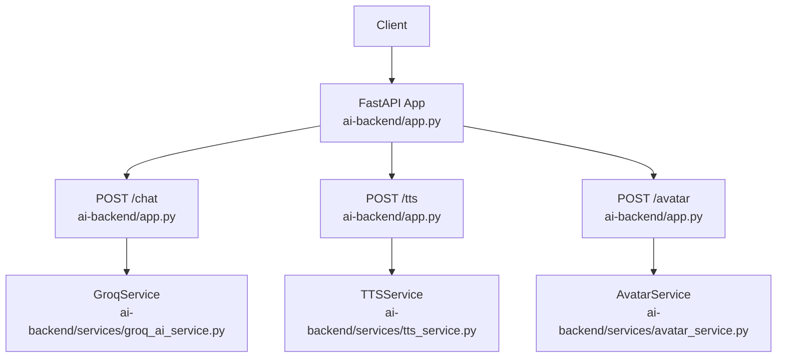
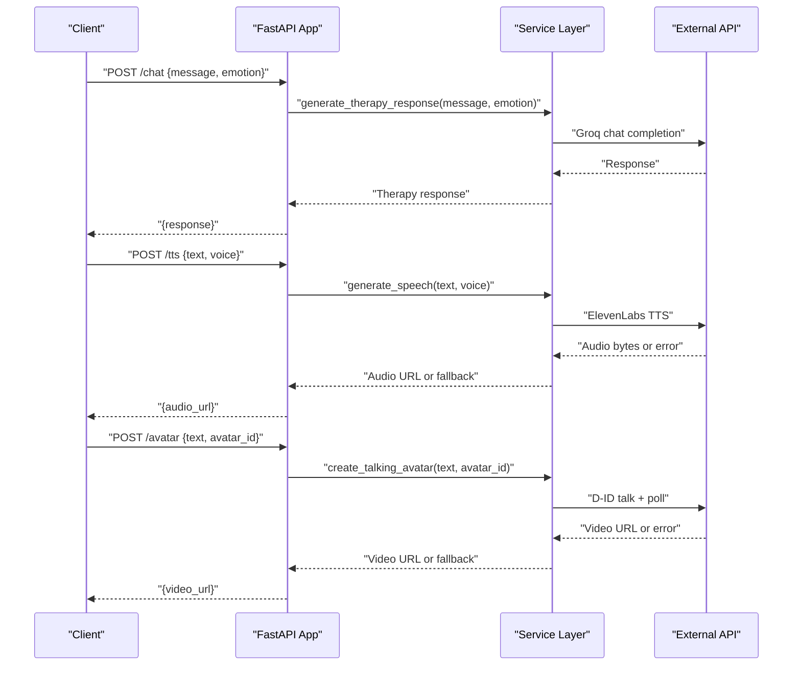
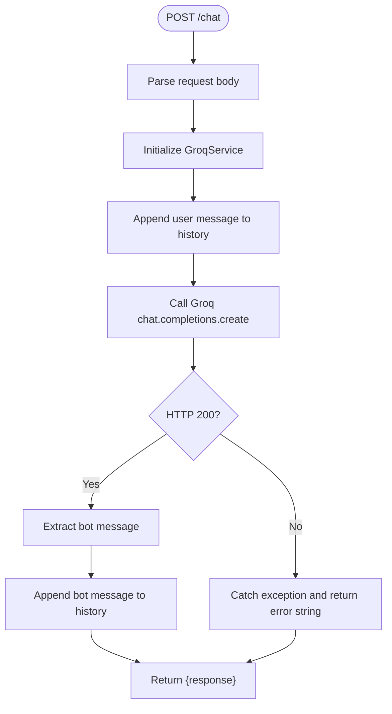
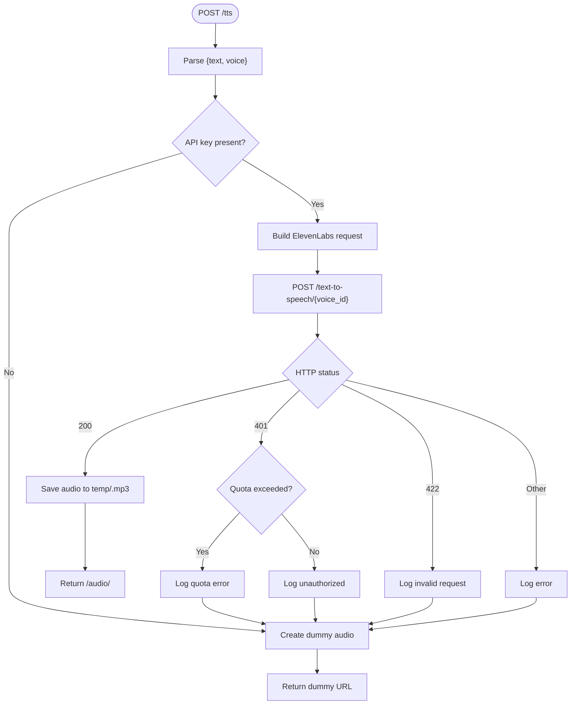
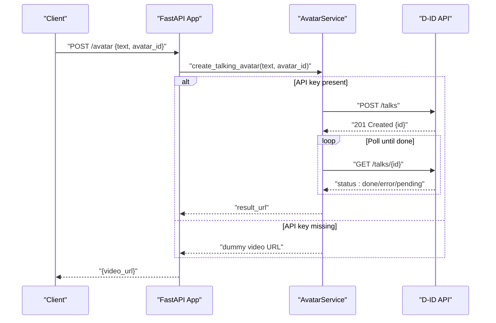
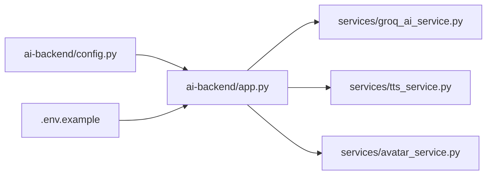

# External API Integrations

<cite>
**Referenced Files in This Document**
- [app.py](file://ai-backend/app.py)
- [config.py](file://ai-backend/config.py)
- [.env.example](file://ai-backend/.env.example)
- [groq_ai_service.py](file://ai-backend/services/groq_ai_service.py)
- [tts_service.py](file://ai-backend/services/tts_service.py)
- [avatar_service.py](file://ai-backend/services/avatar_service.py)
- [test_services.py](file://ai-backend/test_services.py)
- [test_groq_integration.py](file://ai-backend/test_groq_integration.py)
- [test_elevenlabs.py](file://ai-backend/services/test_elevenlabs.py)
- [run_server.py](file://ai-backend/run_server.py)
</cite>

## Table of Contents
1. [Introduction](#introduction)
2. [Project Structure](#project-structure)
3. [Core Components](#core-components)
4. [Architecture Overview](#architecture-overview)
5. [Detailed Component Analysis](#detailed-component-analysis)
6. [Dependency Analysis](#dependency-analysis)
7. [Performance Considerations](#performance-considerations)
8. [Troubleshooting Guide](#troubleshooting-guide)
9. [Conclusion](#conclusion)
10. [Appendices](#appendices)

## Introduction
This document explains the external API integrations powering the AI backend services. It covers how the system integrates with Groq AI for conversational responses, ElevenLabs for text-to-speech (TTS), and D-ID for avatar video generation. It documents configuration management, authentication token handling, rate-limiting strategies, error handling, retries, fallbacks, request/response formatting, validation, API key management, environment variables, security considerations, monitoring/logging, and performance optimizations.

## Project Structure
The AI backend is a FastAPI application that exposes endpoints for chat, TTS, and avatar generation. Services encapsulate external API calls and provide robust fallbacks when credentials are missing or external services fail.

**Diagram sources**
- [app.py](file://ai-backend/app.py#L81-L122)
- [groq_ai_service.py](file://ai-backend/services/groq_ai_service.py#L42-L111)
- [tts_service.py](file://ai-backend/services/tts_service.py#L53-L144)
- [avatar_service.py](file://ai-backend/services/avatar_service.py#L19-L67)

**Section sources**
- [app.py](file://ai-backend/app.py#L1-L154)

## Core Components
- Groq AI service: Provides therapeutic chat responses using a persistent conversation history and a fixed system prompt.
- ElevenLabs TTS service: Generates speech from text with graceful fallback to dummy audio when the API key is missing or quotas are exceeded.
- Avatar service: Creates talking avatar videos via D-ID with fallback to local dummy assets and placeholder media when API keys are unavailable.

Key configuration and environment variables are centralized in a settings class and .env.example.

**Section sources**
- [groq_ai_service.py](file://ai-backend/services/groq_ai_service.py#L1-L123)
- [tts_service.py](file://ai-backend/services/tts_service.py#L1-L280)
- [avatar_service.py](file://ai-backend/services/avatar_service.py#L1-L237)
- [config.py](file://ai-backend/config.py#L1-L49)
- [.env.example](file://ai-backend/.env.example#L1-L20)

## Architecture Overview
The backend exposes three primary endpoints:
- POST /chat: Accepts a user message and emotion, returns a Groq-generated response.
- POST /tts: Accepts text and optional voice, returns a URL to generated audio.
- POST /avatar: Accepts text and optional avatar_id, returns a URL to a generated video.

Static file serving mounts are configured to serve audio and video assets from a temp directory.

**Diagram sources**
- [app.py](file://ai-backend/app.py#L81-L122)
- [groq_ai_service.py](file://ai-backend/services/groq_ai_service.py#L81-L111)
- [tts_service.py](file://ai-backend/services/tts_service.py#L53-L144)
- [avatar_service.py](file://ai-backend/services/avatar_service.py#L19-L67)

## Detailed Component Analysis

### Groq AI Integration
- Initialization: Loads the GROQ_API_KEY from environment and initializes the Groq client.
- Conversation context: Maintains a system prompt and a rolling conversation history to preserve context across turns.
- Endpoint integration: The /chat endpoint delegates to the Groq service and returns a structured JSON response.
- Error handling: Catches exceptions and returns a user-friendly error message string.

**Diagram sources**
- [app.py](file://ai-backend/app.py#L81-L94)
- [groq_ai_service.py](file://ai-backend/services/groq_ai_service.py#L42-L68)

**Section sources**
- [groq_ai_service.py](file://ai-backend/services/groq_ai_service.py#L1-L123)
- [app.py](file://ai-backend/app.py#L81-L94)

### ElevenLabs TTS Integration
- Authentication: Uses ELEVENLABS_API_KEY via HTTP header xi-api-key.
- Request formatting: Sends text, model_id, and voice_settings; expects raw audio bytes on success.
- Response handling: Saves audio to temp with a unique filename and serves it via static route /audio.
- Rate limiting and quotas: Detects 401 unauthorized responses and checks for quota-related error details; falls back to dummy audio.
- Validation: Handles 422 invalid request errors by falling back to dummy audio.
- Logging: Comprehensive logs for success, quota issues, timeouts, and exceptions.
- Cleanup: Periodic cleanup of old audio files to manage disk usage.

**Diagram sources**
- [app.py](file://ai-backend/app.py#L96-L108)
- [tts_service.py](file://ai-backend/services/tts_service.py#L53-L144)

**Section sources**
- [tts_service.py](file://ai-backend/services/tts_service.py#L1-L280)
- [app.py](file://ai-backend/app.py#L96-L108)

### Avatar Generation (D-ID)
- Authentication: Uses Basic authorization with D-ID API key.
- Workflow: Creates a talk, polls for completion, and returns the result URL.
- Fallback: If API key is missing, copies a local dummy video asset to temp and returns a static URL.
- Presenters and uploads: Provides methods to fetch available presenters and upload custom avatars.
- Placeholder: Creates minimal placeholder MP4 if no assets are available.

**Diagram sources**
- [app.py](file://ai-backend/app.py#L110-L122)
- [avatar_service.py](file://ai-backend/services/avatar_service.py#L19-L67)
- [avatar_service.py](file://ai-backend/services/avatar_service.py#L122-L155)

**Section sources**
- [avatar_service.py](file://ai-backend/services/avatar_service.py#L1-L237)
- [app.py](file://ai-backend/app.py#L110-L122)

## Dependency Analysis
- FastAPI app depends on three services: GroqService, TTSService, and AvatarService.
- Services depend on environment variables for API keys and configuration.
- Static file serving is mounted for audio and video under temp.

**Diagram sources**
- [app.py](file://ai-backend/app.py#L48-L71)
- [config.py](file://ai-backend/config.py#L1-L49)
- [.env.example](file://ai-backend/.env.example#L1-L20)

**Section sources**
- [app.py](file://ai-backend/app.py#L1-L154)
- [config.py](file://ai-backend/config.py#L1-L49)
- [.env.example](file://ai-backend/.env.example#L1-L20)

## Performance Considerations
- Asynchronous I/O: Services use httpx.AsyncClient for non-blocking external calls.
- Streaming/static serving: Audio/video saved to temp and served via static files to reduce memory overhead.
- Caching and reuse: Conversation history is maintained per session instance; consider persistence for long sessions.
- Timeout tuning: ElevenLabs requests use explicit timeouts; adjust as needed for production.
- Cleanup: Automated cleanup of old temp files prevents disk bloat.
- Concurrency: FastAPI handles concurrent requests; ensure external APIs are polled efficiently.

[No sources needed since this section provides general guidance]

## Troubleshooting Guide
- Missing API keys:
  - Groq: Ensure GROQ_API_KEY is set; otherwise, initialization raises an error.
  - ElevenLabs: If ELEVENLABS_API_KEY is missing, TTS falls back to dummy audio.
  - D-ID: If DID_API_KEY is missing, avatar service returns a dummy video URL.
- Quota exceeded (ElevenLabs):
  - 401 responses with quota indicators trigger fallback to dummy audio; check account limits.
- Invalid request (ElevenLabs):
  - 422 responses fall back to dummy audio; validate input length and content.
- Timeouts:
  - ElevenLabs requests log timeout errors and fall back to dummy audio.
- Video generation delays:
  - Avatar polling waits with a fixed interval; adjust attempts and sleep if needed.
- Local assets:
  - Dummy videos are copied from the webapp public directory; ensure files exist or allow placeholder creation.

**Section sources**
- [groq_ai_service.py](file://ai-backend/services/groq_ai_service.py#L8-L11)
- [tts_service.py](file://ai-backend/services/tts_service.py#L59-L144)
- [avatar_service.py](file://ai-backend/services/avatar_service.py#L24-L67)
- [test_services.py](file://ai-backend/test_services.py#L1-L102)
- [test_groq_integration.py](file://ai-backend/test_groq_integration.py#L1-L37)
- [test_elevenlabs.py](file://ai-backend/services/test_elevenlabs.py#L1-L48)

## Conclusion
The backend integrates external AI services with clear separation of concerns, robust fallbacks, and strong logging. Configuration is centralized via environment variables and a settings class. The system gracefully handles missing credentials, quota limits, and transient failures, ensuring resilient operation for chat, TTS, and avatar generation.

[No sources needed since this section summarizes without analyzing specific files]

## Appendices

### API Configuration Management
- Centralized settings: The Settings class loads environment variables for API keys, models, ports, and security.
- Environment variables: Example keys include GROQ_API_KEY, ELEVENLABS_API_KEY, ELEVENLABS_VOICE_ID, DID_API_KEY, DID_PRESENTER_ID, MONGODB_URL, REDIS_URL, SECRET_KEY, ALGORITHM, ACCESS_TOKEN_EXPIRE_MINUTES, PORT, HOST, DEBUG, and allowed origins.

**Section sources**
- [config.py](file://ai-backend/config.py#L1-L49)
- [.env.example](file://ai-backend/.env.example#L1-L20)

### Authentication Token Handling
- Groq: API key is loaded once during module import and used implicitly by the Groq client.
- ElevenLabs: API key is passed via HTTP header xi-api-key.
- D-ID: API key is used in Basic authorization header.

**Section sources**
- [groq_ai_service.py](file://ai-backend/services/groq_ai_service.py#L8-L14)
- [tts_service.py](file://ai-backend/services/tts_service.py#L12-L14)
- [avatar_service.py](file://ai-backend/services/avatar_service.py#L12-L16)

### Rate Limiting Strategies
- ElevenLabs:
  - Detects 401 responses and inspects error details for quota mentions; falls back to dummy audio.
  - Logs actionable guidance to upgrade plan or switch accounts.
- D-ID:
  - Polling mechanism checks status with bounded attempts; on timeout or error, raises exceptions surfaced to callers.

**Section sources**
- [tts_service.py](file://ai-backend/services/tts_service.py#L107-L120)
- [avatar_service.py](file://ai-backend/services/avatar_service.py#L122-L155)

### Error Handling, Retry Mechanisms, and Fallbacks
- Groq:
  - Exceptions are caught and returned as error strings; conversation history remains intact.
- ElevenLabs:
  - 401 (unauthorized/quota), 422 (invalid request), and other errors trigger dummy audio fallback.
  - Timeouts also trigger fallback.
- D-ID:
  - Missing API key triggers dummy video fallback.
  - Polling errors and timeouts are logged and raised.

**Section sources**
- [groq_ai_service.py](file://ai-backend/services/groq_ai_service.py#L67-L68)
- [tts_service.py](file://ai-backend/services/tts_service.py#L138-L144)
- [avatar_service.py](file://ai-backend/services/avatar_service.py#L24-L26)

### Request-Response Formatting and Validation
- /chat:
  - Request: { message: string, emotion?: string }.
  - Response: { response: string, status: "success" }.
- /tts:
  - Request: { text: string, voice?: string }.
  - Response: { audio_url: string, status: "success" }.
- /avatar:
  - Request: { text: string, avatar_id?: string }.
  - Response: { video_url: string, status: "success" }.

Validation occurs at the endpoint level by extracting fields from the request body.

**Section sources**
- [app.py](file://ai-backend/app.py#L81-L122)

### API Key Management and Security
- Environment variables: Keys are loaded from .env and validated early in service initialization.
- Security headers: ElevenLabs uses xi-api-key; D-ID uses Basic authorization.
- Static serving: Audio and video are served from temp via static routes; ensure proper permissions and path handling.

**Section sources**
- [config.py](file://ai-backend/config.py#L17-L23)
- [tts_service.py](file://ai-backend/services/tts_service.py#L12-L14)
- [avatar_service.py](file://ai-backend/services/avatar_service.py#L12-L16)
- [app.py](file://ai-backend/app.py#L38-L40)

### Monitoring and Logging
- Logging: Services log successes, quota issues, unauthorized access, invalid requests, timeouts, and exceptions.
- Health endpoint: /health returns service status.
- Static file serving: Mounted for audio and video under temp.

**Section sources**
- [tts_service.py](file://ai-backend/services/tts_service.py#L22-L51)
- [tts_service.py](file://ai-backend/services/tts_service.py#L138-L144)
- [avatar_service.py](file://ai-backend/services/avatar_service.py#L64-L67)
- [app.py](file://ai-backend/app.py#L77-L79)
- [app.py](file://ai-backend/app.py#L38-L40)

### Startup and Deployment Notes
- FastAPI app mounts static directories for audio and video.
- Alternative startup script avoids multiprocessing issues on Windows.

**Section sources**
- [app.py](file://ai-backend/app.py#L35-L40)
- [run_server.py](file://ai-backend/run_server.py#L1-L21)