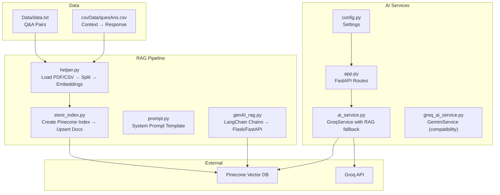
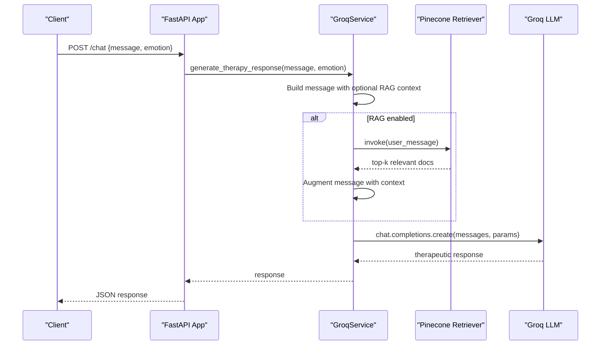
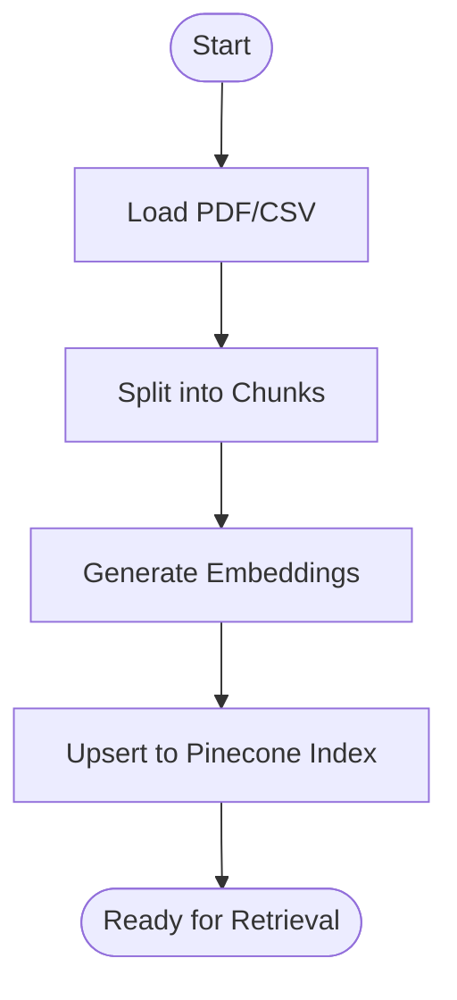
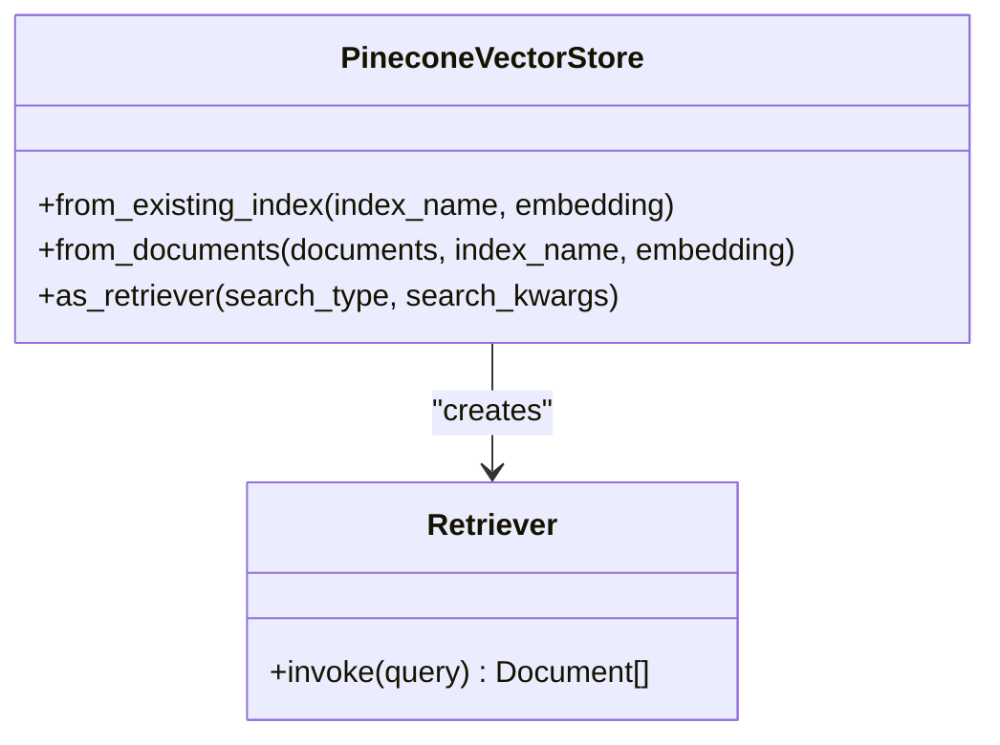
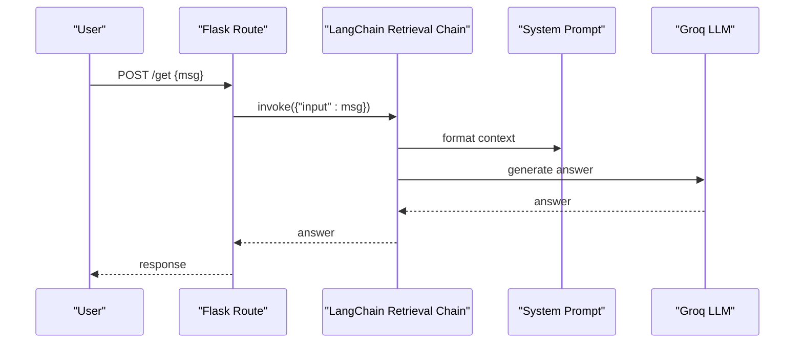
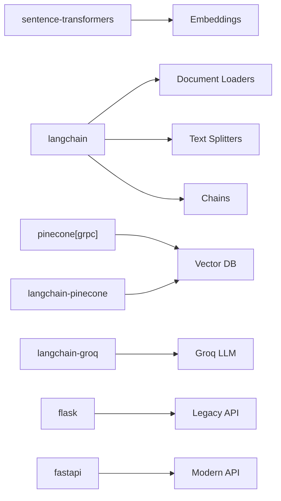

# RAG System Implementation

<cite>
**Referenced Files in This Document**
- [genAI_rag.py](file://ai-backend/rag/genAI_rag.py)
- [helper.py](file://ai-backend/rag/helper.py)
- [prompt.py](file://ai-backend/rag/prompt.py)
- [store_index.py](file://ai-backend/rag/store_index.py)
- [quesAns.csv](file://ai-backend/rag/csvData/quesAns.csv)
- [ai_service.py](file://ai-backend/services/ai_service.py)
- [groq_ai_service.py](file://ai-backend/services/groq_ai_service.py)
- [app.py](file://ai-backend/app.py)
- [config.py](file://ai-backend/config.py)
- [requirements.txt](file://ai-backend/rag/requirements.txt)
- [trials.ipynb](file://ai-backend/rag/research/trials.ipynb)
- [trails2.ipynb](file://ai-backend/rag/research/trails2.ipynb)
- [.env](file://ai-backend/.env)
</cite>

## Table of Contents
1. [Introduction](#introduction)
2. [Project Structure](#project-structure)
3. [Core Components](#core-components)
4. [Architecture Overview](#architecture-overview)
5. [Detailed Component Analysis](#detailed-component-analysis)
6. [Dependency Analysis](#dependency-analysis)
7. [Performance Considerations](#performance-considerations)
8. [Troubleshooting Guide](#troubleshooting-guide)
9. [Conclusion](#conclusion)

## Introduction
This document explains the Retrieval-Augmented Generation (RAG) system implemented in the MindBridge AI backend. The system integrates LangChain with Pinecone to enhance AI responses with contextual knowledge retrieval. It covers the data preprocessing pipeline, embedding generation, vector index storage, prompt engineering, retrieval mechanisms, similarity search algorithms, response synthesis, CSV data processing, question-answer pair handling, knowledge base maintenance, and performance optimization strategies for scalability.

## Project Structure
The RAG implementation spans two primary areas:
- RAG pipeline: PDF/CSV ingestion, chunking, embeddings, and Pinecone index creation/retrieval
- AI service integration: Groq-powered therapy responses with optional RAG augmentation

**Diagram sources**
- [genAI_rag.py](file://ai-backend/rag/genAI_rag.py#L1-L76)
- [helper.py](file://ai-backend/rag/helper.py#L1-L29)
- [store_index.py](file://ai-backend/rag/store_index.py#L1-L40)
- [prompt.py](file://ai-backend/rag/prompt.py#L1-L11)
- [quesAns.csv](file://ai-backend/rag/csvData/quesAns.csv#L1-L221)
- [ai_service.py](file://ai-backend/services/ai_service.py#L72-L192)
- [groq_ai_service.py](file://ai-backend/services/groq_ai_service.py#L70-L111)
- [app.py](file://ai-backend/app.py#L1-L154)
- [config.py](file://ai-backend/config.py#L1-L49)

**Section sources**
- [genAI_rag.py](file://ai-backend/rag/genAI_rag.py#L1-L76)
- [helper.py](file://ai-backend/rag/helper.py#L1-L29)
- [store_index.py](file://ai-backend/rag/store_index.py#L1-L40)
- [prompt.py](file://ai-backend/rag/prompt.py#L1-L11)
- [quesAns.csv](file://ai-backend/rag/csvData/quesAns.csv#L1-L221)
- [ai_service.py](file://ai-backend/services/ai_service.py#L72-L192)
- [groq_ai_service.py](file://ai-backend/services/groq_ai_service.py#L70-L111)
- [app.py](file://ai-backend/app.py#L1-L154)
- [config.py](file://ai-backend/config.py#L1-L49)

## Core Components
- Data ingestion and preprocessing:
  - PDF/CSV loaders and recursive character splitting
  - Sentence Transformers embeddings (all-MiniLM-L6-v2)
- Vector index management:
  - Pinecone index creation with cosine similarity
  - Upsert of embedded chunks
- Retrieval-augmented generation:
  - LangChain retrieval chain with a system prompt
  - Optional RAG augmentation in the Groq service
- Prompt engineering:
  - Concise, context-aware system prompt for Q&A
- API integration:
  - Flask route for legacy chat
  - FastAPI routes for therapy, TTS, and avatar services

**Section sources**
- [helper.py](file://ai-backend/rag/helper.py#L1-L29)
- [store_index.py](file://ai-backend/rag/store_index.py#L1-L40)
- [genAI_rag.py](file://ai-backend/rag/genAI_rag.py#L1-L76)
- [prompt.py](file://ai-backend/rag/prompt.py#L1-L11)
- [ai_service.py](file://ai-backend/services/ai_service.py#L72-L192)
- [app.py](file://ai-backend/app.py#L1-L154)

## Architecture Overview
The RAG system follows a layered architecture:
- Data ingestion and embedding layer
- Vector store layer (Pinecone)
- Retrieval and synthesis layer (LangChain chains)
- API and service layer (FastAPI/Groq)

**Diagram sources**
- [app.py](file://ai-backend/app.py#L81-L94)
- [ai_service.py](file://ai-backend/services/ai_service.py#L131-L191)

## Detailed Component Analysis

### Data Preprocessing Pipeline
- PDF/CSV loading:
  - PDF loader via directory scanning and PyPDF
  - CSV loader mapping Context → source, Response → content
- Chunking:
  - Recursive character splitting with configurable chunk size and overlap
- Embedding:
  - Sentence Transformers model (all-MiniLM-L6-v2) returning 384-d vectors

**Diagram sources**
- [helper.py](file://ai-backend/rag/helper.py#L7-L29)
- [store_index.py](file://ai-backend/rag/store_index.py#L15-L40)

**Section sources**
- [helper.py](file://ai-backend/rag/helper.py#L1-L29)
- [store_index.py](file://ai-backend/rag/store_index.py#L1-L40)
- [trials.ipynb](file://ai-backend/rag/research/trials.ipynb#L188-L200)
- [trails2.ipynb](file://ai-backend/rag/research/trails2.ipynb#L49-L145)

### Embedding Generation and Vector Index Storage
- Embedding model: sentence-transformers/all-MiniLM-L6-v2 (384 dimensions)
- Index creation:
  - Name: healthai or healthai-csv
  - Metric: cosine
  - Cloud: AWS, Region: us-east-1
- Upsert process:
  - Embed each chunk and insert into the index

**Section sources**
- [helper.py](file://ai-backend/rag/helper.py#L26-L29)
- [store_index.py](file://ai-backend/rag/store_index.py#L20-L40)
- [trials.ipynb](file://ai-backend/rag/research/trials.ipynb#L154-L184)
- [trails2.ipynb](file://ai-backend/rag/research/trails2.ipynb#L154-L184)

### Prompt Engineering and Template Management
- System prompt emphasizes:
  - Assistant role for question-answering
  - Use of retrieved context
  - Concise, maximum three-sentence answers
- Template placement:
  - Defined in prompt.py and referenced by LangChain chains

**Section sources**
- [prompt.py](file://ai-backend/rag/prompt.py#L3-L11)
- [genAI_rag.py](file://ai-backend/rag/genAI_rag.py#L47-L52)

### Retrieval Mechanisms and Similarity Search
- Retrieval type: similarity with k=3
- Search kwargs: adjustable parameters for top-k retrieval
- Integration:
  - LangChain retriever for Flask route
  - PineconeVectorStore.from_existing_index for service integration

**Diagram sources**
- [genAI_rag.py](file://ai-backend/rag/genAI_rag.py#L30-L38)
- [ai_service.py](file://ai-backend/services/ai_service.py#L100-L106)

**Section sources**
- [genAI_rag.py](file://ai-backend/rag/genAI_rag.py#L30-L38)
- [ai_service.py](file://ai-backend/services/ai_service.py#L82-L118)

### Response Synthesis and API Integration
- LangChain chains:
  - Documents chain with system prompt
  - Retrieval chain combining retriever and documents chain
- Legacy Flask route:
  - Basic GET/POST chat endpoint
- Modern FastAPI service:
  - GroqService with conversation history and optional RAG augmentation
  - Route /chat returns therapeutic responses

**Diagram sources**
- [genAI_rag.py](file://ai-backend/rag/genAI_rag.py#L58-L70)
- [genAI_rag.py](file://ai-backend/rag/genAI_rag.py#L54-L55)

**Section sources**
- [genAI_rag.py](file://ai-backend/rag/genAI_rag.py#L47-L70)
- [app.py](file://ai-backend/app.py#L81-L94)
- [ai_service.py](file://ai-backend/services/ai_service.py#L131-L191)

### CSV Data Processing Workflow and Knowledge Base Maintenance
- CSV ingestion:
  - Context column as source metadata
  - Response column as content
- Chunking and embedding:
  - Same pipeline as PDF
- Index naming:
  - healthai-csv for CSV-backed knowledge base
- Maintenance:
  - Upsert new question-answer pairs to keep knowledge current

**Section sources**
- [quesAns.csv](file://ai-backend/rag/csvData/quesAns.csv#L1-L221)
- [trails2.ipynb](file://ai-backend/rag/research/trails2.ipynb#L105-L145)
- [store_index.py](file://ai-backend/rag/store_index.py#L20-L40)

### Question-Answer Pair Handling
- Data model:
  - Context: question or scenario
  - Response: therapeutic answer
- Processing:
  - Load via CSVLoader
  - Split into chunks
  - Embed and upsert into Pinecone

**Section sources**
- [quesAns.csv](file://ai-backend/rag/csvData/quesAns.csv#L1-L221)
- [trials.ipynb](file://ai-backend/rag/research/trials.ipynb#L105-L145)

## Dependency Analysis
Key libraries and their roles:
- sentence-transformers: embedding generation
- langchain and langchain-community: document loading, chunking, chains
- pinecone[grpc]: vector database client
- langchain-pinecone: Pinecone integration
- langchain-groq: Groq LLM integration
- flask/fastapi: web frameworks
- python-dotenv: environment variables

**Diagram sources**
- [requirements.txt](file://ai-backend/rag/requirements.txt#L1-L12)
- [genAI_rag.py](file://ai-backend/rag/genAI_rag.py#L1-L16)
- [ai_service.py](file://ai-backend/services/ai_service.py#L1-L16)

**Section sources**
- [requirements.txt](file://ai-backend/rag/requirements.txt#L1-L12)
- [genAI_rag.py](file://ai-backend/rag/genAI_rag.py#L1-L16)
- [ai_service.py](file://ai-backend/services/ai_service.py#L1-L16)

## Performance Considerations
- Embedding model choice:
  - all-MiniLM-L6-v2 (384 dimensions) balances speed and quality
- Chunk sizing:
  - 500-character chunks with 20-character overlap optimize retrieval granularity
- Retrieval parameters:
  - k=3 strikes a balance between relevance and latency
- Async execution:
  - GroqService uses executor threads to avoid blocking I/O
- Scalability:
  - Pinecone serverless spec scales automatically
  - Consider batching upserts and using hybrid search for large datasets
- Memory management:
  - Lazy initialization of services in FastAPI app
  - Avoid loading large models unnecessarily

[No sources needed since this section provides general guidance]

## Troubleshooting Guide
- Missing environment variables:
  - Ensure PINECONE_API_KEY and GROQ_API_KEY are set
- RAG initialization failures:
  - Verify Pinecone API key and index existence
  - Confirm embeddings model availability
- Retrieval errors:
  - Check index dimension matches embedding model (384)
  - Validate search kwargs and retriever configuration
- API connectivity:
  - Test Groq connection via service test method
  - Confirm FastAPI route handlers are mounted correctly

**Section sources**
- [ai_service.py](file://ai-backend/services/ai_service.py#L95-L118)
- [app.py](file://ai-backend/app.py#L143-L153)

## Conclusion
The RAG system integrates LangChain and Pinecone to deliver contextually grounded responses powered by a curated knowledge base of mental health Q&A pairs. The modular design supports both legacy Flask and modern FastAPI deployments, with optional RAG augmentation for enhanced accuracy. By tuning chunk sizes, retrieval parameters, and leveraging asynchronous execution, the system achieves scalable performance suitable for production environments.