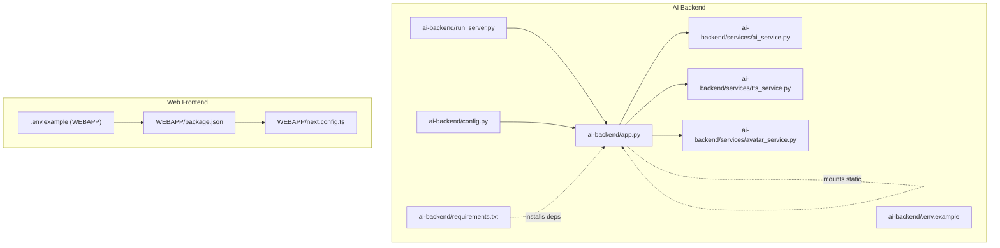
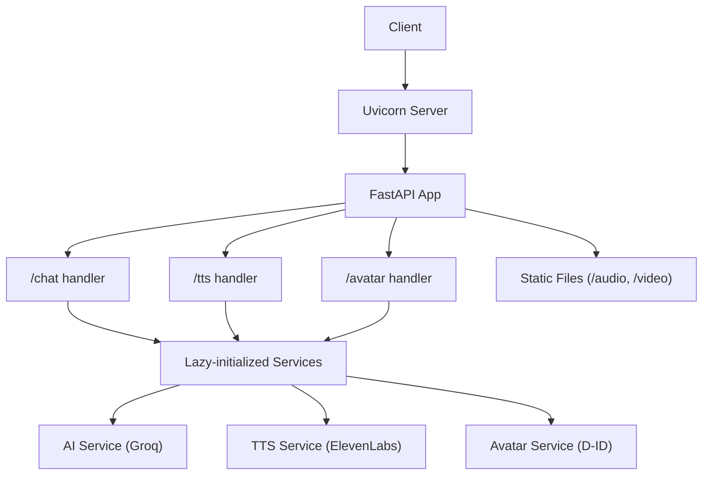
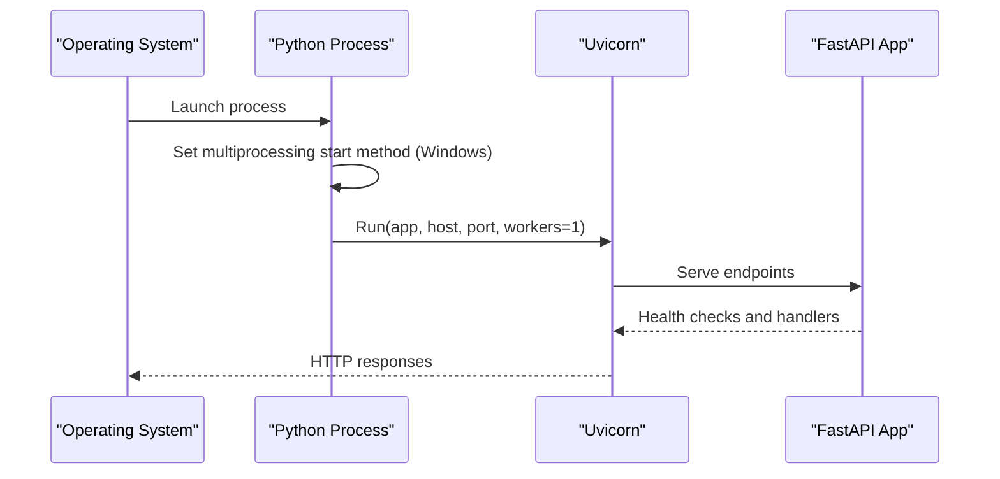
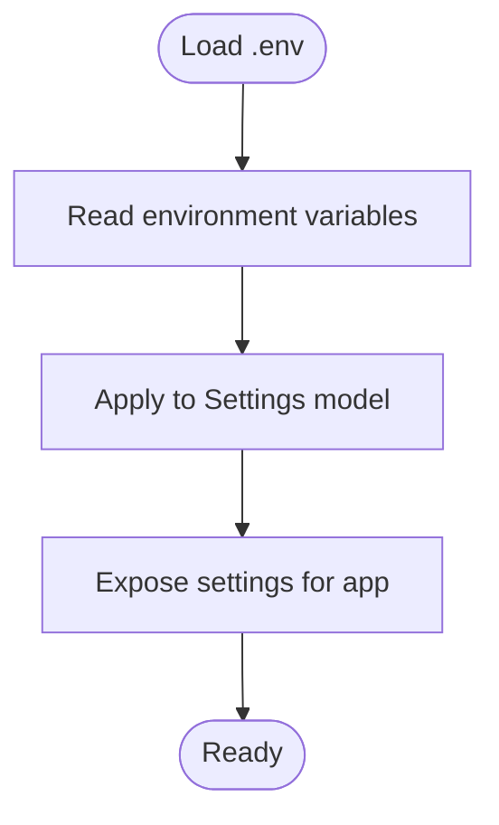
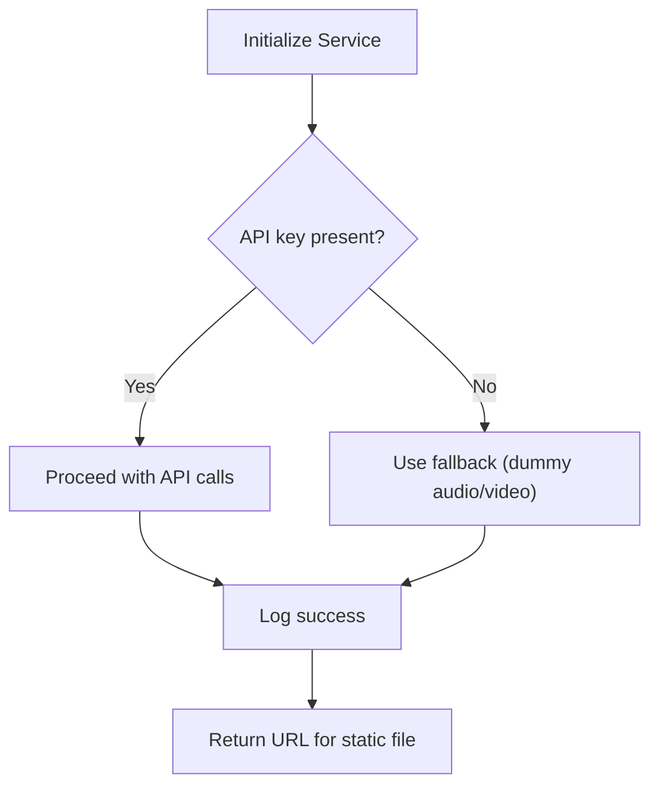
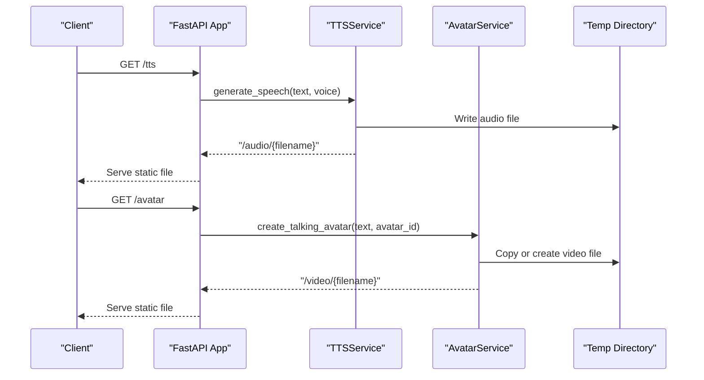
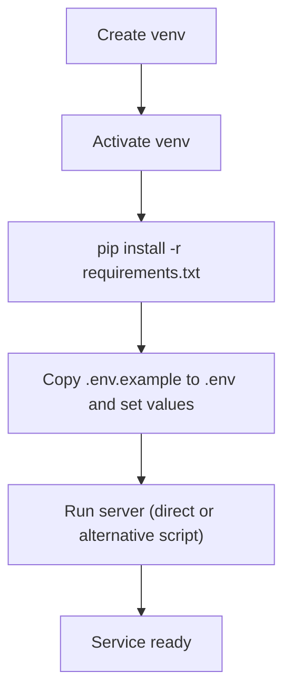
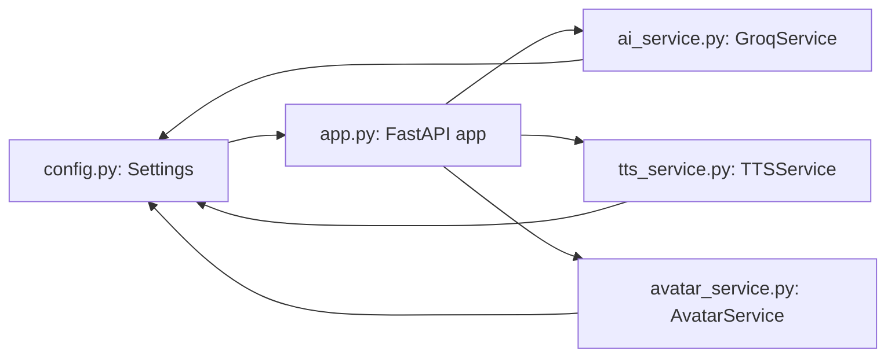

# Service Deployment & Configuration

<cite>
**Referenced Files in This Document**
- [app.py](file://ai-backend/app.py)
- [run_server.py](file://ai-backend/run_server.py)
- [config.py](file://ai-backend/config.py)
- [requirements.txt](file://ai-backend/requirements.txt)
- [ai_service.py](file://ai-backend/services/ai_service.py)
- [tts_service.py](file://ai-backend/services/tts_service.py)
- [avatar_service.py](file://ai-backend/services/avatar_service.py)
- [.env.example](file://ai-backend/.env.example)
- [package.json](file://WEBAPP/package.json)
- [next.config.ts](file://WEBAPP/next.config.ts)
- [.env.example](file://WEBAPP/.env.example)
</cite>

## Table of Contents
1. [Introduction](#introduction)
2. [Project Structure](#project-structure)
3. [Core Components](#core-components)
4. [Architecture Overview](#architecture-overview)
5. [Detailed Component Analysis](#detailed-component-analysis)
6. [Dependency Analysis](#dependency-analysis)
7. [Performance Considerations](#performance-considerations)
8. [Troubleshooting Guide](#troubleshooting-guide)
9. [Conclusion](#conclusion)
10. [Appendices](#appendices)

## Introduction
This document explains how to deploy and configure the AI backend service, focusing on the Uvicorn server setup, Windows multiprocessing compatibility, production deployment strategies, environment variable management, configuration loading, secret handling, dependency management via requirements.txt, Python virtual environment setup, static asset serving for audio/video, directory structure requirements, file permissions, containerization approaches, cloud deployment options, monitoring, and logging for production environments.

## Project Structure
The deployment-relevant parts of the repository are organized into:
- ai-backend: FastAPI application, Uvicorn server, configuration, and service integrations
- WEBAPP: Next.js frontend with environment configuration and static assets
- Shared environment templates for both backend and frontend

**Diagram sources**
- [app.py](file://ai-backend/app.py#L1-L154)
- [run_server.py](file://ai-backend/run_server.py#L1-L21)
- [config.py](file://ai-backend/config.py#L1-L49)
- [requirements.txt](file://ai-backend/requirements.txt#L1-L81)
- [ai_service.py](file://ai-backend/services/ai_service.py#L1-L200)
- [tts_service.py](file://ai-backend/services/tts_service.py#L1-L200)
- [avatar_service.py](file://ai-backend/services/avatar_service.py#L1-L200)
- [.env.example](file://ai-backend/.env.example#L1-L20)
- [package.json](file://WEBAPP/package.json#L1-L88)
- [next.config.ts](file://WEBAPP/next.config.ts#L1-L45)
- [.env.example](file://WEBAPP/.env.example#L1-L16)

**Section sources**
- [app.py](file://ai-backend/app.py#L1-L154)
- [run_server.py](file://ai-backend/run_server.py#L1-L21)
- [config.py](file://ai-backend/config.py#L1-L49)
- [requirements.txt](file://ai-backend/requirements.txt#L1-L81)
- [package.json](file://WEBAPP/package.json#L1-L88)
- [next.config.ts](file://WEBAPP/next.config.ts#L1-L45)
- [.env.example](file://WEBAPP/.env.example#L1-L16)
- [.env.example](file://ai-backend/.env.example#L1-L20)

## Core Components
- Uvicorn server and FastAPI application entry points
- Multiprocessing configuration for Windows compatibility
- Static file serving for audio and video assets
- Configuration loading via Pydantic settings and environment variables
- Secret handling for API keys and tokens
- Service integrations for AI, TTS, and avatar generation
- Frontend environment configuration and static asset exposure

**Section sources**
- [app.py](file://ai-backend/app.py#L143-L154)
- [run_server.py](file://ai-backend/run_server.py#L10-L21)
- [config.py](file://ai-backend/config.py#L5-L49)
- [ai_service.py](file://ai-backend/services/ai_service.py#L10-L16)
- [tts_service.py](file://ai-backend/services/tts_service.py#L10-L21)
- [avatar_service.py](file://ai-backend/services/avatar_service.py#L11-L18)

## Architecture Overview
The AI backend exposes REST endpoints for chat, text-to-speech, and avatar generation. It serves audio and video assets from a temporary directory mounted under specific URLs. Services are lazily initialized to avoid import-time issues and to support optional integrations.

**Diagram sources**
- [app.py](file://ai-backend/app.py#L73-L123)
- [app.py](file://ai-backend/app.py#L38-L40)
- [ai_service.py](file://ai-backend/services/ai_service.py#L72-L192)
- [tts_service.py](file://ai-backend/services/tts_service.py#L53-L144)
- [avatar_service.py](file://ai-backend/services/avatar_service.py#L19-L67)

## Detailed Component Analysis

### Uvicorn Server Setup and Multiprocessing on Windows
- The application sets the multiprocessing start method to spawn on Windows to avoid import-time issues and ensure stability.
- Two startup modes are supported:
  - Direct run inside the module with explicit host/port and single worker
  - An alternative script that loads the app and runs Uvicorn with configurable log level
- Windows-specific freeze support is enabled for the direct run mode.

**Diagram sources**
- [app.py](file://ai-backend/app.py#L11-L153)
- [run_server.py](file://ai-backend/run_server.py#L10-L21)

**Section sources**
- [app.py](file://ai-backend/app.py#L11-L153)
- [run_server.py](file://ai-backend/run_server.py#L10-L21)

### Environment Variable Management and Configuration Loading
- Environment variables are loaded at runtime and used to configure:
  - Application name, debug mode, host, port
  - AI providers (Groq, OpenAI), TTS (ElevenLabs), avatar (D-ID)
  - Database and caching (MongoDB, Redis)
  - Security settings (secret key, JWT algorithm, token expiry)
  - CORS allowed origins
- A dedicated configuration module centralizes defaults and environment-backed values.

**Diagram sources**
- [config.py](file://ai-backend/config.py#L5-L49)

**Section sources**
- [config.py](file://ai-backend/config.py#L5-L49)
- [.env.example](file://ai-backend/.env.example#L1-L20)
- [.env.example](file://WEBAPP/.env.example#L1-L16)

### Secret Handling
- API keys and secrets are read from environment variables and validated at service initialization:
  - Groq API key is required for AI service
  - ElevenLabs API key is required for TTS; fallback to dummy audio if missing
  - D-ID API key is required for avatar; fallback to dummy video if missing
- Logging is used to report missing or invalid credentials.

**Diagram sources**
- [ai_service.py](file://ai-backend/services/ai_service.py#L10-L16)
- [tts_service.py](file://ai-backend/services/tts_service.py#L16-L21)
- [avatar_service.py](file://ai-backend/services/avatar_service.py#L12-L18)

**Section sources**
- [ai_service.py](file://ai-backend/services/ai_service.py#L10-L16)
- [tts_service.py](file://ai-backend/services/tts_service.py#L16-L21)
- [avatar_service.py](file://ai-backend/services/avatar_service.py#L12-L18)

### Static File Serving for Audio and Video Assets
- The application mounts a temporary directory under two endpoints:
  - /audio for generated audio files
  - /video for generated avatar videos
- Audio files are saved to a temp directory with randomized filenames to prevent caching and manage lifecycle.
- Video files are copied from the frontend public directory or created as placeholders if APIs are unavailable.

**Diagram sources**
- [app.py](file://ai-backend/app.py#L38-L40)
- [tts_service.py](file://ai-backend/services/tts_service.py#L91-L105)
- [avatar_service.py](file://ai-backend/services/avatar_service.py#L71-L111)

**Section sources**
- [app.py](file://ai-backend/app.py#L38-L40)
- [tts_service.py](file://ai-backend/services/tts_service.py#L91-L105)
- [avatar_service.py](file://ai-backend/services/avatar_service.py#L71-L111)

### Dependency Management and Virtual Environment Setup
- Python dependencies are declared in requirements.txt for the AI backend.
- Recommended steps:
  - Create a Python virtual environment
  - Activate the environment
  - Install dependencies from requirements.txt
  - Set environment variables from the .env.example template
  - Run the server using either the direct module entry or the alternative script

**Diagram sources**
- [requirements.txt](file://ai-backend/requirements.txt#L1-L81)
- [.env.example](file://ai-backend/.env.example#L1-L20)

**Section sources**
- [requirements.txt](file://ai-backend/requirements.txt#L1-L81)
- [.env.example](file://ai-backend/.env.example#L1-L20)

### Production Deployment Strategies
- Host and port are controlled by environment variables; default values are provided in configuration.
- Disable auto-reload in production to avoid multiprocessing issues.
- Use a single worker for simplicity; scale horizontally behind a reverse proxy if needed.
- Ensure the temp directory exists and is writable by the service user.
- Configure CORS appropriately for production origins.
- Use HTTPS termination at a reverse proxy or platform ingress.

**Section sources**
- [app.py](file://ai-backend/app.py#L147-L153)
- [config.py](file://ai-backend/config.py#L8-L10)
- [config.py](file://ai-backend/config.py#L38-L43)

### Frontend Environment Configuration
- The frontend reads environment variables via Next.js configuration and exposes headers for cross-origin access.
- Example environment variables include database URL, NextAuth settings, and backend service URLs.

**Section sources**
- [next.config.ts](file://WEBAPP/next.config.ts#L17-L39)
- [.env.example](file://WEBAPP/.env.example#L1-L16)

## Dependency Analysis
The backend services depend on environment variables and optional external APIs. The configuration module centralizes defaults and environment-backed values, while services implement fallbacks when keys are missing.

**Diagram sources**
- [config.py](file://ai-backend/config.py#L5-L49)
- [app.py](file://ai-backend/app.py#L48-L71)
- [ai_service.py](file://ai-backend/services/ai_service.py#L72-L192)
- [tts_service.py](file://ai-backend/services/tts_service.py#L10-L21)
- [avatar_service.py](file://ai-backend/services/avatar_service.py#L11-L18)

**Section sources**
- [config.py](file://ai-backend/config.py#L5-L49)
- [app.py](file://ai-backend/app.py#L48-L71)
- [ai_service.py](file://ai-backend/services/ai_service.py#L72-L192)
- [tts_service.py](file://ai-backend/services/tts_service.py#L10-L21)
- [avatar_service.py](file://ai-backend/services/avatar_service.py#L11-L18)

## Performance Considerations
- Single-worker Uvicorn configuration avoids multiprocessing overhead in production.
- Asynchronous service calls reduce blocking during external API interactions.
- Static file serving from a temp directory is suitable for ephemeral assets; consider CDN-backed storage for persistent media in production.
- Implement periodic cleanup of temp files to control disk usage.

[No sources needed since this section provides general guidance]

## Troubleshooting Guide
- Missing API keys:
  - Groq: Required for chat responses; initialize will fail without it.
  - ElevenLabs: Required for TTS; fallback to dummy audio is used otherwise.
  - D-ID: Required for avatar; fallback to dummy video is used otherwise.
- Windows multiprocessing:
  - Ensure the spawn method is used and freeze support is enabled for direct runs.
- Static files not served:
  - Verify temp directory exists and is writable.
  - Confirm mount points for /audio and /video.
- CORS issues:
  - Adjust allowed origins in configuration for production domains.

**Section sources**
- [ai_service.py](file://ai-backend/services/ai_service.py#L12-L13)
- [tts_service.py](file://ai-backend/services/tts_service.py#L16-L21)
- [avatar_service.py](file://ai-backend/services/avatar_service.py#L12-L18)
- [app.py](file://ai-backend/app.py#L11-L13)
- [app.py](file://ai-backend/app.py#L145-L153)
- [app.py](file://ai-backend/app.py#L38-L40)
- [config.py](file://ai-backend/config.py#L38-L43)

## Conclusion
The AI backend is designed for straightforward deployment with Uvicorn, robust environment-driven configuration, and resilient service integrations. By following the outlined setup, environment management, and production strategies, teams can reliably operate the service across platforms and scales.

[No sources needed since this section summarizes without analyzing specific files]

## Appendices

### Environment Variables Reference
- AI and provider keys:
  - GROQ_API_KEY
  - ELEVENLABS_API_KEY, ELEVENLABS_VOICE_ID
  - DID_API_KEY, DID_PRESENTER_ID
- Database and caching:
  - MONGODB_URL, DATABASE_NAME
  - REDIS_URL
- Security:
  - SECRET_KEY, ALGORITHM, ACCESS_TOKEN_EXPIRE_MINUTES
- Server:
  - HOST, PORT, DEBUG

**Section sources**
- [.env.example](file://ai-backend/.env.example#L1-L20)
- [config.py](file://ai-backend/config.py#L12-L35)

### Static Asset Directory Requirements
- Ensure the temp directory exists and is writable by the service user.
- Audio files are written under /audio; video files under /video.
- Use randomized filenames to avoid caching conflicts.

**Section sources**
- [app.py](file://ai-backend/app.py#L35-L40)
- [tts_service.py](file://ai-backend/services/tts_service.py#L91-L105)
- [avatar_service.py](file://ai-backend/services/avatar_service.py#L71-L111)

### Containerization Approaches
- Build a Python image with the AI backend application and install dependencies from requirements.txt.
- Copy .env into the image or inject via environment variables at runtime.
- Expose the configured PORT and mount a persistent volume for temp storage if needed.
- Use a reverse proxy or platform ingress for TLS termination and load balancing.

[No sources needed since this section provides general guidance]

### Cloud Deployment Options
- Platform choices:
  - Containerized deployments on Kubernetes or cloud-run style platforms
  - Paas options supporting Python applications
- Recommendations:
  - Use managed databases and queues for MongoDB and Redis
  - Store secrets in platform-native secret managers
  - Enable health checks and readiness probes

[No sources needed since this section provides general guidance]

### Monitoring and Logging
- Enable structured logging in production and forward logs to centralized systems.
- Monitor endpoint latency and error rates for /chat, /tts, and /avatar.
- Track external API quotas and failures for ElevenLabs and D-ID.

[No sources needed since this section provides general guidance]