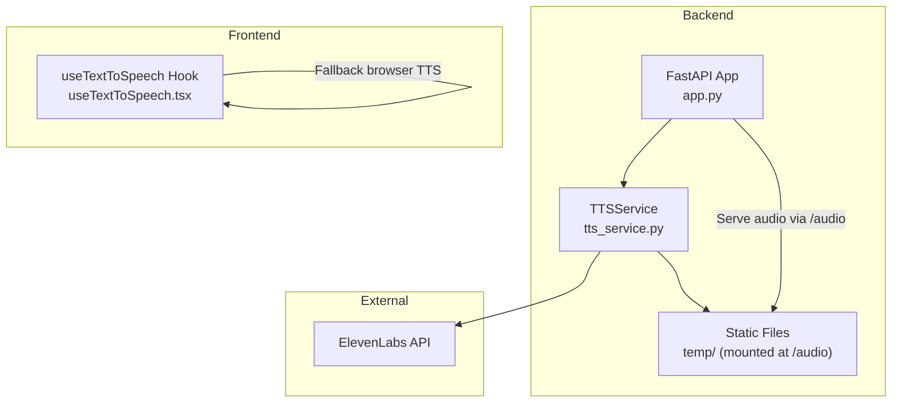
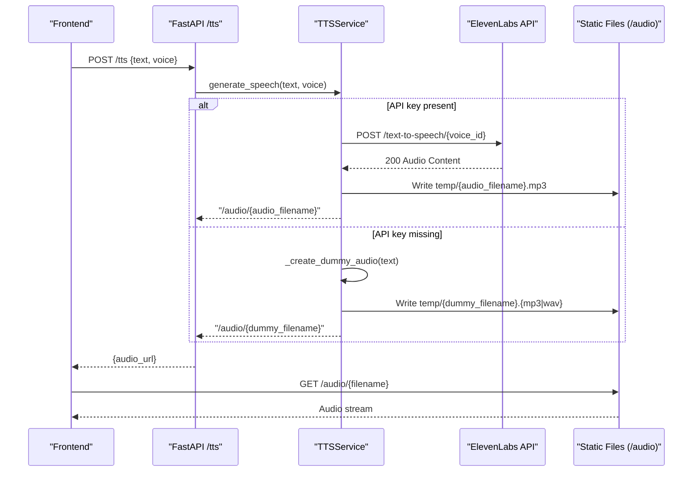
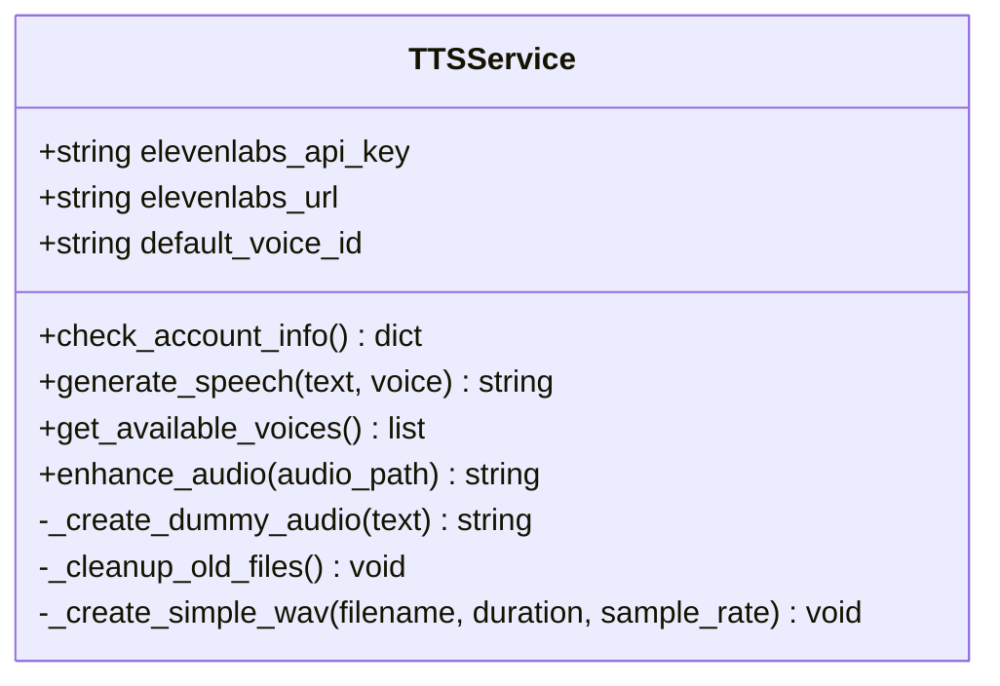
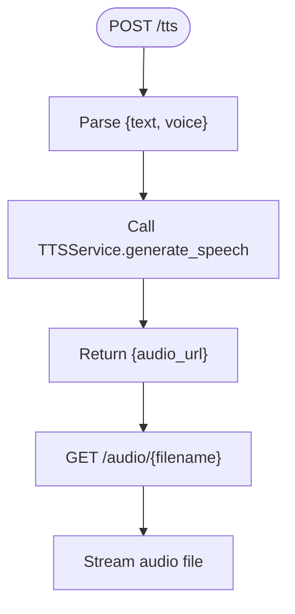
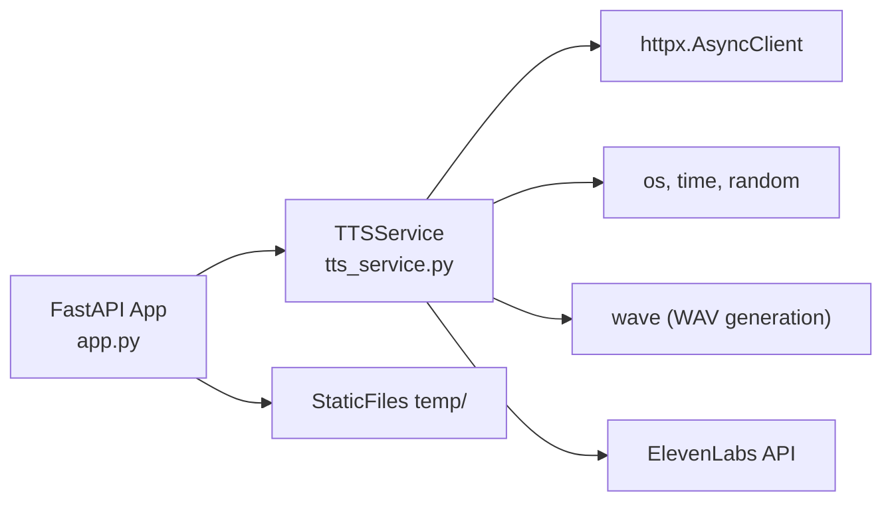

# Text-to-Speech Service

<cite>
**Referenced Files in This Document**
- [tts_service.py](file://ai-backend/services/tts_service.py)
- [app.py](file://ai-backend/app.py)
- [config.py](file://ai-backend/config.py)
- [.env](file://ai-backend/.env)
- [debug_elevenlabs.py](file://ai-backend/debug_elevenlabs.py)
- [test_elevenlabs.py](file://ai-backend/test_elevenlabs.py)
- [test_endpoints.py](file://ai-backend/test_endpoints.py)
- [useTextToSpeech.tsx](file://WEBAPP/src/hooks/useTextToSpeech.tsx)
</cite>

## Table of Contents
1. [Introduction](#introduction)
2. [Project Structure](#project-structure)
3. [Core Components](#core-components)
4. [Architecture Overview](#architecture-overview)
5. [Detailed Component Analysis](#detailed-component-analysis)
6. [Dependency Analysis](#dependency-analysis)
7. [Performance Considerations](#performance-considerations)
8. [Troubleshooting Guide](#troubleshooting-guide)
9. [Conclusion](#conclusion)

## Introduction
This document explains the Text-to-Speech (TTS) service implementation integrated with the ElevenLabs API. It covers the audio generation workflow, voice selection parameters, temporary file handling, static file serving, asynchronous processing, file naming conventions, cleanup procedures, URL generation, and media player integration. It also documents voice customization options, audio quality settings, and performance optimization for concurrent requests.

## Project Structure
The TTS service spans two primary areas:
- Backend service: Implements ElevenLabs integration, audio generation, and static file serving.
- Frontend hook: Provides a browser-native text-to-speech option for environments without backend TTS.

**Diagram sources**
- [app.py](file://ai-backend/app.py#L38-L40)
- [tts_service.py](file://ai-backend/services/tts_service.py#L10-L21)
- [useTextToSpeech.tsx](file://WEBAPP/src/hooks/useTextToSpeech.tsx#L1-L42)

**Section sources**
- [app.py](file://ai-backend/app.py#L1-L154)
- [tts_service.py](file://ai-backend/services/tts_service.py#L1-L280)
- [useTextToSpeech.tsx](file://WEBAPP/src/hooks/useTextToSpeech.tsx#L1-L42)

## Core Components
- TTSService: Manages ElevenLabs API integration, voice selection, audio generation, fallback generation, and cleanup.
- FastAPI app: Exposes the /tts endpoint, mounts static audio files under /audio, and initializes services lazily.
- Environment configuration: Loads ElevenLabs credentials and voice defaults.
- Frontend hook: Provides browser-native speech synthesis as a fallback.

Key responsibilities:
- Asynchronous ElevenLabs text-to-speech requests with robust error handling.
- Unique file naming with timestamps and hashes to prevent caching conflicts.
- Periodic cleanup of old audio files.
- Static file serving for generated audio.
- Fallback to dummy audio when ElevenLabs is unavailable.

**Section sources**
- [tts_service.py](file://ai-backend/services/tts_service.py#L10-L280)
- [app.py](file://ai-backend/app.py#L96-L108)
- [config.py](file://ai-backend/config.py#L17-L19)
- [.env](file://ai-backend/.env#L7-L14)
- [useTextToSpeech.tsx](file://WEBAPP/src/hooks/useTextToSpeech.tsx#L1-L42)

## Architecture Overview
The TTS workflow integrates ElevenLabs for high-quality voice synthesis, with fallback mechanisms and static file serving for playback.

**Diagram sources**
- [app.py](file://ai-backend/app.py#L96-L108)
- [tts_service.py](file://ai-backend/services/tts_service.py#L53-L144)
- [app.py](file://ai-backend/app.py#L38-L40)

## Detailed Component Analysis

### TTSService Implementation
The TTSService encapsulates ElevenLabs integration and local fallback audio generation.

**Diagram sources**
- [tts_service.py](file://ai-backend/services/tts_service.py#L10-L280)

Key behaviors:
- Initialization loads ElevenLabs API key and default voice ID from environment.
- generate_speech orchestrates ElevenLabs requests, writes unique-named audio files, and returns a static URL.
- Fallback creates dummy audio using either a placeholder or a generated WAV, then renames to MP3 if possible.
- Cleanup removes old audio files older than one hour to manage disk usage.
- Voice selection supports "default" or a specific voice ID; available voices can be fetched from ElevenLabs.

Voice customization and quality:
- Model ID: "eleven_monolingual_v1".
- Voice settings include stability and similarity_boost parameters.
- Voice selection via voice parameter or default voice ID.

Temporary file handling:
- Files stored in temp/.
- Naming convention includes a hash of the input text and a millisecond timestamp to avoid collisions and caching.
- Dummy audio filenames include a random suffix for uniqueness.

Static file serving:
- FastAPI mounts the temp directory under /audio for serving audio files.
- URLs returned by generate_speech are prefixed with "/audio/".

Asynchronous processing:
- Uses httpx.AsyncClient for non-blocking API calls.
- Includes timeouts for network requests to prevent hanging.

Error handling:
- Handles 401 (authorization/quota), 422 (invalid request), timeouts, and general exceptions by falling back to dummy audio.
- Logs detailed errors and warnings for diagnostics.

**Section sources**
- [tts_service.py](file://ai-backend/services/tts_service.py#L10-L280)

### FastAPI Endpoint and Static Serving
The backend exposes a single endpoint for TTS and serves audio files via static routing.

**Diagram sources**
- [app.py](file://ai-backend/app.py#L96-L108)
- [app.py](file://ai-backend/app.py#L38-L40)

Behavior:
- Endpoint validates input, delegates to TTSService, and returns a static URL.
- Static files are mounted at runtime to serve MP3/WAV files from temp/.

**Section sources**
- [app.py](file://ai-backend/app.py#L96-L108)
- [app.py](file://ai-backend/app.py#L38-L40)

### Environment Configuration and Validation
- ElevenLabs API key and voice ID are configured via environment variables.
- A dedicated debug script validates the API key and checks voice availability.
- An endpoint tester verifies that the backend serves audio files correctly.

**Section sources**
- [config.py](file://ai-backend/config.py#L17-L19)
- [.env](file://ai-backend/.env#L7-L14)
- [debug_elevenlabs.py](file://ai-backend/debug_elevenlabs.py#L12-L111)
- [test_endpoints.py](file://ai-backend/test_endpoints.py#L12-L87)

### Frontend Fallback Hook
The frontend provides a browser-native text-to-speech fallback when backend TTS is unavailable.

- Uses Web Speech API for synthesis.
- Allows customization of rate, pitch, and volume.
- Supports an optional callback on speech completion.

Note: This is independent of the backend ElevenLabs service and is intended for environments without backend audio generation.

**Section sources**
- [useTextToSpeech.tsx](file://WEBAPP/src/hooks/useTextToSpeech.tsx#L1-L42)

## Dependency Analysis
The TTS service depends on:
- httpx for asynchronous HTTP requests.
- Python standard library modules for file I/O, hashing, and WAV generation.
- FastAPI for endpoint exposure and static file serving.
- Environment variables for ElevenLabs credentials.

**Diagram sources**
- [tts_service.py](file://ai-backend/services/tts_service.py#L1-L8)
- [app.py](file://ai-backend/app.py#L1-L9)

**Section sources**
- [tts_service.py](file://ai-backend/services/tts_service.py#L1-L8)
- [app.py](file://ai-backend/app.py#L1-L9)

## Performance Considerations
- Concurrency: httpx.AsyncClient enables concurrent requests to ElevenLabs and reduces latency.
- Timeouts: Network timeouts prevent slow requests from blocking the service.
- Disk cleanup: Periodic removal of old audio files prevents unbounded growth of the temp directory.
- File naming: Timestamps and hashes ensure unique filenames and avoid stale cache hits.
- Static serving: FastAPI’s StaticFiles efficiently streams audio without loading entire files into memory.

Recommendations:
- Scale horizontally by running multiple backend instances behind a load balancer.
- Monitor ElevenLabs quotas and consider rate limiting at the application level if needed.
- Use CDN or reverse proxy for static audio delivery in production.

[No sources needed since this section provides general guidance]

## Troubleshooting Guide
Common issues and resolutions:
- Missing ElevenLabs API key:
  - Verify environment variables and restart the backend.
  - Use the debug script to confirm key validity and quota status.
- Quota exceeded or unauthorized:
  - ElevenLabs returns 401 or 422; the service falls back to dummy audio.
  - Check account limits and upgrade if necessary.
- Audio not playing:
  - Confirm static serving is enabled and the temp directory exists.
  - Use the endpoint tester to validate audio accessibility.
- Voice not found:
  - Fetch available voices and ensure the selected voice ID exists on your account.

**Section sources**
- [tts_service.py](file://ai-backend/services/tts_service.py#L107-L136)
- [debug_elevenlabs.py](file://ai-backend/debug_elevenlabs.py#L12-L111)
- [test_endpoints.py](file://ai-backend/test_endpoints.py#L12-L87)

## Conclusion
The TTS service provides a robust, asynchronous integration with ElevenLabs for high-quality voice synthesis, with strong fallbacks and efficient static file serving. Its design ensures scalability, resilience against API failures, and predictable performance for concurrent requests. The frontend hook complements the backend by offering a browser-native fallback for environments without backend audio generation.