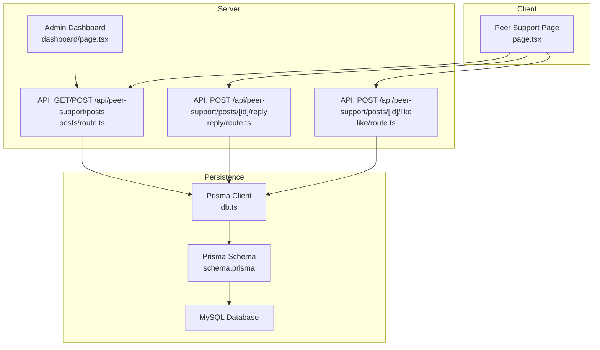
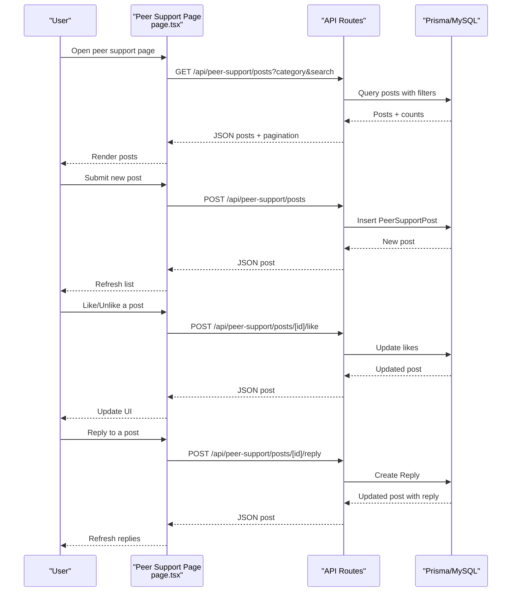
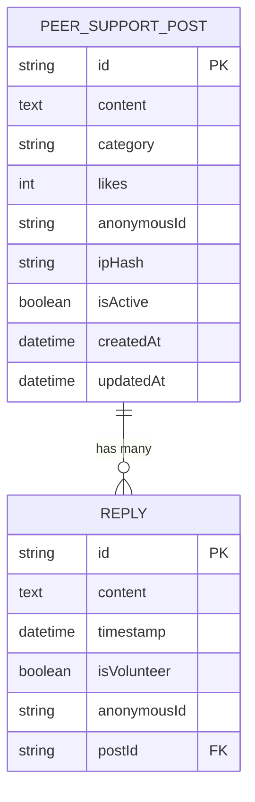
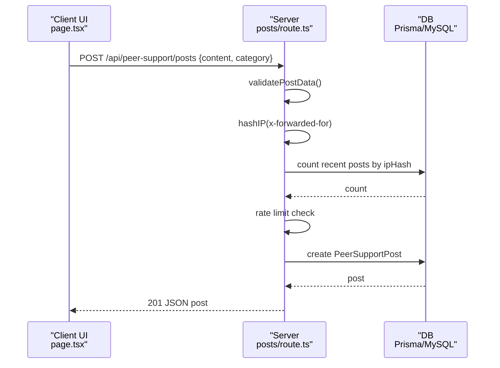
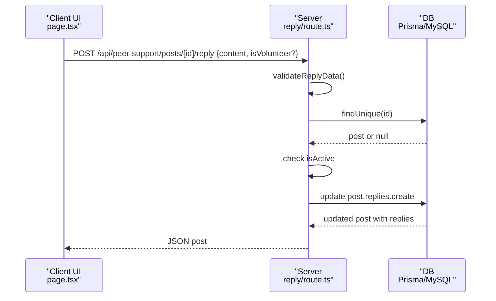
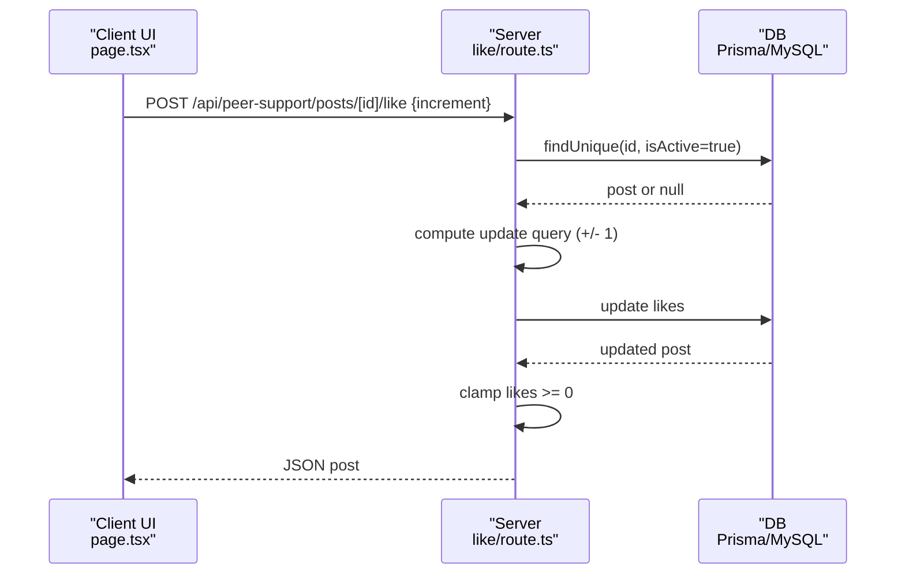
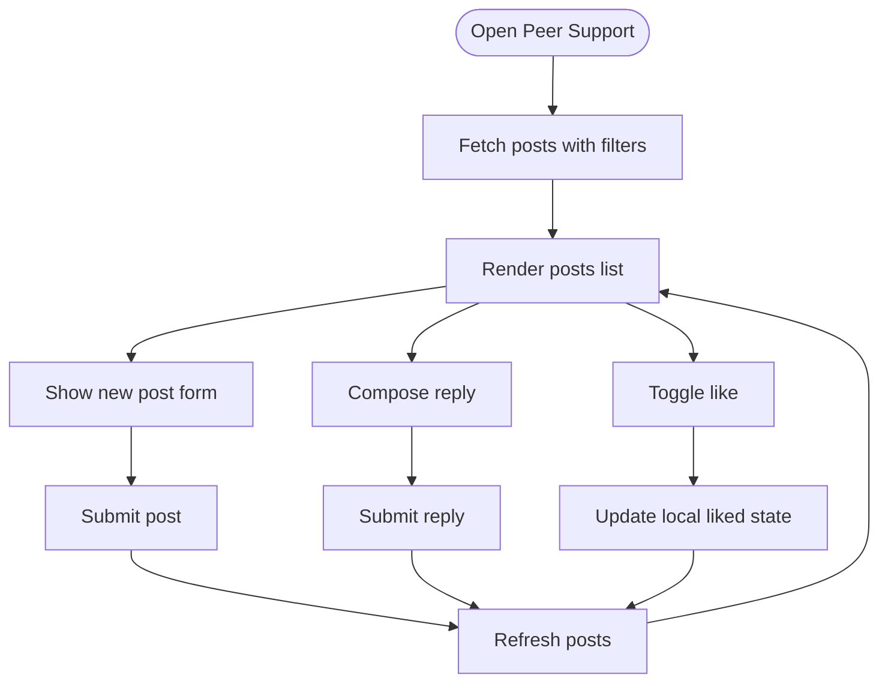
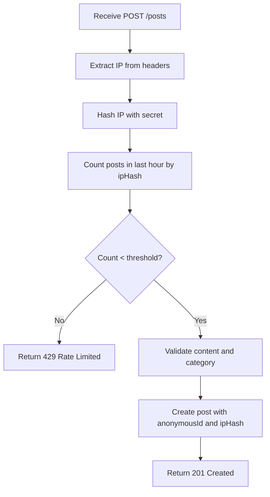
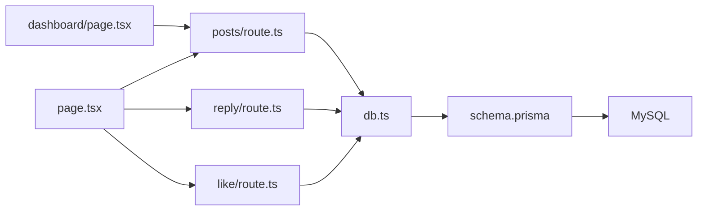

# Community Features

<cite>
**Referenced Files in This Document**
- [page.tsx](file://WEBAPP/src/app/peer-support/page.tsx)
- [posts/route.ts](file://WEBAPP/src/app/api/peer-support/posts/route.ts)
- [reply/route.ts](file://WEBAPP/src/app/api/peer-support/posts/[id]/reply/route.ts)
- [like/route.ts](file://WEBAPP/src/app/api/peer-support/posts/[id]/like/route.ts)
- [schema.prisma](file://WEBAPP/prisma/schema.prisma)
- [db.ts](file://WEBAPP/src/lib/db.ts)
- [dashboard/page.tsx](file://WEBAPP/src/app/admin/dashboard/page.tsx)
</cite>

## Table of Contents
1. [Introduction](#introduction)
2. [Project Structure](#project-structure)
3. [Core Components](#core-components)
4. [Architecture Overview](#architecture-overview)
5. [Detailed Component Analysis](#detailed-component-analysis)
6. [Dependency Analysis](#dependency-analysis)
7. [Performance Considerations](#performance-considerations)
8. [Troubleshooting Guide](#troubleshooting-guide)
9. [Conclusion](#conclusion)
10. [Appendices](#appendices)

## Introduction
This document explains the community and peer support features centered around the anonymous peer support forum. It covers the architecture enabling anonymous posting, community interaction via likes and replies, moderation workflows, spam prevention, and administrative oversight. It also outlines privacy considerations for anonymous participation, community safety measures, and integration points with professional support resources.

## Project Structure
The peer support forum is implemented as a Next.js app with a dedicated page and a set of API routes under the peer-support namespace. Data persistence is handled by Prisma connected to a MySQL database. Administrative dashboards manage users and verification workflows.

**Diagram sources**
- [page.tsx](file://WEBAPP/src/app/peer-support/page.tsx#L1-L523)
- [posts/route.ts](file://WEBAPP/src/app/api/peer-support/posts/route.ts#L1-L161)
- [reply/route.ts](file://WEBAPP/src/app/api/peer-support/posts/[id]/reply/route.ts#L1-L100)
- [like/route.ts](file://WEBAPP/src/app/api/peer-support/posts/[id]/like/route.ts#L1-L58)
- [db.ts](file://WEBAPP/src/lib/db.ts#L1-L15)
- [schema.prisma](file://WEBAPP/prisma/schema.prisma#L1-L330)
- [dashboard/page.tsx](file://WEBAPP/src/app/admin/dashboard/page.tsx#L1-L510)

**Section sources**
- [page.tsx](file://WEBAPP/src/app/peer-support/page.tsx#L1-L523)
- [posts/route.ts](file://WEBAPP/src/app/api/peer-support/posts/route.ts#L1-L161)
- [reply/route.ts](file://WEBAPP/src/app/api/peer-support/posts/[id]/reply/route.ts#L1-L100)
- [like/route.ts](file://WEBAPP/src/app/api/peer-support/posts/[id]/like/route.ts#L1-L58)
- [schema.prisma](file://WEBAPP/prisma/schema.prisma#L79-L106)
- [db.ts](file://WEBAPP/src/lib/db.ts#L1-L15)
- [dashboard/page.tsx](file://WEBAPP/src/app/admin/dashboard/page.tsx#L1-L510)

## Core Components
- Anonymous peer support forum UI: renders posts, categories, search, filters, and supports new post creation, replying, and liking.
- API endpoints:
  - List/create posts with category and content validation.
  - Add replies to posts with validation and anonymous identity generation.
  - Update likes with increment/decrement and bounds checking.
- Data model: posts and replies with anonymized identities, timestamps, and activity flags.
- Admin dashboard: manages users and verification workflows.

Key capabilities:
- Anonymous posting and replies with generated identifiers.
- Client-side and server-side validations.
- Spam prevention via IP hashing and rate limiting.
- Moderation-ready fields and admin controls.

**Section sources**
- [page.tsx](file://WEBAPP/src/app/peer-support/page.tsx#L8-L26)
- [posts/route.ts](file://WEBAPP/src/app/api/peer-support/posts/route.ts#L16-L19)
- [posts/route.ts](file://WEBAPP/src/app/api/peer-support/posts/route.ts#L80-L129)
- [reply/route.ts](file://WEBAPP/src/app/api/peer-support/posts/[id]/reply/route.ts#L17-L72)
- [like/route.ts](file://WEBAPP/src/app/api/peer-support/posts/[id]/like/route.ts#L4-L57)
- [schema.prisma](file://WEBAPP/prisma/schema.prisma#L80-L106)

## Architecture Overview
The peer support forum follows a client-rendered UI pattern with serverless API routes. The UI communicates with three primary endpoints:
- GET /api/peer-support/posts: lists paginated posts with optional category and search filters.
- POST /api/peer-support/posts: creates a new post after validation and rate limiting.
- POST /api/peer-support/posts/[id]/reply: adds a reply to a post.
- POST /api/peer-support/posts/[id]/like: toggles like count for a post.

Data is persisted using Prisma with a MySQL backend. Admin controls are exposed via the admin dashboard.

**Diagram sources**
- [page.tsx](file://WEBAPP/src/app/peer-support/page.tsx#L52-L76)
- [page.tsx](file://WEBAPP/src/app/peer-support/page.tsx#L107-L136)
- [page.tsx](file://WEBAPP/src/app/peer-support/page.tsx#L168-L193)
- [page.tsx](file://WEBAPP/src/app/peer-support/page.tsx#L138-L166)
- [posts/route.ts](file://WEBAPP/src/app/api/peer-support/posts/route.ts#L21-L75)
- [posts/route.ts](file://WEBAPP/src/app/api/peer-support/posts/route.ts#L79-L129)
- [reply/route.ts](file://WEBAPP/src/app/api/peer-support/posts/[id]/reply/route.ts#L17-L72)
- [like/route.ts](file://WEBAPP/src/app/api/peer-support/posts/[id]/like/route.ts#L4-L57)

## Detailed Component Analysis

### Data Model: Posts and Replies
The Prisma schema defines two core entities for the peer support forum:
- PeerSupportPost: stores content, category, anonymous identifier, IP hash, activity flag, and timestamps; includes indexed fields for category and creation time.
- Reply: belongs to a post, stores content, timestamp, volunteer flag, anonymous identifier, and links back to the post.

**Diagram sources**
- [schema.prisma](file://WEBAPP/prisma/schema.prisma#L80-L106)

**Section sources**
- [schema.prisma](file://WEBAPP/prisma/schema.prisma#L80-L106)

### Post Creation Workflow
The client sends a POST request to create a new post. The server validates content and category, computes an IP hash for spam prevention, enforces a rate limit, generates an anonymous identifier, and persists the post.

**Diagram sources**
- [page.tsx](file://WEBAPP/src/app/peer-support/page.tsx#L107-L136)
- [posts/route.ts](file://WEBAPP/src/app/api/peer-support/posts/route.ts#L79-L129)

**Section sources**
- [page.tsx](file://WEBAPP/src/app/peer-support/page.tsx#L107-L136)
- [posts/route.ts](file://WEBAPP/src/app/api/peer-support/posts/route.ts#L16-L19)
- [posts/route.ts](file://WEBAPP/src/app/api/peer-support/posts/route.ts#L80-L129)

### Reply System
Users can add replies to posts. The server validates reply content, ensures the target post exists and is active, and creates a reply with an anonymous identifier. Replies are ordered chronologically.

**Diagram sources**
- [page.tsx](file://WEBAPP/src/app/peer-support/page.tsx#L138-L166)
- [reply/route.ts](file://WEBAPP/src/app/api/peer-support/posts/[id]/reply/route.ts#L17-L72)

**Section sources**
- [page.tsx](file://WEBAPP/src/app/peer-support/page.tsx#L138-L166)
- [reply/route.ts](file://WEBAPP/src/app/api/peer-support/posts/[id]/reply/route.ts#L79-L99)

### Like System
Users can like/unlike posts. The server accepts a boolean increment flag, updates the like count atomically, prevents negative counts, and returns the updated post.

**Diagram sources**
- [page.tsx](file://WEBAPP/src/app/peer-support/page.tsx#L168-L193)
- [like/route.ts](file://WEBAPP/src/app/api/peer-support/posts/[id]/like/route.ts#L4-L57)

**Section sources**
- [page.tsx](file://WEBAPP/src/app/peer-support/page.tsx#L168-L193)
- [like/route.ts](file://WEBAPP/src/app/api/peer-support/posts/[id]/like/route.ts#L26-L51)

### Client-Side UI and Interactions
The UI handles:
- Loading states and refresh.
- Category filtering and search.
- Anonymous post creation with category selection.
- Reply composition and submission.
- Like toggling with optimistic UI updates and refresh.
- Display of anonymous identifiers and timestamps.

**Diagram sources**
- [page.tsx](file://WEBAPP/src/app/peer-support/page.tsx#L52-L76)
- [page.tsx](file://WEBAPP/src/app/peer-support/page.tsx#L107-L136)
- [page.tsx](file://WEBAPP/src/app/peer-support/page.tsx#L138-L166)
- [page.tsx](file://WEBAPP/src/app/peer-support/page.tsx#L168-L193)

**Section sources**
- [page.tsx](file://WEBAPP/src/app/peer-support/page.tsx#L39-L206)
- [page.tsx](file://WEBAPP/src/app/peer-support/page.tsx#L294-L338)
- [page.tsx](file://WEBAPP/src/app/peer-support/page.tsx#L340-L498)

### Content Moderation Tools and Spam Prevention
- IP-based spam prevention: server hashes the client IP with a secret and limits posts per hour per IP.
- Rate limiting: enforced via counting recent posts within an hour.
- Post/activity flags: posts include an activity flag suitable for moderation actions.
- Reporting affordance: UI includes a report action per post for flagging inappropriate content.
- Admin controls: dashboard supports banning/unbanning users and managing verification status.

**Diagram sources**
- [posts/route.ts](file://WEBAPP/src/app/api/peer-support/posts/route.ts#L91-L107)
- [posts/route.ts](file://WEBAPP/src/app/api/peer-support/posts/route.ts#L132-L159)

**Section sources**
- [posts/route.ts](file://WEBAPP/src/app/api/peer-support/posts/route.ts#L16-L19)
- [posts/route.ts](file://WEBAPP/src/app/api/peer-support/posts/route.ts#L96-L107)
- [page.tsx](file://WEBAPP/src/app/peer-support/page.tsx#L382-L388)
- [schema.prisma](file://WEBAPP/prisma/schema.prisma#L84-L87)
- [dashboard/page.tsx](file://WEBAPP/src/app/admin/dashboard/page.tsx#L149-L163)

### Community Guidelines and Safety
- The UI displays community guidelines prominently, including reminders to be respectful, keep discussions relevant, and report inappropriate content.
- Crisis guidance is included in the guidelines footer.

**Section sources**
- [page.tsx](file://WEBAPP/src/app/peer-support/page.tsx#L500-L517)

### Privacy Considerations for Anonymous Posting
- Anonymous identifiers are generated per post and reply to avoid linking identities across time.
- IP addresses are hashed server-side to mitigate abuse while preserving rate-limiting capability.
- No personally identifiable information is stored in posts or replies.

**Section sources**
- [posts/route.ts](file://WEBAPP/src/app/api/peer-support/posts/route.ts#L6-L14)
- [reply/route.ts](file://WEBAPP/src/app/api/peer-support/posts/[id]/reply/route.ts#L7-L15)
- [posts/route.ts](file://WEBAPP/src/app/api/peer-support/posts/route.ts#L16-L19)

### Reputation and Trusted Member Features
- Current implementation does not define explicit reputation scoring or trusted member badges.
- The schema includes a volunteer flag on replies, which can be leveraged later to surface trusted contributions.

**Section sources**
- [schema.prisma](file://WEBAPP/prisma/schema.prisma#L100-L103)
- [reply/route.ts](file://WEBAPP/src/app/api/peer-support/posts/[id]/reply/route.ts#L27-L33)

### Integration with Professional Support Resources
- The UI includes a “Crisis” guideline item advising users to contact emergency services or campus counseling immediately.
- Administrators can ban users who violate community guidelines, reducing risk exposure.

**Section sources**
- [page.tsx](file://WEBAPP/src/app/peer-support/page.tsx#L511-L512)
- [dashboard/page.tsx](file://WEBAPP/src/app/admin/dashboard/page.tsx#L441-L464)

## Dependency Analysis
The peer support module depends on:
- Prisma client for database operations.
- MySQL for persistent storage.
- Next.js API routes for server-side logic.
- Admin dashboard for moderation and user management.

**Diagram sources**
- [page.tsx](file://WEBAPP/src/app/peer-support/page.tsx#L1-L523)
- [posts/route.ts](file://WEBAPP/src/app/api/peer-support/posts/route.ts#L1-L161)
- [reply/route.ts](file://WEBAPP/src/app/api/peer-support/posts/[id]/reply/route.ts#L1-L100)
- [like/route.ts](file://WEBAPP/src/app/api/peer-support/posts/[id]/like/route.ts#L1-L58)
- [db.ts](file://WEBAPP/src/lib/db.ts#L1-L15)
- [schema.prisma](file://WEBAPP/prisma/schema.prisma#L1-L330)
- [dashboard/page.tsx](file://WEBAPP/src/app/admin/dashboard/page.tsx#L1-L510)

**Section sources**
- [db.ts](file://WEBAPP/src/lib/db.ts#L1-L15)
- [schema.prisma](file://WEBAPP/prisma/schema.prisma#L1-L330)

## Performance Considerations
- Pagination: API lists posts with a fixed page size and returns pagination metadata.
- Indexes: Prisma schema includes indexes on category and createdAt for efficient queries.
- Client caching: The UI caches liked state locally to reduce unnecessary re-fetches.
- Recommendations:
  - Consider implementing server-side pagination with cursor-based pagination for large datasets.
  - Add server-side caching for popular categories or trending posts.
  - Optimize reply retrieval by limiting initial reply load and lazy-loading additional replies.

**Section sources**
- [posts/route.ts](file://WEBAPP/src/app/api/peer-support/posts/route.ts#L27-L28)
- [posts/route.ts](file://WEBAPP/src/app/api/peer-support/posts/route.ts#L47-L60)
- [schema.prisma](file://WEBAPP/prisma/schema.prisma#L92-L94)

## Troubleshooting Guide
Common issues and resolutions:
- Post creation fails with validation errors: ensure content length and category are valid.
- Rate limit exceeded: wait before posting again; verify IP header forwarding.
- Reply creation fails: ensure content meets minimum length and character limits.
- Like update fails: confirm the post exists and is active; verify increment flag is boolean.
- Admin actions unauthorized: ensure admin token is present and valid.

**Section sources**
- [posts/route.ts](file://WEBAPP/src/app/api/peer-support/posts/route.ts#L132-L159)
- [posts/route.ts](file://WEBAPP/src/app/api/peer-support/posts/route.ts#L105-L107)
- [reply/route.ts](file://WEBAPP/src/app/api/peer-support/posts/[id]/reply/route.ts#L83-L99)
- [like/route.ts](file://WEBAPP/src/app/api/peer-support/posts/[id]/like/route.ts#L13-L15)
- [dashboard/page.tsx](file://WEBAPP/src/app/admin/dashboard/page.tsx#L76-L84)

## Conclusion
The peer support forum provides a robust foundation for anonymous, community-driven mental health support. It balances user privacy with moderation readiness, incorporates spam prevention, and offers clear safety guidelines. Future enhancements could include reputation scoring, trusted member badges, and deeper integration with professional support resources.

## Appendices
- API endpoint summary:
  - GET /api/peer-support/posts: Lists posts with category and search filters.
  - POST /api/peer-support/posts: Creates a new post with validation and rate limiting.
  - POST /api/peer-support/posts/[id]/reply: Adds a reply to a post.
  - POST /api/peer-support/posts/[id]/like: Updates like count for a post.

**Section sources**
- [posts/route.ts](file://WEBAPP/src/app/api/peer-support/posts/route.ts#L21-L75)
- [posts/route.ts](file://WEBAPP/src/app/api/peer-support/posts/route.ts#L79-L129)
- [reply/route.ts](file://WEBAPP/src/app/api/peer-support/posts/[id]/reply/route.ts#L17-L72)
- [like/route.ts](file://WEBAPP/src/app/api/peer-support/posts/[id]/like/route.ts#L4-L57)