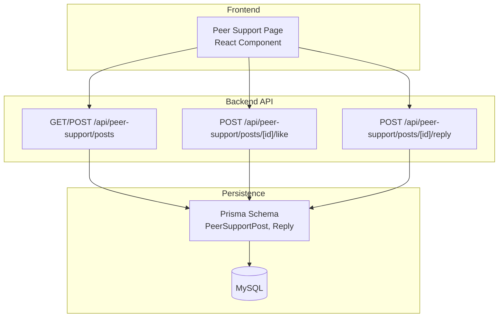
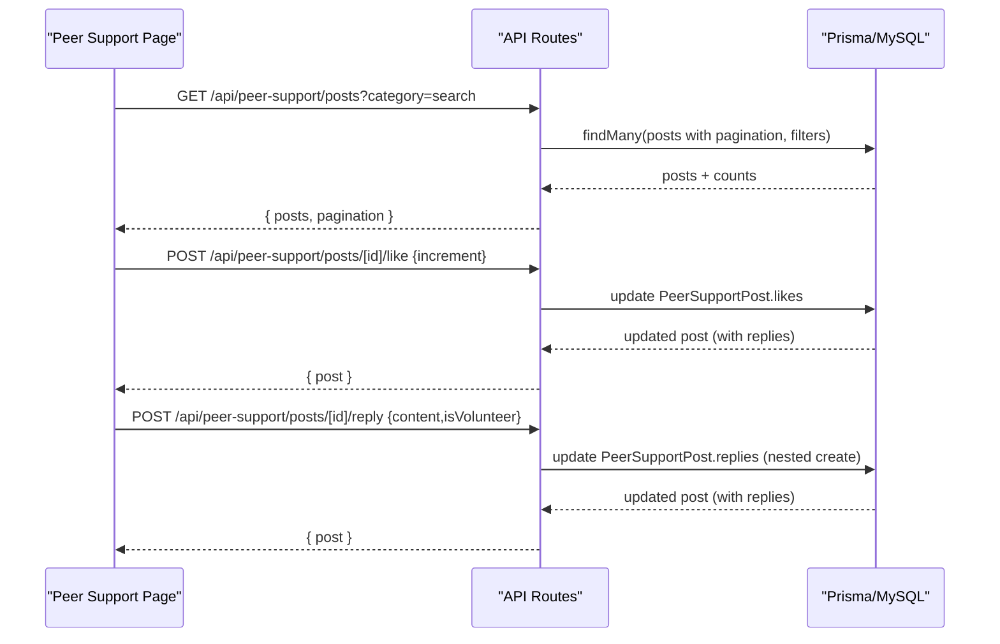
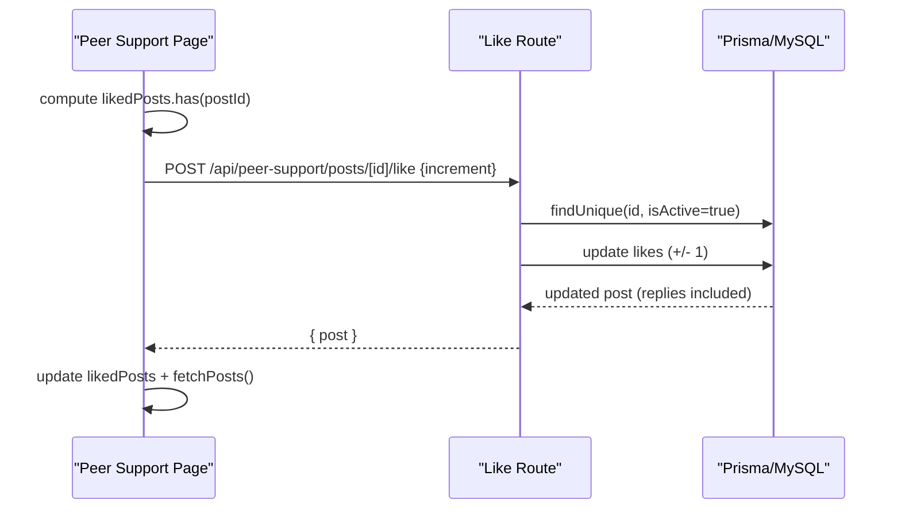
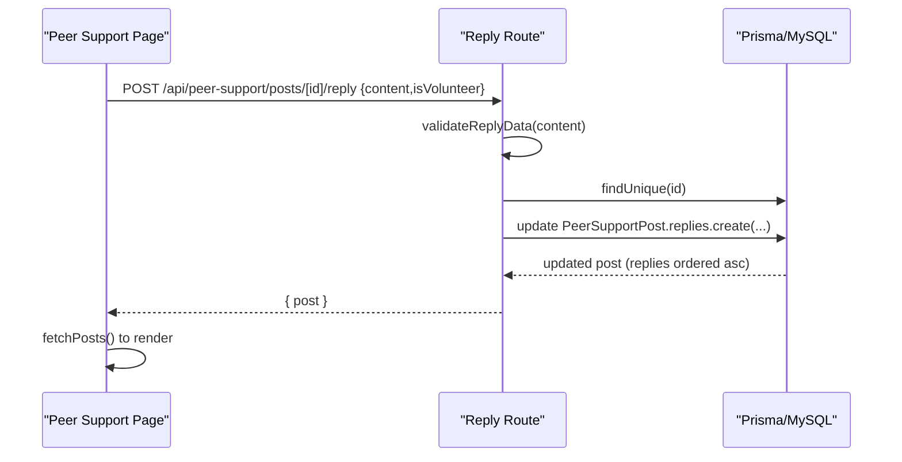
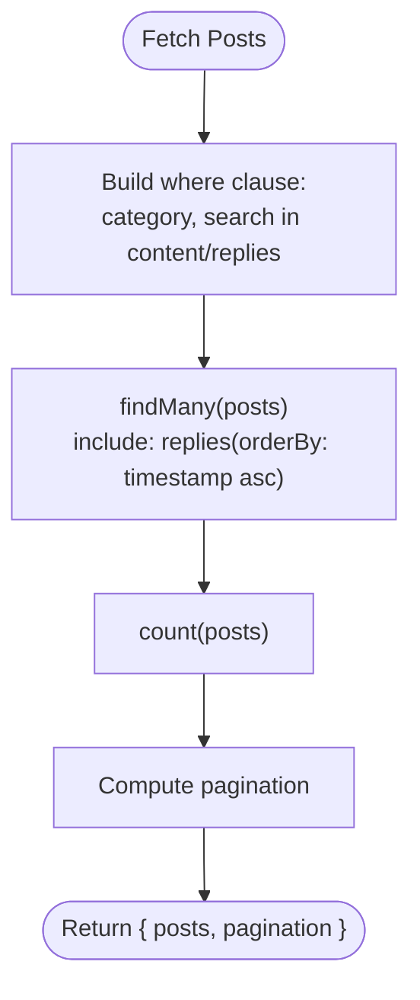
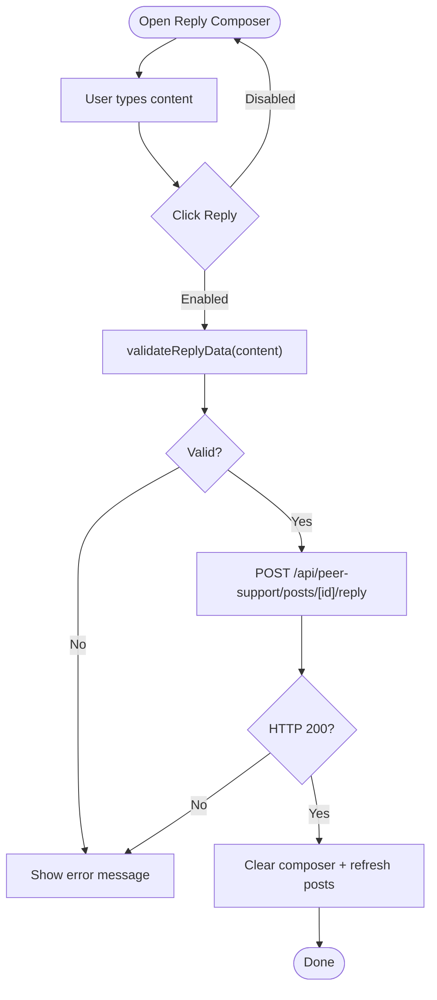
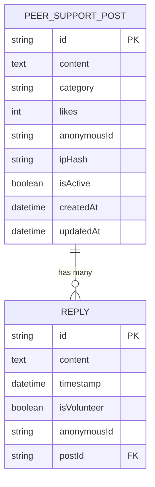

# Community Interaction Features

<cite>
**Referenced Files in This Document**
- [schema.prisma](file://WEBAPP/prisma/schema.prisma)
- [migration.sql](file://WEBAPP/prisma/migrations/20251105192017_add_therapy_models/migration.sql)
- [db.ts](file://WEBAPP/src/lib/db.ts)
- [posts.route.ts](file://WEBAPP/src/app/api/peer-support/posts/route.ts)
- [posts.like.route.ts](file://WEBAPP/src/app/api/peer-support/posts/[id]/like/route.ts)
- [posts.reply.route.ts](file://WEBAPP/src/app/api/peer-support/posts/[id]/reply/route.ts)
- [peer-support.page.tsx](file://WEBAPP/src/app/peer-support/page.tsx)
- [analytics.admin.route.ts](file://WEBAPP/src/app/api/admin/analytics/route.ts)
</cite>

## Table of Contents
1. [Introduction](#introduction)
2. [Project Structure](#project-structure)
3. [Core Components](#core-components)
4. [Architecture Overview](#architecture-overview)
5. [Detailed Component Analysis](#detailed-component-analysis)
6. [Dependency Analysis](#dependency-analysis)
7. [Performance Considerations](#performance-considerations)
8. [Troubleshooting Guide](#troubleshooting-guide)
9. [Conclusion](#conclusion)

## Introduction
This document explains the community interaction features centered around peer support posts, including likes, replies, and engagement tracking. It covers:
- Like toggling with counter updates and safety checks
- Reply creation with anonymous identities and validation
- Engagement metrics (like counts, reply counts)
- Reply form validation, submission, and real-time updates
- Community engagement patterns, user motivation, and social proof
- Example API endpoints, state synchronization, and performance optimizations for large threads

## Project Structure
The community features span frontend UI and backend APIs backed by a relational schema:
- Frontend: peer support page renders posts, handles user actions, and synchronizes state
- Backend: REST-like API routes manage posts, likes, and replies
- Persistence: Prisma schema defines PeerSupportPost and Reply entities with indexes

**Diagram sources**
- [peer-support.page.tsx](file://WEBAPP/src/app/peer-support/page.tsx#L53-L76)
- [posts.route.ts](file://WEBAPP/src/app/api/peer-support/posts/route.ts#L21-L75)
- [posts.like.route.ts](file://WEBAPP/src/app/api/peer-support/posts/[id]/like/route.ts#L4-L58)
- [posts.reply.route.ts](file://WEBAPP/src/app/api/peer-support/posts/[id]/reply/route.ts#L20-L72)
- [schema.prisma](file://WEBAPP/prisma/schema.prisma#L80-L106)

**Section sources**
- [peer-support.page.tsx](file://WEBAPP/src/app/peer-support/page.tsx#L1-L523)
- [posts.route.ts](file://WEBAPP/src/app/api/peer-support/posts/route.ts#L1-L161)
- [posts.like.route.ts](file://WEBAPP/src/app/api/peer-support/posts/[id]/like/route.ts#L1-L58)
- [posts.reply.route.ts](file://WEBAPP/src/app/api/peer-support/posts/[id]/reply/route.ts#L1-L100)
- [schema.prisma](file://WEBAPP/prisma/schema.prisma#L80-L106)

## Core Components
- PeerSupportPost entity stores content, category, anonymous identity, IP hash, activity flag, timestamps, and a relation to replies
- Reply entity stores content, timestamp, volunteer flag, anonymous identity, and a foreign key to the post
- Frontend state tracks posts, filters, search, reply composition, and user “liked” selection
- Backend routes implement:
  - Fetching paginated posts with filtering and search
  - Creating posts with rate limiting and spam protection
  - Toggling likes with bounds checking
  - Adding replies with validation and anonymous IDs

**Section sources**
- [schema.prisma](file://WEBAPP/prisma/schema.prisma#L80-L106)
- [migration.sql](file://WEBAPP/prisma/migrations/20251105192017_add_therapy_models/migration.sql#L57-L80)
- [peer-support.page.tsx](file://WEBAPP/src/app/peer-support/page.tsx#L39-L76)
- [posts.route.ts](file://WEBAPP/src/app/api/peer-support/posts/route.ts#L21-L129)
- [posts.like.route.ts](file://WEBAPP/src/app/api/peer-support/posts/[id]/like/route.ts#L4-L58)
- [posts.reply.route.ts](file://WEBAPP/src/app/api/peer-support/posts/[id]/reply/route.ts#L20-L72)

## Architecture Overview
The system follows a client-server pattern:
- The React page performs fetches to API endpoints
- API routes validate inputs, enforce business rules, and mutate the database via Prisma
- Responses include hydrated post data with replies for immediate UI updates

**Diagram sources**
- [peer-support.page.tsx](file://WEBAPP/src/app/peer-support/page.tsx#L53-L76)
- [posts.route.ts](file://WEBAPP/src/app/api/peer-support/posts/route.ts#L21-L75)
- [posts.like.route.ts](file://WEBAPP/src/app/api/peer-support/posts/[id]/like/route.ts#L4-L58)
- [posts.reply.route.ts](file://WEBAPP/src/app/api/peer-support/posts/[id]/reply/route.ts#L20-L72)

## Detailed Component Analysis

### Like Functionality
- Toggle mechanism: The frontend computes whether a post is currently liked and sends a boolean increment flag to the backend
- Backend enforces type safety and existence checks, updates the like counter, and ensures non-negative values
- UI updates: Local liked set is toggled and posts are refreshed to reflect counters

**Diagram sources**
- [peer-support.page.tsx](file://WEBAPP/src/app/peer-support/page.tsx#L168-L193)
- [posts.like.route.ts](file://WEBAPP/src/app/api/peer-support/posts/[id]/like/route.ts#L4-L58)

**Section sources**
- [peer-support.page.tsx](file://WEBAPP/src/app/peer-support/page.tsx#L168-L193)
- [posts.like.route.ts](file://WEBAPP/src/app/api/peer-support/posts/[id]/like/route.ts#L4-L58)

### Reply System
- Validation: Content length and presence are validated before persisting
- Anonymous replies: Each reply receives a generated anonymous identifier
- Nested creation: The backend uses Prisma’s nested write to attach the reply to the post
- Visibility: Replies are returned with the post and rendered in ascending order

**Diagram sources**
- [peer-support.page.tsx](file://WEBAPP/src/app/peer-support/page.tsx#L138-L166)
- [posts.reply.route.ts](file://WEBAPP/src/app/api/peer-support/posts/[id]/reply/route.ts#L20-L72)

**Section sources**
- [peer-support.page.tsx](file://WEBAPP/src/app/peer-support/page.tsx#L138-L166)
- [posts.reply.route.ts](file://WEBAPP/src/app/api/peer-support/posts/[id]/reply/route.ts#L20-L72)

### Engagement Metrics Tracking
- Counters: Each PeerSupportPost maintains a likes integer and a collection of Reply entries
- Query-time aggregation: The posts endpoint returns posts with reply counts and supports searching within post content and replies
- Pagination: The API paginates posts to keep responses efficient

**Diagram sources**
- [posts.route.ts](file://WEBAPP/src/app/api/peer-support/posts/route.ts#L21-L75)

**Section sources**
- [posts.route.ts](file://WEBAPP/src/app/api/peer-support/posts/route.ts#L21-L75)
- [schema.prisma](file://WEBAPP/prisma/schema.prisma#L80-L106)

### Reply Form Implementation
- Validation: Content presence and length constraints are enforced
- Submission: The form posts to the reply endpoint with isVolunteer set appropriately
- Real-time updates: On success, the UI clears the composer and refreshes posts to show the new reply

**Diagram sources**
- [peer-support.page.tsx](file://WEBAPP/src/app/peer-support/page.tsx#L138-L166)
- [posts.reply.route.ts](file://WEBAPP/src/app/api/peer-support/posts/[id]/reply/route.ts#L83-L99)

**Section sources**
- [peer-support.page.tsx](file://WEBAPP/src/app/peer-support/page.tsx#L138-L166)
- [posts.reply.route.ts](file://WEBAPP/src/app/api/peer-support/posts/[id]/reply/route.ts#L83-L99)

### Community Engagement Patterns and Social Proof
- Social proof: Visible like counts and reply counts encourage participation
- Filtering and search: Users can discover relevant conversations quickly
- Anonymous identity: Supports candid sharing while maintaining safety
- Guideline reinforcement: Footer communicates community standards to foster a respectful environment

[No sources needed since this section synthesizes behavioral observations without quoting specific code]

### Example Interaction API Endpoints
- GET /api/peer-support/posts
  - Query parameters: category (string), search (string), page (number)
  - Returns: posts array and pagination metadata
- POST /api/peer-support/posts
  - Body: content (string), category (string)
  - Returns: newly created post
- POST /api/peer-support/posts/[id]/like
  - Body: increment (boolean)
  - Returns: updated post with replies
- POST /api/peer-support/posts/[id]/reply
  - Body: content (string), isVolunteer (boolean, optional)
  - Returns: updated post with replies

**Section sources**
- [posts.route.ts](file://WEBAPP/src/app/api/peer-support/posts/route.ts#L21-L129)
- [posts.like.route.ts](file://WEBAPP/src/app/api/peer-support/posts/[id]/like/route.ts#L4-L58)
- [posts.reply.route.ts](file://WEBAPP/src/app/api/peer-support/posts/[id]/reply/route.ts#L20-L72)

### State Synchronization Patterns
- Local optimistic UI: The frontend toggles liked state locally and refreshes posts to reconcile server state
- Controlled forms: Composer state is cleared on successful submission
- Debounced refresh: Posts are re-fetched after each mutation to ensure UI consistency

**Section sources**
- [peer-support.page.tsx](file://WEBAPP/src/app/peer-support/page.tsx#L168-L193)
- [peer-support.page.tsx](file://WEBAPP/src/app/peer-support/page.tsx#L138-L166)

## Dependency Analysis
- Frontend depends on:
  - API endpoints for data and mutations
  - Prisma client for database access (via API)
- Backend depends on:
  - Prisma schema for entity definitions and relations
  - Database for persistence
- Entities:
  - PeerSupportPost has a one-to-many relationship with Reply
  - Indexes on category and createdAt optimize queries

**Diagram sources**
- [schema.prisma](file://WEBAPP/prisma/schema.prisma#L80-L106)
- [migration.sql](file://WEBAPP/prisma/migrations/20251105192017_add_therapy_models/migration.sql#L57-L80)

**Section sources**
- [schema.prisma](file://WEBAPP/prisma/schema.prisma#L80-L106)
- [db.ts](file://WEBAPP/src/lib/db.ts#L1-L15)

## Performance Considerations
- Pagination: The posts endpoint limits results and computes total pages to avoid large payloads
- Indexes: Category and createdAt indexes improve filtering and sorting
- Selective includes: Replies are included with ordering to reduce client-side work
- Rate limiting: Creation endpoints throttle submissions by IP hash to prevent spam
- Defensive updates: Like decrements are bounded to prevent negatives

Recommendations:
- Lazy load replies beyond initial viewport
- Consider server-side reply pagination for very large threads
- Cache frequently accessed categories and recent posts at CDN edge where appropriate
- Monitor slow queries and add composite indexes if needed

**Section sources**
- [posts.route.ts](file://WEBAPP/src/app/api/peer-support/posts/route.ts#L21-L75)
- [schema.prisma](file://WEBAPP/prisma/schema.prisma#L92-L93)
- [posts.like.route.ts](file://WEBAPP/src/app/api/peer-support/posts/[id]/like/route.ts#L41-L51)

## Troubleshooting Guide
Common issues and resolutions:
- Invalid increment type in like requests: Ensure the payload contains a boolean increment field
- Post not found during like/reply: Verify the post ID and that the post is active
- Reply validation errors: Ensure content is present and within length limits
- Rate limit exceeded on post creation: Wait for the cooldown period before posting again
- Admin analytics unauthorized: Confirm bearer token and role claims

**Section sources**
- [posts.like.route.ts](file://WEBAPP/src/app/api/peer-support/posts/[id]/like/route.ts#L13-L24)
- [posts.reply.route.ts](file://WEBAPP/src/app/api/peer-support/posts/[id]/reply/route.ts#L30-L42)
- [posts.route.ts](file://WEBAPP/src/app/api/peer-support/posts/route.ts#L96-L107)
- [analytics.admin.route.ts](file://WEBAPP/src/app/api/admin/analytics/route.ts#L7-L17)

## Conclusion
The community interaction system combines a simple, robust API with a responsive UI to enable anonymous peer support. Likes and replies are persisted with strong validation and safety checks, while pagination and indexing keep performance predictable. The design encourages participation through social proof and clear engagement signals, and the architecture supports future enhancements like expanded reply threading and advanced analytics.