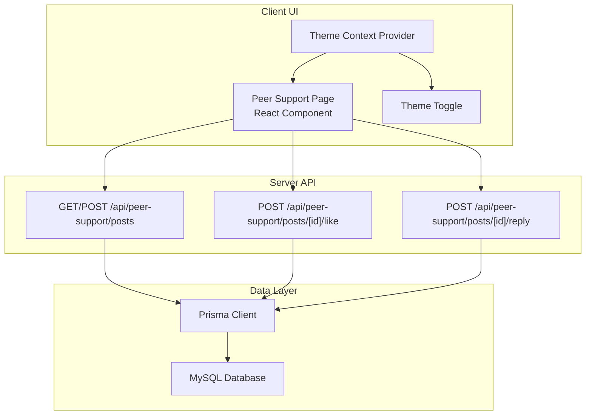
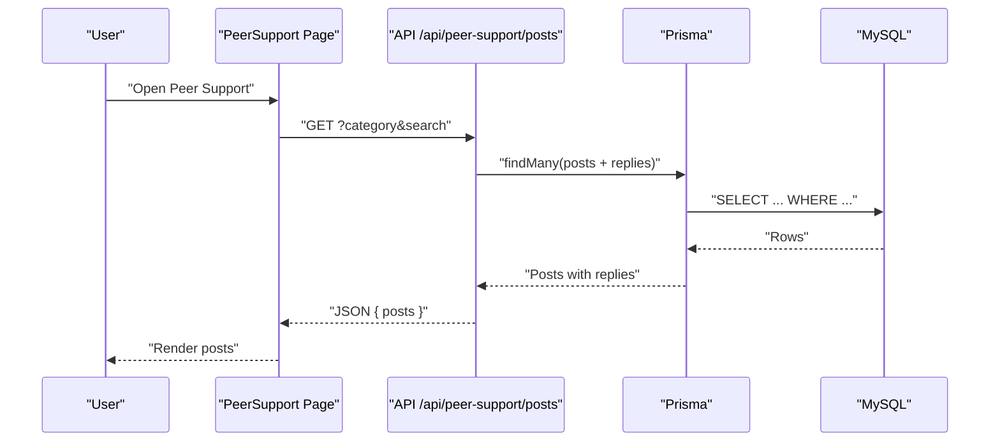
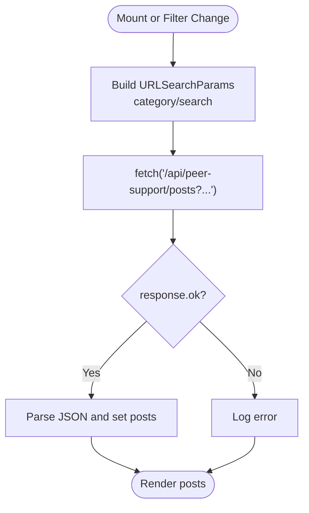
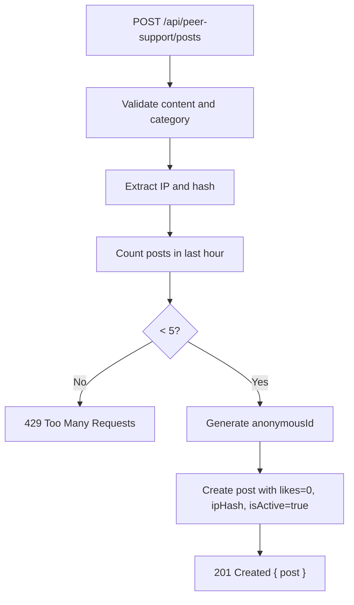
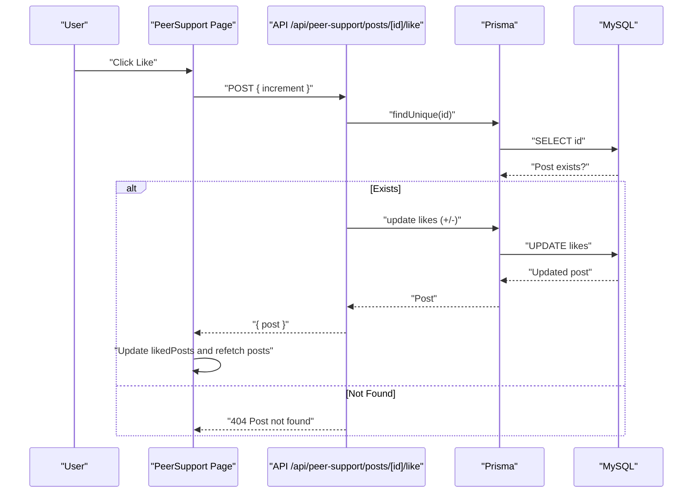
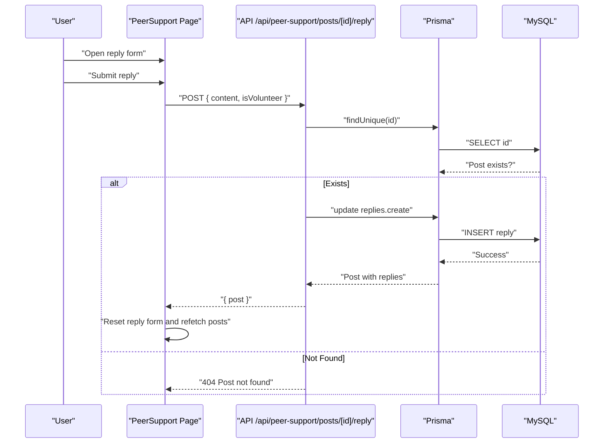
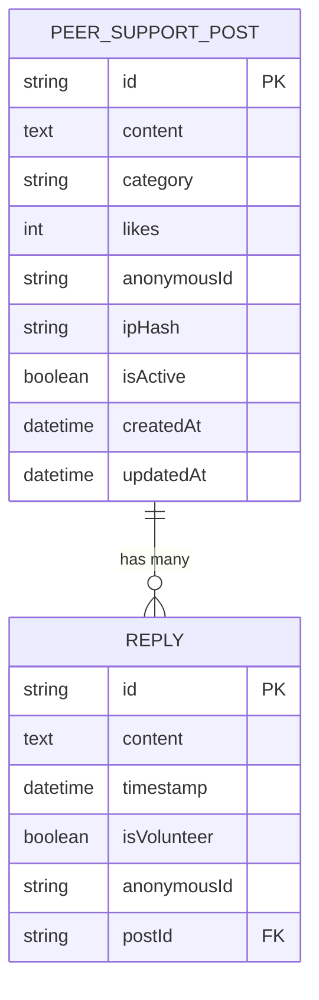
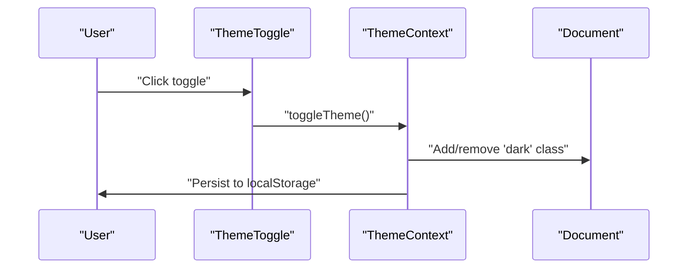
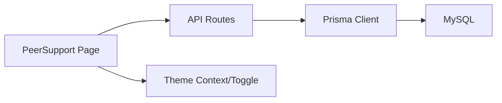

# Forum Architecture

<cite>
**Referenced Files in This Document**
- [page.tsx](file://WEBAPP/src/app/peer-support/page.tsx)
- [route.ts](file://WEBAPP/src/app/api/peer-support/posts/route.ts)
- [route.ts](file://WEBAPP/src/app/api/peer-support/posts/[id]/like/route.ts)
- [route.ts](file://WEBAPP/src/app/api/peer-support/posts/[id]/reply/route.ts)
- [schema.prisma](file://WEBAPP/prisma/schema.prisma)
- [db.ts](file://WEBAPP/src/lib/db.ts)
- [ThemeContext.tsx](file://WEBAPP/src/contexts/ThemeContext.tsx)
- [ThemeToggle.tsx](file://WEBAPP/src/components/ThemeToggle.tsx)
- [layout.tsx](file://WEBAPP/src/app/layout.tsx)
- [page.tsx](file://WEBAPP/src/app/page.tsx)
</cite>

## Table of Contents
1. [Introduction](#introduction)
2. [Project Structure](#project-structure)
3. [Core Components](#core-components)
4. [Architecture Overview](#architecture-overview)
5. [Detailed Component Analysis](#detailed-component-analysis)
6. [Dependency Analysis](#dependency-analysis)
7. [Performance Considerations](#performance-considerations)
8. [Troubleshooting Guide](#troubleshooting-guide)
9. [Conclusion](#conclusion)

## Introduction
This document explains the peer support forum architecture in the MindBridge web application. It covers the React component structure, state management patterns, data flow, API integration, anonymous posting system, and UI/UX behaviors such as filtering, search, loading states, and error handling. The forum enables anonymous peer discussions across mental health categories with support for likes and replies.

## Project Structure
The peer support forum is implemented as a Next.js App Router page with a dedicated API surface backed by Prisma ORM and a MySQL database. The UI integrates with a global theme provider and toggler.

**Diagram sources**
- [page.tsx](file://WEBAPP/src/app/peer-support/page.tsx#L1-L523)
- [route.ts](file://WEBAPP/src/app/api/peer-support/posts/route.ts#L1-L161)
- [route.ts](file://WEBAPP/src/app/api/peer-support/posts/[id]/like/route.ts#L1-L58)
- [route.ts](file://WEBAPP/src/app/api/peer-support/posts/[id]/reply/route.ts#L1-L100)
- [db.ts](file://WEBAPP/src/lib/db.ts#L1-L15)
- [schema.prisma](file://WEBAPP/prisma/schema.prisma#L79-L106)
- [ThemeContext.tsx](file://WEBAPP/src/contexts/ThemeContext.tsx#L1-L67)
- [ThemeToggle.tsx](file://WEBAPP/src/components/ThemeToggle.tsx#L1-L55)

**Section sources**
- [page.tsx](file://WEBAPP/src/app/peer-support/page.tsx#L1-L523)
- [layout.tsx](file://WEBAPP/src/app/layout.tsx#L1-L55)

## Core Components
- Peer Support Page (React component):
  - Renders posts with anonymous identities, categories, likes, and replies.
  - Implements filters (category), search, new post form, reply form, and likes.
  - Manages local state for posts, loading, forms, and liked posts.
- Theme Provider and Toggle:
  - Global theme management with persistence and transitions.
- API Routes:
  - Fetch posts with category and search filters.
  - Create posts with anonymous ID generation and rate limiting.
  - Like/unlike posts atomically.
  - Add replies with anonymous IDs.

**Section sources**
- [page.tsx](file://WEBAPP/src/app/peer-support/page.tsx#L39-L523)
- [ThemeContext.tsx](file://WEBAPP/src/contexts/ThemeContext.tsx#L1-L67)
- [ThemeToggle.tsx](file://WEBAPP/src/components/ThemeToggle.tsx#L1-L55)

## Architecture Overview
The forum follows a client-server pattern:
- Client: React component with local state and UI interactions.
- Server: Next.js API routes implementing CRUD-like operations for posts and replies.
- Data: Prisma ORM queries MySQL for persistent storage.

**Diagram sources**
- [page.tsx](file://WEBAPP/src/app/peer-support/page.tsx#L53-L76)
- [route.ts](file://WEBAPP/src/app/api/peer-support/posts/route.ts#L21-L75)
- [db.ts](file://WEBAPP/src/lib/db.ts#L1-L15)
- [schema.prisma](file://WEBAPP/prisma/schema.prisma#L79-L106)

## Detailed Component Analysis

### Peer Support Page Component
Responsibilities:
- State management: posts, loading, new post form, reply form, filters, liked posts.
- Data fetching: fetchPosts with category and search parameters.
- Anonymous posting: generateAnonymousId and submit new post.
- Interactions: like toggle, reply submission, refresh, and search/filter updates.
- Rendering: post cards, category badges, reply previews, and guidelines footer.

Key patterns:
- Local state with useState/useEffect for UI state and lifecycle.
- Controlled form inputs for new post and reply.
- Event handlers for submit, like, and reply actions.
- Conditional rendering for loading, empty state, and forms.
- Category and time formatting helpers.

**Diagram sources**
- [page.tsx](file://WEBAPP/src/app/peer-support/page.tsx#L53-L76)

**Section sources**
- [page.tsx](file://WEBAPP/src/app/peer-support/page.tsx#L39-L523)

### Anonymous Posting System
Implementation:
- Anonymous ID generation on the server during post creation.
- IP hashing for spam prevention and rate limiting.
- Validation of content length and category.
- Rate limit: maximum 5 posts per hour per hashed IP.

Privacy preservation:
- Anonymous IDs are generated server-side and stored with posts.
- No personally identifiable information is persisted for posts.

**Diagram sources**
- [route.ts](file://WEBAPP/src/app/api/peer-support/posts/route.ts#L79-L129)
- [route.ts](file://WEBAPP/src/app/api/peer-support/posts/route.ts#L5-L14)
- [route.ts](file://WEBAPP/src/app/api/peer-support/posts/route.ts#L16-L19)

**Section sources**
- [route.ts](file://WEBAPP/src/app/api/peer-support/posts/route.ts#L5-L14)
- [route.ts](file://WEBAPP/src/app/api/peer-support/posts/route.ts#L79-L129)

### Likes Interaction
Behavior:
- Client sends a boolean increment flag to the like endpoint.
- Server validates and updates likes atomically.
- Ensures likes do not drop below zero.
- Returns updated post with replies included.

**Diagram sources**
- [page.tsx](file://WEBAPP/src/app/peer-support/page.tsx#L168-L193)
- [route.ts](file://WEBAPP/src/app/api/peer-support/posts/[id]/like/route.ts#L4-L57)

**Section sources**
- [page.tsx](file://WEBAPP/src/app/peer-support/page.tsx#L168-L193)
- [route.ts](file://WEBAPP/src/app/api/peer-support/posts/[id]/like/route.ts#L4-L57)

### Replies Interaction
Behavior:
- Validates reply content length and presence.
- Creates reply under the target post with an anonymous ID.
- Orders replies by timestamp ascending.
- Returns updated post with replies.

**Diagram sources**
- [page.tsx](file://WEBAPP/src/app/peer-support/page.tsx#L138-L166)
- [route.ts](file://WEBAPP/src/app/api/peer-support/posts/[id]/reply/route.ts#L20-L71)

**Section sources**
- [page.tsx](file://WEBAPP/src/app/peer-support/page.tsx#L138-L166)
- [route.ts](file://WEBAPP/src/app/api/peer-support/posts/[id]/reply/route.ts#L20-L71)

### Data Models and Relationships
The Prisma schema defines two primary models for the forum:
- PeerSupportPost: stores content, category, likes, anonymousId, ipHash, timestamps, and active flag; includes a relation to replies.
- Reply: stores content, timestamp, volunteer flag, anonymousId, and links to a post.

**Diagram sources**
- [schema.prisma](file://WEBAPP/prisma/schema.prisma#L79-L106)

**Section sources**
- [schema.prisma](file://WEBAPP/prisma/schema.prisma#L79-L106)

### Theme Integration
The forum page uses the global theme provider and toggle:
- ThemeContext persists and applies theme to the document element.
- ThemeToggle renders a switch with animated state and aria labeling.
- The peer support page header and cards adopt theme-aware styles.

**Diagram sources**
- [ThemeContext.tsx](file://WEBAPP/src/contexts/ThemeContext.tsx#L23-L66)
- [ThemeToggle.tsx](file://WEBAPP/src/components/ThemeToggle.tsx#L10-L54)
- [layout.tsx](file://WEBAPP/src/app/layout.tsx#L46-L50)

**Section sources**
- [ThemeContext.tsx](file://WEBAPP/src/contexts/ThemeContext.tsx#L1-L67)
- [ThemeToggle.tsx](file://WEBAPP/src/components/ThemeToggle.tsx#L1-L55)
- [layout.tsx](file://WEBAPP/src/app/layout.tsx#L1-L55)

## Dependency Analysis
- Client depends on:
  - ThemeContext for theme state.
  - Next.js fetch for API calls.
  - Prisma client indirectly via API routes.
- API routes depend on:
  - Prisma client for database operations.
  - Crypto for IP hashing.
  - Environment variables for secrets and backend URLs.
- Database schema defines:
  - Indexes on category and createdAt for efficient queries.
  - Cascade deletes for replies when posts are removed.

**Diagram sources**
- [page.tsx](file://WEBAPP/src/app/peer-support/page.tsx#L1-L523)
- [route.ts](file://WEBAPP/src/app/api/peer-support/posts/route.ts#L1-L161)
- [db.ts](file://WEBAPP/src/lib/db.ts#L1-L15)
- [schema.prisma](file://WEBAPP/prisma/schema.prisma#L79-L106)
- [ThemeContext.tsx](file://WEBAPP/src/contexts/ThemeContext.tsx#L1-L67)
- [ThemeToggle.tsx](file://WEBAPP/src/components/ThemeToggle.tsx#L1-L55)

**Section sources**
- [page.tsx](file://WEBAPP/src/app/peer-support/page.tsx#L1-L523)
- [route.ts](file://WEBAPP/src/app/api/peer-support/posts/route.ts#L1-L161)
- [db.ts](file://WEBAPP/src/lib/db.ts#L1-L15)
- [schema.prisma](file://WEBAPP/prisma/schema.prisma#L79-L106)

## Performance Considerations
- Pagination: API supports page-based pagination with a fixed limit; client currently does not expose page controls.
- Filtering and search: Implemented server-side with OR conditions across post content and reply content.
- Indexes: Category and createdAt are indexed to optimize filtering and sorting.
- Rate limiting: Prevents spam by enforcing a per-hour cap per hashed IP.
- Client-side caching: No explicit caching; client refetches after mutations.

Recommendations:
- Implement client-side pagination to reduce payload size.
- Debounce search input to avoid excessive requests.
- Consider optimistic UI updates for likes and replies with rollback on failure.

[No sources needed since this section provides general guidance]

## Troubleshooting Guide
Common issues and resolutions:
- Posts not loading:
  - Verify API route availability and network connectivity.
  - Check console for fetch errors and response status.
- Like failures:
  - Ensure increment flag is boolean.
  - Confirm post exists and is active.
- Reply errors:
  - Validate content length and presence.
  - Confirm post ID exists.
- Rate limit exceeded:
  - Wait for the hourly window to reset or vary IP.
- Theme not persisting:
  - Check localStorage accessibility and browser permissions.

**Section sources**
- [page.tsx](file://WEBAPP/src/app/peer-support/page.tsx#L53-L76)
- [route.ts](file://WEBAPP/src/app/api/peer-support/posts/[id]/like/route.ts#L13-L15)
- [route.ts](file://WEBAPP/src/app/api/peer-support/posts/[id]/reply/route.ts#L30-L33)
- [route.ts](file://WEBAPP/src/app/api/peer-support/posts/route.ts#L96-L107)

## Conclusion
The peer support forum combines a clean React component with robust server-side APIs and a secure anonymous model. It emphasizes privacy via server-generated anonymous IDs, rate limiting, and IP hashing. The UI is responsive and theme-aware, with straightforward filtering, search, and interaction patterns for posts and replies.