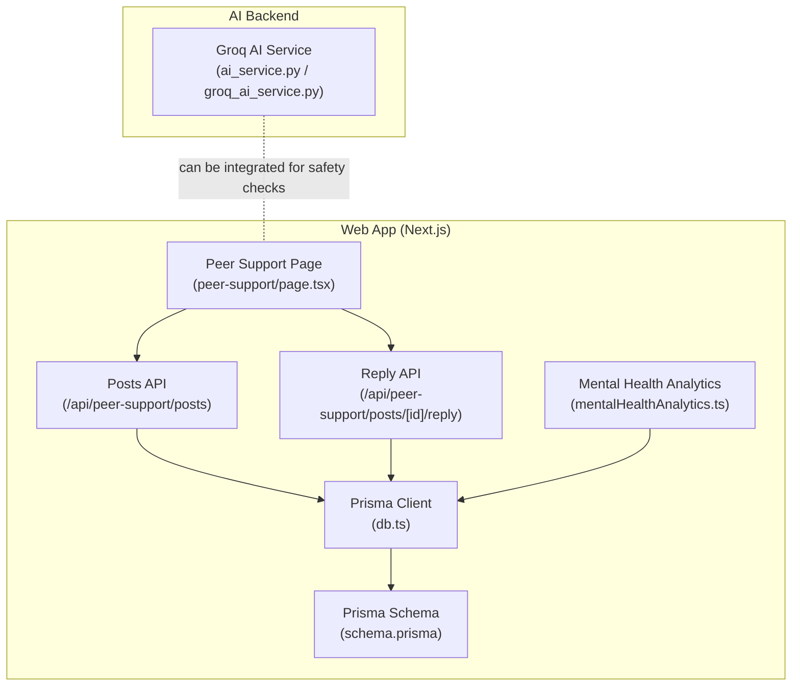
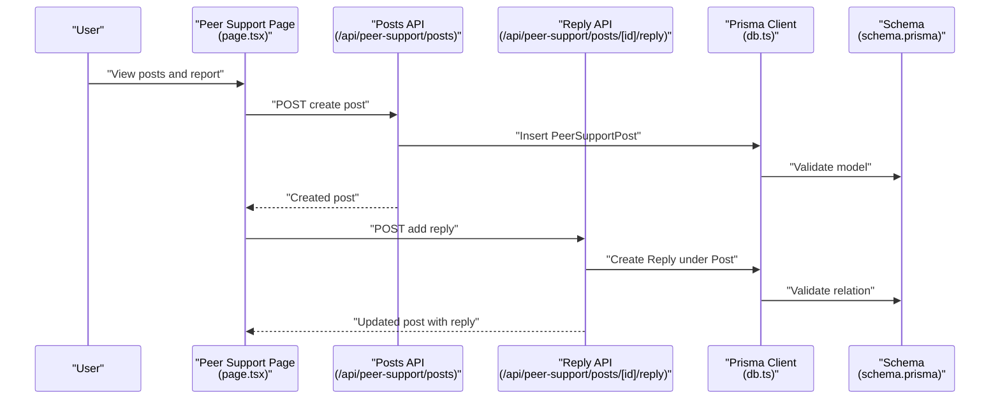
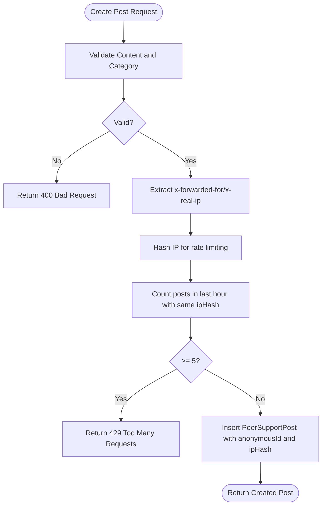
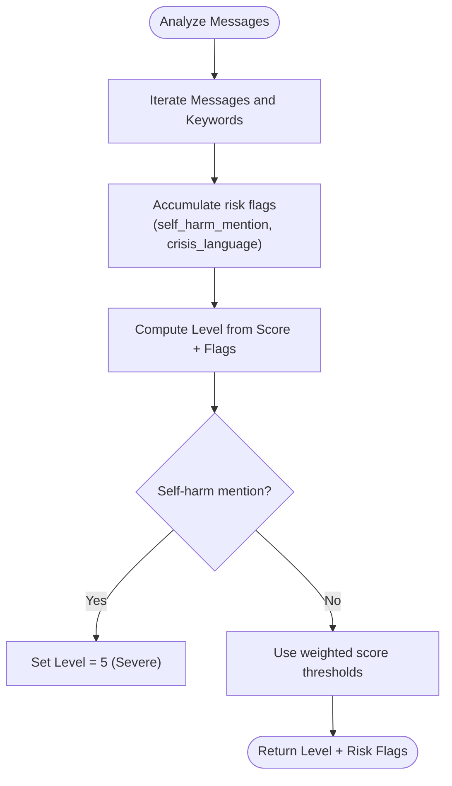
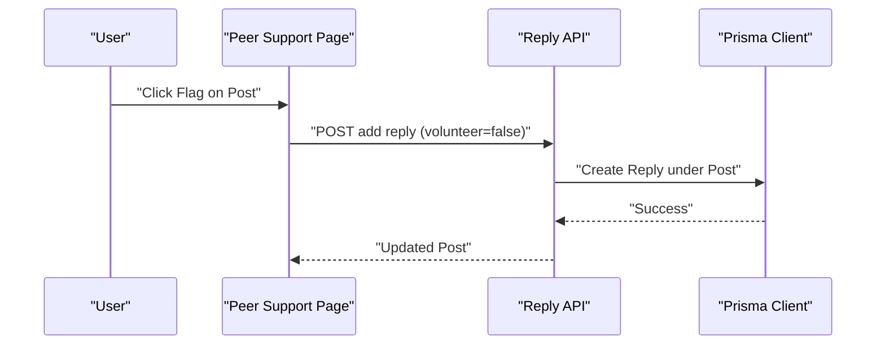
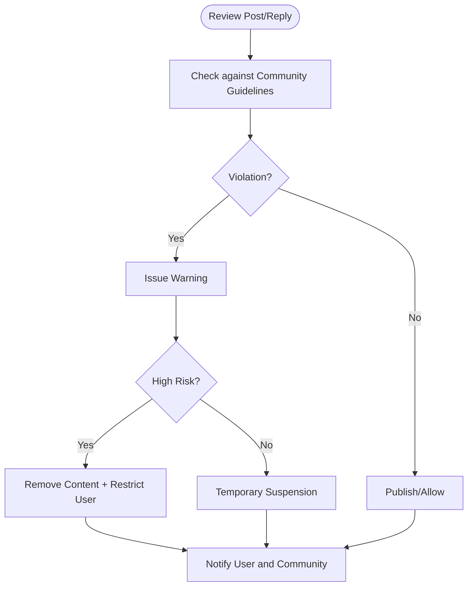
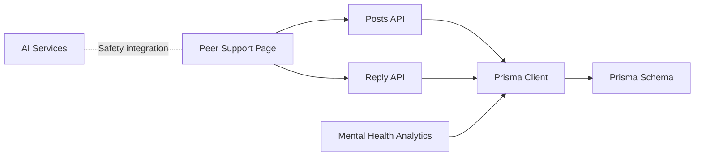
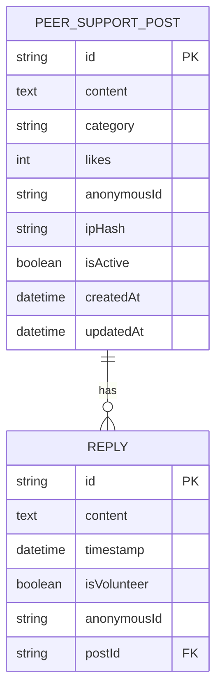

# Moderation and Safety Tools

<cite>
**Referenced Files in This Document**
- [schema.prisma](file://WEBAPP/prisma/schema.prisma)
- [db.ts](file://WEBAPP/src/lib/db.ts)
- [peer-support-posts-route.ts](file://WEBAPP/src/app/api/peer-support/posts/route.ts)
- [peer-support-post-id-reply-route.ts](file://WEBAPP/src/app/api/peer-support/posts/[id]/reply/route.ts)
- [peer-support-page.tsx](file://WEBAPP/src/app/peer-support/page.tsx)
- [mentalHealthAnalytics.ts](file://WEBAPP/src/lib/mentalHealthAnalytics.ts)
- [ai_service.py](file://ai-backend/services/ai_service.py)
- [groq_ai_service.py](file://ai-backend/services/groq_ai_service.py)
- [route.js](file://WEBAPP/.next/server/app/api/analytics/route.js)
</cite>

## Table of Contents
1. [Introduction](#introduction)
2. [Project Structure](#project-structure)
3. [Core Components](#core-components)
4. [Architecture Overview](#architecture-overview)
5. [Detailed Component Analysis](#detailed-component-analysis)
6. [Dependency Analysis](#dependency-analysis)
7. [Performance Considerations](#performance-considerations)
8. [Troubleshooting Guide](#troubleshooting-guide)
9. [Conclusion](#conclusion)
10. [Appendices](#appendices)

## Introduction
This document explains the moderation and safety tools implemented in the community platform. It covers content moderation workflows (automated spam detection, manual review readiness, and community reporting), safety features (crisis detection and mental health resource linkage), the flagging/reporting system, enforcement mechanisms (warnings and escalation), privacy protections for anonymous users, and examples of moderation API endpoints and safety triggers.

## Project Structure
The moderation and safety functionality spans:
- Database models for peer support posts and replies
- API routes for creating posts, replying, and managing content
- Frontend pages enabling community reporting and viewing posts
- Mental health analytics that detect potential crises
- AI services that provide therapeutic responses and can be leveraged for safety checks

**Diagram sources**
- [peer-support-page.tsx](file://WEBAPP/src/app/peer-support/page.tsx#L55-L234)
- [peer-support-posts-route.ts](file://WEBAPP/src/app/api/peer-support/posts/route.ts#L35-L131)
- [peer-support-post-id-reply-route.ts](file://WEBAPP/src/app/api/peer-support/posts/[id]/reply/route.ts#L1-L99)
- [schema.prisma](file://WEBAPP/prisma/schema.prisma#L79-L106)
- [db.ts](file://WEBAPP/src/lib/db.ts#L1-L15)
- [mentalHealthAnalytics.ts](file://WEBAPP/src/lib/mentalHealthAnalytics.ts#L214-L290)
- [ai_service.py](file://ai-backend/services/ai_service.py#L1-L293)
- [groq_ai_service.py](file://ai-backend/services/groq_ai_service.py#L1-L123)

**Section sources**
- [schema.prisma](file://WEBAPP/prisma/schema.prisma#L79-L106)
- [db.ts](file://WEBAPP/src/lib/db.ts#L1-L15)
- [peer-support-posts-route.ts](file://WEBAPP/src/app/api/peer-support/posts/route.ts#L35-L131)
- [peer-support-post-id-reply-route.ts](file://WEBAPP/src/app/api/peer-support/posts/[id]/reply/route.ts#L1-L99)
- [peer-support-page.tsx](file://WEBAPP/src/app/peer-support/page.tsx#L55-L234)
- [mentalHealthAnalytics.ts](file://WEBAPP/src/lib/mentalHealthAnalytics.ts#L214-L290)
- [ai_service.py](file://ai-backend/services/ai_service.py#L1-L293)
- [groq_ai_service.py](file://ai-backend/services/groq_ai_service.py#L1-L123)

## Core Components
- Peer Support Post and Reply models with anonymization and rate-limiting safeguards
- API endpoints for creating posts and adding replies
- Frontend reporting affordances and community guidelines
- Mental health analytics that flag potential crises and compute risk levels
- AI services that can be used to enhance safety checks and provide therapeutic responses

**Section sources**
- [schema.prisma](file://WEBAPP/prisma/schema.prisma#L79-L106)
- [peer-support-posts-route.ts](file://WEBAPP/src/app/api/peer-support/posts/route.ts#L35-L131)
- [peer-support-post-id-reply-route.ts](file://WEBAPP/src/app/api/peer-support/posts/[id]/reply/route.ts#L1-L99)
- [peer-support-page.tsx](file://WEBAPP/src/app/peer-support/page.tsx#L55-L234)
- [mentalHealthAnalytics.ts](file://WEBAPP/src/lib/mentalHealthAnalytics.ts#L214-L290)
- [ai_service.py](file://ai-backend/services/ai_service.py#L1-L293)

## Architecture Overview
The moderation and safety architecture integrates frontend reporting, backend APIs, database persistence, and analytics-driven safety signals.

**Diagram sources**
- [peer-support-page.tsx](file://WEBAPP/src/app/peer-support/page.tsx#L55-L234)
- [peer-support-posts-route.ts](file://WEBAPP/src/app/api/peer-support/posts/route.ts#L35-L131)
- [peer-support-post-id-reply-route.ts](file://WEBAPP/src/app/api/peer-support/posts/[id]/reply/route.ts#L1-L99)
- [db.ts](file://WEBAPP/src/lib/db.ts#L1-L15)
- [schema.prisma](file://WEBAPP/prisma/schema.prisma#L79-L106)

## Detailed Component Analysis

### Content Moderation Workflows
- Automated spam detection and rate limiting:
  - Posts endpoint enforces rate limiting per IP hash to prevent spam.
  - IP address is extracted from request headers and hashed for anonymity while enabling rate limiting.
- Manual review readiness:
  - Posts and replies are stored with timestamps and anonymized identifiers.
  - Moderators can filter by category and search terms via the posts endpoint.
- Community reporting:
  - The frontend exposes a flag affordance on posts to signal potential violations.

**Diagram sources**
- [peer-support-posts-route.ts](file://WEBAPP/src/app/api/peer-support/posts/route.ts#L80-L131)

**Section sources**
- [peer-support-posts-route.ts](file://WEBAPP/src/app/api/peer-support/posts/route.ts#L80-L131)
- [peer-support-page.tsx](file://WEBAPP/src/app/peer-support/page.tsx#L364-L392)

### Safety Features: Crisis Detection and Resource Linkage
- Crisis indicators:
  - Keyword-based detection for self-harm and depression/anxiety clusters.
  - Risk flags escalate severity (e.g., self-harm mention sets highest level).
- Safety signal computation:
  - Weighted scoring and category breakdown inform mental health level.
- Resource linkage:
  - Community guidelines explicitly instruct users to contact emergency services or counseling when in crisis.

**Diagram sources**
- [mentalHealthAnalytics.ts](file://WEBAPP/src/lib/mentalHealthAnalytics.ts#L214-L290)

**Section sources**
- [mentalHealthAnalytics.ts](file://WEBAPP/src/lib/mentalHealthAnalytics.ts#L214-L290)
- [peer-support-page.tsx](file://WEBAPP/src/app/peer-support/page.tsx#L506-L523)

### Flagging System and Reporting
- Reporting affordance:
  - Users can flag posts via a dedicated button on the peer support page.
- Backend reporting:
  - Replies endpoint validates content and ensures the target post exists and is active.
  - Replies are persisted with anonymized identifiers and volunteer flags for moderation visibility.

**Diagram sources**
- [peer-support-page.tsx](file://WEBAPP/src/app/peer-support/page.tsx#L364-L392)
- [peer-support-post-id-reply-route.ts](file://WEBAPP/src/app/api/peer-support/posts/[id]/reply/route.ts#L1-L99)

**Section sources**
- [peer-support-page.tsx](file://WEBAPP/src/app/peer-support/page.tsx#L364-L392)
- [peer-support-post-id-reply-route.ts](file://WEBAPP/src/app/api/peer-support/posts/[id]/reply/route.ts#L1-L99)

### Community Guidelines Enforcement and Escalation
- Enforcement mechanisms:
  - Posts and replies are stored with timestamps and anonymized identifiers for auditability.
  - Moderators can filter/search posts via the posts endpoint.
- Warnings and escalation:
  - Risk flags and computed levels indicate escalation needs.
  - Community guidelines direct users to emergency resources during crisis.

[No sources needed since this diagram shows conceptual workflow, not actual code structure]

**Section sources**
- [peer-support-posts-route.ts](file://WEBAPP/src/app/api/peer-support/posts/route.ts#L35-L75)
- [peer-support-post-id-reply-route.ts](file://WEBAPP/src/app/api/peer-support/posts/[id]/reply/route.ts#L1-L99)
- [peer-support-page.tsx](file://WEBAPP/src/app/peer-support/page.tsx#L506-L523)

### Privacy Protection for Anonymous Users
- Anonymous identifiers:
  - Posts and replies include anonymized IDs to protect user identity.
- IP hashing:
  - IP addresses are hashed for rate limiting while preserving anonymity.
- Data retention:
  - Timestamps and anonymized identifiers enable moderation without exposing personal identities.

**Section sources**
- [peer-support-posts-route.ts](file://WEBAPP/src/app/api/peer-support/posts/route.ts#L91-L116)
- [peer-support-post-id-reply-route.ts](file://WEBAPP/src/app/api/peer-support/posts/[id]/reply/route.ts#L7-L15)

### Moderation API Endpoints (Examples)
- Create a peer support post
  - Method: POST
  - Path: /api/peer-support/posts
  - Body: { content, category }
  - Response: { post }
  - Notes: Enforces validation, rate limits per IP hash, and returns 429 if threshold exceeded
- Add a reply to a post
  - Method: POST
  - Path: /api/peer-support/posts/[id]/reply
  - Body: { content, isVolunteer }
  - Response: { post }
  - Notes: Validates content, checks post existence and activity, creates reply with anonymized ID

**Section sources**
- [peer-support-posts-route.ts](file://WEBAPP/src/app/api/peer-support/posts/route.ts#L79-L131)
- [peer-support-post-id-reply-route.ts](file://WEBAPP/src/app/api/peer-support/posts/[id]/reply/route.ts#L17-L72)

### Safety Trigger Detection
- Keyword categories and weights drive risk scoring.
- Self-harm mentions immediately elevate risk to the highest level.
- Crisis language emerges from elevated counts of depression and anxiety keywords.

**Section sources**
- [mentalHealthAnalytics.ts](file://WEBAPP/src/lib/mentalHealthAnalytics.ts#L214-L290)

### Compliance Reporting Features
- Analytics pipeline:
  - Mental health analytics module computes levels and risk flags for reporting.
  - The analytics module is bundled into the server build, indicating runtime availability for reporting dashboards.

**Section sources**
- [mentalHealthAnalytics.ts](file://WEBAPP/src/lib/mentalHealthAnalytics.ts#L214-L290)
- [route.js](file://WEBAPP/.next/server/app/api/analytics/route.js#L56-L64)

## Dependency Analysis
The moderation and safety stack depends on:
- Prisma schema/models for storing posts and replies
- Next.js API routes for content creation and replies
- Mental health analytics for safety signals
- AI services for therapeutic responses and potential safety integrations

**Diagram sources**
- [peer-support-page.tsx](file://WEBAPP/src/app/peer-support/page.tsx#L55-L234)
- [peer-support-posts-route.ts](file://WEBAPP/src/app/api/peer-support/posts/route.ts#L35-L131)
- [peer-support-post-id-reply-route.ts](file://WEBAPP/src/app/api/peer-support/posts/[id]/reply/route.ts#L1-L99)
- [schema.prisma](file://WEBAPP/prisma/schema.prisma#L79-L106)
- [db.ts](file://WEBAPP/src/lib/db.ts#L1-L15)
- [mentalHealthAnalytics.ts](file://WEBAPP/src/lib/mentalHealthAnalytics.ts#L214-L290)
- [ai_service.py](file://ai-backend/services/ai_service.py#L1-L293)

**Section sources**
- [schema.prisma](file://WEBAPP/prisma/schema.prisma#L79-L106)
- [db.ts](file://WEBAPP/src/lib/db.ts#L1-L15)
- [peer-support-posts-route.ts](file://WEBAPP/src/app/api/peer-support/posts/route.ts#L35-L131)
- [peer-support-post-id-reply-route.ts](file://WEBAPP/src/app/api/peer-support/posts/[id]/reply/route.ts#L1-L99)
- [mentalHealthAnalytics.ts](file://WEBAPP/src/lib/mentalHealthAnalytics.ts#L214-L290)
- [ai_service.py](file://ai-backend/services/ai_service.py#L1-L293)

## Performance Considerations
- Rate limiting reduces spam without blocking legitimate users.
- Indexes on categories and timestamps improve query performance for listing and filtering posts.
- Asynchronous analytics and optional RAG retrieval avoid blocking user requests.

[No sources needed since this section provides general guidance]

## Troubleshooting Guide
- Rate limit errors:
  - Symptom: 429 responses when posting rapidly.
  - Cause: Exceeded posts-per-hour threshold per IP hash.
  - Resolution: Wait for the hourly window to reset.
- Post not found when replying:
  - Symptom: 404 response when adding replies.
  - Cause: Target post does not exist or is inactive.
  - Resolution: Verify post ID and ensure the post is active.
- Validation failures:
  - Symptom: 400 responses for missing or invalid content.
  - Cause: Content too short or missing required fields.
  - Resolution: Ensure content meets minimum length and required fields.

**Section sources**
- [peer-support-posts-route.ts](file://WEBAPP/src/app/api/peer-support/posts/route.ts#L96-L107)
- [peer-support-post-id-reply-route.ts](file://WEBAPP/src/app/api/peer-support/posts/[id]/reply/route.ts#L35-L42)
- [peer-support-post-id-reply-route.ts](file://WEBAPP/src/app/api/peer-support/posts/[id]/reply/route.ts#L83-L99)

## Conclusion
The platform implements a layered moderation and safety system: automated spam controls, community reporting, anonymized content storage, and analytics-driven crisis detection. While explicit moderator dashboards are not present in the examined code, the backend supports moderation-ready data (timestamps, anonymized IDs, categories, and risk flags), enabling straightforward extension to a full moderation workflow.

## Appendices
- Data model overview for peer support content

**Diagram sources**
- [schema.prisma](file://WEBAPP/prisma/schema.prisma#L79-L106)