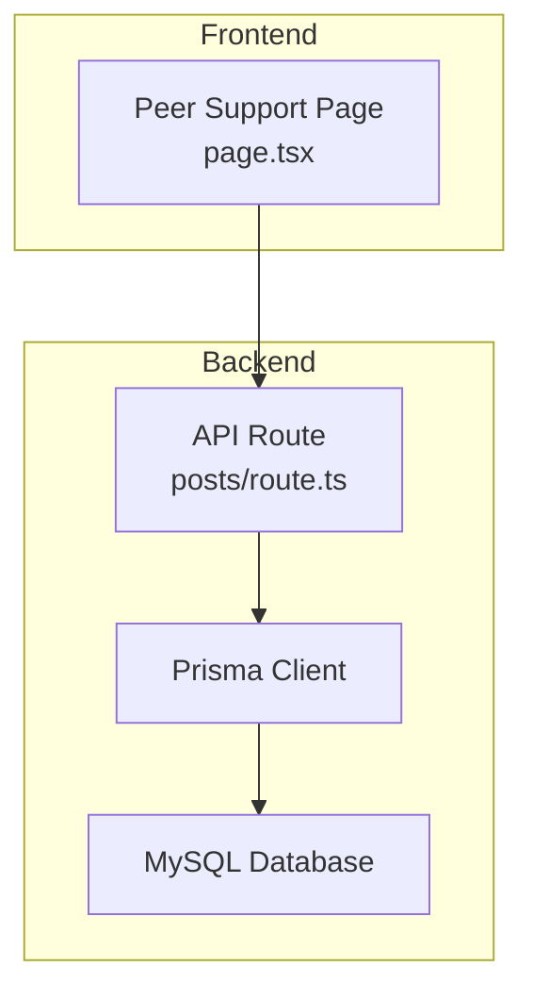
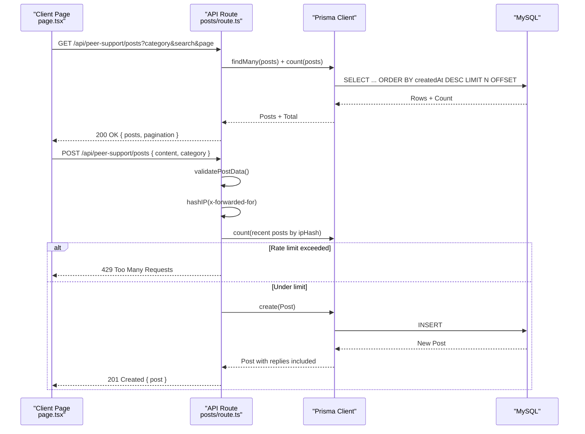
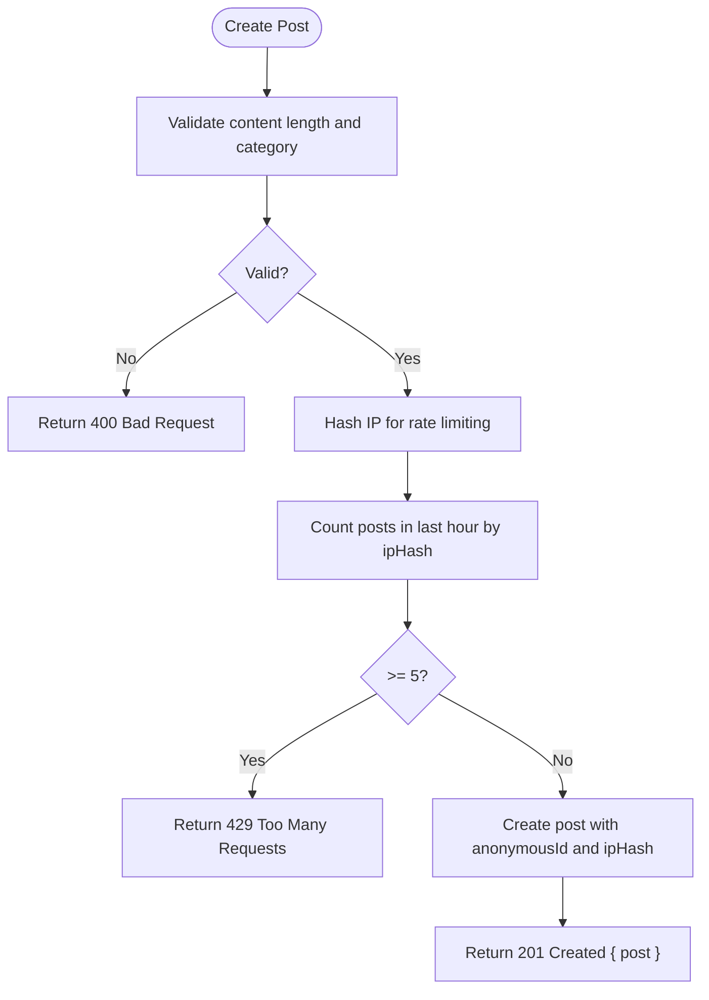
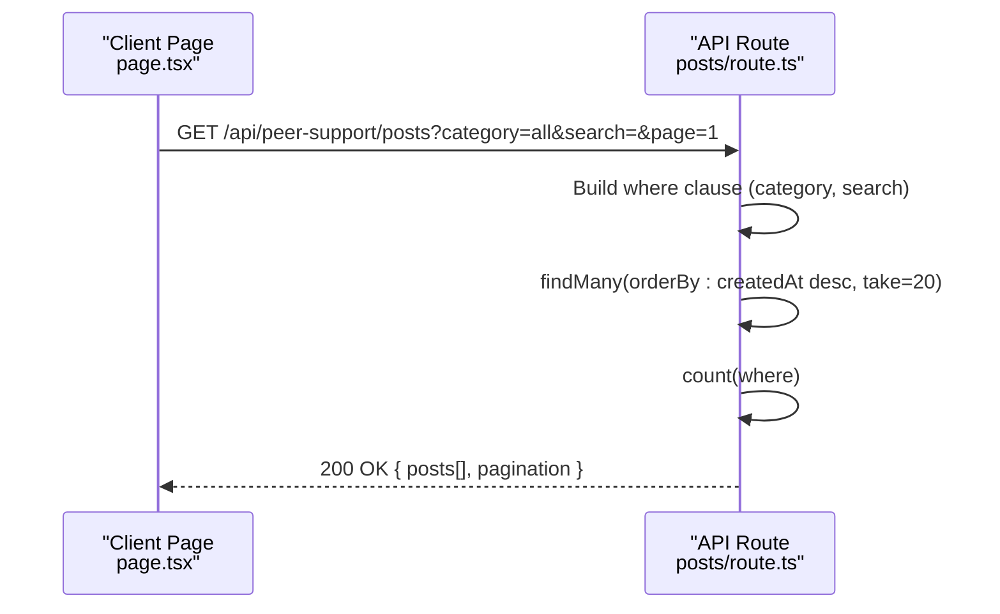
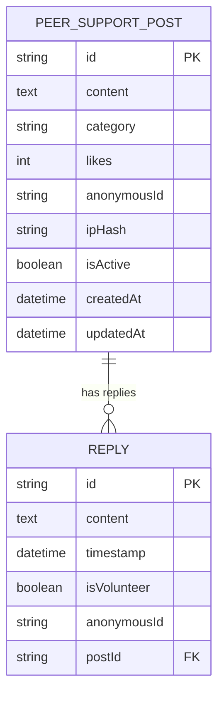
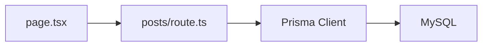

# Post Management System

<cite>
**Referenced Files in This Document**
- [page.tsx](file://WEBAPP/src/app/peer-support/page.tsx)
- [posts/route.ts](file://WEBAPP/src/app/api/peer-support/posts/route.ts)
- [schema.prisma](file://WEBAPP/prisma/schema.prisma)
</cite>

## Table of Contents
1. [Introduction](#introduction)
2. [Project Structure](#project-structure)
3. [Core Components](#core-components)
4. [Architecture Overview](#architecture-overview)
5. [Detailed Component Analysis](#detailed-component-analysis)
6. [Dependency Analysis](#dependency-analysis)
7. [Performance Considerations](#performance-considerations)
8. [Troubleshooting Guide](#troubleshooting-guide)
9. [Conclusion](#conclusion)

## Introduction
This document describes the peer support post management system. It covers the post creation workflow (form validation, category selection, anonymous ID assignment), listing with filtering and search, editing and deletion capabilities, the data model, real-time updates and optimistic UI patterns, and API endpoints with request/response schemas and error handling.

## Project Structure
The post management system spans a Next.js app page component and a serverless API route backed by Prisma ORM and MySQL:
- Frontend: a client-side page component handles UI, state, and user interactions
- Backend: a Next.js API route implements CRUD operations for posts and replies
- Data model: Prisma schema defines the Post and Reply entities and their relations

**Diagram sources**
- [page.tsx](file://WEBAPP/src/app/peer-support/page.tsx#L1-L523)
- [posts/route.ts](file://WEBAPP/src/app/api/peer-support/posts/route.ts#L1-L161)
- [schema.prisma](file://WEBAPP/prisma/schema.prisma#L80-L106)

**Section sources**
- [page.tsx](file://WEBAPP/src/app/peer-support/page.tsx#L1-L523)
- [posts/route.ts](file://WEBAPP/src/app/api/peer-support/posts/route.ts#L1-L161)
- [schema.prisma](file://WEBAPP/prisma/schema.prisma#L80-L106)

## Core Components
- Post entity: content, category, likes, anonymous ID, IP hash, activity flag, timestamps, and replies relation
- Reply entity: content, timestamp, volunteer flag, anonymous ID, and post relation
- Categories: curated list of supported categories for filtering and display
- Anonymous ID generation: deterministic prefix plus random suffix for privacy
- IP hashing: SHA-256 of IP address combined with secret for rate limiting and anti-spam
- Pagination: server-side pagination with configurable page size

Key implementation references:
- Post interface and categories: [page.tsx](file://WEBAPP/src/app/peer-support/page.tsx#L8-L37)
- Anonymous ID generator: [posts/route.ts](file://WEBAPP/src/app/api/peer-support/posts/route.ts#L5-L14)
- IP hashing: [posts/route.ts](file://WEBAPP/src/app/api/peer-support/posts/route.ts#L16-L19)
- Post model definition: [schema.prisma](file://WEBAPP/prisma/schema.prisma#L80-L94)
- Reply model definition: [schema.prisma](file://WEBAPP/prisma/schema.prisma#L96-L106)

**Section sources**
- [page.tsx](file://WEBAPP/src/app/peer-support/page.tsx#L8-L37)
- [posts/route.ts](file://WEBAPP/src/app/api/peer-support/posts/route.ts#L5-L19)
- [schema.prisma](file://WEBAPP/prisma/schema.prisma#L80-L106)

## Architecture Overview
The system follows a client-server architecture:
- The client page component manages UI state, filters, search, and optimistic updates
- The API route validates requests, enforces rate limits, persists data, and returns paginated results
- Prisma ORM maps TypeScript models to MySQL tables

**Diagram sources**
- [page.tsx](file://WEBAPP/src/app/peer-support/page.tsx#L52-L76)
- [posts/route.ts](file://WEBAPP/src/app/api/peer-support/posts/route.ts#L21-L75)
- [posts/route.ts](file://WEBAPP/src/app/api/peer-support/posts/route.ts#L79-L129)
- [posts/route.ts](file://WEBAPP/src/app/api/peer-support/posts/route.ts#L132-L159)

## Detailed Component Analysis

### Post Creation Workflow
- Form validation rules:
  - Content is required, must be a non-empty string, and limited to 1000 characters
  - Category is required and must be one of the predefined values
- Category selection:
  - Client-side dropdown populated from a curated list
  - Server-side validation ensures category matches allowed values
- Anonymous ID assignment:
  - Generated on the server during creation
  - Used consistently for posts and replies
- Rate limiting:
  - Enforced per IP hash with a 5 posts per hour cap
- Request lifecycle:
  - Client sends POST with content and category
  - Server validates, checks rate limit, hashes IP, creates post, and returns 201

**Diagram sources**
- [posts/route.ts](file://WEBAPP/src/app/api/peer-support/posts/route.ts#L85-L107)
- [posts/route.ts](file://WEBAPP/src/app/api/peer-support/posts/route.ts#L132-L159)

**Section sources**
- [page.tsx](file://WEBAPP/src/app/peer-support/page.tsx#L301-L312)
- [posts/route.ts](file://WEBAPP/src/app/api/peer-support/posts/route.ts#L85-L107)
- [posts/route.ts](file://WEBAPP/src/app/api/peer-support/posts/route.ts#L132-L159)

### Post Listing, Filtering, Search, and Sorting
- Filtering by category:
  - Client sets filter category and appends to query string
  - Server applies category filter when not "all"
- Search:
  - Client provides search term; server searches in post content and reply contents
- Sorting:
  - Posts sorted by creation time descending
- Pagination:
  - Server returns current page, total pages, and hasMore flag
- Client refresh:
  - Manual refresh triggers a refetch of posts

**Diagram sources**
- [page.tsx](file://WEBAPP/src/app/peer-support/page.tsx#L52-L76)
- [posts/route.ts](file://WEBAPP/src/app/api/peer-support/posts/route.ts#L21-L75)

**Section sources**
- [page.tsx](file://WEBAPP/src/app/peer-support/page.tsx#L52-L76)
- [posts/route.ts](file://WEBAPP/src/app/api/peer-support/posts/route.ts#L21-L75)

### Replies and Likes
- Replies:
  - Client submits reply to a specific post
  - Server persists reply with anonymous ID and timestamp
  - Client refreshes posts to reflect updated replies
- Likes:
  - Client toggles like for a post
  - Server updates like count via optimistic UI (client toggles local liked state, then refreshes)
  - Client re-fetches posts to sync counts

Note: Editing and deletion endpoints for posts and replies are not present in the current implementation.

**Section sources**
- [page.tsx](file://WEBAPP/src/app/peer-support/page.tsx#L138-L166)
- [page.tsx](file://WEBAPP/src/app/peer-support/page.tsx#L168-L193)

### Real-Time Updates and Optimistic UI
- Optimistic UI patterns:
  - Local liked state is toggled immediately upon user action
  - UI reflects immediate feedback while background sync occurs
- Refresh mechanisms:
  - Manual refresh button triggers a full re-fetch
  - Automatic re-fetch after successful create/reply actions

**Section sources**
- [page.tsx](file://WEBAPP/src/app/peer-support/page.tsx#L168-L193)
- [page.tsx](file://WEBAPP/src/app/peer-support/page.tsx#L232-L238)

### Post Data Model
The Post entity stores:
- Identifier, content, category, likes, anonymous ID, IP hash, activity flag, timestamps
- Replies relation for nested comments
Indexes:
- Category index for filtering
- CreatedAt index for sorting and pagination

The Reply entity stores:
- Identifier, content, timestamp, volunteer flag, anonymous ID, and post relation

**Diagram sources**
- [schema.prisma](file://WEBAPP/prisma/schema.prisma#L80-L106)

**Section sources**
- [schema.prisma](file://WEBAPP/prisma/schema.prisma#L80-L106)

## Dependency Analysis
- Client depends on:
  - API route for all operations
  - Prisma schema for type safety and UI rendering
- API route depends on:
  - Prisma client for database operations
  - Environment variables for secrets
  - Crypto for IP hashing
- Database depends on:
  - Prisma client for queries

**Diagram sources**
- [page.tsx](file://WEBAPP/src/app/peer-support/page.tsx#L1-L523)
- [posts/route.ts](file://WEBAPP/src/app/api/peer-support/posts/route.ts#L1-L161)
- [schema.prisma](file://WEBAPP/prisma/schema.prisma#L80-L106)

**Section sources**
- [page.tsx](file://WEBAPP/src/app/peer-support/page.tsx#L1-L523)
- [posts/route.ts](file://WEBAPP/src/app/api/peer-support/posts/route.ts#L1-L161)
- [schema.prisma](file://WEBAPP/prisma/schema.prisma#L80-L106)

## Performance Considerations
- Pagination: server-side pagination with fixed page size reduces payload sizes
- Indexes: category and createdAt indexes optimize filtering and sorting
- Client caching: local state avoids unnecessary re-renders; minimal re-fetch on refresh
- Rate limiting: prevents spam and protects server resources

## Troubleshooting Guide
Common errors and handling:
- Validation failures:
  - Content missing or empty, content exceeds 1000 characters, invalid category
  - Returns 400 with error message
- Rate limit exceeded:
  - More than 5 posts per hour from the same IP hash
  - Returns 429 with rate limit message
- General server errors:
  - Returns 500 with generic failure message

Operational tips:
- Verify environment variables (e.g., NEXTAUTH_SECRET used for hashing)
- Confirm database connectivity and Prisma client initialization
- Use manual refresh to recover from transient network issues

**Section sources**
- [posts/route.ts](file://WEBAPP/src/app/api/peer-support/posts/route.ts#L85-L107)
- [posts/route.ts](file://WEBAPP/src/app/api/peer-support/posts/route.ts#L132-L159)
- [posts/route.ts](file://WEBAPP/src/app/api/peer-support/posts/route.ts#L71-L74)

## Conclusion
The post management system provides a secure, anonymous, and user-friendly platform for peer support discussions. It balances client-side responsiveness with robust server-side validation, rate limiting, and anti-spam measures. While editing and deletion are not currently implemented, the foundation supports future enhancements.