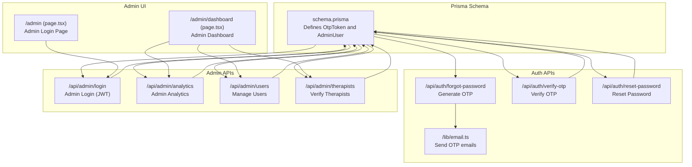
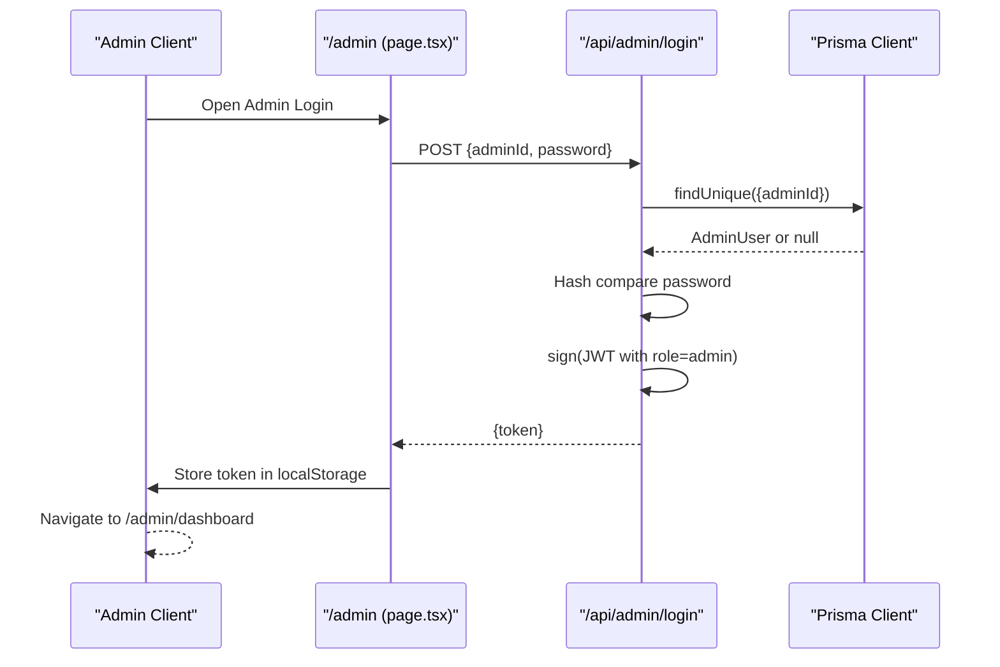
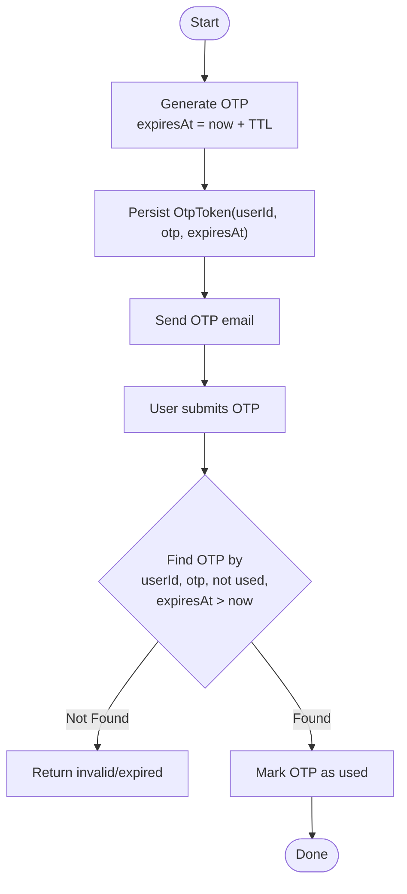
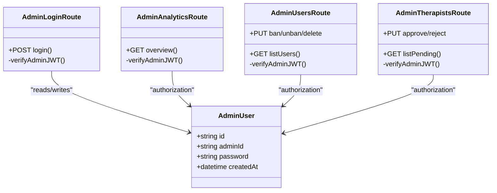
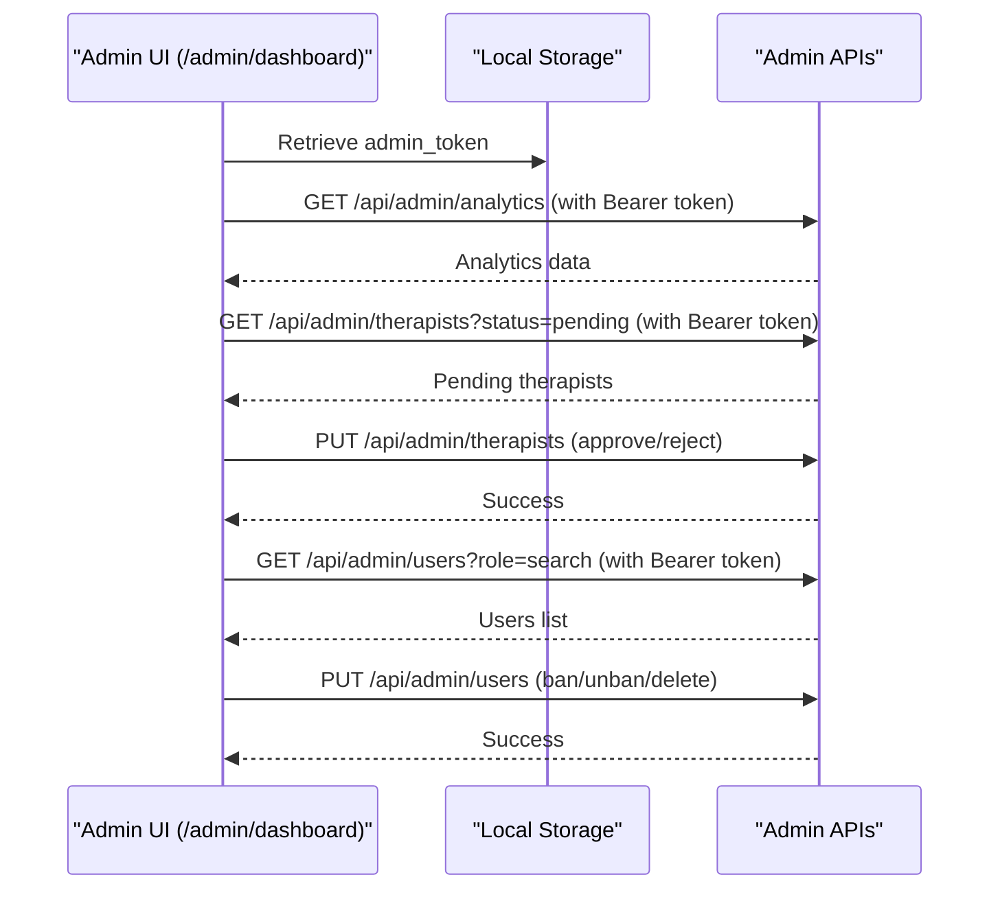
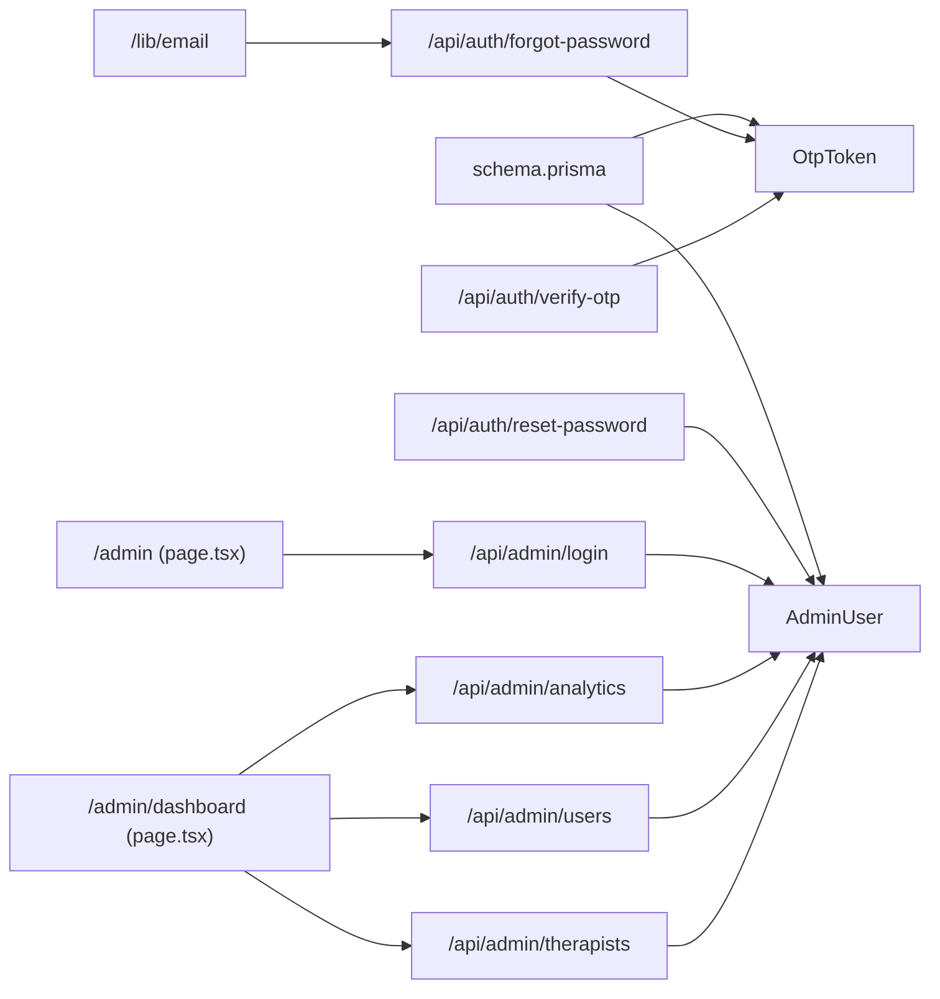

# Administrative Models

<cite>
**Referenced Files in This Document**
- [schema.prisma](file://WEBAPP/prisma/schema.prisma)
- [forgot-password/route.ts](file://WEBAPP/src/app/api/auth/forgot-password/route.ts)
- [verify-otp/route.ts](file://WEBAPP/src/app/api/auth/verify-otp/route.ts)
- [reset-password/route.ts](file://WEBAPP/src/app/api/auth/reset-password/route.ts)
- [email.ts](file://WEBAPP/src/lib/email.ts)
- [admin-login/route.ts](file://WEBAPP/src/app/api/admin/login/route.ts)
- [admin-analytics/route.ts](file://WEBAPP/src/app/api/admin/analytics/route.ts)
- [admin-users/route.ts](file://WEBAPP/src/app/api/admin/users/route.ts)
- [admin-therapists/route.ts](file://WEBAPP/src/app/api/admin/therapists/route.ts)
- [admin-login-page.tsx](file://WEBAPP/src/app/admin/page.tsx)
- [admin-dashboard.tsx](file://WEBAPP/src/app/admin/dashboard/page.tsx)
</cite>

## Table of Contents
1. [Introduction](#introduction)
2. [Project Structure](#project-structure)
3. [Core Components](#core-components)
4. [Architecture Overview](#architecture-overview)
5. [Detailed Component Analysis](#detailed-component-analysis)
6. [Dependency Analysis](#dependency-analysis)
7. [Performance Considerations](#performance-considerations)
8. [Troubleshooting Guide](#troubleshooting-guide)
9. [Conclusion](#conclusion)

## Introduction
This document provides comprehensive documentation for the administrative models and workflows in the project, focusing on:
- OtpToken: OTP-based secure password reset functionality for users, including generation, expiration handling, usage tracking, and security measures.
- AdminUser: Direct administrative access with unique admin identifiers, hashed credentials, and administrative privileges.

It explains field-level semantics, lifecycle management, security considerations, and typical administrative workflows. It also outlines best practices for OTP handling and JWT-based admin access control.

## Project Structure
The administrative models and related flows are defined in the Prisma schema and implemented via Next.js API routes and frontend pages:
- Prisma schema defines OtpToken and AdminUser entities and their relationships.
- Authentication APIs support OTP generation, verification, and password reset.
- Admin APIs enforce JWT-based authorization and expose administrative dashboards.

**Diagram sources**
- [schema.prisma](file://WEBAPP/prisma/schema.prisma#L268-L329)
- [forgot-password/route.ts](file://WEBAPP/src/app/api/auth/forgot-password/route.ts#L1-L102)
- [verify-otp/route.ts](file://WEBAPP/src/app/api/auth/verify-otp/route.ts#L1-L54)
- [reset-password/route.ts](file://WEBAPP/src/app/api/auth/reset-password/route.ts#L1-L41)
- [email.ts](file://WEBAPP/src/lib/email.ts#L1-L201)
- [admin-login/route.ts](file://WEBAPP/src/app/api/admin/login/route.ts#L1-L75)
- [admin-analytics/route.ts](file://WEBAPP/src/app/api/admin/analytics/route.ts#L1-L109)
- [admin-users/route.ts](file://WEBAPP/src/app/api/admin/users/route.ts#L1-L108)
- [admin-therapists/route.ts](file://WEBAPP/src/app/api/admin/therapists/route.ts#L1-L93)
- [admin-login-page.tsx](file://WEBAPP/src/app/admin/page.tsx#L1-L84)
- [admin-dashboard.tsx](file://WEBAPP/src/app/admin/dashboard/page.tsx#L1-L510)

**Section sources**
- [schema.prisma](file://WEBAPP/prisma/schema.prisma#L268-L329)
- [forgot-password/route.ts](file://WEBAPP/src/app/api/auth/forgot-password/route.ts#L1-L102)
- [verify-otp/route.ts](file://WEBAPP/src/app/api/auth/verify-otp/route.ts#L1-L54)
- [reset-password/route.ts](file://WEBAPP/src/app/api/auth/reset-password/route.ts#L1-L41)
- [email.ts](file://WEBAPP/src/lib/email.ts#L1-L201)
- [admin-login/route.ts](file://WEBAPP/src/app/api/admin/login/route.ts#L1-L75)
- [admin-analytics/route.ts](file://WEBAPP/src/app/api/admin/analytics/route.ts#L1-L109)
- [admin-users/route.ts](file://WEBAPP/src/app/api/admin/users/route.ts#L1-L108)
- [admin-therapists/route.ts](file://WEBAPP/src/app/api/admin/therapists/route.ts#L1-L93)
- [admin-login-page.tsx](file://WEBAPP/src/app/admin/page.tsx#L1-L84)
- [admin-dashboard.tsx](file://WEBAPP/src/app/admin/dashboard/page.tsx#L1-L510)

## Core Components
This section documents the two primary administrative models and their roles.

- OtpToken
  - Purpose: Store time-bound, single-use tokens for secure password reset.
  - Lifecycle: Generated on demand, marked used after verification, expires automatically.
  - Security: Indexed by user and OTP for fast lookup; prevents reuse via used flag; short TTL enforced by expiresAt.
  - Relationship: Belongs to a User; cascading deletes when the user is removed.

- AdminUser
  - Purpose: Provide direct administrative access with hashed credentials.
  - Access Control: Unique adminId; password stored as a cryptographic hash; JWT issued upon successful login.
  - Privileges: Admin-only endpoints require a valid admin JWT.

Field-level documentation and security considerations are detailed in the next section.

**Section sources**
- [schema.prisma](file://WEBAPP/prisma/schema.prisma#L268-L329)
- [forgot-password/route.ts](file://WEBAPP/src/app/api/auth/forgot-password/route.ts#L41-L57)
- [verify-otp/route.ts](file://WEBAPP/src/app/api/auth/verify-otp/route.ts#L23-L44)
- [admin-login/route.ts](file://WEBAPP/src/app/api/admin/login/route.ts#L27-L64)

## Architecture Overview
The administrative architecture combines Prisma models with API endpoints and a React admin UI. Admin access is JWT-based; OTP-based password reset is user-facing and uses database-backed tokens.

**Diagram sources**
- [admin-login-page.tsx](file://WEBAPP/src/app/admin/page.tsx#L15-L37)
- [admin-login/route.ts](file://WEBAPP/src/app/api/admin/login/route.ts#L9-L74)
- [schema.prisma](file://WEBAPP/prisma/schema.prisma#L323-L329)

## Detailed Component Analysis

### OtpToken Model
OtpToken supports secure password resets for users. It ensures single-use, time-limited tokens and tracks usage.

- Fields and semantics
  - id: Unique identifier.
  - userId: Foreign key to User; cascades on delete.
  - user: Relation to User.
  - otp: The OTP value; indexed for fast lookup.
  - expiresAt: Expiration timestamp; used to reject expired tokens.
  - used: Boolean flag to prevent reuse; initialized to false.
  - createdAt: Timestamp of creation.

- Lifecycle and security
  - Generation: A new OTP is generated per request and stored with an expiration time.
  - Verification: Tokens are validated against userId, otp, used=false, and expiresAt > now.
  - Usage tracking: After successful verification, the record is marked used.
  - Cleanup: Previous unused OTPs for the user are invalidated before generating a new one.

- Typical workflow
  - Forgot Password: Generate OTP, persist to OtpToken, email OTP to user.
  - Verify OTP: Validate OTP, mark as used.
  - Reset Password: Update user’s password hash.

**Diagram sources**
- [forgot-password/route.ts](file://WEBAPP/src/app/api/auth/forgot-password/route.ts#L41-L57)
- [verify-otp/route.ts](file://WEBAPP/src/app/api/auth/verify-otp/route.ts#L23-L44)
- [email.ts](file://WEBAPP/src/lib/email.ts#L27-L48)

**Section sources**
- [schema.prisma](file://WEBAPP/prisma/schema.prisma#L268-L280)
- [forgot-password/route.ts](file://WEBAPP/src/app/api/auth/forgot-password/route.ts#L41-L57)
- [verify-otp/route.ts](file://WEBAPP/src/app/api/auth/verify-otp/route.ts#L23-L44)
- [reset-password/route.ts](file://WEBAPP/src/app/api/auth/reset-password/route.ts#L24-L31)
- [email.ts](file://WEBAPP/src/lib/email.ts#L27-L48)

### AdminUser Model
AdminUser enables direct administrative access with strong security measures.

- Fields and semantics
  - id: Unique identifier.
  - adminId: Unique admin identifier; serves as the login credential.
  - password: Hashed password; never stored in plain text.
  - createdAt: Timestamp of creation.

- Authentication and authorization
  - Login endpoint validates adminId and password against stored hash.
  - On success, a signed JWT is returned with role=admin and an 8-hour expiry.
  - Admin-only endpoints verify the JWT and enforce role-based access.

- Seed behavior
  - If no admin exists and adminId equals the default seed value, the system seeds a new AdminUser with a hashed default password.

**Diagram sources**
- [schema.prisma](file://WEBAPP/prisma/schema.prisma#L323-L329)
- [admin-login/route.ts](file://WEBAPP/src/app/api/admin/login/route.ts#L27-L64)
- [admin-analytics/route.ts](file://WEBAPP/src/app/api/admin/analytics/route.ts#L7-L17)
- [admin-users/route.ts](file://WEBAPP/src/app/api/admin/users/route.ts#L7-L17)
- [admin-therapists/route.ts](file://WEBAPP/src/app/api/admin/therapists/route.ts#L7-L18)

**Section sources**
- [schema.prisma](file://WEBAPP/prisma/schema.prisma#L323-L329)
- [admin-login/route.ts](file://WEBAPP/src/app/api/admin/login/route.ts#L27-L64)
- [admin-analytics/route.ts](file://WEBAPP/src/app/api/admin/analytics/route.ts#L7-L17)
- [admin-users/route.ts](file://WEBAPP/src/app/api/admin/users/route.ts#L7-L17)
- [admin-therapists/route.ts](file://WEBAPP/src/app/api/admin/therapists/route.ts#L7-L18)

### Admin Dashboard and Workflows
The admin dashboard orchestrates administrative tasks using JWT-protected APIs.

- Admin Login
  - Frontend posts adminId and password to the login endpoint.
  - On success, stores the returned JWT in localStorage and navigates to the dashboard.

- Dashboard Tabs
  - Overview: Displays analytics fetched via an admin-protected endpoint.
  - Verify Therapists: Lists pending therapist profiles; approves or rejects with optional reasons.
  - Manage Users: Filters users by role and search; bans/unbans or deletes users.

**Diagram sources**
- [admin-dashboard.tsx](file://WEBAPP/src/app/admin/dashboard/page.tsx#L92-L163)
- [admin-analytics/route.ts](file://WEBAPP/src/app/api/admin/analytics/route.ts#L19-L103)
- [admin-therapists/route.ts](file://WEBAPP/src/app/api/admin/therapists/route.ts#L20-L92)
- [admin-users/route.ts](file://WEBAPP/src/app/api/admin/users/route.ts#L19-L107)

**Section sources**
- [admin-login-page.tsx](file://WEBAPP/src/app/admin/page.tsx#L15-L37)
- [admin-dashboard.tsx](file://WEBAPP/src/app/admin/dashboard/page.tsx#L92-L163)
- [admin-analytics/route.ts](file://WEBAPP/src/app/api/admin/analytics/route.ts#L19-L103)
- [admin-therapists/route.ts](file://WEBAPP/src/app/api/admin/therapists/route.ts#L20-L92)
- [admin-users/route.ts](file://WEBAPP/src/app/api/admin/users/route.ts#L19-L107)

## Dependency Analysis
Administrative components depend on Prisma models and shared utilities.

**Diagram sources**
- [schema.prisma](file://WEBAPP/prisma/schema.prisma#L268-L329)
- [forgot-password/route.ts](file://WEBAPP/src/app/api/auth/forgot-password/route.ts#L1-L102)
- [verify-otp/route.ts](file://WEBAPP/src/app/api/auth/verify-otp/route.ts#L1-L54)
- [reset-password/route.ts](file://WEBAPP/src/app/api/auth/reset-password/route.ts#L1-L41)
- [admin-login/route.ts](file://WEBAPP/src/app/api/admin/login/route.ts#L1-L75)
- [admin-analytics/route.ts](file://WEBAPP/src/app/api/admin/analytics/route.ts#L1-L109)
- [admin-users/route.ts](file://WEBAPP/src/app/api/admin/users/route.ts#L1-L108)
- [admin-therapists/route.ts](file://WEBAPP/src/app/api/admin/therapists/route.ts#L1-L93)
- [email.ts](file://WEBAPP/src/lib/email.ts#L1-L201)
- [admin-login-page.tsx](file://WEBAPP/src/app/admin/page.tsx#L1-L84)
- [admin-dashboard.tsx](file://WEBAPP/src/app/admin/dashboard/page.tsx#L1-L510)

**Section sources**
- [schema.prisma](file://WEBAPP/prisma/schema.prisma#L268-L329)
- [forgot-password/route.ts](file://WEBAPP/src/app/api/auth/forgot-password/route.ts#L1-L102)
- [verify-otp/route.ts](file://WEBAPP/src/app/api/auth/verify-otp/route.ts#L1-L54)
- [reset-password/route.ts](file://WEBAPP/src/app/api/auth/reset-password/route.ts#L1-L41)
- [admin-login/route.ts](file://WEBAPP/src/app/api/admin/login/route.ts#L1-L75)
- [admin-analytics/route.ts](file://WEBAPP/src/app/api/admin/analytics/route.ts#L1-L109)
- [admin-users/route.ts](file://WEBAPP/src/app/api/admin/users/route.ts#L1-L108)
- [admin-therapists/route.ts](file://WEBAPP/src/app/api/admin/therapists/route.ts#L1-L93)
- [email.ts](file://WEBAPP/src/lib/email.ts#L1-L201)
- [admin-login-page.tsx](file://WEBAPP/src/app/admin/page.tsx#L1-L84)
- [admin-dashboard.tsx](file://WEBAPP/src/app/admin/dashboard/page.tsx#L1-L510)

## Performance Considerations
- Indexes on OtpToken
  - Index on userId and otp enable efficient lookups during OTP verification.
  - Consider adding composite indexes if queries frequently filter by userId and otp together.

- Token lifecycle
  - Short TTL (e.g., 10 minutes) reduces exposure windows.
  - Pre-expiration checks prevent unnecessary retries.

- Admin JWT
  - Keep token expiry short-lived (e.g., 8 hours) to minimize long-term risk.
  - Enforce role checks server-side to avoid client-side tampering.

- Database operations
  - Batch invalidation of previous unused OTPs before creating a new one avoids accumulation.
  - Use atomic updates for marking OTP as used to prevent race conditions.

[No sources needed since this section provides general guidance]

## Troubleshooting Guide
- OTP verification fails
  - Cause: Expired or already used token, mismatched userId/otp, or incorrect input validation.
  - Resolution: Ensure the OTP is within TTL and not marked used; re-generate if needed.

- Email delivery issues
  - Cause: Missing or misconfigured email environment variables.
  - Resolution: Verify EMAIL_USER, EMAIL_PASS, EMAIL_HOST, EMAIL_PORT, and EMAIL_FROM; fallback logs OTP in development.

- Admin login errors
  - Cause: Invalid adminId/password or missing JWT secret.
  - Resolution: Confirm adminId and password match stored hash; ensure NEXTAUTH_SECRET is set.

- Unauthorized admin endpoints
  - Cause: Missing or invalid Bearer token; token not signed with the expected secret.
  - Resolution: Re-authenticate to obtain a new token; verify token header format.

**Section sources**
- [verify-otp/route.ts](file://WEBAPP/src/app/api/auth/verify-otp/route.ts#L33-L38)
- [email.ts](file://WEBAPP/src/lib/email.ts#L27-L48)
- [admin-login/route.ts](file://WEBAPP/src/app/api/admin/login/route.ts#L43-L57)
- [admin-analytics/route.ts](file://WEBAPP/src/app/api/admin/analytics/route.ts#L21-L23)

## Conclusion
The administrative models and workflows provide a robust foundation for secure password resets and admin access:
- OtpToken enforces time-bound, single-use OTPs with clear lifecycle management and indexing for performance.
- AdminUser centralizes administrative credentials with hashed storage and JWT-based authorization.
- Admin APIs and UI ensure role-based access control and streamlined operational tasks.

Adhering to the outlined best practices will help maintain security and reliability across administrative operations.