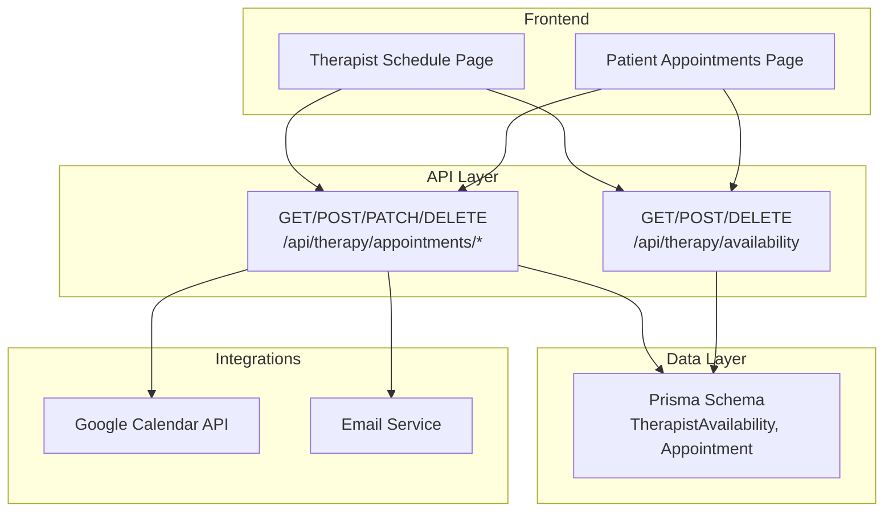
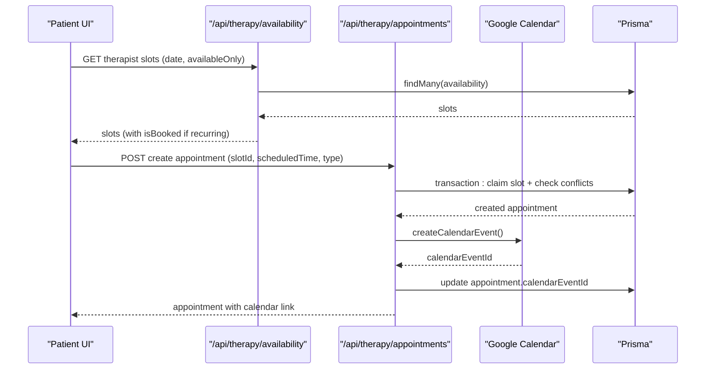
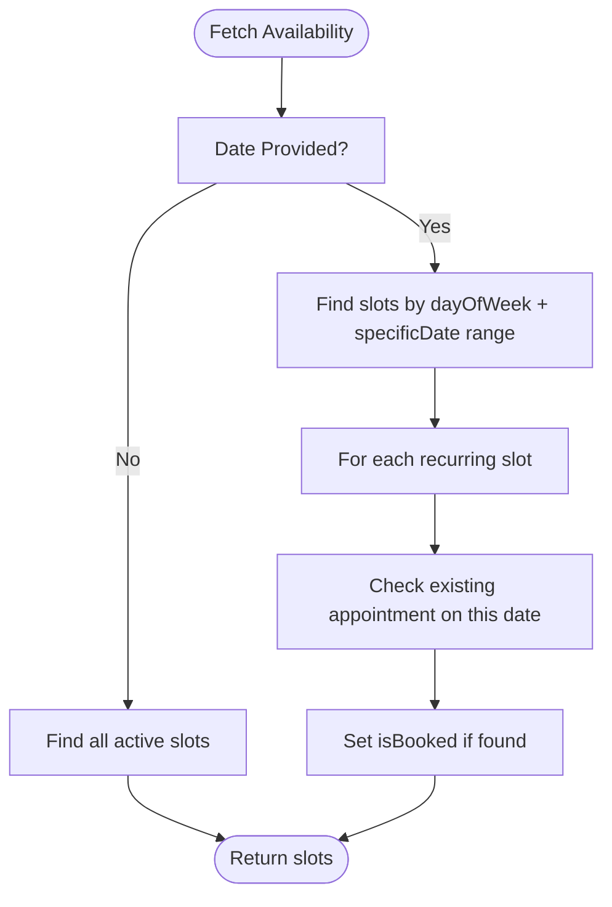
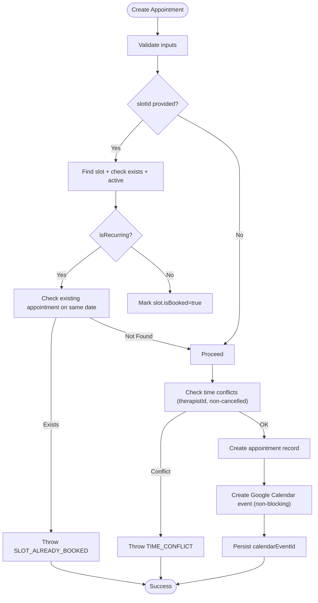
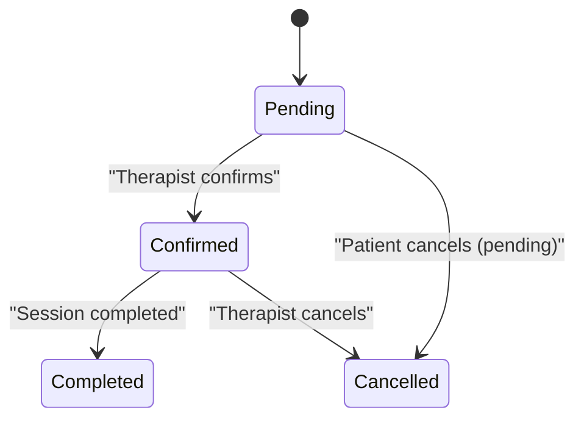
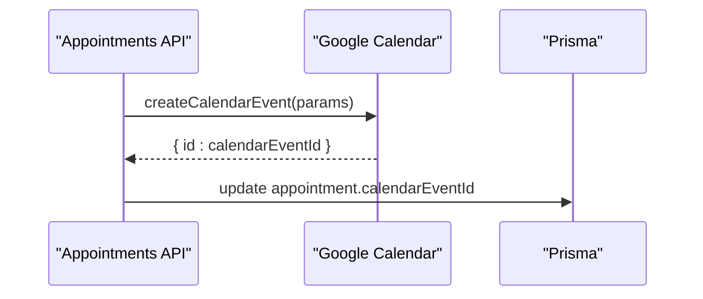
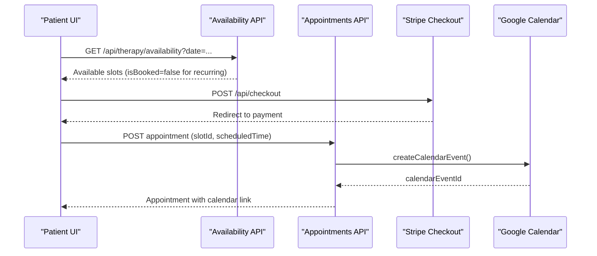
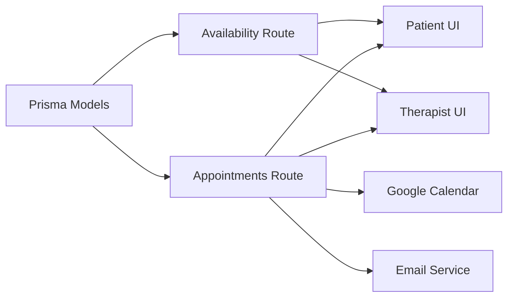

# Appointment & Availability Models

<cite>
**Referenced Files in This Document**
- [schema.prisma](file://WEBAPP/prisma/schema.prisma)
- [availability/route.ts](file://WEBAPP/src/app/api/therapy/availability/route.ts)
- [appointments/route.ts](file://WEBAPP/src/app/api/therapy/appointments/route.ts)
- [appointments/[id]/route.ts](file://WEBAPP/src/app/api/therapy/appointments/[id]/route.ts)
- [googleCalendar.ts](file://WEBAPP/src/lib/googleCalendar.ts)
- [patient/appointments/page.tsx](file://WEBAPP/src/app/patient/appointments/page.tsx)
- [therapist/schedule/page.tsx](file://WEBAPP/src/app/therapist/schedule/page.tsx)
- [email.ts](file://WEBAPP/src/lib/email.ts)
</cite>

## Table of Contents
1. [Introduction](#introduction)
2. [Project Structure](#project-structure)
3. [Core Components](#core-components)
4. [Architecture Overview](#architecture-overview)
5. [Detailed Component Analysis](#detailed-component-analysis)
6. [Dependency Analysis](#dependency-analysis)
7. [Performance Considerations](#performance-considerations)
8. [Troubleshooting Guide](#troubleshooting-guide)
9. [Conclusion](#conclusion)
10. [Appendices](#appendices)

## Introduction
This document explains the appointment scheduling models and related workflows in the MindBridge application. It focuses on:
- TherapistAvailability: weekly scheduling patterns, recurring versus one-off slots, time slot management, and booking status tracking
- Appointment: patient-therapist relationships, scheduled time management, status workflows, appointment types, and Google Calendar integration

It also covers scheduling algorithms, conflict detection, reminder systems, and practical examples of typical scheduling scenarios and availability management workflows.

## Project Structure
The scheduling domain spans Prisma data modeling, backend API routes, and frontend pages:
- Data model definitions for availability and appointments
- Backend routes for CRUD operations, conflict checks, and calendar sync
- Frontend pages for patient booking and therapist schedule management

**Diagram sources**
- [schema.prisma](file://WEBAPP/prisma/schema.prisma#L163-L211)
- [availability/route.ts](file://WEBAPP/src/app/api/therapy/availability/route.ts#L1-L217)
- [appointments/route.ts](file://WEBAPP/src/app/api/therapy/appointments/route.ts#L1-L181)
- [appointments/[id]/route.ts](file://WEBAPP/src/app/api/therapy/appointments/[id]/route.ts#L1-L102)
- [googleCalendar.ts](file://WEBAPP/src/lib/googleCalendar.ts#L102-L161)
- [email.ts](file://WEBAPP/src/lib/email.ts#L80-L104)
- [patient/appointments/page.tsx](file://WEBAPP/src/app/patient/appointments/page.tsx#L179-L218)
- [therapist/schedule/page.tsx](file://WEBAPP/src/app/therapist/schedule/page.tsx#L119-L151)

**Section sources**
- [schema.prisma](file://WEBAPP/prisma/schema.prisma#L163-L211)
- [availability/route.ts](file://WEBAPP/src/app/api/therapy/availability/route.ts#L1-L217)
- [appointments/route.ts](file://WEBAPP/src/app/api/therapy/appointments/route.ts#L1-L181)
- [appointments/[id]/route.ts](file://WEBAPP/src/app/api/therapy/appointments/[id]/route.ts#L1-L102)
- [googleCalendar.ts](file://WEBAPP/src/lib/googleCalendar.ts#L102-L161)
- [email.ts](file://WEBAPP/src/lib/email.ts#L80-L104)
- [patient/appointments/page.tsx](file://WEBAPP/src/app/patient/appointments/page.tsx#L179-L218)
- [therapist/schedule/page.tsx](file://WEBAPP/src/app/therapist/schedule/page.tsx#L119-L151)

## Core Components
- TherapistAvailability
  - Weekly recurring slots (dayOfWeek) and one-off slots (specificDate)
  - Time range per slot (startTime, endTime)
  - Booking and activation controls (isBooked, isActive)
  - Relationship to Appointment via slotId
- Appointment
  - Patient-therapist relationship via foreign keys
  - Scheduled time and duration
  - Status lifecycle: pending, confirmed, cancelled, completed
  - Types: initial, followup, emergency
  - Calendar integration via calendarEventId
  - Reminder flag (reminderSent)

These components are defined in the Prisma schema and enforced by backend routes.

**Section sources**
- [schema.prisma](file://WEBAPP/prisma/schema.prisma#L163-L211)

## Architecture Overview
End-to-end flow for patient booking and calendar synchronization:

**Diagram sources**
- [availability/route.ts](file://WEBAPP/src/app/api/therapy/availability/route.ts#L36-L94)
- [appointments/route.ts](file://WEBAPP/src/app/api/therapy/appointments/route.ts#L38-L181)
- [googleCalendar.ts](file://WEBAPP/src/lib/googleCalendar.ts#L102-L161)

## Detailed Component Analysis

### TherapistAvailability Model
- Purpose: Define therapist working time blocks
- Key fields
  - dayOfWeek: integer representing day of week (0=Sunday, 6=Saturday)
  - startTime, endTime: time strings in HH:mm format
  - isRecurring: whether the slot repeats weekly
  - specificDate: optional DateTime for one-off exceptions
  - isBooked: indicates if a recurring slot is already booked on a specific date
  - isActive: soft-deactivation capability
- Relationships
  - Belongs to User (therapist)
  - Has many Appointment entries via slotId
- Indexes
  - Optimized queries by therapistId, dayOfWeek, isBooked, isActive, specificDate

Scheduling patterns and management:
- Weekly recurring slots
  - Query by dayOfWeek and isRecurring=true
  - For each recurring slot, check per-date bookings using date range filter
- One-off slots
  - Query by specificDate within the target date’s range
- Conflict-free availability
  - When availableOnly=true, filter isBooked=false for recurring slots
- Creation constraints
  - Overlap check within the same therapistId and dayOfWeek
  - Non-overlapping time windows enforced before creation

**Diagram sources**
- [availability/route.ts](file://WEBAPP/src/app/api/therapy/availability/route.ts#L36-L94)

**Section sources**
- [schema.prisma](file://WEBAPP/prisma/schema.prisma#L163-L184)
- [availability/route.ts](file://WEBAPP/src/app/api/therapy/availability/route.ts#L36-L94)

### Appointment Model
- Purpose: Track patient-therapist sessions and lifecycle
- Key fields
  - scheduledTime: DateTime of the session
  - duration: seconds (default 3600)
  - status: pending, confirmed, cancelled, completed
  - type: initial, followup, emergency
  - notes: optional free text
  - slotId: optional reference to TherapistAvailability
  - calendarEventId: Google Calendar event identifier
  - reminderSent: reminder delivery flag
- Relationships
  - Belongs to User (patient and therapist)
  - Optional belongs to TherapistAvailability (when booked via slot)

Booking workflow and conflict detection:
- Slot-based booking
  - If slotId provided, verify slot exists and is active
  - For recurring slots, prevent double-booking on the same date
  - For non-recurring slots, mark slot as isBooked after successful booking
- Time conflict detection
  - Across all statuses except cancelled
  - Two-phase check: partial overlap window + direct overlap window
- Transactional guarantees
  - Atomic creation with conflict checks to avoid race conditions

**Diagram sources**
- [appointments/route.ts](file://WEBAPP/src/app/api/therapy/appointments/route.ts#L57-L141)
- [googleCalendar.ts](file://WEBAPP/src/lib/googleCalendar.ts#L102-L161)

**Section sources**
- [schema.prisma](file://WEBAPP/prisma/schema.prisma#L186-L211)
- [appointments/route.ts](file://WEBAPP/src/app/api/therapy/appointments/route.ts#L57-L141)

### Status Workflows
- Patient actions
  - Cancel pending appointments
  - Cannot cancel confirmed appointments (must contact therapist)
- Therapist actions
  - Confirm pending appointments (triggers email notification)
  - Complete confirmed appointments
  - Cancel confirmed appointments (requires separate policy)
- Status badges and filtering
  - UI displays status and type badges
  - Filtering by status supported in therapist view

**Diagram sources**
- [appointments/[id]/route.ts](file://WEBAPP/src/app/api/therapy/appointments/[id]/route.ts#L35-L54)
- [patient/appointments/page.tsx](file://WEBAPP/src/app/patient/appointments/page.tsx#L290-L314)
- [therapist/schedule/page.tsx](file://WEBAPP/src/app/therapist/schedule/page.tsx#L166-L183)

**Section sources**
- [appointments/[id]/route.ts](file://WEBAPP/src/app/api/therapy/appointments/[id]/route.ts#L35-L54)
- [patient/appointments/page.tsx](file://WEBAPP/src/app/patient/appointments/page.tsx#L290-L314)
- [therapist/schedule/page.tsx](file://WEBAPP/src/app/therapist/schedule/page.tsx#L166-L183)

### Calendar Integration
- Google Calendar synchronization
  - On successful appointment creation, a calendar event is created
  - Attendees include patient and therapist emails
  - Reminders configured (popup and email)
  - calendarEventId stored on the appointment record
- Deletion/update utilities
  - Separate helpers exist for deleting and updating calendar events

**Diagram sources**
- [appointments/route.ts](file://WEBAPP/src/app/api/therapy/appointments/route.ts#L143-L161)
- [googleCalendar.ts](file://WEBAPP/src/lib/googleCalendar.ts#L102-L161)

**Section sources**
- [appointments/route.ts](file://WEBAPP/src/app/api/therapy/appointments/route.ts#L143-L161)
- [googleCalendar.ts](file://WEBAPP/src/lib/googleCalendar.ts#L102-L161)

### Reminder Systems
- Reminder flag
  - reminderSent flag is part of the Appointment model
- Email reminders
  - HTML email template includes session details (date, time, duration)
  - Used for confirmation and reminders

**Section sources**
- [schema.prisma](file://WEBAPP/prisma/schema.prisma#L199-L200)
- [email.ts](file://WEBAPP/src/lib/email.ts#L80-L104)

### Typical Scheduling Scenarios and Workflows
- Patient selects a therapist and date, then picks an available time slot
  - Frontend polls availability and auto-refreshes slots
  - Booking initiates Stripe checkout and creates appointment via API
- Therapist sets up weekly recurring slots and manages availability
  - Bulk add standard business hours
  - Toggle slot activity or delete slots
- Managing conflicts
  - System prevents double-booking for recurring slots on the same date
  - Time overlap checks ensure no concurrent sessions for the same therapist
- Status transitions
  - Patient can cancel pending appointments
  - Therapist confirms pending appointments and completes sessions

**Diagram sources**
- [patient/appointments/page.tsx](file://WEBAPP/src/app/patient/appointments/page.tsx#L179-L218)
- [availability/route.ts](file://WEBAPP/src/app/api/therapy/availability/route.ts#L36-L94)
- [appointments/route.ts](file://WEBAPP/src/app/api/therapy/appointments/route.ts#L143-L161)

**Section sources**
- [patient/appointments/page.tsx](file://WEBAPP/src/app/patient/appointments/page.tsx#L179-L218)
- [therapist/schedule/page.tsx](file://WEBAPP/src/app/therapist/schedule/page.tsx#L244-L350)

## Dependency Analysis
- Data model dependencies
  - Appointment belongs to User (patient and therapist) and optionally to TherapistAvailability
  - TherapistAvailability belongs to User (therapist) and relates to Appointment
- API dependencies
  - Availability API depends on Prisma for querying and on Google Calendar for slot-based booking status
  - Appointments API depends on Prisma for transactions, Google Calendar for sync, and email service for notifications
- Frontend dependencies
  - Patient and therapist pages depend on availability and appointments APIs for data and actions

**Diagram sources**
- [schema.prisma](file://WEBAPP/prisma/schema.prisma#L163-L211)
- [availability/route.ts](file://WEBAPP/src/app/api/therapy/availability/route.ts#L1-L217)
- [appointments/route.ts](file://WEBAPP/src/app/api/therapy/appointments/route.ts#L1-L181)
- [googleCalendar.ts](file://WEBAPP/src/lib/googleCalendar.ts#L102-L161)
- [email.ts](file://WEBAPP/src/lib/email.ts#L80-L104)
- [patient/appointments/page.tsx](file://WEBAPP/src/app/patient/appointments/page.tsx#L179-L218)
- [therapist/schedule/page.tsx](file://WEBAPP/src/app/therapist/schedule/page.tsx#L119-L151)

**Section sources**
- [schema.prisma](file://WEBAPP/prisma/schema.prisma#L163-L211)
- [availability/route.ts](file://WEBAPP/src/app/api/therapy/availability/route.ts#L1-L217)
- [appointments/route.ts](file://WEBAPP/src/app/api/therapy/appointments/route.ts#L1-L181)
- [googleCalendar.ts](file://WEBAPP/src/lib/googleCalendar.ts#L102-L161)
- [email.ts](file://WEBAPP/src/lib/email.ts#L80-L104)
- [patient/appointments/page.tsx](file://WEBAPP/src/app/patient/appointments/page.tsx#L179-L218)
- [therapist/schedule/page.tsx](file://WEBAPP/src/app/therapist/schedule/page.tsx#L119-L151)

## Performance Considerations
- Index usage
  - Availability queries leverage indexes on therapistId, dayOfWeek, isBooked, isActive, specificDate
  - Appointments queries leverage indexes on therapistId, patientId, slotId, status, scheduledTime, reminderSent
- Transactional booking
  - Single Prisma transaction ensures atomicity for slot claiming and conflict checks
- Real-time updates
  - Frontend polling intervals (30 seconds for appointments, 15 seconds for slots) balance freshness and load
- Calendar sync
  - Google Calendar operations are non-blocking to avoid slowing down booking responses

[No sources needed since this section provides general guidance]

## Troubleshooting Guide
- Unauthorized access
  - Availability and appointments endpoints require a valid NextAuth session
- Insufficient permissions
  - Availability management requires therapist role
- Slot conflicts
  - SLOT_ALREADY_BOOKED: recurring slot already taken on the chosen date
  - TIME_CONFLICT: overlapping time with existing appointment
- Calendar sync failures
  - Google Calendar credentials missing or invalid; token refresh failure
- Email notifications
  - Confirmation emails sent only when status transitions to confirmed by therapist

**Section sources**
- [availability/route.ts](file://WEBAPP/src/app/api/therapy/availability/route.ts#L97-L111)
- [appointments/route.ts](file://WEBAPP/src/app/api/therapy/appointments/route.ts#L164-L179)
- [appointments/[id]/route.ts](file://WEBAPP/src/app/api/therapy/appointments/[id]/route.ts#L35-L54)
- [googleCalendar.ts](file://WEBAPP/src/lib/googleCalendar.ts#L68-L100)

## Conclusion
The appointment scheduling system combines robust data modeling with careful backend enforcement of scheduling rules and calendar integration. TherapistAvailability supports flexible weekly and one-off scheduling, while Appointment enforces conflict-free booking and status-driven workflows. Frontend pages provide intuitive booking and schedule management experiences, complemented by real-time updates and non-blocking calendar synchronization.

[No sources needed since this section summarizes without analyzing specific files]

## Appendices

### Field-Level Documentation
- TherapistAvailability
  - dayOfWeek: integer (0–6)
  - startTime, endTime: "HH:mm" strings
  - isRecurring: boolean
  - specificDate: DateTime (optional)
  - isBooked: boolean (per date for recurring slots)
  - isActive: boolean
- Appointment
  - scheduledTime: DateTime
  - duration: seconds
  - status: enum-like string
  - type: enum-like string
  - notes: text
  - slotId: optional string
  - calendarEventId: optional string
  - reminderSent: boolean

**Section sources**
- [schema.prisma](file://WEBAPP/prisma/schema.prisma#L163-L211)