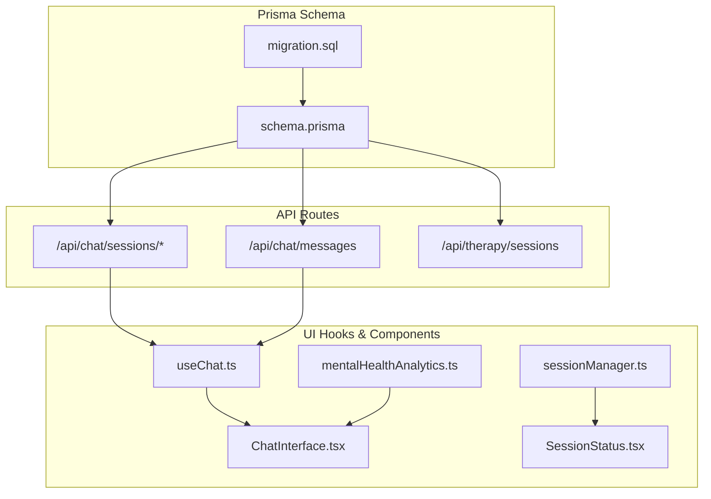
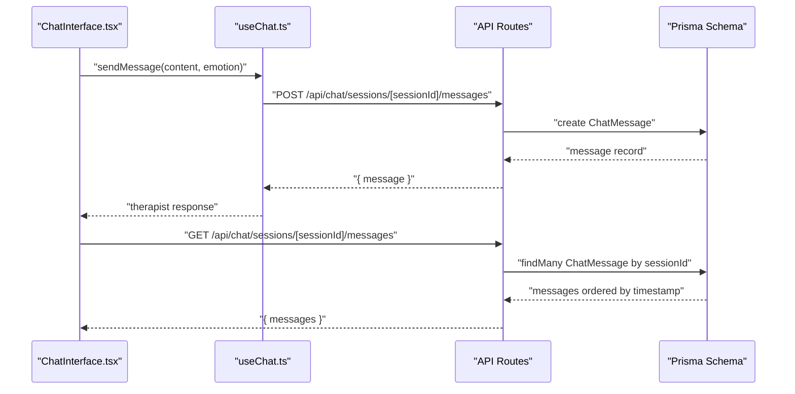
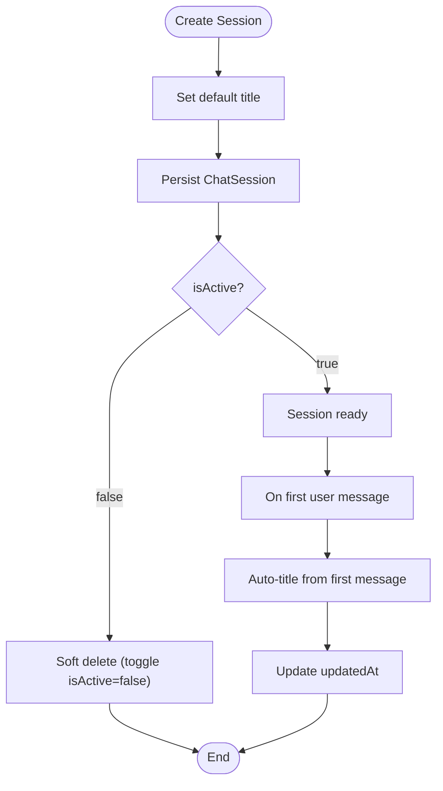
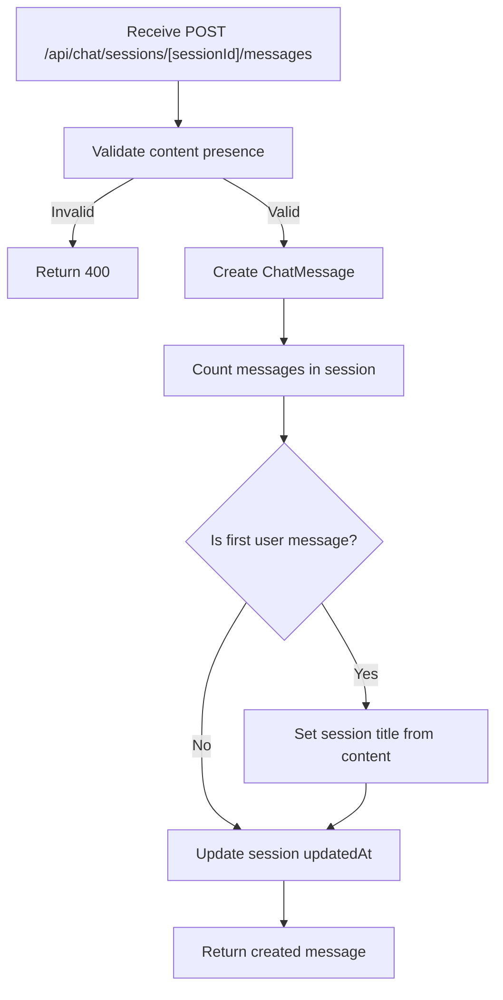
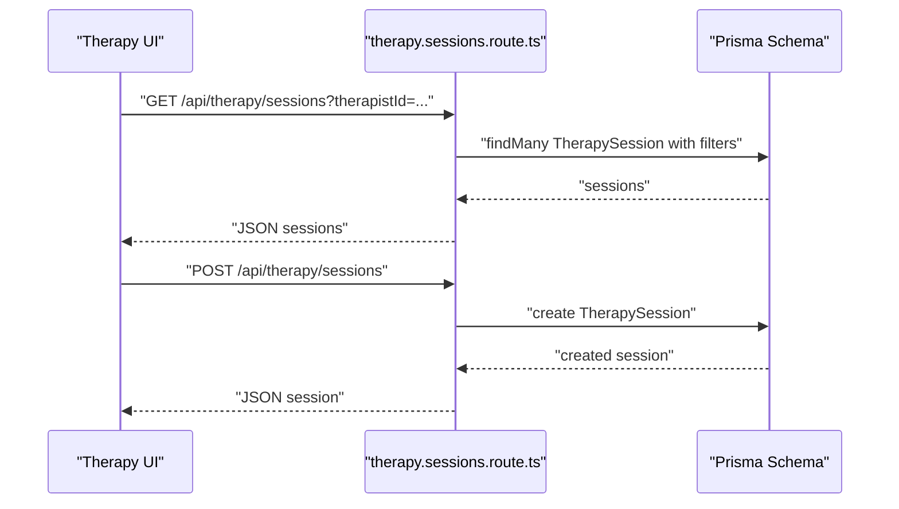
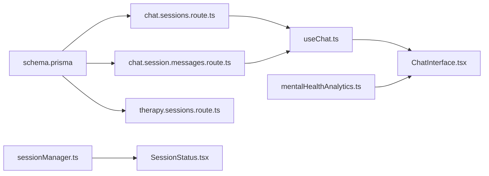

# Chat & Therapy Models

<cite>
**Referenced Files in This Document**
- [schema.prisma](file://WEBAPP/prisma/schema.prisma)
- [migration.sql](file://WEBAPP/prisma/migrations/20251105192017_add_therapy_models/migration.sql)
- [chat.sessions.route.ts](file://WEBAPP/src/app/api/chat/sessions/route.ts)
- [chat.session.messages.route.ts](file://WEBAPP/src/app/api/chat/sessions/[sessionId]/messages/route.ts)
- [chat.messages.route.ts](file://WEBAPP/src/app/api/chat/messages/route.ts)
- [therapy.sessions.route.ts](file://WEBAPP/src/app/api/therapy/sessions/route.ts)
- [useChat.ts](file://WEBAPP/src/hooks/useChat.ts)
- [ChatInterface.tsx](file://WEBAPP/src/components/ChatInterface.tsx)
- [sessionManager.ts](file://WEBAPP/src/lib/sessionManager.ts)
- [SessionStatus.tsx](file://WEBAPP/src/components/SessionStatus.tsx)
- [mentalHealthAnalytics.ts](file://WEBAPP/src/lib/mentalHealthAnalytics.ts)
</cite>

## Table of Contents
1. [Introduction](#introduction)
2. [Project Structure](#project-structure)
3. [Core Components](#core-components)
4. [Architecture Overview](#architecture-overview)
5. [Detailed Component Analysis](#detailed-component-analysis)
6. [Dependency Analysis](#dependency-analysis)
7. [Performance Considerations](#performance-considerations)
8. [Troubleshooting Guide](#troubleshooting-guide)
9. [Conclusion](#conclusion)
10. [Appendices](#appendices)

## Introduction
This document provides comprehensive documentation for the chat and therapy session models used in the application. It covers:
- ChatSession: user relationship, lifecycle tracking, and activity status
- ChatMessage: role-based messaging, content storage, metadata handling, and indexing strategies
- TherapySession: patient-therapist relationships, timing, emotion analytics, status management, and notes handling

It also documents field-level semantics, JSON metadata structures, timestamps, and business logic, along with examples of typical conversation flows and session management scenarios.

## Project Structure
The relevant models and related APIs are defined in the Prisma schema and implemented via Next.js API routes. UI components integrate with these models to provide chat and therapy experiences.

**Diagram sources**
- [schema.prisma](file://WEBAPP/prisma/schema.prisma#L108-L161)
- [migration.sql](file://WEBAPP/prisma/migrations/20251105192017_add_therapy_models/migration.sql#L86-L136)
- [chat.sessions.route.ts](file://WEBAPP/src/app/api/chat/sessions/route.ts#L1-L187)
- [chat.session.messages.route.ts](file://WEBAPP/src/app/api/chat/sessions/[sessionId]/messages/route.ts#L1-L137)
- [chat.messages.route.ts](file://WEBAPP/src/app/api/chat/messages/route.ts#L1-L91)
- [therapy.sessions.route.ts](file://WEBAPP/src/app/api/therapy/sessions/route.ts#L1-L80)
- [useChat.ts](file://WEBAPP/src/hooks/useChat.ts#L1-L150)
- [ChatInterface.tsx](file://WEBAPP/src/components/ChatInterface.tsx#L1-L567)
- [sessionManager.ts](file://WEBAPP/src/lib/sessionManager.ts#L1-L78)
- [SessionStatus.tsx](file://WEBAPP/src/components/SessionStatus.tsx#L1-L187)
- [mentalHealthAnalytics.ts](file://WEBAPP/src/lib/mentalHealthAnalytics.ts#L1-L884)

**Section sources**
- [schema.prisma](file://WEBAPP/prisma/schema.prisma#L108-L161)
- [migration.sql](file://WEBAPP/prisma/migrations/20251105192017_add_therapy_models/migration.sql#L86-L136)

## Core Components
This section documents the three core models and their relationships.

- ChatSession
  - Purpose: Represents a user’s chat channel with lifecycle and activity tracking
  - Key fields: id, userId, title, createdAt, updatedAt, isActive
  - Relationships: belongs to User; has many ChatMessage
  - Indexes: userId, createdAt
  - Lifecycle: created with default title and active status; can be soft-deleted by toggling isActive

- ChatMessage
  - Purpose: Stores messages exchanged in a session
  - Key fields: id, userId, sessionId, role, content, timestamp, metadata
  - Relationships: belongs to User and optional ChatSession
  - Indexes: userId, sessionId, timestamp
  - Metadata: JSON payload for storing contextual data (e.g., audio/video URLs, assessment markers)

- TherapySession
  - Purpose: Tracks therapy sessions between a therapist and a patient
  - Key fields: id, therapistId, patientId, startTime, endTime, duration, emotionsSummary, messageCount, status, notes, timestamps
  - Relationships: belongs to User (as therapist and patient)
  - Indexes: therapistId, patientId, status, startTime
  - Status values: scheduled, active, completed, cancelled

**Section sources**
- [schema.prisma](file://WEBAPP/prisma/schema.prisma#L108-L161)
- [migration.sql](file://WEBAPP/prisma/migrations/20251105192017_add_therapy_models/migration.sql#L86-L136)

## Architecture Overview
The system integrates UI components with Prisma-backed APIs to manage chat and therapy sessions.

**Diagram sources**
- [ChatInterface.tsx](file://WEBAPP/src/components/ChatInterface.tsx#L105-L132)
- [useChat.ts](file://WEBAPP/src/hooks/useChat.ts#L40-L116)
- [chat.session.messages.route.ts](file://WEBAPP/src/app/api/chat/sessions/[sessionId]/messages/route.ts#L52-L137)
- [schema.prisma](file://WEBAPP/prisma/schema.prisma#L108-L161)

## Detailed Component Analysis

### ChatSession Model
- User relationships
  - Belongs to User via userId
  - Includes reverse relations: User.chatSessions
- Session lifecycle tracking
  - createdAt defaults to now
  - updatedAt updates on message creation or session updates
  - isActive flag controls visibility and soft-deletion behavior
- Activity status
  - Active sessions are fetched by default in API routes
  - Soft-delete path sets isActive=false when a session contains messages; hard-delete occurs when no messages exist

**Diagram sources**
- [schema.prisma](file://WEBAPP/prisma/schema.prisma#L108-L121)
- [chat.sessions.route.ts](file://WEBAPP/src/app/api/chat/sessions/route.ts#L42-L74)
- [chat.session.messages.route.ts](file://WEBAPP/src/app/api/chat/sessions/[sessionId]/messages/route.ts#L111-L129)

**Section sources**
- [schema.prisma](file://WEBAPP/prisma/schema.prisma#L108-L121)
- [chat.sessions.route.ts](file://WEBAPP/src/app/api/chat/sessions/route.ts#L5-L40)
- [chat.sessions.route.ts](file://WEBAPP/src/app/api/chat/sessions/route.ts#L76-L135)
- [chat.session.messages.route.ts](file://WEBAPP/src/app/api/chat/sessions/[sessionId]/messages/route.ts#L111-L129)

### ChatMessage Model
- Role-based messaging
  - role defaults to user; therapist responses are stored similarly
- Content storage
  - content stored as TEXT; validated for presence and non-empty
- Metadata handling
  - metadata is JSON; used to store auxiliary data (e.g., audio/video URLs, assessment markers)
- Indexing strategies
  - Indexed by userId, sessionId, timestamp for efficient queries
- Business logic
  - Auto-title logic triggers on first user message in a session
  - Session updatedAt is refreshed on each message

**Diagram sources**
- [chat.session.messages.route.ts](file://WEBAPP/src/app/api/chat/sessions/[sessionId]/messages/route.ts#L52-L137)
- [schema.prisma](file://WEBAPP/prisma/schema.prisma#L123-L138)

**Section sources**
- [schema.prisma](file://WEBAPP/prisma/schema.prisma#L123-L138)
- [chat.session.messages.route.ts](file://WEBAPP/src/app/api/chat/sessions/[sessionId]/messages/route.ts#L89-L131)
- [chat.messages.route.ts](file://WEBAPP/src/app/api/chat/messages/route.ts#L25-L45)

### TherapySession Model
- Patient-therapist relationships
  - therapistId and patientId both reference User
  - Exposed via API includes for display
- Timing tracking
  - startTime and endTime; duration in seconds
- Emotion analytics
  - emotionsSummary stored as JSON (e.g., counts per emotion)
- Session status management
  - status defaults to scheduled; can be updated to active, completed, or cancelled
- Notes handling
  - notes stored as TEXT
- API behavior
  - GET supports filtering by therapistId or patientId
  - POST validates required fields and persists session

**Diagram sources**
- [therapy.sessions.route.ts](file://WEBAPP/src/app/api/therapy/sessions/route.ts#L5-L42)
- [therapy.sessions.route.ts](file://WEBAPP/src/app/api/therapy/sessions/route.ts#L44-L79)
- [schema.prisma](file://WEBAPP/prisma/schema.prisma#L140-L161)

**Section sources**
- [schema.prisma](file://WEBAPP/prisma/schema.prisma#L140-L161)
- [therapy.sessions.route.ts](file://WEBAPP/src/app/api/therapy/sessions/route.ts#L5-L42)
- [therapy.sessions.route.ts](file://WEBAPP/src/app/api/therapy/sessions/route.ts#L44-L79)

## Dependency Analysis
- Prisma schema defines models and foreign keys
- API routes enforce authorization and business rules
- UI components depend on hooks and analytics libraries for rendering and behavior

**Diagram sources**
- [schema.prisma](file://WEBAPP/prisma/schema.prisma#L108-L161)
- [chat.sessions.route.ts](file://WEBAPP/src/app/api/chat/sessions/route.ts#L1-L187)
- [chat.session.messages.route.ts](file://WEBAPP/src/app/api/chat/sessions/[sessionId]/messages/route.ts#L1-L137)
- [therapy.sessions.route.ts](file://WEBAPP/src/app/api/therapy/sessions/route.ts#L1-L80)
- [useChat.ts](file://WEBAPP/src/hooks/useChat.ts#L1-L150)
- [ChatInterface.tsx](file://WEBAPP/src/components/ChatInterface.tsx#L1-L567)
- [mentalHealthAnalytics.ts](file://WEBAPP/src/lib/mentalHealthAnalytics.ts#L1-L884)
- [sessionManager.ts](file://WEBAPP/src/lib/sessionManager.ts#L1-L78)
- [SessionStatus.tsx](file://WEBAPP/src/components/SessionStatus.tsx#L1-L187)

**Section sources**
- [schema.prisma](file://WEBAPP/prisma/schema.prisma#L108-L161)
- [chat.sessions.route.ts](file://WEBAPP/src/app/api/chat/sessions/route.ts#L1-L187)
- [chat.session.messages.route.ts](file://WEBAPP/src/app/api/chat/sessions/[sessionId]/messages/route.ts#L1-L137)
- [therapy.sessions.route.ts](file://WEBAPP/src/app/api/therapy/sessions/route.ts#L1-L80)
- [useChat.ts](file://WEBAPP/src/hooks/useChat.ts#L1-L150)
- [ChatInterface.tsx](file://WEBAPP/src/components/ChatInterface.tsx#L1-L567)
- [mentalHealthAnalytics.ts](file://WEBAPP/src/lib/mentalHealthAnalytics.ts#L1-L884)
- [sessionManager.ts](file://WEBAPP/src/lib/sessionManager.ts#L1-L78)
- [SessionStatus.tsx](file://WEBAPP/src/components/SessionStatus.tsx#L1-L187)

## Performance Considerations
- Indexing
  - ChatSession: userId, createdAt
  - ChatMessage: userId, sessionId, timestamp
  - TherapySession: therapistId, patientId, status, startTime
- Pagination and limits
  - Chat message retrieval supports limit/offset for large histories
- Temporal queries
  - Prefer filtering by indexed timestamps and status for fast retrieval
- Metadata size
  - Keep metadata minimal to avoid bloating JSON fields

[No sources needed since this section provides general guidance]

## Troubleshooting Guide
- Unauthorized access
  - Ensure NextAuth session exists and email is present
- Session not found
  - Verify ownership checks and isActive status for ChatSession
- Validation errors
  - Content must be a non-empty string for ChatMessage
- Session deletion behavior
  - Sessions with messages are soft-deleted; empty sessions are hard-deleted

**Section sources**
- [chat.sessions.route.ts](file://WEBAPP/src/app/api/chat/sessions/route.ts#L8-L20)
- [chat.session.messages.route.ts](file://WEBAPP/src/app/api/chat/sessions/[sessionId]/messages/route.ts#L27-L38)
- [chat.messages.route.ts](file://WEBAPP/src/app/api/chat/messages/route.ts#L25-L30)
- [chat.sessions.route.ts](file://WEBAPP/src/app/api/chat/sessions/route.ts#L117-L128)

## Conclusion
The chat and therapy models are designed around clear user relationships, robust lifecycle management, and efficient indexing. The APIs enforce authorization and business rules, while UI components integrate seamlessly with analytics and session management utilities to deliver a responsive and safe user experience.

[No sources needed since this section summarizes without analyzing specific files]

## Appendices

### Field-Level Documentation and JSON Structures
- ChatSession
  - Fields: id, userId, title, createdAt, updatedAt, isActive
  - Relationships: User (one-to-many), ChatMessage (one-to-many)
  - Indexes: userId, createdAt
- ChatMessage
  - Fields: id, userId, sessionId, role, content, timestamp, metadata
  - Relationships: User, ChatSession
  - Indexes: userId, sessionId, timestamp
  - metadata: JSON (e.g., audioUrl, avatarUrl, assessment markers)
- TherapySession
  - Fields: id, therapistId, patientId, startTime, endTime, duration, emotionsSummary, messageCount, status, notes, timestamps
  - Relationships: User (as therapist and patient)
  - Indexes: therapistId, patientId, status, startTime
  - emotionsSummary: JSON (e.g., counts per emotion)
  - status: enum-like string values

**Section sources**
- [schema.prisma](file://WEBAPP/prisma/schema.prisma#L108-L161)
- [migration.sql](file://WEBAPP/prisma/migrations/20251105192017_add_therapy_models/migration.sql#L86-L136)

### Typical Conversation Flows and Session Management Examples
- Creating a new chat session
  - POST /api/chat/sessions with title; returns session
- Adding messages to a session
  - POST /api/chat/sessions/[sessionId]/messages with content and optional metadata
  - On first user message, session title auto-updates
- Loading session history
  - GET /api/chat/sessions/[sessionId]/messages returns ordered messages
- Deleting a session
  - DELETE /api/chat/sessions with sessionId; soft-delete if messages exist, hard-delete otherwise
- Therapy session management
  - GET /api/therapy/sessions with therapistId or patientId filters
  - POST /api/therapy/sessions to create a session with required fields

**Section sources**
- [chat.sessions.route.ts](file://WEBAPP/src/app/api/chat/sessions/route.ts#L42-L74)
- [chat.session.messages.route.ts](file://WEBAPP/src/app/api/chat/sessions/[sessionId]/messages/route.ts#L52-L137)
- [chat.session.messages.route.ts](file://WEBAPP/src/app/api/chat/sessions/[sessionId]/messages/route.ts#L111-L129)
- [therapy.sessions.route.ts](file://WEBAPP/src/app/api/therapy/sessions/route.ts#L5-L42)
- [therapy.sessions.route.ts](file://WEBAPP/src/app/api/therapy/sessions/route.ts#L44-L79)