# Community & Support Models

<cite>
**Referenced Files in This Document**
- [schema.prisma](file://WEBAPP/prisma/schema.prisma)
- [migration.sql](file://WEBAPP/prisma/migrations/20251105192017_add_therapy_models/migration.sql)
- [db.ts](file://WEBAPP/src/lib/db.ts)
- [posts.route.ts](file://WEBAPP/src/app/api/peer-support/posts/route.ts)
- [reply.route.ts](file://WEBAPP/src/app/api/peer-support/posts/[id]/reply/route.ts)
- [like.route.ts](file://WEBAPP/src/app/api/peer-support/posts/[id]/like/route.ts)
- [page.tsx](file://WEBAPP/src/app/peer-support/page.tsx)
- [admin.page.tsx](file://WEBAPP/src/app/admin/dashboard/page.tsx)
</cite>

## Table of Contents
1. [Introduction](#introduction)
2. [Project Structure](#project-structure)
3. [Core Components](#core-components)
4. [Architecture Overview](#architecture-overview)
5. [Detailed Component Analysis](#detailed-component-analysis)
6. [Dependency Analysis](#dependency-analysis)
7. [Performance Considerations](#performance-considerations)
8. [Troubleshooting Guide](#troubleshooting-guide)
9. [Conclusion](#conclusion)

## Introduction
This document describes the community and peer support models implemented in the platform, focusing on PeerSupportPost and Reply. It explains how content is managed, categorized, posted anonymously, moderated via IP-based spam prevention, tracked for activity, and indexed for efficient retrieval. It also documents Reply’s hierarchical comment structure, volunteer moderation flags, anonymous responses, and post-reply relationships. Finally, it outlines field-level documentation for content moderation, spam prevention measures, anonymous identity management, and typical community interaction patterns.

## Project Structure
The community and peer support functionality spans the Prisma schema, API routes, and the frontend page component:
- Prisma schema defines PeerSupportPost and Reply models with indexes and relationships.
- API routes implement creation, retrieval, replies, and likes for posts.
- Frontend page renders posts, supports anonymous posting, filtering, searching, replying, and liking.
- Admin dashboard provides user and system management capabilities.

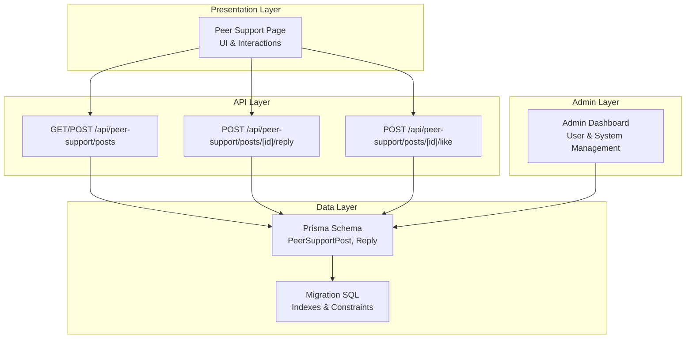

**Diagram sources**
- [schema.prisma](file://WEBAPP/prisma/schema.prisma#L80-L106)
- [migration.sql](file://WEBAPP/prisma/migrations/20251105192017_add_therapy_models/migration.sql#L57-L80)
- [posts.route.ts](file://WEBAPP/src/app/api/peer-support/posts/route.ts#L21-L129)
- [reply.route.ts](file://WEBAPP/src/app/api/peer-support/posts/[id]/reply/route.ts#L17-L72)
- [like.route.ts](file://WEBAPP/src/app/api/peer-support/posts/[id]/like/route.ts#L4-L57)
- [page.tsx](file://WEBAPP/src/app/peer-support/page.tsx#L39-L523)
- [admin.page.tsx](file://WEBAPP/src/app/admin/dashboard/page.tsx#L61-L510)

**Section sources**
- [schema.prisma](file://WEBAPP/prisma/schema.prisma#L80-L106)
- [migration.sql](file://WEBAPP/prisma/migrations/20251105192017_add_therapy_models/migration.sql#L57-L80)
- [posts.route.ts](file://WEBAPP/src/app/api/peer-support/posts/route.ts#L21-L129)
- [reply.route.ts](file://WEBAPP/src/app/api/peer-support/posts/[id]/reply/route.ts#L17-L72)
- [like.route.ts](file://WEBAPP/src/app/api/peer-support/posts/[id]/like/route.ts#L4-L57)
- [page.tsx](file://WEBAPP/src/app/peer-support/page.tsx#L39-L523)
- [admin.page.tsx](file://WEBAPP/src/app/admin/dashboard/page.tsx#L61-L510)

## Core Components
- PeerSupportPost: Represents a community post with content, category, anonymous identity, IP-based spam prevention, activity tracking, and reply aggregation.
- Reply: Represents a comment under a post with content, timestamp, volunteer moderation flag, and anonymous identity.

Key responsibilities:
- Content management: Creation, retrieval, search, and pagination.
- Category tagging: Filtering and indexing by category.
- Anonymous posting: Unique anonymous identifiers per post and reply.
- IP-based moderation: IP hashing and rate limiting to prevent spam.
- Activity tracking: Likes, timestamps, and updatedAt fields.
- Indexing strategies: Category and createdAt indexes for fast queries.

**Section sources**
- [schema.prisma](file://WEBAPP/prisma/schema.prisma#L80-L106)
- [migration.sql](file://WEBAPP/prisma/migrations/20251105192017_add_therapy_models/migration.sql#L57-L80)
- [posts.route.ts](file://WEBAPP/src/app/api/peer-support/posts/route.ts#L21-L129)
- [reply.route.ts](file://WEBAPP/src/app/api/peer-support/posts/[id]/reply/route.ts#L17-L72)
- [like.route.ts](file://WEBAPP/src/app/api/peer-support/posts/[id]/like/route.ts#L4-L57)

## Architecture Overview
The system follows a layered architecture:
- Presentation: Next.js page component renders the community feed and handles user interactions.
- API: Next.js API routes manage CRUD operations for posts and replies, enforce validations, and apply moderation controls.
- Data: Prisma ORM connects to MySQL, with indexes optimized for category and time-based queries.
- Admin: Separate admin dashboard manages users and system state.

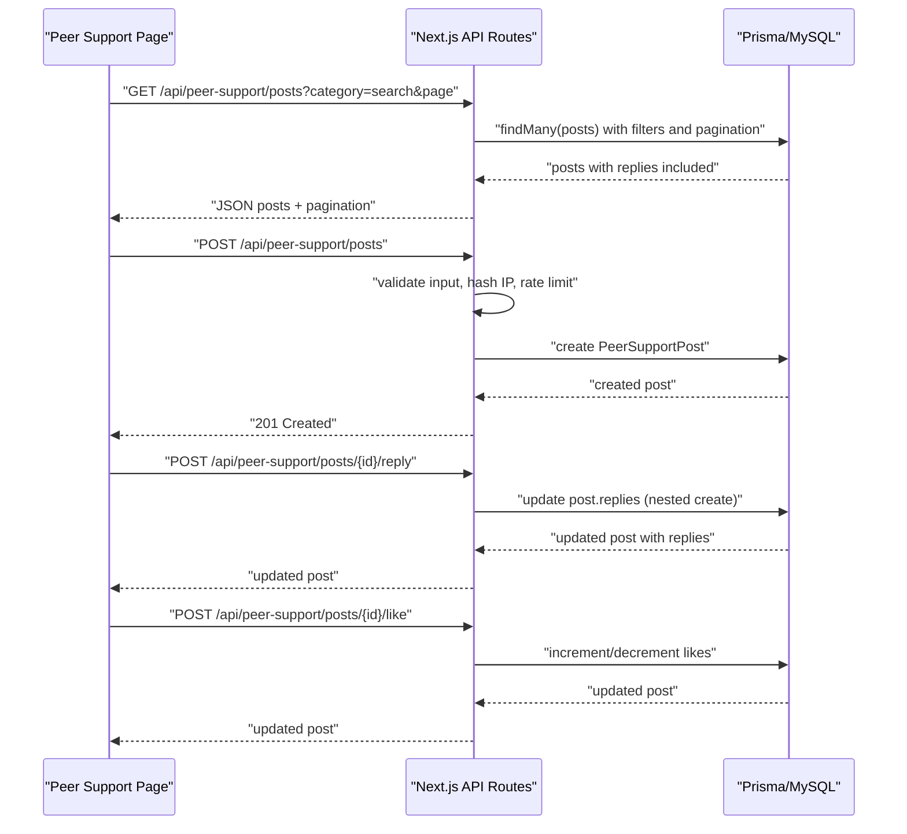

**Diagram sources**
- [page.tsx](file://WEBAPP/src/app/peer-support/page.tsx#L52-L193)
- [posts.route.ts](file://WEBAPP/src/app/api/peer-support/posts/route.ts#L21-L129)
- [reply.route.ts](file://WEBAPP/src/app/api/peer-support/posts/[id]/reply/route.ts#L17-L72)
- [like.route.ts](file://WEBAPP/src/app/api/peer-support/posts/[id]/like/route.ts#L4-L57)

## Detailed Component Analysis

### PeerSupportPost Model
PeerSupportPost encapsulates a single community post with the following fields and behaviors:
- Identity and categorization: id, content, category, anonymousId.
- Moderation and safety: ipHash, isActive.
- Activity and lifecycle: likes, createdAt, updatedAt.
- Relationships: replies collection.

Indexing:
- Category index for fast category filtering.
- createdAt index for reverse-chronological listing.

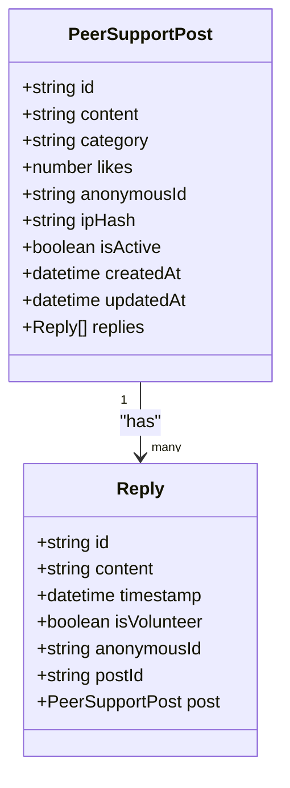

**Diagram sources**
- [schema.prisma](file://WEBAPP/prisma/schema.prisma#L80-L106)

**Section sources**
- [schema.prisma](file://WEBAPP/prisma/schema.prisma#L80-L106)
- [migration.sql](file://WEBAPP/prisma/migrations/20251105192017_add_therapy_models/migration.sql#L57-L71)

### Reply Model
Reply captures a comment under a post:
- Content and identity: content, anonymousId.
- Volunteer moderation: isVolunteer flag.
- Relationship: postId links to PeerSupportPost.

Indexing:
- PostId index for efficient lookup and cascading updates.

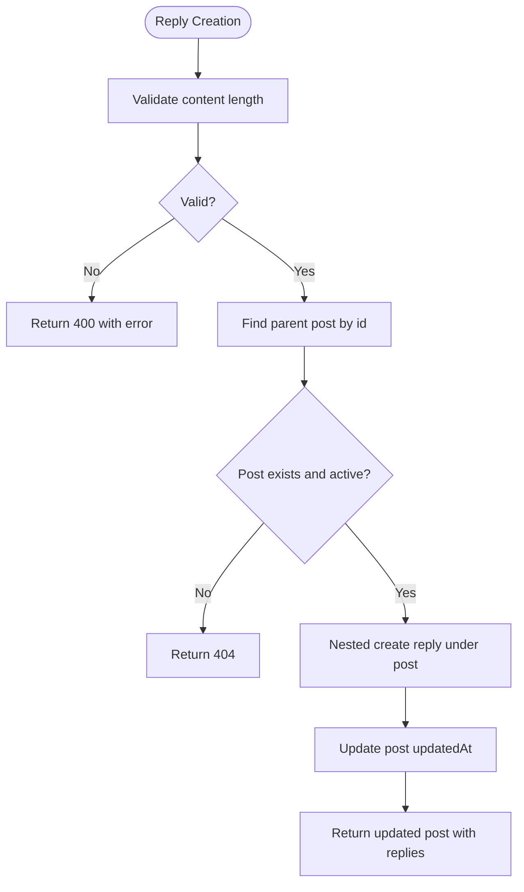

**Diagram sources**
- [reply.route.ts](file://WEBAPP/src/app/api/peer-support/posts/[id]/reply/route.ts#L17-L72)

**Section sources**
- [schema.prisma](file://WEBAPP/prisma/schema.prisma#L96-L106)
- [reply.route.ts](file://WEBAPP/src/app/api/peer-support/posts/[id]/reply/route.ts#L17-L72)

### Content Management and Retrieval
- Pagination: API paginates posts with a fixed limit and exposes total pages.
- Filtering: Supports category and combined post/reply content search.
- Ordering: Posts ordered by createdAt descending.
- Inclusion: Replies are included and ordered by timestamp ascending.

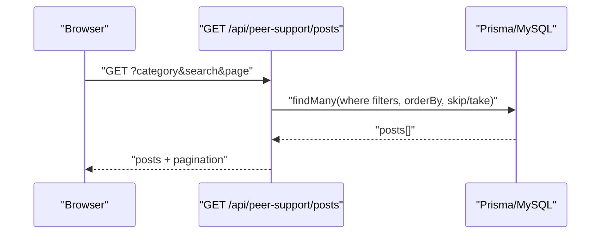

**Diagram sources**
- [posts.route.ts](file://WEBAPP/src/app/api/peer-support/posts/route.ts#L21-L75)

**Section sources**
- [posts.route.ts](file://WEBAPP/src/app/api/peer-support/posts/route.ts#L21-L75)

### Anonymous Posting and Identity Management
- Anonymous identifiers: Both posts and replies generate unique Student_* identifiers.
- Frontend rendering: Anonymous identities are displayed with category-derived colors and truncated initials.

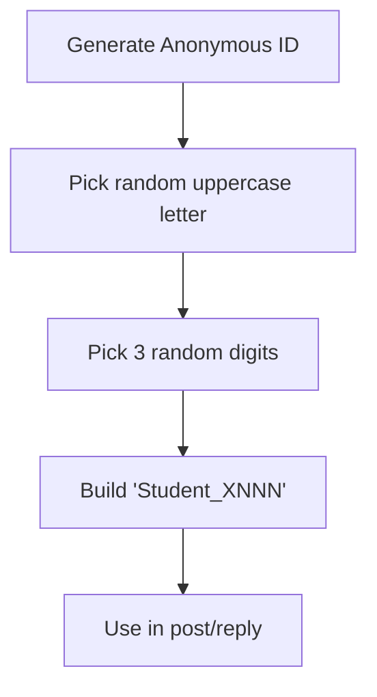

**Diagram sources**
- [posts.route.ts](file://WEBAPP/src/app/api/peer-support/posts/route.ts#L5-L14)
- [reply.route.ts](file://WEBAPP/src/app/api/peer-support/posts/[id]/reply/route.ts#L4-L15)
- [page.tsx](file://WEBAPP/src/app/peer-support/page.tsx#L78-L85)

**Section sources**
- [posts.route.ts](file://WEBAPP/src/app/api/peer-support/posts/route.ts#L5-L14)
- [reply.route.ts](file://WEBAPP/src/app/api/peer-support/posts/[id]/reply/route.ts#L4-L15)
- [page.tsx](file://WEBAPP/src/app/peer-support/page.tsx#L78-L85)

### IP-Based Moderation and Spam Prevention
- IP hashing: Incoming IP is hashed with a secret to anonymize and normalize for rate limiting.
- Rate limiting: Enforces a cap on posts per hour per IP hash.
- Error handling: Returns appropriate HTTP statuses for validation failures and rate limits.

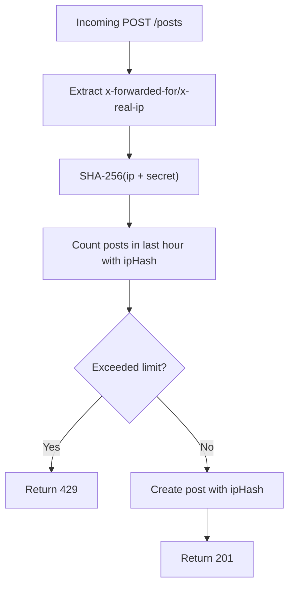

**Diagram sources**
- [posts.route.ts](file://WEBAPP/src/app/api/peer-support/posts/route.ts#L91-L107)

**Section sources**
- [posts.route.ts](file://WEBAPP/src/app/api/peer-support/posts/route.ts#L91-L107)

### Activity Tracking and Engagement
- Likes: Increment/decrement endpoint ensures non-negative counts and updates timestamps.
- Replies: Nested creation updates post updatedAt and returns updated post with replies.
- Frontend: Local state tracks liked posts and refreshes after actions.

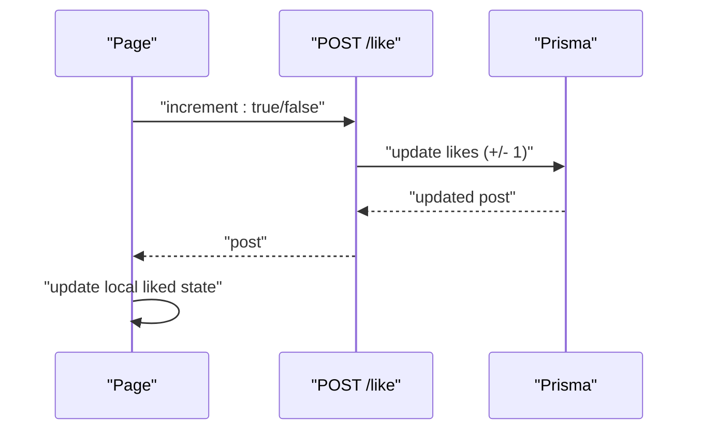

**Diagram sources**
- [like.route.ts](file://WEBAPP/src/app/api/peer-support/posts/[id]/like/route.ts#L4-L57)
- [page.tsx](file://WEBAPP/src/app/peer-support/page.tsx#L168-L193)

**Section sources**
- [like.route.ts](file://WEBAPP/src/app/api/peer-support/posts/[id]/like/route.ts#L4-L57)
- [page.tsx](file://WEBAPP/src/app/peer-support/page.tsx#L168-L193)

### Indexing Strategies
- PeerSupportPost: Indexes on category and createdAt enable fast filtering and chronological sorting.
- Reply: Index on postId supports efficient relationship queries.

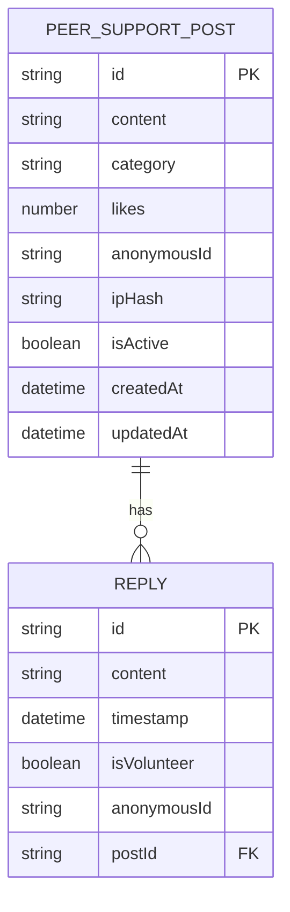

**Diagram sources**
- [schema.prisma](file://WEBAPP/prisma/schema.prisma#L80-L106)
- [migration.sql](file://WEBAPP/prisma/migrations/20251105192017_add_therapy_models/migration.sql#L57-L80)

**Section sources**
- [schema.prisma](file://WEBAPP/prisma/schema.prisma#L80-L106)
- [migration.sql](file://WEBAPP/prisma/migrations/20251105192017_add_therapy_models/migration.sql#L57-L80)

### Typical Community Engagement Scenarios
- New post creation:
  - User selects category, writes content, submits anonymously.
  - Backend validates, hashes IP, applies rate limit, creates post with anonymousId and ipHash.
- Searching and filtering:
  - Users filter by category and search across post and reply content.
- Replying and supporting:
  - Users reply anonymously; replies are sorted chronologically.
- Liking:
  - Users can express support; likes are tracked per post.

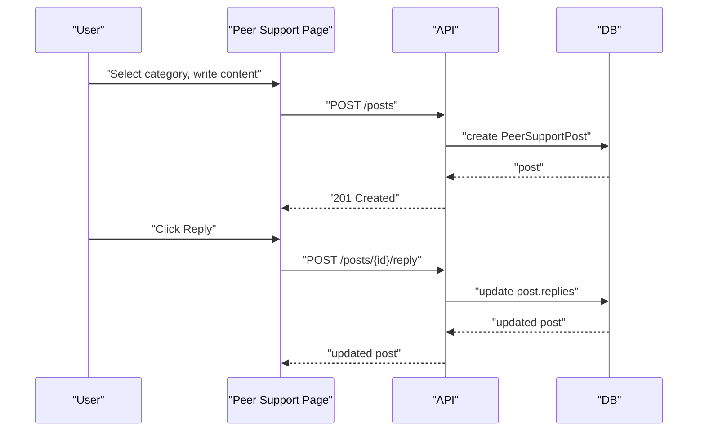

**Diagram sources**
- [page.tsx](file://WEBAPP/src/app/peer-support/page.tsx#L107-L166)
- [posts.route.ts](file://WEBAPP/src/app/api/peer-support/posts/route.ts#L79-L129)
- [reply.route.ts](file://WEBAPP/src/app/api/peer-support/posts/[id]/reply/route.ts#L17-L72)

**Section sources**
- [page.tsx](file://WEBAPP/src/app/peer-support/page.tsx#L107-L166)
- [posts.route.ts](file://WEBAPP/src/app/api/peer-support/posts/route.ts#L79-L129)
- [reply.route.ts](file://WEBAPP/src/app/api/peer-support/posts/[id]/reply/route.ts#L17-L72)

### Moderation Workflows
- Content moderation:
  - Validation enforces minimum/maximum lengths and category checks.
  - Rate limiting prevents spam via IP hashing.
- Volunteer moderation:
  - Reply model includes isVolunteer flag to mark supportive responses.
- Reporting and visibility:
  - UI exposes a report affordance; admin dashboard supports user management and bans.

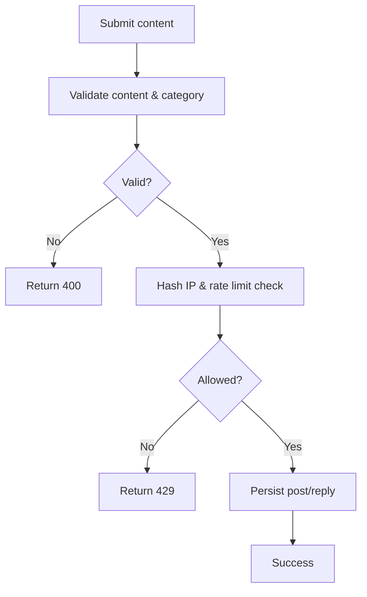

**Diagram sources**
- [posts.route.ts](file://WEBAPP/src/app/api/peer-support/posts/route.ts#L132-L159)
- [reply.route.ts](file://WEBAPP/src/app/api/peer-support/posts/[id]/reply/route.ts#L79-L99)

**Section sources**
- [posts.route.ts](file://WEBAPP/src/app/api/peer-support/posts/route.ts#L132-L159)
- [reply.route.ts](file://WEBAPP/src/app/api/peer-support/posts/[id]/reply/route.ts#L79-L99)

## Dependency Analysis
- Frontend depends on API routes for all interactions.
- API routes depend on Prisma client for database operations.
- Prisma client is configured globally to avoid reconnect overhead.

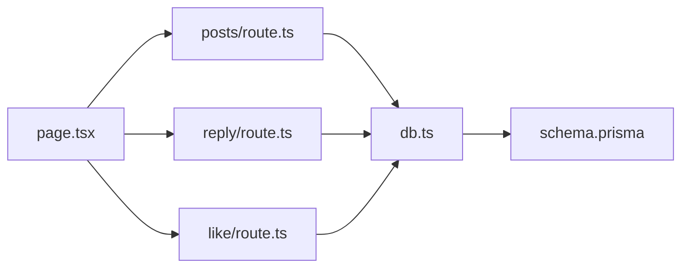

**Diagram sources**
- [page.tsx](file://WEBAPP/src/app/peer-support/page.tsx#L52-L193)
- [posts.route.ts](file://WEBAPP/src/app/api/peer-support/posts/route.ts#L1-L3)
- [reply.route.ts](file://WEBAPP/src/app/api/peer-support/posts/[id]/reply/route.ts#L1-L2)
- [like.route.ts](file://WEBAPP/src/app/api/peer-support/posts/[id]/like/route.ts#L1-L2)
- [db.ts](file://WEBAPP/src/lib/db.ts#L1-L15)
- [schema.prisma](file://WEBAPP/prisma/schema.prisma#L80-L106)

**Section sources**
- [page.tsx](file://WEBAPP/src/app/peer-support/page.tsx#L52-L193)
- [posts.route.ts](file://WEBAPP/src/app/api/peer-support/posts/route.ts#L1-L3)
- [reply.route.ts](file://WEBAPP/src/app/api/peer-support/posts/[id]/reply/route.ts#L1-L2)
- [like.route.ts](file://WEBAPP/src/app/api/peer-support/posts/[id]/like/route.ts#L1-L2)
- [db.ts](file://WEBAPP/src/lib/db.ts#L1-L15)
- [schema.prisma](file://WEBAPP/prisma/schema.prisma#L80-L106)

## Performance Considerations
- Indexes: Category and createdAt indexes on PeerSupportPost enable fast filtering and sorting.
- Pagination: Fixed page size with total calculation avoids large result sets.
- Nested writes: Using Prisma nested create minimizes round-trips.
- Rate limiting: Prevents excessive writes and reduces load.

[No sources needed since this section provides general guidance]

## Troubleshooting Guide
Common issues and resolutions:
- Validation errors on post creation:
  - Ensure content length and category are valid; backend returns 400 with error details.
- Rate limit exceeded:
  - Exceeded posts per hour per IP hash; wait before posting again.
- Post not found when replying:
  - Parent post may be inactive or deleted; verify post ID.
- Like update anomalies:
  - Ensure increment is a boolean; backend validates and clamps likes to non-negative.

**Section sources**
- [posts.route.ts](file://WEBAPP/src/app/api/peer-support/posts/route.ts#L132-L159)
- [reply.route.ts](file://WEBAPP/src/app/api/peer-support/posts/[id]/reply/route.ts#L29-L42)
- [like.route.ts](file://WEBAPP/src/app/api/peer-support/posts/[id]/like/route.ts#L13-L24)

## Conclusion
The PeerSupportPost and Reply models provide a robust foundation for anonymous, community-driven discussions with built-in moderation and performance optimizations. The API enforces validations, rate limits, and IP hashing to mitigate spam, while the frontend offers intuitive controls for browsing, posting, replying, and liking. Admin capabilities complement these features by enabling user and system oversight.