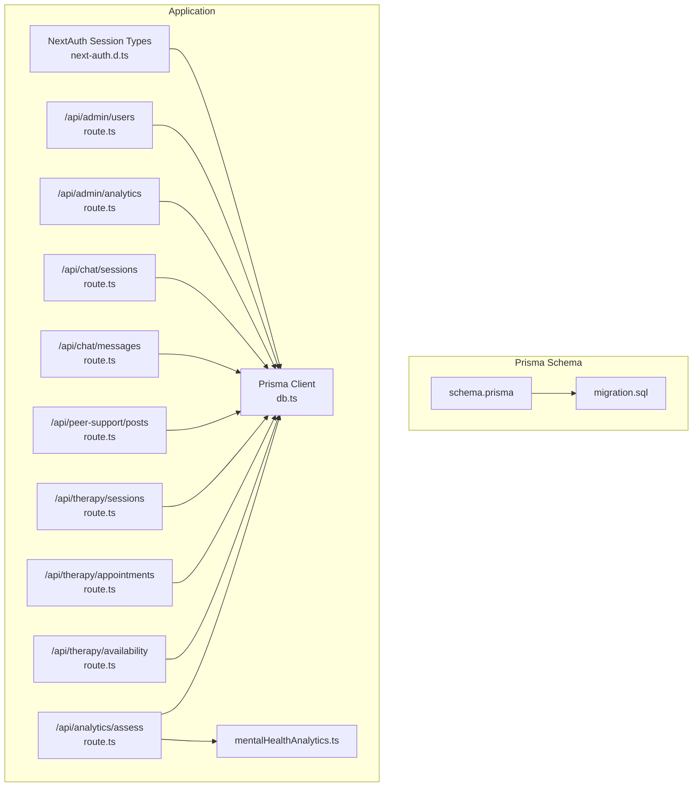
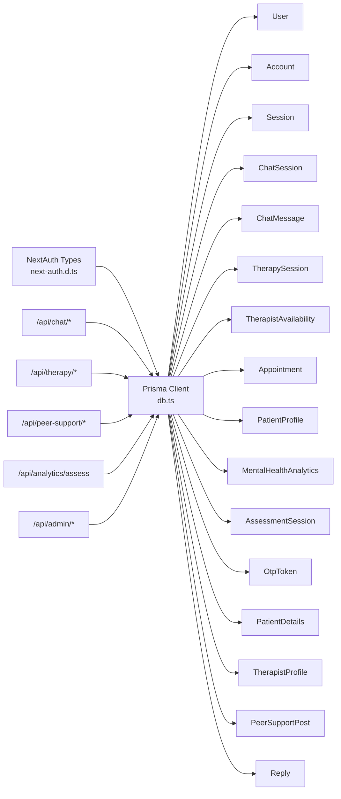

# Data Models

<cite>
**Referenced Files in This Document**
- [schema.prisma](file://WEBAPP/prisma/schema.prisma)
- [migration.sql](file://WEBAPP/prisma/migrations/20251105192017_add_therapy_models/migration.sql)
- [seed.ts](file://WEBAPP/prisma/seed.ts)
- [db.ts](file://WEBAPP/src/lib/db.ts)
- [next-auth.d.ts](file://WEBAPP/src/types/next-auth.d.ts)
- [route.ts (admin analytics)](file://WEBAPP/src/app/api/admin/analytics/route.ts)
- [route.ts (admin users)](file://WEBAPP/src/app/api/admin/users/route.ts)
- [route.ts (chat sessions)](file://WEBAPP/src/app/api/chat/sessions/route.ts)
- [route.ts (chat messages)](file://WEBAPP/src/app/api/chat/messages/route.ts)
- [route.ts (peer support posts)](file://WEBAPP/src/app/api/peer-support/posts/route.ts)
- [route.ts (therapy sessions)](file://WEBAPP/src/app/api/therapy/sessions/route.ts)
- [route.ts (therapy appointments)](file://WEBAPP/src/app/api/therapy/appointments/route.ts)
- [route.ts (therapy availability)](file://WEBAPP/src/app/api/therapy/availability/route.ts)
- [route.ts (analytics assess)](file://WEBAPP/src/app/api/analytics/assess/route.ts)
- [mentalHealthAnalytics.ts](file://WEBAPP/src/lib/mentalHealthAnalytics.ts)
</cite>

## Table of Contents
1. [Introduction](#introduction)
2. [Project Structure](#project-structure)
3. [Core Components](#core-components)
4. [Architecture Overview](#architecture-overview)
5. [Detailed Component Analysis](#detailed-component-analysis)
6. [Dependency Analysis](#dependency-analysis)
7. [Performance Considerations](#performance-considerations)
8. [Troubleshooting Guide](#troubleshooting-guide)
9. [Conclusion](#conclusion)

## Introduction
This document provides comprehensive data model documentation for the MindBridge database system. It covers all 20+ models defined in the Prisma schema, including Users, Accounts, Sessions, Chat systems, Therapy sessions, Patient profiles, Mental health analytics, Peer support, Appointments, and administrative models. For each model, we explain purpose, fields, data types, constraints, business logic, indexes, unique constraints, and performance considerations. We also include examples of typical data structures and use cases derived from the API routes and utilities.

## Project Structure
The data models are defined declaratively in Prisma and backed by MySQL. The Prisma schema maps directly to SQL tables and indexes. The application uses NextAuth.js for authentication and exposes REST endpoints under src/app/api/* that operate against these models.

**Diagram sources**
- [schema.prisma](file://WEBAPP/prisma/schema.prisma#L1-L330)
- [migration.sql](file://WEBAPP/prisma/migrations/20251105192017_add_therapy_models/migration.sql#L1-L206)
- [next-auth.d.ts](file://WEBAPP/src/types/next-auth.d.ts#L1-L28)
- [db.ts](file://WEBAPP/src/lib/db.ts#L1-L15)
- [route.ts (admin users)](file://WEBAPP/src/app/api/admin/users/route.ts#L1-L108)
- [route.ts (admin analytics)](file://WEBAPP/src/app/api/admin/analytics/route.ts#L1-L109)
- [route.ts (chat sessions)](file://WEBAPP/src/app/api/chat/sessions/route.ts#L1-L187)
- [route.ts (chat messages)](file://WEBAPP/src/app/api/chat/messages/route.ts#L1-L91)
- [route.ts (peer support posts)](file://WEBAPP/src/app/api/peer-support/posts/route.ts#L1-L161)
- [route.ts (therapy sessions)](file://WEBAPP/src/app/api/therapy/sessions/route.ts#L1-L80)
- [route.ts (therapy appointments)](file://WEBAPP/src/app/api/therapy/appointments/route.ts#L1-L181)
- [route.ts (therapy availability)](file://WEBAPP/src/app/api/therapy/availability/route.ts#L1-L217)
- [route.ts (analytics assess)](file://WEBAPP/src/app/api/analytics/assess/route.ts#L1-L121)
- [mentalHealthAnalytics.ts](file://WEBAPP/src/lib/mentalHealthAnalytics.ts#L1-L884)

**Section sources**
- [schema.prisma](file://WEBAPP/prisma/schema.prisma#L1-L330)
- [migration.sql](file://WEBAPP/prisma/migrations/20251105192017_add_therapy_models/migration.sql#L1-L206)
- [db.ts](file://WEBAPP/src/lib/db.ts#L1-L15)

## Core Components
Below are the primary data models and their core characteristics. Each model’s purpose, fields, data types, constraints, and indexes are documented. Business logic and usage patterns are described in later sections.

- User
  - Purpose: Base identity and authentication record for patients, therapists, and admins.
  - Fields: id, name, email (unique), emailVerified, password, role (default "patient"), image, isProfileComplete (default false), isBanned (default false), createdAt (default now), relations to accounts, sessions, chatMessages, chatSessions, patientDetails, therapistProfile, therapySessions (as patient/therapist), therapistAvailability, patientProfile, mentalHealthAnalytics, assessmentSessions, otpTokens.
  - Constraints: Unique email; role defaults; timestamps default.
  - Indexes: None declared in schema; unique enforced by database.
  - Notes: Role determines access to features; profile completeness flag used during onboarding.

- Account (NextAuth)
  - Purpose: OAuth/OpenID Connect account records linked to User.
  - Fields: id, userId (foreign key), type, provider, providerAccountId, refresh_token, access_token, expires_at, token_type, scope, id_token, session_state.
  - Constraints: Unique(provider, providerAccountId).
  - Indexes: None declared; unique enforced by database.

- Session (NextAuth)
  - Purpose: Session tokens for NextAuth.
  - Fields: id, sessionToken (unique), userId, expires.
  - Constraints: Unique sessionToken.
  - Indexes: None declared; unique enforced by database.

- VerificationToken (NextAuth)
  - Purpose: One-time token for email verification/reset flows.
  - Fields: identifier, token (unique), expires.
  - Constraints: Unique token; composite unique(identifier, token).
  - Indexes: None declared; unique enforced by database.

- ChatSession
  - Purpose: Represents a user’s chat channel/session.
  - Fields: id, userId (foreign key), title (default "New Chat"), createdAt (default now), updatedAt (default now), isActive (default true), messages.
  - Constraints: None.
  - Indexes: userId, createdAt.

- ChatMessage
  - Purpose: Stores user messages within a session or standalone.
  - Fields: id, userId (foreign key), sessionId (optional), role (default "user"), content (text), timestamp (default now), metadata (JSON).
  - Constraints: None.
  - Indexes: userId, sessionId, timestamp.

- TherapySession
  - Purpose: Tracks therapy sessions between a therapist and a patient.
  - Fields: id, therapistId, patientId, startTime, endTime (nullable), duration (seconds, default 0), emotionsSummary (JSON), messageCount (default 0), status (default "scheduled"), notes (text), createdAt/updatedAt.
  - Constraints: None.
  - Indexes: therapistId, patientId, status, startTime.

- TherapistAvailability
  - Purpose: Defines therapist available time slots (weekly or specific dates).
  - Fields: id, therapistId, dayOfWeek (0–6), startTime ("HH:mm"), endTime ("HH:mm"), isRecurring (default true), specificDate (nullable override), isBooked (default false), isActive (default true), createdAt/updatedAt, appointments.
  - Constraints: None.
  - Indexes: therapistId, dayOfWeek, isBooked, isActive, specificDate.

- Appointment
  - Purpose: Schedules therapy sessions with time slots and status tracking.
  - Fields: id, therapistId, patientId, slotId (optional), scheduledTime, duration (seconds, default 3600), status (default "pending"), type (default "followup"), notes (text), reminderSent (default false), calendarEventId (nullable), createdAt/updatedAt.
  - Constraints: None.
  - Indexes: therapistId, patientId, slotId, status, scheduledTime, reminderSent.

- PatientProfile
  - Purpose: Aggregated patient analytics and progress.
  - Fields: id, userId (unique), totalSessions (default 0), lastSessionDate, dominantEmotion (default "neutral"), improvementTrend (default "stable"), notes (text), createdAt/updatedAt.
  - Constraints: Unique userId.
  - Indexes: userId.

- MentalHealthAnalytics
  - Purpose: Daily computed mental health metrics per user.
  - Fields: id, userId, date (default now), mentalHealthLevel (1–5), levelLabel, keywordsDetected (JSON), keywordCounts (JSON), totalMessages (default 0), positiveCount (default 0), negativeCount (default 0), riskFlags (JSON), source (default "chat"), createdAt.
  - Constraints: None.
  - Indexes: userId, date, compound(userId, date).

- AssessmentSession
  - Purpose: Stores Q&A screening assessment results.
  - Fields: id, userId, totalScore (default 0), maxScore (default 30), mentalHealthLevel (computed), levelLabel, answers (JSON array), completedAt (default now), createdAt.
  - Constraints: None.
  - Indexes: userId, completedAt.

- OtpToken
  - Purpose: One-time password tokens for password reset.
  - Fields: id, userId, otp, expiresAt, used (default false), createdAt.
  - Constraints: None.
  - Indexes: userId, otp.

- PatientDetails
  - Purpose: First-time registration details for patients.
  - Fields: id, userId (unique), fullName, dateOfBirth, gender, age, height (optional), weight (optional), createdAt/updatedAt.
  - Constraints: Unique userId.
  - Indexes: userId.

- TherapistProfile
  - Purpose: Verified profile for therapists with credentials and verification status.
  - Fields: id, userId (unique), fullName, dateOfBirth, gender, age, degree, experience, hospitalAffiliation (text), photoUrl (long text), isVerified (default false), verificationStatus (default "pending"), rejectionReason (text), createdAt/updatedAt.
  - Constraints: Unique userId.
  - Indexes: userId, isVerified, verificationStatus.

- AdminUser
  - Purpose: Administrative users stored directly in DB.
  - Fields: id, adminId (unique), password, createdAt.
  - Constraints: Unique adminId.
  - Indexes: None declared; unique enforced by database.

- PeerSupportPost
  - Purpose: Community forum posts with categories and activity.
  - Fields: id, content (text), category, likes (default 0), anonymousId, ipHash, isActive (default true), createdAt/updatedAt, replies.
  - Constraints: None.
  - Indexes: category, createdAt.

- Reply
  - Purpose: Replies to peer support posts.
  - Fields: id, content (text), timestamp (default now), isVolunteer (default false), anonymousId, postId (foreign key).
  - Constraints: None.
  - Indexes: postId.

**Section sources**
- [schema.prisma](file://WEBAPP/prisma/schema.prisma#L11-L329)
- [migration.sql](file://WEBAPP/prisma/migrations/20251105192017_add_therapy_models/migration.sql#L1-L206)

## Architecture Overview
The system uses Prisma ORM to define models and generate SQL migrations. Application APIs under src/app/api/* interact with these models to enforce business rules (e.g., session ownership, availability conflicts, rate limits). Mental health analytics are computed via a dedicated library and persisted into MentalHealthAnalytics and AssessmentSession.

```mermaid
classDiagram
class User {
+string id
+string name?
+string email (unique)
+datetime emailVerified?
+string password
+string role
+string image?
+boolean isProfileComplete
+boolean isBanned
+datetime createdAt
}
class Account {
+string id
+string userId
+string type
+string provider
+string providerAccountId
+string refresh_token?
+string access_token?
+int expires_at?
+string token_type?
+string scope?
+string id_token?
+string session_state?
}
class Session {
+string id
+string sessionToken (unique)
+string userId
+datetime expires
}
class ChatSession {
+string id
+string userId
+string title
+datetime createdAt
+datetime updatedAt
+boolean isActive
}
class ChatMessage {
+string id
+string userId
+string sessionId?
+string role
+text content
+datetime timestamp
+json metadata?
}
class TherapySession {
+string id
+string therapistId
+string patientId
+datetime startTime
+datetime endTime?
+int duration
+json emotionsSummary?
+int messageCount
+string status
+text notes?
}
class TherapistAvailability {
+string id
+string therapistId
+int dayOfWeek
+string startTime
+string endTime
+boolean isRecurring
+datetime specificDate?
+boolean isBooked
+boolean isActive
}
class Appointment {
+string id
+string therapistId
+string patientId
+string slotId?
+datetime scheduledTime
+int duration
+string status
+string type
+text notes?
+boolean reminderSent
+string calendarEventId?
}
class PatientProfile {
+string id
+string userId (unique)
+int totalSessions
+datetime lastSessionDate?
+string dominantEmotion
+string improvementTrend
}
class MentalHealthAnalytics {
+string id
+string userId
+datetime date
+int mentalHealthLevel
+string levelLabel
+json keywordsDetected?
+json keywordCounts?
+int totalMessages
+int positiveCount
+int negativeCount
+json riskFlags?
+string source
}
class AssessmentSession {
+string id
+string userId
+int totalScore
+int maxScore
+int mentalHealthLevel
+string levelLabel
+json answers
}
class OtpToken {
+string id
+string userId
+string otp
+datetime expiresAt
+boolean used
}
class PatientDetails {
+string id
+string userId (unique)
+string fullName
+datetime dateOfBirth
+string gender
+int age
+string height?
+string weight?
}
class TherapistProfile {
+string id
+string userId (unique)
+string fullName
+datetime dateOfBirth
+string gender
+int age
+string degree
+string experience
+text hospitalAffiliation
+longtext photoUrl
+boolean isVerified
+string verificationStatus
+text rejectionReason?
}
class PeerSupportPost {
+string id
+text content
+string category
+int likes
+string anonymousId
+string ipHash
+boolean isActive
}
class Reply {
+string id
+text content
+datetime timestamp
+boolean isVolunteer
+string anonymousId
+string postId
}
User "1" <-- "many" Account : "accounts"
User "1" <-- "many" Session : "sessions"
User "1" <-- "many" ChatMessage : "chatMessages"
User "1" <-- "many" ChatSession : "chatSessions"
User "1" <-- "one" PatientDetails : "patientDetails"
User "1" <-- "one" TherapistProfile : "therapistProfile"
User "1" <-- "many" TherapySession : "therapySessions (patient)"
User "1" <-- "many" TherapySession : "therapySessions (therapist)"
User "1" <-- "many" Appointment : "patientAppointments"
User "1" <-- "many" Appointment : "therapistAppointments"
User "1" <-- "many" MentalHealthAnalytics : "mentalHealthAnalytics"
User "1" <-- "many" AssessmentSession : "assessmentSessions"
User "1" <-- "many" OtpToken : "otpTokens"
ChatSession "1" --> "many" ChatMessage : "messages"
PeerSupportPost "1" --> "many" Reply : "replies"
```

**Diagram sources**
- [schema.prisma](file://WEBAPP/prisma/schema.prisma#L11-L329)

## Detailed Component Analysis

### Authentication and Identity Models
- User
  - Purpose: Central identity with role-based access.
  - Defaults: role="patient", isProfileComplete=false, isBanned=false, createdAt=now().
  - Relations: accounts, sessions, chatMessages, chatSessions, patientDetails, therapistProfile, therapySessions (as patient/therapist), therapistAvailability, patientProfile, mentalHealthAnalytics, assessmentSessions, otpTokens.
  - Business logic: Role determines access to features; profile completion flag gates onboarding flows.

- Account
  - Purpose: NextAuth external account linkage.
  - Constraints: Composite unique(provider, providerAccountId).

- Session
  - Purpose: NextAuth session persistence.
  - Constraints: sessionToken unique.

- VerificationToken
  - Purpose: One-time token for verification/reset.
  - Constraints: token unique; composite unique(identifier, token).

- OtpToken
  - Purpose: Temporary token for password reset.
  - Constraints: None.
  - Indexes: userId, otp.

**Section sources**
- [schema.prisma](file://WEBAPP/prisma/schema.prisma#L12-L79)
- [migration.sql](file://WEBAPP/prisma/migrations/20251105192017_add_therapy_models/migration.sql#L2-L54)

### Chat System Models
- ChatSession
  - Purpose: User chat channels.
  - Indexes: userId, createdAt.
  - Behavior: Soft deletion via isActive; listing filters by isActive=true.

- ChatMessage
  - Purpose: Messages stored with optional session association and metadata.
  - Indexes: userId, sessionId, timestamp.
  - Metadata: JSON for emotions, context, etc.

- API usage patterns:
  - List/create/delete/update sessions: [route.ts (chat sessions)](file://WEBAPP/src/app/api/chat/sessions/route.ts#L1-L187)
  - Save/retrieve messages: [route.ts (chat messages)](file://WEBAPP/src/app/api/chat/messages/route.ts#L1-L91)

**Section sources**
- [schema.prisma](file://WEBAPP/prisma/schema.prisma#L108-L138)
- [migration.sql](file://WEBAPP/prisma/migrations/20251105192017_add_therapy_models/migration.sql#L86-L114)
- [route.ts (chat sessions)](file://WEBAPP/src/app/api/chat/sessions/route.ts#L1-L187)
- [route.ts (chat messages)](file://WEBAPP/src/app/api/chat/messages/route.ts#L1-L91)

### Therapy Models
- TherapySession
  - Purpose: Tracks session lifecycle with status, duration, emotion summary, and notes.
  - Indexes: therapistId, patientId, status, startTime.

- TherapistAvailability
  - Purpose: Weekly recurring or specific-date slots; supports booking checks.
  - Indexes: therapistId, dayOfWeek, isBooked, isActive, specificDate.

- Appointment
  - Purpose: Scheduling with conflict detection and optional slot binding.
  - Indexes: therapistId, patientId, slotId, status, scheduledTime, reminderSent.
  - Business logic: Transactional booking; Google Calendar sync attempted post-creation.

- API usage patterns:
  - List/create therapy sessions: [route.ts (therapy sessions)](file://WEBAPP/src/app/api/therapy/sessions/route.ts#L1-L80)
  - List/create appointments with conflict checks: [route.ts (therapy appointments)](file://WEBAPP/src/app/api/therapy/appointments/route.ts#L1-L181)
  - Manage availability (create/delete/get): [route.ts (therapy availability)](file://WEBAPP/src/app/api/therapy/availability/route.ts#L1-L217)

**Section sources**
- [schema.prisma](file://WEBAPP/prisma/schema.prisma#L140-L211)
- [migration.sql](file://WEBAPP/prisma/migrations/20251105192017_add_therapy_models/migration.sql#L116-L155)
- [route.ts (therapy sessions)](file://WEBAPP/src/app/api/therapy/sessions/route.ts#L1-L80)
- [route.ts (therapy appointments)](file://WEBAPP/src/app/api/therapy/appointments/route.ts#L1-L181)
- [route.ts (therapy availability)](file://WEBAPP/src/app/api/therapy/availability/route.ts#L1-L217)

### Patient and Therapist Profiles
- PatientProfile
  - Purpose: Aggregate metrics and trends for patients.
  - Indexes: userId.

- PatientDetails
  - Purpose: Onboarding data for patients.
  - Indexes: userId.

- TherapistProfile
  - Purpose: Verified professional profile with hospital affiliation and photo.
  - Indexes: userId, isVerified, verificationStatus.

- API usage patterns:
  - Admin user listing with profile details: [route.ts (admin users)](file://WEBAPP/src/app/api/admin/users/route.ts#L1-L108)

**Section sources**
- [schema.prisma](file://WEBAPP/prisma/schema.prisma#L213-L321)
- [migration.sql](file://WEBAPP/prisma/migrations/20251105192017_add_therapy_models/migration.sql#L157-L205)
- [route.ts (admin users)](file://WEBAPP/src/app/api/admin/users/route.ts#L1-L108)

### Mental Health Analytics Models
- MentalHealthAnalytics
  - Purpose: Daily computed metrics including keyword counts, risk flags, and severity level.
  - Indexes: userId, date, (userId, date).

- AssessmentSession
  - Purpose: Structured assessment results with scored categories.
  - Indexes: userId, completedAt.

- Analytics engine:
  - Library computes keyword-based severity, risk flags, sentiment, and trends.
  - Used by assessment endpoint to persist results.

**Section sources**
- [schema.prisma](file://WEBAPP/prisma/schema.prisma#L229-L266)
- [migration.sql](file://WEBAPP/prisma/migrations/20251105192017_add_therapy_models/migration.sql#L157-L157)
- [route.ts (analytics assess)](file://WEBAPP/src/app/api/analytics/assess/route.ts#L1-L121)
- [mentalHealthAnalytics.ts](file://WEBAPP/src/lib/mentalHealthAnalytics.ts#L1-L884)

### Peer Support Models
- PeerSupportPost
  - Purpose: Community posts with categories and anonymous identifiers.
  - Indexes: category, createdAt.

- Reply
  - Purpose: Threaded replies to posts.
  - Indexes: postId.

- API usage patterns:
  - List/create posts with rate limiting and spam prevention: [route.ts (peer support posts)](file://WEBAPP/src/app/api/peer-support/posts/route.ts#L1-L161)

**Section sources**
- [schema.prisma](file://WEBAPP/prisma/schema.prisma#L79-L106)
- [migration.sql](file://WEBAPP/prisma/migrations/20251105192017_add_therapy_models/migration.sql#L56-L84)
- [route.ts (peer support posts)](file://WEBAPP/src/app/api/peer-support/posts/route.ts#L1-L161)

### Administrative Models
- AdminUser
  - Purpose: Directly stored admin credentials.
  - Constraints: Unique adminId.

- Admin analytics and user management:
  - Admin analytics endpoint aggregates counts and charts: [route.ts (admin analytics)](file://WEBAPP/src/app/api/admin/analytics/route.ts#L1-L109)
  - Admin user listing and actions: [route.ts (admin users)](file://WEBAPP/src/app/api/admin/users/route.ts#L1-L108)

**Section sources**
- [schema.prisma](file://WEBAPP/prisma/schema.prisma#L323-L329)
- [route.ts (admin analytics)](file://WEBAPP/src/app/api/admin/analytics/route.ts#L1-L109)
- [route.ts (admin users)](file://WEBAPP/src/app/api/admin/users/route.ts#L1-L108)

## Dependency Analysis
The following diagram shows key dependencies among models and how APIs depend on Prisma client and shared types.

**Diagram sources**
- [db.ts](file://WEBAPP/src/lib/db.ts#L1-L15)
- [next-auth.d.ts](file://WEBAPP/src/types/next-auth.d.ts#L1-L28)
- [schema.prisma](file://WEBAPP/prisma/schema.prisma#L11-L329)
- [route.ts (chat sessions)](file://WEBAPP/src/app/api/chat/sessions/route.ts#L1-L187)
- [route.ts (chat messages)](file://WEBAPP/src/app/api/chat/messages/route.ts#L1-L91)
- [route.ts (therapy sessions)](file://WEBAPP/src/app/api/therapy/sessions/route.ts#L1-L80)
- [route.ts (therapy appointments)](file://WEBAPP/src/app/api/therapy/appointments/route.ts#L1-L181)
- [route.ts (therapy availability)](file://WEBAPP/src/app/api/therapy/availability/route.ts#L1-L217)
- [route.ts (peer support posts)](file://WEBAPP/src/app/api/peer-support/posts/route.ts#L1-L161)
- [route.ts (analytics assess)](file://WEBAPP/src/app/api/analytics/assess/route.ts#L1-L121)
- [route.ts (admin analytics)](file://WEBAPP/src/app/api/admin/analytics/route.ts#L1-L109)
- [route.ts (admin users)](file://WEBAPP/src/app/api/admin/users/route.ts#L1-L108)

**Section sources**
- [db.ts](file://WEBAPP/src/lib/db.ts#L1-L15)
- [schema.prisma](file://WEBAPP/prisma/schema.prisma#L11-L329)

## Performance Considerations
- Indexes
  - ChatMessage: userId, sessionId, timestamp — essential for pagination and filtering by user/session/time.
  - TherapySession: therapistId, patientId, status, startTime — supports scheduling queries and reporting.
  - Appointment: therapistId, patientId, slotId, status, scheduledTime, reminderSent — enables efficient scheduling and reminders.
  - MentalHealthAnalytics: userId, date, (userId, date) — supports daily and user-level analytics.
  - PeerSupportPost: category, createdAt — improves feed queries and trending.
  - Other models: Many include targeted indexes (e.g., availability, verification) to reduce scans.

- Unique constraints
  - Email uniqueness on User ensures fast lookup and prevents duplicates.
  - Composite unique on Account(provider, providerAccountId) avoids duplicate external accounts.
  - Unique on PatientProfile.userId and TherapistProfile.userId enforces one profile per user.

- Transactions and atomicity
  - Appointment creation uses Prisma transactions to prevent double-booking and maintain consistency.

- Pagination and limits
  - Chat message retrieval uses limit/offset to avoid large result sets.

- JSON fields
  - Metadata in ChatMessage and emotion summaries in TherapySession enable flexible storage but require careful querying and indexing strategies if used heavily.

[No sources needed since this section provides general guidance]

## Troubleshooting Guide
- Unauthorized access
  - Symptom: 401 responses from protected endpoints.
  - Cause: Missing/invalid NextAuth session or missing email in session.
  - Example: [route.ts (chat sessions)](file://WEBAPP/src/app/api/chat/sessions/route.ts#L8-L12)

- Missing required fields
  - Symptom: 400 responses when creating sessions or appointments.
  - Cause: Missing therapistId, patientId, startTime, or other required fields.
  - Example: [route.ts (therapy sessions)](file://WEBAPP/src/app/api/therapy/sessions/route.ts#L52-L56)

- Time conflicts and double-booking
  - Symptom: 409 responses when creating appointments.
  - Cause: Overlapping time windows or slot already booked.
  - Example: [route.ts (therapy appointments)](file://WEBAPP/src/app/api/therapy/appointments/route.ts#L117-L119)

- Rate limiting on peer support
  - Symptom: 429 responses when posting frequently.
  - Cause: More than threshold posts per hour from same IP hash.
  - Example: [route.ts (peer support posts)](file://WEBAPP/src/app/api/peer-support/posts/route.ts#L105-L107)

- Admin-only endpoints
  - Symptom: 401 responses when accessing admin analytics/users.
  - Cause: Missing/invalid admin JWT or wrong role.
  - Example: [route.ts (admin analytics)](file://WEBAPP/src/app/api/admin/analytics/route.ts#L7-L17), [route.ts (admin users)](file://WEBAPP/src/app/api/admin/users/route.ts#L7-L17)

**Section sources**
- [route.ts (chat sessions)](file://WEBAPP/src/app/api/chat/sessions/route.ts#L8-L12)
- [route.ts (therapy sessions)](file://WEBAPP/src/app/api/therapy/sessions/route.ts#L52-L56)
- [route.ts (therapy appointments)](file://WEBAPP/src/app/api/therapy/appointments/route.ts#L117-L119)
- [route.ts (peer support posts)](file://WEBAPP/src/app/api/peer-support/posts/route.ts#L105-L107)
- [route.ts (admin analytics)](file://WEBAPP/src/app/api/admin/analytics/route.ts#L7-L17)
- [route.ts (admin users)](file://WEBAPP/src/app/api/admin/users/route.ts#L7-L17)

## Conclusion
MindBridge’s data model is centered around a robust identity layer (User, Account, Session), a flexible chat system (ChatSession, ChatMessage), structured therapy workflows (TherapySession, TherapistAvailability, Appointment), and comprehensive mental health analytics (MentalHealthAnalytics, AssessmentSession). Strong indexing and unique constraints ensure data integrity and performance. The APIs enforce business rules such as session ownership, availability conflicts, and rate limiting, while the analytics engine provides actionable insights. Together, these models support a scalable, secure, and user-focused mental health platform.