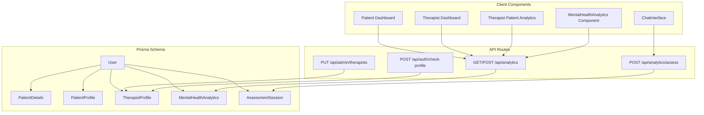
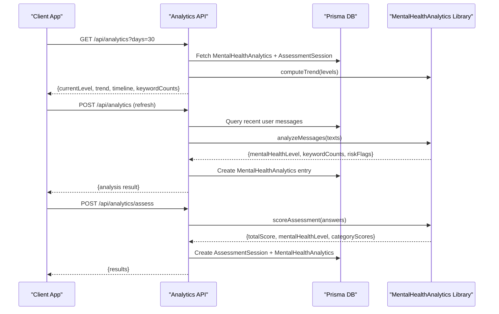
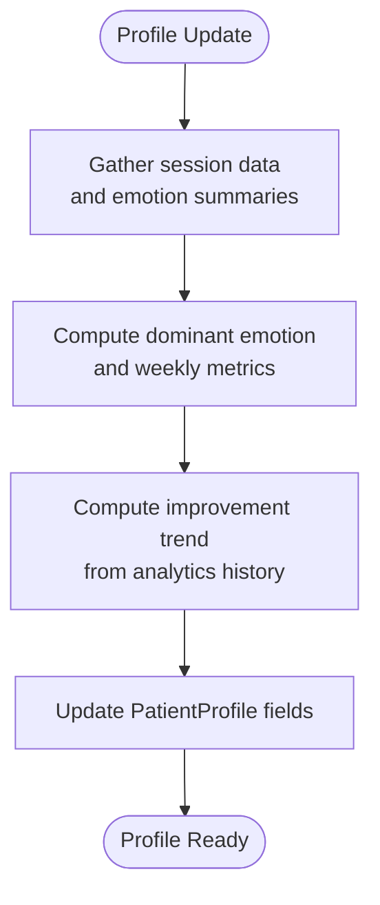
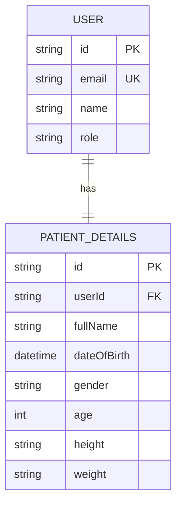
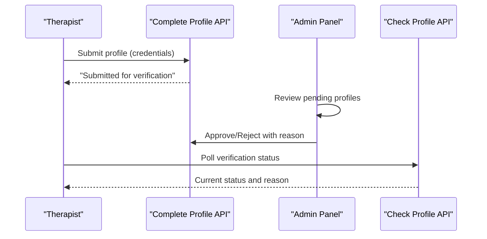
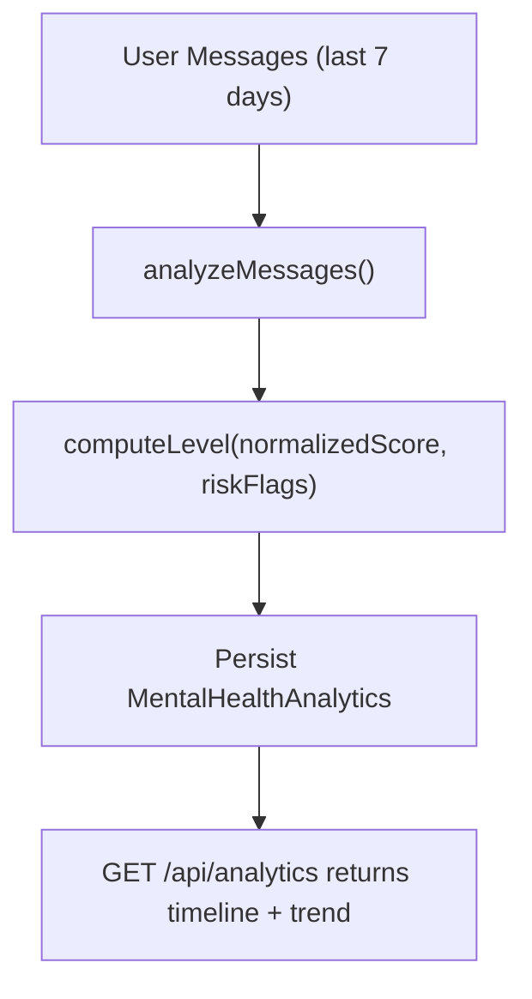
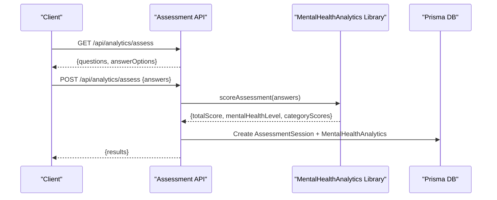
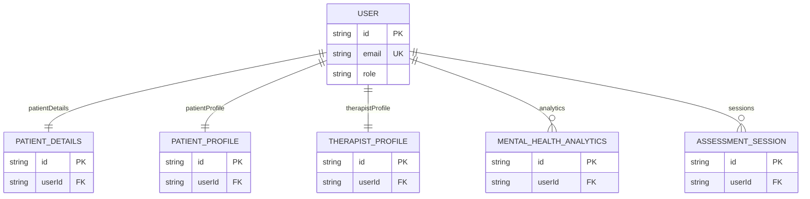

# Profile & Analytics Models

<cite>
**Referenced Files in This Document**
- [schema.prisma](file://WEBAPP/prisma/schema.prisma)
- [mentalHealthAnalytics.ts](file://WEBAPP/src/lib/mentalHealthAnalytics.ts)
- [analytics route.ts](file://WEBAPP/src/app/api/analytics/route.ts)
- [analytics assess route.ts](file://WEBAPP/src/app/api/analytics/assess/route.ts)
- [ChatInterface.tsx](file://WEBAPP/src/components/ChatInterface.tsx)
- [MentalHealthAnalytics.tsx](file://WEBAPP/src/components/MentalHealthAnalytics.tsx)
- [patient dashboard page.tsx](file://WEBAPP/src/app/patient/dashboard/page.tsx)
- [therapist dashboard page.tsx](file://WEBAPP/src/app/therapist/dashboard/page.tsx)
- [therapist patient-analytics page.tsx](file://WEBAPP/src/app/therapist/patient-analytics/page.tsx)
- [admin therapists route.ts](file://WEBAPP/src/app/admin/dashboard/page.tsx)
- [admin therapists api route.ts](file://WEBAPP/src/app/api/admin/therapists/route.ts)
- [complete-profile therapist route.ts](file://WEBAPP/src/app/api/auth/complete-profile/therapist/route.ts)
- [check-profile route.ts](file://WEBAPP/src/app/api/auth/check-profile/route.ts)
- [verification-pending page.tsx](file://WEBAPP/src/app/auth/verification-pending/page.tsx)
</cite>

## Table of Contents
1. [Introduction](#introduction)
2. [Project Structure](#project-structure)
3. [Core Components](#core-components)
4. [Architecture Overview](#architecture-overview)
5. [Detailed Component Analysis](#detailed-component-analysis)
6. [Dependency Analysis](#dependency-analysis)
7. [Performance Considerations](#performance-considerations)
8. [Troubleshooting Guide](#troubleshooting-guide)
9. [Conclusion](#conclusion)

## Introduction
This document provides comprehensive documentation for the profile and analytics models that power MindBridge’s patient and therapist workflows. It covers:
- PatientProfile: session tracking, emotional analytics, progress trends, and user insights
- PatientDetails: initial registration data capture including demographics and health information
- TherapistProfile: professional credentials, verification workflow, and administrative approval tracking
- MentalHealthAnalytics: daily mental health assessments, keyword detection, sentiment analysis, and risk flagging
- AssessmentSession: structured screening assessments with scoring algorithms and results tracking

The documentation includes field-level coverage, JSON structures, scoring mechanisms, and analytical calculations, along with practical diagrams and references to the source code.

## Project Structure
The relevant models are defined in the Prisma schema and backed by API routes and client components:
- Prisma schema defines the database models and relationships
- API routes implement analytics computation, assessment scoring, and profile updates
- Client components render dashboards and collect assessment inputs

**Diagram sources**
- [schema.prisma](file://WEBAPP/prisma/schema.prisma#L39-L69)
- [schema.prisma](file://WEBAPP/prisma/schema.prisma#L213-L227)
- [schema.prisma](file://WEBAPP/prisma/schema.prisma#L229-L249)
- [schema.prisma](file://WEBAPP/prisma/schema.prisma#L251-L266)
- [schema.prisma](file://WEBAPP/prisma/schema.prisma#L282-L297)
- [schema.prisma](file://WEBAPP/prisma/schema.prisma#L299-L321)
- [analytics route.ts](file://WEBAPP/src/app/api/analytics/route.ts#L1-L161)
- [analytics assess route.ts](file://WEBAPP/src/app/api/analytics/assess/route.ts#L1-L121)
- [admin therapists api route.ts](file://WEBAPP/src/app/api/admin/therapists/route.ts#L1-L93)
- [check-profile route.ts](file://WEBAPP/src/app/api/auth/check-profile/route.ts#L1-L52)

**Section sources**
- [schema.prisma](file://WEBAPP/prisma/schema.prisma#L39-L69)
- [analytics route.ts](file://WEBAPP/src/app/api/analytics/route.ts#L1-L161)
- [analytics assess route.ts](file://WEBAPP/src/app/api/analytics/assess/route.ts#L1-L121)

## Core Components
This section documents each model with its fields, relationships, and typical usage patterns.

- PatientProfile
  - Purpose: Track patient engagement and mental health trends
  - Key fields: totalSessions, lastSessionDate, dominantEmotion, improvementTrend, notes
  - Relationships: One-to-one with User via patientProfile
  - Usage: Updated from therapy sessions and analytics
  - Example references:
    - [PatientProfile definition](file://WEBAPP/prisma/schema.prisma#L213-L227)
    - [Therapist dashboard aggregation](file://WEBAPP/src/app/therapist/patient-analytics/page.tsx#L45-L55)

- PatientDetails
  - Purpose: Capture initial registration demographics and basic health info
  - Key fields: fullName, dateOfBirth, gender, age, height, weight
  - Relationships: One-to-one with User via patientDetails
  - Usage: Created during first-time registration
  - Example references:
    - [PatientDetails definition](file://WEBAPP/prisma/schema.prisma#L282-L297)
    - [Registration flow](file://WEBAPP/src/app/api/auth/complete-profile/therapist/route.ts#L49-L76)

- TherapistProfile
  - Purpose: Store professional credentials and verification status
  - Key fields: fullName, dateOfBirth, gender, age, degree, experience, hospitalAffiliation, photoUrl, isVerified, verificationStatus, rejectionReason
  - Relationships: One-to-one with User via therapistProfile
  - Usage: Submitted by therapists, reviewed by admins
  - Example references:
    - [TherapistProfile definition](file://WEBAPP/prisma/schema.prisma#L299-L321)
    - [Admin verification workflow](file://WEBAPP/src/app/api/admin/therapists/route.ts#L20-L92)
    - [Verification status polling](file://WEBAPP/src/app/auth/verification-pending/page.tsx#L15-L52)

- MentalHealthAnalytics
  - Purpose: Daily computed analytics from chat messages
  - Key fields: date, mentalHealthLevel, levelLabel, keywordsDetected (JSON), keywordCounts (JSON), totalMessages, positiveCount, negativeCount, riskFlags (JSON), source
  - Relationships: Many-to-one with User
  - Usage: Generated from chat messages and assessments
  - Example references:
    - [MentalHealthAnalytics definition](file://WEBAPP/prisma/schema.prisma#L229-L249)
    - [Daily analysis endpoint](file://WEBAPP/src/app/api/analytics/route.ts#L195-L252)

- AssessmentSession
  - Purpose: Structured screening assessment with scoring
  - Key fields: totalScore, maxScore, mentalHealthLevel, levelLabel, answers (JSON array)
  - Relationships: Many-to-one with User
  - Usage: Created after completing the assessment flow
  - Example references:
    - [AssessmentSession definition](file://WEBAPP/prisma/schema.prisma#L251-L266)
    - [Assessment submission](file://WEBAPP/src/app/api/analytics/assess/route.ts#L25-L121)

**Section sources**
- [schema.prisma](file://WEBAPP/prisma/schema.prisma#L213-L227)
- [schema.prisma](file://WEBAPP/prisma/schema.prisma#L229-L249)
- [schema.prisma](file://WEBAPP/prisma/schema.prisma#L251-L266)
- [schema.prisma](file://WEBAPP/prisma/schema.prisma#L282-L297)
- [schema.prisma](file://WEBAPP/prisma/schema.prisma#L299-L321)
- [analytics route.ts](file://WEBAPP/src/app/api/analytics/route.ts#L195-L252)
- [analytics assess route.ts](file://WEBAPP/src/app/api/analytics/assess/route.ts#L25-L121)
- [admin therapists api route.ts](file://WEBAPP/src/app/api/admin/therapists/route.ts#L20-L92)
- [check-profile route.ts](file://WEBAPP/src/app/api/auth/check-profile/route.ts#L19-L47)

## Architecture Overview
The analytics pipeline integrates chat analysis, assessment scoring, and profile insights across the frontend and backend.

**Diagram sources**
- [analytics route.ts](file://WEBAPP/src/app/api/analytics/route.ts#L13-L161)
- [analytics route.ts](file://WEBAPP/src/app/api/analytics/route.ts#L195-L252)
- [analytics assess route.ts](file://WEBAPP/src/app/api/analytics/assess/route.ts#L25-L121)
- [mentalHealthAnalytics.ts](file://WEBAPP/src/lib/mentalHealthAnalytics.ts#L294-L350)

## Detailed Component Analysis

### PatientProfile
- Fields and semantics
  - totalSessions: cumulative count of therapy sessions
  - lastSessionDate: timestamp of the most recent session
  - dominantEmotion: derived emotion category from chat/emotion analytics
  - improvementTrend: computed trend from analytics history ("up", "down", "stable")
  - notes: optional free-text insights
- Data sources
  - Sessions and emotion summaries feed into profile updates
  - Analytics history contributes to trend computations
- Typical usage
  - Aggregated in therapist dashboards for patient overview
  - Used to compute weekly progress and activity metrics in the patient dashboard

**Diagram sources**
- [schema.prisma](file://WEBAPP/prisma/schema.prisma#L213-L227)
- [analytics route.ts](file://WEBAPP/src/app/api/analytics/route.ts#L90-L95)
- [patient dashboard page.tsx](file://WEBAPP/src/app/patient/dashboard/page.tsx#L211-L231)

**Section sources**
- [schema.prisma](file://WEBAPP/prisma/schema.prisma#L213-L227)
- [analytics route.ts](file://WEBAPP/src/app/api/analytics/route.ts#L90-L95)
- [patient dashboard page.tsx](file://WEBAPP/src/app/patient/dashboard/page.tsx#L211-L231)

### PatientDetails
- Fields and semantics
  - fullName, dateOfBirth, gender, age: demographic identifiers
  - height, weight: optional health metrics captured during registration
- Data capture
  - Fetched and stored upon first-time registration
  - Linked to User via patientDetails relation
- Typical usage
  - Displayed in dashboards and reports
  - Used for personalized analytics and reminders

**Diagram sources**
- [schema.prisma](file://WEBAPP/prisma/schema.prisma#L39-L69)
- [schema.prisma](file://WEBAPP/prisma/schema.prisma#L282-L297)

**Section sources**
- [schema.prisma](file://WEBAPP/prisma/schema.prisma#L282-L297)

### TherapistProfile
- Fields and semantics
  - Professional: fullName, dateOfBirth, gender, age, degree, experience, hospitalAffiliation, photoUrl
  - Verification: isVerified, verificationStatus ("pending", "approved", "rejected"), rejectionReason
- Workflow
  - Submission: therapist completes profile and submits for verification
  - Admin review: admin approves or rejects with optional reason
  - Status polling: therapist checks verification status until resolved
- Typical usage
  - Visible in admin panel for moderation
  - Used to filter eligible therapists for scheduling

**Diagram sources**
- [complete-profile therapist route.ts](file://WEBAPP/src/app/api/auth/complete-profile/therapist/route.ts#L49-L82)
- [admin therapists api route.ts](file://WEBAPP/src/app/api/admin/therapists/route.ts#L20-L92)
- [check-profile route.ts](file://WEBAPP/src/app/api/auth/check-profile/route.ts#L19-L47)
- [verification-pending page.tsx](file://WEBAPP/src/app/auth/verification-pending/page.tsx#L15-L52)

**Section sources**
- [schema.prisma](file://WEBAPP/prisma/schema.prisma#L299-L321)
- [complete-profile therapist route.ts](file://WEBAPP/src/app/api/auth/complete-profile/therapist/route.ts#L49-L82)
- [admin therapists api route.ts](file://WEBAPP/src/app/api/admin/therapists/route.ts#L20-L92)
- [check-profile route.ts](file://WEBAPP/src/app/api/auth/check-profile/route.ts#L19-L47)
- [verification-pending page.tsx](file://WEBAPP/src/app/auth/verification-pending/page.tsx#L15-L52)

### MentalHealthAnalytics
- Purpose and fields
  - Daily analytics computed from user chat messages
  - mentalHealthLevel (1–5), levelLabel, keywordsDetected (JSON), keywordCounts (JSON), totalMessages, positiveCount, negativeCount, riskFlags (JSON), source ("chat" or "assessment")
- Computation
  - Keyword detection across categories (stress, anxiety, depression, anger, self-harm, loneliness, positive)
  - Risk flags: self-harm mention, crisis language, comorbid indicators
  - Sentiment analysis and lexical diversity for deeper insights
  - Trend computation from historical levels
- API integration
  - GET /api/analytics: returns timeline, current level, trend, keyword counts, and latest entries
  - POST /api/analytics: triggers a fresh analysis of recent messages and persists results

**Diagram sources**
- [mentalHealthAnalytics.ts](file://WEBAPP/src/lib/mentalHealthAnalytics.ts#L199-L289)
- [mentalHealthAnalytics.ts](file://WEBAPP/src/lib/mentalHealthAnalytics.ts#L294-L303)
- [analytics route.ts](file://WEBAPP/src/app/api/analytics/route.ts#L195-L252)
- [analytics route.ts](file://WEBAPP/src/app/api/analytics/route.ts#L39-L161)

**Section sources**
- [schema.prisma](file://WEBAPP/prisma/schema.prisma#L229-L249)
- [mentalHealthAnalytics.ts](file://WEBAPP/src/lib/mentalHealthAnalytics.ts#L199-L289)
- [mentalHealthAnalytics.ts](file://WEBAPP/src/lib/mentalHealthAnalytics.ts#L294-L303)
- [analytics route.ts](file://WEBAPP/src/app/api/analytics/route.ts#L39-L161)

### AssessmentSession
- Purpose and fields
  - Structured screening assessment (e.g., PHQ-9/GAD-7 inspired)
  - totalScore, maxScore, mentalHealthLevel, levelLabel, answers (JSON array of questionId, question, answer, score)
- Scoring mechanism
  - Sum of selected scores; categorical breakdown; escalation rules (e.g., high self-harm score raises minimum level)
- API integration
  - GET /api/analytics/assess: returns questions and answer options
  - POST /api/analytics/assess: validates answers, computes score, persists AssessmentSession and a corresponding MentalHealthAnalytics entry

**Diagram sources**
- [analytics assess route.ts](file://WEBAPP/src/app/api/analytics/assess/route.ts#L9-L16)
- [analytics assess route.ts](file://WEBAPP/src/app/api/analytics/assess/route.ts#L25-L121)
- [mentalHealthAnalytics.ts](file://WEBAPP/src/lib/mentalHealthAnalytics.ts#L308-L350)

**Section sources**
- [schema.prisma](file://WEBAPP/prisma/schema.prisma#L251-L266)
- [analytics assess route.ts](file://WEBAPP/src/app/api/analytics/assess/route.ts#L9-L16)
- [analytics assess route.ts](file://WEBAPP/src/app/api/analytics/assess/route.ts#L25-L121)
- [mentalHealthAnalytics.ts](file://WEBAPP/src/lib/mentalHealthAnalytics.ts#L308-L350)

## Dependency Analysis
This section maps the relationships among models and the APIs that operate on them.

**Diagram sources**
- [schema.prisma](file://WEBAPP/prisma/schema.prisma#L39-L69)
- [schema.prisma](file://WEBAPP/prisma/schema.prisma#L213-L227)
- [schema.prisma](file://WEBAPP/prisma/schema.prisma#L229-L249)
- [schema.prisma](file://WEBAPP/prisma/schema.prisma#L251-L266)
- [schema.prisma](file://WEBAPP/prisma/schema.prisma#L282-L297)
- [schema.prisma](file://WEBAPP/prisma/schema.prisma#L299-L321)

**Section sources**
- [schema.prisma](file://WEBAPP/prisma/schema.prisma#L39-L69)

## Performance Considerations
- Keyword and sentiment analysis run client-side for responsiveness; consider caching results and debouncing frequent refreshes
- Trend computations rely on aggregated levels; batch updates to reduce repeated computations
- API endpoints limit analysis windows (e.g., last 7 days for chat) to keep queries efficient
- Use of JSON fields enables flexible analytics but requires careful indexing and validation

## Troubleshooting Guide
- Unauthorized access
  - Ensure session exists and user email is present for analytics endpoints
  - Verify admin JWT secret and bearer token for admin endpoints
- Missing or invalid answers
  - Assessment API validates answer arrays and score ranges; confirm client sends expected payload
- No recent messages for analysis
  - Refresh endpoint returns a message indicating zero recent texts; ensure user has engaged in conversations
- Verification status not updating
  - Poll the check-profile endpoint and verify admin actions; confirm rejection reason is recorded

**Section sources**
- [analytics route.ts](file://WEBAPP/src/app/api/analytics/route.ts#L14-L25)
- [analytics route.ts](file://WEBAPP/src/app/api/analytics/route.ts#L166-L189)
- [analytics assess route.ts](file://WEBAPP/src/app/api/analytics/assess/route.ts#L42-L61)
- [check-profile route.ts](file://WEBAPP/src/app/api/auth/check-profile/route.ts#L19-L47)
- [admin therapists api route.ts](file://WEBAPP/src/app/api/admin/therapists/route.ts#L8-L18)

## Conclusion
MindBridge’s profile and analytics models form a cohesive system for tracking patient engagement, deriving actionable insights from chat and assessments, and supporting therapist and admin workflows. The schema enforces strong relationships, while the API routes and client components deliver real-time analytics and structured assessment capabilities. By leveraging keyword detection, sentiment analysis, and trend computations, the platform provides both quantitative metrics and qualitative insights to support mental health monitoring and intervention.