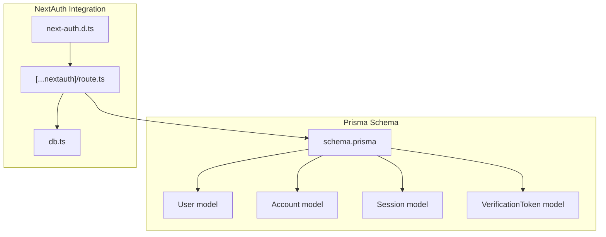
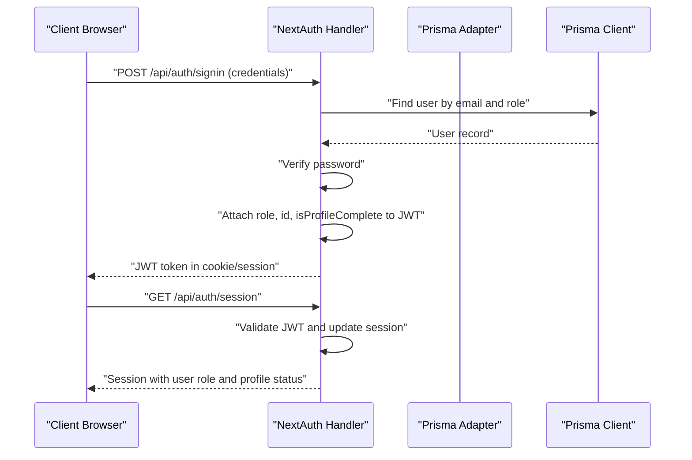
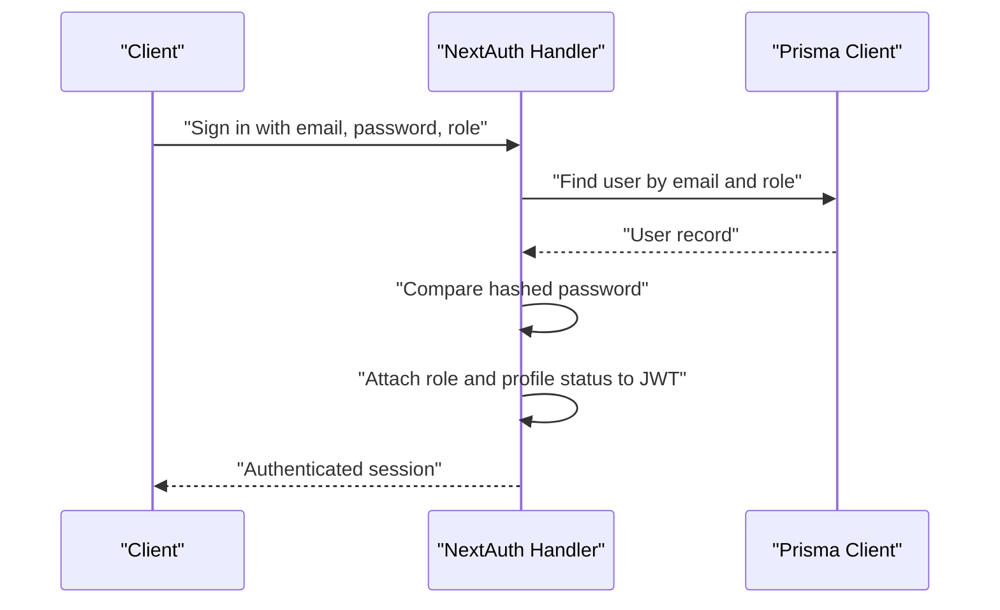
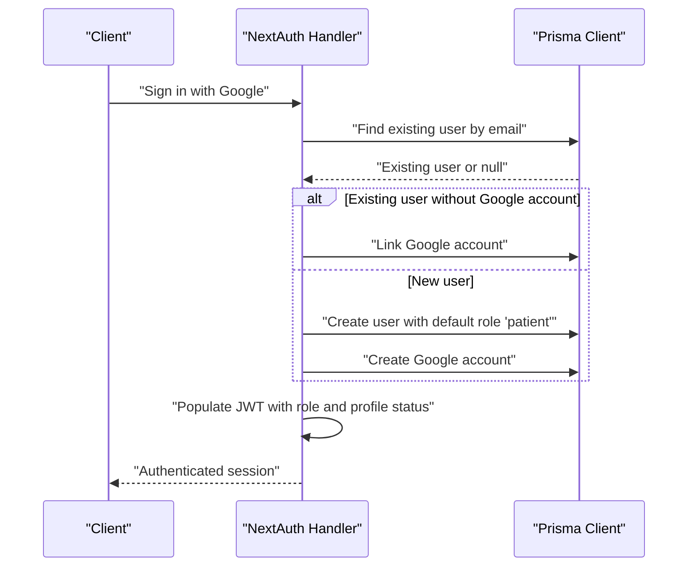
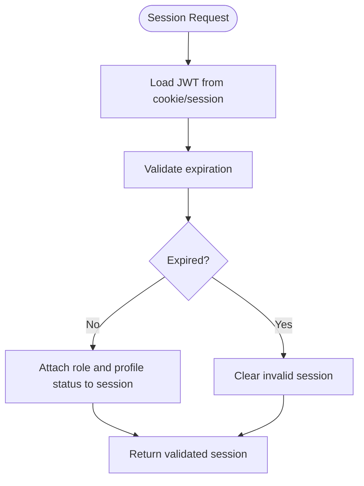
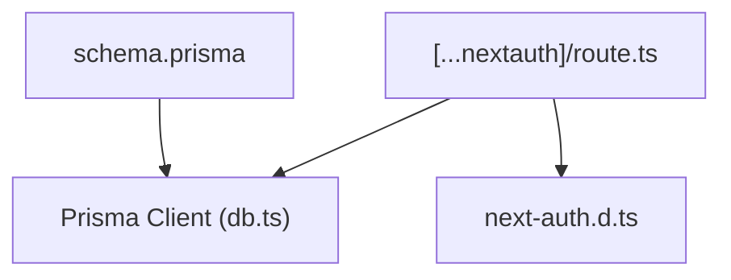

# User Management Models

<cite>
**Referenced Files in This Document**
- [schema.prisma](file://WEBAPP/prisma/schema.prisma)
- [db.ts](file://WEBAPP/src/lib/db.ts)
- [next-auth.d.ts](file://WEBAPP/src/types/next-auth.d.ts)
- [[...nextauth]/route.ts](file://WEBAPP/src/app/api/auth/[...nextauth]/route.ts)
</cite>

## Table of Contents
1. [Introduction](#introduction)
2. [Project Structure](#project-structure)
3. [Core Components](#core-components)
4. [Architecture Overview](#architecture-overview)
5. [Detailed Component Analysis](#detailed-component-analysis)
6. [Dependency Analysis](#dependency-analysis)
7. [Performance Considerations](#performance-considerations)
8. [Troubleshooting Guide](#troubleshooting-guide)
9. [Conclusion](#conclusion)

## Introduction
This document provides comprehensive documentation for the user management models in the MindBridge application. It focuses on four core models: User, Account, Session, and VerificationToken. The documentation covers field-level definitions, constraints, defaults, relationships, and how these models integrate with NextAuth for authentication and session management. It also explains role-based access control (patient, therapist, admin), profile completion tracking, OAuth integrations via provider-specific fields and tokens, session token uniqueness and expiration handling, and email verification workflows using verification tokens.

## Project Structure
The user management models are defined in the Prisma schema and integrated with NextAuth in the web application. The Prisma client is initialized in the application and used by NextAuth to persist and manage authentication-related data.

**Diagram sources**
- [schema.prisma](file://WEBAPP/prisma/schema.prisma#L11-L77)
- [[...nextauth]/route.ts](file://WEBAPP/src/app/api/auth/[...nextauth]/route.ts#L1-L240)
- [next-auth.d.ts](file://WEBAPP/src/types/next-auth.d.ts#L1-L28)
- [db.ts](file://WEBAPP/src/lib/db.ts#L1-L15)

**Section sources**
- [schema.prisma](file://WEBAPP/prisma/schema.prisma#L11-L77)
- [db.ts](file://WEBAPP/src/lib/db.ts#L1-L15)
- [[...nextauth]/route.ts](file://WEBAPP/src/app/api/auth/[...nextauth]/route.ts#L1-L240)
- [next-auth.d.ts](file://WEBAPP/src/types/next-auth.d.ts#L1-L28)

## Core Components
This section documents the four primary models used for user management and authentication.

- User
  - Purpose: Central identity and profile holder with role-based access control and profile completion tracking.
  - Key fields:
    - id: Unique identifier.
    - name: Optional display name.
    - email: Unique email address.
    - emailVerified: Timestamp for verified emails.
    - password: Hashed password for credential-based login.
    - role: Role value with default "patient". Allowed values include "patient", "therapist", and "admin".
    - image: Optional profile image stored as long text.
    - isProfileComplete: Boolean flag indicating whether initial registration information is filled.
    - isBanned: Boolean flag to prevent login access.
    - createdAt: Timestamp for account creation.
  - Relationships:
    - One-to-many with Account and Session.
    - Optional one-to-one with PatientDetails and TherapistProfile.
    - Many-to-many-like relations via TherapySession and Appointment for therapy roles.
    - One-to-one with PatientProfile and one-to-many with MentalHealthAnalytics, AssessmentSession, and OtpToken.

- Account
  - Purpose: OAuth integration storage for providers such as Google.
  - Key fields:
    - id: Unique identifier.
    - userId: Foreign key to User.
    - type: Type of account (e.g., "oauth").
    - provider: OAuth provider name (e.g., "google").
    - providerAccountId: Provider-specific user identifier.
    - refresh_token, access_token: Tokens managed by the provider.
    - expires_at: Expiration timestamp for tokens.
    - token_type, scope, id_token, session_state: Provider-specific fields.
  - Constraints:
    - Unique constraint on provider and providerAccountId to prevent duplicates.
  - Relationship: Belongs to User.

- Session
  - Purpose: NextAuth session management using JWT strategy with sessionToken uniqueness and expiration handling.
  - Key fields:
    - id: Unique identifier.
    - sessionToken: Unique session token.
    - userId: Foreign key to User.
    - expires: Expiration timestamp for the session.
  - Constraints:
    - sessionToken is unique.
  - Relationship: Belongs to User.

- VerificationToken
  - Purpose: Email verification workflow support with unique tokens and expiration.
  - Key fields:
    - identifier: Identifier for the verification (e.g., email address).
    - token: Unique token value.
    - expires: Expiration timestamp for the token.
  - Constraints:
    - token is unique.
    - Composite unique index on identifier and token.
  - Usage: Typically used for email verification and password reset flows.

Field-level documentation highlights:
- Data types: Strings, integers, booleans, timestamps, JSON fields for provider-specific data and analytics metadata.
- Defaults: Role defaults to "patient"; profile completion defaults to false; creation timestamps default to current time; ban flag defaults to false.
- Relationships: Defined via Prisma relations and foreign keys; cascading deletes apply for dependent records.

**Section sources**
- [schema.prisma](file://WEBAPP/prisma/schema.prisma#L11-L77)

## Architecture Overview
The authentication and user management architecture integrates Prisma ORM with NextAuth. NextAuth uses a Prisma adapter to persist user identities, OAuth accounts, sessions, and verification tokens. The JWT strategy manages session lifetimes and stores user attributes such as role and profile completion status.

**Diagram sources**
- [[...nextauth]/route.ts](file://WEBAPP/src/app/api/auth/[...nextauth]/route.ts#L62-L97)
- [[...nextauth]/route.ts](file://WEBAPP/src/app/api/auth/[...nextauth]/route.ts#L174-L213)
- [db.ts](file://WEBAPP/src/lib/db.ts#L1-L15)

**Section sources**
- [[...nextauth]/route.ts](file://WEBAPP/src/app/api/auth/[...nextauth]/route.ts#L8-L240)
- [db.ts](file://WEBAPP/src/lib/db.ts#L1-L15)

## Detailed Component Analysis

### User Model
The User model encapsulates identity, authentication, roles, and profile state. It supports three roles: patient, therapist, and admin. Profile completion is tracked to guide onboarding flows. The model includes numerous relations to therapy, chat, and analytics features.

Key capabilities:
- Role-based access control: role field determines access to features and pages.
- Profile completion tracking: isProfileComplete flag enables redirecting users to profile completion steps.
- Authentication fields: email and password for credential-based login; emailVerified for verification status.
- Relations: links to Account and Session for authentication; optional PatientDetails and TherapistProfile for onboarding; extensive therapy and analytics relations.

Typical data structures:
- Minimal user: id, email, role, isProfileComplete.
- Full user: includes name, image, timestamps, and all related entities.

Integration points:
- NextAuth callbacks populate JWT and session with role and profile completion status.
- Prisma queries filter by role during credential-based sign-in.

**Section sources**
- [schema.prisma](file://WEBAPP/prisma/schema.prisma#L39-L69)
- [[...nextauth]/route.ts](file://WEBAPP/src/app/api/auth/[...nextauth]/route.ts#L69-L96)
- [next-auth.d.ts](file://WEBAPP/src/types/next-auth.d.ts#L3-L19)

### Account Model
The Account model stores OAuth provider credentials and tokens. It ensures uniqueness per provider/providerAccountId to avoid duplicate linking. Fields include provider-specific tokens and metadata.

Key capabilities:
- OAuth linkage: Links external provider accounts to internal users.
- Token management: Stores refresh/access tokens and expiration timestamps.
- Provider metadata: Captures token_type, scope, id_token, and session_state.

Typical data structures:
- OAuth account: provider, providerAccountId, access_token, refresh_token, expires_at, token_type, scope, id_token, session_state.

Integration points:
- NextAuth signIn callback creates or links accounts for Google sign-in.
- Prisma adapter persists account records for provider-based authentication.

**Section sources**
- [schema.prisma](file://WEBAPP/prisma/schema.prisma#L12-L29)
- [[...nextauth]/route.ts](file://WEBAPP/src/app/api/auth/[...nextauth]/route.ts#L100-L171)

### Session Model
The Session model manages NextAuth sessions using JWT strategy. sessionToken is unique and expires according to configured maxAge and updateAge policies. Sessions are tied to users and cascade deletions when users are removed.

Key capabilities:
- Unique session tokens: Ensures single active session per token.
- Expiration handling: Controlled by session strategy settings.
- User association: Links sessions to users for access control.

Typical data structures:
- Session: sessionToken, userId, expires.

Integration points:
- NextAuth session strategy uses JWT with maxAge and updateAge.
- Session callbacks attach user role and profile completion to session.

**Section sources**
- [schema.prisma](file://WEBAPP/prisma/schema.prisma#L31-L37)
- [[...nextauth]/route.ts](file://WEBAPP/src/app/api/auth/[...nextauth]/route.ts#L10-L14)
- [[...nextauth]/route.ts](file://WEBAPP/src/app/api/auth/[...nextauth]/route.ts#L205-L213)

### VerificationToken Model
The VerificationToken model supports email verification and password reset workflows. It ensures token uniqueness and enforces expiration to limit reuse windows.

Key capabilities:
- Unique tokens: token is unique across identifiers.
- Composite uniqueness: identifier and token combined must be unique.
- Expiration enforcement: expires timestamp controls validity window.

Typical data structures:
- Verification token: identifier, token, expires.

Integration points:
- Used in email verification and password reset flows to validate requests and enforce time limits.

**Section sources**
- [schema.prisma](file://WEBAPP/prisma/schema.prisma#L71-L77)

### Authentication Flows

#### Credential-Based Login

**Diagram sources**
- [[...nextauth]/route.ts](file://WEBAPP/src/app/api/auth/[...nextauth]/route.ts#L62-L97)
- [[...nextauth]/route.ts](file://WEBAPP/src/app/api/auth/[...nextauth]/route.ts#L174-L213)

#### Google OAuth Sign-In

**Diagram sources**
- [[...nextauth]/route.ts](file://WEBAPP/src/app/api/auth/[...nextauth]/route.ts#L100-L171)
- [[...nextauth]/route.ts](file://WEBAPP/src/app/api/auth/[...nextauth]/route.ts#L174-L213)

#### Session Access and Validation

**Diagram sources**
- [[...nextauth]/route.ts](file://WEBAPP/src/app/api/auth/[...nextauth]/route.ts#L196-L203)
- [[...nextauth]/route.ts](file://WEBAPP/src/app/api/auth/[...nextauth]/route.ts#L205-L213)

## Dependency Analysis
The user management models depend on Prisma for persistence and NextAuth for authentication orchestration. The Prisma client is initialized once and reused across the application.

**Diagram sources**
- [schema.prisma](file://WEBAPP/prisma/schema.prisma#L1-L9)
- [db.ts](file://WEBAPP/src/lib/db.ts#L1-L15)
- [[...nextauth]/route.ts](file://WEBAPP/src/app/api/auth/[...nextauth]/route.ts#L1-L6)

**Section sources**
- [schema.prisma](file://WEBAPP/prisma/schema.prisma#L1-L9)
- [db.ts](file://WEBAPP/src/lib/db.ts#L1-L15)
- [[...nextauth]/route.ts](file://WEBAPP/src/app/api/auth/[...nextauth]/route.ts#L1-L6)

## Performance Considerations
- Indexes on frequently queried fields (e.g., email, provider/providerAccountId, sessionToken, token) improve lookup performance.
- JWT strategy reduces database round-trips for session validation compared to database-backed sessions.
- Cascading deletes ensure referential integrity while preventing orphaned records.
- Token expiration and session maxAge/updateAge reduce stale session overhead.

## Troubleshooting Guide
Common issues and resolutions:
- Duplicate OAuth account linking: Ensure provider/providerAccountId uniqueness to prevent duplicates.
- Banned user login attempts: Credential-based sign-in explicitly rejects banned users.
- Expired JWT handling: Server-side checks log expired tokens; clients should refresh or re-authenticate.
- Session validation failures: Verify secure cookie settings and proxy configurations for proper cookie handling.

**Section sources**
- [[...nextauth]/route.ts](file://WEBAPP/src/app/api/auth/[...nextauth]/route.ts#L83-L84)
- [[...nextauth]/route.ts](file://WEBAPP/src/app/api/auth/[...nextauth]/route.ts#L196-L201)
- [[...nextauth]/route.ts](file://WEBAPP/src/app/api/auth/[...nextauth]/route.ts#L16-L46)

## Conclusion
The user management models provide a robust foundation for identity, authentication, and session handling. The User model supports role-based access control and profile completion tracking, while Account, Session, and VerificationToken models enable secure OAuth integrations, JWT-based sessions, and email verification workflows. NextAuth integrates seamlessly with Prisma to maintain data consistency and efficient access patterns.