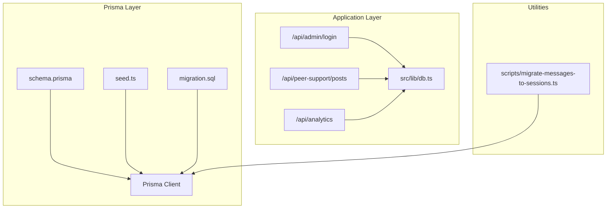
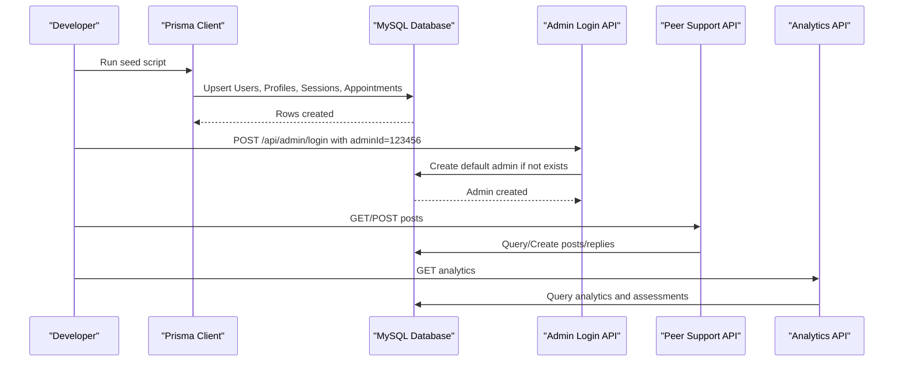
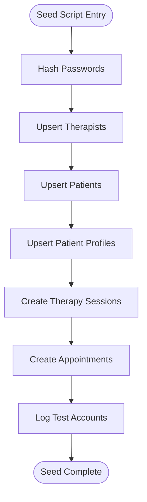
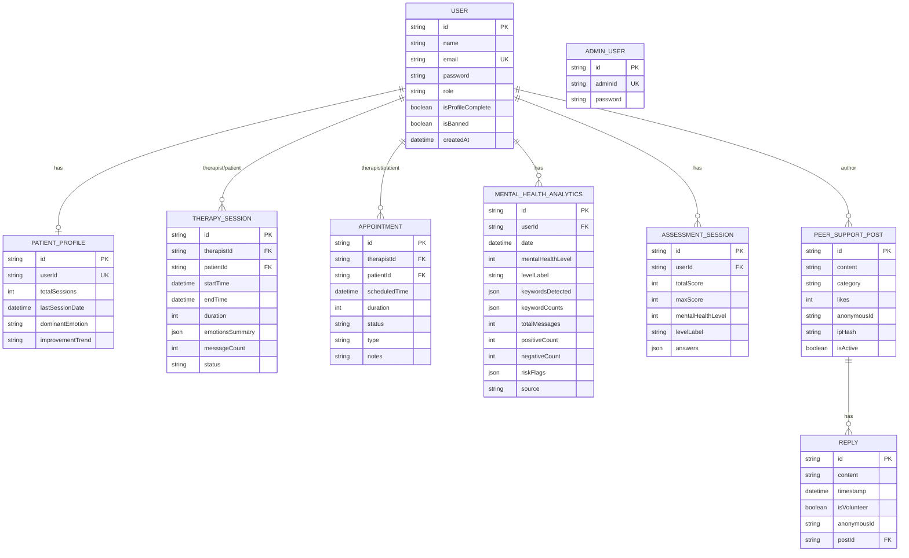
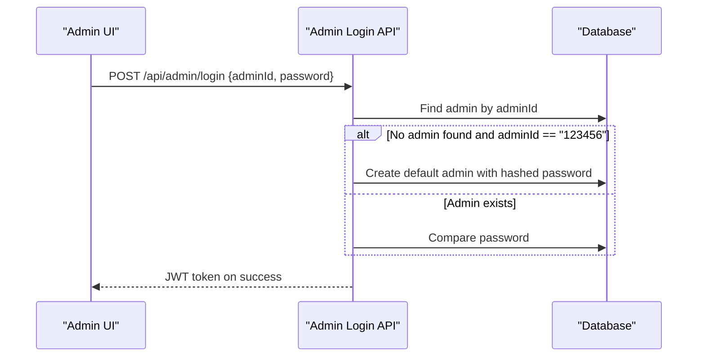
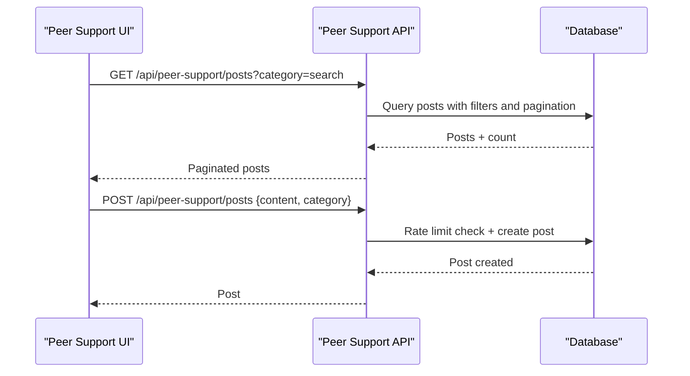
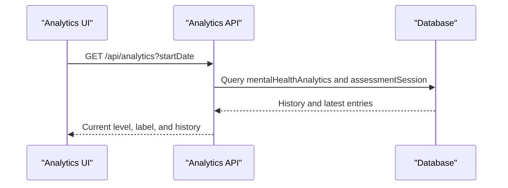
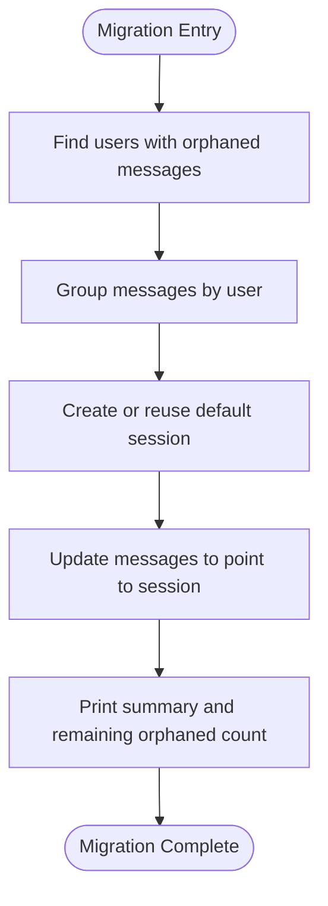
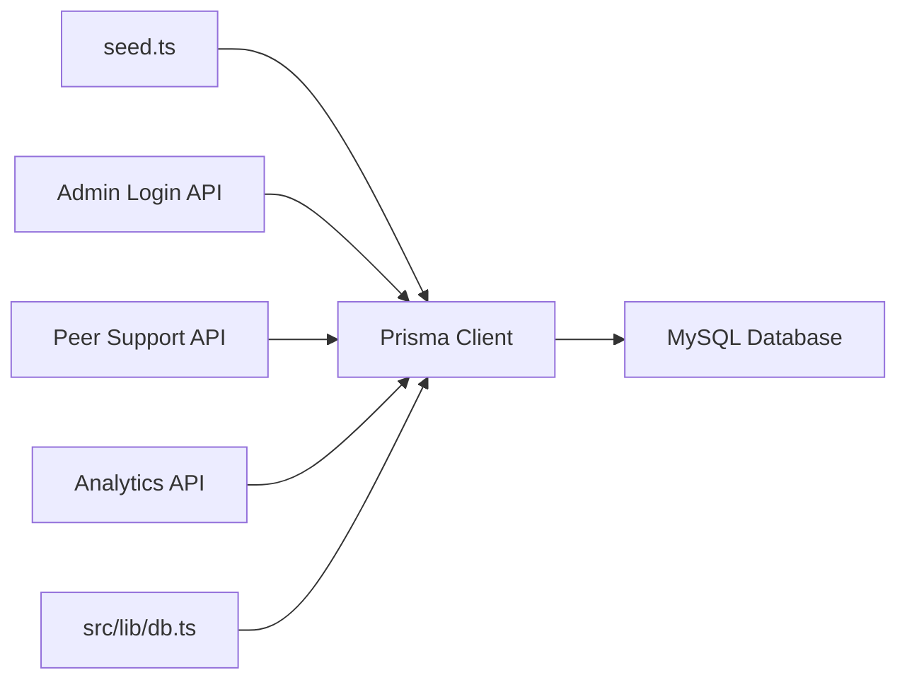

# Data Seeding

<cite>
**Referenced Files in This Document**
- [seed.ts](file://WEBAPP/prisma/seed.ts)
- [schema.prisma](file://WEBAPP/prisma/schema.prisma)
- [package.json](file://WEBAPP/package.json)
- [.env.example](file://WEBAPP/.env.example)
- [MY_SQL_INFO.md](file://WEBAPP/MY_SQL_INFO.md)
- [db.ts](file://WEBAPP/src/lib/db.ts)
- [login.route.ts](file://WEBAPP/src/app/api/admin/login/route.ts)
- [page.tsx](file://WEBAPP/src/app/admin/page.tsx)
- [route.ts](file://WEBAPP/src/app/api/peer-support/posts/route.ts)
- [route.ts](file://WEBAPP/src/app/api/analytics/route.ts)
- [mentalHealthAnalytics.ts](file://WEBAPP/src/lib/mentalHealthAnalytics.ts)
- [migrate-messages-to-sessions.ts](file://WEBAPP/scripts/migrate-messages-to-sessions.ts)
- [migration.sql](file://WEBAPP/prisma/migrations/20251105192017_add_therapy_models/migration.sql)
</cite>

## Table of Contents
1. [Introduction](#introduction)
2. [Project Structure](#project-structure)
3. [Core Components](#core-components)
4. [Architecture Overview](#architecture-overview)
5. [Detailed Component Analysis](#detailed-component-analysis)
6. [Dependency Analysis](#dependency-analysis)
7. [Performance Considerations](#performance-considerations)
8. [Troubleshooting Guide](#troubleshooting-guide)
9. [Conclusion](#conclusion)
10. [Appendices](#appendices)

## Introduction
This document explains the data seeding and initialization processes in MindBridge. It focuses on the seed.ts script that bootstraps development environments with initial users, roles, therapy sessions, appointments, analytics, and peer support content. It also covers how the admin user is created on first login, how to run the seed, and how to keep seed data aligned across environments while addressing security considerations for sensitive healthcare data.

## Project Structure
The seeding and initialization pipeline spans several parts of the repository:
- Prisma schema defines the database models and relationships.
- The seed script creates initial users, profiles, therapy sessions, and appointments.
- Admin login logic seeds a default admin account on first use.
- Peer support posts and replies are part of the seed content.
- Mental health analytics and assessment sessions are included to demonstrate analytics workflows.
- A migration script helps align legacy chat data to the new session model.

**Diagram sources**
- [schema.prisma](file://WEBAPP/prisma/schema.prisma#L1-L330)
- [seed.ts](file://WEBAPP/prisma/seed.ts#L1-L168)
- [login.route.ts](file://WEBAPP/src/app/api/admin/login/route.ts#L1-L74)
- [route.ts](file://WEBAPP/src/app/api/peer-support/posts/route.ts#L35-L131)
- [route.ts](file://WEBAPP/src/app/api/analytics/route.ts#L38-L76)
- [db.ts](file://WEBAPP/src/lib/db.ts#L1-L14)
- [migrate-messages-to-sessions.ts](file://WEBAPP/scripts/migrate-messages-to-sessions.ts#L1-L140)
- [migration.sql](file://WEBAPP/prisma/migrations/20251105192017_add_therapy_models/migration.sql#L1-L206)

**Section sources**
- [schema.prisma](file://WEBAPP/prisma/schema.prisma#L1-L330)
- [seed.ts](file://WEBAPP/prisma/seed.ts#L1-L168)
- [package.json](file://WEBAPP/package.json#L12-L14)
- [MY_SQL_INFO.md](file://WEBAPP/MY_SQL_INFO.md#L35-L75)

## Core Components
- Seed script: Creates therapists, patients, patient profiles, therapy sessions, and appointments. Logs test account credentials for convenience.
- Prisma schema: Defines models for users, therapy sessions, appointments, patient profiles, mental health analytics, assessment sessions, peer support posts, replies, and admin user.
- Admin login endpoint: Seeds a default admin (ID: 123456, password: 123456) on first login if no admin exists and the ID matches.
- Peer support API: Provides endpoints to list, create posts, and manage replies; supports rate limiting and spam prevention.
- Analytics API: Aggregates mental health analytics and assessment data for display.
- Migration script: Moves legacy chat messages into default sessions to align with the new session model.

**Section sources**
- [seed.ts](file://WEBAPP/prisma/seed.ts#L6-L168)
- [schema.prisma](file://WEBAPP/prisma/schema.prisma#L39-L329)
- [login.route.ts](file://WEBAPP/src/app/api/admin/login/route.ts#L27-L41)
- [route.ts](file://WEBAPP/src/app/api/peer-support/posts/route.ts#L35-L131)
- [route.ts](file://WEBAPP/src/app/api/analytics/route.ts#L38-L76)
- [migrate-messages-to-sessions.ts](file://WEBAPP/scripts/migrate-messages-to-sessions.ts#L34-L132)

## Architecture Overview
The seeding workflow integrates Prisma ORM with the application’s admin and peer support APIs. The seed script runs against the configured database URL and inserts initial rows. On first admin login, the admin endpoint seeds a default admin record. The peer support and analytics APIs rely on the seeded data to demonstrate functionality.

**Diagram sources**
- [seed.ts](file://WEBAPP/prisma/seed.ts#L6-L168)
- [login.route.ts](file://WEBAPP/src/app/api/admin/login/route.ts#L27-L41)
- [route.ts](file://WEBAPP/src/app/api/peer-support/posts/route.ts#L35-L131)
- [route.ts](file://WEBAPP/src/app/api/analytics/route.ts#L38-L76)

## Detailed Component Analysis

### Seed Script: Initial Data Population
The seed script performs the following actions:
- Creates multiple therapists with hashed passwords and role set to “therapist”.
- Creates multiple patients with hashed passwords and role set to “patient”.
- Upserts patient profiles with baseline metrics such as total sessions, dominant emotion, and improvement trend.
- Creates therapy sessions with timestamps, durations, statuses, and emotion summaries.
- Creates appointments with scheduled times, durations, statuses, and notes.
- Prints test account credentials for developers.

**Diagram sources**
- [seed.ts](file://WEBAPP/prisma/seed.ts#L6-L168)

**Section sources**
- [seed.ts](file://WEBAPP/prisma/seed.ts#L6-L168)

### Prisma Schema: Data Models and Relationships
The schema defines core models used by the seed:
- User: Base entity with role defaults to “patient”, includes NextAuth relations.
- PatientProfile: Per-user profile with analytics-related fields.
- TherapySession: Links therapists and patients with timing, status, and emotion summary.
- Appointment: Scheduling model with status and notes.
- MentalHealthAnalytics: Daily analytics with severity levels and keyword counts.
- AssessmentSession: Screening assessment results.
- PeerSupportPost and Reply: Community forum with categories and rate limiting.
- AdminUser: Dedicated admin account model.

**Diagram sources**
- [schema.prisma](file://WEBAPP/prisma/schema.prisma#L39-L329)

**Section sources**
- [schema.prisma](file://WEBAPP/prisma/schema.prisma#L39-L329)

### Admin Initialization on First Login
On the first admin login attempt with adminId “123456”, the admin login endpoint seeds a default admin record with a hashed password. Subsequent logins validate the stored credentials and issue a JWT token.

**Diagram sources**
- [login.route.ts](file://WEBAPP/src/app/api/admin/login/route.ts#L9-L74)
- [page.tsx](file://WEBAPP/src/app/admin/page.tsx#L15-L37)

**Section sources**
- [login.route.ts](file://WEBAPP/src/app/api/admin/login/route.ts#L27-L41)

### Peer Support Content Generation
The seed script contributes to peer support by creating posts and replies through the API. The API enforces rate limits and spam prevention, and supports filtering and searching.

**Diagram sources**
- [route.ts](file://WEBAPP/src/app/api/peer-support/posts/route.ts#L35-L131)

**Section sources**
- [route.ts](file://WEBAPP/src/app/api/peer-support/posts/route.ts#L35-L131)

### Analytics and Assessment Data
The analytics API aggregates mental health analytics and assessment sessions to compute current levels and trends. The seed script provides baseline data to demonstrate analytics workflows.

**Diagram sources**
- [route.ts](file://WEBAPP/src/app/api/analytics/route.ts#L38-L76)
- [mentalHealthAnalytics.ts](file://WEBAPP/src/lib/mentalHealthAnalytics.ts#L199-L289)

**Section sources**
- [route.ts](file://WEBAPP/src/app/api/analytics/route.ts#L38-L76)
- [mentalHealthAnalytics.ts](file://WEBAPP/src/lib/mentalHealthAnalytics.ts#L199-L289)

### Legacy Data Migration to Sessions
A dedicated migration script moves orphaned chat messages into default sessions to align with the new session model.

**Diagram sources**
- [migrate-messages-to-sessions.ts](file://WEBAPP/scripts/migrate-messages-to-sessions.ts#L34-L132)

**Section sources**
- [migrate-messages-to-sessions.ts](file://WEBAPP/scripts/migrate-messages-to-sessions.ts#L34-L132)

## Dependency Analysis
- The seed script depends on Prisma Client and bcrypt hashing for secure credential storage.
- The admin login endpoint depends on Prisma and JWT signing for session tokens.
- The peer support API depends on Prisma for data persistence and rate-limiting logic.
- The analytics API depends on Prisma and the mental health analytics library for computations.
- The database connection is centralized via a shared Prisma client.

**Diagram sources**
- [seed.ts](file://WEBAPP/prisma/seed.ts#L1-L4)
- [login.route.ts](file://WEBAPP/src/app/api/admin/login/route.ts#L1-L5)
- [route.ts](file://WEBAPP/src/app/api/peer-support/posts/route.ts#L1-L5)
- [route.ts](file://WEBAPP/src/app/api/analytics/route.ts#L1-L5)
- [db.ts](file://WEBAPP/src/lib/db.ts#L1-L14)

**Section sources**
- [seed.ts](file://WEBAPP/prisma/seed.ts#L1-L4)
- [db.ts](file://WEBAPP/src/lib/db.ts#L1-L14)

## Performance Considerations
- Seed script operations use upserts and creates; batching is not implemented. For large datasets, consider grouping operations to reduce round-trips.
- Hashing passwords during seeding is CPU-intensive; ensure adequate resources during development.
- Analytics computations rely on keyword matching and sentiment analysis; precompute or cache results for frequently accessed users.
- Peer support rate limiting prevents abuse but may impact user experience under load; tune thresholds as needed.

[No sources needed since this section provides general guidance]

## Troubleshooting Guide
- Database connectivity issues: Ensure MySQL is running and DATABASE_URL is correct in the environment.
- Prisma client generation errors: Run Prisma generate and restart the development server.
- Seed script failures: Confirm Prisma client is generated and the database is initialized before seeding.
- Admin login fails: Verify adminId and password; on first login with adminId “123456”, the endpoint seeds a default admin.

**Section sources**
- [MY_SQL_INFO.md](file://WEBAPP/MY_SQL_INFO.md#L97-L118)
- [package.json](file://WEBAPP/package.json#L12-L14)
- [login.route.ts](file://WEBAPP/src/app/api/admin/login/route.ts#L43-L57)

## Conclusion
MindBridge’s seeding and initialization pipeline provides a robust foundation for development by creating realistic users, therapy sessions, appointments, analytics, and peer support content. The admin login endpoint seeds a default admin on first use, and the peer support and analytics APIs demonstrate real-world workflows. Use the migration script to align legacy data with the new session model. For production, apply environment-specific seed strategies and adhere to strict security and privacy controls for healthcare data.

[No sources needed since this section summarizes without analyzing specific files]

## Appendices

### Seed Data Structures and Roles
- Users: Role defaults to “patient”; therapists and patients are created with hashed passwords.
- Patient Profiles: Contain total sessions, dominant emotion, and improvement trend.
- Therapy Sessions: Include start/end times, duration, status, and emotion summaries.
- Appointments: Include scheduled time, duration, status, and notes.
- Admin User: Default admin seeded on first login with adminId “123456”.

**Section sources**
- [schema.prisma](file://WEBAPP/prisma/schema.prisma#L39-L329)
- [seed.ts](file://WEBAPP/prisma/seed.ts#L10-L168)
- [login.route.ts](file://WEBAPP/src/app/api/admin/login/route.ts#L32-L41)

### Running the Seed and Setup
- Configure DATABASE_URL in the environment.
- Generate Prisma client and initialize the database schema.
- Run the seed script to populate initial data.

**Section sources**
- [.env.example](file://WEBAPP/.env.example#L1-L16)
- [MY_SQL_INFO.md](file://WEBAPP/MY_SQL_INFO.md#L35-L75)
- [package.json](file://WEBAPP/package.json#L12-L14)

### Security Considerations for Healthcare Data
- Use strong secrets for NEXTAUTH_SECRET and admin JWT secret.
- Avoid storing real patient data in development seeds; use anonymized placeholders.
- Enforce rate limits and spam prevention in community features.
- Encrypt sensitive fields at rest and in transit.
- Regularly rotate secrets and review access logs.

[No sources needed since this section provides general guidance]